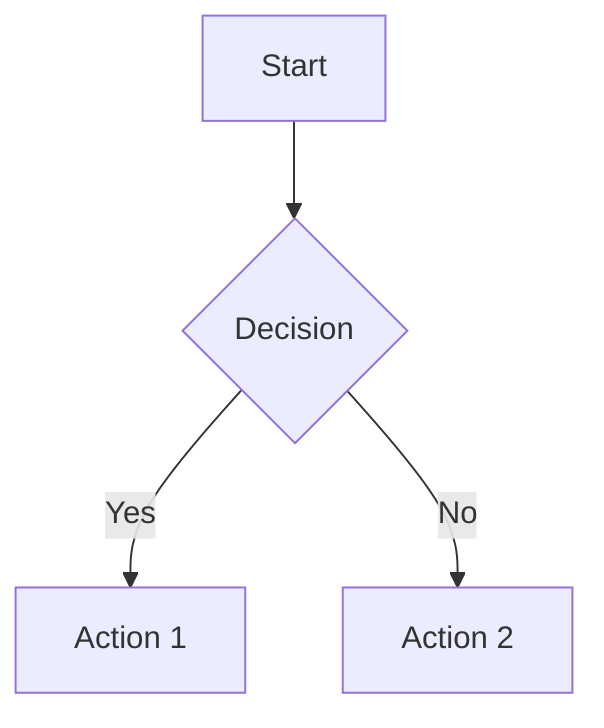

# Mermaid Chart Usage Guide

Posts write diagrams in **Mermaid syntax**. The site renders them with
**[Pele](https://pele.run)** ([obsidianmd/pele](https://github.com/obsidianmd/pele)). Pele is a
small, dependency-free renderer that reads Mermaid syntax and outputs SVG you can theme with CSS
variables. It replaced Mermaid.js and svg-pan-zoom.

## How to Use Mermaid in Posts

Use a code fence with the `mermaid` language identifier:

````markdown

````

The diagram renders when the page loads.

## Implementation

| File | Role |
| --- | --- |
| `_layouts/default.html` | Loads `assets/js/mermaid-pele.js` as a module |
| `assets/js/mermaid-pele.js` | Finds ` ```mermaid ` blocks, mounts them with Pele, and adds the ⛶ 전체화면 viewer |
| `assets/css/style.css` (`MERMAID DIAGRAMS` section) | Maps `--pele-*` to the site's design tokens and styles the frame, the button and the fullscreen dialog |

### How it works

1. Kramdown turns the fence into `<pre><code class="language-mermaid">`.
2. `mermaid-pele.js` checks whether the page has any such block. If it does, it imports Pele's
   lazy ESM entry from jsDelivr. The version is pinned (`pele@1.8.0`) because Pele releases
   often. Each diagram type's code loads only when a diagram of that type is on the page.
3. Each block becomes `<div class="mermaid-frame"><div class="mermaid">…svg…</div><button
   class="mermaid-expand-btn">`.
4. If Pele fails to load, the fenced source stays on the page so it is still readable.

### Viewing

- **Inline**: diagrams render at their natural size.
  - A diagram wider than the column is scaled down, and Pele's zoom turns on. Ctrl/⌘ + wheel or a
    trackpad pinch zooms, drag pans, and the +/− buttons sit at the top right.
  - Plain wheel always scrolls the page, the same as on GitHub.
- **⛶ 전체화면**: appears on hover (always visible on touch devices). It mounts the same source in
  a fullscreen dialog.
  - The diagram is fitted to the screen by width *and* height.
  - Pan by dragging. Zoom with the wheel, a pinch, the − / + buttons, or the `+`/`-` keys.
  - `0` or ⟲ 맞춤 refits the diagram. `Esc` or ✕ 닫기 closes the dialog.
  - The dialog title is the nearest preceding heading.

## Theming (light + dark)

Pele draws with CSS variables, so a diagram follows the ☀️/🔥 toggle **without being
re-rendered**. `style.css` maps them onto design tokens:

| Pele variable | Token |
| --- | --- |
| `--pele-bg` | `--bg-panel` |
| `--pele-fg` / `--pele-muted` | `--text-color` / `--text-light` |
| `--pele-line` | `--mermaid-line` (edges and arrows) |
| `--pele-surface` / `--pele-surface-alt` | `--bg-light` / `--bg-sunken` (node fills) |
| `--pele-border` | `--border-color` |
| `--pele-accent` / `--pele-critical` | `--secondary-color` / `--accent-color` |
| `--pele-font` / `--pele-font-mono` | `--font-body` / `--font-mono` |

**Do not hardcode colors** with `style` or `classDef` in a diagram, because they break one of the
two themes. Rely on the token mapping above. If you change the palette, edit the tokens and not
the diagrams.

## Compatibility notes

- Pele targets **Mermaid 12.1 syntax**. When it was adopted (2026-10-22), it parsed 428 of the
  wiki's 437 blocks. The other 9 also fail in Mermaid 11.15, so they were already broken.
- Pele uses **its own layout and visual style**. A diagram looks cleaner than in Mermaid.js but
  not pixel-identical.
- Breakage seen so far:
  - CSS functions in `classDef` / `style` (e.g. `fill:var(--bg-light)`): unquoted parentheses
    break parsing.
  - Parentheses inside a `[...]` label (e.g. `[min(a, b)]`): quote the label instead,
    `["min(a, b)"]`.
  - Parentheses in a `note` line of `stateDiagram-v2`.
- **Quote node labels** that contain Korean, parentheses, slashes or punctuation
  (`A["검증 비용<br/>(Verification Tax)"]`). Use `<br/>` for line breaks.

## Supported Diagram Types

Pele supports every diagram type built into Mermaid 12.1: flowchart/graph, sequence, class,
state, ER, gantt, pie, mindmap, timeline, gitGraph, quadrant, xychart, sankey, block,
architecture, C4 and more. See the [Pele docs](https://pele.run) and its
[playground](https://pele.run) for the full list.

## Troubleshooting

- **A diagram shows as raw text or an error line**: check the browser console, then paste the
  source into the [Pele playground](https://pele.run). The message gives the line and column.
- **A diagram is too wide on mobile**: prefer `TD`/`TB` over `LR` for long chains. A wide diagram
  is scaled down inline and can be read in ⛶ 전체화면.
- **Colors look wrong in one theme**: remove any hardcoded `style`/`classDef` colors (see Theming).

## Resources

- [Pele documentation, API & playground](https://pele.run)
- [obsidianmd/pele on GitHub](https://github.com/obsidianmd/pele)
- [Mermaid syntax reference](https://mermaid.js.org/intro/) (the authoring syntax is unchanged)

**Last Updated:** 2026-10-22 (switched from Mermaid.js + svg-pan-zoom to Pele)
