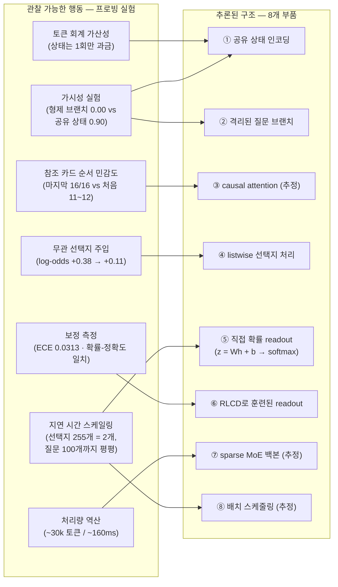

<figure class="post-figure post-figure--header">
<svg role="img" aria-label="탐사자가 프로브로 가면 쓴 블랙박스 모델에 신호를 보내자, 비스듬히 벗겨지는 가면 뒤로 내부 구조 — 공유 상태 바, 격리된 질문 브랜치 Q1·Q2·Q3, 확률 readout 다이얼 — 가 드러난다." viewBox="0 0 680 340" xmlns="http://www.w3.org/2000/svg">
  <title>가면을 벗기다 — 공개 API 프로빙으로 드러나는 Jev의 내부 (공유 상태 · 격리 브랜치 · 확률 readout)</title>
  <defs>
    <marker id="jevarch-arr" markerWidth="9" markerHeight="9" refX="7" refY="3" orient="auto">
      <path d="M0 0 L7 3 L0 6 z" fill="currentColor"/>
    </marker>
  </defs>

  <!-- 탐사자 (프로브를 든 실험자) -->
  <circle cx="70" cy="190" r="11" fill="var(--bg-light)" stroke="currentColor" stroke-width="1.8"/>
  <rect x="60" y="203" width="20" height="36" rx="4" fill="var(--bg-light)" stroke="currentColor" stroke-width="1.6"/>
  <line x1="65" y1="239" x2="58" y2="298" stroke="currentColor" stroke-width="1.8"/>
  <line x1="75" y1="239" x2="82" y2="298" stroke="currentColor" stroke-width="1.8"/>
  <line x1="78" y1="210" x2="106" y2="192" stroke="currentColor" stroke-width="1.6"/>
  <rect x="104" y="180" width="28" height="18" rx="3" fill="var(--bg-light)" stroke="currentColor" stroke-width="1.6"/>
  <line x1="132" y1="189" x2="146" y2="189" stroke="currentColor" stroke-width="1.8"/>
  <text x="90" y="322" text-anchor="middle" font-size="10" fill="currentColor" opacity="0.7">탐사자 — 공개 API 프로빙</text>

  <!-- 프로브 신호 (토큰 회계 · 지연 · 가시성 실험) -->
  <line x1="150" y1="185" x2="214" y2="150" stroke="currentColor" stroke-width="1.6" stroke-dasharray="5 4" opacity="0.55" marker-end="url(#jevarch-arr)"/>
  <line x1="150" y1="189" x2="214" y2="189" stroke="currentColor" stroke-width="1.6" stroke-dasharray="5 4" opacity="0.55" marker-end="url(#jevarch-arr)"/>
  <line x1="150" y1="193" x2="214" y2="228" stroke="currentColor" stroke-width="1.6" stroke-dasharray="5 4" opacity="0.55" marker-end="url(#jevarch-arr)"/>

  <!-- 블랙박스 모델 본체 -->
  <rect x="225" y="70" width="430" height="230" rx="3" fill="var(--bg-panel)" stroke="currentColor" stroke-width="2"/>

  <!-- 내부: 공유 상태 (한 번 인코딩되는 두꺼운 몸통) -->
  <rect x="245" y="248" width="390" height="34" rx="3" fill="var(--gold)" fill-opacity="0.22" stroke="currentColor" stroke-width="1.5"/>
  <text x="495" y="270" text-anchor="middle" font-size="10.5" fill="currentColor" font-weight="700">공유 상태 — 1회 인코딩</text>

  <!-- 내부: 격리된 질문 브랜치들 -->
  <line x1="420" y1="248" x2="420" y2="196" stroke="currentColor" stroke-width="1.6"/>
  <line x1="500" y1="248" x2="500" y2="196" stroke="currentColor" stroke-width="1.6"/>
  <line x1="580" y1="248" x2="580" y2="196" stroke="currentColor" stroke-width="1.6"/>
  <rect x="395" y="166" width="50" height="30" rx="3" fill="var(--bg-light)" stroke="currentColor" stroke-width="1.5"/>
  <text x="420" y="186" text-anchor="middle" font-size="10" fill="currentColor">Q1</text>
  <rect x="475" y="166" width="50" height="30" rx="3" fill="var(--bg-light)" stroke="currentColor" stroke-width="1.5"/>
  <text x="500" y="186" text-anchor="middle" font-size="10" fill="currentColor">Q2</text>
  <rect x="555" y="166" width="50" height="30" rx="3" fill="var(--bg-light)" stroke="currentColor" stroke-width="1.5"/>
  <text x="580" y="186" text-anchor="middle" font-size="10" fill="currentColor">Q3</text>
  <line x1="460" y1="162" x2="460" y2="244" stroke="currentColor" stroke-width="1.4" stroke-dasharray="3 5" opacity="0.5"/>
  <line x1="540" y1="162" x2="540" y2="244" stroke="currentColor" stroke-width="1.4" stroke-dasharray="3 5" opacity="0.5"/>
  <text x="500" y="155" text-anchor="middle" font-size="9" fill="currentColor" opacity="0.7">격리 질문 브랜치</text>

  <!-- 내부: 확률 readout 다이얼 -->
  <line x1="500" y1="166" x2="512" y2="140" stroke="currentColor" stroke-width="1.5" opacity="0.7" marker-end="url(#jevarch-arr)"/>
  <circle cx="520" cy="112" r="24" fill="var(--bg-light)" stroke="currentColor" stroke-width="1.8"/>
  <line x1="502" y1="98" x2="506" y2="102" stroke="currentColor" stroke-width="1.4"/>
  <line x1="520" y1="90" x2="520" y2="95" stroke="currentColor" stroke-width="1.4"/>
  <line x1="538" y1="98" x2="534" y2="102" stroke="currentColor" stroke-width="1.4"/>
  <line x1="520" y1="112" x2="536" y2="94" stroke="var(--accent-color)" stroke-width="2.5"/>
  <circle cx="520" cy="112" r="2.5" fill="currentColor"/>
  <text x="552" y="106" font-size="9.5" fill="currentColor">직접 확률</text>
  <text x="552" y="119" font-size="9.5" fill="currentColor">readout</text>

  <!-- 프로브 빛줄기 (내부를 비춤) -->
  <polygon points="150,189 380,100 380,270" fill="var(--gold)" fill-opacity="0.10"/>

  <!-- 벗겨지는 가면 (미공개 연구라는 facade) -->
  <g transform="rotate(-8 298 189)">
    <rect x="228" y="78" width="140" height="222" rx="3" fill="var(--steel)" stroke="currentColor" stroke-width="2"/>
    <ellipse cx="272" cy="150" rx="14" ry="8" fill="var(--bg-panel)"/>
    <ellipse cx="324" cy="150" rx="14" ry="8" fill="var(--bg-panel)"/>
    <rect x="280" y="205" width="36" height="6" rx="3" fill="var(--bg-panel)"/>
  </g>
  <text x="298" y="322" text-anchor="middle" font-size="10" fill="currentColor" opacity="0.7">가면 — 미공개 아키텍처</text>
</svg>
<figcaption>벤더가 논문을 내지 않아도 아키텍처는 행동에 지문을 남긴다 — 공개 API 프로빙만으로 가면 뒤의 공유 상태·격리 브랜치·확률 readout을 재구성한다.</figcaption>
</figure>

## 원문 정보

> - **제목**: Jev's Architecture Unmasked
> - **출처**: Archer Hume ([archerhume.com](https://archerhume.com/))
> - **발행**: 2026-09-17 · 약 28분 분량
> - **원문 링크**: <https://archerhume.com/posts/jevs-architecture-unmasked/>

TypeSafe가 연구를 공개하지 않는 판단 특화 모델 Jev의 내부를, 저자가 **체계적인 API 프로빙 실험**으로 역공학한 장문의 기술 탐사기다. 이 위키의 Jev 분석 계보 — [Sean Goedecke의 아키텍처 해부](/2026/09/20/jev-structured-output-interesting-again.html), [Mike Taylor의 실사용 검증](/2026/09/20/mini-vibe-check-typesafe-jev.html) — 에서 가장 깊은 층을 파고드는 세 번째 글로 담는다.

## 한 줄 요약 (TL;DR)

Jev는 텍스트로 "생성된 확신 주장" 대신 **내부 표현에서 직접 읽어낸 확률**을 돌려주는 모델이며, 저자는 토큰 회계·지연 시간·가시성·선택지 순서 실험 등을 통해 그 아키텍처를 재구성한다 — **공유 상태를 한 번 인코딩하고, 질문 브랜치들을 격리된 배치로 병렬 처리하며, causal 트랜스포머 위의 readout(z = Wh + b → softmax)으로 텍스트 생성 없이 확률을 출력하고, 선택지들이 서로 상호작용한 뒤 판정되며, RLCD로 분포 자체를 훈련한** (그리고 백본은 sparse MoE로 추정되는) 설계다.

## 왜 이 글을 골랐나

글의 척추를 한눈에 — 각 프로빙 실험(관찰 가능한 행동)이 어느 아키텍처 결론(추론된 구조)을 지지하는지의 매핑이다.

이 위키는 Jev를 이미 두 번 다뤘다. Sean Goedecke는 [속도가 prefill + 단일 토큰 전략으로 재현 가능하다](/2026/09/20/jev-structured-output-interesting-again.html)며 "해자는 얇다"고 봤고, Mike Taylor는 [777개 판단 실사용기](/2026/09/20/mini-vibe-check-typesafe-jev.html)로 활용처를 보여줬다. 이 글은 두 글이 남긴 공백 — **"그래서 안에서 실제로 무슨 일이 일어나는가"** — 을 채운다. 특히 흥미로운 건 이 글의 결론이 Goedecke의 가설과 부분적으로 충돌한다는 점이다. 프로빙 결과는 Jev가 "보통 LLM + 영리한 추론 스택"이 아니라, **텍스트 생성 경로 자체가 없는 readout 기반 설계**일 가능성을 가리킨다.

방법론 자체도 배울 거리다. 벤더가 논문을 내지 않을 때, 공개 API만으로 — 토큰 회계의 가산성, 지연 시간 스케일링, 형제 브랜치 간 정보 가시성, 선택지 순서 민감도, 무관한 선택지 주입 시 log-odds 변화 — 아키텍처 가설을 세우고 기각하는 과정은 **블랙박스 시스템을 다루는 엔지니어의 실험 설계 교과서**에 가깝다.

## 핵심 내용

### 문제 설정: 생성된 확신이 아니라 읽어낸 확률

전통적인 LLM은 확신도를 텍스트 토큰으로 "생성"한다 — 그러나 그렇게 생성된 숫자는 실제 결정 확률과 아무 연결이 보장되지 않는다. 저자에 따르면 Jev의 제안은 이렇다.

> "Jev의 제안은 사전학습된 LLM의 지식을 유지하면서, 생성된 확신 주장을 내부 표현에서 직접 읽어낸 결정 확률로 대체하는 것이다."

확률이 나오면 다운스트림 정책을 명시적으로 짤 수 있다. 원문의 예: 긴급 케이스를 놓치는 비용이 9, 오탐 에스컬레이션 비용이 1이라면, **P(urgent) > 0.1일 때 에스컬레이션**하면 된다. 이 확률 + 임계값 패턴은 [JEV Essential 6단계](/2026/09/21/jev-essential-curriculum.html)에서 다룬 것과 같은 구조다. 저자는 12백만 뷰짜리 화제성에 대한 흔한 반응("JSON 분류기에 이 난리? 버블이다")이 설계의 핵심을 놓친 것이라고 지적하며 글을 연다.

### 증거 1 — 추론은 readout으로 끝난다 (텍스트 생성 없음)

TypeSafe 문서는 "autoregressive하게가 아니라 **모든 확률을 병렬로 출력한다**"고 명시한다. 저자의 실험이 이를 뒷받침한다.

- **255개 선택지 응답이 2개짜리만큼 빠르다.** 지연 시간은 입력 길이에만 비례한다.
- API의 `output_tokens` 필드는 모델의 생성이 아니라 **추론 후 직렬화**를 반영한다 — "서버는 단일 모델 평가 후 수천 문자를 직렬화할 수 있다."
- 추정 메커니즘: 최종 은닉 상태에 선형 readout **z = Wh + b**를 적용하고 softmax로 K개 클래스의 분포를 만든다.

이것이 grammar-constrained decoding과 근본적으로 다른 지점이다. 제약 디코딩은 여전히 토큰을 "생성"하지만, readout은 **숫자를 직접 출력**한다.

### 증거 2 — 상태는 공유하고, 질문은 격리한다

<figure class="post-figure">
<svg role="img" aria-label="가시성 실험 두 장면. 실험 A에서는 비밀 코드를 형제 브랜치 Q1에 심었을 때 칸막이 너머 브랜치 Q2가 전혀 보지 못해 확률 0.00이 되고, 실험 B에서는 같은 코드를 공유 상태에 올리자 브랜치 Q2의 정답률이 0.90으로 뛴다." viewBox="0 0 680 330" xmlns="http://www.w3.org/2000/svg">
  <title>공유 상태는 모든 브랜치에 보이고, 형제 브랜치끼리는 완전히 격리된다 — 0.00 vs 0.90 가시성 실험</title>
  <defs>
    <marker id="jevarch-arr2" markerWidth="9" markerHeight="9" refX="7" refY="3" orient="auto">
      <path d="M0 0 L7 3 L0 6 z" fill="currentColor"/>
    </marker>
    <marker id="jevarch-arr2-vis" markerWidth="9" markerHeight="9" refX="7" refY="3" orient="auto">
      <path d="M0 0 L7 3 L0 6 z" fill="var(--secondary-color)"/>
    </marker>
  </defs>

  <!-- ===== 실험 A — 비밀을 형제 브랜치에 ===== -->
  <text x="170" y="26" text-anchor="middle" font-size="12" fill="currentColor" font-weight="700">실험 A — 비밀을 형제 브랜치에</text>

  <rect x="48" y="96" width="112" height="112" rx="3" fill="var(--bg-panel)" stroke="currentColor" stroke-width="1.6"/>
  <text x="104" y="116" text-anchor="middle" font-size="10.5" fill="currentColor" font-weight="700">브랜치 Q1</text>
  <rect x="62" y="130" width="84" height="24" rx="3" fill="var(--bg-light)" stroke="var(--accent-color)" stroke-width="2"/>
  <text x="104" y="146" text-anchor="middle" font-size="9.5" fill="var(--accent-color)" font-weight="700">비밀 코드 7431</text>
  <text x="104" y="176" text-anchor="middle" font-size="9" fill="currentColor" opacity="0.6">여기에 심음</text>

  <rect x="180" y="96" width="112" height="112" rx="3" fill="var(--bg-panel)" stroke="currentColor" stroke-width="1.6"/>
  <text x="236" y="116" text-anchor="middle" font-size="10.5" fill="currentColor" font-weight="700">브랜치 Q2</text>
  <text x="236" y="146" text-anchor="middle" font-size="10" fill="currentColor">코드는?</text>
  <text x="236" y="178" text-anchor="middle" font-size="13" fill="currentColor" font-weight="700" opacity="0.75">0.00</text>
  <text x="236" y="194" text-anchor="middle" font-size="8.5" fill="currentColor" opacity="0.6">전혀 안 보임</text>

  <!-- 칸막이 (격리) -->
  <line x1="170" y1="80" x2="170" y2="240" stroke="currentColor" stroke-width="2" stroke-dasharray="3 5" opacity="0.55"/>
  <text x="170" y="70" text-anchor="middle" font-size="9" fill="currentColor" opacity="0.65">칸막이 — 브랜치 격리</text>

  <!-- 차단된 시선 -->
  <line x1="150" y1="142" x2="190" y2="142" stroke="currentColor" stroke-width="1.4" stroke-dasharray="4 3" opacity="0.5"/>
  <line x1="164" y1="136" x2="176" y2="148" stroke="var(--accent-color)" stroke-width="2"/>
  <line x1="176" y1="136" x2="164" y2="148" stroke="var(--accent-color)" stroke-width="2"/>

  <rect x="40" y="252" width="260" height="38" rx="3" fill="var(--bg-light)" stroke="currentColor" stroke-width="2"/>
  <text x="170" y="276" text-anchor="middle" font-size="10.5" fill="currentColor">공유 상태 (state) — 1회 인코딩</text>
  <line x1="104" y1="252" x2="104" y2="212" stroke="currentColor" stroke-width="1.6" marker-end="url(#jevarch-arr2)"/>
  <line x1="236" y1="252" x2="236" y2="212" stroke="currentColor" stroke-width="1.6" marker-end="url(#jevarch-arr2)"/>

  <!-- 패널 구분선 -->
  <line x1="338" y1="20" x2="338" y2="310" stroke="currentColor" stroke-width="1.4" stroke-dasharray="4 6" opacity="0.3"/>

  <!-- ===== 실험 B — 비밀을 공유 상태에 ===== -->
  <text x="510" y="26" text-anchor="middle" font-size="12" fill="currentColor" font-weight="700">실험 B — 비밀을 공유 상태에</text>

  <rect x="388" y="96" width="112" height="112" rx="3" fill="var(--bg-panel)" stroke="currentColor" stroke-width="1.6"/>
  <text x="444" y="116" text-anchor="middle" font-size="10.5" fill="currentColor" font-weight="700">브랜치 Q1</text>
  <text x="444" y="146" text-anchor="middle" font-size="9.5" fill="currentColor" opacity="0.6">(다른 질문)</text>

  <rect x="520" y="96" width="112" height="112" rx="3" fill="var(--bg-panel)" stroke="currentColor" stroke-width="1.6"/>
  <text x="576" y="116" text-anchor="middle" font-size="10.5" fill="currentColor" font-weight="700">브랜치 Q2</text>
  <text x="576" y="146" text-anchor="middle" font-size="10" fill="currentColor">코드는?</text>
  <text x="576" y="180" text-anchor="middle" font-size="15" fill="var(--secondary-color)" font-weight="700">0.90</text>
  <text x="576" y="196" text-anchor="middle" font-size="8.5" fill="currentColor" opacity="0.65">정답률 0.90~0.92</text>

  <line x1="510" y1="80" x2="510" y2="240" stroke="currentColor" stroke-width="2" stroke-dasharray="3 5" opacity="0.55"/>

  <rect x="380" y="252" width="260" height="38" rx="3" fill="var(--bg-light)" stroke="currentColor" stroke-width="2"/>
  <text x="510" y="276" text-anchor="middle" font-size="10.5" fill="currentColor">공유 상태 + <tspan fill="var(--accent-color)" font-weight="700">비밀 코드 7431</tspan></text>
  <line x1="444" y1="252" x2="444" y2="212" stroke="currentColor" stroke-width="1.6" marker-end="url(#jevarch-arr2)"/>
  <line x1="576" y1="252" x2="576" y2="212" stroke="var(--secondary-color)" stroke-width="2" marker-end="url(#jevarch-arr2-vis)"/>
</svg>
<figcaption>같은 비밀 코드가 위치에 따라 0.00과 0.90으로 갈린다 — 공유 상태는 모든 브랜치에 보이고, 형제 브랜치끼리는 완전히 격리된다.</figcaption>
</figure>

글에서 가장 정교한 실험 묶음이다.

- **토큰 회계가 정확히 가산적이다.** yes/no 질문 1개 = 268 토큰, 2개 = 276 토큰. 상태(state)는 한 번만 과금된다.
- **가시성 실험**: 비밀 코드를 형제 질문(sibling branch)에 넣으면 다른 질문에서 완전히 보이지 않는다(확률 0.00). 같은 코드를 공유 상태로 옮기면 정답률이 **0.90~0.92**로 뛴다. 브랜치 간 정보는 완전히 격리되어 있다.
- **지연 시간**: 질문 1개 중앙값 86.5ms, 질문 100개 82ms — 사실상 변화 없음. 1,500개에서도 610ms. 약 100개까지는 평평하다가 그 이후 완만히 증가 — 상태를 한 번 계산하고 질문들을 배치로 처리한다는 신호다.
- 23k 토큰짜리 상태에 질문 5,000개를 실어도 65,536 토큰 요청 한도에 들어가는 건 **상태가 한 번만 계산될 때만** 성립하는 산수다.

이 격리는 부수 효과가 아니라 설계 의도로 보인다. 뒤 질문의 답이 앞 질문에 영향을 주지 못하므로, 각 판정을 **독립적인 정책 결정**으로 쓸 수 있다.

### 증거 3 — causal 백본과 순서 민감성

백본은 causal decoder로 **추정**된다 (증명은 아니다). 그 규모의 프론티어 모델이 모두 causal이고, bidirectional encoder로의 전환은 서빙 이득 없이 비용만 들기 때문이다. 저자는 "causal attention은 어느 위치가 어느 정보를 쓸 수 있는지를 기술할 뿐, 입력 토큰의 실행 순서를 강제하는 게 아니다"라고 정확히 짚는다 — readout과 causal은 모순이 아니다.

- **토크나이저 지문 채취**: 공개 토크나이저 192종을 모두 테스트했지만 일치하는 게 없었다. 독자적이거나 개조된 어휘로 추정.
- **참조 카드 실험**: 정답 판단에 필요한 참조 카드를 선택지 **마지막**에 두면 16/16 정답(평균 확률 ~0.88), **처음/중간**에 두면 11~12/16으로 흩어진다. 표현(representation)이 순서에 민감하게 쌓인다는 것 — causal한 정보 흐름과 부합한다.

### 증거 4 — 선택지들은 판정 전에 상호작용한다

<figure class="post-figure">
<svg role="img" aria-label="두 장면의 저울 비교. 왼쪽은 선택지 A와 B만 있을 때 A쪽으로 기운 저울로 log-odds +0.38, 오른쪽은 무관한 세 번째 선택지 'bad weather'가 주입되자 저울이 +0.11로 움직인 장면 — 독립 채점이라면 움직이지 않아야 할 저울이다." viewBox="0 0 680 300" xmlns="http://www.w3.org/2000/svg">
  <title>무관 선택지 주입 실험 — log-odds(A:B)가 +0.38에서 +0.11로 이동 (listwise 상호작용)</title>
  <defs>
    <marker id="jevarch-arr3" markerWidth="9" markerHeight="9" refX="7" refY="3" orient="auto">
      <path d="M0 0 L7 3 L0 6 z" fill="currentColor"/>
    </marker>
    <marker id="jevarch-arr3-acc" markerWidth="9" markerHeight="9" refX="7" refY="3" orient="auto">
      <path d="M0 0 L7 3 L0 6 z" fill="var(--accent-color)"/>
    </marker>
  </defs>

  <!-- ===== 왼쪽: 선택지 2개 ===== -->
  <text x="165" y="26" text-anchor="middle" font-size="12" fill="currentColor" font-weight="700">판정 — 선택지 2개</text>
  <text x="165" y="50" text-anchor="middle" font-size="13" fill="currentColor" font-weight="700">log-odds(A : B) = +0.38</text>

  <rect x="130" y="252" width="70" height="10" fill="var(--bg-light)" stroke="currentColor" stroke-width="1.6"/>
  <line x1="165" y1="252" x2="165" y2="130" stroke="currentColor" stroke-width="2.5"/>
  <line x1="90" y1="158" x2="240" y2="106" stroke="currentColor" stroke-width="2.5"/>
  <circle cx="165" cy="132" r="4" fill="currentColor"/>
  <line x1="90" y1="158" x2="90" y2="186" stroke="currentColor" stroke-width="1.6"/>
  <rect x="58" y="186" width="64" height="26" rx="3" fill="var(--bg-light)" stroke="currentColor" stroke-width="1.6"/>
  <text x="90" y="203" text-anchor="middle" font-size="10" fill="currentColor">선택지 A</text>
  <line x1="240" y1="106" x2="240" y2="134" stroke="currentColor" stroke-width="1.6"/>
  <rect x="208" y="134" width="64" height="26" rx="3" fill="var(--bg-light)" stroke="currentColor" stroke-width="1.6"/>
  <text x="240" y="151" text-anchor="middle" font-size="10" fill="currentColor">선택지 B</text>
  <text x="165" y="286" text-anchor="middle" font-size="9.5" fill="currentColor" opacity="0.6">A가 우세하게 기운 저울</text>

  <!-- ===== 가운데: 주입 ===== -->
  <text x="323" y="138" text-anchor="middle" font-size="9" fill="currentColor" opacity="0.7">무관 선택지</text>
  <text x="323" y="150" text-anchor="middle" font-size="9" fill="currentColor" opacity="0.7">주입</text>
  <line x1="298" y1="160" x2="346" y2="160" stroke="currentColor" stroke-width="2" marker-end="url(#jevarch-arr3)"/>

  <!-- ===== 오른쪽: 무관 선택지 주입 후 ===== -->
  <text x="515" y="26" text-anchor="middle" font-size="12" fill="currentColor" font-weight="700">무관 선택지 주입 후</text>
  <text x="515" y="50" text-anchor="middle" font-size="13" fill="var(--accent-color)" font-weight="700">log-odds(A : B) = +0.11</text>
  <text x="515" y="68" text-anchor="middle" font-size="9.5" fill="currentColor" opacity="0.7">Δ = −0.28 · 무작위 10개 블록 전부 재현</text>

  <rect x="480" y="252" width="70" height="10" fill="var(--bg-light)" stroke="currentColor" stroke-width="1.6"/>
  <line x1="515" y1="252" x2="515" y2="130" stroke="currentColor" stroke-width="2.5"/>
  <line x1="440" y1="146" x2="590" y2="118" stroke="currentColor" stroke-width="2.5"/>
  <circle cx="515" cy="132" r="4" fill="currentColor"/>
  <line x1="440" y1="146" x2="440" y2="178" stroke="currentColor" stroke-width="1.6"/>
  <rect x="408" y="178" width="64" height="26" rx="3" fill="var(--bg-light)" stroke="currentColor" stroke-width="1.6"/>
  <text x="440" y="195" text-anchor="middle" font-size="10" fill="currentColor">선택지 A</text>
  <line x1="590" y1="118" x2="590" y2="150" stroke="currentColor" stroke-width="1.6"/>
  <rect x="558" y="150" width="64" height="26" rx="3" fill="var(--bg-light)" stroke="currentColor" stroke-width="1.6"/>
  <text x="590" y="167" text-anchor="middle" font-size="10" fill="currentColor">선택지 B</text>

  <rect x="545" y="78" width="118" height="26" rx="3" fill="var(--bg-light)" stroke="var(--accent-color)" stroke-width="2"/>
  <text x="604" y="95" text-anchor="middle" font-size="9" fill="var(--accent-color)" font-weight="700">C · bad weather (무관)</text>
  <line x1="595" y1="106" x2="550" y2="124" stroke="var(--accent-color)" stroke-width="1.8" stroke-dasharray="5 4" marker-end="url(#jevarch-arr3-acc)"/>
  <text x="515" y="286" text-anchor="middle" font-size="9.5" fill="currentColor" opacity="0.6">저울이 눈에 띄게 움직인다</text>
</svg>
<figcaption>무관한 선택지 하나가 기존 두 선택지의 log-odds 저울을 움직인다(+0.38 → +0.11) — 고정된 독립 logit 채점으로는 불가능한, listwise 상호작용의 증거.</figcaption>
</figure>

Jev가 선택지를 하나씩 독립적으로 채점한 뒤 정규화하는 걸까, 아니면 선택지들이 함께 읽힌 뒤 판정될까? 저자의 실험:

- 무관한 선택지("bad weather caused it")를 추가하자 기존 두 선택지 사이의 log-odds가 **+0.38 → +0.11**로 이동했다(평균 변화 −0.28). 무작위화된 10개 블록 전부에서 감소가 재현됐다 — **고정된 독립 logit 가설과 모순**된다.
- 추가 문구를 "wild birds caused it"으로 바꾸면 이동이 일관되지 않다 — 단순한 temperature 효과가 아니라 **내용 의존적 상호작용**이다.
- 마지막 위치의 판정 head든 pointer 방식 scorer든 관찰을 설명할 수 있으며, API의 255개 선택지 제한은 **고정 슬롯 head**와 잘 맞는다.
- 텍스트로 주입한 가짜 선택지는 진짜 선택지를 결코 밀어내지 못했다 — 선택지 경계가 텍스트 포맷 바깥에서 마킹된다는 뜻이다 (프롬프트 인젝션 관점에서 의미 있는 관찰).

### 증거 5 — 분포를 훈련하고, 확신도는 산수로 계산한다

TypeSafe의 **RLCD**(Reinforcement Learning for Calibrated Decisions)는 인식론적으로 정직한 확률을 목표로 최적화한다. proper scoring rule(log loss, Brier loss)은 참 조건부 분포를 보고하는 것을 보상하는 성질이 있다.

- 저자의 보정 측정: MMLU 1,200문항에서 10-bin **ECE 0.0313**. (990문항이 0.9~1.0 구간에 몰림)
- 신선한 수학 과제: 세 자리 곱셈에서 정확도 86.7% / 평균 최고 확률 0.83, 2단계 서술형 문제에서 정확도 32% / 확률 0.30 — **틀릴 때는 낮은 확률로 틀린다.**
- 흥미로운 발견: API의 `confidence` 필드는 별도로 학습된 추정치가 아니라 **(pmax − 1/K)/(1 − 1/K)라는 사후 산수**다.

다만 저자는 훈련이 신뢰할 수 있는 불확실성을 *목표*로 할 뿐, 유한한 데이터와 분포 이동은 여전히 보정 리스크로 남는다고 단서를 단다.

### 추정 — sparse MoE 백본과 배치 스케줄링

마지막 두 절은 저자 스스로 "측정이 아니라 추론"이라고 선을 긋는 부분이다.

- **Sparse MoE 추정**: Jev는 ~30k 토큰을 ~160ms에 처리했다. dense 70B라면 ~1초가 필요하다. 활성 파라미터 ~10B 수준의 MoE가 지연 시간과 맞는다. prefill 전용 동작이라 토큰별 디코딩 병목이 없고, 긴 KV 캐시가 expert 가중치와 메모리를 다투지도 않는다. 최근 프론티어 모델들(DeepSeek-V3, Qwen3, Kimi K2)이 MoE라는 정황도 있다.
- **배치 스케줄링**: 질문 브랜치들은 대화가 아니라 **독립 작업 항목**으로 배치에 패킹된다. 동일 요청의 반복 응답에 나타나는 미세한 차이는 텍스트 샘플링이 아니라 dynamic batching·라우팅 수준의 비결정성으로 보이고, 응답 키 순서가 반복되는 패턴으로 변하는 건 해시 순서가 다른 여러 워커의 존재를 시사한다.

### 결론 — 아키텍처를 과제에 정렬하다

저자의 최종 그림은 8개 부품이다: ① 공유 상태 인코딩 ② 격리된 질문 브랜치 ③ causal attention ④ listwise 선택지 처리 ⑤ 직접 확률 readout(softmax over K) ⑥ 결과로 훈련된 readout 함수 ⑦ (추정) sparse MoE 백본 ⑧ 배치 스케줄링.

> "흥미로운 조합은 폭넓게 유능한 트랜스포머, 공유된 컨텍스트 계산, 타입이 있는 출력 인터페이스, 그리고 유용한 불확실성을 보상하는 훈련이다."

핵심 통찰은 **아키텍처 정렬**이다. 모든 결정을 텍스트 생성에 욱여넣는 대신, 계산 그래프를 실제 과제 — 증거를 읽고, 결과를 비교하고, 불확실성을 노출하는 것 — 에 맞게 분리했다는 것.

## 분석과 인사이트

여기서부터는 원문 요약이 아니라 내 해석이다.

**1. Goedecke 가설의 절반을 기각하는 글이다.** [Sean Goedecke의 분석](/2026/09/20/jev-structured-output-interesting-again.html)은 "prefill + 단일 토큰이면 어떤 LLM이든 비슷한 속도가 난다 → 실질적 해자 없음"이었다. 이 글의 프로빙은 속도의 재현 가능성엔 동의하면서도, Jev가 그 전략을 쓰는 게 아니라 **생성 경로 자체가 없는 readout + 공유 상태 + 브랜치 배치**라는 다른 물건임을 보여준다. 특히 "질문 100개까지 지연 시간이 평평하다"는 관찰과 "토큰 회계가 정확히 가산적"이라는 관찰은 단일 토큰 constrained decoding으로는 설명이 어렵다. 해자 논쟁의 판이 바뀐다: 문제는 "속도를 흉내낼 수 있느냐"가 아니라 **"공유 상태 1회 인코딩 + 5,000개 격리 판정이라는 인터페이스와 비용 구조를 흉내낼 수 있느냐"**다.

**2. 블랙박스 프로빙 방법론 자체가 이 글의 절반이다.** 토큰 회계의 가산성으로 계산 그래프를 추정하고, 형제 브랜치에 비밀 코드를 심어 attention 가시성을 측정하고, 무관한 선택지를 주입해 logit 독립성 가설을 기각하고, 192개 토크나이저로 지문을 채취한다 — 전부 공개 API만으로. 벤더 문서가 침묵할 때 시스템의 계약(contract)을 스스로 확인하는 이 태도는, 서드파티 API 위에 프로덕션을 짓는 모든 엔지니어에게 이식 가능한 기술이다. 그리고 저자가 측정(옵션 상호작용, 보정)과 추론(causal, MoE)을 문장마다 구분하는 지적 정직함은 이런 글의 모범이다.

**3. `confidence` 필드가 사후 산수라는 발견은 작지만 실무적으로 중요하다.** (pmax − 1/K)/(1 − 1/K)는 학습된 신호가 아니라 확률 분포의 재포장이다. 즉 이 필드에 새로운 정보는 없다 — 임계값 정책을 짤 거라면 원 확률 분포를 직접 쓰는 편이 명확하고, "confidence가 높으니 믿자"는 식으로 이 필드에 독립적 의미를 부여하면 안 된다. 벤더 API의 편의 필드가 어떤 산수인지 확인하는 습관의 좋은 사례다.

**4. 낙관을 접어야 할 지점도 분명하다.** ECE 0.0313은 인상적이지만 MMLU 990/1,200 문항이 0.9~1.0 구간에 몰린 분포에서 나온 수치다 — 쉬운 문제 위주 벤치마크에서 보정은 후해 보이기 마련이다. 2단계 서술형에서 정확도 32%가 확률 0.30과 일치한 건 오히려 더 강한 증거지만, 결국 [Mike Taylor 글](/2026/09/20/mini-vibe-check-typesafe-jev.html)의 결론과 같은 자리로 돌아온다: **자기 도메인 데이터로 보정 곡선을 직접 그려보기 전까지는 벤더의 보정 주장을 정책에 꽂지 마라.** MoE 추정 역시 저자 말대로 외부에서 관측 불가능하며, 지연 시간 하나에서 역산한 것임을 기억해야 한다.

## 적용 포인트

- **블랙박스 API를 쓸 때 "비용 회계 실험"부터 하라.** 토큰 과금이 가산적인지, 지연이 어떤 축(입력 길이? 질문 수? 선택지 수?)에 비례하는지 측정하면 내부 계산 그래프 — 그리고 요금을 아끼는 요청 구조 — 가 보인다. Jev류라면 공유 상태를 크게, 질문을 많이 묶는 쪽이 유리하다.
- **브랜치 격리를 설계 자산으로 써라.** 판정들이 서로를 볼 수 없다는 성질은 감사(audit) 가능한 독립 정책 결정을 만든다 — 반대로 판정 간 정보 공유가 필요하면 공유 상태 쪽에 올려야 한다는 제약이기도 하다.
- **선택지 순서를 통제 변수로 다뤄라.** 참조 정보는 선택지 뒤쪽에 배치할 때 정확도가 안정적이었다(16/16 vs 11~12/16). 프롬프트/선택지 순서를 고정하고, 순서를 바꿔가며 자기 태스크의 민감도를 측정해 볼 것.
- **편의 필드의 산수를 확인하라.** `confidence` = (pmax − 1/K)/(1 − 1/K)처럼 파생 값일 수 있다. 정책은 원 확률 분포 위에 세워라.
- **"틀릴 때 낮은 확률로 틀리는가"를 자기 데이터로 검증하라.** 정답을 아는 케이스로 정확도-확률 쌍(86.7%/0.83, 32%/0.30 같은)을 직접 재현해 보는 것이 도입 게이트다.
- **측정과 추론을 구분해 문서화하라.** 시스템 분석 글이나 장애 보고서를 쓸 때, 이 글처럼 "관찰된 것"과 "그로부터 추정한 것"을 문장 단위로 구분하는 규율을 가져가자.

## 마무리

이 글은 Jev 3부작의 마지막 조각이다. Goedecke가 "그 속도는 특별하지 않을 수 있다"는 회의를, Taylor가 "그래서 어디에 쓰는가"라는 실용을 보여줬다면, Hume은 공개 API에 실험을 퍼부어 **"안에서 실제로 무슨 일이 일어나는가"**를 재구성했다. 그 결과는 회의론보다 흥미로운 그림이다 — 텍스트 생성이라는 우회로 없이, 공유 상태를 한 번 읽고, 격리된 질문들을 배치로 판정하고, 결과로 훈련된 readout이 확률을 뱉는 구조. 벤더가 논문을 내지 않아도 아키텍처는 행동에 지문을 남기고, 좋은 실험 설계는 그 지문을 읽어낸다. 그것이 이 글에서 가져갈 가장 큰 수확이다.

### 더 읽어보기

- [원문 — Jev's Architecture Unmasked](https://archerhume.com/posts/jevs-architecture-unmasked/)
- [Jev와 구조화 출력의 재발견 (Sean Goedecke)](/2026/09/20/jev-structured-output-interesting-again.html) — "속도는 prefill + 단일 토큰으로 재현 가능하다"는 가설 — 이 글의 프로빙이 절반을 기각하는 바로 그 논쟁의 출발점
- [0.7초 만에 내 글 전부를 심사한 모델: TypeSafe Jev 미니 바이브 체크 (Mike Taylor)](/2026/09/20/mini-vibe-check-typesafe-jev.html) — 같은 Jev의 실사용 검증 — 777개 판단, "지식 노동의 린터" 프레임
- [JEV Essential Curriculum](/2026/09/21/jev-essential-curriculum.html) — 판단 특화 모델의 배경·본질·활용을 7단계로 정복하는 학습 로드맵 — 이 글은 특히 5단계(해부)·4단계(보정)의 심화 자료
- [CS336 10강 — 추론(Inference): KV 캐시와 메모리 한계의 게임](/2026/06/26/cs336-lecture-10-inference.html) — prefill vs decode 비용 구조와 MoE 지연 시간 추정을 읽는 배경 지식
- [무엇이 하니스를 하니스로 만드는가](/2026/08/03/what-makes-a-harness-a-harness.html) — 이런 판정기가 부품으로 꽂힐 하니스 계층의 정의
