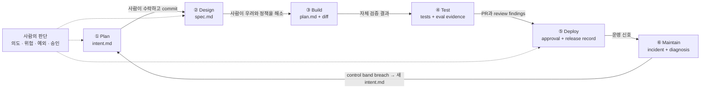

<figure class="post-figure post-figure--header">
<svg role="img" aria-labelledby="ai-sdlc-title ai-sdlc-desc" viewBox="0 0 720 340" xmlns="http://www.w3.org/2000/svg">
  <title id="ai-sdlc-title">코드 작성이 빨라지자 병목이 계획과 검증, 배포로 이동한다</title>
  <desc id="ai-sdlc-desc">왼쪽의 계획 관문에는 아이디어 카드가, 가운데 넓어진 빌드 통로에는 여러 에이전트가 만든 변경 카드가, 오른쪽 테스트·리뷰·배포 관문에는 풀 리퀘스트 카드가 쌓여 있다. 사람의 판단과 책임을 나타내는 위쪽 통제선은 계획과 프로덕션 관문을 함께 감독한다.</desc>
  <defs>
    <marker id="ai-sdlc-arrow" markerWidth="9" markerHeight="9" refX="7" refY="4" orient="auto">
      <path d="M0 0 L8 4 L0 8 Z" fill="var(--secondary-color)"/>
    </marker>
    <marker id="ai-sdlc-gold-arrow" markerWidth="9" markerHeight="9" refX="7" refY="4" orient="auto">
      <path d="M0 0 L8 4 L0 8 Z" fill="var(--gold)"/>
    </marker>
  </defs>

  <path d="M68 62 H652" fill="none" stroke="var(--gold)" stroke-width="3"/>
  <circle cx="112" cy="62" r="8" fill="var(--bg-panel)" stroke="var(--gold)" stroke-width="3"/>
  <circle cx="360" cy="62" r="8" fill="var(--bg-panel)" stroke="var(--gold)" stroke-width="3"/>
  <circle cx="608" cy="62" r="8" fill="var(--bg-panel)" stroke="var(--gold)" stroke-width="3"/>
  <text x="360" y="32" text-anchor="middle" font-size="15" font-weight="700" fill="currentColor">사람의 판단 · 위험 수용 · 최종 승인</text>
  <path d="M112 72 V101 M608 72 V101" fill="none" stroke="var(--gold)" stroke-width="2" stroke-dasharray="5 5"/>

  <rect x="28" y="106" width="166" height="142" rx="8" fill="var(--bg-light)" stroke="var(--border-color)" stroke-width="2.5"/>
  <text x="111" y="132" text-anchor="middle" font-size="14" font-weight="700" fill="var(--accent-color)">PLAN · DESIGN</text>
  <rect x="48" y="151" width="100" height="25" rx="3" fill="var(--bg-panel)" stroke="currentColor" stroke-width="1.5"/>
  <rect x="56" y="183" width="100" height="25" rx="3" fill="var(--bg-panel)" stroke="currentColor" stroke-width="1.5"/>
  <rect x="64" y="215" width="100" height="25" rx="3" fill="var(--bg-panel)" stroke="currentColor" stroke-width="1.5"/>
  <text x="98" y="168" text-anchor="middle" font-size="10" fill="currentColor">idea · ticket</text>
  <text x="106" y="200" text-anchor="middle" font-size="10" fill="currentColor">intent.md</text>
  <text x="114" y="232" text-anchor="middle" font-size="10" fill="currentColor">spec.md</text>

  <path d="M198 177 H242" fill="none" stroke="var(--secondary-color)" stroke-width="3" marker-end="url(#ai-sdlc-arrow)"/>

  <rect x="250" y="106" width="220" height="142" rx="8" fill="var(--bg-panel)" stroke="var(--secondary-color)" stroke-width="3"/>
  <text x="360" y="132" text-anchor="middle" font-size="14" font-weight="700" fill="var(--secondary-color)">BUILD · 넓어진 통로</text>
  <g fill="var(--bg-light)" stroke="currentColor" stroke-width="1.5">
    <rect x="270" y="154" width="51" height="62" rx="4"/>
    <rect x="335" y="154" width="51" height="62" rx="4"/>
    <rect x="400" y="154" width="51" height="62" rx="4"/>
  </g>
  <g fill="currentColor" text-anchor="middle" font-size="10" font-weight="700">
    <text x="295" y="178">Agent 1</text>
    <text x="360" y="178">Agent 2</text>
    <text x="425" y="178">Agent 3</text>
  </g>
  <g fill="none" stroke="var(--border-color)" stroke-width="2">
    <path d="M280 190 H311 M280 199 H304"/>
    <path d="M345 190 H376 M345 199 H369"/>
    <path d="M410 190 H441 M410 199 H434"/>
  </g>
  <text x="360" y="235" text-anchor="middle" font-size="10" fill="currentColor" opacity="0.72">plan.md → diff + tests</text>

  <path d="M474 177 H518" fill="none" stroke="var(--secondary-color)" stroke-width="3" marker-end="url(#ai-sdlc-arrow)"/>

  <rect x="526" y="106" width="166" height="142" rx="8" fill="var(--bg-light)" stroke="var(--accent-color)" stroke-width="2.5"/>
  <text x="609" y="132" text-anchor="middle" font-size="11" font-weight="700" fill="var(--accent-color)">TEST · REVIEW · DEPLOY</text>
  <rect x="544" y="151" width="102" height="25" rx="3" fill="var(--bg-panel)" stroke="currentColor" stroke-width="1.5"/>
  <rect x="552" y="183" width="102" height="25" rx="3" fill="var(--bg-panel)" stroke="currentColor" stroke-width="1.5"/>
  <rect x="560" y="215" width="102" height="25" rx="3" fill="var(--bg-panel)" stroke="currentColor" stroke-width="1.5"/>
  <text x="595" y="168" text-anchor="middle" font-size="10" fill="currentColor">test evidence</text>
  <text x="603" y="200" text-anchor="middle" font-size="10" fill="currentColor">review findings</text>
  <text x="611" y="232" text-anchor="middle" font-size="10" fill="currentColor">PR · approval</text>

  <path d="M360 266 C360 306 164 306 112 262" fill="none" stroke="var(--gold)" stroke-width="2.5" stroke-dasharray="6 5" marker-end="url(#ai-sdlc-gold-arrow)"/>
  <path d="M360 266 C360 306 556 306 608 262" fill="none" stroke="var(--gold)" stroke-width="2.5" stroke-dasharray="6 5" marker-end="url(#ai-sdlc-gold-arrow)"/>
  <text x="360" y="326" text-anchor="middle" font-size="13" font-weight="700" fill="currentColor">BUILD가 짧아질수록 병목은 코드의 왼쪽과 오른쪽으로 이동한다</text>
</svg>
<figcaption>개념도 — 에이전트가 Build 통로를 넓혀도 아이디어를 정확한 의도로 바꾸는 일과 결과를 검증·승인하는 일은 저절로 빨라지지 않는다. 원문의 핵심은 사람을 빼는 것이 아니라, 사람의 판단이 필요한 관문 사이를 기계 판독 가능한 산출물과 통제로 잇는 데 있다.</figcaption>
</figure>

<strong>원문 정보</strong>: <a href="https://claude.com/ko/resources/articles/the-ai-native-sdlc-playbook" target="_blank" rel="noopener"><em>The AI-native SDLC playbook</em></a> by Louis Claxton, Claude by Anthropic (2026-08-21 · 40분) 
<strong>TL;DR</strong>: 코드 생성이 빨라지면 생산성의 병목은 계획·검증·배포로 이동한다. Anthropic은 기존 통제 목적을 없애는 대신 <code>intent.md → spec.md → plan.md → diff/tests → PR → incident</code>라는 커밋된 산출물 사슬과 skills·hooks·CI·eval을 결합해 6단계 SDLC를 선형 절차에서 닫힌 루프로 바꾸자고 제안한다. 
핵심 원칙은 <strong>에이전트는 프로덕션 관문까지 일하되 그 관문을 스스로 넘지 못하게 하고, 사람은 의도·위험·예외·최종 승인에 집중한다</strong>는 것이다.

## 왜 이 아티클을 골랐나

코딩 에이전트 도입 논의는 흔히 "구현 시간이 얼마나 줄었는가"에서 멈춘다. 하지만 구현만 빨라진 조직에서는 요구사항이 오기를 기다리는 시간, 리뷰 큐, 보안 승인, 배포 회의가 그대로 남는다. 원문의 문제 제기는 명확하다. **Build가 더는 가장 느린 단계가 아니라면, Build만 AI화해서는 전체 흐름의 생산성 향상이 제한된다.** 보안팀이 사람의 코드 생산량에 맞춰져 있는데 에이전트가 diff를 몇 배로 늘리면, 리뷰가 밀리거나 덜 검토한 코드가 나가는 두 나쁜 선택만 남는다는 예가 이를 잘 보여준다.

이 글은 이 위키가 다뤄 온 [Loop Engineering](/2026/06/19/loop-engineering.html)을 개인의 코딩 루프에서 조직의 전달 시스템 전체로 확장한다. 무엇을 프롬프트할지가 아니라 **어떤 산출물이 다음 단계를 기동하고, 어떤 신호가 멈춤·에스컬레이션·승인을 결정하는가**를 설계한다는 점에서 `AI-Engineering`에 가장 잘 맞는다.

아래 「핵심 내용 요약」은 Louis Claxton이 정리한 Anthropic Applied AI 팀의 플레이북을 따른다. 「분석과 인사이트」부터는 원문의 주장과 별개인 이 글의 평가다. 원문은 Claude 제품을 중심으로 쓴 공급자 측 실무 가이드이지, 여러 도구를 비교한 연구나 도입 성과를 입증한 실험 보고서는 아니라는 경계도 함께 두고 읽는다.

## 핵심 내용 요약

원문이 정의하는 **AI-native SDLC**는 기존 거버넌스를 버린 개발 방식이 아니다. 감사 가능성·권한 분리·승인 같은 **통제 목적(control objective)은 유지하되, 그것을 회의와 기억이 아니라 버전 관리되는 산출물과 실행 가능한 통제로 집행하는 방식**이다. 단계는 Plan·Design·Build·Test·Deploy·Maintain 여섯 개로 남지만, 일회성 직선이 아니라 운영에서 발견한 문제가 다시 `intent.md`가 되는 루프로 바뀐다.

### 한눈에 보기: 커밋된 산출물이 다음 단계를 깨운다

각 단계가 끝날 때 다음 사람이 읽을 문서만 남는 것이 아니다. **다음 에이전트도 읽고 행동할 수 있는 커밋된 인터페이스**를 남긴다. Git 이력은 무엇을 요청했고, 무엇이 만들어졌으며, 누가 승인했는지를 잇는 감사 추적이 된다. 처음에는 사람이 각 단계를 수동으로 시작하지만, 성숙하면 수락된 산출물의 커밋이 다음 작업을 자동 기동한다.

### 1. Plan — 아이디어를 `intent.md`라는 실행 가능한 의도로 고정한다

전통적 흐름에서는 아이디어가 백로그·사용자 스토리·스토리 포인트·정제 회의를 거칠 때마다 소유자가 바뀌고 원래 뜻이 희석된다. AI-native 흐름에서는 아이디어를 낸 사람이 Claude와 문제·영향받는 사용자·바라는 결과·제약·성공 기준을 구체화하고, 조직 템플릿에 맞춰 `intent.md`를 만든다. 티켓이나 운영 경보에서 시작한 일도 같은 형식으로 들어온다.

중요한 통제는 **에이전트가 쓴 의도를 그대로 커밋하지 않는 것**이다. 제안자는 오해를 바로잡고, product owner가 수락 또는 기각한다. `intent.md`에는 작성자와 시각, 문제, 제안 결과, 영향받는 사용자·시스템, 제약, 열린 질문이 남는다. 이는 [Intent Debt](/2026/06/21/intent-debt.html)가 경고한 "코드는 있는데 왜 만들었는지 없는 상태"를 SDLC 입구에서 줄이는 장치다.

### 2. Design — 요구사항·설계를 한 세션으로 압축하되 정책을 작성 중에 적용한다

수락된 `intent.md`는 `spec.md`의 입력이 된다. Claude는 브랜드·보안·컴플라이언스·UX 정책을 skills로 읽고 요구사항과 설계를 한 번에 초안화하며, 서로 충돌하거나 충족할 수 없는 부분을 **우려 사항으로 표시**한다. Product owner는 원래 의도를 해결하는지 검토하고, 표시된 우려를 정책 소유자와 먼저 해소한 뒤 spec을 승인한다.

원문의 포인트는 분석가나 디자이너를 없애는 데 있지 않다. 완성된 설계를 몇 주 뒤 보안팀에 던지는 대신 **정책을 spec을 쓰는 순간의 입력으로 당겨오는 것**이다. 적용된 prompt와 skill 버전, 승인된 `intent.md`·`spec.md`가 함께 남으므로 어떤 규칙 아래 어떤 결정을 했는지도 추적할 수 있다.

### 3. Build — 먼저 `plan.md`, 다음에 코드, 규율은 파일과 실행 코드로

엔지니어는 승인된 spec을 들고 Claude Code를 plan mode로 시작한다. Claude가 코드베이스를 읽어 변경 파일, 작업 순서, 위험, 검증 방법을 적은 계획을 만들면, 엔지니어는 "무엇이 깨질 수 있는가", "가장 위험한 단계는 무엇인가", "버린 대안은 무엇인가"를 묻고 수정한다. 처음 보는 엔지니어도 실행할 수 있을 정도가 되면 `plan.md`로 커밋하고 그제야 구현한다. 구현이 계획에서 벗어나면 계획도 같은 커밋에서 갱신한다.

계획 이후의 실행을 떠받치는 세 층도 구분한다.

- **`CLAUDE.md` — 저장소의 일상 지식**: build·test·lint 명령, 아키텍처, 중요한 관례, 에이전트가 반복해 틀리는 것을 짧게 기록한다. 원문은 "같은 실수를 두 번 하면 넣는다"와 한 페이지 이내를 실무 규칙으로 제안한다.
- **Skills — 재사용할 제도 지식**: 보안 표준·API 규칙·브랜드 원칙처럼 여러 작업에 일관되게 적용할 정책을 명시한다. 다만 skill은 어디까지나 **advisory control**이다.
- **Hooks — 반드시 지켜야 할 불변식**: 보호 경로 수정 차단, 자격 증명이 diff에 들어가는지 검사, 파일 변경 뒤 formatter 실행처럼 모델의 협조와 무관하게 허용·질문·차단한다. 무거운 전체 테스트는 매 edit가 아니라 commit 또는 PR 관문에 둔다.

이 기반이 성숙한 뒤에야 routine change를 auto mode로 넘기고, 독립 작업은 각자 git worktree를 쓰는 병렬 세션으로 분리한다. 반복 검증은 제한된 도구와 별도 context를 가진 subagent로 감싼다. 원문도 병렬 수의 실제 상한은 모델이 아니라 **엔지니어가 제대로 검토할 수 있는 작업 흐름 수**라고 본다.

기존 Jira·ServiceNow·Figma를 무조건 Markdown으로 대체하라는 주장도 아니다. 원문은 산출물마다 repo 또는 legacy system 중 **하나를 source of truth로 선언**하고, 최소한 양쪽에 record ID와 commit SHA를 교차 기록하라고 명시한다.

### 4. Test — 코드뿐 아니라 에이전트를 움직이는 설정도 회귀 테스트한다

첫 번째 play는 짧은 자기 검증 루프다. 테스트·빌드·screenshot diff처럼 성공 여부가 기계 판독 가능하고 한 명령으로 실행되는 피드백을 주고, 에이전트가 사람이 보기 전에 스스로 반복하게 한다. 버그 수정은 먼저 실패하는 재현 테스트를 만들고, 그 테스트가 예상한 이유로 실패함을 확인한 뒤, fix 동안 test file을 바꾸지 못하게 hook으로 막는 방식을 권한다. 마지막 verifier subagent는 구현 맥락과 분리된 새 context에서 실제 동작을 확인할 수 있다.

두 번째 play는 **continuous evals**다. `CLAUDE.md`, skills, hooks, prompt, model은 에이전트의 행동을 바꾸는 실행 구성인데도 보통 회귀 테스트 없이 바뀐다. 원문은 최근 실제 작업 20~50개와 허용 기준을 eval suite로 만들고, 이 구성이 바뀔 때와 정기 schedule에 CI에서 실행하라고 제안한다. 프로덕션 사고가 나면 그 유형을 eval에 추가한다. 즉 전통적 테스트가 제품 코드의 퇴행을 막는다면, eval은 **그 코드를 만드는 에이전트 시스템의 퇴행**을 막는다.

### 5. Deploy — 에이전트는 프로덕션 관문까지 가고, 스스로 넘지는 못한다

Claude는 incoming PR을 `REVIEW.md`의 bugs·security·spec/plan compliance pass로 검토하고 severity를 붙인다. 자기 PR의 review comment도 처리해 branch를 고칠 수 있다. 그러나 작성 에이전트는 자기 변경을 승인할 수 없고, branch protection이 code owner의 승인을 요구한다. 사람의 리뷰 초점은 모든 줄을 다시 읽는 데서 **의도와 위험을 수용할 수 있는지 판단하는 일**로 올라간다.

Governance는 review 문구에만 맡기지 않는다. Hook은 행동 직전에 `allow`·`ask`·`block`을 반환해 production deploy, migration, infrastructure 변경 같은 승인을 강제한다. 비협상 규칙은 개별 엔지니어가 끌 수 없는 managed settings에 두고, sandbox·network allowlist·scoped short-lived credentials로 shell 수준의 우회 경로도 닫는다.

CI/CD에서는 처음엔 failed build triage나 changelog 초안 같은 **read-only 판단 작업**부터 non-interactive Claude에 맡긴다. 그다음 lint fix나 review comment 반영처럼 PR로만 도착하는 쓰기 작업을 연다. 배포·상태 조회·rollback은 환경별로 범위를 좁힌 MCP tool로 노출하고, development·staging·production의 자율성 등급을 다르게 둔다. 특히 rollback은 평소 staging에서 반복해 검증한 단일 경로여야 한다.

### 6. Maintain — 결정론적 감지가 확률적 진단을 깨우고 다시 Plan으로 돌려보낸다

마지막 단계에서야 사람이 시작 버튼을 누르지 않는 루프가 완성된다. 단, "LLM이 production을 계속 감시한다"는 설계가 아니다. 버전 관리되고 unit test된 **결정론적 script**가 CI 실패율·배포 뒤 5xx·PR cycle time 같은 안정된 지표의 control band 위반을 감지한 뒤 Claude를 호출한다.

원문의 `bands.yaml` 예시는 1σ에서 log만 남기고, 2σ에서 read-only 진단을 허용하며, 3σ에서 PR 제안이나 사전 승인된 rollback runbook만 실행하게 한다. 이는 설명을 위한 autonomy tier 예시이지 모든 서비스에 그대로 적용할 임계값은 아니다. 에이전트는 증거·영향 시스템·제안 결과·열린 질문을 `intent.md`로 써서 같은 파이프라인에 넣고, service owner가 fix now·schedule·dismiss를 판단한다. 해결된 사고 유형은 eval에 추가돼 같은 실패가 다시 나오는지 감시한다.

같은 패턴은 scheduled security scan과 incident channel에도 적용된다. 원문은 Claude Security가 정기적으로 repository를 스캔해 confidence와 함께 finding을 내고, 작은 것은 PR gate로, 큰 것은 `intent.md`로 보내는 흐름을 소개한다. Claude Tag가 Slack incident thread에서 진단·사람의 승인·수정 기록을 한곳에 남기는 사례도 든다. 어느 경로든 **감지나 대화 자체가 배포 권한은 아니며**, 변경은 기존 PR·승인 관문을 통과한다.

### 무엇을 측정할 것인가

원문은 각 play에 leading indicator와 lagging indicator를 붙인다. 아래는 단계별 제안을 압축한 것이며, 원문이 실제 개선 수치를 보고한 것은 아니다.

| 단계 | 먼저 볼 신호 | 나중에 확인할 결과 |
|---|---|---|
| **Plan** | 첫 대화부터 `intent.md` commit까지의 시간 | Design으로 수락된 intent 비율, `spec.md` 이후 intent 재작업 |
| **Design** | intent commit부터 spec commit까지의 시간 | Build 시작 뒤 발생한 requirements rework |
| **Build** | 첫 구현 pass에서 merge된 비율, plan 승인부터 PR merge까지의 시간 | change당 rework 횟수, 최종 diff와 `plan.md`의 일치 |
| **Test** | first-pass CI success, eval pass rate | PR review 시간, production regression·change failure rate |
| **Deploy** | first review까지의 시간, approval gate별 대기 시간 | merge 전 발견 대비 production 유출 defect·vulnerability, DORA 지표 |
| **Maintain** | band breach부터 triage queue의 `intent.md`까지의 시간 | finding이 merged fix가 된 비율, 같은 유형의 반복 incident |

## 분석과 인사이트

여기부터는 원문 요약이 아니라 이 글의 해석이다.

### 진짜 설계 대상은 모델이 아니라 "산출물 프로토콜"이다

원문에는 Claude Code·Code Review·Security·Tag 같은 제품명이 많이 등장하지만, 가장 오래 남을 부분은 제품 목록이 아니다. `intent.md → spec.md → plan.md → diff/tests → PR → incident`라는 **조직 내부 프로토콜**이다. 각 단계가 다음 단계에 넘길 입력 형식, 승인 주체, 실패 신호를 명시하면 모델이 바뀌어도 루프는 남는다. 반대로 이 인터페이스 없이 좋은 모델만 붙이면 사람의 구두 설명과 수동 handoff가 계속 병목이다.

이 관점에서 AI-native는 "모든 단계에 챗봇을 배치한다"가 아니라 **암묵적 협업 계약을 기계와 사람 모두 읽을 수 있는 형태로 외부화한다**는 뜻이다. [무엇이 하니스를 하니스로 만드는가](/2026/08/03/what-makes-a-harness-a-harness.html)가 단일 에이전트의 runtime control을 정의했다면, 이 글은 그 제어 원리를 SDLC 전체의 artifact graph로 확장한다.

### 거버넌스를 줄이는 것이 아니라 실행 시점으로 당긴다

가장 좋은 구분은 skill과 hook 사이에 있다. "보안 규칙을 지켜라"는 지시는 위반 가능성을 낮출 뿐이고, 보호 경로 수정 차단·branch protection·sandbox 같은 장치는 모델의 협조 없이도 작동한다. 원문은 이 차이를 숨기지 않는다. 정책은 spec과 code를 만드는 동안 advisory하게 적용하고, 반드시 지켜야 할 경계는 deterministic control로 뒤에서 봉인한다.

이는 거버넌스가 사라지는 자동화가 아니라 **회의형 거버넌스가 policy-as-code로 이동하는 것**이다. 승인 횟수를 무작정 늘리면 다시 병목이 되므로 routine path는 자동 허용하고, 위험·예외·프로덕션만 사람에게 올려야 한다. 핵심 최적화 대상은 "사람을 loop에서 빼는 비율"이 아니라 **사람에게 올라오는 판단의 신호 대 잡음비**다.

### 가장 설득력 있는 경계는 "결정론적 감지 → 확률적 진단 → 제한된 행동"이다

Maintain 단계의 control band 설계는 이 긴 글에서 가장 재사용하기 좋은 패턴이다. 임계치 감지는 test 가능한 script가 맡고, 모호한 원인 분석은 모델이 맡으며, 행동은 PR이나 사전 승인 runbook으로 제한한다. 확률적 모델에게 경보 발생 여부부터 배포 권한까지 한꺼번에 주지 않는다.

이 세 층은 Build와 Deploy에도 그대로 적용된다. lint·test·path protection은 결정론적으로, architecture trade-off와 incident hypothesis는 모델과 사람이 판단하고, 실제 변경은 되돌릴 수 있는 branch·PR·rollback 경로로 흘린다. [Continuous Integration](/2026/06/19/continuous-integration.html)의 빠른 피드백 루프가 에이전트 시대에 더 중요해지는 이유다. 에이전트는 자동화가 없는 조직을 마법처럼 고치는 게 아니라, 이미 기계가 읽을 수 있는 신호를 더 빠르게 소비한다.

### 사람의 병목은 없어지지 않고 더 비싼 병목으로 변한다

원문은 "human judgement stays above it"라고 끝맺는다. 정확한 결론이지만 동시에 가장 큰 미해결 문제다. agent output이 늘수록 사람은 더 많은 `intent.md`, spec, plan, PR, finding을 승인해야 한다. 줄 단위 검토를 의도·위험 검토로 올려도, 잘못된 의도나 생소한 architecture를 판별하는 일은 더 어렵고 더 숙련된 사람을 요구한다.

그래서 병렬 세션 수의 상한은 compute가 아니라 **review bandwidth**다. 동일한 model family로 maker와 checker를 나눴다고 진정한 독립성이 생기는 것도 아니다. 둘은 같은 맹점과 잘못된 전제를 공유할 수 있다. 중요한 변경에는 서로 다른 검증 방식—결정론적 테스트, 별도 모델, domain expert, 실제 runtime evidence—을 겹쳐야 한다. 모든 diff를 직접 보는 [짧은 목줄 방법](/2026/07/06/short-leash-ai-coding.html)과 원문의 장기 자율 세션은 겉보기엔 반대지만, 둘 다 **검토 가능한 작은 blast radius와 사람이 쥔 승인권**에서 만난다.

### 전제와 한계: 이 플레이북을 그대로 복사하면 안 되는 이유

- **"코드가 더는 병목이 아니다"는 보편 법칙이 아니다.** 익숙한 CRUD·integration에서는 맞을 수 있지만, 새 알고리즘·복잡한 distributed system·safety-critical code·낡은 legacy integration에서는 구현과 debugging이 여전히 핵심 병목일 수 있다. 먼저 우리 value stream의 실제 대기 시간을 재야 한다.
- **성숙한 플랫폼이 선행 조건이다.** 한 명령 build/test, 안정된 CI, branch protection, version control, observable production metrics, sandbox, scoped credentials, rollback, 정책 소유자가 이미 있어야 자율성을 안전하게 높일 수 있다. 원문도 각 play의 prerequisite로 이를 적지만, 구축 비용과 조직 변화 비용을 합산하지는 않는다.
- **공급자 관점과 증거 수준을 분리해야 한다.** Anthropic Applied AI 팀의 고객 경험을 바탕으로 한 유용한 playbook이지만, Claude 제품 중심이며 일부 기능은 beta 또는 research preview다. 제안한 지표는 많아도 도입 전후 결과, 비용, false positive, review load를 비교한 수치는 없다. 효과가 아니라 **검증할 가설과 운영 체크리스트**로 읽는 편이 정확하다.
- **Markdown이 곧 진실이 되는 것은 아니다.** 산출물을 많이 만들수록 서로 어긋난 stale copy가 늘 수 있다. 원문이 source of truth와 commit SHA linkage를 강조하는 이유다. 문서 생성량이 아니라 다음 단계가 실제 읽는 최소 산출물만 남기고, 코드와 계획이 갈라지면 함께 갱신해야 한다.
- **`intent.md`는 발견(discovery)을 대체하지 않는다.** 고객 조사, 이해관계 충돌, 정책 해석처럼 애초에 답이 없는 문제는 문서화 속도를 높인다고 해결되지 않는다. 에이전트가 매끄럽게 쓴 의도를 사람이 진짜 합의로 착각하면 오히려 intent debt를 더 빨리 쌓는다.
- **전통 SDLC와 AI-native SDLC의 대비는 양 끝점을 그린 모델이다.** 많은 현대 팀은 이미 cross-functional discovery, CI/CD, trunk-based development, policy-as-code를 쓴다. 원문도 대부분의 조직이 두 열 사이에 있다고 밝힌다. 기존의 좋은 루프를 버리고 새 이름으로 재구축하기보다, 사람 손에서 멈춘 handoff만 골라 자동화해야 한다.

## 적용 포인트 (우리는 무엇을 배울 것인가)

- **먼저 value stream을 계측하라**: 최근 change 20개에서 대기 시간을 Plan·Design·Build·Test·Deploy로 나눈다. Build가 정말 병목인지, review queue나 환경 승인이 더 긴지 확인한 뒤 가장 긴 handoff 하나만 고른다.
- **작은 변경 하나에 artifact chain을 끝까지 연결하라**: `intent.md`에는 why·scope·constraint, `spec.md`에는 acceptance와 정책 우려, `plan.md`에는 변경 파일·순서·위험·proof를 적는다. 세 문서가 같은 요구를 반복하지 않게 각자의 계약을 분명히 한다.
- **산출물마다 source of truth를 하나만 정하라**: Jira가 원본이면 Markdown에 issue ID를, repo가 원본이면 Jira에 commit SHA를 남긴다. 양쪽을 사람이 따로 갱신하는 운영은 만들지 않는다.
- **자율성보다 피드백 루프를 먼저 깔아라**: build·test·lint·smoke check를 각각 한 명령으로 만들고 성공 조건을 기계 판독 가능하게 한다. UI라면 실제 화면 또는 screenshot diff까지 에이전트가 볼 수 있어야 한다.
- **지식을 강도에 따라 세 곳으로 나눠라**: 일상적 repo context는 `CLAUDE.md`, 여러 작업에 재사용할 정책은 skill, 절대 깨지면 안 되는 경계는 hook·CI·branch protection에 둔다. 중요한 규칙을 prompt에만 두지 않는다.
- **autonomy ladder를 명시하라**: read-only diagnosis → PR 제안 → 제한된 write → 사전 승인 runbook 순으로 한 단계씩 연다. 각 단계에는 timeout·비용 한도·rollback·human escalation 조건을 붙이고, production direct write는 열지 않는다.
- **maker와 approver를 분리하라**: 코드를 만든 에이전트가 자기 PR을 승인하지 못하게 하고 code owner gate를 유지한다. 고위험 변경은 동일 모델의 재검토만으로 끝내지 말고 결정론적 evidence와 domain expert를 겹친다.
- **리뷰 정책을 `REVIEW.md`로 명시하라**: bugs·security·spec/plan compliance처럼 pass를 나누고, Important의 기준과 nit 상한, CI가 이미 잡는 항목의 제외 규칙을 적어 사람에게 올라오는 noise를 줄인다.
- **사고를 루프의 학습 자산으로 바꿔라**: production incident가 닫힐 때 재현 test 또는 eval, 새 guardrail, 필요하면 `intent.md`를 함께 남긴다. "누가 대응했다"가 아니라 같은 class의 사고가 다시 자동으로 잡히는지가 완료 조건이다.
- **속도와 함께 품질·비용을 묶어 측정하라**: PR 수나 생성 LOC 대신 lead time, first-pass CI, rework, escaped defect, gate wait, eval pass rate, model 비용을 한 화면에서 본다. 처리량이 늘면서 rework와 review load가 더 빨리 늘면 자동화가 아니라 queue를 만든 것이다.

## 더 읽어보기

- [원문 — *The AI-native SDLC playbook* (Louis Claxton, Claude by Anthropic)](https://claude.com/ko/resources/articles/the-ai-native-sdlc-playbook)
- [Loop Engineering: 에이전트를 프롬프트하는 대신 프롬프트하는 시스템을 설계하라](/2026/06/19/loop-engineering.html) — 개인의 agent loop가 조직의 SDLC loop로 확장되는 출발점
- [Intent Debt: 에이전트가 대신 갚아줄 수 없는 단 하나의 부채](/2026/06/21/intent-debt.html) — `intent.md`가 담아야 할 why와, 매끄러운 문서만으로는 갚을 수 없는 부채
- [무엇이 하니스를 하니스로 만드는가](/2026/08/03/what-makes-a-harness-a-harness.html) — loop·tool·context·control로 보는 agent runtime의 필요충분조건
- [Continuous Integration: 통합 지옥을 없애는 실천](/2026/06/19/continuous-integration.html) — 에이전트가 소비할 빠르고 기계 판독 가능한 feedback의 고전적 토대
- [짧은 목줄 방법: AI 코딩 에이전트를 통제하며 고품질 코드를 만드는 법](/2026/07/06/short-leash-ai-coding.html) — 장기 자율 실행과 대비해 사람의 개입 빈도·검토 책임을 점검하는 반대편 관점
