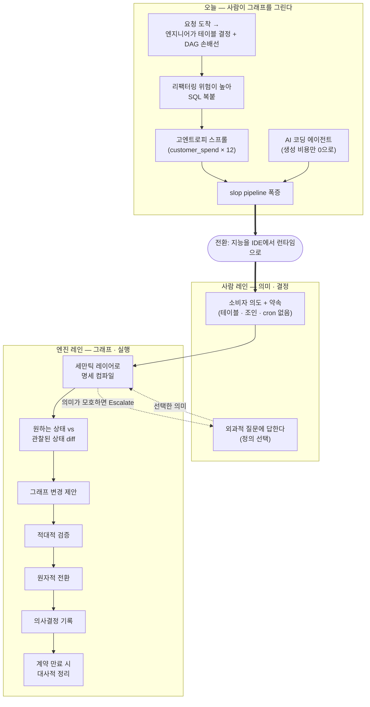
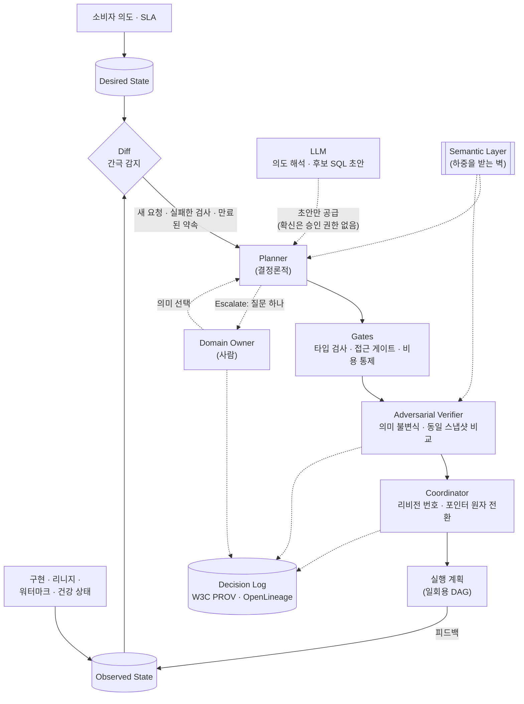

<figure class="post-figure post-figure--header">
<svg role="img" aria-labelledby="sods-h-title sods-h-desc" viewBox="0 0 720 350" xmlns="http://www.w3.org/2000/svg">
  <title id="sods-h-title">사람은 의미를 쓰고, 엔진은 그래프를 쓴다</title>
  <desc id="sods-h-desc">위쪽에서 사람이 의미·정의·정책이 적힌 두루마리만 들고 있다. 왼쪽 패널에는 사람이 손으로 엮어 선이 엉킨 DAG와 customer_spend 사본 열두 개가 쌓인 고엔트로피 창고가, 오른쪽 패널에는 raw_purchases에서 공유 일별 자산을 거쳐 30일·90일 자산으로 이어지는, 엔진이 스스로 정렬한 그래프가 반딧불이처럼 함께 빛난다. 두루마리에서 오른쪽 그래프로만 점선이 이어진다.</desc>
  <defs>
    <marker id="sods-h-arrow" markerWidth="9" markerHeight="9" refX="7" refY="4" orient="auto">
      <path d="M0 0 L8 4 L0 8 Z" fill="var(--secondary-color)"/>
    </marker>
    <marker id="sods-h-gold" markerWidth="9" markerHeight="9" refX="7" refY="4" orient="auto">
      <path d="M0 0 L8 4 L0 8 Z" fill="var(--gold)"/>
    </marker>
  </defs>

  <!-- human + scroll of meaning -->
  <circle cx="244" cy="34" r="9" fill="var(--bg-panel)" stroke="currentColor" stroke-width="2"/>
  <path d="M244 43 V66 M244 52 H276 M244 66 L236 84 M244 66 L252 84" fill="none" stroke="currentColor" stroke-width="2" stroke-linecap="round"/>
  <rect x="274" y="20" width="10" height="60" rx="4" fill="var(--bg-light)" stroke="var(--gold)" stroke-width="2"/>
  <rect x="516" y="20" width="10" height="60" rx="4" fill="var(--bg-light)" stroke="var(--gold)" stroke-width="2"/>
  <rect x="284" y="26" width="232" height="48" fill="var(--bg-light)" stroke="var(--gold)" stroke-width="2"/>
  <text x="400" y="48" text-anchor="middle" font-size="15" font-weight="700" fill="currentColor">의미 · 정의 · 정책</text>
  <text x="400" y="66" text-anchor="middle" font-size="11" fill="var(--text-light)">사람이 쓰는 것은 이것뿐</text>
  <path d="M500 78 C 540 88, 556 96, 560 112" fill="none" stroke="var(--gold)" stroke-width="2.5" stroke-dasharray="6 5" marker-end="url(#sods-h-gold)"/>

  <!-- LEFT: today, hand-drawn tangle -->
  <rect x="24" y="118" width="300" height="216" rx="8" fill="var(--bg-light)" stroke="var(--border-color)" stroke-width="2"/>
  <text x="174" y="142" text-anchor="middle" font-size="13" font-weight="700" fill="var(--accent-color)">오늘 — 사람이 손으로 엮은 DAG</text>
  <g fill="none" stroke="currentColor" stroke-width="1.5" opacity="0.6">
    <path d="M59 167 C 120 230, 40 230, 131 257"/>
    <path d="M121 157 C 60 200, 170 220, 63 262"/>
    <path d="M81 212 C 140 150, 200 200, 181 237"/>
    <path d="M151 202 C 100 260, 200 270, 186 172"/>
    <path d="M59 167 C 150 180, 90 140, 186 172"/>
    <path d="M63 262 C 120 220, 170 280, 181 237"/>
  </g>
  <g fill="var(--bg-panel)" stroke="currentColor" stroke-width="1.5">
    <rect x="48" y="160" width="22" height="14" rx="2"/>
    <rect x="110" y="150" width="22" height="14" rx="2"/>
    <rect x="70" y="205" width="22" height="14" rx="2"/>
    <rect x="140" y="195" width="22" height="14" rx="2"/>
    <rect x="52" y="255" width="22" height="14" rx="2"/>
    <rect x="120" y="250" width="22" height="14" rx="2"/>
    <rect x="175" y="165" width="22" height="14" rx="2"/>
    <rect x="170" y="230" width="22" height="14" rx="2"/>
  </g>
  <g font-size="13" font-weight="700" fill="var(--accent-color)" text-anchor="middle">
    <text x="104" y="238">?</text>
    <text x="166" y="226">?</text>
    <text x="96" y="186">?</text>
  </g>
  <g fill="var(--bg-panel)" stroke="var(--border-color)" stroke-width="1.5">
    <rect x="210" y="160" width="104" height="22" rx="2"/>
    <rect x="210" y="186" width="104" height="22" rx="2"/>
    <rect x="210" y="212" width="104" height="22" rx="2"/>
    <rect x="210" y="238" width="104" height="22" rx="2" stroke-dasharray="3 3"/>
    <rect x="210" y="264" width="104" height="22" rx="2"/>
  </g>
  <g font-size="9" fill="currentColor" text-anchor="middle">
    <text x="262" y="175">customer_spend_v1</text>
    <text x="262" y="201">customer_spend_v2</text>
    <text x="262" y="227">customer_spend_v3</text>
    <text x="262" y="253">…</text>
    <text x="262" y="279">customer_spend_v12</text>
  </g>
  <text x="174" y="316" text-anchor="middle" font-size="12" fill="var(--text-light)">복붙 · 스프롤 · 아무도 못 지우는 좀비 테이블</text>

  <!-- middle shift arrow -->
  <text x="360" y="204" text-anchor="middle" font-size="10" font-weight="700" fill="currentColor">지능을</text>
  <text x="360" y="217" text-anchor="middle" font-size="10" font-weight="700" fill="currentColor">런타임으로</text>
  <path d="M334 230 H384" fill="none" stroke="var(--secondary-color)" stroke-width="3" marker-end="url(#sods-h-arrow)"/>

  <!-- RIGHT: self-organizing graph -->
  <rect x="396" y="118" width="300" height="216" rx="8" fill="var(--bg-light)" stroke="var(--secondary-color)" stroke-width="2.5"/>
  <text x="546" y="142" text-anchor="middle" font-size="13" font-weight="700" fill="var(--secondary-color)">자기조직화 — 엔진이 쓰는 그래프</text>
  <g fill="none" stroke="var(--secondary-color)" stroke-width="2">
    <path d="M546 182 V200" marker-end="url(#sods-h-arrow)"/>
    <path d="M520 230 L486 254" marker-end="url(#sods-h-arrow)"/>
    <path d="M572 230 L606 254" marker-end="url(#sods-h-arrow)"/>
  </g>
  <g fill="var(--bg-panel)" stroke="currentColor" stroke-width="1.5">
    <rect x="496" y="158" width="100" height="24" rx="4"/>
    <rect x="476" y="206" width="140" height="24" rx="4" stroke="var(--gold)" stroke-width="2.5"/>
    <rect x="420" y="260" width="110" height="24" rx="4"/>
    <rect x="562" y="260" width="110" height="24" rx="4"/>
  </g>
  <g font-size="10" fill="currentColor" text-anchor="middle">
    <text x="546" y="174">raw_purchases</text>
    <text x="546" y="222" font-weight="700">customer_spend_daily</text>
    <text x="475" y="276">30일 · 영업 앱</text>
    <text x="617" y="276">90일 · 고객지원</text>
  </g>
  <text x="626" y="246" font-size="9.5" fill="var(--secondary-color)">엔진이 긋는 선</text>
  <!-- fireflies: nodes glowing in one beat -->
  <g fill="var(--gold-soft)">
    <circle cx="496" cy="158" r="8"/><circle cx="476" cy="206" r="8"/>
    <circle cx="420" cy="260" r="8"/><circle cx="672" cy="260" r="8"/>
    <circle cx="616" cy="230" r="8"/><circle cx="596" cy="182" r="8"/>
  </g>
  <g fill="var(--gold)">
    <circle cx="496" cy="158" r="3"/><circle cx="476" cy="206" r="3"/>
    <circle cx="420" cy="260" r="3"/><circle cx="672" cy="260" r="3"/>
    <circle cx="616" cy="230" r="3"/><circle cx="596" cy="182" r="3"/>
  </g>
  <text x="546" y="316" text-anchor="middle" font-size="12" fill="var(--text-light)">자산 · 약속 · 결정은 영속, DAG는 일회용 실행 계획</text>
</svg>
<figcaption>"Humans author the meaning; the engine authors the graph." — 손으로 엮은 DAG와 복붙 사본의 스프롤(왼쪽)에서, 사람은 의미만 쓰고 엔진이 스스로 정렬하는 자산 그래프(오른쪽)로.</figcaption>
</figure>

## 원문 정보

> - **제목**: The Self-Organizing Data Stack — *When agents answer the questions, they can maintain the data model. Here is what that demands from the orchestration engine.*
> - **출처**: Ananth Packkildurai, Data Engineering Weekly ([dataengineeringweekly.com](https://www.dataengineeringweekly.com))
> - **발행**: 2026-10-14 · 약 11분 분량 (약 2,500단어)
> - **원문 링크**: <https://www.dataengineeringweekly.com/p/the-self-organizing-data-stack>

이 위키는 [Data-Engineering-Essential](/2026/06/25/data-engineering-essential-curriculum.html)에서 시작해 Airflow·dbt·Kafka·Lakehouse·Spark·Flink·Ontology까지 데이터 엔지니어링의 **현재 패러다임**을 꽤 넓게 정리해 왔다. 이 글은 그 패러다임의 가장 밑바닥 가정, 곧 **"파이프라인 그래프는 사람이 그린다"**를 정면으로 뒤집자는 제안이라서, 다른 아티클보다 깊게 읽고 위키의 기존 지식과 하나하나 대조해 본다.

## 한 줄 요약 (TL;DR)

데이터 엔지니어는 지금 "어떤 테이블이 있어야 하는가(모델링)"와 "그 테이블을 최신으로 유지하는 오케스트레이션 배선"이라는 두 가지 일을 손으로 하고 있고, AI 코딩 에이전트는 **새 파이프라인을 만드는 비용만 0에 가깝게 낮추고 기존 파이프라인을 리팩터링하는 위험은 그대로 둬서** 창고의 엔트로피를 키웠다. 저자는 지능을 IDE가 아니라 **런타임(오케스트레이션 엔진)**으로 옮기자고 제안한다. 사람은 의미(정의·정책·판단)와 소비자 약속을 쓰고, 엔진은 원하는 상태와 관찰된 상태를 비교해 **그래프를 스스로 합성·통합·검증·전환·정리**한다. DAG는 진실의 원천에서 **일회용 실행 계획**으로 내려온다.

### 한눈에 보기



## 왜 이 글을 골랐나

첫째, **문제 진단이 정확하다.** "남의 취약한 DAG를 사흘 동안 역공학할 것인가, SQL을 복붙해 새 테이블을 만들 것인가" — 이 선택 앞에서 합리적인 엔지니어는 언제나 후자를 고른다. 위키의 [dbt 세만틱 레이어 편](/2026/07/14/dbt-semantic-layer-metrics.html)이 "mart 테이블 폭발"로, [데이터 품질 사다리](/2026/07/18/on-data-quality-basics.html)가 "용도에 따라 달라지는 품질"로 다룬 현상의 **근본 원인을 개인의 게으름이 아니라 인센티브 구조**로 짚는다.

둘째, **AI에 대한 태도가 균형 잡혀 있다.** "AI가 다 해 준다"도, "AI는 슬롭만 만든다"도 아니다. 저자의 주장은 *지금처럼 IDE에만 에이전트를 붙이면* 문제가 악화된다는 것, 그리고 해결은 **모델이 아니라 런타임 설계**에 있다는 것이다. 이는 위키가 반복해서 다뤄 온 "하니스가 곧 제품이다"([GPT-6 Astra](/2026/09/08/gpt6-astra-harness-is-the-product.html))라는 관점을 데이터 플랫폼으로 옮긴 형태다.

셋째, **설계의 디테일이 있다.** 다섯 개의 루프, 재사용의 물리학과 한계, 원하는 상태/관찰된 상태의 대사(reconciliation), 의미 불변식 기반 검증, 리비전 번호에 묶인 원자적 전환, W3C PROV·OpenLineage 기반 의사결정 기록, 새벽 3시 디버깅 절차, 계약 만료 기반 정리까지 — 슬로건이 아니라 **엔진 스펙에 가까운 글**이다. 그래서 위키의 시리즈 포스트와 개념 단위로 대조할 수 있다.

## 핵심 내용

### 출발점: 두 개의 수작업과 "고엔트로피 스프롤"

저자는 오늘의 데이터 엔지니어가 두 가지 일을 한다고 정리한다.

1. **데이터 모델링** — 어떤 테이블이 존재해야 하는지 결정한다.
2. **오케스트레이션 배선** — 스케줄·의존성·재시도·백필을 손으로 엮어 그 테이블을 최신으로 유지한다.

한 달 뒤 *살짝 다른 질문*이 도착하면, 엔지니어는 남의 DAG를 역공학하며 그 안의 "적히지 않은 가정"을 배우고 조용한 하류 파손을 감수할지, 아니면 SQL을 복붙해 새 테이블을 만들지 고른다. 합리적인 엔지니어는 늘 복붙을 고르고, 이 생존 본능이 엔지니어 200명 × 3년으로 곱해지면 **"customer_spend의 버전 열두 개, 아무도 리팩터링하지 못하는 수천 개의 모델, 아무도 지우지 못하는 페타바이트의 좀비 테이블"**이 남는다.

AI는 여기에 기름을 부었다. 오케스트레이션 모델은 그대로 둔 채 엔지니어에게 코딩 에이전트를 쥐여 주니 **새 파이프라인 생성 비용은 0에 수렴하고, 기존 파이프라인 리팩터링 위험은 여전히 하늘 높이** 남았다. 결과는 하나의 프롬프트에 국소 최적화된 "slop pipeline"의 폭발이다.

저자는 이 스프롤이 그동안 용인된 이유도 짚는다. 데이터 모델링은 **사람 소비자를 위한 사람의 활동**이었다. 스타 스키마와 conformed dimension은 분석가가 창고를 "읽을 수 있게" 만들기 위한 것이고, **가독성(legibility)이 모델의 존재 이유**였다. 그런데 에이전트가 데이터를 소비해 답을 내는 세계에서는, 물리 모델이 더 이상 "사람이 이해하기 위한 박물관 전시"처럼 생길 필요도, 사람 손으로 유지될 필요도 없다 — **단, 지능을 IDE 밖으로, 런타임 안으로 옮긴다면.** 그때 의존성 그래프는 엔지니어가 그리는 경직된 *입력*에서 엔진이 유지하는 동적 *출력*이 된다. 사람에게 남는 것은 **의미(meaning)** — 시스템이 지켜야 할 정의·정책·판단이다.

### 질서는 어떻게 창발하는가: 자산이 곧 계약이다

저자는 Steven Strogatz의 『Sync』를 빌려 온다. 중앙 지휘자 없이 반딧불이 떼가 동시에 깜빡이고 심장 박동 세포가 동기화되듯, 개별 부품은 취약해도 전체는 조직될 수 있다. 이를 데이터에 적용하려면 **"자산(asset)"의 정의부터 바꿔야** 한다.

- 자산은 저장소에 놓인 **물리 테이블이 아니라**, 안정적인 정체성(identity)을 가진 **영속적·논리적 데이터 제품**이다.
- 자산은 자신의 **의미(semantic meaning), 그레인(grain), 각 하류 소비자에 대한 약속(commitments)**을 선언한다.
- 자산은 스스로 행동하거나 백그라운드 LLM 프로세스를 돌리지 않는다. **경계만 선언하고, 그래프 조율은 엔진이** 한다.

엔진은 다섯 개의 핵심 루프로 그래프를 조율한다.

| 루프 | 하는 일 |
| --- | --- |
| **Synthesize** | 새 요청에 필요한 물리 테이블과 변환을 만든다 |
| **Consolidate** | 겹치는 명세를 감지해 공유·분할·병합을 제안한다 |
| **Verify and Repair** | 모든 그래프 변경·장애 복구를 하류 계약에 대해 출시 전에 검증한다 |
| **Coordinate** | 버전 붙은 변경을 원자적으로 활성화해 어떤 활성 소비자 약속도 깨지지 않게 한다 |
| **Escalate** | 의미의 모호성이 진행을 막으면, 증거와 트레이드오프를 붙인 **구체적 질문 하나**를 사람 소유자에게 가져간다 |

이 다섯 루프를 가능하게 하는 건축적 분리는 하나다. **자산은 정체성을 유지하고, 물리 구현은 바뀔 수 있다.** 계약은 자산의 것이고, 물리 기계 장치는 엔진의 것이다. 그래서 플랫폼은 하류 소비자에게 통합 코드를 다시 쓰라고 강요하지 않고도 창고를 계속 재배선할 수 있다.

<figure class="post-figure">
<svg role="img" aria-labelledby="sods-a-title sods-a-desc" viewBox="0 0 720 410" xmlns="http://www.w3.org/2000/svg">
  <title id="sods-a-title">자산은 곧 계약: 고정된 논리 자산과 갈아끼워지는 물리 구현, 그리고 다섯 루프</title>
  <desc id="sods-a-desc">가운데 두 층 블록의 위층은 안정 ID·의미·그레인·소비자별 약속을 가진 논리 자산으로 고정되어 있고, 아래층은 테이블·변환·스케줄로 이루어진 물리 구현으로 엔진이 갈아끼운다. 그 둘레를 Synthesize, Consolidate, Verify and Repair, Coordinate, Escalate 다섯 루프가 시계 방향으로 돌며, Escalate에서만 사람인 도메인 소유자에게 화살표가 나간다.</desc>
  <defs>
    <marker id="sods-a-gold" markerWidth="9" markerHeight="9" refX="7" refY="4" orient="auto">
      <path d="M0 0 L8 4 L0 8 Z" fill="var(--gold)"/>
    </marker>
    <marker id="sods-a-red" markerWidth="9" markerHeight="9" refX="7" refY="4" orient="auto">
      <path d="M0 0 L8 4 L0 8 Z" fill="var(--accent-color)"/>
    </marker>
  </defs>

  <!-- ring of five loops (clockwise) -->
  <g fill="none" stroke="var(--gold)" stroke-width="2.5" marker-end="url(#sods-a-gold)">
    <path d="M442 43 A 318 180 0 0 1 585 90"/>
    <path d="M667 170 A 318 180 0 0 1 648 293"/>
    <path d="M519 373 A 318 180 0 0 1 201 373"/>
    <path d="M72 293 A 318 180 0 0 1 53 170"/>
    <path d="M135 90 A 318 180 0 0 1 278 43"/>
  </g>

  <!-- center: two-layer asset -->
  <rect x="230" y="128" width="260" height="78" rx="6" fill="var(--bg-panel)" stroke="var(--accent-color)" stroke-width="2.5"/>
  <text x="360" y="150" text-anchor="middle" font-size="13" font-weight="700" fill="var(--accent-color)">논리 자산 — 정체성 고정</text>
  <text x="360" y="175" text-anchor="middle" font-size="12" fill="currentColor">안정 ID · 의미 · 그레인 · 소비자별 약속</text>
  <text x="360" y="195" text-anchor="middle" font-size="10.5" fill="var(--text-light)">계약은 자산의 것</text>
  <text x="360" y="221" text-anchor="middle" font-size="10" fill="var(--text-light)">구현이 바뀌어도 소비자 통합 코드는 그대로</text>
  <rect x="230" y="228" width="260" height="78" rx="6" fill="var(--bg-light)" stroke="currentColor" stroke-width="1.5" stroke-dasharray="6 4"/>
  <text x="360" y="250" text-anchor="middle" font-size="13" font-weight="700" fill="var(--secondary-color)">물리 구현 — 엔진이 갈아끼움</text>
  <text x="360" y="274" text-anchor="middle" font-size="12" fill="currentColor">테이블 · 변환 · 스케줄</text>
  <text x="360" y="293" text-anchor="middle" font-size="10.5" fill="var(--text-light)">기계 장치는 엔진의 것</text>
  <text x="360" y="332" text-anchor="middle" font-size="11" fill="var(--text-light)">엔진의 다섯 루프가 둘레를 돈다</text>

  <!-- loop nodes -->
  <g fill="var(--bg-panel)" stroke="var(--border-color)" stroke-width="2">
    <rect x="285" y="20" width="150" height="46" rx="6"/>
    <rect x="560" y="104" width="150" height="46" rx="6"/>
    <rect x="529" y="310" width="150" height="46" rx="6"/>
    <rect x="41" y="310" width="150" height="46" rx="6"/>
    <rect x="10" y="104" width="150" height="46" rx="6" stroke="var(--accent-color)" stroke-width="2.5"/>
  </g>
  <g text-anchor="middle" fill="currentColor">
    <text x="360" y="39" font-size="12.5" font-weight="700">Synthesize</text>
    <text x="360" y="56" font-size="10">새 요청 → 테이블·변환 합성</text>
    <text x="635" y="123" font-size="12.5" font-weight="700">Consolidate</text>
    <text x="635" y="140" font-size="10">겹치는 명세 → 공유·분할·병합</text>
    <text x="604" y="329" font-size="12.5" font-weight="700">Verify &amp; Repair</text>
    <text x="604" y="346" font-size="10">출시 전 하류 계약 검증</text>
    <text x="116" y="329" font-size="12.5" font-weight="700">Coordinate</text>
    <text x="116" y="346" font-size="10">버전 변경을 원자적 활성화</text>
    <text x="85" y="123" font-size="12.5" font-weight="700" fill="var(--accent-color)">Escalate</text>
    <text x="85" y="140" font-size="10">모호하면 질문 하나</text>
  </g>

  <!-- escalation to the human owner -->
  <circle cx="30" cy="24" r="8" fill="var(--bg-panel)" stroke="var(--accent-color)" stroke-width="2"/>
  <path d="M30 32 V52 M20 40 H40 M30 52 L23 66 M30 52 L37 66" fill="none" stroke="var(--accent-color)" stroke-width="2" stroke-linecap="round"/>
  <text x="50" y="30" font-size="11" font-weight="700" fill="var(--accent-color)">사람 · 도메인 소유자</text>
  <path d="M52 102 L40 74" fill="none" stroke="var(--accent-color)" stroke-width="2.5" marker-end="url(#sods-a-red)"/>
</svg>
<figcaption>자산 = 계약 — 위층의 논리 자산(정체성·의미·그레인·약속)은 고정되고, 아래층 물리 구현은 엔진이 갈아끼운다. 다섯 루프 중 Escalate만 사람에게 나간다.</figcaption>
</figure>

### 소비자 의도에서 창발하는 재사용

원문의 실연 예시는 이렇다. 영업 애플리케이션이 고객별 최근 30일 지출을 원한다. 사람이 타이핑하든 에이전트가 API로 보내든, 요청에는 **결과와 약속만** 담긴다 — "고객당 한 행, UTC 기준 직전 30일의 *완결된* 달력일, 승인된 구매 금액·고객 정체성 정의 사용, 구매가 없는 고객도 포함, 새 원천 데이터는 5분 안에 반영, 영업 앱이 의존하는 동안 유지." 테이블도, 조인 키도, cron도 없다.

이 의도를 환각 없이 해석하기 위해 엔진은 **세만틱 레이어**에 기댄다 — 권위 있는 원천, 엔티티 키, 단위, 승인된 계산, 시간 규칙. 저자는 이것을 이 설계의 **"하중을 받는 벽(load-bearing wall)"**이라고 부른다. 시스템은 컬럼 이름에 대한 그럴듯한 추측을 비즈니스 정의로 바꿀 수 없고, 의미가 없으면 SQL로 추측하는 대신 **열린 질문으로 에스컬레이션**한다.

플래너는 세만틱 레이어로부터 형식 명세를 컴파일하고 **테스트를 스스로 도출**한다.

- "고객당 한 행" → 유일성 제약
- "구매 없는 고객 포함" → 고객 레지스트리에 대한 outer join 필요
- "승인된 구매 금액" → 원장(raw ledger)과의 대사(reconciliation) 규칙

첫 소비자에게는 원시 구매 데이터 위의 직접 변환이 5분 SLA 안에서 가장 싸므로, 엔진은 단순한 직통 파이프라인을 만든다.

한 달 뒤 고객지원 에이전트가 **같은 지표를 완결된 UTC 90일**로 요청한다. 오늘의 스택이라면 코딩 코파일럿이 원시 구매를 다시 스캔하는 중복 파이프라인을 신나게 만든다. 자기조직화 스택의 플래너는 물리 테이블 너머의 **명세**를 본다. 같은 USD 구매 정의, 같은 고객 정체성 규칙, 그리고 결정적으로 **같은 "완결된 UTC 일" 경계** — 현재 초에서 끝나는 롤링 윈도였다면 집계를 공유할 수 없었다. 사람이 키보드를 만지지 않아도 엔진은 다음을 수행한다.

1. 90일 이력을 가진 공유 중간 자산 `customer_spend_daily`를 제안한다.
2. 원천 이력이 존재하는지, 접근 정책이 허락하는지 확인하고 일별 롤업을 백필한다.
3. 그 위에 90일 고객지원 자산을 만들고, 기존 30일 영업 자산을 **조용히 새 일별 중간 자산을 읽도록 재배선**한다.

저자의 요점은 날카롭다. "시니어 엔지니어라면 이 리팩터링을 10분이면 한다. 요점은 **아무도 할 필요가 없었다**는 것이다." 두 번째 요청이 최적 아키텍처를 바꿨고, 엔진은 영업 앱의 계약을 지키면서 그래프를 재조직했다.

<figure class="post-figure">
<svg role="img" aria-labelledby="sods-r-title sods-r-desc" viewBox="0 0 720 310" xmlns="http://www.w3.org/2000/svg">
  <title id="sods-r-title">소비자 의도에서 재사용이 창발하는 세 장면</title>
  <desc id="sods-r-desc">첫 장면에서 raw_purchases가 customer_spend_30d로 직통 변환되어 영업 앱에 공급된다. 둘째 장면에서 고객지원 에이전트의 완결 UTC 90일 요청이 도착하고, 엔진이 USD 구매 정의·고객 정체성 규칙·완결 UTC 일 경계가 같은지 비교해 세 항목 모두 일치를 확인한다. 셋째 장면에서 raw_purchases 위에 90일 백필된 공유 자산 customer_spend_daily가 생기고, 30일 자산은 이를 읽도록 재배선되며 90일 자산이 새로 만들어진다. 영업 앱의 계약 배지는 세 장면 내내 그대로다.</desc>
  <defs>
    <marker id="sods-r-arrow" markerWidth="9" markerHeight="9" refX="7" refY="4" orient="auto">
      <path d="M0 0 L8 4 L0 8 Z" fill="var(--secondary-color)"/>
    </marker>
  </defs>

  <g fill="var(--bg-light)" stroke="var(--border-color)" stroke-width="2">
    <rect x="8" y="8" width="224" height="294" rx="8"/>
    <rect x="248" y="8" width="224" height="294" rx="8"/>
    <rect x="488" y="8" width="224" height="294" rx="8"/>
  </g>
  <g font-size="12.5" font-weight="700" fill="currentColor" text-anchor="middle">
    <text x="120" y="32">① 첫 요청: 영업 30일</text>
    <text x="360" y="32">② 90일 요청 · 명세 비교</text>
    <text x="600" y="32">③ 엔진이 그래프를 재조직</text>
  </g>

  <!-- panel 1 -->
  <rect x="60" y="56" width="120" height="26" rx="4" fill="var(--bg-panel)" stroke="currentColor" stroke-width="1.5"/>
  <text x="120" y="73" text-anchor="middle" font-size="10.5" fill="currentColor">raw_purchases</text>
  <path d="M120 82 V126" fill="none" stroke="var(--secondary-color)" stroke-width="2" marker-end="url(#sods-r-arrow)"/>
  <text x="128" y="108" font-size="9.5" fill="var(--text-light)">직통 변환</text>
  <rect x="50" y="130" width="140" height="26" rx="4" fill="var(--bg-panel)" stroke="var(--secondary-color)" stroke-width="2"/>
  <text x="120" y="147" text-anchor="middle" font-size="10.5" fill="currentColor">customer_spend_30d</text>
  <path d="M120 156 V230" fill="none" stroke="var(--secondary-color)" stroke-width="2" marker-end="url(#sods-r-arrow)"/>

  <!-- panel 2 -->
  <text x="360" y="48" text-anchor="middle" font-size="9.5" fill="var(--text-light)">고객지원 에이전트 · 완결 UTC 90일</text>
  <g fill="var(--bg-panel)" stroke="var(--border-color)" stroke-width="1.5">
    <rect x="262" y="58" width="196" height="26" rx="3"/>
    <rect x="262" y="92" width="196" height="26" rx="3"/>
    <rect x="262" y="126" width="196" height="26" rx="3" stroke="var(--secondary-color)" stroke-width="2.5"/>
  </g>
  <g font-size="10.5" fill="currentColor">
    <text x="272" y="75">같은 USD 구매 정의</text>
    <text x="272" y="109">같은 고객 정체성 규칙</text>
    <text x="272" y="143" font-weight="700">같은 '완결 UTC 일' 경계</text>
  </g>
  <g font-size="14" font-weight="700" fill="var(--secondary-color)" text-anchor="middle">
    <text x="444" y="76">✓</text><text x="444" y="110">✓</text><text x="444" y="144">✓</text>
  </g>
  <text x="360" y="178" text-anchor="middle" font-size="10" fill="var(--text-light)">롤링 윈도였다면 집계를 공유할 수 없었다</text>
  <text x="360" y="200" text-anchor="middle" font-size="10.5" font-weight="700" fill="var(--secondary-color)">→ 공유 중간 자산 제안</text>

  <!-- panel 3 -->
  <rect x="545" y="48" width="110" height="24" rx="4" fill="var(--bg-panel)" stroke="currentColor" stroke-width="1.5"/>
  <text x="600" y="64" text-anchor="middle" font-size="10" fill="currentColor">raw_purchases</text>
  <path d="M600 72 V92" fill="none" stroke="var(--secondary-color)" stroke-width="2" marker-end="url(#sods-r-arrow)"/>
  <rect x="516" y="96" width="168" height="36" rx="4" fill="var(--bg-panel)" stroke="var(--gold)" stroke-width="2.5"/>
  <text x="600" y="111" text-anchor="middle" font-size="10.5" font-weight="700" fill="currentColor">customer_spend_daily</text>
  <text x="600" y="125" text-anchor="middle" font-size="9.5" fill="var(--text-light)">공유 · 90일 백필</text>
  <g fill="none" stroke="var(--secondary-color)" stroke-width="2" marker-end="url(#sods-r-arrow)">
    <path d="M560 132 L550 158"/>
    <path d="M640 132 L650 158"/>
    <path d="M548 198 V230"/>
    <path d="M656 198 V230"/>
  </g>
  <rect x="496" y="162" width="104" height="36" rx="4" fill="var(--bg-panel)" stroke="var(--secondary-color)" stroke-width="2" stroke-dasharray="5 3"/>
  <rect x="604" y="162" width="104" height="36" rx="4" fill="var(--bg-panel)" stroke="var(--secondary-color)" stroke-width="2"/>
  <g text-anchor="middle" fill="currentColor">
    <text x="548" y="177" font-size="9">customer_spend_30d</text>
    <text x="548" y="191" font-size="9.5" font-weight="700" fill="var(--secondary-color)">재배선</text>
    <text x="656" y="177" font-size="9">customer_spend_90d</text>
    <text x="656" y="191" font-size="9.5" font-weight="700" fill="var(--secondary-color)">신규</text>
  </g>

  <!-- the sales contract badge: identical in all three scenes -->
  <g fill="var(--gold-soft)" stroke="var(--gold)" stroke-width="2">
    <rect x="50" y="234" width="140" height="30" rx="4"/>
    <rect x="290" y="234" width="140" height="30" rx="4"/>
    <rect x="496" y="234" width="104" height="30" rx="4"/>
  </g>
  <rect x="604" y="234" width="104" height="30" rx="4" fill="var(--bg-panel)" stroke="var(--secondary-color)" stroke-width="2"/>
  <g font-size="10.5" font-weight="700" fill="currentColor" text-anchor="middle">
    <text x="120" y="253">영업 앱 · 계약 ✓</text>
    <text x="360" y="253">영업 앱 · 계약 ✓</text>
    <text x="548" y="253" font-size="10">영업 앱 · 계약 ✓</text>
    <text x="656" y="253" font-size="10">고객지원 · 계약 ✓</text>
  </g>
  <g font-size="10" fill="var(--text-light)" text-anchor="middle">
    <text x="120" y="288">5분 SLA 안에서 가장 싼 직통</text>
    <text x="360" y="288">테이블이 아니라 명세를 본다</text>
    <text x="600" y="288">아무도 키보드를 만지지 않았다</text>
  </g>
</svg>
<figcaption>재사용의 창발 — 두 번째 요청이 최적 구조를 바꾸자 엔진이 공유 일별 자산을 세우고 30일 자산을 재배선했다. 세 장면 내내 영업 앱의 계약 배지는 그대로다.</figcaption>
</figure>

### 재사용의 물리학과 그 한계

통합(consolidation)은 맹목적 명령이 아니다.

- **정의가 다르면 구현도 따로**다. 통화 정책, 고객 정의, 접근 범위, 회계 달력이 다르면 별도 구현이 필요하다. 비슷한 컬럼 이름이나 일치하는 샘플 행은 결코 동등성을 증명하지 못한다 — **형식 정의만이 증명한다.**
- **유효한 공유도 "열역학적 비용"을 치른다.** 공유 의존성은 장애의 폭발 반경(blast radius)을 넓히고, 실시간 소비자 하나 때문에 무거운 중간 테이블을 5분마다 갱신하는 비용이 파이프라인 두 개를 따로 돌리는 것보다 클 수 있다.
- 그래서 플래너는 **감쇠(damped) 제어 시스템**처럼 움직인다. 실제 컴퓨트 비용을 측정하고, 재조직 전에 **최소 기대 절감 임계값**을 요구하며, 한 자산이 리팩터링되는 **빈도에 상한**을 둔다(thrashing 방지). 진짜 중복을 찾으면 두 기존 인터페이스 뒤에서 물리 구현을 합치고, 의존자들이 옮겨 갈 때까지 기다린다.

그 결과 플랫폼 팀이 축하하는 지표가 바뀐다. 테이블 수나 파이프라인 속도가 아니라 **"최적 비용으로 이행된 소비자 계약"**. 그리고 "때로 새 요청에 대한 최선의 응답은 **아무것도 만들지 않는 것**"이다.

### DAG를 뒤집기: 원하는 상태 vs 관찰된 상태

저자는 이 비전의 조각이 이미 존재한다고 인정한다. Kubernetes는 desired/actual 상태를 비교하는 **reconciliation loop**를 대중화했고, asset 지향 오케스트레이터는 멘탈 모델을 태스크 스케줄에서 데이터 자산으로 옮겼으며, 웨어하우스의 dynamic table·materialized view는 증분 갱신을 자동화했다. **그러나 이 모든 도구는 여전히 그래프를 사람이 작성하길 기대한다.** 자기조직화 스택은 **그래프 작성 자체**를 엔진 안으로 옮긴다.

이를 안전하게 하려고 런타임은 두 가지를 버전 관리된 뷰로 유지한다.

- **Desired State** — 소비자가 계약한 결과와 SLA
- **Observed State** — 실제로 존재하는 구현·리니지·워터마크·건강 상태

새 요청, 실패한 검사, 만료된 약속이 둘 사이에 간극을 만들면 엔진이 **그래프 변경(mutation)을 제안**한다. 여기서 원문의 가장 중요한 안전 원칙이 나온다. **LLM은 의도를 해석하고 후보 SQL 초안을 쓰는 데 도울 수 있지만, 모델의 확신(confidence)은 결코 그래프 변경을 승인하지 못한다.** 초안은 결정론적 플래너, 타입 검사, 접근 게이트, 비용 통제, 독립 검증 안에 갇힌다.

스케줄링도 이 결정에서 **창발**한다 — 일별 롤업은 원천 워터마크가 전진할 때 돌고, 윈도 뷰는 UTC 자정에 굴러간다. 이렇게 전통적 DAG는 안팎이 뒤집힌다. **DAG는 시스템의 영속적 진실의 원천에서 내려와, 한 번의 변경을 위해 생성되는 일회용 실행 산출물**이 된다. 영속하는 것은 자산, 약속, 결정이다.

원문이 묘사한 런타임의 구성 요소를 한 장에 모으면 다음과 같다.



### 적대적 검증과 원자적 전환

"검증 없는 자율은 자동화된 혼돈일 뿐이다." 공유 일별 테이블을 활성화하기 전에 엔진은 그 변경이 30일 소비자의 계약을 깨지 않음을 **증명**해야 한다.

원문은 데이터 엔지니어의 주말을 망치는 고전적 함정을 예로 든다. **과거 정체성 팬아웃(historical identity fan-out).** 고객 정체성 원천이 계정 병합 이력을 추적하고, 승인된 귀속 규칙이 "구매 시점에 유효했던 매핑"을 쓴다고 하자. 후보 변환이 `account_id`만으로 조인하면, 과거 매핑이 두 개인 계정의 모든 구매가 **두 번** 세어진다. 그런데 표준 문법적 테스트를 돌리면,

- 스키마 검사? **통과.**
- null 검사? **통과.**
- 집계 후 기본키 유일성? **통과.**

대시보드의 모든 초록불이 거짓말을 한다. 합계만 틀렸다. 자기조직화 스택은 문법이 아니라 **의미 불변식(semantic invariants)**으로 검증한다. 승인된 구매 정의에 대한 대사 검사가 이중 집계된 매출을 즉시 드러내고 원인을 제안된 일별 의존성까지 추적한다. 엔진은 조인을 **유효 기간(validity interval)**을 존중하도록 고치고, **동일한 입력 스냅샷**에서 옛 구현과 새 구현을 비교하는 동시에 비즈니스 불변식을 독립적으로 검사한다. 원문의 한 문장은 밑줄 감이다 — **"계산과 그 테스트를 둘 다 쓴 LLM은 자기 가정을 스스로 인증할 수 없다."**

검증이 끝나도 **동시성**이 남는다. 테스트 도중 새 소비자가 30일 자산에 의존성을 등록하면, 검증 증거는 이미 낡았다. 그래서 코디네이터는 각 활성화를 **트랜잭션 레지스트리 안의 엄격한 리비전 번호**에 묶는다 — 자산을 스테이징하고, 테스트 중 계약이 바뀌지 않았는지 확인한 뒤, 활성 포인터를 원자적으로 뒤집는다(별도 스토리지 백엔드라면 blue/green 마이그레이션). 결함이 새어 나갔다면 **복구 기록이 노출 구간 동안 나쁜 데이터를 읽은 모든 하류 소비자를 지목**한다. 테이블을 롤백해도 에이전트가 이미 취한 행동은 되돌릴 수 없기 때문이다.

<figure class="post-figure">
<svg role="img" aria-labelledby="sods-f-title sods-f-desc" viewBox="0 0 720 310" xmlns="http://www.w3.org/2000/svg">
  <title id="sods-f-title">과거 정체성 팬아웃 버그의 해부</title>
  <desc id="sods-f-desc">왼쪽: 계정 A는 병합 전과 병합 후, 두 개의 과거 매핑을 가진다. 구매 한 건을 account_id만으로 조인하면 두 행이 되어 합계가 2X로 두 번 세어진다. 가운데: 스키마 검사, null 검사, 집계 후 기본키 유일성 검사가 모두 통과로 초록이지만 합계만 틀렸다. 오른쪽: 구매 시점에 유효했던 매핑만 쓰도록 유효 구간 조건을 더하면 한 행, 합계 X가 되고, 승인된 구매 정의에 대한 원장 대사와 동일 입력 스냅샷에서의 옛·새 구현 비교를 통과한다.</desc>
  <defs>
    <marker id="sods-f-red" markerWidth="9" markerHeight="9" refX="7" refY="4" orient="auto">
      <path d="M0 0 L8 4 L0 8 Z" fill="var(--accent-color)"/>
    </marker>
    <marker id="sods-f-arrow" markerWidth="9" markerHeight="9" refX="7" refY="4" orient="auto">
      <path d="M0 0 L8 4 L0 8 Z" fill="var(--secondary-color)"/>
    </marker>
  </defs>

  <g fill="var(--bg-light)" stroke="var(--border-color)" stroke-width="2">
    <rect x="8" y="8" width="228" height="294" rx="8"/>
    <rect x="246" y="8" width="228" height="294" rx="8"/>
    <rect x="484" y="8" width="228" height="294" rx="8"/>
  </g>
  <g font-size="12" font-weight="700" text-anchor="middle">
    <text x="122" y="32" fill="var(--accent-color)">① account_id만으로 조인</text>
    <text x="360" y="32" fill="currentColor">② 문법 테스트는 전부 초록</text>
    <text x="598" y="32" fill="var(--secondary-color)">③ 유효 구간을 존중한 조인</text>
  </g>

  <!-- left: the fan-out -->
  <rect x="20" y="46" width="204" height="74" rx="4" fill="var(--bg-panel)" stroke="var(--border-color)" stroke-width="1.5"/>
  <text x="122" y="64" text-anchor="middle" font-size="10.5" font-weight="700" fill="currentColor">계정 A의 매핑 이력</text>
  <text x="34" y="86" font-size="10" fill="currentColor">매핑 ① · 병합 전에 유효</text>
  <text x="34" y="108" font-size="10" fill="currentColor">매핑 ② · 병합 후에 유효</text>
  <rect x="20" y="130" width="204" height="28" rx="4" fill="var(--bg-panel)" stroke="var(--border-color)" stroke-width="1.5"/>
  <text x="122" y="148" text-anchor="middle" font-size="10" fill="currentColor">계정 A의 구매 1건 (금액 X)</text>
  <path d="M122 160 V194" fill="none" stroke="var(--accent-color)" stroke-width="2" marker-end="url(#sods-f-red)"/>
  <text x="128" y="181" font-size="9.5" font-weight="700" fill="var(--accent-color)">JOIN ON account_id</text>
  <rect x="20" y="198" width="204" height="52" rx="4" fill="var(--bg-panel)" stroke="var(--accent-color)" stroke-width="2.5" stroke-dasharray="6 3"/>
  <text x="122" y="218" text-anchor="middle" font-size="10" fill="currentColor">구매 × 매핑 ① → X</text>
  <text x="122" y="238" text-anchor="middle" font-size="10" fill="currentColor">구매 × 매핑 ② → X</text>
  <text x="122" y="278" text-anchor="middle" font-size="10.5" font-weight="700" fill="var(--accent-color)">합계 2X — 두 번 세어진다</text>

  <!-- middle: green lights that lie -->
  <g fill="var(--bg-panel)" stroke="var(--secondary-color)" stroke-width="2">
    <rect x="258" y="50" width="204" height="32" rx="4"/>
    <rect x="258" y="94" width="204" height="32" rx="4"/>
    <rect x="258" y="138" width="204" height="32" rx="4"/>
  </g>
  <g font-size="10.5" font-weight="700" fill="var(--secondary-color)" text-anchor="middle">
    <text x="360" y="70">✓ 스키마 검사 · 통과</text>
    <text x="360" y="114">✓ null 검사 · 통과</text>
    <text x="360" y="158">✓ 집계 후 기본키 유일성 · 통과</text>
  </g>
  <rect x="258" y="196" width="204" height="34" rx="4" fill="var(--bg-panel)" stroke="var(--accent-color)" stroke-width="3" stroke-dasharray="6 3"/>
  <text x="360" y="217" text-anchor="middle" font-size="11" font-weight="700" fill="var(--accent-color)">✗ 합계만 틀렸다</text>
  <text x="360" y="278" text-anchor="middle" font-size="11" font-weight="700" fill="currentColor">초록불이 거짓말을 한다</text>

  <!-- right: validity-interval join + semantic invariants -->
  <rect x="496" y="46" width="204" height="48" rx="4" fill="var(--bg-panel)" stroke="var(--secondary-color)" stroke-width="2"/>
  <text x="598" y="65" text-anchor="middle" font-size="10" font-weight="700" fill="var(--secondary-color)">JOIN ON account_id</text>
  <text x="598" y="83" text-anchor="middle" font-size="10" font-weight="700" fill="var(--secondary-color)">AND 구매 시점 ∈ 매핑 유효 구간</text>
  <path d="M598 96 V114" fill="none" stroke="var(--secondary-color)" stroke-width="2" marker-end="url(#sods-f-arrow)"/>
  <rect x="496" y="118" width="204" height="30" rx="4" fill="var(--bg-panel)" stroke="var(--border-color)" stroke-width="1.5"/>
  <text x="598" y="137" text-anchor="middle" font-size="10" fill="currentColor">구매 × (그 시점에 유효한 매핑) → X</text>
  <g fill="var(--bg-panel)" stroke="var(--secondary-color)" stroke-width="2">
    <rect x="496" y="162" width="204" height="32" rx="4"/>
    <rect x="496" y="204" width="204" height="32" rx="4"/>
  </g>
  <g font-size="10" font-weight="700" fill="var(--secondary-color)" text-anchor="middle">
    <text x="598" y="182">✓ 승인된 구매 정의와 원장 대사</text>
    <text x="598" y="224">✓ 동일 스냅샷에서 옛/새 구현 비교</text>
  </g>
  <text x="598" y="278" text-anchor="middle" font-size="10.5" font-weight="700" fill="var(--secondary-color)">합계 X — 의미 불변식으로 검증</text>
</svg>
<figcaption>과거 정체성 팬아웃 — account_id만으로 조인하면 매핑이 두 개인 계정의 구매가 두 번 세어지지만 문법 테스트는 모두 통과한다. 이 오류는 유효 구간을 존중한 조인과 의미 불변식(원장 대사) 검증이 잡아낸다.</figcaption>
</figure>

### 사람은 의미를 소유한다 — 그리고 의사결정 기록

엔진이 물리 모델을 유지한다면, 사람은 시스템을 이해하러 어디로 가는가? **스키마가 아니라 결정으로** 간다.

세 번째 소비자가 90일 *가구(household)* 지출을 요청한다. 엔진은 승인된 가구 정의 두 개를 찾는다 — 하나는 물리적 거주지 기준, 하나는 연결된 청구 계정 기준. 엔진은 추측하지 않고 도메인 소유자에게 **외과적 질문 하나**를 올린다. 각 정의가 고객을 어떻게 묶는지, 각각 어떤 기존 자산을 재사용할 수 있는지, 비용은 얼마인지를 함께 보여 준다. 사람이 의미를 고르면, 엔진은 그 선택을 권한 있는 도메인 범위로 한정하고 그래프를 도출한다.

모든 명확화·명세·제안·검증 보고서·배포는 **불변 의사결정 로그**로 연결되고, 살아 있는 자산의 모든 요구사항은 자신의 **인과적 기원**을 가리킨다. 원문의 예시 레코드를 그대로 옮기면 다음과 같다.

```yaml
asset_id: household_spend_90d
spec_version: 1
requirements:
  household_definition:
    ref: semantic:primary_residence_household@2
    source: decision:d17
  spending_definition:
    ref: semantic:purchase_amount_usd@4
    source: policy:approved_spending_semantics@4
  window:
    complete_calendar_days: 90
    timezone: UTC
    source: message:m3
change_proposal_ref: proposal:p28
verification_ref: verification:v91
deployment_ref: deployment:d44
```

W3C PROV와 OpenLineage 같은 표준 위에 세운 이 기록이, 예전에 **스타 스키마가 하던 인지적 역할을 대체**한다. SQL 파일을 역공학해 테이블의 뜻을 추측하는 대신, 이 자산이 *왜* 존재하고 *무엇을* 보장하며 *누가* 그 정의를 승인했는지를 읽는다. 사람의 판단이 **버전 붙은 데이터로 축적**된다.

### 새벽 3시의 디버깅과 대사적(metabolic) 정리

내가 그리지 않은 그래프가 새벽 3시에 깨지면 어떻게 디버깅하는가? **실패한 태스크가 아니라 깨진 약속에서 시작한다.** 전통적 오케스트레이터에서는 DAG가 곧 설계이므로 DAG를 읽는다. 여기서는 설계가 명세와 결정에 살기 때문에, 운영 콘솔은 네 질문에 순서대로 답한다.

1. 어떤 약속이 지켜지지 않았나
2. 그것이 어떤 소비자에게 영향을 주나
3. 최근 어떤 그래프 변경이 그것을 건드렸나
4. 엔진은 지금 어떤 복구를 시험 중인가

그리고 "브레이크 없는 자율은 첫 장애를 넘기지 못하므로", 운영자는 **도메인 전체의 재조직을 동결(freeze)**하거나, **자산을 검증된 버전에 고정(pin)**하거나, **과거 입력에 대해 제안을 재생(replay)**할 수 있다.

마지막으로 살아 있는 스택은 **스스로 청소한다.** 뼈는 하중이 걸리는 곳에서 자라고 하중이 사라지면 녹는다. 지금의 웨어하우스에는 대사(metabolism)가 없고 질량만 쌓인다. 영업 앱이 30일 지출 구독을 끊으면 엔진은 `customer_spend_30d`를 은퇴시키고 90일 자산은 살려 둔다. 이때 단순한 쿼리 로그 스크래핑에 의존하지 않는다 — 분기 말에만 도는 재무 작업이 있을 수 있으니까. 대신 **명시적 계약 만료, 컴플라이언스 보존 정책, 재구축 비용**을 저울질한다. 물리 테이블을 가상 뷰로 강등하거나, 이력은 두고 컴퓨트만 동결하거나, 마지막 공유 의존자가 사라진 중간 테이블을 완전히 해체할 수 있다.

### 에이전트 시대를 위한 플랫폼 만들기

저자는 이 설계가 데이터 엔지니어를 없애는 게 아니라 **우리가 작성하는 대상을 격상**시킨다고 말한다. 요청을 취약한 DAG로 번역하는 "사람 컴파일러" 노릇을 그만두고, 런타임이 따라야 할 **경계와 물리 법칙**을 설계하게 된다.

오케스트레이터를 하룻밤에 갈아엎을 필요도 없다. 저자는 Ian Macomber의 「The Post-AI Data Stack」을 인용한다 — AI가 분석 생산을 싸게 만들었으니, **현실에 대한 엔지니어링 합의(consensus on reality)가 새 병목**이다. 오늘 가장 실용적인 임시방편은 기존 데이터 파이프라인 옆에 **Context Pipeline**을 세우는 것, 곧 **ETL에서 ECL(Extract, Contextualize, Link)**로의 이동이다. 코딩 에이전트가 볼 수 없는 400줄짜리 SQL 파일 속에 비즈니스 규칙을 묻어 두는 대신, 엔티티 정의와 도메인 결정을 추출·버전 관리·연결해 권위 있는 층으로 만든다. 이 컨텍스트 층이 성숙하면, 코딩 에이전트의 참고 자료를 넘어 **오케스트레이터의 컨트롤 플레인**이 된다.

플랫폼·오케스트레이션 엔진을 만드는 사람에게 주는 네 가지 권고는 다음과 같다.

1. **소비자 약속을 일급 시민으로.** 누가 각 자산에 의존하고 무엇을 약속받았는지를, 그것을 이행하는 SQL과 **분리해** 기록하라.
2. **플래너보다 세만틱 레이어에 먼저 투자하라.** 엔진은 형식 정의로 동등성을 증명할 수 있는 것만 재조직할 수 있다.
3. **적대적 검증을 구축하라.** 승인된 정의에 대해 출력을 독립적으로 검사하고, 증거에 등급을 매기고, **에이전트가 자기 작업을 채점하게 두지 마라.**
4. **결정을 데이터로 다뤄라.** 모든 사람의 명확화를 그 권한·범위·영향 받은 자산과 함께 포착하라.

결론 문장은 이렇다. "오늘 파이프라인 DAG는 사람이 데이터 아키텍처를 적어 두는 곳이다. 자기조직화 스택에서는 엔진이 계속 그것을 쓴다. 새 요청이 그래프를 만들고, 중복이 그래프를 다시 빚고, 실패한 약속이 복구를 촉발하고, 만료된 약속이 그래프를 단순하게 만든다. **사람은 의미를 쓰고, 엔진은 그래프를 쓴다.**"

### 독자 댓글이 짚은 두 개의 구멍

원문 댓글란에는 이 설계의 약한 고리를 정확히 찌르는 두 개의 지적이 달려 있다(원문 페이지에서 확인).

- **Nan Deng**: 리비전 번호에 묶인 원자적 전환이 재배선을 안전하게 만드는 핵심이라고 평가하면서, "복구 기록이 나쁜 데이터를 *읽은* 소비자만 지목한다면, 그 에이전트들이 노출 구간 동안 **커밋한 하류 쓰기**도 지목하는가, 아니면 그건 의사결정 로그 밖에 있는가?"라고 묻는다.
- **Abhishek Pan**: 팬아웃 검사는 검증 스냅샷에 **과거 매핑이 두 개인 계정이 실제로 들어 있어야만** 잡힌다. 최근 샘플에는 그런 계정이 없기 쉽고, 그러면 깨진 SQL로도 대사가 통과한다. 그래서 과거 장애의 병합 계정 같은 **"악명 높은 엔티티" 고정 세트**를 두고 모든 그래프 변경이 그 위에서 돌게 하자고 제안한다.

두 지적 모두 아래 비판적 읽기에서 다시 다룬다.

## 분석과 인사이트

여기부터는 원문 요약이 아니라 내 해석이다. 기준점은 이 위키가 정리해 온 데이터 엔지니어링의 **현재 패러다임**이다.

### 위키의 지도 위에 놓기 — 이번 진자는 무엇을 흔드는가

[데이터 파이프라인의 역사와 진화](/2026/06/25/data-pipeline-history-and-evolution.html)는 데이터 파이프라인의 역사를 몇 개의 **진자 운동**(정형↔유연, ETL↔ELT, 중앙↔분산, 배치↔실시간)으로 읽고, 두 가지 교훈을 남겼다. "각 시대는 이전의 한계를 풀면서 새 한계를 만든다", 그리고 **"아키텍처는 종종 비용 구조가 결정한다."** ETL에서 ELT로의 전환을 가른 것이 기술이 아니라 저장·컴퓨트 비용의 역전이었던 것처럼.

이 글은 정확히 그 두 번째 교훈의 문법으로 쓰여 있다. AI가 바꾼 비용 구조는 **"생성은 거의 공짜, 변경은 여전히 비쌈"**이다. ELT가 "변환을 어디서 하는가"의 축을 흔들었다면, 자기조직화 스택은 지금까지 아무도 흔들지 않았던 축을 흔든다 — **"그래프를 누가 작성하는가."** 기존 진자들은 전부 "사람이 그린 그래프"라는 고정점 위에서 흔들렸다. Airflow의 정적 DAG든, dbt의 `ref()`가 만드는 그래프든, Dagster의 자산 그래프든, 최종 저자는 사람이다. 이 글이 진짜로 제안하는 것은 **그 고정점을 움직이는 것**이고, 그래서 "또 하나의 도구"가 아니라 패러다임 전환이라 부를 만하다.

그 전환의 정체를 한 문장으로 말하면, **질의 옵티마이저의 사고를 창고 전체의 그래프 수준으로 끌어올리는 것**이라고 본다. [Spark Catalyst·AQE 편](/2026/07/16/spark-catalyst-tungsten-aqe.html)에서 본 것처럼, 우리는 이미 한 쿼리 안에서는 "선언적 논리 계획(무엇을)"을 쓰고 "물리 계획(어떻게)"은 옵티마이저에게, 심지어 AQE처럼 **런타임 통계를 보고 계획을 다시 쓰게** 맡긴다. 아무도 Spark의 조인 전략을 손으로 고르지 않는 데 불안해하지 않는다. 원문의 자산(논리)/구현(물리) 분리는 이 분리를 쿼리 하나에서 **파이프라인 수백 개로 확장**한 것이다. 차이는 범위가 커질수록 "동등성 증명"이 어려워진다는 점이고, 원문이 세만틱 레이어를 "하중을 받는 벽"이라고 부르는 이유가 바로 그것이다 — 옵티마이저는 관계 대수라는 형식 의미론이 있어서 재작성할 수 있지만, 창고 수준의 재작성에는 **비즈니스 의미의 형식 의미론**이 필요하다.

### 기존 패러다임 vs 자기조직화 패러다임

위키 시리즈가 정리한 현재의 관행과 원문의 제안을 축별로 대조하면 다음과 같다.

| 축 | 기존 패러다임 (위키 시리즈가 정리한 현재) | 자기조직화 패러다임 (원문 제안) |
| --- | --- | --- |
| 진실의 원천 | 사람이 쓴 **DAG·모델 코드** (Airflow DAG 파일, dbt 프로젝트) | **자산·약속·결정**. DAG는 변경마다 생성되는 일회용 실행 계획 |
| 그래프 작성자 | 엔지니어 (task는 Airflow, asset은 Dagster·dbt에서 선언) | **오케스트레이션 엔진** (사람은 의도·정의·정책만 작성) |
| 일급 시민 | task(Airflow) → asset(Dagster, Airflow 3 Assets) | **소비자 계약을 가진 논리 자산** (정체성은 고정, 구현은 가변) |
| 요청의 형태 | "이 테이블을 만들어 주세요" (티켓 → SQL) | "이 결과를 이 SLA로" (의도 + 약속, 테이블·조인·cron 없음) |
| 스케줄링 | cron·data interval·asset 이벤트를 사람이 지정 | 워터마크 전진·윈도 경계에서 **창발** |
| 재사용 | 엔지니어 재량, 리팩터링 위험 때문에 복붙이 합리적 | 명세 동등성 증명 + 비용 임계값 기반 **자동 통합**, 빈도 상한 |
| 의미(semantics)의 위치 | SQL 파일·사람 머릿속·(성숙 조직은) 세만틱 레이어 | **세만틱 레이어가 필수 전제**이자 컨트롤 플레인 |
| 품질 검증 | dbt tests·Great Expectations 같은 **문법·제약 검사**, 사후 관측 | **의미 불변식·원장 대사·스냅샷 비교**, 생성자와 검증자 분리 |
| 배포 | CI/CD, dev/staging/prod, 롤백 | **리비전 번호 기반 원자적 포인터 전환**, 노출 구간 소비자 추적 |
| 거버넌스·리니지 | 카탈로그·리니지는 "관찰·문서화"용 | 의사결정 로그(PROV·OpenLineage)가 **인과적 근거**이자 설계 문서 |
| 장애 대응 | 빨간 task에서 출발해 DAG를 읽는다 | **깨진 약속**에서 출발, freeze·pin·replay |
| 정리(cleanup) | 좀비 테이블은 아무도 못 지운다, 사람이 주기적 정리 | 계약 만료·보존 정책·재구축 비용 기반 **대사적 은퇴** |
| 성공 지표 | 테이블 수, 파이프라인 속도, 작업 성공률 | **최적 비용으로 이행된 소비자 계약** ("아무것도 안 만드는 것"도 성공) |
| 엔지니어의 역할 | 요청 → DAG로 번역하는 "사람 컴파일러" | 경계·물리 법칙(정의·정책·검증·예산)의 설계자 |

### 원문 개념 ↔ 위키 시리즈 매핑

원문의 거의 모든 구성 요소는 위키에 이미 **부분적 선례**가 있다. 이 매핑이 중요한 이유는, 원문이 "무에서 새 엔진"이 아니라 **이미 흩어져 있는 조각을 하나의 루프로 묶자**는 제안이라는 점을 보여 주기 때문이다.

| 원문 개념 | 위키의 선례 | 원문이 더하는 것 |
| --- | --- | --- |
| 자산 = 계약, 자산 지향 오케스트레이션 | [오케스트레이션](/2026/06/25/orchestration.html)의 task-centric(Airflow) vs asset-centric(Dagster) 비교, [Airflow 센서 편](/2026/07/13/airflow-sensors-deferrable-operators.html)의 Datasets/Assets 이벤트 트리거 | 자산 그래프를 사람이 선언하지 않고 **엔진이 도출·재배선** |
| 소비자 약속(consumer commitments) | [dbt 테스트·문서화](/2026/07/14/dbt-tests-documentation.html)의 **exposure**(대시보드까지 계보 잇기), [데이터 품질·거버넌스](/2026/06/25/data-quality-governance.html)의 **데이터 계약** | exposure는 "누가 쓰는가"의 수동 선언, 데이터 계약은 생산자↔소비자 스키마 약속. 원문은 이를 **SLA·의미·유지 기간을 가진 일급 객체**로 승격하고 엔진의 목적 함수로 삼는다 |
| SLA 기반 목표 | [DataOps·운영](/2026/06/25/dataops-operations.html)의 SLI/SLO/SLA, [Flink SQL](/2026/07/22/flink-sql.html)의 Materialized Table(신선도 선언) | 신선도 약속이 **모니터링 대상이 아니라 계획의 입력**이 된다 |
| 세만틱 레이어 = 하중을 받는 벽 | [dbt 세만틱 레이어·메트릭](/2026/07/14/dbt-semantic-layer-metrics.html)("정의는 한 번, SQL은 조회 시점에", mart 폭발), [온톨로지란 무엇인가](/2026/07/19/ontology-semantic-layer-vs-data-model.html)의 의미 계층 | MetricFlow가 *질의 시점*에 SQL을 컴파일하듯, 원문은 *물리 그래프 자체*를 정의로부터 컴파일 |
| 정체성 팬아웃·유효 기간 조인 | [dbt Incremental·Snapshot](/2026/07/14/dbt-incremental-snapshots.html)의 SCD Type 2(유효 구간), [엔티티 해소](/2026/07/19/ontology-data-mapping-entity-resolution.html)의 병합·골든 레코드 | 이 지식을 **자동 검증의 불변식**으로 바꾸라는 요구 |
| 의미 불변식 검증 | [데이터 품질·거버넌스](/2026/06/25/data-quality-governance.html)의 5개 품질 차원·관측가능성("결과를 감시하라"), [데이터 품질 사다리](/2026/07/18/on-data-quality-basics.html) | 문법 테스트로는 부족함을 명시하고 **생성자≠검증자**를 원칙화 |
| 리비전 번호 기반 원자적 전환 | [Iceberg REST Catalog](/2026/07/15/lakehouse-iceberg-rest-catalog-governance.html)의 requirements + updates 조건부 커밋(409 Conflict), [Iceberg ACID·스냅샷](/2026/07/15/lakehouse-iceberg-acid-snapshots-time-travel.html) | 테이블 하나의 낙관적 동시성을 **자산 그래프 + 소비자 등록부**로 확장 |
| 공유 구현 뒤에서 의존자 이관 | [온톨로지 거버넌스·진화](/2026/07/19/ontology-governance-evolution-fde-workflow.html)의 expand → migrate → contract | 사람이 하던 "migrate(커뮤니케이션)" 단계를 계약 레지스트리로 **자동화** |
| 백필·멱등 | [Airflow 백필·catchup·멱등](/2026/07/13/airflow-backfill-catchup-idempotency.html) | 공유 중간 자산 생성 시 백필을 엔진이 판단·실행 — **멱등 설계가 전제** |
| 대사적 정리(metabolism) | [Iceberg compaction·유지보수](/2026/07/15/lakehouse-iceberg-compaction-maintenance.html)의 스냅샷 만료·고아 파일 정리 | 파일 수준의 청소를 **자산(테이블) 수준**으로, 근거는 계약 만료·보존 정책 |
| 의사결정 기록·리니지 | [데이터 품질·거버넌스](/2026/06/25/data-quality-governance.html)의 리니지·카탈로그, [온톨로지 거버넌스](/2026/07/19/ontology-governance-evolution-fde-workflow.html)의 계보·감사("누가, 왜 바꿨나") | 리니지가 "무엇에서 왔나"라면, 결정 로그는 **"왜 이렇게 정의됐나"**를 데이터로 남긴다 |
| 사람에게 에스컬레이션, 도메인이 의미 소유 | [아키텍처 패턴](/2026/06/25/architecture-patterns.html)의 Data Mesh(도메인 오너십·연합 거버넌스), 온톨로지의 FDE 도메인 워크숍 | 도메인 소유자에게 **증거·비용이 붙은 질문 하나**만 가져가는 인터페이스 |
| Context Pipeline (ECL) | [Claude 셀프서비스 분석](/2026/06/22/self-service-data-analytics-with-claude.html)의 4계층(거버넌스된 데이터 기반·진실의 원천·skill·검증) | 에이전트용 컨텍스트가 결국 **오케스트레이터의 컨트롤 플레인**이 된다는 경로 제시 |

### 확장하는 것, 도전하는 것, 의존하는 것

이 매핑을 세 갈래로 나눠 보면 원문의 위치가 선명해진다.

**확장(extend)하는 것.** 자산 지향 오케스트레이션, 세만틱 레이어, 데이터 계약, 원자적 커밋은 모두 **같은 방향의 연장선**이다. Dagster가 "작업이 돌았나"에서 "데이터가 최신이고 올바른가"로 질문을 옮겼다면, 원문은 다시 한 칸 더 나가 "소비자와의 약속이 최적 비용으로 지켜지고 있나"를 묻는다. MetricFlow가 "정의만 내려 두고 SQL은 조회 시점에"라고 했다면, 원문은 "정의만 내려 두고 **물리 그래프도** 엔진이"라고 한다. 이 점에서 원문은 위키가 정리한 흐름의 **자연스러운 다음 정거장**이다.

**도전(challenge)하는 것.** 두 가지 관행에는 정면으로 맞선다.

- **"모델은 사람이 읽기 위한 것"이라는 가정.** [데이터 엔지니어링이란](/2026/06/25/what-is-data-engineering.html)과 [아키텍처 패턴](/2026/06/25/architecture-patterns.html)의 Medallion(Bronze→Silver→Gold)이나 dbt의 staging→intermediate→marts 계층 규약은 상당 부분 **사람의 탐색성**을 위한 것이다. 원문은 그 역할을 의사결정 로그로 넘기고 물리 계층을 "엔진이 최적화하는 내부 구현"으로 강등시킨다. 이건 큰 주장이다 — 분석가가 SQL로 직접 창고를 탐색하는 문화가 남아 있는 한, 물리 모델의 가독성은 여전히 비용 함수에 들어가야 한다고 본다.
- **"DAG가 설계 문서"라는 운영 문화.** Airflow 운영의 근육 기억은 "빨간 박스부터 본다"이다. 원문은 디버깅의 출발점을 약속으로 옮긴다. 개념적으로 옳지만, 이는 오케스트레이터 UI뿐 아니라 **온콜 런북과 장애 회고 양식까지** 바꿔야 하는 문화적 전환이다.

**의존(depend)하는 것.** 반대로 원문은 기존 기반이 **견고할수록만** 성립한다.

- 멱등성과 결정적 산출 경로가 없으면 엔진의 자동 백필·재배선은 사고 생성기다([Airflow 백필·멱등](/2026/07/13/airflow-backfill-catchup-idempotency.html)).
- 스냅샷·시간여행·원자적 커밋을 주는 테이블 포맷이 없으면 "동일 입력 스냅샷에서 옛/새 구현 비교"도, 포인터 원자 전환도 불가능하다([Lakehouse 시리즈](/2026/07/12/lakehouse-essential-curriculum.html)).
- 형식화된 세만틱 레이어·엔티티 해소가 없으면 Consolidate 루프는 아무것도 증명할 수 없다.

즉 이 패러다임은 기존 기반을 **대체하지 않고 그 위에 올라탄다.** 위키 시리즈가 다룬 기본기는 "이제 낡은 것"이 아니라 **자기조직화의 전제 조건 목록**에 가깝다.

### 비판적 읽기 — 전제 조건, 리스크, 변하지 않는 것

**1. 전제 조건: 세만틱 레이어는 대부분의 조직에서 "벽"이 아니라 "공사 중"이다.** 원문 스스로 "플래너보다 세만틱 레이어에 먼저"라고 하지만, 현실의 난도는 과소평가하기 쉽다. "승인된 구매 금액", "구매 시점 유효 매핑", "가구 정의 v2" 같은 수준의 형식 정의가 존재하는 조직은 드물다. [기술적으로 뛰어난 데이터 팀이 실패하는 이유](/2026/07/20/why-technically-excellent-data-teams-fail.html)가 말한 "Perspective(해석)" 층의 부재가 바로 이 지점이다. 정의가 없으면 Escalate 루프가 **질문 폭탄**이 되고, 도메인 소유자가 그 질문에 답할 시간·권한이 없으면 엔진은 멈춘다. 결국 병목은 원문이 인용한 대로 "현실에 대한 합의"이고, 이것은 엔진이 대신 만들어 주지 못한다 — [Intent Debt](/2026/06/21/intent-debt.html)의 표현을 빌리면 **에이전트가 대신 갚을 수 없는 부채**다.

**2. 동등성 증명의 한계.** "형식 정의만이 동등성을 증명한다"는 원칙은 옳지만, SQL 수준의 의미 동등성은 일반적으로 결정 불가능한 문제에 가깝다. 실제 엔진은 **정의 참조의 동일성**(같은 `semantic:purchase_amount_usd@4`를 쓰는가)이라는 보수적 근사에 기댈 수밖에 없고, 그렇다면 재사용은 "정의를 잘 쪼개 둔 만큼만" 일어난다. 이는 나쁜 소식이 아니다 — 오히려 **세만틱 레이어의 입자도(granularity)**가 곧 재사용률을 결정한다는 실무적 레버를 준다.

**3. 검증 커버리지는 데이터 커버리지에 묶인다.** Abhishek Pan의 댓글이 정곡이다. 팬아웃 버그는 스냅샷에 병합 이력 계정이 있어야만 드러난다. 의미 불변식 검증도 결국 **입력 분포 의존적**이다. 과거 장애에서 수집한 "악명 높은 엔티티" 고정 세트(골든 테스트셋)는 원문 설계에 필수로 추가돼야 할 부품이라고 본다. 이는 소프트웨어의 회귀 테스트 픽스처와 정확히 같은 역할이다.

**4. 롤백할 수 없는 부작용.** Nan Deng의 질문은 더 근본적이다. 소비자가 에이전트이고 그 에이전트가 **행동(쓰기·알림·결제)**을 했다면, "누가 읽었나"의 목록만으로는 복구가 끝나지 않는다. 데이터 스택의 복구가 **분산 트랜잭션의 보상(compensation) 문제**로 번지는 지점이다. 위키의 [Postgres durable execution](/2026/06/22/postgres-durable-execution.html)이 다룬 워크플로 내구성·재실행 의미론이 여기서 데이터 플랫폼과 만난다. 실무적으로는 에이전트 소비자에게 "읽은 자산 리비전"을 출력에 함께 기록하게 하는 **역방향 리니지 계약**이 필요해 보인다.

**5. 자율성의 운영 비용.** 감쇠 제어·절감 임계값·리팩터링 빈도 상한·freeze·pin·replay는 모두 좋은 안전장치지만, 동시에 **새로운 튜닝 표면**이다. 임계값을 너무 낮추면 thrashing, 너무 높이면 결국 스프롤로 돌아간다. 또 공유 중간 자산이 늘수록 폭발 반경이 커진다는 원문 스스로의 경고를 생각하면, 엔진의 목적 함수에 비용뿐 아니라 **장애 격리(blast radius)**를 명시적 항으로 넣어야 한다.

**6. 감사 가능성과 규제.** 금융·의료처럼 "이 숫자를 누가 어떤 로직으로 만들었나"를 사람이 설명해야 하는 영역에서는, 엔진이 그래프를 바꿀 때마다 변경 승인 절차가 필요할 수 있다. 원문의 의사결정 로그는 바로 이 요구에 대한 답이지만, **"결정론적 플래너가 제안하고 사람이 승인"하는 모드**가 상당 기간 기본값이 될 것이다. 완전 자율은 도메인별로 점진적으로 열어야 한다.

**변하지 않는 것.** 원문을 읽고 오히려 더 단단해지는 것들이 있다.

- **의미의 소유는 사람(도메인)에게 있다.** 원문의 핵심 문장이기도 하다. 정의를 고르는 일, 정책을 정하는 일은 자동화 대상이 아니다.
- **기본기는 전제 조건으로 승격된다.** 멱등성, 원자적 커밋, 스냅샷, 데이터 계약, 리니지 — 위키 시리즈의 내용은 사라지는 게 아니라 엔진이 기대는 바닥이 된다.
- **검증은 생성보다 비싸고, 더 중요해진다.** [Fowler의 fragments](/2026/06/23/fowler-fragments-verification-cognitive-surrender.html)가 소프트웨어에서 짚었던 "코드가 공짜가 되면 검증이 비싸진다"가 데이터에서도 그대로 성립한다. "에이전트가 자기 작업을 채점하게 두지 마라"는 코딩 에이전트 하니스의 원칙과 정확히 같다.
- **데이터는 여전히 해자다.** [데이터가 유일한 해자](/2026/07/20/data-is-your-only-moat.html)의 관점에서 보면, 자기조직화 스택이 쌓는 의사결정 로그(조직이 현실을 어떻게 정의했는가의 이력)야말로 경쟁사가 복제할 수 없는 자산이다.

## 적용 포인트

원문의 네 권고를, 지금 Airflow·dbt·Iceberg 위에서 일하는 팀이 **오케스트레이터를 갈아엎지 않고** 밟을 수 있는 단계로 풀어 보면 다음과 같다. 각 단계는 그 자체로 가치가 있고, 다음 단계의 전제 조건이 된다.

<figure class="post-figure">
<svg role="img" aria-labelledby="sods-s-title sods-s-desc" viewBox="0 0 720 300" xmlns="http://www.w3.org/2000/svg">
  <title id="sods-s-title">오케스트레이터를 갈아엎지 않는 도입 경로: 0단계부터 6단계까지의 계단</title>
  <desc id="sods-s-desc">왼쪽 아래에서 오른쪽 위로 오르는 일곱 계단. 0 바닥 점검(멱등·스냅샷·원자 커밋), 1 소비자 약속 레지스트리, 2 세만틱 레이어와 정의 버전, 3 Context Pipeline(ECL)과 결정 레코드, 4 적대적 검증과 악명 높은 엔티티 고정 세트, 5 제안만 하고 사람이 승인하는 플래너, 6 freeze·pin·replay를 갖춘 도메인별 제한적 자율. 각 계단 안에 대응하는 위키 글 이름이 적혀 있다.</desc>

  <text x="16" y="28" font-size="12" font-weight="700" fill="currentColor">각 단계가 다음 단계의 전제 조건</text>
  <text x="16" y="46" font-size="10" fill="var(--text-light)">오케스트레이터를 갈아엎지 않고 Airflow · dbt · Iceberg 위에서</text>

  <!-- steps: x = 16 + i*98, top = 250 - i*30, bottom 286 -->
  <g fill="var(--bg-light)" stroke="var(--border-color)" stroke-width="2">
    <rect x="16" y="250" width="94" height="36" rx="3"/>
    <rect x="114" y="220" width="94" height="66" rx="3"/>
    <rect x="212" y="190" width="94" height="96" rx="3"/>
    <rect x="310" y="160" width="94" height="126" rx="3"/>
    <rect x="408" y="130" width="94" height="156" rx="3"/>
    <rect x="506" y="100" width="94" height="186" rx="3"/>
    <rect x="604" y="70" width="94" height="216" rx="3" stroke="var(--secondary-color)" stroke-width="2.5"/>
  </g>

  <!-- step numbers -->
  <g fill="var(--bg-panel)" stroke="var(--accent-color)" stroke-width="2">
    <circle cx="63" cy="202" r="10"/><circle cx="161" cy="172" r="10"/><circle cx="259" cy="142" r="10"/>
    <circle cx="357" cy="112" r="10"/><circle cx="455" cy="82" r="10"/><circle cx="553" cy="52" r="10"/>
    <circle cx="651" cy="22" r="10"/>
  </g>
  <g font-size="11" font-weight="700" fill="var(--accent-color)" text-anchor="middle">
    <text x="63" y="206">0</text><text x="161" y="176">1</text><text x="259" y="146">2</text>
    <text x="357" y="116">3</text><text x="455" y="86">4</text><text x="553" y="56">5</text>
    <text x="651" y="26">6</text>
  </g>

  <!-- labels above each step -->
  <g text-anchor="middle" fill="currentColor">
    <text x="63" y="224" font-size="10.5" font-weight="700">바닥 점검</text>
    <text x="63" y="238" font-size="9">멱등·스냅샷·커밋</text>
    <text x="161" y="194" font-size="10.5" font-weight="700">소비자 약속</text>
    <text x="161" y="208" font-size="9.5">일급 레지스트리</text>
    <text x="259" y="164" font-size="10.5" font-weight="700">세만틱 레이어</text>
    <text x="259" y="178" font-size="9.5">정의@버전</text>
    <text x="357" y="134" font-size="10.5" font-weight="700">ECL 파이프라인</text>
    <text x="357" y="148" font-size="9.5">결정 레코드 저장</text>
    <text x="455" y="104" font-size="10.5" font-weight="700">적대적 검증</text>
    <text x="455" y="118" font-size="9.5">악명 높은 엔티티 세트</text>
    <text x="553" y="74" font-size="10.5" font-weight="700">제안형 플래너</text>
    <text x="553" y="88" font-size="9.5">사람이 승인</text>
    <text x="651" y="44" font-size="10.5" font-weight="700" fill="var(--secondary-color)">제한적 자율</text>
    <text x="651" y="58" font-size="9.5">freeze · pin · replay</text>
  </g>

  <!-- related wiki posts inside each block -->
  <g text-anchor="middle" font-size="9" fill="var(--text-light)">
    <text x="63" y="264">Airflow</text><text x="63" y="277">Lakehouse</text>
    <text x="161" y="236">dbt exposure</text>
    <text x="259" y="206">dbt</text><text x="259" y="219">Ontology</text>
    <text x="357" y="176">셀프서비스 분석</text>
    <text x="455" y="146">데이터 품질</text><text x="455" y="159">dbt 테스트</text>
    <text x="553" y="116">이행된 계약 / 비용</text>
    <text x="651" y="86">DataOps</text>
  </g>
</svg>
<figcaption>도입 경로 — 오케스트레이터를 갈아엎지 않고 밟는 0~6단계. 각 단계는 그 자체로 가치가 있고 다음 단계의 전제 조건이 된다. 블록 안의 이름은 대응하는 위키 글(5단계는 바꿀 성공 지표).</figcaption>
</figure>

- **0단계 — 바닥 점검.** 모든 변환이 멱등인지, 테이블 포맷이 스냅샷·원자적 커밋을 주는지 확인한다. 자동 재배선·백필은 이 바닥 없이는 위험하다. ([Airflow 백필·멱등](/2026/07/13/airflow-backfill-catchup-idempotency.html), [Lakehouse 커리큘럼](/2026/07/12/lakehouse-essential-curriculum.html))
- **1단계 — 소비자 약속을 일급으로.** dbt exposure를 "문서"에서 **레지스트리**로 바꾼다. 소비자, 약속한 의미, 신선도 SLA, 유지 기간(만료일)을 SQL과 분리해 기록한다. 만료일이 있는 계약이 생기는 순간 좀비 테이블 정리의 근거가 생긴다.
- **2단계 — 세만틱 레이어와 정의 버전.** 가장 많이 복제된 지표 다섯 개(예: 매출, 활성 사용자, 고객 정체성)부터 `정의@버전` 형태로 형식화한다. 복붙된 `customer_spend` 변종들을 이 정의에 대조해 보면 **어디가 진짜 중복이고 어디가 정의 차이인지** 처음으로 보인다. ([dbt 세만틱 레이어](/2026/07/14/dbt-semantic-layer-metrics.html), [온톨로지 의미 계층](/2026/07/19/ontology-semantic-layer-vs-data-model.html))
- **3단계 — Context Pipeline(ECL) 가동.** 도메인 결정(가구 정의는 무엇인가, 매출에서 환불은 언제 빼는가)을 Slack 스레드와 SQL 주석에서 꺼내 **결정 레코드**(권한·범위·영향 자산 링크)로 저장한다. 처음에는 코딩 에이전트의 컨텍스트로만 써도 효과가 즉시 난다. ([Claude 셀프서비스 분석](/2026/06/22/self-service-data-analytics-with-claude.html))
- **4단계 — 적대적 검증.** 문법 테스트(not_null, unique) 위에 **원장 대사·정의 기반 불변식**을 얹고, 과거 장애 엔티티를 모은 **고정 테스트셋**을 모든 변경이 통과하게 한다. 그리고 SQL을 생성한 에이전트와 테스트를 생성·판정하는 주체를 분리한다. ([데이터 품질·거버넌스](/2026/06/25/data-quality-governance.html), [dbt 테스트](/2026/07/14/dbt-tests-documentation.html))
- **5단계 — 제안만 하는 플래너.** 새 요청이 오면 엔진(또는 에이전트 + 결정론적 스크립트)이 "기존 자산 재사용 / 공유 중간 자산 신설 / 신규 구축" 중 하나를 **근거·비용과 함께 제안**하고 사람이 승인한다. 성공 지표를 "만든 테이블 수"에서 **"이행된 계약 / 비용"**으로 바꾸는 것도 이 단계에서.
- **6단계 — 도메인별 제한적 자율.** 정의가 성숙하고 검증 커버리지가 확보된 도메인부터, 빈도 상한·절감 임계값·freeze/pin/replay 스위치를 갖춘 채 자동 적용을 연다. 장애 대응 런북의 첫 질문을 "어떤 task가 빨간가"에서 **"어떤 약속이 깨졌나"**로 바꾼다. ([DataOps·운영](/2026/06/25/dataops-operations.html))

## 마무리

이 글의 진짜 기여는 "AI가 파이프라인을 짜 준다"가 아니라, **무엇이 영속하고 무엇이 일회용인가를 다시 나눈 것**이다. 지금까지 우리는 DAG와 SQL을 영속 자산으로, 의미와 결정을 사람 머릿속의 휘발성 지식으로 다뤘다. 원문은 그 관계를 뒤집는다 — 의미·약속·결정이 버전 붙은 데이터로 영속하고, DAG와 물리 테이블은 그 위에서 엔진이 계속 다시 쓰는 실행 산출물이 된다. 위키의 시리즈들이 정리한 오케스트레이션·세만틱 레이어·데이터 계약·원자적 커밋·리니지는 이 전환으로 낡지 않는다. 오히려 **자기조직화가 기대는 바닥**이 되고, 그 바닥이 단단한 팀일수록 이 패러다임에 먼저 닿는다. 엔진이 그래프를 쓰는 날이 와도, 무엇이 "매출"이고 무엇이 "가구"인지는 여전히 우리가 써야 한다.

### 더 읽어보기

- [원문 — The Self-Organizing Data Stack (Ananth Packkildurai, Data Engineering Weekly)](https://www.dataengineeringweekly.com/p/the-self-organizing-data-stack)
- [Data Engineering Essential Curriculum](/2026/06/25/data-engineering-essential-curriculum.html) — 이 글이 뒤집으려는 "현재 패러다임"의 전체 지도
- [데이터 파이프라인의 역사와 진화](/2026/06/25/data-pipeline-history-and-evolution.html) — "아키텍처는 비용 구조가 결정한다"는 진자의 교훈
- [오케스트레이션: DAG·스케줄링과 견고한 파이프라인](/2026/06/25/orchestration.html) — task-centric vs asset-centric, 원문이 한 칸 더 나아가는 출발점
- [데이터 아키텍처 패턴](/2026/06/25/architecture-patterns.html) — Medallion의 가독성 계층과 Data Mesh의 도메인 오너십
- [데이터 품질·거버넌스·관측가능성](/2026/06/25/data-quality-governance.html) — 데이터 계약·리니지·관측, 원문 검증 루프의 선례
- [DataOps·운영·신뢰성](/2026/06/25/dataops-operations.html) — SLI/SLO/SLA와 장애 대응, "깨진 약속에서 출발하는 디버깅"과 대조
- [사례별 파이프라인 설계](/2026/06/25/pipeline-case-studies.html) — 요구사항(지연·정확성·규모)에서 설계를 도출하는 사고, 엔진이 자동화하려는 바로 그 일
- [Airflow Essential Curriculum](/2026/07/12/airflow-essential-curriculum.html) · [센서·Datasets/Assets](/2026/07/13/airflow-sensors-deferrable-operators.html) · [백필·catchup·멱등](/2026/07/13/airflow-backfill-catchup-idempotency.html) — 사람이 그리는 DAG의 현재형과 자동 백필의 전제 조건
- [dbt 세만틱 레이어·메트릭](/2026/07/14/dbt-semantic-layer-metrics.html) — 원문이 "하중을 받는 벽"이라 부른 층의 실체
- [dbt 테스트·문서화](/2026/07/14/dbt-tests-documentation.html) · [Incremental·Snapshot](/2026/07/14/dbt-incremental-snapshots.html) — exposure(소비자 선언)와 SCD2 유효 구간(팬아웃 버그의 해법)
- [Iceberg REST Catalog·거버넌스](/2026/07/15/lakehouse-iceberg-rest-catalog-governance.html) · [ACID·스냅샷·시간여행](/2026/07/15/lakehouse-iceberg-acid-snapshots-time-travel.html) · [compaction·유지보수](/2026/07/15/lakehouse-iceberg-compaction-maintenance.html) — 원자적 전환·스냅샷 비교·대사적 정리의 테이블 수준 선례
- [Spark Catalyst·Tungsten·AQE](/2026/07/16/spark-catalyst-tungsten-aqe.html) — 논리/물리 계획 분리와 런타임 재최적화, 원문 발상의 쿼리 수준 원형
- [Flink SQL](/2026/07/22/flink-sql.html) — 신선도를 선언하는 Materialized Table
- [온톨로지란 무엇인가](/2026/07/19/ontology-semantic-layer-vs-data-model.html) · [엔티티 해소](/2026/07/19/ontology-data-mapping-entity-resolution.html) · [거버넌스·진화](/2026/07/19/ontology-governance-evolution-fde-workflow.html) — 의미 계층, 정체성 병합, expand→migrate→contract
- [데이터는 소프트웨어가 아니다: Claude 셀프서비스 분석](/2026/06/22/self-service-data-analytics-with-claude.html) — Context Pipeline의 실전 버전
- [데이터 품질은 '사다리'다](/2026/07/18/on-data-quality-basics.html) · [기술적으로 뛰어난 데이터 팀이 실패하는 이유](/2026/07/20/why-technically-excellent-data-teams-fail.html) — 품질과 해석은 용도·합의에서 나온다
- [데이터가 당신의 유일한 해자다](/2026/07/20/data-is-your-only-moat.html) — 의사결정 로그가 쌓는 복제 불가능한 자산
- [Intent Debt](/2026/06/21/intent-debt.html) · [코딩이 공짜가 되면 무엇이 비싸지는가](/2026/06/23/fowler-fragments-verification-cognitive-surrender.html) — 의도는 위임할 수 없고, 검증은 더 비싸진다
- [Postgres 하나면 충분하다: Durable Workflow](/2026/06/22/postgres-durable-execution.html) — 롤백할 수 없는 부작용과 실행 내구성
