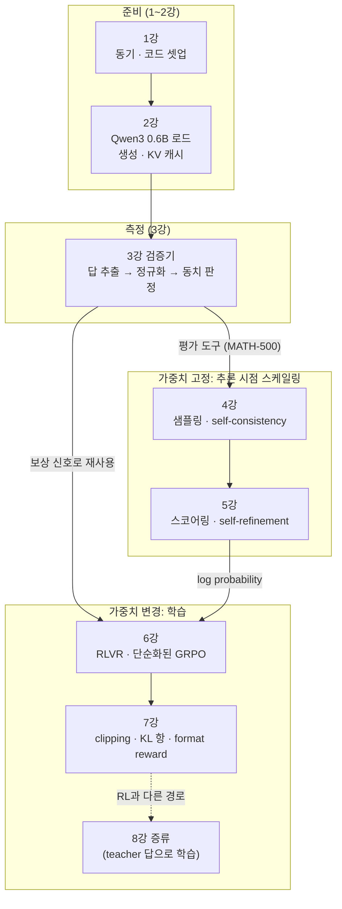
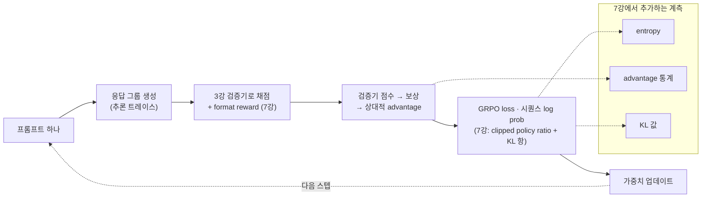

<figure class="post-figure post-figure--header">
<svg role="img" aria-labelledby="rsn-hdr-title rsn-hdr-desc" viewBox="0 0 720 320" xmlns="http://www.w3.org/2000/svg">
  <title id="rsn-hdr-title">일반 LLM 엔진에 부품을 장착해 추론 모델로 튜닝하고, 에이전트 하니스라는 차체에 얹는다</title>
  <desc id="rsn-hdr-desc">가운데 엔진 블록은 Qwen3 0.6B 위에 조립하는 추론 모델이다. 왼쪽에서 검증기(3강)와 샘플링·스코어링(4~5강), 오른쪽에서 RL·GRPO(6~7강)와 증류(8강) 부품이 엔진에 볼트로 결합된다. 완성된 엔진은 아래쪽 차체, 즉 컨텍스트 관리와 도구 접근을 맡는 에이전트 하니스의 엔진 베이로 내려가 장착된다.</desc>
  <defs>
    <marker id="rsn-hdr-arrow" markerWidth="9" markerHeight="9" refX="7" refY="4" orient="auto">
      <path d="M0 0 L8 4 L0 8 Z" fill="var(--gold)"/>
    </marker>
  </defs>

  <text x="360" y="34" text-anchor="middle" font-size="15" font-weight="700" fill="currentColor">엔진을 튜닝하고, 차체에 얹는다</text>
  <text x="360" y="56" text-anchor="middle" font-size="11" fill="currentColor" opacity="0.72">모델 = 엔진 · 하니스 = 엔진을 여러 용도로 쓰게 해 주는 기계 장치</text>

  <g fill="var(--bg-light)" stroke="currentColor" stroke-width="1.5">
    <rect x="40" y="88" width="170" height="32" rx="4"/>
    <rect x="40" y="142" width="170" height="32" rx="4"/>
    <rect x="510" y="88" width="170" height="32" rx="4"/>
    <rect x="510" y="142" width="170" height="32" rx="4"/>
  </g>
  <g fill="currentColor" text-anchor="middle" font-size="12" font-weight="700">
    <text x="125" y="109">검증기 · 3강</text>
    <text x="125" y="163">샘플링·스코어링 · 4~5강</text>
    <text x="595" y="109">RL · GRPO · 6~7강</text>
    <text x="595" y="163">증류 · 8강</text>
  </g>
  <g fill="none" stroke="var(--secondary-color)" stroke-width="3">
    <path d="M210 104 H250 M210 158 H250 M470 104 H510 M470 158 H510"/>
  </g>
  <g fill="var(--gold)">
    <rect x="244" y="100" width="8" height="8"/>
    <rect x="244" y="154" width="8" height="8"/>
    <rect x="468" y="100" width="8" height="8"/>
    <rect x="468" y="154" width="8" height="8"/>
  </g>

  <rect x="250" y="84" width="220" height="94" rx="6" fill="var(--bg-panel)" stroke="var(--accent-color)" stroke-width="3"/>
  <g fill="none" stroke="var(--border-color)" stroke-width="2">
    <path d="M272 96 V112 M286 96 V112 M300 96 V112 M420 96 V112 M434 96 V112 M448 96 V112"/>
  </g>
  <text x="360" y="134" text-anchor="middle" font-size="15" font-weight="700" fill="var(--accent-color)">추론 모델 (엔진)</text>
  <text x="360" y="156" text-anchor="middle" font-size="11" fill="currentColor">일반 LLM · Qwen3 0.6B 위에 조립</text>

  <path d="M360 182 V218" fill="none" stroke="var(--gold)" stroke-width="3" stroke-dasharray="6 4" marker-end="url(#rsn-hdr-arrow)"/>
  <text x="372" y="204" font-size="12" font-weight="700" fill="var(--gold)">장착</text>

  <path d="M60 272 V236 Q60 222 74 222 H250 V240 H470 V222 H646 Q660 222 660 236 V272 Z" fill="var(--bg-panel)" stroke="var(--secondary-color)" stroke-width="3"/>
  <text x="155" y="252" text-anchor="middle" font-size="12" font-weight="700" fill="currentColor">컨텍스트 관리</text>
  <text x="565" y="252" text-anchor="middle" font-size="12" font-weight="700" fill="currentColor">도구 접근</text>
  <text x="360" y="264" text-anchor="middle" font-size="13" font-weight="700" fill="var(--secondary-color)">에이전트 하니스 (차체)</text>
  <g fill="var(--bg-light)" stroke="currentColor" stroke-width="3">
    <circle cx="150" cy="280" r="17"/>
    <circle cx="570" cy="280" r="17"/>
  </g>
  <g fill="currentColor">
    <circle cx="150" cy="280" r="4"/>
    <circle cx="570" cy="280" r="4"/>
  </g>
  <text x="360" y="312" text-anchor="middle" font-size="11" fill="currentColor" opacity="0.72">더 큰 코딩 작업 · 여행 예약 · 개인 비서 업무</text>
</svg>
<figcaption>이번 강의는 엔진 쪽 — 일반 LLM에 검증기·추론 시점 스케일링·RL·증류를 하나씩 붙여 추론 모델로 만드는 과정 — 에 집중한다.</figcaption>
</figure>

## 원문 정보

> - **제목**: Building Reasoning Models from the Ground Up: A Full Video Course
> - **부제**: Eight videos and over 11 hours of coding, covering evaluation, inference-time scaling, reinforcement learning, and distillation in Python and PyTorch.
> - **출처**: Sebastian Raschka, PhD — Ahead of AI ([magazine.sebastianraschka.com](https://magazine.sebastianraschka.com/))
> - **발행**: 2026-10-24 · 약 10분 분량 (영상 본편은 약 11시간)
> - **원문 링크**: <https://magazine.sebastianraschka.com/p/building-reasoning-models>

저자의 책 *Build a Reasoning Model (From Scratch)*에 딸린 8편의 코딩 강의 영상을 소개하는 글이다. 이 포스트는 **글 본문(강의 소개와 강의별 목차)**을 근거로 하며, 영상 11시간 분량의 세부 내용은 직접 다루지 않는다. 영상 안에서 실제로 어떤 수치가 나오는지는 원문에도 적혀 있지 않으므로 여기서도 언급하지 않는다.

## 한 줄 요약 (TL;DR)

추론 모델은 일반 LLM에 **검증 가능한 보상 기반 강화학습(RLVR)**과 (선택적으로) **추론 시점 스케일링**을 얹은 "업그레이드된 엔진"이고, 에이전트는 이 엔진을 감싸는 하니스다. Raschka는 사전학습된 Qwen3 0.6B에서 출발해 **평가 → 추론 시점 스케일링 → RL(GRPO) → 증류**를 PyTorch로 직접 구현하는 8강 코스로, 그 엔진의 내부를 손으로 짜 보게 한다.

## 왜 이 글을 골랐나

위키에는 이미 Stanford CS336을 따라간 [CS336 시리즈](/2026/06/26/cs336-llm-from-scratch-curriculum.html)가 있고, 그 끝자락에서 [RLVR와 추론 모델](/2026/06/26/cs336-lecture-16-alignment-rlvr.html), [GRPO 직접 구현](/2026/06/26/cs336-lecture-17-alignment-rl-grpo.html)을 다뤘다. 한편 Articles 쪽에는 [하니스의 정의](/2026/08/03/what-makes-a-harness-a-harness.html)나 [Codex의 agent loop](/2026/06/25/codex-agent-loop.html)처럼 **엔진 바깥**을 다룬 글이 많다.

이 글은 그 둘을 잇는다. "추론 모델 = 엔진, 하니스 = 엔진을 쓰게 해 주는 기계 장치"라는 짧은 정리가 들어 있고, 본편은 엔진 쪽을 **작은 모델 하나로 끝까지** 구현하는 실습 순서를 제시한다. 강의 목차 자체가 "추론 모델을 만들려면 무엇을 어떤 순서로 쌓아야 하는가"에 대한 잘 설계된 답이라는 점이 이 글을 고른 이유다.

### 한눈에 보기

8강의 흐름을 한 장으로 그리면 다음과 같다. 3강의 검증기가 평가 도구로 먼저 쓰이고, 6강에서 보상 신호로 다시 쓰인다.

## 핵심 내용

### 배경: 왜 지금 또 추론 모델인가

Raschka는 지난 2년간 Ahead of AI에서 추론 모델을 여러 차례 다뤘고, 최근에는 [추론 노력(reasoning effort) 수준을 제어하는 메커니즘](https://magazine.sebastianraschka.com/p/controlling-reasoning-effort-in-llms)에 대한 글도 썼다. 그의 진단은 간단하다. **현세대 LLM은 거의 전부가 추론 모델이거나 추론 모드를 제공한다.** 그래서 추론 모델은 "여전히 그 어느 때보다 중요한" 주제라는 것.

그는 이 주제를 이해하는 최선의 방법이 여전히 **PyTorch로 밑바닥부터 구현해 보는 것**이라고 보고, 책 *Build a Reasoning Model (From Scratch)*에 이어 지난 몇 달간 녹화한 강의 8편을 공개했다. 작년의 [Coding LLMs from the Ground Up](https://magazine.sebastianraschka.com/p/coding-llms-from-the-ground-up) 코스의 **속편** 격이지만, 그 코스를 선수 과목으로 요구하지는 않는다.

### LLM · 추론 모델 · 에이전트는 어떻게 맞물리나

본편 전에 저자는 자주 받는 질문 — "추론 모델과 오늘날의 AI 에이전트는 어떤 관계인가" — 에 짧게 답한다.

- **추론 모델**은 일반 LLM의 업그레이드다. **RLVR(reinforcement learning with verifiable rewards)** 기반의 추가 post-training과, 선택적으로 추론 시점 스케일링 기법을 더해 더 어려운 문제를 풀게 만든 것. 고전적으로는 수학과 코드를 겨냥해 개발되지만, 그 능력은 다른 문제 영역으로도 일반화될 수 있다.
- **에이전트 하니스**는 LLM/추론 모델을 감싸는 소프트웨어·도구 프레임워크로, 더 큰 코딩 작업, 여행 예약, 각종 개인 비서 업무처럼 훨씬 어려운 문제를 다룬다. 하니스의 일은 **정교한 컨텍스트 관리**와 **LLM에게 도구 접근권을 주는 것**이다.
- 비유하자면 **모델은 엔진**, 하니스는 그 엔진을 (단순 챗봇 인터페이스를 넘어) 여러 용도로 쓰게 해 주는 **기계 장치**다. 에이전트는 일반 LLM도 쓸 수 있지만, 더 유능한 추론 모델이 더 일반적인 선택이다.

결론적으로 "엔진"인 추론 모델은 현대 LLM 에이전트를 이해하는 데 여전히 핵심 부품이라는 것이 저자의 정리다. 그는 이 세 층에 각각 대응하는 자료로 *Build a Large Language Model (From Scratch)* (책·영상), *Build a Reasoning Model (From Scratch)* (책·이번 영상), 그리고 [Components of a Coding Agent](https://magazine.sebastianraschka.com/p/components-of-a-coding-agent) 글을 제시한다. 이번 강의는 그중 **엔진 개발**에 집중한다.

<figure class="post-figure">
<svg role="img" aria-labelledby="rsn-stack-title rsn-stack-desc" viewBox="0 0 720 300" xmlns="http://www.w3.org/2000/svg">
  <title id="rsn-stack-title">일반 LLM, 추론 모델, 에이전트 하니스의 세 층과 각 층에 대응하는 Raschka 자료</title>
  <desc id="rsn-stack-desc">가장 안쪽 상자는 사전학습된 일반 LLM이다. 그 위에 RLVR post-training과 선택적인 추론 시점 스케일링을 얹은 것이 추론 모델이고, 가장 바깥을 컨텍스트 관리와 도구 접근을 맡는 에이전트 하니스가 감싼다. 오른쪽 라벨은 각 층에 대응하는 자료로, 하니스는 Components of a Coding Agent 글, 추론 모델은 Build a Reasoning Model (From Scratch) 책과 이번 강의, 일반 LLM은 Build a Large Language Model (From Scratch) 책과 영상이다. 이번 강의의 초점인 추론 모델 층이 강조되어 있다.</desc>

  <rect x="30" y="20" width="440" height="260" rx="10" fill="var(--bg-light)" stroke="var(--secondary-color)" stroke-width="3"/>
  <text x="50" y="48" font-size="15" font-weight="700" fill="var(--secondary-color)">에이전트 하니스</text>
  <text x="50" y="68" font-size="12" fill="currentColor">컨텍스트 관리 + 도구 접근</text>

  <rect x="60" y="84" width="380" height="180" rx="8" fill="var(--bg-panel)" stroke="var(--accent-color)" stroke-width="3"/>
  <text x="80" y="110" font-size="15" font-weight="700" fill="var(--accent-color)">추론 모델</text>
  <text x="80" y="130" font-size="12" fill="currentColor">+ RLVR 기반 post-training</text>
  <text x="80" y="149" font-size="12" fill="currentColor">+ 추론 시점 스케일링 (선택)</text>

  <rect x="90" y="166" width="320" height="80" rx="6" fill="var(--bg-light)" stroke="currentColor" stroke-width="2"/>
  <text x="110" y="198" font-size="14" font-weight="700" fill="currentColor">일반 LLM (사전학습)</text>
  <text x="110" y="222" font-size="12" fill="currentColor" opacity="0.8">이 강의의 출발점: Qwen3 0.6B</text>

  <g fill="none" stroke="var(--border-color)" stroke-width="2" stroke-dasharray="4 4">
    <path d="M470 58 H495 M440 126 H495 M410 206 H495"/>
  </g>

  <rect x="495" y="36" width="205" height="44" rx="4" fill="var(--bg-panel)" stroke="currentColor" stroke-width="1.5"/>
  <text x="508" y="54" font-size="11" font-weight="700" fill="currentColor">Components of a Coding Agent</text>
  <text x="508" y="70" font-size="10" fill="currentColor" opacity="0.8">Raschka 글</text>

  <rect x="495" y="104" width="205" height="44" rx="4" fill="var(--bg-panel)" stroke="var(--gold)" stroke-width="3"/>
  <text x="508" y="122" font-size="11" font-weight="700" fill="currentColor">Build a Reasoning Model</text>
  <text x="508" y="138" font-size="10" fill="currentColor" opacity="0.8">(From Scratch) 책 · 이번 강의</text>
  <text x="597" y="166" text-anchor="middle" font-size="11" font-weight="700" fill="var(--gold)">이번 강의의 초점 = 엔진 개발</text>

  <rect x="495" y="184" width="205" height="44" rx="4" fill="var(--bg-panel)" stroke="currentColor" stroke-width="1.5"/>
  <text x="508" y="202" font-size="11" font-weight="700" fill="currentColor">Build a Large Language Model</text>
  <text x="508" y="218" font-size="10" fill="currentColor" opacity="0.8">(From Scratch) 책 · 영상</text>
</svg>
<figcaption>세 층의 관계 — 하니스는 컨텍스트와 도구를, 추론 능력은 엔진(post-training)을 맡는다. 각 층마다 저자의 자료가 하나씩 대응한다.</figcaption>
</figure>

### 범위와 선수 지식

- 대상 모델은 **작은 사전학습 Qwen3 모델**이고, 추론 기법은 Python과 PyTorch로 직접 구현한다. 사전학습 모델에서 출발하는 이유는 흥미로운 부분 — **평가, 추론 시점 스케일링, 강화학습, 증류** — 에 집중하기 위해서다.
- Python과 PyTorch에 익숙한 것을 권장한다. 이전 LLM 책은 권장 사항이지만 필수는 아니다.
- 연산 자원: 초반의 텍스트 생성·평가 예제는 **CPU로도** 따라갈 수 있다. 후반 실험, 특히 학습은 **GPU가 있어야 현실적**이다. 하드웨어·환경 권장 사항은 1강과 [저장소의 setup tips](https://github.com/rasbt/reasoning-from-scratch/tree/main/ch02/02_setup-tips)에 있다.

### 동반 도서와 권장 학습 방식

강의는 책 *Build a Reasoning Model (From Scratch)* (Manning/Amazon, 컬러 인쇄판)의 동반 자료다. 저자가 권하는 가장 깊은 학습 루틴은 **한 장을 읽고 → 해당 영상과 함께 코드를 따라 치고 → 연습문제를 푸는 것**이다. 본편 전의 가벼운 개요가 필요하다면 약 90분짜리 LinkedIn Learning 강좌 *AI Reasoning Models*를 선택적 예고편으로 추천한다(저자 링크로 접속하면 24시간 무료라고 안내한다).

### 8강 커리큘럼

각 강의는 책의 한 장과 짝을 이루며, 영상 링크와 장별 코드(`rasbt/reasoning-from-scratch`의 `ch02`~`ch08`)가 함께 제공된다.

| 강 | 주제 | 이 강의가 만드는 것 (원문 "Topics covered" 요약) |
| --- | --- | --- |
| 1 | 동기와 코드 셋업 | LLM·추론 모델·하니스의 관계, 코드로 배우는 이점, `uv`로 의존성 설치, CUDA/Apple Silicon 확인, VS Code 원격 GPU와 환경 트러블슈팅 |
| 2 | 베이스 모델 로드, 텍스트 생성, KV 캐싱 | Qwen3 0.6B 가중치 로드, 토큰 인코딩/디코딩, 텐서 shape·logits·다음 토큰 예측, greedy decoding과 스트리밍 생성, EOS 처리와 생성 속도 측정, KV 캐시, `torch.compile` 결합과 하드웨어별 성능 비교 |
| 3 | 평가와 RL을 위한 검증기 | 답 추출 → 정규화 → 수학적 동치 판정으로 이어지는 math-answer verifier, MATH-500 평가 루프, 베이스 모델과 추론 모델 비교. 이 검증기는 이후 **RLVR의 보상 신호**로 재사용된다 |
| 4 | 추론 시점 스케일링 (1): 샘플링과 self-consistency | 학습 시 vs 추론 시 추가 연산의 효과 비교, chain-of-thought 프롬프트로 보는 추론 스케일링 입문, temperature scaling·multinomial sampling·top-p filtering으로 다양한 답 생성, 최종 답 다수결(self-consistency), 정확도 대 추가 연산 비용 평가 |
| 5 | 추론 시점 스케일링 (2): 스코어링과 self-refinement | 여러 답을 비교하고 동점을 깨는 스코어링 함수, 간단한 휴리스틱 scorer, 토큰 확률과 시퀀스 likelihood(이후 RL에도 쓰임), 수치 안정성을 위한 log probability, 모델이 스스로 비평하고 수정하는 self-refinement 루프와 MATH-500 평가 |
| 6 | 강화학습: RLVR을 위한 GRPO 구현 | 추론 트레이스 생성과 답 길이·문제 해결력의 관계, RLHF vs RLVR 비교, 검증기 점수 → 보상 → 상대적 advantage, 시퀀스 log prob와 **단순화된 GRPO loss**, 로깅·체크포인트가 있는 학습 루프, 학습 안정성과 메모리 요구 확인 |
| 7 | 강화학습: 추적, clipped policy ratio, KL 항 | 더 긴 학습과 로그 해석, advantage·entropy 추적, policy loss의 clipping과 그 효과, KL loss 항과 reward hacking, 단순화된 KL 정식화의 한계, **정답 여부에 조건화한 format reward**, 체크포인트 비교와 GRPO 후속 연구 |
| 8 | 추론 모델 증류 | soft/hard, on-policy/off-policy 증류의 조합 비교, DeepSeek R1로 MATH 데이터셋의 teacher 답 생성, 토크나이즈와 train/validation/test 분할, 답 토큰 log prob와 cross-entropy loss, 지도 학습 루프와 손실 추적, MATH-500에서 증류 결과 비교 |

몇 가지 설계 포인트가 원문에 명시되어 있다.

- **4~5강은 가중치를 고정한 채** 답을 개선한다. 그 전에 같은 프롬프트에서 다양한 답을 뽑는 방법부터 구현하는데, 저자는 이것이 ChatGPT 같은 상용 챗봇에서도 표준 관행이라고 말한다.
- 5강의 스코어링은 4강 self-consistency의 **동점 깨기**에도 쓰이고, 거기서 구현한 log probability 계산은 6~7강 RL로 이어진다.
- 6강은 GRPO의 **단순화된 버전**을 먼저 만들고, 7강에서 그 학습 루프를 다시 열어 entropy·advantage 통계, clipped policy ratio, KL 항, format reward를 추가하며 "이 추가 요소들이 실제로 도움이 되는가"를 로그와 평가 결과로 따진다.
- 8강의 증류는 RL과 **다른 경로**로 작은 추론 모델을 만드는 방법, 즉 더 크고 강한 teacher 모델의 답으로부터 배우는 방식으로 코스를 마무리한다.

6~7강에서 구현하는 GRPO 학습의 한 스텝을 그리면 다음과 같다. 점선은 7강에서 학습 루프를 다시 열며 추가하는 계측 지점이다.

### 맺음말

저자는 강의를 보다가 흥미로운 생각이 들면 **잠시 멈추고 작은 실험을 해 보라**고 권한다. 샘플링 설정을 바꿔 보거나, 틀린 답 몇 개를 들여다보거나, 연습문제의 제안과 비슷한 변형을 시도해 보라는 것. 그리고 잠깐 휴식 후 다음 달 LLM 연구 라운드업으로 돌아오겠다는 인사로 글을 맺는다.

## 분석과 인사이트

여기부터는 원문 요약이 아니라 내 해석이다.

### 1. 이 목차의 진짜 주인공은 "검증기"다

8강 구성에서 가장 영리한 설계는 3강의 검증기다. 같은 부품이 **평가 도구**(MATH-500 채점)로 먼저 등장하고, 6강에서 **보상 함수**로 재등장한다. RLVR이라는 이름 자체가 "verifiable"에 기대고 있다는 점을 생각하면, "측정할 수 있어야 개선할 수 있다"는 원칙이 코스 구조로 체화된 셈이다. CS336의 [RLVR 강의](/2026/06/26/cs336-lecture-16-alignment-rlvr.html)에서 정리했던 "왜 검증 가능한 보상인가"라는 질문에, 이 코스는 "그 검증기를 직접 짜 보라"로 답한다. 실무에서도 마찬가지다. 에이전트든 추론 모델이든, 개선 루프를 돌리기 전에 **자동으로 정답을 판정하는 장치**를 먼저 갖추는 것이 순서다.

### 2. "가중치 고정 → 가중치 변경"이라는 비용의 사다리

4~5강(추론 시점 스케일링)과 6~8강(RL·증류)의 경계는 곧 **비용 구조의 경계**다. 앞쪽은 학습 없이 추론 연산을 더 써서 정확도를 사고, 뒤쪽은 학습 연산을 써서 모델 자체를 바꾼다. 원문 4강이 "학습 시 vs 추론 시 추가 연산의 효과 비교"로 시작하고 "정확도 대 추가 연산 비용"으로 끝나는 것은, 이 선택이 결국 트레이드오프라는 점을 처음부터 의식시키려는 의도로 읽힌다. 하니스를 만드는 입장에서는 self-consistency나 self-refinement가 **모델을 건드리지 않고 하니스 레벨에서 구현 가능한** 기법이라는 점이 특히 실용적이다.

### 3. 엔진 비유는 단순하지만, 경계선을 잘 긋는다

"모델 = 엔진, 하니스 = 기계 장치"는 위키의 [하니스 정의 글](/2026/08/03/what-makes-a-harness-a-harness.html)이나 [GPT-6 Astra 글](/2026/09/08/gpt6-astra-harness-is-the-product.html)에 비하면 거친 정리다. 그래도 하니스의 역할을 **컨텍스트 관리 + 도구 접근**으로 한정하고, 추론 능력은 엔진(post-training) 쪽 책임으로 분리한다는 점에서 유용하다. 에이전트 품질 문제를 디버깅할 때 "엔진의 한계인가, 하니스의 한계인가"를 먼저 가르는 습관을 들이게 해 준다. 다만 self-consistency처럼 추론 시점 스케일링은 엔진과 하니스 어느 쪽에서도 구현될 수 있어, 경계가 생각보다 흐릿하다는 점은 염두에 둘 만하다(이 부분은 원문이 다루지 않는 내 관찰이다).

### 4. 작은 모델로 끝까지 — 교육 설계로서의 강점과 한계

Qwen3 0.6B라는 작은 모델 하나로 생성 → 평가 → 스케일링 → RL → 증류를 일관되게 관통한다는 점은 학습 효율이 높다. 모든 기법을 **같은 벤치마크(MATH-500)**로 비교하게 만들어, 각 기법의 효과를 같은 잣대로 보게 한다. 반면 이 설정은 수학이라는 "검증이 쉬운" 도메인에 맞춰져 있다. 원문도 추론 모델이 고전적으로 수학·코드를 겨냥한다고 밝히는데, 정답 판정이 모호한 실무 도메인(문서 작성, 설계 판단 등)으로 옮길 때 검증기를 어떻게 만들지는 이 코스 밖의 숙제로 남는다.

### 5. 원문이 "무엇을 말하지 않는가"

이 글은 강의 소개문이라 **결과 수치가 없다.** 각 기법이 MATH-500에서 얼마나 개선되는지, GRPO 학습에 GPU 시간이 얼마나 드는지 같은 정보는 영상과 책에 있을 것으로 보이지만 글에는 없다. 이 코스의 가치를 판단하려면 결국 영상과 코드를 직접 돌려 봐야 한다.

## 적용 포인트

- **위키 CS336 시리즈의 실습판으로 쓰기**: [CS336 16강](/2026/06/26/cs336-lecture-16-alignment-rlvr.html)과 [17강](/2026/06/26/cs336-lecture-17-alignment-rl-grpo.html)에서 개념으로 정리한 RLVR·GRPO를 이 코스의 6~7강 코드로 직접 손에 익힌다. KV 캐시는 [CS336 10강](/2026/06/26/cs336-lecture-10-inference.html)과 이 코스 2강을 나란히 보면 좋다.
- **CPU로 시작해 GPU로 넘어가기**: 1~5강(생성·평가·추론 시점 스케일링)은 CPU로도 따라갈 수 있다고 하니, GPU를 확보하기 전에 먼저 진행한다.
- **"한 장 읽기 → 영상 따라 코딩 → 연습문제"** 루틴을 그대로 채택한다. 저자의 제안대로 중간중간 멈추고 샘플링 설정을 바꾸거나 틀린 답을 들여다보는 작은 실험을 끼운다.
- **검증기부터 만드는 습관**: 사내 에이전트나 LLM 기능을 개선하려 할 때도 3강처럼 "답 추출 → 정규화 → 동치 판정" 파이프라인을 먼저 설계한다. 그것이 평가 지표이자 나중의 보상 함수가 된다. 평가 설계의 큰 그림은 [CS336 12강](/2026/06/26/cs336-lecture-12-evaluation.html) 참고.
- **하니스 레벨의 값싼 개선부터**: 모델을 학습시키기 전에 temperature/top-p 샘플링 + self-consistency, 스코어링 기반 선택, self-refinement 같은 추론 시점 기법을 먼저 시도하고, 정확도 대 비용을 측정한다.
- **엔진/하니스 분리 진단**: 에이전트가 실패하면 원인을 "엔진(추론 능력)"과 "하니스(컨텍스트 관리·도구 접근)"로 먼저 나눈다.

## 마무리

Raschka의 이번 글은 새로운 연구 결과가 아니라 **잘 짜인 학습 로드맵**이다. 하지만 그 목차는 "추론 모델이란 무엇으로 이루어지는가"에 대한 압축된 답이다. 생성할 수 있는 베이스 모델, 정답을 판정하는 검증기, 가중치를 건드리지 않는 추론 시점 스케일링, 검증기를 보상으로 삼는 RL, 그리고 더 큰 모델에게서 배우는 증류. 에이전트 하니스를 만드는 사람에게 이 코스는 자신이 얹어 쓰는 엔진의 내부를 한 번은 직접 조립해 보게 해 주는, 비용 대비 효과가 큰 우회로다.

### 더 읽어보기

- [원문 — Building Reasoning Models from the Ground Up: A Full Video Course](https://magazine.sebastianraschka.com/p/building-reasoning-models) — Sebastian Raschka, Ahead of AI
- [코드 저장소 — rasbt/reasoning-from-scratch](https://github.com/rasbt/reasoning-from-scratch) — 장별 코드(`ch02`~`ch08`)와 셋업 팁
- [Components of a Coding Agent](https://magazine.sebastianraschka.com/p/components-of-a-coding-agent) — 원문이 엔진 비유 그림의 출처로 든 저자의 하니스 글
- [CS336: 밑바닥부터 만드는 언어 모델 — Essential Curriculum](/2026/06/26/cs336-llm-from-scratch-curriculum.html) — 같은 "from scratch" 철학의 위키 시리즈 전체 지도
- [CS336 16강 — RLVR와 추론 모델](/2026/06/26/cs336-lecture-16-alignment-rlvr.html) — 이 코스 6강의 개념적 배경
- [CS336 17강 — 정책 경사와 GRPO 직접 구현](/2026/06/26/cs336-lecture-17-alignment-rl-grpo.html) — 6~7강 GRPO 구현과 나란히 보기
- [CS336 15강 — SFT와 RLHF](/2026/06/26/cs336-lecture-15-alignment-sft-rlhf.html) — 6강의 RLHF vs RLVR 비교를 위한 배경
- [CS336 10강 — 추론: KV 캐시와 메모리 한계의 게임](/2026/06/26/cs336-lecture-10-inference.html) — 2강의 KV 캐싱 배경
- [CS336 12강 — 평가: 하나의 참된 평가는 없다](/2026/06/26/cs336-lecture-12-evaluation.html) — 3강 검증기 기반 평가를 넓은 맥락에서
- [무엇이 하니스를 하니스로 만드는가](/2026/08/03/what-makes-a-harness-a-harness.html) — 엔진 바깥, 하니스의 정의
- [Codex의 agent loop를 펼쳐 보기](/2026/06/25/codex-agent-loop.html) — 하니스가 추론 모델을 실제로 부리는 방식
