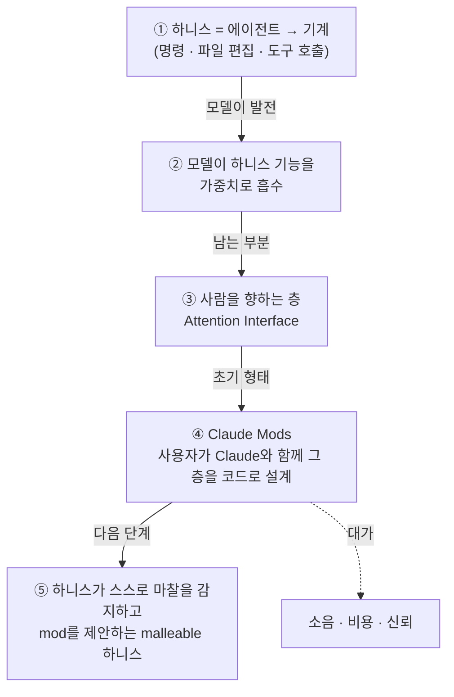
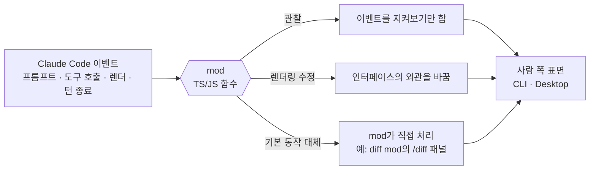
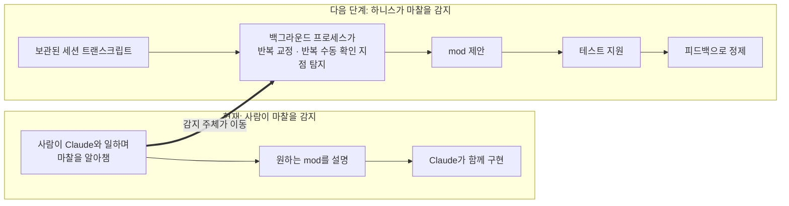

<figure class="post-figure post-figure--header">
<svg role="img" aria-label="왼쪽의 기계(터미널·파일·도구)를 향하던 에이전트의 하니스 화살표가 점선으로 희미해지고, 대신 굵은 화살표가 아래로 꺾여 되돌아 나오면서 그 길 위에 놓인 mod를 지나 오른쪽의 사람의 눈, 곧 사람의 주의(Attention Interface)를 향하는 그림" viewBox="0 0 640 320">
  <title>안팎으로 뒤집힌 하니스</title>

  <!-- LEFT: 기계 (터미널 · 파일 · 도구) -->
  <text x="36" y="50" font-family="var(--font-body)" font-size="15" font-weight="700" fill="currentColor">기계</text>
  <text x="36" y="68" font-family="var(--font-body)" font-size="11" fill="currentColor" opacity="0.7">터미널 · 파일 · 도구</text>
  <g fill="none" stroke="currentColor" stroke-width="2" opacity="0.6">
    <rect x="36" y="82" width="112" height="70" rx="4"/>
    <path d="M36 96 H148"/>
    <path d="M52 182 h36 l14 14 v50 h-50 z"/>
    <path d="M88 182 v14 h14"/>
    <path d="M60 212 h30 M60 224 h30 M60 236 h20"/>
    <circle cx="136" cy="214" r="16"/>
    <circle cx="136" cy="214" r="6"/>
    <path d="M136 192 v6 M136 230 v6 M114 214 h6 M152 214 h6"/>
  </g>
  <text x="48" y="128" font-family="var(--font-mono)" font-size="16" fill="currentColor" opacity="0.6">&gt;_ cmd</text>

  <!-- OLD direction: 에이전트 → 기계 (희미한 점선) -->
  <g fill="none" stroke="currentColor" stroke-width="2.5" stroke-dasharray="6 6" opacity="0.4" stroke-linecap="round">
    <path d="M282 150 H172"/>
  </g>
  <polygon points="162,150 176,142 176,158" fill="currentColor" opacity="0.4"/>
  <text x="227" y="138" text-anchor="middle" font-family="var(--font-body)" font-size="11" fill="currentColor" opacity="0.6">예전의 방향</text>

  <!-- CENTER: 에이전트 (픽셀 블록 머리) -->
  <g>
    <rect x="296" y="118" width="48" height="48" fill="var(--orc-green)" stroke="currentColor" stroke-width="2"/>
    <rect x="306" y="132" width="8" height="8" fill="currentColor"/>
    <rect x="326" y="132" width="8" height="8" fill="currentColor"/>
    <rect x="308" y="152" width="24" height="4" fill="currentColor"/>
    <rect x="316" y="108" width="8" height="10" fill="currentColor"/>
  </g>
  <text x="320" y="96" text-anchor="middle" font-family="var(--font-body)" font-size="14" font-weight="700" fill="currentColor">에이전트</text>

  <!-- NEW direction: 꺾여 되돌아 사람을 향하는 하니스 -->
  <path d="M300 172 C 230 196, 220 270, 320 270 C 420 270, 452 222, 480 186" fill="none" stroke="var(--accent-color)" stroke-width="5" stroke-linecap="round"/>
  <polygon points="487,177 484,195 470,184" fill="var(--accent-color)"/>

  <!-- mod: 뒤집힌 길 위에 놓인 미들웨어 -->
  <rect x="294" y="256" width="58" height="28" rx="3" fill="var(--bg-panel)" stroke="var(--accent-color)" stroke-width="2"/>
  <text x="323" y="275" text-anchor="middle" font-family="var(--font-mono)" font-size="13" font-weight="700" fill="var(--accent-color)">mod</text>
  <text x="323" y="304" text-anchor="middle" font-family="var(--font-body)" font-size="11" fill="currentColor" opacity="0.75">사용자가 Claude와 함께 짜는 층</text>

  <!-- RIGHT: 사람의 눈 (주의) -->
  <path d="M492 150 Q546 102 600 150 Q546 198 492 150 Z" fill="none" stroke="currentColor" stroke-width="2.5"/>
  <circle cx="546" cy="150" r="19" fill="var(--secondary-color)"/>
  <circle cx="546" cy="150" r="8" fill="currentColor"/>
  <rect x="550" y="140" width="5" height="5" fill="var(--bg-panel)"/>
  <text x="546" y="70" text-anchor="middle" font-family="var(--font-body)" font-size="15" font-weight="700" fill="currentColor">사람의 주의</text>
  <text x="546" y="222" text-anchor="middle" font-family="var(--font-body)" font-size="12" font-weight="700" fill="var(--accent-color)">Attention Interface</text>
</svg>
<figcaption>기계를 향하던 하니스가 꺾여 사람의 주의를 향한다 — 그 뒤집힌 길 위에 mod가 놓인다.</figcaption>
</figure>

## 원문 정보

> - **제목**: Claude Mods: Flipping the Harness Inside Out
> - **출처**: Dan McAteer / Latent Space ([latent.space](https://latent.space))
> - **발행**: 2026-10-21 · 약 10분 분량
> - **원문 링크**: <https://latent.space/p/claude-mods/>

이 위키가 여러 번 다뤄 온 "에이전트 하니스" 논의를, 이번에는 **모델 쪽이 아니라 사람 쪽 끝**에서 다시 보는 글이라 Articles에 담는다.

## 한 줄 요약 (TL;DR)

모델이 하니스의 기능을 점점 가중치 안으로 흡수하면, 남는 하니스는 **사람의 주의를 다루는 층(Attention Interface)**이 된다. Claude Mods는 이 층을 사용자가 Claude와 함께 **코드로 직접 설계**할 수 있게 하는 초기 형태다 — 다만 소음·비용·신뢰라는 대가가 따른다.

### 한눈에 보기

하니스가 향하는 방향이 어떻게 바뀌어 왔고, Claude Mods가 그 흐름의 어디에 있는지를 한 장으로 정리하면 이렇다.

## 왜 이 글을 골랐나

이 위키에는 하니스를 **정의**하는 글([무엇이 하니스를 하니스로 만드는가](/2026/08/03/what-makes-a-harness-a-harness.html)), 하니스가 **제품 경쟁력**이라는 글([GPT-6 Astra: 하니스가 곧 제품이다](/2026/09/08/gpt6-astra-harness-is-the-product.html)), 하니스가 LLM을 **어떻게 부리는지** 펼친 글([Codex의 agent loop](/2026/06/25/codex-agent-loop.html))이 있다. 셋 모두 "모델과 기계 사이"를 본다.

이 글은 방향이 반대다. 하니스의 **사람 쪽 표면** — 에이전트가 언제 나를 방해하고, 무엇을 보여주고, 어떤 결정을 내게 넘기는지 — 이 앞으로의 핵심이라고 주장한다. [Anthropic의 고용 변화 분석](/2026/10/22/employment-at-anthropic.html)이 짚은 "사람의 주의가 병목"이라는 관찰과도 정확히 맞물린다. 게다가 추상론이 아니라 저자가 몇 주간 실제로 써 본 사례·수치(111턴 중 99턴 등)와 단점까지 담고 있어 실무적으로 읽을 거리가 많다.

## 핵심 내용

### "주의를 기울이는 부분"이 이제 가장 중요하다

저자는 앞선 Latent Space 글 *The Evolution of the Agent Harness*에서, 모델이 하니스의 더 많은 부분을 가중치로 흡수할수록 **남는 부분은 사람을 향하게 된다**고 주장했다. 그것이 **Attention Interface** — 에이전트가 언제 끼어들지, 무엇을 보여줄지, 어떤 결정을 사람에게 요구할지를 정하는 층이다. Claude Mods는 이 Attention Interface의 초기 버전이며, **사용자가 스스로 모양을 잡을 수 있는** 버전이라는 것이 저자의 위치 설정이다.

저자의 베팅도 여기서 나온다. 브라우저가 웹 앱의 플랫폼이 되었듯, **하니스는 모델을 엔진으로 삼아 다른 회사들이 그 위에 무언가를 짓는 플랫폼**이 될 것이고, 사람과 에이전트 사이 인터페이스의 플랫폼이 될 수 있다.

### Claude Mods란 무엇인가

원문이 설명하는 정의는 다음과 같다.

- mod는 Claude Code 안에서 실행되는 **TypeScript/JavaScript 함수들로 이루어진 Claude Code 플러그인**이다.
- 이 함수들은 CLI와 Desktop에서 인터페이스의 **동작과 외관**을 커스터마이즈한다.
- mod는 **이벤트**(프롬프트, 도구 호출, 인터페이스 렌더 등)에 반응해 그 이벤트를 **관찰**하거나, **렌더링 방식을 수정**하거나, **기본 동작을 대신 처리**할 수 있다.

저자는 이를 **"에이전트 하니스를 위한 미들웨어"**라고 부른다. Claude Code의 실행·렌더링 흐름에 코드를 주입해 런타임 동작을 바꾼다는 뜻이다. 핵심은 사람과 에이전트가 **하니스의 사람 쪽 부분을 함께 만든다**는 점 — "Claude가 나와 일하는 방식을 Claude와 함께 설계한다"가 Attention Interface의 본질이라고 말한다.

mod가 "하니스 미들웨어"로서 이벤트 흐름에 끼어드는 방식을 그리면 다음과 같다.





### 하니스의 역전 (The harness reversal)

하니스는 원래 **에이전트와 그것이 돌아가는 기계 사이의 인터페이스**였다. 사람이 프롬프트를 주면 에이전트가 명령을 보내고, 파일을 고치고, 도구를 호출한다. 그런데 점점 **에이전트가 사람과 상호작용하는 수단**이 되어 가고 있다.

Claude Mods는 이 방향을 뒤집는다. 하니스가 "에이전트 → 기계"를 가리키는 대신 "에이전트 → 사람 운영자"를 가리키게 하고, 하니스는 **사람의 주의와 인터페이스하는 수단**이 된다. 원문의 표현으로는 "Claude Mods는 사람 층(human layer)을, Claude를 쓰는 그 사람이 프로그래밍할 수 있게 만든다."

또한 Claude Code에는 **mod 작성법을 가르치는 내장 skill**이 있어서, 원하는 mod를 자연어로 요청하면 Claude가 만들어 준다.

### 실제로 쓰이는 mod들

Claude Code 자체 기능 중 일부가 이미 mod로 구현되어 있다. Anthropic은 **6개의 내장 mod**를 제공하며, `/plugin` → Installed의 Built-in 항목에서 볼 수 있다.

| 내장 mod | 역할 (원문 설명) |
| --- | --- |
| `agents-md` | `AGENTS.md`를 프로젝트 지침으로 로드 |
| `diff` | `/diff`를 가져가 그 패널을 그림 |
| `plugin-authoring` | Claude가 사용자 대신 mod를 작성할 때 쓰는 skill 제공 |
| `sec-default` | 사용자가 설치한 mod로부터 조직이 관리하는 항목을 보호 |
| `telemetry` | Claude Code와 내장 mod가 남기는 분석 기록을 전송 |
| `you-should-know` | 놓쳤을 만한 것을 발견하면 프롬프트 위에 메모를 띄우는 사이드 에이전트 (유일하게 **기본 꺼짐**) |

대부분은 백그라운드에서 동작한다. 저자는 이 점이 흥미롭다고 본다 — Anthropic이 **사용자가 눈치채지 못하는 부분까지** Claude Code를 mod로 만들고 있다는 뜻이기 때문이다.

### 사례 1 — You Should Know

Anthropic이 만든 네이티브 플러그인으로, **메인 에이전트가 일하는 동안 이를 관찰하는 사이드 에이전트**를 돌려 사용자가 놓치기 쉬운 중요한 정보를 표시한다. 결과물에 실질적 영향을 주지만 에이전트 트레이스 속에 묻혀 잘 보이지 않는 도구 호출·결정 같은 것들이다.

저자의 실제 사례: 개인 프로젝트의 시끄러운 UI 문구를 단순화해 달라고 했고, 메인 에이전트는 Compare 화면의 문구를 다듬고 새 빌드를 설치해 전후 스크린샷까지 찍었다. 다 끝난 것처럼 보였다. 그때 You Should Know가 경고했다 — 에이전트가 편집하던 `CompareView.swift`에는 **이미 커밋되지 않은 작업**이 있었고, 다른 약 45개 파일도 마찬가지였다. 나중에 데모 편집을 버리면 그 이전의 미완성 작업까지 함께 날아갈 상황이었고, mod는 먼저 commit이나 stash를 하라고 제안했다. 결과적으로 **의도치 않은 작업 손실을 막아 준** 셈이다.

### 사례 2 — Next Steps Supervisor

저자가 직접 만든 mod다. **파일을 편집했거나, 명령을 실행했거나, 도구 호출이 8회 이상인 턴** 뒤에만 동작한다. 사용자가 주의해야 할 항목들을 표시하고(원문 스크린샷에서는 6가지), 다음 단계를 **클릭 가능한 버튼**으로 제안한다. 버튼을 누르면 그 지시가 Claude Code에 메시지로 전송된다.

이 mod는 저자가 만든 오픈소스 Claude Code 플러그인 **ModSmith**의 일부다. ModSmith는 여러 내장 mod와, Claude가 서로 협업하는 새 mod를 만들 때 쓸 수 있는 **템플릿**을 함께 담고 있다.

### 다른 곳의 Attention Interface

저자는 Attention Interface를 만드는 곳이 Anthropic만은 아니라며 두 제품을 비교 기준으로 삼는다.

**ChatGPT의 Intelligent UI** — OpenAI는 10월 7일 ChatGPT에 GPT-6와 함께 Intelligent UI를 내놓았다. 텍스트로만 답하지 않고 답하면서 **인터페이스를 생성**한다: 차트, 지도, 체크리스트, 폼, 더치페이 계산기·저축 계산기 같은 작은 도구들. 모델이 즉석에서 만드는 일종의 generative UI다. OpenAI 예시 중 하나는 원하는 것을 좁히기 위해 **객관식 후속 질문**으로 답하는데, 저자는 이를 "모델이 언제 사람의 판단이 필요한지 정하고, 그 판단을 받을 인터페이스를 직접 만든다"고 해석한다. 차이점은, 모델이 **OpenAI가 만든 컴포넌트 라이브러리** 안에서 답마다 인터페이스를 고른다는 것, 그리고 출시 시점에 언급된 사용자 제어는 **시각 요소를 줄이는 것** 하나뿐이라는 것이다.

**Cursor의 PR Routing & Approval** — 같은 문제를 반대편에서 푼다. 한 사람·한 답이 아니라 **팀과 PR의 흐름**(점점 더 많은 PR을 에이전트가 쓴다)에서, 어떤 변경이 사람의 주의를 받을 가치가 있는지를 결정한다. 코드 오너십과 커밋 이력으로 리뷰어를 배정하고, 저위험 PR은 **자동 승인**할 수 있다. 설정한 임계값 대비 위험 점수, Cursor의 Bugbot·Security 리뷰어 결과, 저장소 안의 정책 파일을 함께 따진다.

저자가 주목한 규칙 하나: **PR이 승인 정책 자체를 수정하면, 에이전트는 그 수정본으로 해당 PR의 리뷰를 완화하지 않고 base 브랜치의 정책을 읽는다.** 에이전트가 규칙을 바꿔 자기 PR을 통과시킬 수 없다는 뜻이다. Cursor 문서도 이 기능이 "전체 코드 리뷰를 대체하지 않는다"고 분명히 밝힌다 — 사람의 리뷰를 없애는 게 아니라 **중요한 곳에 쓰게** 하려는 것이다.

### 세 시스템의 차이: 누가 Attention Interface를 설계하는가

| 시스템 | 인터페이스를 설계하는 주체 | 원문의 평가 |
| --- | --- | --- |
| ChatGPT Intelligent UI | 랩이 만든 틀 안에서 **모델**이 답마다 설계 | 설정 없음, 통제는 적음 (저자는 엔지니어가 주 대상은 아니라고 봄) |
| Cursor PR Routing & Approval | **팀**이 정책을 쓰고, 고정된 리뷰 워크플로가 집행 | 설정 가능하지만 상호작용의 흐름은 Cursor의 것 — 규칙은 정해도 인터페이스는 못 정함 |
| Claude Mods | **사용자와 에이전트**가 인터페이스 자체를 코드로 구축 | 프롬프트 제출부터 도구 호출, 턴 종료까지 루프의 어느 지점에든 훅을 걸어 무엇을 보여주고 무엇을 할 수 있게 할지 결정 |

저자는 Next Steps Supervisor로 차이를 구체화한다. Cursor는 건드린 파일을 근거로 PR을 저자에게 라우팅할 수 있고, ChatGPT는 판정을 예쁜 카드로 그릴 수 있다. 하지만 어느 쪽도 "**파일을 편집한 모든 턴은 second opinion을 받고, 그 의견에는 에이전트가 택한 지름길(shortcut)이 나열되며, 제안된 각 다음 단계는 키 하나로 실행된다**"는 결정을 사용자에게 맡기지 않는다. 결론: ChatGPT와 Cursor는 **남이 설계한** Attention Interface를 주고, Claude Mods는 Claude와 함께 **직접 설계**하게 하지만, 그만큼 **유용하게 만드는 책임도 사용자에게** 있다.

### Mods의 문제점

저자가 직접 겪은 단점 세 가지와 하나의 장점.

1. **소음.** Next Steps Supervisor의 발동 조건(파일 편집·명령 실행·도구 호출 8회 이상)은 실제로는 거의 모든 턴에 해당한다. 10월 15일 설치 이후 **111턴 중 99턴**이 조건을 충족했다. 유용한 판정도 있지만 소음도 있고, mod가 거의 매 턴 말을 걸면 결국 훑고 지나가게 되어 **Attention Interface의 취지 자체가 무너진다.**
2. **비용.** supervisor 체크마다 대화를 fork해 다시 읽는다. 대부분 prompt cache에서 처리되지만, mod의 README 추정으로 50k 토큰 세션 기준 체크당 **약 5–6k input-equivalent 토큰**이 들고, 캐시가 만료되면 더 든다.
3. **신뢰.** mod는 **사용자 권한으로 실행되는 코드**다. Anthropic 문서에 따르면 로드된 mod는 파일을 읽고 쓰고, 보내는 모든 프롬프트를 보고, 사용량을 소비할 수 있으며, "mods aren't sandboxed." 내장 mod는 `--safe-mode`로 시작해도 계속 동작한다. 저자는 자신이 쓴 mod나 Claude Code에 내장된 mod는 편하게 쓰지만, 남의 mod는 **설치 전에 코드를 읽겠다**고 한다.

장점은 **고칠 수 있다**는 것이다. 어떤 세션에서 supervisor가 소음이면 `/supervisor off`로 끄면 되고, 자기 mod이니 언제 동작할지도 바꿀 수 있다.

### 앞으로의 방향

하니스 커스터마이즈가 모든 엔지니어에게 이득이라는 보장은 없다. mod 하나를 더할 때마다 주의를 줘야 할 정보도 하나 는다. 저자의 한 세션에서는 Next Steps Supervisor가 작업을 "Solved"로 표시하면서 동시에 **gap 2개와 shortcut 3개**를 나열하기도 했다. 에이전트도 완벽하지 않고 사람의 주의도 완벽하지 않다.

그래서 저자가 mod의 유용성을 재는 기준은 단순하다.

> 내가 놓쳤을 무언가를 드러냈는가, 결정을 더 쉽게 만들었는가, 더 많은 출력에 산만해지지 않고 행동하게 해 줬는가? 아니라면 그건 유용한 도구가 아니라 겉치레(window-dressing)다.

지금의 mod 제작 흐름은 "사람이 Claude와 일하며 마찰을 알아챈다 → 원하는 mod를 설명한다 → Claude가 함께 만든다"이다. **마찰을 알아채는 데는 여전히 사람의 주의가 필요하다.** 다음 단계는 **하니스가 마찰을 알아채는 것**이다. Claude Code는 이미 세션 트랜스크립트를 보관한다. 백그라운드 프로세스가 이를 읽어 사용자가 에이전트를 반복해서 교정하거나 같은 것을 손으로 반복 확인하는 지점을 찾아 mod를 제안하고, 테스트를 돕고, 피드백으로 다듬는 식이다. 저자는 이것이 AI 엔지니어에게 최선의 시나리오 — **실사용에서 스스로 개선을 제안하는 유연한(malleable) 하니스** — 라고 보고, Claude Mods가 그 방향의 한 걸음이라고 말한다.

mod 제작 루프에서 "마찰을 알아채는 일"이 사람에게서 하니스로 옮겨 가는 모습을 나란히 놓으면 이렇다.

처음의 베팅이 맞다면, 몇 년 뒤 우리는 Claude Code나 Codex, 혹은 아직 존재하지 않는 하니스 **위에 세워진 스타트업들**을 이야기하게 될 것이라며 글을 맺는다. 마지막 질문은 이렇다: "Claude Code와 일하며 느낀 마찰 중, 이 글을 계기로 오늘 mod로 해결해 볼 만한 것은 무엇인가?"

## 분석과 인사이트

여기부터는 원문 요약이 아니라 이 위키의 관점이다.

### 1. 하니스 논의의 "마지막 퍼즐 조각"

[하니스의 정의 논문](/2026/08/03/what-makes-a-harness-a-harness.html)이나 [Codex agent loop 분석](/2026/06/25/codex-agent-loop.html)은 하니스를 "LLM이 세계에 작용하게 만드는 런타임"으로 본다. [GPT-6 Astra 글](/2026/09/08/gpt6-astra-harness-is-the-product.html)은 같은 모델도 하니스에 따라 성능이 크게 갈린다고 했다. 이 글은 그 위에 한 층을 얹는다 — 모델 성능 쪽이 수렴하더라도, **사람이 결과를 얼마나 잘 받아들이고 판단하느냐**는 하니스의 사람 쪽 표면이 결정한다. 정의(무엇인가) → 성능(얼마나 잘하나) → 인터페이스(사람이 어떻게 감독하나)로 이어지는 흐름에서 마지막 칸을 채우는 글로 읽힌다.

### 2. 가장 설득력 있는 부분은 저자 자신의 반례다

이 글의 강점은 자기 mod에 불리한 데이터를 그대로 공개한다는 점이다. 111턴 중 99턴 발동, "Solved"인데 gap 2개·shortcut 3개. 이는 **Attention Interface 설계의 근본 긴장** — "놓치지 않게 하려고 더 많이 알리면, 결국 아무것도 안 읽게 된다" — 을 정확히 보여 준다. 알림 피로(alert fatigue)는 모니터링·온콜 분야에서 오래된 문제인데, 에이전트 감독에서도 똑같이 재현된다는 신호다. 발동 조건이 "편집했나/명령 실행했나" 같은 **행위 기반**이면 거의 항상 참이 될 수밖에 없고, 결국 필요한 건 **위험·영향 기반** 트리거일 것이다. Cursor가 위험 점수와 임계값을 쓰는 이유도 같은 맥락으로 보인다.

<figure class="post-figure">
<svg role="img" aria-label="왼쪽에 계속 늘어나는 에이전트 출력(도구 호출·판정·알림)이 쌓여 있고, 가운데 Attention Interface 깔때기가 이를 걸러내기·라우팅·버튼화로 압축해 오른쪽의 크기가 고정된 사람의 주의 예산 상자로 보낸다. 아래에는 깔때기가 헐거우면 111턴 중 99턴 발동처럼 결국 훑고 지나가게 된다는 경고가 있다." viewBox="0 0 640 330">
  <title>출력 증가 vs 고정된 주의 예산</title>

  <!-- LEFT: 늘어나는 에이전트 출력 -->
  <text x="24" y="36" font-family="var(--font-body)" font-size="14" font-weight="700" fill="currentColor">에이전트 출력</text>
  <text x="24" y="54" font-family="var(--font-body)" font-size="11" fill="currentColor" opacity="0.7">도구 호출 · 판정 · 알림 — 계속 는다</text>
  <g fill="currentColor" opacity="0.35">
    <rect x="28" y="196" width="26" height="10"/><rect x="28" y="182" width="26" height="10"/>
    <rect x="62" y="196" width="26" height="10"/><rect x="62" y="182" width="26" height="10"/><rect x="62" y="168" width="26" height="10"/>
    <rect x="96" y="196" width="26" height="10"/><rect x="96" y="182" width="26" height="10"/><rect x="96" y="168" width="26" height="10"/><rect x="96" y="154" width="26" height="10"/><rect x="96" y="140" width="26" height="10"/>
    <rect x="130" y="196" width="26" height="10"/><rect x="130" y="182" width="26" height="10"/><rect x="130" y="168" width="26" height="10"/><rect x="130" y="154" width="26" height="10"/><rect x="130" y="140" width="26" height="10"/><rect x="130" y="126" width="26" height="10"/><rect x="130" y="112" width="26" height="10"/>
    <rect x="164" y="196" width="26" height="10"/><rect x="164" y="182" width="26" height="10"/><rect x="164" y="168" width="26" height="10"/><rect x="164" y="154" width="26" height="10"/><rect x="164" y="140" width="26" height="10"/><rect x="164" y="126" width="26" height="10"/><rect x="164" y="112" width="26" height="10"/><rect x="164" y="98" width="26" height="10"/><rect x="164" y="84" width="26" height="10"/>
  </g>
  <path d="M28 214 H192" stroke="currentColor" stroke-width="1.5" opacity="0.5"/>

  <!-- CENTER: Attention Interface 깔때기 -->
  <polygon points="212,72 396,128 396,172 212,228" fill="var(--gold-soft)" stroke="var(--gold)" stroke-width="2.5" stroke-linejoin="round"/>
  <text x="300" y="146" text-anchor="middle" font-family="var(--font-body)" font-size="13" font-weight="700" fill="currentColor">Attention</text>
  <text x="300" y="164" text-anchor="middle" font-family="var(--font-body)" font-size="13" font-weight="700" fill="currentColor">Interface</text>
  <g font-family="var(--font-body)" font-size="11" fill="currentColor">
    <text x="212" y="252">· 걸러내기 — 위험 기반 트리거</text>
    <text x="212" y="268">· 라우팅 — 주의 받을 변경만 사람에게</text>
    <text x="212" y="284">· 버튼화 — 다음 단계를 키 하나로</text>
  </g>

  <!-- arrow to budget -->
  <path d="M400 150 H440" stroke="var(--secondary-color)" stroke-width="3" stroke-linecap="round"/>
  <polygon points="452,150 438,142 438,158" fill="var(--secondary-color)"/>

  <!-- RIGHT: 고정된 주의 예산 -->
  <rect x="462" y="108" width="150" height="84" fill="none" stroke="currentColor" stroke-width="2.5"/>
  <rect x="474" y="152" width="22" height="10" fill="var(--secondary-color)"/>
  <rect x="502" y="152" width="22" height="10" fill="var(--secondary-color)"/>
  <rect x="530" y="152" width="22" height="10" fill="var(--secondary-color)"/>
  <text x="537" y="94" text-anchor="middle" font-family="var(--font-body)" font-size="14" font-weight="700" fill="currentColor">사람의 주의 예산</text>
  <text x="537" y="138" text-anchor="middle" font-family="var(--font-body)" font-size="11" fill="currentColor" opacity="0.75">크기 고정</text>
  <text x="537" y="182" text-anchor="middle" font-family="var(--font-body)" font-size="11" fill="currentColor" opacity="0.75">놓친 것 · 쉬운 결정 · 행동</text>

  <!-- 경고: 헐거운 깔때기 -->
  <text x="320" y="316" text-anchor="middle" font-family="var(--font-body)" font-size="12" font-weight="700" fill="var(--accent-color)">깔때기가 헐거우면: 111턴 중 99턴 발동 → 결국 훑고 지나간다</text>
</svg>
<figcaption>출력은 늘고 주의는 고정돼 있다 — Attention Interface의 가치는 얼마나 잘 압축하느냐에 달려 있다.</figcaption>
</figure>

### 3. Cursor의 base-branch 정책 규칙은 그 자체로 하나의 설계 원칙

"정책을 바꾸는 PR은 바뀐 정책으로 심사받지 않는다"는 규칙은 작지만 중요하다. 에이전트가 자기 감독 규칙을 고칠 수 있는 구조라면 감독은 의미가 없다. Claude Mods에도 같은 질문이 남는다 — Claude가 mod를 만들어 주는 구조에서, **에이전트가 자신을 감시하는 mod를 수정하는 것**은 어떻게 막을까? 원문은 이 지점을 직접 다루지 않지만, 저자가 지적한 신뢰 문제(sandbox 없음, `--safe-mode`에서도 내장 mod 동작)와 합치면 mod 코드 자체를 **리뷰 대상 산출물**로 다뤄야 한다는 결론이 자연스럽다. [Short Leash 방법](/2026/07/06/short-leash-ai-coding.html)이 강조한 "diff를 매번 직접 본다"는 규율이 여기에도 적용된다.

### 4. "남이 설계한 주의" vs "내가 설계한 주의"의 트레이드오프

세 시스템 비교는 결국 **기본값의 품질 vs 커스터마이즈의 자유**라는 익숙한 축이다. 엔지니어 개인에게 Claude Mods가 매력적인 건 분명하지만, 저자도 인정하듯 "유용하게 만드는 책임"이 사용자에게 넘어온다. 팀 단위로 보면 오히려 Cursor식 **정책 기반**이 일관성을 주는 장점이 있다. 개인 mod가 팀마다 제각각이면 "같은 에이전트를 써도 감독 품질이 사람마다 다른" 상황이 생길 수 있다 — 이 부분은 원문이 다루지 않은, 조직 도입 시의 열린 질문이다.

### 5. 플랫폼 베팅에 대해

"하니스가 브라우저처럼 플랫폼이 된다"는 베팅은 [IDE의 죽음?](/2026/07/06/death-of-the-ide.html)이 말한 "개발의 중심이 컨트롤 플레인으로 이동한다"와 같은 방향이다. 다만 브라우저가 플랫폼이 된 건 표준(HTML·JS)이 있었기 때문이다. 지금의 mod는 Claude Code 고유의 확장 모델이므로, 이 베팅이 맞으려면 하니스 간 확장 인터페이스가 어느 정도 수렴하거나, 하나의 하니스가 압도적 점유율을 가져야 할 것이다. 원문은 이 조건을 논하지 않으므로 아직은 **비전**으로 읽는 게 적절하다.

## 적용 포인트

- **"놓친 것 / 쉬워진 결정 / 산만함 없는 행동" 3문항 테스트**를 내가 쓰는 모든 에이전트 보조 장치(알림, 훅, 요약, 리뷰 봇)에 그대로 적용해 보자. 셋 다 아니면 끈다.
- **발동 조건은 행위가 아니라 위험으로 걸자.** "파일을 편집했다"는 거의 항상 참이다. "커밋 안 된 기존 변경과 겹치는 파일을 건드렸다", "테스트 없이 완료를 선언했다"처럼 좁혀야 소음이 준다.
- **You Should Know 류의 사이드 감시자**는 기본 꺼짐인 경우가 많다. 커밋되지 않은 작업 손실처럼 "트레이스에 묻히는 위험"을 자주 겪는다면 켜 볼 가치가 있다.
- **감시 비용을 숫자로 확인하자.** 체크마다 대화를 fork해 다시 읽는 구조는 세션이 길어질수록 비용이 커진다. 캐시 적중 여부를 함께 본다.
- **남의 mod는 코드를 읽고 설치한다.** sandbox가 없고 사용자 권한으로 돈다는 점은 일반 플러그인보다 엄격하게 다뤄야 한다는 뜻이다.
- **감독 규칙을 에이전트가 스스로 완화하지 못하게** 하자. Cursor의 base-branch 정책 규칙처럼, 감시 장치·정책 파일의 변경은 그 변경 자체가 별도 리뷰를 거치게 한다.
- **마찰 로그를 남기자.** "에이전트를 또 같은 이유로 교정했다"는 순간을 기록해 두면, 그게 곧 다음에 만들 mod(혹은 skill·hook)의 후보 목록이 된다.

## 마무리

Claude Mods에 대한 소개처럼 보이지만, 이 글이 실제로 던지는 질문은 "에이전트가 일을 더 많이, 더 잘 할수록 사람은 무엇을 봐야 하는가"이다. 저자의 답은 그 판단의 인터페이스를 **사람이 에이전트와 함께 직접 설계**할 수 있어야 한다는 것이고, 동시에 그렇게 만든 인터페이스가 쉽게 소음·비용·신뢰 문제로 무너진다는 것을 자기 데이터로 보여 준다. 하니스가 "모델을 위한 런타임"에서 "사람의 주의를 위한 런타임"으로 확장되고 있다는 관점은, 코딩 에이전트를 매일 쓰는 개발자라면 지금 바로 자기 워크플로에 대입해 볼 만하다.

### 더 읽어보기

- [원문 — Claude Mods: Flipping the Harness Inside Out (Latent Space, Dan McAteer)](https://latent.space/p/claude-mods/)
- [The Evolution of the Agent Harness (Latent Space)](https://www.latent.space/p/attention-interface) — 원문이 전제로 삼는 저자의 앞선 글 (Attention Interface 개념)
- [Claude Code 문서 — Mods overview](https://code.claude.com/docs/en/plugins/mods/overview) / [Creating mods](https://code.claude.com/docs/en/plugins/mods/create) — 원문이 인용한 공식 문서
- [ModSmith (GitHub)](https://github.com/DannyMac180/skills/tree/main/modsmith) — Next Steps Supervisor가 포함된 저자의 오픈소스 플러그인
- [Cursor 문서 — PR Routing & Approval](https://cursor.com/docs/approval-agents) — 비교 대상
- [무엇이 하니스를 하니스로 만드는가](/2026/08/03/what-makes-a-harness-a-harness.html) — 하니스의 정의(기계 쪽 관점)
- [GPT-6 Astra: 하니스가 곧 제품이다](/2026/09/08/gpt6-astra-harness-is-the-product.html) — 하니스가 성능·제품을 가른다는 관점
- [Codex의 agent loop를 펼쳐 보기](/2026/06/25/codex-agent-loop.html) — 하니스 내부 루프와 prompt caching 비용 구조
- [IDE의 죽음?](/2026/07/06/death-of-the-ide.html) — 개발의 중심이 에이전트 컨트롤 플레인으로 이동한다는 흐름
- [짧은 목줄(Short Leash) 방법](/2026/07/06/short-leash-ai-coding.html) — 사람이 에이전트를 직접 감독하는 규율
- [에이전트에게 얼마나 맡길 것인가 — Martin Fowler의 Fragments](/2026/07/18/fowler-fragments-agent-autonomy.html) — 자율성과 신뢰의 균형
- [Anthropic의 고용 변화](/2026/10/22/employment-at-anthropic.html) — "사람의 주의가 병목"이라는 관찰
