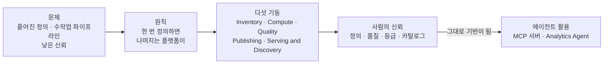
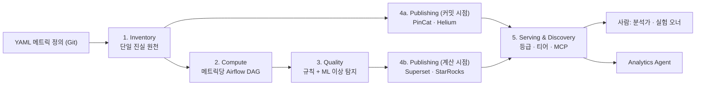
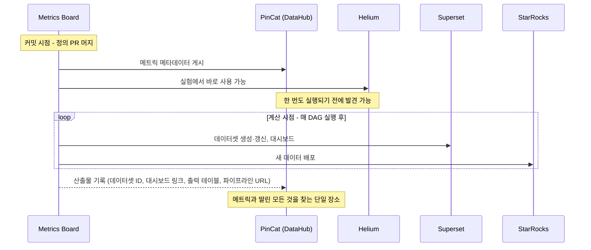

<figure class="post-figure post-figure--header">
<svg role="img" aria-labelledby="pmb-h-title pmb-h-desc" viewBox="0 0 720 340" xmlns="http://www.w3.org/2000/svg">
  <title id="pmb-h-title">한 번 정의하면, 나머지는 따라온다</title>
  <desc id="pmb-h-desc">왼쪽에 YAML 메트릭 정의가 적힌 두루마리 하나가 있고, 그 두루마리에서 다섯 갈래 빛줄기가 오른쪽으로 뻗어 PinCat 카탈로그, Helium 실험 플랫폼, Superset BI 대시보드, StarRocks 웨어하우스, 그리고 MCP를 거친 Analytics Agent로 흘러간다.</desc>
  <defs>
    <marker id="pmb-h-gold" markerWidth="9" markerHeight="9" refX="7" refY="4" orient="auto">
      <path d="M0 0 L8 4 L0 8 Z" fill="var(--gold)"/>
    </marker>
  </defs>

  <!-- the single YAML scroll -->
  <rect x="36" y="88" width="12" height="164" rx="5" fill="var(--bg-light)" stroke="var(--gold)" stroke-width="2"/>
  <rect x="252" y="88" width="12" height="164" rx="5" fill="var(--bg-light)" stroke="var(--gold)" stroke-width="2"/>
  <rect x="48" y="96" width="204" height="148" fill="var(--bg-light)" stroke="var(--gold)" stroke-width="2"/>
  <text x="150" y="80" text-anchor="middle" font-size="14" font-weight="700" fill="var(--accent-color)">메트릭 정의 (YAML · Git)</text>
  <g font-family="monospace" font-size="11" fill="currentColor">
    <text x="62" y="120">metric_id: mb__metrics</text>
    <text x="62" y="140">domain: tech_data</text>
    <text x="62" y="160">metric_sql: |-</text>
    <text x="76" y="178" fill="var(--text-light)"># SELECT ...</text>
    <text x="62" y="198">integrations:</text>
    <text x="76" y="216">superset: enabled</text>
    <text x="62" y="234">compute: 0 9 * * *</text>
  </g>
  <text x="150" y="276" text-anchor="middle" font-size="13" font-weight="700" fill="currentColor">한 번만 정의</text>

  <!-- five rays -->
  <g fill="none" stroke="var(--gold)" stroke-width="2.5" stroke-linecap="round" marker-end="url(#pmb-h-gold)">
    <path d="M268 150 C 360 120, 380 54, 452 52"/>
    <path d="M268 160 C 360 150, 390 112, 452 112"/>
    <path d="M268 170 L 452 170"/>
    <path d="M268 180 C 360 190, 390 228, 452 228"/>
    <path d="M268 190 C 360 220, 380 286, 452 288" stroke-dasharray="7 5"/>
  </g>
  <text x="360" y="162" text-anchor="middle" font-size="11" fill="var(--text-light)">자동 파생</text>

  <!-- destinations -->
  <g fill="var(--bg-panel)" stroke="var(--border-color)" stroke-width="2">
    <rect x="460" y="30" width="236" height="44" rx="6"/>
    <rect x="460" y="90" width="236" height="44" rx="6"/>
    <rect x="460" y="148" width="236" height="44" rx="6"/>
    <rect x="460" y="206" width="236" height="44" rx="6"/>
    <rect x="460" y="266" width="236" height="44" rx="6" stroke="var(--accent-color)"/>
  </g>
  <g font-size="13" font-weight="700" fill="currentColor">
    <text x="474" y="50">PinCat</text>
    <text x="474" y="110">Helium</text>
    <text x="474" y="168">Superset</text>
    <text x="474" y="226">StarRocks</text>
    <text x="474" y="286" fill="var(--accent-color)">Analytics Agent</text>
  </g>
  <g font-size="11" fill="var(--text-light)">
    <text x="474" y="66">데이터 카탈로그 (DataHub)</text>
    <text x="474" y="126">실험 플랫폼</text>
    <text x="474" y="184">BI 대시보드</text>
    <text x="474" y="242">분석 웨어하우스</text>
    <text x="474" y="302">MCP 서버로 메트릭을 읽는 에이전트</text>
  </g>
  <text x="360" y="332" text-anchor="middle" font-size="12" font-style="italic" fill="var(--text-light)">Define once — the rest follows</text>
</svg>
<figcaption>메트릭을 한 번 정의하면 카탈로그·실험·BI·웨어하우스·에이전트로의 배포가 그 정의에서 자동으로 따라온다.</figcaption>
</figure>

## 원문 정보

> - **제목**: Metrics Board: Building an Agent-ready Metrics Layer
> - **출처**: Pinterest Engineering Blog (Medium) — Michele Ceccacci, Jason Coffman, Colm O'Shaughnessy, Laura Palmer, Adam Podraza, Surya Karri ([medium.com/pinterest-engineering](https://medium.com/pinterest-engineering))
> - **발행**: 2026-10-06 · 약 10분 분량
> - **원문 링크**: <https://medium.com/pinterest-engineering/metrics-board-building-an-agent-ready-metrics-layer-2c8fefe68756>

[Data Engineering Weekly #293](https://www.dataengineeringweekly.com/p/data-engineering-weekly-293)에서 "메트릭/시맨틱 레이어 도입이 생태계 전반에서 늘고 있다"는 코멘트와 함께 소개된 글로, 시맨틱 레이어를 **에이전트 분석의 전제 조건**으로 다루는 대규모 실무 사례라서 Articles에 담는다.

## 한 줄 요약 (TL;DR)

Pinterest는 흩어진 메트릭 정의와 손으로 만든 파이프라인 때문에 실험이 느려지고 리포팅의 신뢰가 무너지는 문제를, **"메트릭을 한 번 정의하면 나머지는 플랫폼이 처리한다"**는 얇은 시맨틱 레이어 Metrics Board로 풀었다. 그리고 사람이 메트릭을 믿게 만들려고 한 작업(정의·품질·등급·카탈로그)이 그대로 **에이전트가 메트릭을 쓸 수 있게 만드는 기반**이 되었다고 말한다.

## 왜 이 글을 골랐나

"LLM에게 데이터 분석을 시키자"는 이야기는 많지만, 실제로 에이전트의 답을 믿을 수 있게 만드는 것은 모델이 아니라 **에이전트가 참조하는 지표의 정의와 신뢰 신호**다. 이 글은 그 신뢰 기반을 수천 개 메트릭, 수천 개 동시 실험 규모에서 어떻게 깔았는지를 구체적인 설계 결정(엄격한 시맨틱 모델 vs 아무 SQL 허용, 메트릭당 DAG, 등급 체계)과 함께 보여 준다.

이 위키의 맥락에서는 세 갈래가 만난다. [dbt 세만틱 레이어 · 메트릭](/2026/07/14/dbt-semantic-layer-metrics.html)에서 본 "지표 표준화", [데이터 품질·거버넌스·관측가능성](/2026/06/25/data-quality-governance.html)의 신뢰 체계, 그리고 [Anthropic의 Claude 셀프서비스 데이터 분석](/2026/06/22/self-service-data-analytics-with-claude.html)이 강조한 "에이전트는 신뢰할 수 있는 맥락이 있어야 쓸모 있다"는 교훈이 하나의 플랫폼 안에서 구현된 사례다.

글 전체의 흐름을 한 장으로 보면 다음과 같다.



## 핵심 내용

### 왜 Pinterest에서 메트릭이 중요한가

원문은 메트릭을 "Pinterest가 사용자와 광고주에게 가치를 전달하고 있는지 이해하는 방법"으로 규정한다. 매출·성장·참여 같은 지표가 제품·재무·경영진의 일상적 의사결정을 이끈다.

특히 **실험** 규모가 크다. 원문에 따르면 어느 시점에나 수천 개의 실험이 돌고, 실험은 새 기능 출시의 관문(gate) 역할을 한다. 결과가 공정하고 비교 가능하며 통계적으로 유의하려면 메트릭이 명확히 정의되고, 신뢰할 수 있고, 재사용 가능해야 한다. 여기에 실험마다 특정 모듈·기능·디바이스로 한정된 **맞춤형(bespoke) 메트릭**이 필요하다는 점이 복잡도를 더한다. 원문의 예: Pin과 상호작용하는 새로운 방식을 추가한 기능은 핵심 참여 지표가 평평하더라도, 그 새 상호작용을 측정하는 새 메트릭으로는 성공으로 판정될 수 있다.

그리고 질문 방식이 바뀌었다. 질문은 점점 SQL이나 대시보드 필터가 아니라 **에이전트에게 자연어로** 던져진다. 원문의 표현으로 "에이전트는 접근할 수 있는 신뢰 데이터만큼만 좋다". 에이전트 분석이 작동하려면 메트릭이 **발견 가능하고(discoverable), 품질 검증되었고(quality-checked), 기계가 읽을 수 있어야(machine-readable)** 한다.

### Metrics Board 이전의 문제

과거에는 사용자가 각자 맞춤 데이터 파이프라인에서 메트릭을 정의하고, 리포팅·실험 제품에 손으로 연결했다. 원문이 꼽는 문제는 네 가지다.

- 비슷한 파이프라인을 손으로 반복 구축하느라 느렸다.
- 모니터링과 가용성이 일관되지 않아, 장애가 다운스트림에서야 드러나곤 했다.
- 기존 메트릭의 존재를 잘 몰라 중복이 생기고 신뢰가 깎였다.
- 메트릭 메타데이터가 곳곳에서 어긋났고(drift), 단일 진실 원천이 없었다.

그래서 필요한 해법의 요건을 이렇게 정리한다: 조직 전체의 메트릭 통합, 투명한 정의와 코드 버전 관리, 파이프라인 생성·오케스트레이션·운영의 최대한 자동화, 문서·메타데이터의 필수화와 자동 생성, 정확성·신뢰성·이상치에 대한 자동 검증과 모니터링, 그리고 모든 메트릭과 대시보드에 **공유된 품질·신뢰 신호** 부여. 목표 사용자에는 메트릭을 만드는 사람, 소비하는 사람, 서빙하는 애플리케이션, 그리고 "점점 더" 그 위에서 추론하는 에이전트까지 포함된다.

### 해법: "한 번 정의하면, 나머지는 Metrics Board가"

Metrics Board는 Pinterest가 이미 운영하는 데이터 도구들 **위에 얹은 얇은(thin) 메트릭 시맨틱 레이어**다. 메트릭은 한 번 정의되고, 그 정의가 다운스트림의 모든 것을 구동한다. 다섯 기둥으로 구성된다.



### 1. Inventory — 메트릭 정의의 단일 진실 원천

모든 메트릭은 전용 Git 저장소의 **YAML 스펙**으로 존재하고, 버전 관리·코드 리뷰·변경 이력을 갖춘 프로덕션 코드처럼 다뤄진다. 원문이 보여 주는 예시(Metrics Board 자신에 정의된 메트릭 개수를 세는 메트릭)의 주요 필드를 추리면 다음과 같다(SQL 본문은 생략).

```yaml
version: 1
metric_id: mb__metrics
display_name: Metrics Board metrics count
description: |-
  Count of metrics defined in MB. Test metrics aren't included.
domain: tech_data
metric_sql: |-
  # ... '{end_date}' 파라미터를 쓰는 임의의 SQL ...
temporal_columns:
  - column_name: dt
    format: YYYY-MM-DD
    granularity: DAY
integrations:
  superset:
    enabled: true
  starrocks:
    enabled: false
ownership:
  nimbus_project: ii
compute:
  schedule: 0 9 * * *
```

이 기둥에서 가장 흥미로운 것은 **설계 결정**이다. "Metrics Board가 얼마나 진짜 시맨틱 레이어여야 하는가?" — 기존 데이터셋 위에 모델을 강제하고 메트릭을 그 모델의 표현식으로 정의하게 할지, 아니면 **어떤 SQL이든 받아들이고** 결과 데이터에 대한 모델링 정보(시간 컬럼, 메트릭·디멘션 정의)를 사용자가 제공하게 할지. Pinterest는 **후자**를 택했다. 이유는 둘이다: 사용자 피드백(회사 가치 "Put Pinners First"), 그리고 메트릭 정의에 쓰이는 테이블의 엄청난 다양성 — 테이블마다 시맨틱 레이어를 강제하는 것은 "현실적이지 않았다".

또 정의를 손으로 쓰게 하지 않는다. 전용 **Metrics Board UI**의 가이드 폼으로 정의하면, 시스템이 YAML을 생성하고 사용자 대신 **pull request를 연다**. 소유권·거버넌스·메타데이터를 한곳에서 관리하면서도 나머지 데이터 스택과 깔끔하게 통합된다.

<figure class="post-figure">
<svg role="img" aria-labelledby="pmb-p-title pmb-p-desc" viewBox="0 0 720 320" xmlns="http://www.w3.org/2000/svg">
  <title id="pmb-p-title">두꺼운 시맨틱 모델 vs 얇은 레이어</title>
  <desc id="pmb-p-desc">갈림길에서 왼쪽 길은 엄격한 시맨틱 모델로, 테이블마다 모델 층을 깔고 메트릭을 그 모델의 표현식으로 정의해야 해서 무겁다. 오른쪽 길은 임의의 SQL을 받고 결과 데이터에 시간 컬럼과 메트릭·디멘션 정보만 붙이는 얇은 길로, Pinterest가 선택했다.</desc>
  <defs>
    <marker id="pmb-p-arrow" markerWidth="9" markerHeight="9" refX="7" refY="4" orient="auto">
      <path d="M0 0 L8 4 L0 8 Z" fill="currentColor"/>
    </marker>
    <marker id="pmb-p-gold" markerWidth="9" markerHeight="9" refX="7" refY="4" orient="auto">
      <path d="M0 0 L8 4 L0 8 Z" fill="var(--gold)"/>
    </marker>
  </defs>

  <!-- fork -->
  <rect x="200" y="14" width="320" height="38" rx="6" fill="var(--bg-light)" stroke="var(--border-color)" stroke-width="2"/>
  <text x="360" y="38" text-anchor="middle" font-size="13" font-weight="700" fill="currentColor">얼마나 "진짜" 시맨틱 레이어여야 하나?</text>
  <path d="M300 52 C 260 70, 200 70, 180 86" fill="none" stroke="currentColor" stroke-width="2" opacity="0.6" marker-end="url(#pmb-p-arrow)"/>
  <path d="M420 52 C 460 70, 520 70, 540 86" fill="none" stroke="var(--gold)" stroke-width="3" marker-end="url(#pmb-p-gold)"/>

  <!-- LEFT: strict model -->
  <rect x="20" y="94" width="320" height="214" rx="8" fill="var(--bg-light)" stroke="var(--border-color)" stroke-width="2" stroke-dasharray="6 4"/>
  <text x="180" y="118" text-anchor="middle" font-size="14" font-weight="700" fill="currentColor">엄격한 시맨틱 모델</text>
  <text x="180" y="136" text-anchor="middle" font-size="11" fill="var(--text-light)">메트릭 = 모델 위의 표현식</text>
  <g stroke="currentColor" stroke-width="1.5">
    <g fill="var(--bg-panel)">
      <rect x="40" y="200" width="60" height="26" rx="2"/>
      <rect x="110" y="200" width="60" height="26" rx="2"/>
      <rect x="180" y="200" width="60" height="26" rx="2"/>
      <rect x="250" y="200" width="70" height="26" rx="2"/>
    </g>
    <g fill="var(--bg-sunken)" stroke="var(--secondary-color)">
      <rect x="40" y="156" width="60" height="38" rx="2"/>
      <rect x="110" y="156" width="60" height="38" rx="2"/>
      <rect x="180" y="156" width="60" height="38" rx="2"/>
      <rect x="250" y="156" width="70" height="38" rx="2"/>
    </g>
  </g>
  <g font-size="10" text-anchor="middle" fill="currentColor">
    <text x="70" y="179">모델</text><text x="140" y="179">모델</text><text x="210" y="179">모델</text><text x="285" y="179">모델 …</text>
    <text x="70" y="217">테이블</text><text x="140" y="217">테이블</text><text x="210" y="217">테이블</text><text x="285" y="217">테이블 …</text>
  </g>
  <text x="180" y="254" text-anchor="middle" font-size="12" fill="currentColor">테이블마다 모델을 깔아야 한다</text>
  <text x="180" y="276" text-anchor="middle" font-size="12" font-weight="700" fill="var(--accent-color)">테이블이 너무 다양해 "현실적이지 않음"</text>

  <!-- RIGHT: thin layer -->
  <rect x="380" y="94" width="320" height="214" rx="8" fill="var(--bg-light)" stroke="var(--gold)" stroke-width="2.5"/>
  <text x="540" y="118" text-anchor="middle" font-size="14" font-weight="700" fill="currentColor">임의 SQL + 모델링 메타데이터</text>
  <text x="540" y="136" text-anchor="middle" font-size="11" fill="var(--text-light)">어떤 SQL이든 받고, 결과에 정보만 붙인다</text>
  <rect x="400" y="156" width="150" height="70" rx="3" fill="var(--bg-panel)" stroke="currentColor" stroke-width="1.5"/>
  <text x="475" y="180" text-anchor="middle" font-family="monospace" font-size="11" fill="currentColor">SELECT …</text>
  <text x="475" y="198" text-anchor="middle" font-family="monospace" font-size="11" fill="currentColor">FROM 기존 테이블</text>
  <text x="475" y="216" text-anchor="middle" font-size="10" fill="var(--text-light)">(구조는 그대로)</text>
  <g fill="var(--bg-panel)" stroke="var(--gold)" stroke-width="1.5">
    <rect x="566" y="160" width="120" height="26" rx="13"/>
    <rect x="566" y="196" width="120" height="26" rx="13"/>
  </g>
  <g font-size="11" text-anchor="middle" fill="currentColor">
    <text x="626" y="177">시간 컬럼</text>
    <text x="626" y="213">메트릭 · 디멘션</text>
  </g>
  <rect x="460" y="242" width="160" height="26" rx="4" fill="var(--bg-panel)" stroke="var(--gold)" stroke-width="2.5"/>
  <text x="540" y="259" text-anchor="middle" font-size="12" font-weight="700" fill="currentColor">★ Pinterest의 선택</text>
  <text x="540" y="290" text-anchor="middle" font-size="11" fill="var(--text-light)">근거: 사용자 피드백(Put Pinners First) · 테이블의 다양성</text>
</svg>
<figcaption>Pinterest는 테이블마다 모델을 강제하는 대신, 임의 SQL에 모델링 정보만 붙이는 얇은 길을 택했다.</figcaption>
</figure>

### 2. Compute — 메트릭 하나에 DAG 하나

각 정의는 **자기만의 스케줄된 Airflow DAG**로 변환된다. 정의에는 스케줄·SQL·검증·통합 등 워크플로 생성에 필요한 메타데이터가 다 들어 있다. 메트릭마다 DAG를 분리하면 스케줄·재시도·리소스를 개별 조정할 수 있고, 한 메트릭의 실패가 다른 메트릭으로 번지지 않는다.

실행 시점의 자동화는 다음과 같다.

- 정의에 명시된 엔진에 따라 SQL을 **SparkSQL 또는 PrestoSQL**로 컴파일한다.
- SQL을 분석해(**sqlglot**으로 파싱) 업스트림 데이터 준비를 기다리는 **의존성 태스크를 자동 생성**한다.
- 표준 데이터 품질 검사를 자동 생성하고, 사용자 정의 검사도 추가할 수 있다.
- 백필은 Airflow로 관리해 오너가 과거 구간을 쉽게 재계산한다.
- 업스트림 데이터가 늦으면, 도착을 자동 감지해 계산 DAG를 재개한다.

원문은 이 덕분에 **비데이터 팀도** 메트릭을 쉽게 만들고 관리할 수 있게 되었고, 예전엔 며칠~몇 주 걸리던 일이 **1~2시간**이면 된다고 말한다.

### 3. Quality — 아무도 믿지 않는 메트릭은 없는 것보다 나쁘다

모든 정의는 자기 파이프라인 안에서 실행되는 검증을 선언할 수 있고, 두 엔진이 받친다.

- **규칙 기반 검사**: 전일·전주·전월·전년 대비 임계값, 커스텀 임계 규칙, **부모 메트릭과의 비교** — 각각 단일 시점 또는 시간 추세에 적용.
- **ML 기반 이상 탐지**: 계절성·추세·정상 변동을 모델링해 정적 규칙이 놓칠 편차를 찾는다(원문은 Pinterest의 Warden을 참조로 링크한다).

검사가 실패하면 검증 직후 담당 팀으로 실시간 알림이 가고, 스누즈·확인(acknowledge)을 지원해 신호가 소음이 되지 않게 한다. 결과는 메트릭별 **품질 리포트**(검사별 통과율, 결과 시계열, 검증이 돌지 않은 공백, 코멘트·티켓 주석)로 모여 API와 PDF로 제공된다. 핵심은 검증이 메트릭과 **같은 스펙**에 있으므로, 품질도 정의와 함께 버전 관리·리뷰된다는 점이다.

### 4. Publishing — 플래그 하나로 퍼져 나가기

파이프라인 안에만 있는 메트릭은 아직 쓸모가 없다. 사람들이 실제로 일하는 제품에 도달해야 한다. 각 메트릭은 자신의 통합 대상을 선언하고, 플래그를 켜면 Metrics Board가 해당 표면으로 자동 배포한다. 현재 대상은 넷이다.

| 대상 | 역할 |
| --- | --- |
| **PinCat** (DataHub 기반) | 데이터 카탈로그·메타데이터 허브 — 발견과 리니지 추적 |
| **Helium** | 실험 플랫폼 — 정의되는 순간 실험에서 사용 가능 |
| **Superset** | BI 레이어 — 데이터셋 생성·갱신, 모니터링 대시보드 자동 생성 |
| **StarRocks** | 분석 웨어하우스 — 빠른 인터랙티브 쿼리 |

배포는 **두 단계**로 일어난다.

- **메타데이터 수준 통합**(DataHub, Helium)은 정의가 머지되는 **커밋 시점**에 배포된다. 메트릭이 한 번도 실행되기 전에 카탈로그에 오르고 실험에서 쓸 수 있다.
- **데이터 수준 통합**(Superset, StarRocks)은 매 실행 후 새 데이터가 생기는 **계산 시점**에 배포된다.

어느 쪽이든 산출물(데이터셋 ID, 대시보드 링크, 출력 테이블, 파이프라인 URL)은 DataHub에 다시 기록되어, 카탈로그가 메트릭과 그에 딸린 모든 것을 찾는 **단일 장소**로 유지된다.

배포의 두 시점과 산출물이 카탈로그로 되돌아오는 흐름을 순서대로 보면 다음과 같다.



### 5. Serving & Discovery — 신뢰 신호와 에이전트

**발견과 거버넌스.** 메트릭은 정의와 함께 소유자·설명·인증 등급·품질 신호 같은 풍부한 메타데이터를 갖고 자동으로 PinCat에 흘러 들어가, 사용자는 데이터셋을 찾던 곳에서 메트릭도 찾는다. 찾은 다음의 질문은 "무엇을 믿을까"이고, 원문은 두 수준의 신호로 답한다.

- **메트릭 수준 — 등급(grade)**: Unknown → C → B → A → **A+**(Data Quality Steward가 수동 검증한 완전 인증)로 올라가며, 단계마다 더 많은 품질 작업을 요구한다. 소비자에게는 무엇을 믿을지, 오너에게는 어떻게 등급을 올릴지 알려 준다. 등급·인증 상태·소유자는 Superset 차트 안에도 직접 노출된다.
- **리포팅 수준 — 대시보드 티어**: Superset 대시보드를 세 티어로 나누고, 티어가 **미사용 시 보존 기간, 쿼리가 도는 Presto 클러스터(성능), 필수 문서**를 결정한다.

| 티어 | 대상 | 요구 사항 | 보장 |
| --- | --- | --- | --- |
| Tier 1 | 소수의 큐레이션된 회사 핵심 대시보드 | 가장 완전한 문서, 공식 인증(주기적 갱신) | 우선 쿼리 성능, 자동 정리 제외 |
| Tier 2 | 다른 팀이 의존하는 팀 수준 대시보드 | 기본 소유권·문서 | 정기적으로 쓰이는 동안 보존 |
| Tier 3 | 탐색·테스트용(기본값) | 추가 메타데이터 없음 | 미사용 시 자동 정리 |

**에이전트 활성화.** 탐색을 구동하는 바로 그 구조화된 메타데이터가 Metrics Board를 분석 에이전트의 기반 플랫폼으로 만든다. Pinterest는 **MCP 서버**를 노출해 LLM 기반 도구가 메트릭을 찾고, 정의를 읽고, 추론할 수 있게 했다. 대표 사례인 **Analytics Agent**는 메트릭에 대한 자연어 질문에 답하면서 **골든 쿼리(golden queries)와 인증된 메트릭 정의**를 참조해 답을 신뢰·거버넌스된 데이터에 근거시킨다. 원문의 결론 문장: "사람을 위해 메트릭을 신뢰할 수 있게 만든 작업이, 에이전트가 메트릭을 쓸 수 있게 만드는 것이었다."

<figure class="post-figure">
<svg role="img" aria-labelledby="pmb-l-title pmb-l-desc" viewBox="0 0 720 340" xmlns="http://www.w3.org/2000/svg">
  <title id="pmb-l-title">신뢰의 사다리: 메트릭 등급과 대시보드 티어</title>
  <desc id="pmb-l-desc">왼쪽은 메트릭 등급 계단으로 Unknown, C, B, A, A+ 순으로 올라가며 단계마다 더 많은 품질 작업을 요구하고, A+는 Data Quality Steward가 수동 검증한 완전 인증이다. 가운데는 대시보드 티어 피라미드로 아래 Tier 3(탐색·테스트, 기본값, 미사용 시 자동 정리), Tier 2(팀 수준, 기본 소유권·문서), 꼭대기 Tier 1(회사 핵심, 공식 인증, 우선 쿼리 성능)이며 위로 갈수록 문서·인증 요구와 성능·보존 보장이 커진다. 오른쪽에서는 MCP 서버를 통해 Analytics Agent가 인증된 메트릭 정의와 골든 쿼리를 참조한다.</desc>
  <defs>
    <marker id="pmb-l-gold" markerWidth="9" markerHeight="9" refX="7" refY="4" orient="auto">
      <path d="M0 0 L8 4 L0 8 Z" fill="var(--gold)"/>
    </marker>
    <marker id="pmb-l-arrow" markerWidth="9" markerHeight="9" refX="7" refY="4" orient="auto">
      <path d="M0 0 L8 4 L0 8 Z" fill="currentColor"/>
    </marker>
  </defs>

  <!-- LEFT: metric grade staircase -->
  <text x="150" y="28" text-anchor="middle" font-size="13" font-weight="700" fill="currentColor">메트릭 수준 — 등급</text>
  <g stroke="currentColor" stroke-width="1.5">
    <rect x="20" y="270" width="52" height="30" fill="var(--bg-sunken)"/>
    <rect x="72" y="240" width="52" height="60" fill="var(--bg-light)"/>
    <rect x="124" y="210" width="52" height="90" fill="var(--bg-light)"/>
    <rect x="176" y="180" width="52" height="120" fill="var(--bg-light)"/>
    <rect x="228" y="150" width="52" height="150" fill="var(--bg-panel)" stroke="var(--gold)" stroke-width="2.5"/>
  </g>
  <g font-size="12" font-weight="700" text-anchor="middle" fill="currentColor">
    <text x="46" y="290" font-size="10">Unknown</text>
    <text x="98" y="260">C</text>
    <text x="150" y="230">B</text>
    <text x="202" y="200">A</text>
    <text x="254" y="170">A+</text>
  </g>
  <path d="M30 252 L 214 136" fill="none" stroke="currentColor" stroke-width="1.5" stroke-dasharray="4 4" opacity="0.7" marker-end="url(#pmb-l-arrow)"/>
  <text x="96" y="186" font-size="11" fill="var(--text-light)" transform="rotate(-32 96 186)">더 많은 품질 작업</text>
  <text x="254" y="118" text-anchor="middle" font-size="10" fill="var(--text-light)">Steward</text>
  <text x="254" y="132" text-anchor="middle" font-size="10" fill="var(--text-light)">수동 검증</text>
  <text x="150" y="324" text-anchor="middle" font-size="11" fill="var(--text-light)">Superset 차트에도 등급·인증·소유자 노출</text>

  <!-- MIDDLE: dashboard tier pyramid -->
  <text x="430" y="28" text-anchor="middle" font-size="13" font-weight="700" fill="currentColor">리포팅 수준 — 대시보드 티어</text>
  <g stroke="currentColor" stroke-width="1.5">
    <path d="M430 60 L 469 140 L 391 140 Z" fill="var(--bg-panel)" stroke="var(--gold)" stroke-width="2.5"/>
    <path d="M391 140 L 469 140 L 508 220 L 352 220 Z" fill="var(--bg-light)"/>
    <path d="M352 220 L 508 220 L 547 300 L 313 300 Z" fill="var(--bg-sunken)"/>
  </g>
  <g text-anchor="middle" fill="currentColor">
    <text x="430" y="118" font-size="12" font-weight="700">Tier 1</text>
    <text x="430" y="132" font-size="9">회사 핵심</text>
    <text x="430" y="178" font-size="12" font-weight="700">Tier 2</text>
    <text x="430" y="196" font-size="10">팀 수준 · 기본 소유권·문서</text>
    <text x="430" y="258" font-size="12" font-weight="700">Tier 3 (기본값)</text>
    <text x="430" y="276" font-size="10">탐색·테스트 · 미사용 시 자동 정리</text>
  </g>
  <path d="M320 290 L 320 80" fill="none" stroke="currentColor" stroke-width="1.5" opacity="0.7" marker-end="url(#pmb-l-arrow)"/>
  <text x="308" y="190" text-anchor="middle" font-size="10" fill="var(--text-light)" transform="rotate(-90 308 190)">문서·인증 요구 ↑ · 성능·보존 보장 ↑</text>
  <text x="430" y="324" text-anchor="middle" font-size="11" fill="var(--text-light)">티어가 보존 기간 · Presto 클러스터 · 필수 문서를 결정</text>

  <!-- RIGHT: MCP + Analytics Agent -->
  <rect x="580" y="150" width="124" height="40" rx="6" fill="var(--bg-light)" stroke="var(--border-color)" stroke-width="2"/>
  <text x="642" y="175" text-anchor="middle" font-size="13" font-weight="700" fill="currentColor">MCP 서버</text>
  <rect x="580" y="226" width="124" height="54" rx="6" fill="var(--bg-panel)" stroke="var(--accent-color)" stroke-width="2"/>
  <text x="642" y="250" text-anchor="middle" font-size="12" font-weight="700" fill="var(--accent-color)">Analytics</text>
  <text x="642" y="268" text-anchor="middle" font-size="12" font-weight="700" fill="var(--accent-color)">Agent</text>
  <path d="M642 226 L 642 196" fill="none" stroke="currentColor" stroke-width="2" marker-end="url(#pmb-l-arrow)"/>
  <!-- trust signals flow to MCP -->
  <path d="M270 146 C 330 10, 560 10, 628 146" fill="none" stroke="var(--gold)" stroke-width="2.5" stroke-dasharray="7 5" marker-end="url(#pmb-l-gold)"/>
  <path d="M470 100 C 540 100, 570 120, 590 146" fill="none" stroke="var(--gold)" stroke-width="2" stroke-dasharray="4 4" marker-end="url(#pmb-l-gold)"/>
  <text x="642" y="296" text-anchor="middle" font-size="10" fill="var(--text-light)">인증된 메트릭 정의</text>
  <text x="642" y="310" text-anchor="middle" font-size="10" fill="var(--text-light)">+ 골든 쿼리 참조</text>
</svg>
<figcaption>등급과 티어라는 기계가 읽을 수 있는 신뢰 신호가 MCP 서버를 통해 Analytics Agent의 근거가 된다.</figcaption>
</figure>

### 성과

- 주요 성공 지표는 **채택(adoption)**이며, 생성된 메트릭 수와 활성 사용자 모두에서 분기마다 목표를 넘었다.
- 현재 매월 **약 150개**의 새 메트릭이 생성된다(더 이상 쓰이지 않는 메트릭을 정리하는 라이프사이클 정책·엔진도 만들었다).
- 실험용으로 만들어지는 메트릭의 **98% 이상**이 Metrics Board를 거친다.
- 핵심 참여 지표를 개편한 최근 대형 프로젝트에서 기존 방식 대비 약 **2 엔지니어-월**을 절약했고, 몇 주 걸리던 메트릭 추가가 며칠로 줄었다. 규모 전체로는 매월 **수천 시간**의 절감이라고 한다.
- 이렇게 쌓은 거버넌스·품질·카탈로그가 지금 출시 중인 LLM·에이전트 활용 사례의 기반이 되고 있다.

## 분석과 인사이트

여기서부터는 원문 요약이 아니라 나의 해석이다.

### 1. "얇은" 시맨틱 레이어라는 현실적 타협

가장 인상적인 대목은 **엄격한 시맨틱 모델을 포기한 결정**이다. [dbt 세만틱 레이어](/2026/07/14/dbt-semantic-layer-metrics.html)(MetricFlow)는 semantic model 위에 measure·dimension을 선언하고 메트릭을 그 조합으로 정의하는, 말하자면 "두꺼운" 쪽이다. 그러면 메트릭을 임의의 디멘션으로 자르고 조합하는 능력을 얻는다. Pinterest는 그 능력을 일부 포기하고 "임의 SQL + 결과에 대한 모델링 메타데이터"를 택했다.

이 선택은 트레이드오프가 분명하다. 얻은 것은 **채택**이다 — 기존 테이블 구조를 건드리지 않고 기존 SQL을 그대로 들여올 수 있으니, 실험 메트릭의 98% 이상을 흡수할 수 있었다. 잃은 것은 (원문이 직접 말하지는 않지만) 아마도 **조합 가능성과 정의 간 일관성**이다. 두 메트릭이 같은 "활성 사용자"를 다른 SQL로 계산하는 일을 구조적으로 막아 주지는 않는다. Pinterest는 이 빈틈을 모델이 아니라 **거버넌스(등급, 부모 메트릭 비교 검사, 카탈로그를 통한 중복 인지)**로 메운 것으로 읽힌다. 시맨틱 레이어 도입을 고민하는 팀에게 "완벽한 모델보다 채택이 먼저"라는 유용한 반례이자 선택지다.

### 2. 메트릭은 "코드"가 아니라 "데이터 제품"으로 다뤄진다

YAML 스펙 + Git + PR + 메트릭당 DAG + 품질 리포트 + 소유권 + 라이프사이클(가비지 컬렉션)의 조합은 메트릭을 하나의 **데이터 제품**으로 만든다. [데이터 품질·거버넌스](/2026/06/25/data-quality-governance.html)에서 다룬 데이터 계약·관측가능성 개념이 테이블 단위가 아니라 **메트릭 단위**로 내려온 셈이다. 특히 "검증이 정의와 같은 스펙에 있다"는 점이 중요하다. 품질 규칙이 별도 시스템에 있으면 정의가 바뀔 때 규칙이 낡는다. 같은 파일에 있으면 같은 PR에서 같이 리뷰된다.

### 3. 선언이 실행을 낳는다 — 자기조직화 스택의 축소판

정의 하나에서 DAG, 의존성 센서(sqlglot 파싱), 품질 검사, 배포 대상이 **파생**된다. 이는 [자기조직화 데이터 스택](/2026/10/22/self-organizing-data-stack.html)에서 Ananth Packkildurai가 말한 "사람은 의미를 쓰고, 엔진은 그래프를 쓴다"의 구체적인 실현 사례로 보인다. 사람은 "무엇을 측정하는가(SQL·시간 컬럼·소유자·검증)"만 선언하고, 실행 그래프는 플랫폼이 도출한다. 메트릭당 DAG라는 선택은 Airflow 관점에서 DAG 수가 매우 많아지는 부담이 있을 텐데, 원문은 그 운영 비용(스케줄러 부하 등)에 대해서는 다루지 않는다. 같은 패턴을 Airflow로 시도한다면 [Airflow 백필·catchup·멱등성](/2026/07/13/airflow-backfill-catchup-idempotency.html)과 [센서·Deferrable 오퍼레이터](/2026/07/13/airflow-sensors-deferrable-operators.html)가 직접 관련된 고려 사항이다.

### 4. 두 단계 배포: "실행 전에 발견 가능"하다는 것의 의미

커밋 시점에 카탈로그와 실험 플랫폼에 메타데이터가 먼저 올라간다는 설계는 작지만 영리하다. 실험 설계자는 데이터가 쌓이기 전부터 메트릭을 실험에 걸 수 있고, 에이전트는 아직 값이 없는 메트릭도 "존재한다"는 것을 안다. 메타데이터와 데이터의 생명주기를 분리한 것이다.

### 5. 에이전트 준비성(agent-readiness)은 별도 프로젝트가 아니다

원문의 진짜 메시지는 마지막 문장에 있다. Pinterest는 "에이전트용 레이어"를 따로 만들지 않았다. 사람을 위해 만든 정의·등급·티어·카탈로그 위에 **MCP 서버 하나**를 얹었을 뿐이다. 이는 [Anthropic의 셀프서비스 데이터 분석 사례](/2026/06/22/self-service-data-analytics-with-claude.html)의 교훈 — 에이전트 품질은 모델보다 맥락(신뢰할 수 있는 정의와 예시 쿼리)에 달렸다 — 과 정확히 겹친다. Analytics Agent가 "골든 쿼리와 인증된 메트릭 정의"를 참조한다는 대목은, 에이전트의 grounding 소스가 곧 거버넌스 산출물이라는 뜻이다.

더 나아가 등급 체계는 에이전트에게 특히 유용한 신호다. 사람은 대시보드 하나를 보고 맥락으로 신뢰도를 짐작하지만, 에이전트는 명시적 신호가 없으면 C등급 실험 메트릭과 A+ 핵심 지표를 구분하지 못한다. "Unknown~A+" 같은 **기계가 읽을 수 있는 신뢰 등급**은 에이전트가 "어떤 메트릭을 근거로 답할지" 고를 수 있게 하는 정책 입력이 된다. 이는 [온톨로지와 시맨틱 레이어의 차이](/2026/07/19/ontology-semantic-layer-vs-data-model.html)에서 다룬 "의미 계층"이 단지 정의뿐 아니라 **신뢰와 소유의 메타데이터**까지 포함해야 한다는 관점을 뒷받침한다.

### 아쉬운 점

- MCP 서버와 Analytics Agent에 대한 설명은 한 단락에 그친다. 어떤 도구(tool)를 노출하는지, 에이전트가 메트릭을 어떻게 고르는지, 등급이 낮은 메트릭을 어떻게 다루는지, 답변 정확도를 어떻게 평가하는지는 나오지 않는다. 제목에 "Agent-ready"를 걸었지만 본문 대부분은 메트릭 플랫폼 이야기다.
- 성과 지표가 채택률과 시간 절감 중심이고, **신뢰 자체의 개선**(예: 메트릭 관련 인시던트 감소, 중복 메트릭 감소)을 보여 주는 수치는 없다.
- "임의 SQL" 접근에서 동일 개념의 중복 정의를 어떻게 통제하는지가 구체적으로 설명되지 않는다.

## 적용 포인트

- **메트릭 정의를 코드로 옮겨라.** 대시보드 안 SQL, 노트북 셀에 흩어진 지표를 YAML(또는 dbt metrics) 스펙으로 Git에 모으고, 변경은 PR로 리뷰한다. 작성 진입 장벽이 문제면 폼 UI → 스펙 생성 → 자동 PR 흐름을 고려한다.
- **완벽한 시맨틱 모델보다 채택을 먼저 고민하라.** 기존 테이블이 제각각이면 "임의 SQL + 시간 컬럼·디멘션 메타데이터"라는 얇은 레이어로 시작하고, 일관성은 거버넌스(소유자·등급·부모 메트릭 비교)로 보완한다.
- **품질 규칙을 정의와 같은 파일에 둬라.** 기간 대비 임계값, 부모 메트릭과의 비교를 기본 템플릿으로 자동 생성하면 "정의는 바뀌었는데 검사는 낡은" 상태를 막는다.
- **신뢰 신호를 기계가 읽을 수 있게 만들어라.** 메트릭 등급, 대시보드 티어, 소유자를 카탈로그 메타데이터로 노출하라. 사람에게는 배지, 에이전트에게는 선택 기준이 된다.
- **티어에 운영 정책을 묶어라.** 보존 기간·쿼리 클러스터·문서 요구를 티어에서 자동으로 도출하면 거버넌스가 "부탁"이 아니라 "결과"가 된다.
- **에이전트 연결은 마지막 한 겹으로.** 이미 있는 카탈로그·인증 정의·골든 쿼리를 MCP 같은 인터페이스로 노출하는 것부터 시작한다. 에이전트용 별도 데이터 레이어를 만들기 전에, 사람용 신뢰 체계가 갖춰졌는지 먼저 점검한다.

## 마무리

Metrics Board의 교훈은 "에이전트를 위한 데이터"가 새로운 무엇이 아니라는 점이다. 메트릭을 한 번 정의하고, 그 정의에서 계산·품질·배포·탐색을 파생시키고, 등급과 티어로 신뢰를 명시하는 일 — 데이터 팀이 사람을 위해 오래 해 왔어야 할 일을 제대로 했더니, 그 위에 MCP 서버 하나만 얹어도 에이전트가 쓸 수 있게 되었다. 엄격한 모델 대신 얇은 레이어와 강한 거버넌스를 택한 Pinterest의 타협은, 시맨틱 레이어를 "언젠가 완성할 이상"이 아니라 "지금 채택될 수 있는 플랫폼"으로 보는 실용적 관점을 보여 준다.

### 더 읽어보기

- [원문 — Metrics Board: Building an Agent-ready Metrics Layer (Pinterest Engineering)](https://medium.com/pinterest-engineering/metrics-board-building-an-agent-ready-metrics-layer-2c8fefe68756)
- [Data Engineering Weekly #293](https://www.dataengineeringweekly.com/p/data-engineering-weekly-293) — 이 글을 발견한 뉴스레터
- [dbt 세만틱 레이어 · 메트릭: MetricFlow로 지표 표준화](/2026/07/14/dbt-semantic-layer-metrics.html) — "두꺼운" 시맨틱 레이어와의 비교 기준점
- [자기조직화 데이터 스택: 사람은 의미를, 엔진은 그래프를 쓴다](/2026/10/22/self-organizing-data-stack.html) — 선언에서 실행 그래프를 파생시키는 패러다임
- [데이터는 소프트웨어가 아니다: Anthropic의 Claude 셀프서비스 데이터 분석](/2026/06/22/self-service-data-analytics-with-claude.html) — 에이전트 분석의 신뢰는 맥락에서 나온다는 또 하나의 사례
- [데이터 품질·거버넌스·관측가능성](/2026/06/25/data-quality-governance.html) — 메트릭 단위 품질·소유권의 배경 개념
- [온톨로지란 무엇인가: 데이터 모델·스키마와 의미 계층의 차이](/2026/07/19/ontology-semantic-layer-vs-data-model.html) — 의미 계층이 담아야 할 것
- [Airflow 백필 · Catchup · 멱등](/2026/07/13/airflow-backfill-catchup-idempotency.html) — 메트릭당 DAG와 재계산 설계 시 참고
