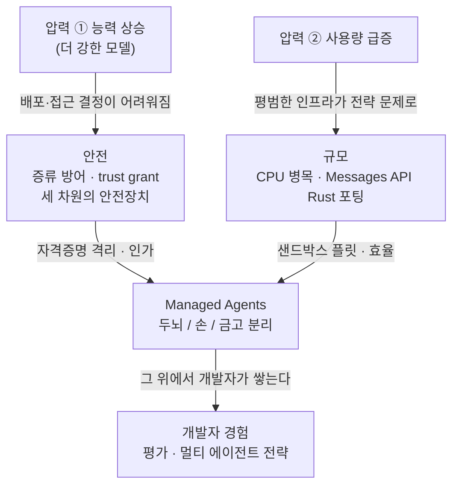
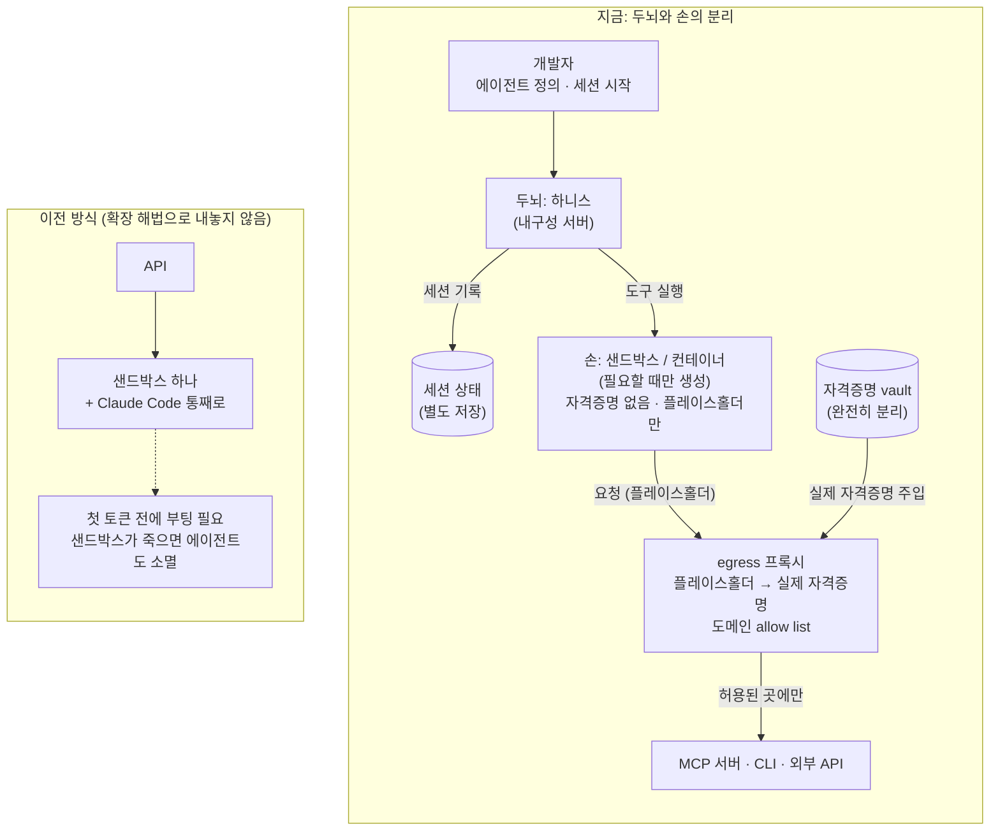

<figure class="post-figure post-figure--header">
<svg role="img" aria-label="왼쪽 단단한 서버 위의 두뇌(하니스와 세션 로그)가 가운데의 일회용 샌드박스 상자들, 곧 손 가운데 하나를 원격으로 조종한다. 자격증명 열쇠는 두뇌에도 손에도 없이 오른쪽 아래의 별도 금고에 잠겨 있고, 손과 바깥 세상 사이의 egress에 선 프록시 관문만이 금고에서 열쇠를 받아 플레이스홀더를 실제 자격증명으로 바꿔 내보낸다." viewBox="0 0 640 320">
  <title>두뇌와 손, 그리고 금고</title>

  <!-- LEFT: 두뇌 (내구성 서버 위의 하니스 · 세션 로그) -->
  <text x="100" y="40" text-anchor="middle" font-family="var(--font-body)" font-size="15" font-weight="700" fill="currentColor">두뇌</text>
  <text x="100" y="58" text-anchor="middle" font-family="var(--font-body)" font-size="11" fill="currentColor" opacity="0.75">하니스 · 세션 로그</text>
  <!-- brain (pixel blocks) -->
  <g fill="var(--secondary-color)" stroke="currentColor" stroke-width="1.5">
    <rect x="72" y="74" width="20" height="16"/>
    <rect x="92" y="70" width="20" height="20"/>
    <rect x="112" y="76" width="16" height="14"/>
    <rect x="68" y="90" width="28" height="18"/>
    <rect x="96" y="90" width="34" height="18"/>
  </g>
  <path d="M100 72 V106" stroke="currentColor" stroke-width="1.5" opacity="0.6"/>
  <!-- durable server -->
  <g fill="var(--bg-panel)" stroke="currentColor" stroke-width="2">
    <rect x="40" y="116" width="120" height="44" rx="3"/>
    <rect x="40" y="166" width="120" height="44" rx="3"/>
    <rect x="40" y="216" width="120" height="44" rx="3"/>
  </g>
  <g fill="var(--orc-green)">
    <rect x="52" y="134" width="8" height="8"/>
    <rect x="52" y="184" width="8" height="8"/>
    <rect x="52" y="234" width="8" height="8"/>
  </g>
  <g stroke="currentColor" stroke-width="2" opacity="0.5">
    <path d="M72 138 H146 M72 188 H146 M72 238 H146"/>
  </g>
  <text x="100" y="282" text-anchor="middle" font-family="var(--font-body)" font-size="11" fill="currentColor" opacity="0.75">살아남아야 하는 것</text>

  <!-- remote control: 두뇌 → 활성 손 -->
  <path d="M164 188 H244" fill="none" stroke="var(--accent-color)" stroke-width="3" stroke-dasharray="7 5" stroke-linecap="round"/>
  <polygon points="254,188 240,180 240,196" fill="var(--accent-color)"/>
  <text x="206" y="178" text-anchor="middle" font-family="var(--font-body)" font-size="11" fill="var(--accent-color)" font-weight="700">원격 조종</text>

  <!-- MIDDLE: 손 (일회용 샌드박스) -->
  <text x="310" y="40" text-anchor="middle" font-family="var(--font-body)" font-size="15" font-weight="700" fill="currentColor">손</text>
  <text x="310" y="58" text-anchor="middle" font-family="var(--font-body)" font-size="11" fill="currentColor" opacity="0.75">샌드박스 · 필요할 때만 생성</text>
  <g fill="none" stroke="currentColor" stroke-width="2" stroke-dasharray="5 4" opacity="0.45">
    <rect x="262" y="84" width="96" height="62" rx="3"/>
    <rect x="262" y="230" width="96" height="44" rx="3"/>
  </g>
  <text x="310" y="120" text-anchor="middle" font-family="var(--font-mono)" font-size="12" fill="currentColor" opacity="0.45">(폐기됨)</text>
  <text x="310" y="257" text-anchor="middle" font-family="var(--font-mono)" font-size="12" fill="currentColor" opacity="0.45">(대기)</text>
  <!-- active hand -->
  <rect x="262" y="160" width="96" height="58" rx="3" fill="var(--bg-panel)" stroke="var(--accent-color)" stroke-width="2.5"/>
  <text x="310" y="184" text-anchor="middle" font-family="var(--font-mono)" font-size="13" fill="currentColor">&gt;_ code</text>
  <text x="310" y="204" text-anchor="middle" font-family="var(--font-mono)" font-size="11" fill="currentColor" opacity="0.8">$PLACEHOLDER</text>
  <text x="310" y="296" text-anchor="middle" font-family="var(--font-body)" font-size="11" fill="currentColor" opacity="0.75">신뢰할 수 없는 일을 실행</text>

  <!-- egress: 손 → 프록시 -->
  <path d="M362 188 H430" fill="none" stroke="currentColor" stroke-width="2.5" stroke-linecap="round"/>
  <polygon points="440,188 426,180 426,196" fill="currentColor"/>
  <text x="398" y="178" text-anchor="middle" font-family="var(--font-body)" font-size="11" fill="currentColor" opacity="0.8">egress</text>

  <!-- 프록시 관문 -->
  <g fill="var(--bg-panel)" stroke="currentColor" stroke-width="2">
    <rect x="444" y="132" width="14" height="96"/>
    <rect x="482" y="132" width="14" height="96"/>
    <rect x="440" y="122" width="60" height="12"/>
  </g>
  <g fill="currentColor">
    <rect x="444" y="114" width="8" height="8"/>
    <rect x="466" y="114" width="8" height="8"/>
    <rect x="488" y="114" width="8" height="8"/>
  </g>
  <text x="470" y="104" text-anchor="middle" font-family="var(--font-body)" font-size="13" font-weight="700" fill="currentColor">프록시</text>
  <text x="470" y="90" text-anchor="middle" font-family="var(--font-body)" font-size="10" fill="currentColor" opacity="0.75">allow list</text>

  <!-- 금고 (vault) -->
  <rect x="434" y="252" width="72" height="52" rx="4" fill="var(--bg-panel)" stroke="var(--gold)" stroke-width="2.5"/>
  <circle cx="470" cy="272" r="7" fill="none" stroke="var(--gold)" stroke-width="2.5"/>
  <rect x="467" y="277" width="6" height="12" fill="var(--gold)"/>
  <text x="532" y="276" font-family="var(--font-body)" font-size="13" font-weight="700" fill="currentColor">금고</text>
  <text x="532" y="292" font-family="var(--font-body)" font-size="10" fill="currentColor" opacity="0.75">자격증명 vault</text>
  <!-- key handoff only to proxy -->
  <path d="M470 250 V236" stroke="var(--gold)" stroke-width="3" stroke-linecap="round"/>
  <polygon points="470,230 463,242 477,242" fill="var(--gold)"/>

  <!-- 바깥 세상 -->
  <path d="M500 188 H548" fill="none" stroke="var(--gold)" stroke-width="3" stroke-linecap="round"/>
  <polygon points="558,188 544,180 544,196" fill="var(--gold)"/>
  <circle cx="590" cy="188" r="30" fill="none" stroke="currentColor" stroke-width="2"/>
  <ellipse cx="590" cy="188" rx="12" ry="30" fill="none" stroke="currentColor" stroke-width="1.5" opacity="0.6"/>
  <path d="M560 188 H620 M566 172 H614 M566 204 H614" stroke="currentColor" stroke-width="1.5" opacity="0.6"/>
  <text x="590" y="140" text-anchor="middle" font-family="var(--font-body)" font-size="12" font-weight="700" fill="currentColor">바깥 세상</text>
  <text x="590" y="154" text-anchor="middle" font-family="var(--font-body)" font-size="10" fill="currentColor" opacity="0.75">MCP · CLI · 외부 API</text>
</svg>
<figcaption>살아남아야 하는 두뇌, 쓰고 버리는 손, 그리고 어느 쪽에도 없는 열쇠 — 자격증명은 금고에서 egress 프록시로만 건너간다.</figcaption>
</figure>

## 원문 정보

> - **제목**: How Anthropic ships Claude with Claude: Separating the Brain from the Hands
> - **출처**: Latent Space, swyx ([latent.space](https://latent.space)) — 게스트: Katelyn Lesse(Anthropic 플랫폼 엔지니어링 총괄), Angela Jiang(Anthropic 플랫폼 제품 총괄)
> - **발행**: 2026-10-27 · 약 104분 분량(에디토리얼 소개 + 쇼노트 + 영상 대담 전사본)
> - **원문 링크**: <https://latent.space/p/opus55/>

원문은 짧은 에디토리얼 세 꼭지와 약 1시간 46분 분량의 대담 **자동 전사본**으로 이뤄져 있다. 전사본에는 "자동 전사 초안이며 이름·표현에 오류가 있을 수 있고 화자는 지정되지 않았다"는 주석이 붙어 있으므로, 이 글에서도 발언자를 단정할 수 없는 대목은 "게스트"로 묶어 적는다. 에이전트 하니스와 런타임을 다뤄 온 이 위키의 흐름에서, **모델을 만든 회사가 자기 플랫폼을 어떻게 운영하는지**를 직접 들려주는 드문 자료라 Articles에 담는다.

## 한 줄 요약 (TL;DR)

프런티어 모델 출시는 이제 모델 품질만의 문제가 아니라 **API 통합 변경·안전 정책·권한 체계·CPU 용량**이 함께 움직이는 플랫폼 이벤트이고, Anthropic이 그 압력을 견디는 핵심 설계는 **살아남아야 하는 것(두뇌: 하니스·세션)과 신뢰할 수 없는 일을 실행하는 것(손: 샌드박스)과 비밀(자격증명)을 서로 다른 곳에 두는 것**이다.

## 왜 이 글을 골랐나

이 위키는 하니스를 여러 각도에서 다뤄 왔다. [무엇이 하니스를 하니스로 만드는가](/2026/08/03/what-makes-a-harness-a-harness.html)는 정의를, [Codex의 agent loop](/2026/06/25/codex-agent-loop.html)는 루프의 내부를, [GPT-6 Astra: 하니스가 곧 제품이다](/2026/09/08/gpt6-astra-harness-is-the-product.html)는 제품 관점을, 바로 전날 정리한 [Claude Mods](/2026/10/27/claude-mods-harness-inside-out.html)는 사람의 주의 쪽 끝을 봤다. 이번 글은 그 하니스가 **어디서 돌고, 무엇과 분리되어야 하며, 어떤 비밀을 들고 있으면 안 되는가**라는 런타임·인프라 질문에 답한다.

또 하나의 이유는 "AI로 AI를 만든다"는 구호가 구체적인 엔지니어링 결정으로 내려오는 장면이 많다는 점이다. Rust 개발자가 한 명도 없던 팀이 Messages API 전체를 Rust로 포팅해 섀도 트래픽으로 검증한 이야기는, [Anthropic 내부 고용 데이터 보고서](/2026/10/22/employment-at-anthropic.html)가 숫자로 보여 준 변화를 현장의 일로 보여 준다.

### 한눈에 보기

두 가지 압력이 안전과 규모라는 두 갈래의 작업을 낳고, 그 둘이 Managed Agents의 분리 설계에서 만나 개발자 경험으로 이어진다.

## 핵심 내용

### 두 가지 압력: 더 강한 모델, 더 많은 사용량

에디토리얼은 팀이 **두 종류의 압력** 아래에서 일한다고 요약한다. 모델이 강해질수록 안전한 배포와 접근 결정이 어려워지고, 동시에 사용량이 너무 빨리 늘어 "API가 CPU를 얼마나 쓰는가" 같은 평범한 인프라 선택이 전략적 문제가 된다. 그리고 이 두 문제는 개발자에게 닿는 제품 선택에서 만난다.

배경으로 호스트 swyx는 전날 공개된 Anthropic S-1 신고서를 짧게 짚는다. 에디토리얼은 지난 1년 사이 손실률 -126%에서 GAAP 기준 이익률 19%로의 전환을 언급하고(전사본에서는 같은 대목이 "129%"로 옮겨져 있어 자동 전사 오차로 보인다), 회사가 이를 **개선 루프**(Claude → 더 나은 모델 → 더 많은 사용처 → 더 많은 피드백 → 더 나은 Claude)와 **투자 루프**(도입 확대에 따른 매출 → 성장 → 투자 → 역량 → 더 나은 Claude) 두 개의 루프로 설명한다고 소개한다. 직원 1인당 연 매출이 1년 전 140만 달러에서 660만 달러가 됐다는 수치, Claude Code와 Cowork가 외부에 공개된 Claude Platform과 같은 프리미티브 위에 지어졌다는 "ant fooding" 이야기도 이 도입부에 나온다. 다만 이 부분은 swyx가 S-1에서 뽑아 읽은 내용이므로, 숫자 자체는 원 신고서로 확인하는 편이 안전하다.

### 모델 출시는 곧 API 출시다

Opus 5.5 출시에서 게스트들이 꼽은 메시지는 두 가지다. 이전 세대 Opus의 글이 장황하다는 피드백을 받아 이를 정리했고, **달러당 지능(intelligence per dollar)**을 맞추는 데 공을 들였다. 에디토리얼은 새 모델이 이전보다 운영 비용이 낮지만 절감 폭은 워크로드와 캐시된 컨텍스트 활용 정도에 달려 있다고 덧붙인다.

덜 보이는 출시 작업은 **증류(distillation) 방어**다. 사고의 연쇄(chain of thought)를 추출하는 것이 모델을 증류하는 가장 강력한 방법 중 하나라는 점은 오래전부터 알려진 틈이었고, 최근 추론 흔적을 빼내는 기법이 공개되면서(연구자들은 책임 있는 공개 절차를 밟았다고 한다) 대응이 구체화됐다. 해법의 축은 **턴을 넘어 thinking block을 보존하도록 강제하는 것**이다.

이 대목에서 게스트가 설명한 "사용자 경험 손상의 두 층위"가 인상적이다.

1. 통합을 바꿔야 해서 **귀찮지만**, 바꾸고 나면 예전과 같은 일을 할 수 있는 경우
2. 바꾼 뒤에도 **예전에 하던 일을 더는 할 수 없는** 경우

팀은 두 번째를 만들지 않는 것을 가장 중요하게 여겼다. 예를 들어 일부 고객의 컴팩션(compaction) 전략은 thinking block 보존 요구 때문에 깨질 처지였는데, 팀은 보존된 thinking과 함께 동작하는 **컴팩션 기능을 API에 새로 넣어** 고객이 직접 하던 일을 대체했다. 오픈소스 하니스 유지보수자들에게 먼저 연락해 업그레이드를 안내한 것도 같은 맥락이다. 증류를 막는 이유에 대해서는 "상업적 문제가 아니라 안전 문제"라고 못 박는다. Anthropic은 생성 토큰에 안전 분류기를 돌리는데, 증류된 모델이 그런 장치 없이 돌면 나쁜 결과가 생길 수 있다는 논리다.

### 조기 접근 프로그램: 벤치마크 점수보다 "다른 하니스"

출시 과정은 대략 이렇게 묘사된다. 여러 버전을 잘라 평가하고, 사내에서 Claude를 써 보며("ant fooding") 초기 신호를 잡고, 확신이 생긴 변형을 1st-party 제품이나 API 고객에게 조기 접근으로 내보낸다. 조기 접근 대상은 **견고한 평가 세트를 가진 고객**이 대부분이다. 테스트용 버전을 자르고 모두에게 공개하기까지의 창을 최대한 좁히고 싶기 때문에, 바로 전체 평가를 돌리고 실행 가능한 피드백을 돌려줄 수 있는 곳과 일한다.

가장 쓸모 있는 피드백은 **부정적인 것**이다. 한 번은 초기 버전이 너무 "게으르다"는 피드백이 나와 모델을 다시 "오븐에 넣었다"고 한다. 그리고 API 고객의 피드백이 특히 귀한 이유는 Claude를 **Anthropic 자신의 제품이 다루지 않는 하니스와 과제**에 넣어 보기 때문이다. Claude가 범용적이길 원한다면, 남의 하니스에서의 행동이 곧 일반화의 시험대다.

게으름과 과잉 행동 사이의 기본값은 모두가 다르게 원하기 때문에 "정확히 맞추는 건 문자 그대로 불가능하다"는 고백도 나온다. 현재 해법은 effort 같은 **파라미터를 노출하고 고객군별로 기본값을 다르게** 두는 것인데, effort·budget 등 파라미터가 뒤섞인 상태라 어떤 것을 없애고 어떤 것을 더 나은 기본값으로 바꿀지 계속 고민 중이라고 한다. 이 복잡성을 흡수해 주는 것이 Claude Managed Agents의 가치 제안 중 하나로 이어진다.

### 안전은 이제 출시 작업의 대부분이다

게스트는 "지금 말하는 것들은 예전에는 모델을 출시할 때 생각하지 않아도 됐던 것들이고, 이제는 그것이 작업의 대부분"이라고 말한다. 언급된 요소는 다음과 같다.

- **모델별 정책 결정**: 예컨대 데이터 보존(data retention) 요건을 둘지 말지. 대규모 계정 네트워크를 통한 악용이나 증류는 토큰이 흐르는 순간에는 잡기 어려워, 자동·사람 검토를 위한 보존 정책이 필요해졌다. Opus 5.5에는 Fable에 있던 그 보존 요건이 없다고 한다.
- **검증 프로그램**: 사이버 보안, 그리고 새로 생긴 생명과학 검증 프로그램. 이중 용도(dual use) 역량에 대해 용도를 신청·승인받은 사용자에게는 안전장치를 완화해 준다.
- **끝까지 이어지는 인가**: "API 키를 주고 기능 플래그를 켜는" 수준이 아니라, 특정 모델·프로그램에 대한 권한이 시스템 전체를 관통해 신뢰할 수 있게 전파되도록 만들었다.

후반부에서는 이것을 **세 차원**으로 정리한다. (1) 아키텍처·인프라 보안, (2) 모델이 일하는 동안 도는 온라인 안전장치, (3) 저장된 데이터에 대한 오프라인 안전장치 분류. "페이싱(pacing)을 말하면서 프런티어 모델을 연달아 내는 건 모순 아니냐"는 질문에는, 세 차원 모두에서 충분하다고 판단했기 때문에 낸 것이라는 답이 돌아온다.

분류기 때문에 대화가 다른 모델로 **폴백(fallback)**되는 경험이 사용자에게 답답하다는 점도 인정한다. API에서는 서버 측 폴백을 고객이 선택할 수 있고, SDK에는 클라이언트 측에서 폴백을 관리하거나 같은 모델로 다르게 재프롬프트하는 헬퍼가 있다고 한다. 이상적인 방향으로는 모델을 이리저리 갈아타는 대신 **하나의 일관된 모델이 아주 낮은 effort에서 시작해 연속적으로 스스로를 확장**하는 쪽을 꼽는데, 이는 비용 라우터 문제와도 같은 구조라는 데 호스트와 게스트가 동의한다.

### Trust grant: 범용 프리미티브와 "확률적" 로드맵

증류 방어와 검증 프로그램을 받치는 것은 게스트들이 **trust grant**라고 부르는 인가 데이터 모델이다. "특정 모델 또는 특정 프로그램에 대한 접근 권한을 부여받았다"는 사실을 깔끔하게 표현하는 구조이고, 요청의 핫 패스에서 해당 grant가 있는지 확인하는 서비스가 돈다. 호스트가 AWS IAM과 뭐가 다르냐고 묻자 "본질적으로 Anthropic판 IAM"이라는 답이 나온다.

흥미로운 건 이 프리미티브가 쓰인 곳들이다. Fable 5.1에서 thinking 보존을 처음 강제할 때 기존 고객에게 유예 기간을 주는 grandfathering에 썼고, 혹시 모를 상황에 대비해 **모든 사람의 모델 접근을 버튼 하나로 회수**할 수 있는 장치에도 같은 프리미티브를 깔았다. 제품 측 게스트는 이 경험을 로드맵 철학으로 연결한다. 전통적인 PM이라면 구체적 유스케이스에 집중하겠지만, Fable의 배포 철회처럼 아무도 예상하지 못한 사건이 실제로 일어나는 환경에서는 로드맵이 "깊이 확률적"이 되고 **헤지(hedge) 포트폴리오**를 쌓게 된다는 것이다. 그리고 범용적으로 설계한 프리미티브는 결국 대부분 다시 쓰이게 되더라는 관찰이 뒤따른다.

### CPU가 새로운 병목이고, Messages API는 Rust가 됐다

규모 쪽 이야기에서 가장 의외인 대목은 **병목이 GPU가 아니라 CPU**라는 것이다. 제품 서비스와 API, 샌드박싱, 그리고 코드가 훨씬 많이 쓰이면서 늘어난 CI 실행까지 모두 CPU를 먹는다. 클라우드 사업자와 협상해 확보한 CPU는 회사 전체에서 제로섬이라 연구용 샌드박스와 제품용 샌드박스까지 나눠 써야 한다. 예산만 있으면 필요할 때 늘리던 CPU를 이제는 **미리 용량 계획**해야 하는 상황이며, 게스트는 이것이 자기들만의 문제가 아니라 업계 전체의 문제라고 말한다.

대응은 세 갈래다. CPU를 더 확보하고, 인프라 계층에서 테넌트 격리 같은 보안 성질을 해치지 않으면서 샌드박스를 더 효율적으로 돌리고, 애플리케이션 계층을 더 효율적으로 만든다. 마지막 갈래의 대표 사례가 **Messages API의 Rust 포팅**이다.

<figure class="post-figure">
<svg role="img" aria-label="Messages API의 Rust 포팅 절차. 같은 요청이 기존 Python 모놀리스와 API 전체를 Rust로 포크한 시스템 양쪽으로 흐르고, Rust 쪽은 섀도 트래픽으로 받는다. 정적 분석 장치가 Python에만 추가된 기능을 경고한다. 두 출력이 같은지 비교한 뒤 기능 플래그 다이얼을 천천히 Rust 쪽으로 돌린다. 아래에는 계획과 검증은 사람이, 구현은 Claude가 맡는다는 역할 표시가 있다." viewBox="0 0 640 360">
  <title>섀도 트래픽으로 검증한 Rust 포팅</title>

  <!-- 요청 -->
  <rect x="270" y="14" width="100" height="32" rx="3" fill="var(--bg-panel)" stroke="currentColor" stroke-width="2"/>
  <text x="320" y="35" text-anchor="middle" font-family="var(--font-body)" font-size="13" font-weight="700" fill="currentColor">같은 요청</text>

  <!-- split arrows -->
  <path d="M290 46 L170 76" fill="none" stroke="currentColor" stroke-width="2.5" stroke-linecap="round"/>
  <polygon points="160,79 172,70 175,83" fill="currentColor"/>
  <text x="196" y="56" text-anchor="middle" font-family="var(--font-body)" font-size="11" fill="currentColor" opacity="0.8">실제 트래픽</text>
  <path d="M350 46 L470 76" fill="none" stroke="var(--accent-color)" stroke-width="2.5" stroke-dasharray="6 4" stroke-linecap="round"/>
  <polygon points="480,79 465,83 468,70" fill="var(--accent-color)"/>
  <text x="446" y="56" text-anchor="middle" font-family="var(--font-body)" font-size="11" font-weight="700" fill="var(--accent-color)">섀도 트래픽</text>

  <!-- Python 모놀리스 -->
  <rect x="60" y="84" width="180" height="60" rx="3" fill="var(--bg-panel)" stroke="currentColor" stroke-width="2"/>
  <text x="150" y="110" text-anchor="middle" font-family="var(--font-body)" font-size="14" font-weight="700" fill="currentColor">Python 모놀리스</text>
  <text x="150" y="129" text-anchor="middle" font-family="var(--font-body)" font-size="11" fill="currentColor" opacity="0.75">기존 시스템 · 기능 추가 계속</text>

  <!-- Rust 포크 -->
  <rect x="400" y="84" width="180" height="60" rx="3" fill="var(--bg-panel)" stroke="var(--accent-color)" stroke-width="2.5"/>
  <text x="490" y="110" text-anchor="middle" font-family="var(--font-body)" font-size="14" font-weight="700" fill="currentColor">Rust 포크 (API 전체)</text>
  <text x="490" y="129" text-anchor="middle" font-family="var(--font-body)" font-size="11" fill="currentColor" opacity="0.75">순수 포팅 · 새 기능 없음</text>

  <!-- 정적 분석 경고 -->
  <path d="M244 114 H392" fill="none" stroke="var(--gold)" stroke-width="2" stroke-dasharray="3 4"/>
  <polygon points="398,114 388,109 388,119" fill="var(--gold)"/>
  <rect x="309" y="96" width="22" height="16" fill="var(--bg-panel)" stroke="var(--gold)" stroke-width="2"/>
  <text x="320" y="109" text-anchor="middle" font-family="var(--font-mono)" font-size="12" font-weight="700" fill="var(--gold)">!</text>
  <text x="320" y="132" text-anchor="middle" font-family="var(--font-body)" font-size="10" fill="currentColor" opacity="0.8">정적 분석: Rust 미반영 경고</text>

  <!-- to comparator -->
  <path d="M150 144 L282 176" fill="none" stroke="currentColor" stroke-width="2" stroke-linecap="round"/>
  <path d="M490 144 L358 176" fill="none" stroke="var(--accent-color)" stroke-width="2" stroke-dasharray="6 4" stroke-linecap="round"/>
  <polygon points="320,154 358,178 320,202 282,178" fill="var(--bg-panel)" stroke="currentColor" stroke-width="2.5"/>
  <text x="320" y="183" text-anchor="middle" font-family="var(--font-body)" font-size="12" font-weight="700" fill="currentColor">출력 같은가</text>

  <!-- arrow to dial -->
  <path d="M320 202 V212" stroke="currentColor" stroke-width="2.5"/>
  <polygon points="320,222 313,210 327,210" fill="currentColor"/>

  <!-- 기능 플래그 다이얼 -->
  <path d="M276 272 A44 44 0 0 1 364 272" fill="none" stroke="currentColor" stroke-width="3"/>
  <path d="M276 272 A44 44 0 0 1 306 231" fill="none" stroke="currentColor" stroke-width="6" opacity="0.35"/>
  <path d="M334 231 A44 44 0 0 1 364 272" fill="none" stroke="var(--accent-color)" stroke-width="6"/>
  <path d="M320 272 L349 245" stroke="var(--accent-color)" stroke-width="3" stroke-linecap="round"/>
  <circle cx="320" cy="272" r="5" fill="currentColor"/>
  <text x="268" y="276" text-anchor="end" font-family="var(--font-mono)" font-size="11" fill="currentColor" opacity="0.75">Python</text>
  <text x="372" y="276" font-family="var(--font-mono)" font-size="11" font-weight="700" fill="var(--accent-color)">Rust</text>
  <text x="320" y="292" text-anchor="middle" font-family="var(--font-body)" font-size="11" fill="currentColor" opacity="0.8">기능 플래그 · 천천히 켜기</text>

  <!-- 결과 (원문 수치, 대략) -->
  <text x="470" y="236" font-family="var(--font-body)" font-size="11" font-weight="700" fill="currentColor">결과 (대략)</text>
  <text x="470" y="254" font-family="var(--font-body)" font-size="11" fill="currentColor" opacity="0.85">CPU 40~50% 절감</text>
  <text x="470" y="270" font-family="var(--font-body)" font-size="11" fill="currentColor" opacity="0.85">TTFT 10~20% 개선</text>

  <text x="60" y="246" font-family="var(--font-body)" font-size="11" fill="currentColor" opacity="0.8">조각내 수년 대신</text>
  <text x="60" y="262" font-family="var(--font-body)" font-size="11" font-weight="700" fill="currentColor">한 번에 이전</text>

  <!-- 역할 표시 -->
  <rect x="40" y="306" width="180" height="40" rx="3" fill="var(--bg-panel)" stroke="var(--secondary-color)" stroke-width="2.5"/>
  <text x="130" y="331" text-anchor="middle" font-family="var(--font-body)" font-size="13" font-weight="700" fill="currentColor">계획 · 사람</text>
  <rect x="230" y="306" width="180" height="40" rx="3" fill="none" stroke="currentColor" stroke-width="2" stroke-dasharray="5 4" opacity="0.7"/>
  <text x="320" y="331" text-anchor="middle" font-family="var(--font-body)" font-size="13" fill="currentColor" opacity="0.85">구현 · Claude</text>
  <rect x="420" y="306" width="180" height="40" rx="3" fill="var(--bg-panel)" stroke="var(--secondary-color)" stroke-width="2.5"/>
  <text x="510" y="331" text-anchor="middle" font-family="var(--font-body)" font-size="13" font-weight="700" fill="currentColor">검증 · 사람</text>
</svg>
<figcaption>같은 요청을 섀도 트래픽으로 양쪽에 흘려 출력을 맞춘 뒤 다이얼을 천천히 돌린다 — 사람은 계획과 검증을, Claude는 구현을 맡았다.</figcaption>
</figure>

- 출발점: 게스트가 1년여 전 합류했을 때 Messages API는 **단일 GCP 리전의 Python 모놀리스**였다.
- 결정: Rust를 택했지만 팀에는 **Rust 개발자가 단 한 명도 없었다.** 코드는 Claude가 쓰고, 분산 시스템 설계는 사람이 했다. Claude는 엔지니어가 설계에 필요한 것을 배우고 아이디어를 주고받는 상대로도 쓰였다.
- 핵심: 가장 중요했던 건 **계획과 검증** 두 가지였다. 구현은 "Claude가 코드를 쓰는 일"이었기 때문이다.
- 방법: API **전체를 Rust로 포크**한 뒤 섀도 트래픽을 흘려 Python 시스템과 Rust 시스템의 출력이 같은지 검증하고, 천천히 켰다. 예전 같으면 조각조각 나눠 수년에 걸쳐 옮겼을 일을 한 번에 옮겼다.
- 규율: 재작성 중 새 기능을 끼워 넣고 싶은 유혹을 참고 **순수한 포팅**으로 유지했다. 나머지 팀이 Python 쪽에 기능을 계속 추가하는 동안, 포팅 팀은 "여기 기능을 넣고 Rust 쪽은 안 고쳤다"고 경고하는 정적 분석 장치까지 만들어 따라잡았다.
- 결과: 대략 **CPU 40~50% 절감**, **time-to-first-token 10~20% 개선**(긴 워크로드에서 더 크다고 한다).

포팅 팀의 다음 목표는 재설계이며, 그중 하나로 대화 상태 전체를 매번 주고받지 않아도 되도록 **일정 기간 서버 측에 상태를 저장하는 방식**을 실험 중이라고 한다. 프롬프트 캐싱이 있어도 지금은 대화 상태를 다시 보내야 하므로, 사용자 수로는 소수여도 토큰 볼륨으로는 다수를 차지하는 긴 대화에서 지연과 효율 이득이 클 것이라는 설명이다.

### 두뇌와 손: Managed Agents의 아키텍처

에디토리얼이 "이 에피소드에서 가장 좋아하는 멘탈 모델"이라고 꼽은 부분이다. Claude Managed Agents는 Messages API(원시 토큰 접근)보다 한 단계 높은 추상화로, 에이전트를 정의하고 세션을 시작하면 하니스와 인프라 구성을 건너뛸 수 있는 API 묶음이다. Claude Code 같은 1st-party 제품과 하니스를 공유하지는 않지만, 실행을 떠받치는 샌드박스 플릿 같은 인프라는 상당 부분 같다고 한다.

에디토리얼이 말하는 분리를 구조도로 옮기면 다음과 같다. "이전 방식" 묶음은 대비용으로 함께 둔 첫 설계다.

**이전 방식과의 대비.** 에이전트용 API의 첫 버전은 "샌드박스에 Claude Code를 넣고 위에 API를 얹는" 형태였다. 그러면 토큰 하나를 돌려주기 전에 샌드박스와 Claude Code를 먼저 부팅해야 하고, 샌드박스가 죽으면 에이전트 전체가 사라진다. 신뢰성이 기대에 못 미쳐 이를 확장 가능한 해법으로 내놓지 않았다.

**분리의 내용.** 하니스(두뇌)는 내구성 있는 서버에서 돌고, 세션 상태는 따로 저장되며, 실행 환경(손)은 필요할 때만 생성된다. 그래서 첫 요청에 토큰을 빨리 돌려줄 수 있고, 샌드박스가 죽어도 에이전트는 죽지 않는다. 처음 동기는 **지연과 신뢰성**이었다.

**보안이라는 부산물이자 본질.** 게스트는 처음부터 "이 아키텍처의 가장 중요한 성질은 보안"이라고 주장했던 PM에게 녹화 전날(출시 당일) 사과했다는 일화를 전한다. 핵심은 자격증명의 위치다.

- MCP 서버, CLI, 외부 API 등 에이전트가 쓰는 자격증명은 **완전히 분리된 vault**에 저장된다.
- 에이전트는 **플레이스홀더만** 보고, egress의 **프록시가 실제 자격증명을 꺼내 주입**한다.
- 따라서 생성된 코드가 도는 샌드박스에는 애초에 **읽을 자격증명이 존재하지 않는다.** "스크럽"이나 "에이전트가 훔치지 않기를" 바라는 정책이 아니라 문자 그대로 인프라의 벽이다.
- 샌드박스에는 **도메인 allow list나 네트워크 차단** 같은 egress 통제를 걸 수 있어, 신뢰할 수 없는 코드가 실행돼도 허락한 곳에만 닿는다.

게스트는 고객에게 두 가지를 가장 중요하다고 말한다고 한다. 에이전트가 해서는 안 되는 일을 **아예 불가능하게 만드는 아키텍처**, 그리고 샌드박스의 **구성(configuration)**. "두뇌와 손, 자격증명 주입, egress 같은 말은 9개월 전에는 아무도 하지 않았다"는 말에서 이 분야가 얼마나 새로운지 드러난다.

에디토리얼은 이를 에이전트 런타임을 설계하는 누구에게나 쓸모 있는 렌즈로 정리한다. **어떤 부분이 살아남아야 하는가, 어떤 부분이 신뢰할 수 없는 일을 실행하는가, 어떤 비밀이 코드가 도는 곳에 정말로 있어야 하는가.** 구현은 제품마다 달라도 이 질문은 유효하다는 것이다.

**샌드박스 탈출 사고에 대해.** 최근 화제가 된 탈출 사례들에 대해 게스트는 그 대부분이 **훈련 중인 모델**에게 일어난 일이라고 구분한다. 훈련 환경은 모델을 상자에 넣고 불가능한 과제를 주는 구조라 상자 밖으로 나가려는 유인이 생기지만, 프로덕션 워크로드에는 온라인 안전장치가 있고 "하니스는 여기, 손은 저기" 있는 아키텍처가 있다는 것이다. 동시에 장시간 실행 에이전트 자체가 새로운 분야라 모두가 통제 장치를 급히 갖춰 가는 중이라고 인정한다.

### 다른 에이전트의 기억을 돕는 에이전트

Managed Agents는 메모리와 멀티 에이전트 실험의 기반이기도 하다. **Dreaming**은 별것 아니게도 **한 managed agent가 다른 managed agent의 이전 작업을 들여다보고 그 에이전트에 기억을 써 주는** 방식으로 구현됐다. "managed agents all the way down"이다. 같은 프리미티브로 best-of-N, 검증자(verifier) 에이전트 같은 다른 전략도 만들 수 있고, 곧 그 기반 프리미티브를 사용자에게 열어 Dreaming 같은 **멀티 에이전트 전략을 직접 구성**하도록 템플릿과 함께 제공할 계획이라고 한다. 에디토리얼은 이런 향후 기능을 "약속이 아니라 계획으로 받아들이라"고 선을 긋는다.

로드맵의 무게중심에 대한 설명도 솔직하다. 메모리와 학습은 여전히 중요하지만, 모델 출시가 안전 측면에서 점점 어려워지면서 팀의 당장의 에너지는 skills·dreaming·memory 같은 기능보다 **안전**으로 옮겨 갔다고 한다. 기본 하니스는 의도적으로 단순하게 유지하고, 그 위에서 개발자가 검증자·병렬 에이전트 등 "힐 클라이밍" 전략을 실험하도록 두겠다는 방향이다.

### 평가: 더 많이, 단순하게 시작해서, 연구처럼

평가에 대한 게스트들의 조언은 단순하다.

- 정적·결정론적 평가, LLM-as-a-judge 등 종류는 많지만, 몇 개의 완벽한 세트로 답을 다 얻을 수는 없다. 대부분 **상대적으로 큰 평가 묶음**이 필요해진다.
- 가장 흔한 실수는 **과소 투자**다. 온갖 기법 목록을 보며 고민하는 사이 실제 평가는 0개인 경우가 많으니, 단순한 것부터 시작하라.
- 에이전트와 함께 평가 세트를 진화시켜라. **Claude는 에이전트를 평가할 평가를 만드는 데 실제로 능하다.**

호스트 swyx는 여기에 "엔지니어링을 연구처럼 다루라"는 프레임을 보탠다. 목표를 먼저 정의해 평가로 형식화하고, 왜 실패하는지 파고든다. 그러면 평가가 틀린 경우, 환경이 틀린 경우, 모델이 틀린 경우가 갈린다. 그리고 "꽤 자주 평가가 틀렸다"고 덧붙인다. 에디토리얼은 이를 "하니스는 애플리케이션이지만, 그것을 개선하는 일은 연구를 닮아 간다"고 요약하면서도, 평가가 실제 사용자의 일을 반영하는지 판단할 **사람의 판단력은 남겨 두어야** 한다고 적는다.

### 슬롭과 싸우는 법, 그리고 멀티 에이전트에 대한 조언

마지막 꼭지들에서 나온 실무 감각 몇 가지.

- **문서 슬롭**: Claude를 쓰는 건 당연하지만, 읽지도 않고 생성만 해서 넘기면 읽는 사람에게 부담을 떠넘기는 것이다. 품질의 책임은 여전히 사람에게 있다. 반대로 읽는 쪽도 정말 슬롭이면 그냥 돌려보내되, em dash 같은 사소한 "Claude 티"에 과민하게 굴지는 말자는 균형을 팀에서 계속 맞추고 있다고 한다.
- **코드 슬롭**: 사람은 시스템 설계를 책임지고 구현은 대체로 Claude가 한다. 모든 줄을 깊이 리뷰하기보다 전체 계획과 설계가 건전한지에 더 신경 쓰고, **많은 검증 장치**에 의존해 품질을 지킨다.
- **제품 슬롭**: Thariq의 말을 빌려, 모델 역량을 기능을 10배 더 출시하는 데 쓰지 말고 사용자를 이해하고 실험하는 데 쓰라고 한다. 에이전트가 일부를 빠르게 해 준다고 해서 계획과 판단 같은 기초 과정을 건너뛰는 일종의 게으름이 생기고 있다는 경계도 나온다. 대담 후반 Angela의 트윗을 다루는 코너에서 꼽힌 한 문장, "무언가를 반쯤 하는 것은 그것을 하지 않는 비싼 방법이다"도 이 주제와 겹친다.
- **멀티 에이전트**: Opus 5.5로 해 볼 만한 것으로 멀티 에이전트 구성을 꼽는다. 리드 하나를 두고 병렬화 가능한 일을 쪼개되, **하위 에이전트들이 균일한 컨텍스트(공유 상태)를 갖고, 비동기적이어서 서로를 막지 않을 것**. 아키텍처에서 신경 쓸 건 이 두 가지뿐이고, 나머지는 Claude가 설계하게 두고 실험해 보라는 조언이다.

대담에는 제품·엔지니어링 리더의 협업 방식, Slack 받은편지함 관리, 플랫폼 DevRel 팀 구성(제품·콘텐츠·커뮤니티 세 기둥, Claude API skill을 DevRel 팀이 소유한다는 점) 이야기도 있지만, 이 글에서는 에이전트 엔지니어링과 직접 닿는 부분에 집중했다.

## 분석과 인사이트

여기부터는 원문 요약이 아니라 내 해석이다.

### 1. "두뇌와 손"은 오래된 원칙의 에이전트판이다

자격증명을 vault에 두고 egress 프록시에서 주입하는 패턴, 상태 없는 워커와 내구성 있는 상태 저장소의 분리, 최소 권한과 네트워크 allow list는 모두 클라우드 보안과 분산 시스템에서 익숙한 원칙이다. 새로운 점은 **실행 주체가 신뢰할 수 없는 코드를 스스로 생성한다**는 것이다. 사람이 짠 서비스라면 "이 코드는 자격증명을 함부로 쓰지 않는다"고 리뷰로 보증할 수 있었지만, 에이전트가 방금 생성한 코드는 그런 보증이 불가능하다. 그러면 남는 선택지는 정책이 아니라 **배치(placement)**, 곧 비밀이 그 자리에 아예 없게 만드는 것뿐이다. 원문이 "스크럽하는 대신 인프라의 벽"이라고 강조하는 이유가 여기에 있다.

이 관점은 [KV 캐시 교차 요청 노출 사고](/2026/10/27/kv-cache-exposure-remediation.html)와도 이어진다. 그 사고도 결국 "격리돼 있으리라 믿었던 경계"가 실제로는 공유 자원이었다는 이야기였다. 에이전트 시대의 보안은 **경계가 어디에 물리적으로 존재하는가**를 묻는 일이 된다.

### 2. 내구성 있는 두뇌는 durable execution의 문제이기도 하다

"샌드박스가 죽어도 에이전트는 죽지 않는다"는 성질은 [Postgres 기반 durable workflow](/2026/06/22/postgres-durable-execution.html)가 다룬 문제와 같은 모양이다. 장시간 실행 에이전트의 진짜 어려움은 모델 호출이 아니라 **실패한 단계에서 재개할 수 있는 상태 관리**다. 원문은 구현 세부를 밝히지 않지만, 하니스와 세션 로그를 실행 환경에서 떼어 냈다는 사실만으로도 직접 에이전트 런타임을 만드는 팀이 무엇을 먼저 분리해야 하는지는 분명해진다.

### 3. Rust 포팅 이야기에서 진짜 교훈은 "언어"가 아니라 "검증"이다

가장 인용되기 쉬운 문장은 "Rust 개발자 없이 Rust로 포팅했다"겠지만, 내가 보기에 핵심은 게스트 스스로 말한 **"가장 중요했던 건 계획과 검증"**이다. 섀도 트래픽으로 두 시스템의 출력을 비교할 수 있었기 때문에 한 번에 옮기는 결정이 가능했다. 바꿔 말하면, 출력 동등성을 기계적으로 확인할 오라클이 없는 시스템이라면 같은 전략이 통하지 않는다. 그리고 "순수 포팅" 규율과 정적 분석 경고 장치는 코드 생성이 싸졌을 때 오히려 더 중요해지는, **범위를 지키는 장치**다. 이 위키의 [Rust-Essential 커리큘럼](/2026/01/02/rust-essential-curriculum.html)을 공부하는 입장에서도, "언어를 몰라도 된다"가 아니라 "검증 가능한 계약이 있으면 언어 장벽이 낮아진다"로 읽는 편이 정확하다.

수치(CPU 40~50%, TTFT 10~20%)는 대담 중 게스트가 "대략"이라며 말한 것이고 Python 모놀리스의 비효율이 출발점이었다는 점도 감안해야 한다. "Rust로 바꾸면 절반이 줄어든다"는 일반 법칙으로 받아들이면 곤란하다.

### 4. 증류 방어의 "두 층위" 기준은 모든 플랫폼 팀이 빌려 쓸 만하다

통합 변경을 강제할 때 "귀찮지만 할 수 있는 일은 그대로인가, 아니면 할 수 없는 일이 생기는가"로 나누는 기준은 깔끔하다. 두 번째 층위에 걸리는 고객(컴팩션 전략이 깨지는 고객)을 위해 **대체 기능을 먼저 만들어 주고** 강제한다는 순서도 정석이다. API를 운영하는 팀이라면 breaking change 정책 문서에 그대로 옮겨 적어도 될 만한 원칙이다.

다만 이견도 하나 있다. 증류 방어를 "상업 문제가 아니라 안전 문제"라고 하는 설명은 이해하지만, 사용자 입장에서는 그 동기가 무엇이든 thinking block 보존 요구, 데이터 보존 정책, 분류기 폴백이 **통합 복잡도와 예측 불가능성**으로 돌아온다. 원문도 폴백 경험이 답답하다는 점과 파라미터가 뒤섞여 있다는 점을 인정한다. 그 복잡도를 "Managed Agents를 쓰면 우리가 흡수해 준다"로 푸는 것은 합리적이지만, 동시에 플랫폼 의존도를 높이는 방향이라는 점은 의식하고 선택해야 한다.

### 5. "확률적 로드맵"은 플랫폼 엔지니어링의 오래된 딜레마를 다시 정당화한다

"사고 한 번 나면 과잉 대비하고, 그 사고는 다시 안 일어난다"는 플랫폼 엔지니어링의 농담에 대해, 제품 측 게스트는 꼬리 위험이 실제로 일어나는 환경에서는 헤지 포트폴리오가 맞고, 범용적으로 설계한 프리미티브는 결국 다시 쓰이더라고 답한다. 이건 YAGNI와 정면으로 부딪치는 주장처럼 보이지만, 실은 **불확실성의 분산이 클 때 옵션 가치가 커진다**는 같은 논리의 다른 면이다. [YAGNI를 옵션과 NPV로 다시 읽는 글](/2026/07/03/yagni-cost-was-never-typing.html)과 나란히 읽으면, 언제 범용 프리미티브에 투자할지를 감이 아니라 "얼마나 예측 불가능한 환경인가"로 판단할 수 있다.

### 6. 평가에 대한 조언은 평범하지만, 그래서 더 아프다

"평가가 0개인 팀이 많다", "더 많이, 단순하게 시작하라"는 조언은 새롭지 않다. 그런데 이 말을 하는 쪽이 조기 접근 대상 고객을 **평가 세트가 견고한지로 고른다**는 사실을 함께 놓고 보면 무게가 달라진다. 평가를 가진 팀은 새 모델이 나올 때 가장 먼저 시험해 보고 피드백을 줄 수 있고, 평가가 없는 팀은 출시 후에 바이브로 따라간다. 평가는 품질 장치이면서 동시에 **프런티어에 대한 접근권**이기도 하다. [GPT-6 Astra 글](/2026/09/08/gpt6-astra-harness-is-the-product.html)이 말한 "하니스가 곧 제품"이라면, 평가는 그 제품의 회귀 테스트다.

## 적용 포인트

- **에이전트 런타임을 세 칸으로 나눠 그려 보라.** 살아남아야 하는 것(하니스·세션 상태), 신뢰할 수 없는 일을 실행하는 것(샌드박스), 비밀(자격증명). 지금 이 셋이 한 프로세스나 한 컨테이너에 같이 있다면 그게 첫 번째 리팩터링 대상이다.
- **샌드박스에 자격증명을 넣지 말라.** 플레이스홀더와 egress 프록시 주입 패턴을 쓰고, 샌드박스의 네트워크는 기본 차단에 도메인 allow list로 연다. "에이전트가 안 훔치기를 바라는" 정책 대신 배치로 해결한다.
- **샌드박스 수명과 에이전트 수명을 분리하라.** 실행 환경이 죽어도 세션을 이어 갈 수 있는지, 첫 응답 전에 무거운 부팅이 끼어 있지 않은지 점검한다.
- **breaking change를 "두 층위"로 분류하라.** 할 수 있던 일을 못 하게 되는 변경이라면, 강제하기 전에 대체 기능부터 제공한다.
- **권한을 "기능 플래그"가 아니라 범용 grant로 모델링하라.** 특정 모델·프로그램·유예 기간·전면 회수를 같은 프리미티브로 다룰 수 있으면, 예상 못 한 사건에 대응하는 속도가 달라진다.
- **큰 마이그레이션은 섀도 트래픽과 출력 비교를 먼저 설계하라.** 구현을 에이전트에게 맡길수록 계획과 검증의 비중이 커진다. 재작성 중 기능 추가는 금지하고, 병행 개발 중인 쪽과의 차이를 경고하는 장치를 둔다.
- **평가는 오늘 하나라도 만들어라.** 단순한 것부터 시작하고, 실패를 볼 때 "평가가 틀렸나, 환경이 틀렸나, 모델이 틀렸나"를 먼저 갈라 본다. 평가 초안 작성 자체를 Claude에게 맡겨 보는 것도 방법이다.
- **멀티 에이전트를 시험한다면 두 가지만 지켜라.** 하위 에이전트들이 공유 상태를 갖게 하고, 서로를 블로킹하지 않게 한다.
- **팀의 슬롭 규칙을 명문화하라.** 생성물의 품질 책임은 만든 사람에게 있고, 진짜 슬롭은 돌려보내되 사소한 AI 티에 대한 지적은 자제한다.

## 마무리

이 대담은 모델 회사의 성공담처럼 시작하지만, 남는 것은 꽤 고전적인 엔지니어링 원칙들이다. 상태와 실행을 분리하고, 비밀은 실행되는 곳에 두지 않고, 큰 변경은 검증 가능한 계약 위에서 하고, 강제 변경은 대체 수단을 먼저 준다. 달라진 것은 이 원칙들을 지켜야 하는 이유다. 실행 주체가 스스로 코드를 만들고, 모델 능력이 오를수록 안전 결정이 무거워지고, 사용량이 CPU 같은 평범한 자원까지 전략 문제로 만든다. "Claude로 Claude를 출시한다"는 말은 결국 **구현은 점점 싸지고 설계·검증·배치가 점점 비싸진다**는 뜻으로 읽힌다. 에이전트를 만드는 쪽이라면 그 비싸지는 쪽에 시간을 쓰는 것이 맞다.

### 더 읽어보기

- [원문 — How Anthropic ships Claude with Claude: Separating the Brain from the Hands (Latent Space)](https://latent.space/p/opus55/)
- [원문 쇼노트 — Scaling Managed Agents: Decoupling the brain from the hands (Anthropic)](https://www.anthropic.com/research/managed-agents) — 대담에서 말한 세션·하니스·샌드박스 아키텍처의 공식 글
- [원문 쇼노트 — How Anthropic contains Claude across products (Anthropic)](https://www.anthropic.com/research/how-we-contain-claude) — 격리·자격증명·네트워크 통제 전반
- [원문 쇼노트 — Effective harnesses for long-running agents (Anthropic)](https://www.anthropic.com/engineering/effective-harnesses-for-long-running-agents) — 컨텍스트 창을 넘어 진행을 유지하는 문제
- [Claude Mods: 하니스를 안팎으로 뒤집다](/2026/10/27/claude-mods-harness-inside-out.html) — 같은 Latent Space 발, 하니스의 사람 쪽 끝
- [무엇이 하니스를 하니스로 만드는가](/2026/08/03/what-makes-a-harness-a-harness.html) — 이 글이 말하는 "두뇌"의 정의
- [Codex의 agent loop를 펼쳐 보기](/2026/06/25/codex-agent-loop.html) — 다른 회사의 하니스 내부 구조와 비교
- [GPT-6 Astra: 하니스가 곧 제품이다](/2026/09/08/gpt6-astra-harness-is-the-product.html) — 하니스와 평가를 제품 관점에서
- [당신의 '모르는 것'을 찾아라 — Claude Fable 필드 가이드 (Thariq Shihipar)](/2026/07/08/field-guide-claude-fable-unknowns.html) — 대담에 인용된 Thariq의 작업 방식
- [Postgres 하나면 충분하다: Durable Workflow](/2026/06/22/postgres-durable-execution.html) — "죽지 않는 두뇌"를 직접 만들 때의 상태 관리
- [KV 캐시가 남의 대화를 흘렸다](/2026/10/27/kv-cache-exposure-remediation.html) — 격리 경계가 실제로 어디 있는지에 대한 사고 사례
- [Anthropic 내부 고용 데이터 보고서](/2026/10/22/employment-at-anthropic.html) — 같은 회사의 변화를 고용 숫자로 본 글
- [모든 글에 AI를 쓰면서도 AI 슬롭을 만들지 않는 법](/2026/09/08/ai-without-ai-slop.html) — 슬롭 규칙을 다른 조직은 어떻게 세웠나
- [YAGNI가 아낀 것은 타이핑이 아니었다](/2026/07/03/yagni-cost-was-never-typing.html) — "확률적 로드맵"과 옵션 가치
- [Rust-Essential 커리큘럼](/2026/01/02/rust-essential-curriculum.html) — Messages API가 옮겨 간 언어
