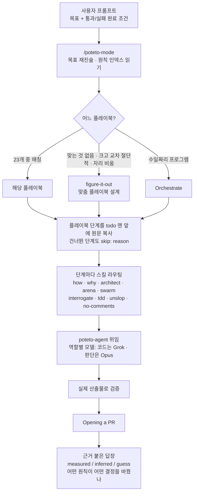
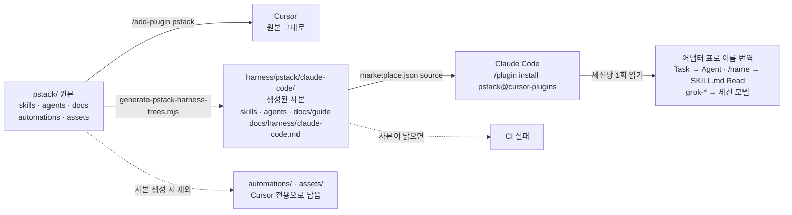
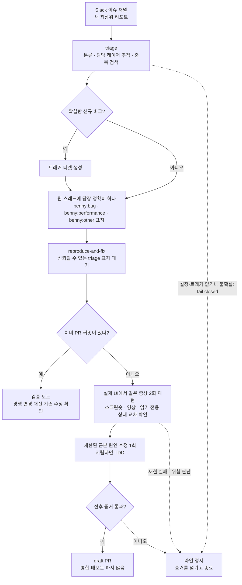

<figure class="post-figure post-figure--header">
<svg role="img" aria-label="작전 탁자 위에 플레이북 카드 23장이 놓여 있고, /poteto-mode 지휘관이 그중 한 장을 집어 든다. 탁자 왼쪽으로는 판단과 글을 맡는 Opus 계열 병사들이, 오른쪽으로는 코드 위임과 탐색을 맡는 Grok 계열 병사들이 각자의 진지로 흩어진다. 위에는 'if you want to go fast, go deep first.' 문구가 있다." viewBox="0 0 640 300">
  <title>빨리 가려면 먼저 깊이 가라 — 플레이북 하나를 집고, 역할별 모델로 흩어진다</title>

  <!-- TAGLINE -->
  <text x="320" y="32" text-anchor="middle" font-family="var(--font-mono)" font-size="14" fill="currentColor" opacity="0.85">if you want to go fast, go deep first.</text>
  <text x="320" y="52" text-anchor="middle" font-family="var(--font-body)" font-size="12" font-weight="700" fill="var(--accent-color)">빨리 가려면 먼저 깊이 가라</text>

  <!-- COMMANDER (poteto-mode) -->
  <g>
    <rect x="309" y="76" width="22" height="22" fill="currentColor"/>
    <rect x="313" y="92" width="3" height="5" fill="var(--bg-panel)"/>
    <rect x="324" y="92" width="3" height="5" fill="var(--bg-panel)"/>
    <rect x="302" y="99" width="36" height="34" fill="var(--primary-color)"/>
    <rect x="304" y="133" width="10" height="12" fill="currentColor"/>
    <rect x="326" y="133" width="10" height="12" fill="currentColor"/>
    <path d="M338 106 L352 96" stroke="currentColor" stroke-width="5" stroke-linecap="square"/>
    <!-- lifted playbook card -->
    <rect x="348" y="66" width="26" height="34" rx="2" fill="var(--bg-panel)" stroke="var(--accent-color)" stroke-width="2.5"/>
    <g stroke="var(--accent-color)" stroke-width="2">
      <path d="M354 76 H368 M354 83 H368 M354 90 H364"/>
    </g>
  </g>
  <text x="292" y="102" text-anchor="end" font-family="var(--font-mono)" font-size="13" font-weight="700" fill="var(--accent-color)">/poteto-mode</text>
  <text x="292" y="120" text-anchor="end" font-family="var(--font-body)" font-size="11" fill="currentColor" opacity="0.75">라우터 스킬</text>

  <!-- WAR TABLE with 23 playbook slots -->
  <path d="M182 150 H458 L498 218 H142 Z" fill="var(--bg-panel)" stroke="currentColor" stroke-width="2.5" stroke-linejoin="round"/>
  <rect x="154" y="218" width="8" height="16" fill="currentColor"/>
  <rect x="478" y="218" width="8" height="16" fill="currentColor"/>
  <g fill="var(--bg-panel)" stroke="currentColor" stroke-width="1.6">
    <!-- row 1: 8 -->
    <rect x="224" y="157" width="18" height="13"/><rect x="248" y="157" width="18" height="13"/>
    <rect x="272" y="157" width="18" height="13"/><rect x="296" y="157" width="18" height="13"/>
    <rect x="320" y="157" width="18" height="13"/><rect x="344" y="157" width="18" height="13"/>
    <rect x="368" y="157" width="18" height="13"/><rect x="392" y="157" width="18" height="13"/>
    <!-- row 2: 8 -->
    <rect x="212" y="177" width="19" height="14"/><rect x="238" y="177" width="19" height="14"/>
    <rect x="264" y="177" width="19" height="14"/><rect x="290" y="177" width="19" height="14"/>
    <rect x="316" y="177" width="19" height="14"/><rect x="342" y="177" width="19" height="14"/>
    <rect x="368" y="177" width="19" height="14"/><rect x="394" y="177" width="19" height="14"/>
    <!-- row 3: 5 + gap (22 on the table + 1 lifted = 23) -->
    <rect x="200" y="198" width="20" height="14"/><rect x="228" y="198" width="20" height="14"/>
    <rect x="256" y="198" width="20" height="14"/><rect x="284" y="198" width="20" height="14"/>
    <rect x="368" y="198" width="20" height="14"/>
  </g>
  <!-- row 3 slots: one more card + the dashed empty slot of the lifted card -->
  <rect x="312" y="198" width="20" height="14" fill="var(--bg-panel)" stroke="currentColor" stroke-width="1.6"/>
  <rect x="340" y="198" width="20" height="14" fill="none" stroke="var(--accent-color)" stroke-width="1.6" stroke-dasharray="3 2"/>
  <path d="M350 196 Q356 140 360 104" fill="none" stroke="var(--accent-color)" stroke-width="1.5" stroke-dasharray="4 3"/>
  <text x="320" y="252" text-anchor="middle" font-family="var(--font-body)" font-size="12" fill="currentColor" opacity="0.8">플레이북 23장 중 하나를 집어 단계를 todo로 복사한다</text>

  <!-- LEFT CAMP: Opus -->
  <path d="M184 156 Q160 140 130 140" fill="none" stroke="var(--primary-color)" stroke-width="2.5" stroke-dasharray="7 5"/>
  <path d="M136 134 L128 140 L136 146" fill="none" stroke="var(--primary-color)" stroke-width="2.5"/>
  <g>
    <rect x="44" y="112" width="12" height="12" fill="currentColor"/><rect x="40" y="125" width="20" height="20" fill="var(--primary-color)"/>
    <rect x="72" y="112" width="12" height="12" fill="currentColor"/><rect x="68" y="125" width="20" height="20" fill="var(--primary-color)"/>
    <rect x="100" y="112" width="12" height="12" fill="currentColor"/><rect x="96" y="125" width="20" height="20" fill="var(--primary-color)"/>
    <rect x="40" y="145" width="76" height="4" fill="currentColor" opacity="0.5"/>
  </g>
  <text x="78" y="172" text-anchor="middle" font-family="var(--font-body)" font-size="14" font-weight="800" fill="var(--primary-color)">Opus 계열</text>
  <text x="78" y="190" text-anchor="middle" font-family="var(--font-body)" font-size="11" fill="currentColor" opacity="0.8">판단 · 글 · 가장 어려운 변경</text>

  <!-- RIGHT CAMP: Grok -->
  <path d="M456 156 Q480 140 510 140" fill="none" stroke="var(--secondary-color)" stroke-width="2.5" stroke-dasharray="7 5"/>
  <path d="M504 134 L512 140 L504 146" fill="none" stroke="var(--secondary-color)" stroke-width="2.5"/>
  <g>
    <rect x="528" y="112" width="12" height="12" fill="currentColor"/><rect x="524" y="125" width="20" height="20" fill="var(--secondary-color)"/>
    <rect x="556" y="112" width="12" height="12" fill="currentColor"/><rect x="552" y="125" width="20" height="20" fill="var(--secondary-color)"/>
    <rect x="584" y="112" width="12" height="12" fill="currentColor"/><rect x="580" y="125" width="20" height="20" fill="var(--secondary-color)"/>
    <rect x="524" y="145" width="76" height="4" fill="currentColor" opacity="0.5"/>
  </g>
  <text x="562" y="172" text-anchor="middle" font-family="var(--font-body)" font-size="14" font-weight="800" fill="var(--secondary-color)">Grok 계열</text>
  <text x="562" y="190" text-anchor="middle" font-family="var(--font-body)" font-size="11" fill="currentColor" opacity="0.8">코드 위임 · 탐색 · 대량 작업</text>

  <!-- THROUGH-LINE -->
  <text x="320" y="282" text-anchor="middle" font-family="var(--font-body)" font-size="13" font-weight="700" fill="var(--accent-color)">깊이 → 신뢰 → 두려움 없는 병렬화</text>
</svg>
<figcaption>poteto-mode가 23개 플레이북 중 하나를 골라 단계를 todo로 옮기면, 판단·글은 Opus가, 코드 위임과 탐색은 Grok이 나눠 맡는다.</figcaption>
</figure>

## 원문 정보

> - **제목**: pstack — "if you want to go fast, go deep first."
> - **출처**: poteto (Lauren Tan) · Cursor 공식 플러그인 저장소 [cursor/plugins](https://github.com/cursor/plugins)
> - **발행**: 별도 발행일 없음 — 본 분석은 `main` 브랜치 HEAD `c742dd6`(2026-10-27 커밋) 스냅숏, 매니페스트 버전 `0.15.36` 기준 · README + 가이드 10장 + 스킬 58개 디렉터리 분량
> - **원문 링크**: <https://github.com/cursor/plugins/tree/main/pstack>
> - **라이선스**: MIT

블로그 글이 아니라 **저장소 자체**가 원문이다. 저장소를 얕게 클론해(`git clone --depth 1`) README, 두 개의 매니페스트, `skills/`·`agents/`·`automations/`·`docs/`의 파일 목록 전체와 주요 파일 본문을 읽고 썼다. 아래 "핵심 내용"은 저장소에 적힌 사실만, "분석과 인사이트"는 내 해석이다.

## 한 줄 요약 (TL;DR)

pstack은 "AI가 슬롭 코드를 너무 많이 쓴다"는 문제의식에서, 한 명의 시니어 엔지니어(poteto)가 매일 쓰는 작업 방식을 **라우터 스킬 하나(`/poteto-mode`) + 23개 플레이북 + 24개 원칙 스킬 + 역할별 멀티 모델 배치**로 패키징한 Cursor 플러그인이다. 목표는 코드량을 늘리는 것이 아니라, 에이전트 하나를 믿을 수 있을 만큼 깊게 만들어 "두려움 없는 병렬화"를 가능하게 하는 것이다. Claude Code에도 어댑터 문서와 함께 설치된다.

## 왜 이 글을 골랐나

이 위키는 그동안 코딩 에이전트를 "어떻게 묶어 둘 것인가"를 여러 각도로 다뤘다. [하니스의 필요충분조건](/2026/08/03/what-makes-a-harness-a-harness.html), [Loop Engineering](/2026/06/19/loop-engineering.html), [짧은 목줄 방법](/2026/07/06/short-leash-ai-coding.html), 그리고 판단 하나를 스킬로 심는 [Ponytail](/2026/06/23/ponytail-lazy-senior-dev-skill.html)까지. pstack은 이 주제들이 **실제 현업 엔지니어의 일상 도구로 수렴하면 어떤 모양이 되는지** 보여 주는 드문 실물이다.

특히 세 가지가 눈에 띈다.

1. **"플레이북을 todo 목록에 그대로 복사한다"**는 아주 구체적인 강제 장치. 스킬 문서가 읽히고 끝나는 게 아니라 실행 순서로 바뀐다.
2. **모델을 역할로 다룬다.** "어떤 모델이 최고냐"가 아니라 "코드 위임은 Grok, 판단·글은 Opus, 리뷰 패널은 둘 다"라는 분업 설계.
3. **Claude Code 이식 문서가 1급 시민**이다. Cursor 플러그인이 Claude Code의 도구 이름·경로·모델 체계로 번역되는 방식을 한 장의 매핑 표로 정리해 두었다.

**한눈에 보기.** `/poteto-mode` 호출 한 번이 PR과 답장에 이르기까지의 흐름을 README와 SKILL.md 기준으로 한 장에 그리면 이렇다.



## 핵심 내용

### 1. 만든 목적 — 어떤 문제를 푸는가

README의 문제 정의는 짧고 직설적이다. 저자 poteto는 Meta, Netflix, Cursor에서 수백만 줄의 코드를 다뤘고 React core 팀에서 React Compiler를 만든다고 자신을 소개한 뒤 이렇게 쓴다.

> "there's a growing sense that ai writes too much slop code. i agree. i don't want to ship like a team of twenty slop artists. throughput without quality is not a goal i aspire to. if you want to go fast, go deep first."

README가 내세우는 세 가지 약속은 다음과 같다.

- **"pstack is my answer."** 저자가 Cursor에서 매일 쓰는 스킬 그대로이며, "cursor를 진짜 엔지니어링 팀으로" 바꾸는 것이 목표다. 목표는 LOC 극대화가 아니라 그 반대, **"write less, but higher quality code"**.
- **"fearless parallelism."** 에이전트 하나를 깊게 믿을 수 있으면, 여러 에이전트를 `poteto-mode`로 동시에 띄워도 각자 엄격한 원칙을 적용할 것이라고 믿을 수 있다.
- **"the best of all worlds."** 프런티어 모델마다 강약점이 있으므로 여러 스킬이 멀티 모델 워크플로를 쓴다.

매니페스트(`plugin.json`)의 설명도 같은 문장이다. "if you want to go fast, go deep first. pstack helps you write less, but higher quality code. rigorous agent workflows you can parallelize with confidence." 작성자는 `Lauren Tan`, 카테고리는 `developer-tools`, 태그는 `workflow`, `principles`, `review`, `planning`이다.

README에는 일부러 **기획(planning) 스킬을 넣지 않았다**는 절도 있다. Cursor의 plan mode로 충분하고, 저자 본인은 "the best spec is code"라고 믿는다는 이유다. 필요하면 `poteto-mode`의 Multi-phase plan 플레이북이 다루지만 기본값은 아니다.

### 2. 설치 방법 — Cursor와 Claude Code

**Cursor** (README와 가이드 `01-setup.md` 기준):

```text
/add-plugin pstack
```

**Claude Code** (README에 적힌 명령 그대로):

```text
/plugin marketplace add cursor/plugins
/plugin install pstack@cursor-plugins
```

README가 밝히는 Claude Code 특이사항은 다음과 같다.

- Claude Code는 서드파티 마켓플레이스의 **자동 업데이트를 꺼 둔다.** 켜려면 `/plugin` → **marketplaces** 탭 → `cursor-plugins` 선택 → **enable auto-update**. 한 번만 수동 업데이트하려면 `claude plugin update pstack@cursor-plugins`.
- 플러그인 명령과 에이전트에 접두사가 붙는다. `/poteto-mode`는 `/pstack:poteto-mode`, 설정은 `/pstack:setup-pstack`.
- Claude Code가 설치하는 것은 `pstack/` 원본이 아니라 저장소 루트 `harness/pstack/claude-code/`의 **생성된 사본**이다. 루트 `.claude-plugin/marketplace.json`의 `pstack` 항목 `source`가 `./harness/pstack/claude-code`를 가리키는 것으로 확인했다. 이 사본은 `skills`, `agents`, `docs/guide`, `docs/harness/claude-code.md`, `README.md`, `LICENSE`, `plugin.json`에서 생성되며 **`automations/`와 `assets/`는 빠진다**(`harness/pstack/README.md`). pstack을 고치면 `node scripts/generate-pstack-harness-trees.mjs`로 재생성해야 하고, 사본이 낡으면 CI가 실패한다.

설치 후 시작은 두 단계다.

1. `/setup-pstack`으로 추론 예산과 역할별 모델을 고른다.
2. 엄밀함이 필요한 모든 작업에 `/poteto-mode`를 쓴다.

가이드는 Cursor에서 `/` 메뉴에서 `poteto-mode`를 고를 때 Enter 대신 **Option+Enter(Mac) / Alt+Enter(Windows)**를 누르면 [Custom Mode](https://cursor.com/docs/skills#using-a-skill-as-a-custom-mode)가 되어 매 턴 컨텍스트에 유지된다고 설명한다(일반 Enter는 해당 메시지 하나에만 붙는다). Custom Mode는 Agents Window와 CLI에서 제공된다. 그리고 설정 후에는 **새 채팅을 시작**해야 모델 규칙이 적용된다.

### 3. Claude Code 어댑터 — Cursor 이름을 번역하는 한 장의 표

`docs/harness/claude-code.md`는 스킬 본문이 Cursor 용어로 쓰여 있다는 전제에서, Claude Code에서는 이 파일을 세션당 한 번 읽고 이름을 번역하라고 지시한다. 주요 매핑은 이렇다.

| 범주 | Cursor | Claude Code |
| --- | --- | --- |
| 도구 | `Task` / `AskQuestion` | `Agent` / `AskUserQuestion`(`-p` 모드에선 평문 질문) |
| 다른 pstack 스킬 실행 | `/name` | `<pstack>/skills/<name>/SKILL.md`를 `Read`해서 따른다 (`Skill` 도구는 대부분의 pstack 스킬을 거부한다고 명시) |
| 서브에이전트 | `poteto-agent`, `comment-sicko` | `pstack:poteto-agent`, `pstack:comment-sicko` |
| 읽기 전용 | `readonly: true` | `subagent_type: "Explore"` + 브리프에 "파일 수정 금지" + 사후 `git status` 확인 |
| 클라우드 | `environment: "cloud"` | `isolation: "worktree"` |
| 모델 | `claude-opus-5-5-xhigh` | `model: "opus"`, `effort: "xhigh"` (`-fast`는 버림) |
| 비 Claude 모델 | `grok-*`, `gpt-*` 등 | `model` 생략 → 세션 모델로 실행하고 그 사실을 밝힌다 |
| 모델 규칙 파일 | `~/.cursor/rules/pstack-models.mdc` | `~/.claude/rules/pstack-models.md` |
| 상시 규칙 | `.cursor/rules/*.mdc` | `CLAUDE.md` (없으면 `AGENTS.md`) |

Cursor 전용 기능(Cursor Automations, Bugbot 설정·대기, Cursor cloud agent 자체가 필요한 단계)은 Claude Code에서 `Skipped in Claude Code: <step>. <reason>.` 한 줄을 남기고 **멈추지 말고 다음 단계로 넘어가라**고 규정한다.



### 4. poteto-mode와 플레이북 구조

`skills/poteto-mode/SKILL.md`(150줄)는 pstack의 "정문"이다. 프런트매터에 `disable-model-invocation: true`가 있어 모델이 알아서 부르지 않고 **사용자가 명시적으로 호출**해야 한다. 디렉터리는 다음과 같다.

```text
skills/poteto-mode/
├── SKILL.md            # 라우팅 규칙, Non-negotiables, 원칙 인덱스, Autonomy, Subagents, 답장 문체
├── playbooks/          # 23개 플레이북 (*.md)
├── references/
│   └── bugbot-triage.md
└── scripts/
    ├── bootstrap.ts, check-plan.mjs (+test), worktree-audit.sh, package.json, bun.lock
    └── watch-pr/       # GitHub PR 상태 감시 CLI (TypeScript, 테스트 포함)
```

README가 설명하는 호출 시 동작은 세 줄이다.

1. 작업을 플레이북에 매칭하고, **그 플레이북의 단계를 원문 그대로 복사해** todo 목록의 맨 앞에 둔다. 건너뛴 단계도 `skip: <reason>`으로 목록에 남는다.
2. 단계가 실행될 때마다 다른 스킬로 라우팅한다.
3. 소비자와 유지보수자를 향해 "unslop된" 답장을 쓴다.

SKILL.md 본문은 여섯 덩어리로 짜여 있다.

- **Non-negotiables.** 트리거 → 행동 규칙 목록. 첫 메시지에서 사용자의 목표·문제·예상되는 최소 변경을 자기 말로 재진술(확인을 기다리지 않음), 함수 경계를 넘는 코드는 `architect`, 경합하는 설계는 `interrogate`, 모든 산문은 `unslop`, 커밋 전 `deslop`(cursor-team-kit), 리뷰 전 `no-comments`, 벤치마크 수치는 `benchmark-checklist`, PR 상태 요청은 Babysit 플레이북 등. 눈에 띄는 규칙은 "어느 접근이 좋은가"를 사람에게 묻기 전에 **실행해서 관찰할 수 있는 사실인지 분류하라**는 것이다. 관찰 가능하면 Prototype 플레이북으로 스케치해 결과가 결정하게 한다.
- **Principles.** 24개 원칙의 인라인 인덱스(Core 10 · Architecture 6 · Verification 5 · Delegation 2 · Meta 1). 원칙을 적용하면 해당 leaf 스킬을 전부 읽어야 하고, 답장에서 **어떤 원칙이 어떤 결정을 바꿨는지** 이름을 대야 한다.
- **Autonomy.** 되돌릴 수 있는 작업과 외부 액션은 묻지 않고 진행, 되돌릴 수 없는 쓰기(공유 브랜치 force-push, 배포, 데이터 삭제, 고객 메시지)는 항상 멈춤. "going to bed", "run until done" 같은 세션 오버라이드가 있으며, "No is an acceptable answer" — 동조보다 솔직함.
- **Subagents.** 플레이북 단계 안에서 띄우는 모든 서브에이전트는 `poteto-agent`. 모델 배치 규칙(아래 5절)과 "기본은 새 서브에이전트, 재사용은 그 에이전트에만 있는 상태가 꼭 필요할 때만" 규칙.
- **Writing the reply.** 짧은 평서문, 긴 대시(—) 금지, 문장 중간 연결용 콜론 금지, 모든 주장에 "measured / inferred / guess" 표지를 붙이고 링크·인용은 이번 세션에 실제로 읽은 것만.
- **Playbooks.** 23개 플레이북 목록과 라우팅 규칙. 크고 교차 절단적인 작업이나 사용자가 자리를 비우는 작업은 더 좁은 플레이북이 맞아도 `figure-it-out`으로, 수일짜리 프로그램은 `Orchestrate`로 보낸다.

23개 플레이북을 README의 표에서 성격별로 묶으면 이렇다.

| 묶음 | 플레이북 |
| --- | --- |
| 이해·진단 | Investigation, Runtime forensics, Trace forensics |
| 변경 | Bug fix, Perf issue, Hillclimb, Feature, Refactoring, Prototype, Visual parity |
| 메타(스킬 자체) | Authoring a skill, Eval |
| PR·출하 | Babysit, Shipping, Opening a PR(다른 모든 플레이북 끝에서 호출) |
| 장시간·자율 | Autonomous run, Orchestrate, Autopilot-full, Autopilot-stack, Multi-phase plan |
| 세션 관리 | Session pickup, Pause safely, Worktree cleanup |

플레이북 하나의 결을 보면 성격이 분명해진다. `bug-fix.md`는 "Every shipped line traces to runtime evidence"로 시작하고, ① 컨트롤 스킬로 **직접 재현**(사용자에게 재현을 떠넘기지 않음) → ② 가설을 이분 탐색으로 소거 → ③ 수정 계획(함수 경계를 넘으면 `architect`), 구현은 bug-fix 모델에 위임 → ④ 같은 표면에서 검증("Inconclusive"는 통과가 아님) → ⑤ 실패하는 재현이 git 히스토리에서 수정보다 먼저 오도록 커밋 → ⑥ Opening a PR 순서다. 답장에는 실패→통과 재현 출력을 원문 그대로 붙여야 한다. `feature.md`는 반대로 "You own the design"으로 시작해 `how` → `architect` → **처리량 체크포인트 4항목**(선행 게이트, 독립 작업 흐름, 공유 가변 상태, 최소 안전 분해) → 위임 → 검증 → 작은 커밋 정렬 → 필요 시 `interrogate` → PR로 간다.

<figure class="post-figure">
<svg role="img" aria-label="왼쪽에 poteto-mode SKILL.md의 여섯 블록이 위에서부터 Non-negotiables, Principles 인덱스, Autonomy, Subagents, Writing the reply, Playbooks 순으로 쌓여 있다. 맨 아래 Playbooks 블록에서 23개 플레이북이 여섯 묶음(이해·진단 3, 변경 7, 메타 2, PR·출하 3, 장시간·자율 5, 세션 관리 3)으로 갈라지고, 고른 플레이북의 단계는 오른쪽 todo 목록에 원문 그대로 복사되며 건너뛴 단계는 skip 사유와 함께 남는다." viewBox="0 0 640 350">
  <title>poteto-mode SKILL.md의 여섯 블록과 23개 플레이북의 여섯 묶음</title>
  <text x="125" y="28" text-anchor="middle" font-family="var(--font-mono)" font-size="13" font-weight="700" fill="currentColor">SKILL.md (150줄)</text>
  <text x="360" y="28" text-anchor="middle" font-family="var(--font-body)" font-size="13" font-weight="700" fill="currentColor">플레이북 23개 · 6묶음</text>
  <text x="555" y="28" text-anchor="middle" font-family="var(--font-body)" font-size="13" font-weight="700" fill="currentColor">todo 목록</text>
  <rect x="20" y="42" width="210" height="40" rx="3" fill="var(--bg-panel)" stroke="currentColor" stroke-width="2"/>
  <text x="32" y="59" font-family="var(--font-body)" font-size="12.5" font-weight="700" fill="var(--primary-color)">Non-negotiables</text>
  <text x="32" y="75" font-family="var(--font-body)" font-size="10" fill="currentColor" opacity="0.75">트리거 → 행동 규칙</text>
  <rect x="20" y="90" width="210" height="40" rx="3" fill="var(--bg-panel)" stroke="currentColor" stroke-width="2"/>
  <text x="32" y="107" font-family="var(--font-body)" font-size="12.5" font-weight="700" fill="var(--primary-color)">Principles 인덱스 (24)</text>
  <text x="32" y="123" font-family="var(--font-body)" font-size="10" fill="currentColor" opacity="0.75">Core 10 · Arch 6 · Verif 5 · Deleg 2 · Meta 1</text>
  <rect x="20" y="138" width="210" height="40" rx="3" fill="var(--bg-panel)" stroke="currentColor" stroke-width="2"/>
  <text x="32" y="155" font-family="var(--font-body)" font-size="12.5" font-weight="700" fill="var(--primary-color)">Autonomy</text>
  <text x="32" y="171" font-family="var(--font-body)" font-size="10" fill="currentColor" opacity="0.75">되돌릴 수 있으면 진행 · 없으면 멈춤</text>
  <rect x="20" y="186" width="210" height="40" rx="3" fill="var(--bg-panel)" stroke="currentColor" stroke-width="2"/>
  <text x="32" y="203" font-family="var(--font-body)" font-size="12.5" font-weight="700" fill="var(--primary-color)">Subagents</text>
  <text x="32" y="219" font-family="var(--font-body)" font-size="10" fill="currentColor" opacity="0.75">모든 스폰은 poteto-agent</text>
  <rect x="20" y="234" width="210" height="40" rx="3" fill="var(--bg-panel)" stroke="currentColor" stroke-width="2"/>
  <text x="32" y="251" font-family="var(--font-body)" font-size="12.5" font-weight="700" fill="var(--primary-color)">Writing the reply</text>
  <text x="32" y="267" font-family="var(--font-body)" font-size="10" fill="currentColor" opacity="0.75">measured / inferred / guess</text>
  <rect x="20" y="282" width="210" height="40" rx="3" fill="var(--bg-panel)" stroke="var(--accent-color)" stroke-width="3"/>
  <text x="32" y="299" font-family="var(--font-body)" font-size="12.5" font-weight="700" fill="var(--accent-color)">Playbooks (23)</text>
  <text x="32" y="315" font-family="var(--font-body)" font-size="10" fill="currentColor" opacity="0.75">라우팅 규칙 + 목록</text>
  <path d="M230 302 C250 302 250 62 268 62" fill="none" stroke="var(--accent-color)" stroke-width="1.6"/>
  <path d="M230 302 C250 302 250 110 268 110" fill="none" stroke="var(--accent-color)" stroke-width="1.6"/>
  <path d="M230 302 C250 302 250 158 268 158" fill="none" stroke="var(--accent-color)" stroke-width="1.6"/>
  <path d="M230 302 C250 302 250 206 268 206" fill="none" stroke="var(--accent-color)" stroke-width="1.6"/>
  <path d="M230 302 C250 302 250 254 268 254" fill="none" stroke="var(--accent-color)" stroke-width="1.6"/>
  <path d="M230 302 C250 302 250 302 268 302" fill="none" stroke="var(--accent-color)" stroke-width="1.6"/>
  <rect x="268" y="42" width="190" height="40" rx="3" fill="var(--bg-panel)" stroke="currentColor" stroke-width="2"/>
  <text x="280" y="59" font-family="var(--font-body)" font-size="12.5" font-weight="700" fill="currentColor">이해·진단</text>
  <text x="446" y="59" text-anchor="end" font-family="var(--font-mono)" font-size="12.5" font-weight="700" fill="var(--secondary-color)">3</text>
  <text x="280" y="75" font-family="var(--font-body)" font-size="9.5" fill="currentColor" opacity="0.75">Investigation · Runtime · Trace forensics</text>
  <rect x="268" y="90" width="190" height="40" rx="3" fill="var(--bg-panel)" stroke="currentColor" stroke-width="2"/>
  <text x="280" y="107" font-family="var(--font-body)" font-size="12.5" font-weight="700" fill="currentColor">변경</text>
  <text x="446" y="107" text-anchor="end" font-family="var(--font-mono)" font-size="12.5" font-weight="700" fill="var(--secondary-color)">7</text>
  <text x="280" y="123" font-family="var(--font-body)" font-size="9.5" fill="currentColor" opacity="0.75">Bug fix · Feature · Refactoring · Perf …</text>
  <rect x="268" y="138" width="190" height="40" rx="3" fill="var(--bg-panel)" stroke="currentColor" stroke-width="2"/>
  <text x="280" y="155" font-family="var(--font-body)" font-size="12.5" font-weight="700" fill="currentColor">메타</text>
  <text x="446" y="155" text-anchor="end" font-family="var(--font-mono)" font-size="12.5" font-weight="700" fill="var(--secondary-color)">2</text>
  <text x="280" y="171" font-family="var(--font-body)" font-size="9.5" fill="currentColor" opacity="0.75">Authoring a skill · Eval</text>
  <rect x="268" y="186" width="190" height="40" rx="3" fill="var(--bg-panel)" stroke="currentColor" stroke-width="2"/>
  <text x="280" y="203" font-family="var(--font-body)" font-size="12.5" font-weight="700" fill="currentColor">PR·출하</text>
  <text x="446" y="203" text-anchor="end" font-family="var(--font-mono)" font-size="12.5" font-weight="700" fill="var(--secondary-color)">3</text>
  <text x="280" y="219" font-family="var(--font-body)" font-size="9.5" fill="currentColor" opacity="0.75">Babysit · Shipping · Opening a PR</text>
  <rect x="268" y="234" width="190" height="40" rx="3" fill="var(--bg-panel)" stroke="currentColor" stroke-width="2"/>
  <text x="280" y="251" font-family="var(--font-body)" font-size="12.5" font-weight="700" fill="currentColor">장시간·자율</text>
  <text x="446" y="251" text-anchor="end" font-family="var(--font-mono)" font-size="12.5" font-weight="700" fill="var(--secondary-color)">5</text>
  <text x="280" y="267" font-family="var(--font-body)" font-size="9.5" fill="currentColor" opacity="0.75">Orchestrate · Autopilot · Multi-phase …</text>
  <rect x="268" y="282" width="190" height="40" rx="3" fill="var(--bg-panel)" stroke="currentColor" stroke-width="2"/>
  <text x="280" y="299" font-family="var(--font-body)" font-size="12.5" font-weight="700" fill="currentColor">세션 관리</text>
  <text x="446" y="299" text-anchor="end" font-family="var(--font-mono)" font-size="12.5" font-weight="700" fill="var(--secondary-color)">3</text>
  <text x="280" y="315" font-family="var(--font-body)" font-size="9.5" fill="currentColor" opacity="0.75">Session pickup · Pause · Worktree cleanup</text>
  <path d="M458 186 H484" stroke="var(--accent-color)" stroke-width="3"/>
  <path d="M478 179 L487 186 L478 193" fill="none" stroke="var(--accent-color)" stroke-width="3"/>
  <text x="472" y="172" text-anchor="middle" font-family="var(--font-body)" font-size="10.5" font-weight="700" fill="var(--accent-color)">원문 복사</text>
  <rect x="492" y="64" width="128" height="250" rx="4" fill="var(--bg-panel)" stroke="currentColor" stroke-width="2.5"/>
  <rect x="536" y="56" width="40" height="14" rx="2" fill="currentColor"/>
  <rect x="504" y="83" width="13" height="13" fill="none" stroke="currentColor" stroke-width="1.6"/>
  <text x="524" y="94" font-family="var(--font-body)" font-size="10.5" fill="currentColor">1. 플레이북 단계</text>
  <rect x="504" y="119" width="13" height="13" fill="none" stroke="currentColor" stroke-width="1.6"/>
  <text x="524" y="130" font-family="var(--font-body)" font-size="10.5" fill="currentColor">2. 플레이북 단계</text>
  <rect x="504" y="155" width="13" height="13" fill="none" stroke="var(--accent-color)" stroke-width="1.6" stroke-dasharray="3 2"/>
  <text x="524" y="166" font-family="var(--font-mono)" font-size="10.5" fill="var(--accent-color)">skip: &lt;reason&gt;</text>
  <rect x="504" y="191" width="13" height="13" fill="none" stroke="currentColor" stroke-width="1.6"/>
  <text x="524" y="202" font-family="var(--font-body)" font-size="10.5" fill="currentColor">4. 플레이북 단계</text>
  <rect x="504" y="227" width="13" height="13" fill="none" stroke="currentColor" stroke-width="1.6"/>
  <text x="524" y="238" font-family="var(--font-body)" font-size="10.5" fill="currentColor">5. 플레이북 단계</text>
  <rect x="504" y="263" width="13" height="13" fill="none" stroke="currentColor" stroke-width="1.6"/>
  <text x="524" y="274" font-family="var(--font-body)" font-size="10.5" fill="currentColor">… Opening a PR</text>
  <text x="320" y="338" text-anchor="middle" font-family="var(--font-body)" font-size="11" fill="currentColor" opacity="0.8">생략도 목록에 남으므로 보인다 — 각 단계가 실행될 때 다른 스킬로 라우팅된다</text>
</svg>
<figcaption>SKILL.md는 여섯 블록으로 짜여 있고, Playbooks 블록의 23개 플레이북은 여섯 묶음으로 나뉜다. 고른 플레이북의 단계는 todo 맨 앞에 원문 그대로 복사된다.</figcaption>
</figure>

### 5. 주요 스킬과 멀티 모델 분담

`skills/`에는 58개 디렉터리가 있다. 그중 24개가 `principle-*` 원칙 스킬이고, 나머지 34개가 기능 스킬이다(`poteto-mode`, `setup-pstack` 포함). README가 "`poteto-mode`가 대신 실행해 준다"고 밝힌 것은 `how`, `why`, `architect`, `arena`, `swarm`, `interrogate`, `unslop`, `no-comments`, `technical-writing`, `tdd`, 그리고 원칙들이다. 역할별로 정리하면 이렇다.

| 역할 | 스킬 | 하는 일 (README·SKILL.md 기준) |
| --- | --- | --- |
| 입구·안내 | `poteto-mode`, `poteto-help`, `setup-pstack`, `in-your-own-words`, `sharpen` | 라우팅 / 어떤 스킬을 쓸지 답하고 보낼 프롬프트를 건넴(직접 실행 안 함) / 역할별 모델 설정 / 목표 재진술 / 프롬프트를 "더 크게가 아니라 더 깊게" 재작성 |
| 이해 | `how`, `why`, `teach`, `recall`, `ketchup`, `ketchup-video`, `bro` | 서브시스템 동작 설명 / MCP로 소스관리·트래커·문서·채팅 등 근거를 병렬 조사해 설계 이유 추적 / how+why를 엮은 설명 / 과거 대화로 맥락 복원 / 지난 메시지 이후 변화 요약(영상판 포함) / 평이한 말로 재진술 |
| 설계 | `architect`, `arena`, `swarm`, `interrogate`, `figure-it-out`, `blast-radius` | 타입·시그니처를 먼저 스케치 / N개 병렬 후보 → 교차 심사 → 베이스 선택 + 접목 / N개 워커로 슬라이스·경주 → 단일 보고 / 여러 모델이 변경을 깨뜨려 보고 **실행으로 증명된 발견만** 남김 / 맞는 플레이북이 없을 때 맞춤 플레이북 설계 / 작은 변경의 파급 범위를 실행으로 증명 |
| 구현·정리 | `tdd`, `typescript-best-practices`, `unslop`, `no-comments`, `technical-writing` | 실패 테스트 먼저 / TS 타입 규율 / AI 문체 흔적 제거 / Comment Sicko로 주석 제거 / Diátaxis·Google 스타일 기반 문서 표준 |
| 검증 | `create-verification-skill`, `maintain-verification-skill`, `create-formal-verification-skill`, `maintain-formal-verification-skill`, `statechart`, `benchmark-checklist` | 프로젝트 전용 `verify-<app>` 스킬 생성·유지 / 하나의 핵심 성질을 모든 경우에 대해 형식 검증 / TLA+ 모델을 Mermaid 상태도로 / 측정 수치 검증 |
| 학습·자기화 | `reflect`, `correct`, `automate-me`, `show-me-your-work`, `make-bot-ui` | 끝난 작업의 레시피를 스킬 수정으로 / 반복되는 실수를 아키텍처→타입·린트·CI→테스트→문서 순으로 구조화 / 내 작업 이력으로 `<내이름>-mode` 생성 / 결정 로그 TSV / 웹훅으로 Grok Bot을 깨우는 대시보드 |

**멀티 모델 분담.** README는 기본 분업을 이렇게 요약한다. "code delegates (feature, refactoring, bug fix, perf, hillclimb) go to grok, while the hardest changes, prose, and judgment go to opus 5.5. the default panel is opus 5.5 / grok." 구체적인 기본값은 `setup-pstack/SKILL.md`가 써 주는 규칙 파일 모양에 그대로 있다.

| 역할 (규칙 파일의 줄) | 기본 모델 |
| --- | --- |
| `feature, refactoring` / `bug-fix` / `perf-issue` / `hillclimb` | `grok-4.7-xhigh-fast` |
| `judgment and prose` / `hardest tasks` | `claude-opus-5-5-xhigh` |
| `how explorer` / `why investigators` / `reflect tooling` / `swarm workers` | `grok-4.7-xhigh-fast` |
| `how explainer` / `why synthesizer` / `reflect judgment, divergent, synthesizer` | `claude-opus-5-5-xhigh` |
| `arena runners` / `arena cross-judge pool` / `architect runners` / `interrogate reviewers` | `claude-opus-5-5-xhigh`, `grok-4.7-xhigh-fast` (패널 — 목록 길이 = 서브에이전트 수) |

패턴은 일관된다. **탐색·대량 작업·코드 위임은 Grok, 종합·설명·판단은 Opus, 리뷰 패널은 두 계열을 섞는다.** 몇 가지 세부 규칙도 문서에 박혀 있다.

- `poteto-mode` Subagents 절: 코드 위임도 난이도로 나눈다. 교차 절단적 설계, 까다로운 동시성, 미묘한 알고리즘 같은 **가장 어려운 변경은 가장 강한 판단 모델**(`claude-opus-5-5-xhigh`)에, 사소한 기계적 편집은 빠른 코드 모델에.
- 추론 수준 조정: 역할의 기본값에서 시작해 가장 어려운 일은 한 단계 올리고(최대 `max`), 판단은 한 단계, 일상 작업은 두 단계 이상 내린다. `-fast`는 CI나 trunk가 깨졌거나 사람이 지금 막혀 있을 때만. 단, **패널의 다양성을 지키기 위해 모델 계열은 바꾸지 말고** 노력 수준과 fast 여부만 바꾼다.
- `arena`의 교차 심사자는 **부모와 다른 계열**에서만 뽑는다. 기본 풀에서 Claude 부모라면 Grok이 심사한다.
- `interrogate`는 arena의 팬아웃을 빌려 `interrogate reviewers`를 적대적 검토자로 띄우고, 각자 실제 실행으로 증명한 발견만 보고하게 한 뒤 부모가 명령을 다시 돌려 확인한 것만 남긴다.
- `/setup-pstack` 예산: `unlimited`(max) / `large`(xhigh, 기본값과 동일) / `medium`(high) / `small`(medium). Grok은 `xhigh`가 상한이라 `unlimited`에서도 `xhigh`에 머문다. `inherit-parent`나 `auto`를 넣으면 `model` 필드를 생략해 부모 채팅 모델을 물려받는다.

**agents/ 정의.** `agents/`에는 두 개의 서브에이전트가 있다. 두 파일 모두 프런트매터에 **`model` 필드가 없다** — 모델은 정의 파일이 아니라 띄우는 쪽이 역할 줄을 보고 정한다.

- **`poteto-agent`**: `poteto-mode` 실행 중 코드 작성·보조 작업을 맡는 위임 서브에이전트(`is_background: true`). 작업 전에 `poteto-mode`의 SKILL.md를 원칙 인덱스까지 **전부 읽어야** 한다. 부모가 경로를 안 주면 `~/.cursor/plugins/`에서 `skills/poteto-mode/SKILL.md`를 찾고, 여러 개면 `.cursor-plugin/plugin.json` 버전이 가장 높은 것을 쓴다. README는 `generalPurpose`로 대체하면 이 읽기를 건너뛰어 "drifts"한다고 경고하고, 플레이북 자체를 `poteto-agent`에게 돌리지 말라고 못 박는다. 플레이북·todo·모든 스폰은 `/poteto-mode`를 받은 채팅이 소유한다.
- **`comment-sicko`**: "주석을 혐오하는" 읽기 전용 리뷰어. 법적 헤더, 바꿀 수 없는 외부 의존성이 강제한 비자명한 동작, `// prettier-ignore`, 공개 API 계약 doc comment, 제약을 설명하는 이슈·RFC 링크만 살려 두고 나머지 주석은 삭제 대상으로, 우리 코드의 놀라운 동작은 해당 심볼에 `MUST KILL` 플래그를 단다. 애플리케이션 코드는 절대 쓰지 않는다. 보통 `/no-comments`가 띄우며, `/no-comments`가 결과를 검수해 받아들인 플래그만 고친다.

<figure class="post-figure">
<svg role="img" aria-label="역할별 모델 분담 매트릭스. 세로축은 역할, 가로축은 Grok 계열과 Opus 계열이다. 코드 위임과 탐색·조사는 Grok, 가장 어려운 변경과 종합·설명·판단은 Opus 칸이 채워진다. 리뷰 패널 행은 두 칸이 모두 채워지고, arena 교차 심사 행은 두 칸 사이의 양방향 화살표로 부모와 다른 계열이 심사함을 나타낸다." viewBox="0 0 640 375">
  <title>역할 × 모델 계열 — 탐색·코드는 Grok, 종합·판단은 Opus, 패널은 둘 다</title>
  <text x="30" y="40" font-family="var(--font-body)" font-size="12" font-weight="700" fill="currentColor" opacity="0.8">역할</text>
  <text x="390" y="34" text-anchor="middle" font-family="var(--font-body)" font-size="14" font-weight="800" fill="var(--secondary-color)">Grok 계열</text>
  <text x="390" y="50" text-anchor="middle" font-family="var(--font-mono)" font-size="9.5" fill="currentColor" opacity="0.75">grok-4.7-xhigh-fast</text>
  <text x="540" y="34" text-anchor="middle" font-family="var(--font-body)" font-size="14" font-weight="800" fill="var(--primary-color)">Opus 계열</text>
  <text x="540" y="50" text-anchor="middle" font-family="var(--font-mono)" font-size="9.5" fill="currentColor" opacity="0.75">claude-opus-5-5-xhigh</text>
  <path d="M20 60 H620" stroke="currentColor" stroke-width="2"/>
  <text x="30" y="85" font-family="var(--font-body)" font-size="13" font-weight="700" fill="currentColor">코드 위임</text>
  <text x="30" y="101" font-family="var(--font-body)" font-size="9.5" fill="currentColor" opacity="0.75">feature · refactoring · bug-fix · perf · hillclimb</text>
  <rect x="320" y="70" width="140" height="34" rx="3" fill="var(--secondary-color)" fill-opacity="0.18" stroke="var(--secondary-color)" stroke-width="2.5"/>
  <rect x="332" y="82" width="10" height="10" fill="var(--secondary-color)"/>
  <text x="350" y="91" font-family="var(--font-body)" font-size="11.5" font-weight="700" fill="currentColor">담당</text>
  <rect x="470" y="70" width="140" height="34" rx="3" fill="none" stroke="currentColor" stroke-width="1" opacity="0.3"/>
  <path d="M20 108 H620" stroke="currentColor" stroke-width="1" opacity="0.25"/>
  <text x="30" y="129" font-family="var(--font-body)" font-size="13" font-weight="700" fill="currentColor">가장 어려운 변경</text>
  <text x="30" y="145" font-family="var(--font-body)" font-size="9.5" fill="currentColor" opacity="0.75">교차 절단 설계 · 까다로운 동시성 · 미묘한 알고리즘</text>
  <rect x="320" y="114" width="140" height="34" rx="3" fill="none" stroke="currentColor" stroke-width="1" opacity="0.3"/>
  <rect x="470" y="114" width="140" height="34" rx="3" fill="var(--primary-color)" fill-opacity="0.18" stroke="var(--primary-color)" stroke-width="2.5"/>
  <rect x="482" y="126" width="10" height="10" fill="var(--primary-color)"/>
  <text x="500" y="135" font-family="var(--font-body)" font-size="11.5" font-weight="700" fill="currentColor">담당</text>
  <path d="M20 152 H620" stroke="currentColor" stroke-width="1" opacity="0.25"/>
  <text x="30" y="173" font-family="var(--font-body)" font-size="13" font-weight="700" fill="currentColor">탐색·조사</text>
  <text x="30" y="189" font-family="var(--font-body)" font-size="9.5" fill="currentColor" opacity="0.75">how explorer · why investigators · swarm workers</text>
  <rect x="320" y="158" width="140" height="34" rx="3" fill="var(--secondary-color)" fill-opacity="0.18" stroke="var(--secondary-color)" stroke-width="2.5"/>
  <rect x="332" y="170" width="10" height="10" fill="var(--secondary-color)"/>
  <text x="350" y="179" font-family="var(--font-body)" font-size="11.5" font-weight="700" fill="currentColor">담당</text>
  <rect x="470" y="158" width="140" height="34" rx="3" fill="none" stroke="currentColor" stroke-width="1" opacity="0.3"/>
  <path d="M20 196 H620" stroke="currentColor" stroke-width="1" opacity="0.25"/>
  <text x="30" y="217" font-family="var(--font-body)" font-size="13" font-weight="700" fill="currentColor">종합·설명·판단</text>
  <text x="30" y="233" font-family="var(--font-body)" font-size="9.5" fill="currentColor" opacity="0.75">how explainer · why synthesizer · judgment and prose</text>
  <rect x="320" y="202" width="140" height="34" rx="3" fill="none" stroke="currentColor" stroke-width="1" opacity="0.3"/>
  <rect x="470" y="202" width="140" height="34" rx="3" fill="var(--primary-color)" fill-opacity="0.18" stroke="var(--primary-color)" stroke-width="2.5"/>
  <rect x="482" y="214" width="10" height="10" fill="var(--primary-color)"/>
  <text x="500" y="223" font-family="var(--font-body)" font-size="11.5" font-weight="700" fill="currentColor">담당</text>
  <path d="M20 240 H620" stroke="currentColor" stroke-width="1" opacity="0.25"/>
  <text x="30" y="261" font-family="var(--font-body)" font-size="13" font-weight="700" fill="currentColor">리뷰 패널</text>
  <text x="30" y="277" font-family="var(--font-body)" font-size="9.5" fill="currentColor" opacity="0.75">arena · architect runners · interrogate reviewers</text>
  <rect x="320" y="246" width="135" height="34" rx="3" fill="var(--secondary-color)" fill-opacity="0.18" stroke="var(--secondary-color)" stroke-width="2.5"/>
  <rect x="332" y="258" width="10" height="10" fill="var(--secondary-color)"/>
  <text x="350" y="267" font-family="var(--font-body)" font-size="11.5" font-weight="700" fill="currentColor">패널 구성원</text>
  <rect x="475" y="246" width="135" height="34" rx="3" fill="var(--primary-color)" fill-opacity="0.18" stroke="var(--primary-color)" stroke-width="2.5"/>
  <rect x="487" y="258" width="10" height="10" fill="var(--primary-color)"/>
  <text x="505" y="267" font-family="var(--font-body)" font-size="11.5" font-weight="700" fill="currentColor">패널 구성원</text>
  <text x="465" y="267" text-anchor="middle" font-family="var(--font-body)" font-size="13" font-weight="800" fill="var(--accent-color)">+</text>
  <path d="M20 284 H620" stroke="currentColor" stroke-width="1" opacity="0.25"/>
  <text x="30" y="305" font-family="var(--font-body)" font-size="13" font-weight="700" fill="currentColor">arena 교차 심사</text>
  <text x="30" y="321" font-family="var(--font-body)" font-size="9.5" fill="currentColor" opacity="0.75">심사자는 부모와 다른 계열에서만</text>
  <rect x="320" y="290" width="140" height="34" rx="3" fill="none" stroke="currentColor" stroke-width="1.5" stroke-dasharray="4 3" opacity="0.6"/>
  <rect x="470" y="290" width="140" height="34" rx="3" fill="none" stroke="currentColor" stroke-width="1.5" stroke-dasharray="4 3" opacity="0.6"/>
  <text x="390" y="311" text-anchor="middle" font-family="var(--font-body)" font-size="11" fill="currentColor">부모 ↔ 심사자</text>
  <text x="540" y="311" text-anchor="middle" font-family="var(--font-body)" font-size="11" fill="currentColor">부모 ↔ 심사자</text>
  <path d="M400 332 Q465 350 530 332" fill="none" stroke="var(--accent-color)" stroke-width="2.5"/>
  <path d="M408 329 L399 331 L405 339" fill="none" stroke="var(--accent-color)" stroke-width="2.5"/>
  <path d="M522 329 L531 331 L525 339" fill="none" stroke="var(--accent-color)" stroke-width="2.5"/>
  <text x="465" y="360" text-anchor="middle" font-family="var(--font-body)" font-size="11.5" font-weight="700" fill="var(--accent-color)">부모와 다른 계열이 심사 (Claude 부모 → Grok 심사)</text>
  <path d="M20 328 H620" stroke="currentColor" stroke-width="1" opacity="0.25"/>
</svg>
<figcaption>탐색·대량 작업·코드 위임은 Grok, 종합·설명·판단은 Opus, 리뷰 패널은 두 계열을 섞는다. arena의 교차 심사자는 부모와 다른 계열에서만 뽑는다.</figcaption>
</figure>

### 6. automations/ — 잠든 Slack 이슈 자동화 팩 benny

`automations/benny/`는 슬래시 스킬로 등록되지 않는 **휴면(dormant) 자동화 팩**이다. 매니페스트의 `skills` 경로는 `./skills/`뿐이므로 benny의 SKILL.md 파일들은 슬래시 메뉴에 나타나지 않는다. 구성은 이렇다.

```text
automations/benny/
├── README.md, FOR_AGENTS.md          # 설치 절차 / 에이전트용 의도 명세
├── skills/
│   ├── setup-benny/SKILL.md
│   ├── triage-issue-reports/SKILL.md (+ references/routing.example.md)
│   └── reproduce-and-fix-issues/SKILL.md (+ control-adapter, feature-map.example, verify-existing-fix)
└── templates/
    ├── configuration.example.yaml
    ├── triage-automation-prompt.md
    └── reproduce-automation-prompt.md
```

benny는 한 Slack 이슈 채널에서 함께 도는 **두 개의 Cursor Automation**이다.

1. **triage**: 새 최상위 리포트가 올라오면 스레드와 첨부를 읽고 버그·성능 / 기능 요청 / 질문·피드백 / 재라우팅으로 분류하고, 담당 레이어를 추적하고, 트래커에서 중복을 찾고, **확실한 신규 버그일 때만** 티켓을 만든 뒤 원 스레드에 `[benny:bug]`, `[benny:performance]`, `[benny:other]` 표지가 붙은 답장을 **정확히 하나** 단다.
2. **reproduce-and-fix**: 같은 스레드에서 신뢰할 수 있는 triage 표지를 기다린 뒤, 설정된 컨트롤 어댑터와 기능 지도로 **실제 UI에서 같은 증상을 두 번** 재현하고 스크린숏·영상·읽기 전용 상태 교차 확인을 남긴다. 이미 PR이나 커밋이 있으면 경쟁 변경 대신 검증 모드로 바뀐다. 재현이 확인되면 제한된 근본 원인 수정을 한 번 시도하고(저렴하면 TDD), 전후 증거가 통과할 때만 **draft PR**을 연다.

공유 규칙은 보수적이다. 소스 채널·스레드 좌표는 실행 내내 불변이고, 소스 채널에 루트 메시지를 절대 올리지 않으며, 서브에이전트는 Slack 자격증명을 받지 못하고, 설정·트래커·컨트롤 어댑터·기능 지도가 없거나 불확실하면 **fail closed**, 병합·배포는 하지 않고 draft PR만 연다. benny 스킬은 pstack의 `how`, `why`, `tdd`, `unslop`과 원칙 스킬(`separate-before-serializing-shared-state`, `minimize-reader-load`, `guard-the-context-window`, `sequence-verifiable-units`, `fix-root-causes`, `prove-it-works`)을 공유 의존성으로 쓴다.

설치는 Cursor에게 `FOR_AGENTS.md`를 가리키고 대상 저장소를 알려 주는 방식이다. 팩 전체가 `<target>/.cursor/automations/benny/`로 병합되고, 대상 저장소의 `.cursor/settings.json`에 `"plugins": { "pstack": { "enabled": true } }`가 추가되며, 사용자 설정(예: `.cursor/benny/`)은 팩 바깥에 둔다. 자동화 생성은 사용자가 명시적으로 요청할 때만 Cursor 내장 `/automate`로 triage와 repro를 하나씩 만든다. README는 **benny가 Cursor Automations 위에서 돌기 때문에 Cursor 전용**이라고 밝히며, Claude Code용 생성 사본에도 `automations/`는 포함되지 않는다.

가이드 `07-overnight.md`는 이 팩을 "루프가 스스로 시작하게 하라" 절에서 소개하며 두 규칙을 붙인다. **모든 단계가 라인을 멈출 수 있어야 하고**(재현 실패, 위험 판단도 유용한 결과), **모든 단계가 증거를 넘겨야 한다**.



### 7. 가이드와 쓰임새

`docs/guide/`는 10장짜리 튜토리얼이다(설정 → poteto-mode 라우팅 → 이해 → 설계 → 구현·정리 → 검증·출하 → 밤샘 실행 → 원칙 이름으로 조종하기 → 내 것으로 만들기 → 레시피와 함정). 핵심 메시지는 첫 페이지의 "If you only remember one thing"에 압축되어 있다. **목표와 그것을 확인하는 방법을 내 말로 주라.**

`02-poteto-mode.md`는 좋은 프롬프트가 담는 다섯 가지를 든다. 목표, **통과/실패가 가능한** 완료 조건, 보고 싶은 증거, 이미 아는 것, 실제 제약("repro first", "don't change any code yet", "zero behavior change"). 빼야 할 것은 "어떻게"와 초반의 원인 가설이다. 가이드가 꼽는 대표 함정은 프롬프트에 스킬을 나열하는 것("use /how then /architect then /arena") — 플레이북이 이미 순서를 정해 두었으므로 오히려 단계가 뒤섞이거나 빠진다.

`08-principles.md`는 원칙을 **"호출"하지 말고 이름으로 "조종"하라**고 한다. 예: "use subtract before you add. delete the obsolete adapters first", "apply prove it works. run the real import flow and show me the written records".

## 분석과 인사이트

여기부터는 내 해석이다.

### 1. "스킬 문서"를 "실행 계약"으로 바꾸는 작은 장치들

스킬 기반 에이전트의 고질병은 스킬이 *읽히기만* 한다는 것이다. [스킬 적응 논문](/2026/10/28/skill-adaptation-harness-self-evolution.html)이 약한 모델 실패의 86%가 "이미 스킬에 적힌 요구사항 위반"이라고 진단한 것과 같은 문제다. pstack은 이를 산문이 아니라 **형식**으로 막는다.

- 플레이북 단계를 todo로 **원문 그대로 복사**하고, 건너뛰면 `skip: <reason>`을 남긴다. 생략이 보이게 된다.
- 원칙을 적용하면 **어떤 결정을 바꿨는지** 답장에 써야 한다. 결정 없는 인용은 "이름만 댄 것"으로 간주된다.
- 주장마다 measured / inferred / guess 표지.
- Multi-phase plan은 `check-plan.mjs`라는 스크립트로 계획 문서를 검사한다(Encode Lessons in Structure의 직접 적용).

이것은 [Loop Engineering](/2026/06/19/loop-engineering.html)이 말한 "루프를 설계하라"를 개인 도구 수준에서 아주 촘촘하게 구현한 사례로 읽힌다. 하니스의 개념적 정의는 [하니스의 필요충분조건](/2026/08/03/what-makes-a-harness-a-harness.html)이 다뤘지만, pstack은 그 하니스 위에 얹는 **작업 규율 레이어**가 실제로 어떤 형태인지 보여 준다.

### 2. 모델을 "직무"로 다루기 — 다양성 자체가 검증 장치

pstack의 멀티 모델 설계는 "더 좋은 모델을 고르기"가 아니라 **검증 구조**에 가깝다고 본다. arena의 교차 심사자를 부모와 다른 계열에서 뽑고, 노력 수준을 조정할 때도 "계열은 바꾸지 말라"고 강제하는 이유는 "same prompt against a different model. Agreement is high-signal."이라는 문장 하나로 설명된다. 같은 모델의 자기 검토는 같은 맹점을 공유한다는 전제다.

다만 이 설계에는 **비용과 플랫폼 조건**이 따른다. Cursor처럼 여러 공급사 모델을 한 `Task` 도구로 부를 수 있는 환경이어야 Grok/Opus 패널이 성립한다. 어댑터 문서에 따르면 Claude Code에서는 `grok-*` 슬러그가 `model` 생략, 즉 세션 모델로 대체된다. 그렇다면 Claude Code에서 기본 설정 그대로 돌린 arena·interrogate 패널은 사실상 **Claude 계열 단일 패널**이 될 가능성이 높다(내 추론 — 실제로 돌려 확인하지는 않았다). Claude Code 사용자는 이 점을 감안해 패널을 `opus`, `sonnet` 등 서로 다른 Claude 모델로 구성하는 편이 낫겠다.

### 3. "planning을 믿지 않는다"와 "설계는 두 번 하라"의 공존

README는 계획 스킬을 일부러 뺐다고 하면서도, `architect`는 "Design it twice"를 요구하고 `exhaust-the-design-space`는 2~3개 프로토타입 비교를 요구한다. 모순처럼 보이지만 일관된 입장이라고 본다. pstack이 거부하는 것은 **문서로서의 계획**이고, 대신 **실행 가능한 산출물로 결정**한다. "사람에게 묻기 전에 관찰 가능한 사실인지 분류하라"는 규칙과 가이드의 함정 목록("Polishing an abstract plan… invents risks that will never happen")이 같은 철학이다. [짧은 목줄](/2026/07/06/short-leash-ai-coding.html)이 "사람이 diff를 한 줄씩 본다"로 품질을 지킨다면, pstack은 "에이전트가 증거를 만들어 오게 한다"로 지킨다. 출발점(슬롭에 대한 경계)은 같고 해법의 위치가 다르다.

### 4. 원칙 24개는 "프롬프트 어휘"다

원칙을 별도 스킬 24개로 쪼갠 이유를 README는 "다른 스킬이 이름으로 참조하도록"이라고 설명한다. 실무적으로 더 큰 의미는 **사용자의 조종 어휘**가 된다는 점이다. "prove it works" 한 마디가 한 문단짜리 지시를 대신한다. [Karpathy 가이드라인](/2026/06/22/karpathy-llm-coding-guidelines.html)이나 [Ponytail](/2026/06/23/ponytail-lazy-senior-dev-skill.html)의 "게으른 시니어" 규칙(pstack의 Laziness Protocol과 겹친다)이 원칙 하나를 심는 데 집중했다면, pstack은 원칙 묶음을 **이름 공간**으로 만들어 팀이 공유할 수 있는 언어로 쓴다. 다만 이 어휘가 효과를 내려면 사람도 24개 이름을 알아야 하므로 학습 비용이 있다. 가이드가 "외우지 말고 필요할 때 돌아오라"고 하는 것도 그 때문일 것이다.

### 5. 우려 — 토큰 비용, 개인 스타일, 빠른 변화

- **비용.** 가이드 스스로 "pstack spends extra tokens on subagents and review panels. That's the price of the rigor."라고 인정하고, 작고 뻔한 편집에는 `/poteto-mode`를 쓰지 말라고 한다. 기본 예산이 `xhigh`라는 점도 기억해야 한다.
- **개인 스타일의 이식성.** README도 "`poteto-mode` is my style"이라고 말하고 `/automate-me`로 내 모드를 만들라고 권한다. 소문자 문체, 긴 대시 금지, 콜론 금지 같은 답장 규칙은 취향의 영역이라 한국어 팀 문서에는 그대로 맞지 않을 수 있다.
- **변동성.** 매니페스트 버전이 `0.15.36`이고 기본 모델이 바뀌면 이전 규칙 파일이 옛 기본값을 고정한다는 경고가 README·가이드에 반복된다. 빠르게 움직이는 도구이므로 이 글의 세부 사항(플레이북 수, 기본 모델)은 스냅숏으로 읽어야 한다.
- **외부 의존.** `deslop`, `control-cli`, `control-ui`는 `cursor-team-kit`에 있다. 특히 Bug fix의 "직접 재현"은 컨트롤 스킬이 있어야 온전히 돈다. pstack만 설치하면 일부 Non-negotiables는 비어 있는 셈이다.

## 적용 포인트

**써 볼 만한 시나리오** (프롬프트는 저장소 README·가이드의 예시를 그대로 가져왔다. Claude Code에서는 `/pstack:` 접두사를 붙인다):

- **재현 우선 버그 수정.** `/poteto-mode users get two notifications after a retry. repro first, then fix and verify.` → Bug fix 플레이북으로 라우팅되어 재현 → 이분 탐색 → 위임 수정 → 같은 표면 검증 → 실패 재현이 먼저 오는 커밋 순서로 PR까지 간다. 이것이 pstack의 기본기를 가장 빠르게 체감하는 시나리오다.
- **코드를 건드리지 않는 조사.** `/how do we cancel runs? do we have an n+1 when we look up every run to cancel?` 또는 `use /how first to understand how this initialization works. then use /why to figure out why it broke recently.` → 탐색은 Grok, 설명은 Opus가 맡는 분업을 관찰하기 좋다.
- **PR 적대적 리뷰.** `/interrogate the whole branch, but skeptically. don't change anything yet. no nitpicks unless it's an actual bug or regression in behavior.` → 실행으로 증명된 발견만 남고, 버려진 발견과 이유도 함께 나온다. 리뷰 봇 코멘트 홍수에 지친 팀에게 특히 유용해 보인다.
- **설계를 고르기 전에 두 개 만들어 보기.** `/poteto-mode prototype a few options for the settings layout. put them behind a switcher and send me screenshots of each.` 또는 `ask /arena for a second opinion on this thread and our approach`.
- **밤샘 마이그레이션.** 가이드의 "overnight contract" 그대로 — 목표, 완료 조건(`done means zero old callers, all parser fixtures pass, old api deleted`), 새 worktree, 커밋 허가, `/loop until done`, 탈출구("if you're truly stuck after a few hours, stop and write up why"). 아침에는 `/show-me-your-work catch me up on what you did last night`.
- **반복되는 실수 구조화.** `/correct agents keep adding new config flags without registering them in the schema` → 채팅 교정이 아니라 아키텍처·타입·린트·테스트로 저장소에 박는다.

**도입 체크리스트:**

- 설치 직후 `/setup-pstack`에서 예산을 정하고, **`/create-verification-skill` 제안은 받아들여라.** 가이드는 "Of everything in this guide, the verification skill pays off the most"라고 쓴다. 검증 수단이 없으면 에이전트는 결과를 사람에게 되돌려 보낼 뿐이다.
- 프롬프트에 **통과/실패가 가능한 완료 조건**을 넣는 습관부터 들여라. "4시간 동안 작업해"는 완료 조건이 아니다.
- 프롬프트에 스킬을 나열하지 마라. 목표와 제약만 주고, 기본 선택을 바꾸고 싶을 때만 스킬 이름을 댄다.
- 비용이 걱정되면 메인 채팅은 강한 모델, 코드 역할은 싸고 빠른 모델로 나누거나, 역할을 `inherit-parent`로 두거나, 패널 목록을 줄인다.
- Claude Code 사용자는 `docs/harness/claude-code.md`를 한 번 읽어 두고, 멀티 모델 패널이 단일 계열로 무너지지 않도록 `~/.claude/rules/pstack-models.md`의 패널 줄을 직접 점검하라.
- 플레이북 전체를 쓰지 않더라도, **"단계를 todo로 복사하고 생략은 이유와 함께 남긴다"**는 장치 하나만 자기 `CLAUDE.md`/`AGENTS.md` 워크플로에 가져와도 효과가 크다.

## 마무리

pstack은 "AI 슬롭"이라는 막연한 불만을 **라우터 하나, 플레이북 23개, 원칙 24개, 역할별 모델 배치, 그리고 증거를 요구하는 답장 규칙**으로 번역한 결과물이다. 핵심은 개별 스킬의 기발함보다, 스킬이 읽히고 잊히지 않도록 todo 복사·원칙 인용·증거 표지 같은 **형식적 강제**를 촘촘히 깔아 둔 데 있다. 그 위에서야 "두려움 없는 병렬화"가 가능하다는 것이 저자의 주장이고, 나는 그 순서(깊이 → 신뢰 → 병렬)가 맞다고 본다. 다만 비용과 플랫폼 조건, 그리고 한 사람의 스타일이라는 점을 감안해, 통째로 받기보다 `/automate-me`가 권하듯 **자기 모드로 다시 빚을 재료**로 쓰는 편이 현실적이다.

### 더 읽어보기

- [원문 — cursor/plugins: pstack](https://github.com/cursor/plugins/tree/main/pstack)
- [pstack 가이드 (docs/guide)](https://github.com/cursor/plugins/tree/main/pstack/docs/guide) — 10장짜리 튜토리얼
- [pstack Claude Code 어댑터](https://github.com/cursor/plugins/blob/main/pstack/docs/harness/claude-code.md) — Cursor 이름 → Claude Code 매핑 표
- [Ponytail: '게으른 시니어'를 코딩 에이전트에 심는 스킬](/2026/06/23/ponytail-lazy-senior-dev-skill.html) — pstack의 Laziness Protocol과 같은 판단을 스킬 하나로 심은 사례
- [Karpathy의 LLM 코딩 가이드라인](/2026/06/22/karpathy-llm-coding-guidelines.html) — 실패 모드 관찰을 원칙 스킬로 증류한 선례
- [능력에 맞춰 진화하라: 스킬 적응과 하니스 자기 진화](/2026/10/28/skill-adaptation-harness-self-evolution.html) — 스킬이 "읽히기만 하는" 문제의 실증 분석
- [무엇이 하니스를 하니스로 만드는가](/2026/08/03/what-makes-a-harness-a-harness.html) — pstack이 얹히는 하니스 레이어의 정의
- [Loop Engineering](/2026/06/19/loop-engineering.html) — 프롬프트하는 루프를 설계하라는 관점, pstack의 overnight 계약과 연결
- [짧은 목줄(Short Leash) 방법](/2026/07/06/short-leash-ai-coding.html) — 같은 "슬롭 경계"에서 출발해 사람의 리뷰로 푸는 대조적 해법
- [Claude Mods: 하니스를 안팎으로 뒤집다](/2026/10/27/claude-mods-harness-inside-out.html) — Claude Code 하니스 확장과 Cursor PR Routing 비교
- [AI 네이티브 SDLC 플레이북](/2026/10/14/ai-native-sdlc-playbook.html) — 검증·배포 병목을 실행 가능한 통제로 잇는 조직 단위 버전
- [Claude로 Claude를 출시하는 법](/2026/10/28/anthropic-ships-claude-with-claude.html) — 멀티 에이전트·평가·슬롭에 대한 모델 제공자 쪽 시각
- [Codex의 agent loop를 펼쳐 보기](/2026/06/25/codex-agent-loop.html) — 하니스가 LLM을 부리는 내부 루프
- [Test-Driven Development: By Example](/2026/06/19/tdd-by-example.html) — pstack `tdd` 스킬과 Bug fix 플레이북의 "실패 테스트 먼저" 배경
