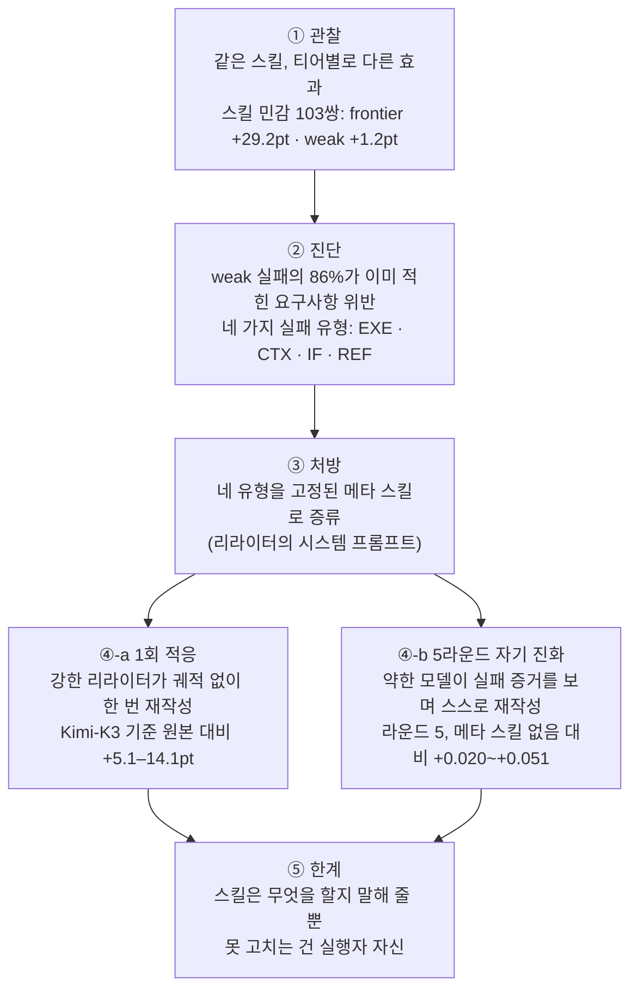
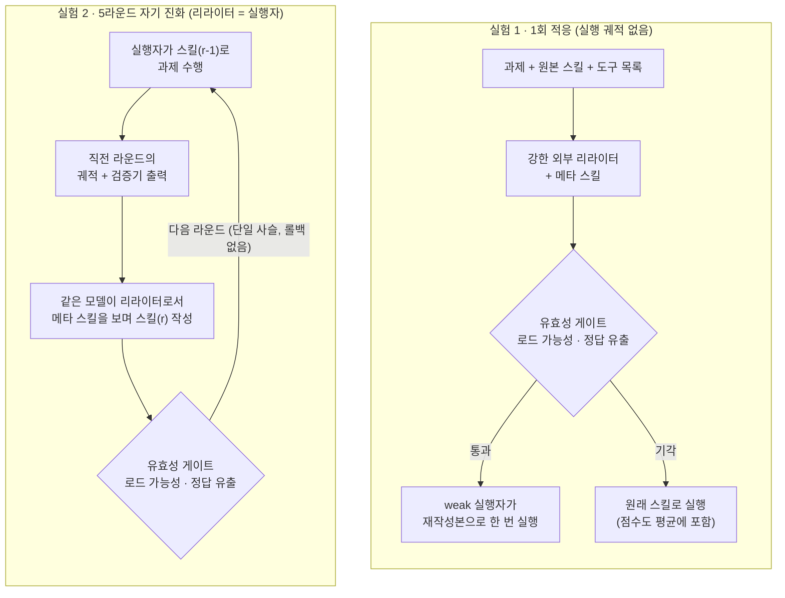

<figure class="post-figure post-figure--header">
<svg role="img" aria-labelledby="sa-h-title sa-h-desc" viewBox="0 0 720 340" xmlns="http://www.w3.org/2000/svg">
  <title id="sa-h-title">같은 두루마리, 다른 결과</title>
  <desc id="sa-h-desc">가운데 위쪽의 SKILL.md 두루마리가 왼쪽의 커다란 전사와 오른쪽의 작은 신병에게 똑같이 건네진다. 전사는 깃발을 세우고(frontier 평균 +29.2포인트), 신병은 물음표를 띄운 채 서 있다(weak 평균 +1.2포인트). 가운데 아래에서는 서기관(리라이터)이 메타 스킬을 보며 두루마리를 도구·범위·요구사항·검증이라는 짧은 카드 네 장으로 고쳐 써서 신병에게 건넨다.</desc>
  <defs>
    <marker id="sa-h-arrow" markerWidth="9" markerHeight="9" refX="7" refY="4" orient="auto">
      <path d="M0 0 L8 4 L0 8 Z" fill="var(--gold)"/>
    </marker>
    <marker id="sa-h-arrow-g" markerWidth="9" markerHeight="9" refX="7" refY="4" orient="auto">
      <path d="M0 0 L8 4 L0 8 Z" fill="var(--secondary-color)"/>
    </marker>
  </defs>

  <!-- the shared SKILL.md scroll -->
  <rect x="294" y="30" width="12" height="64" rx="5" fill="var(--bg-light)" stroke="var(--gold)" stroke-width="2"/>
  <rect x="414" y="30" width="12" height="64" rx="5" fill="var(--bg-light)" stroke="var(--gold)" stroke-width="2"/>
  <rect x="306" y="36" width="108" height="52" fill="var(--bg-light)" stroke="var(--gold)" stroke-width="2"/>
  <text x="360" y="58" text-anchor="middle" font-family="monospace" font-size="13" font-weight="700" fill="currentColor">SKILL.md</text>
  <g stroke="var(--text-light)" stroke-width="2" stroke-linecap="round">
    <line x1="320" y1="70" x2="400" y2="70"/>
    <line x1="320" y1="79" x2="384" y2="79"/>
  </g>
  <text x="360" y="20" text-anchor="middle" font-size="12" fill="var(--text-light)">사람이 쓴 같은 스킬</text>

  <!-- same scroll handed to both -->
  <g fill="none" stroke="var(--gold)" stroke-width="2.5" stroke-linecap="round" marker-end="url(#sa-h-arrow)">
    <path d="M292 62 C 230 62, 190 80, 170 104"/>
    <path d="M428 62 C 520 62, 590 110, 606 160"/>
  </g>

  <!-- big warrior (strong executor) -->
  <g stroke="currentColor" stroke-width="2.5" stroke-linejoin="round">
    <circle cx="130" cy="132" r="20" fill="var(--bg-light)"/>
    <rect x="96" y="154" width="68" height="78" rx="6" fill="var(--bg-light)"/>
    <rect x="86" y="150" width="22" height="16" rx="4" fill="var(--bg-sunken)"/>
    <rect x="152" y="150" width="22" height="16" rx="4" fill="var(--bg-sunken)"/>
    <rect x="102" y="232" width="22" height="42" fill="var(--bg-light)"/>
    <rect x="136" y="232" width="22" height="42" fill="var(--bg-light)"/>
  </g>
  <!-- banner of victory -->
  <line x1="62" y1="96" x2="62" y2="276" stroke="currentColor" stroke-width="3" stroke-linecap="round"/>
  <path d="M64 100 L104 110 L64 122 Z" fill="var(--secondary-color)"/>
  <line x1="88" y1="180" x2="64" y2="170" stroke="currentColor" stroke-width="3" stroke-linecap="round"/>
  <text x="122" y="300" text-anchor="middle" font-size="13" font-weight="700" fill="currentColor">강한 실행자 (frontier)</text>
  <text x="122" y="322" text-anchor="middle" font-size="14" font-weight="700" fill="var(--secondary-color)">평균 +29.2pt</text>

  <!-- small recruit (weak executor) -->
  <g stroke="currentColor" stroke-width="2.5" stroke-linejoin="round">
    <circle cx="630" cy="204" r="12" fill="var(--bg-light)"/>
    <rect x="614" y="218" width="32" height="40" rx="4" fill="var(--bg-light)"/>
    <rect x="618" y="258" width="10" height="18" fill="var(--bg-light)"/>
    <rect x="632" y="258" width="10" height="18" fill="var(--bg-light)"/>
  </g>
  <text x="652" y="186" font-size="22" font-weight="700" fill="var(--accent-color)">?</text>
  <text x="630" y="300" text-anchor="middle" font-size="13" font-weight="700" fill="currentColor">약한 실행자 (weak)</text>
  <text x="630" y="322" text-anchor="middle" font-size="14" font-weight="700" fill="var(--accent-color)">평균 +1.2pt</text>

  <!-- scribe (rewriter) at the desk -->
  <line x1="360" y1="100" x2="360" y2="128" stroke="var(--gold)" stroke-width="2.5" stroke-dasharray="5 4" marker-end="url(#sa-h-arrow)"/>
  <g stroke="currentColor" stroke-width="2.5" stroke-linejoin="round">
    <circle cx="340" cy="152" r="14" fill="var(--bg-light)"/>
    <rect x="322" y="168" width="36" height="50" rx="5" fill="var(--bg-light)"/>
    <rect x="290" y="218" width="140" height="12" rx="2" fill="var(--bg-sunken)"/>
  </g>
  <path d="M356 196 L380 162" stroke="currentColor" stroke-width="2" stroke-linecap="round"/>
  <path d="M380 162 L386 152 L382 164 Z" fill="currentColor"/>
  <rect x="372" y="196" width="44" height="22" rx="2" fill="var(--bg-panel)" stroke="var(--border-color)" stroke-width="1.5"/>
  <text x="394" y="211" text-anchor="middle" font-size="9" fill="var(--text-light)">메타 스킬</text>
  <text x="360" y="250" text-anchor="middle" font-size="13" font-weight="700" fill="currentColor">리라이터</text>
  <text x="360" y="268" text-anchor="middle" font-size="11" fill="var(--text-light)">같은 내용, 따를 수 있는 모양으로</text>

  <!-- four command cards -->
  <g fill="var(--bg-panel)" stroke="var(--secondary-color)" stroke-width="2">
    <rect x="452" y="128" width="104" height="26" rx="4"/>
    <rect x="452" y="160" width="104" height="26" rx="4"/>
    <rect x="452" y="192" width="104" height="26" rx="4"/>
    <rect x="452" y="224" width="104" height="26" rx="4"/>
  </g>
  <g font-size="12" font-weight="700" fill="currentColor">
    <text x="464" y="146">① 도구</text>
    <text x="464" y="178">② 범위</text>
    <text x="464" y="210">③ 요구사항</text>
    <text x="464" y="242">④ 검증</text>
  </g>
  <line x1="432" y1="190" x2="446" y2="190" stroke="var(--secondary-color)" stroke-width="2.5" marker-end="url(#sa-h-arrow-g)"/>
  <line x1="560" y1="230" x2="604" y2="234" stroke="var(--secondary-color)" stroke-width="2.5" marker-end="url(#sa-h-arrow-g)"/>
</svg>
<figcaption>같은 SKILL.md가 강한 모델은 크게 끌어올리지만 약한 모델에겐 거의 효과가 없다(스킬 민감 103쌍 기준). 논문의 처방은 정보를 더하는 대신, 리라이터가 같은 내용을 실행자가 따를 수 있는 모양으로 다시 쓰는 것이다.</figcaption>
</figure>

## 원문 정보

> - **제목**: *Evolving to Match Capabilities: Improving Harness Self-Evolution via Skill Adaptation*
> - **저자**: Zhihao Yang\*, Haojin Wang\*, Juncheng Wu\*, Kuan Zhang, Yukun Chen, Run Luo, Yaojie Lu, Yuyin Zhou, Lu Wang†, Xianpei Han† (\* 공동 1저자, † 교신저자) — University of Chinese Academy of Sciences, UC Santa Cruz, Tsinghua University, National University of Singapore, 중국과학원 소프트웨어연구소 중국정보처리연구실(CIP) 등
> - **출처**: arXiv:2610.33024v1 [cs.LG; cs.AI, cs.CL] · Hugging Face Papers 소개 페이지
> - **발행**: 2026-10-10 제출 · 24쪽 (그림 12, 표 4)
> - **원문 링크**: <https://arxiv.org/abs/2610.33024> · <https://huggingface.co/papers/2610.33024>
> - **프로젝트 페이지**: <https://zhihaoyang30.github.io/skill-adaptation/> (코드는 리뷰 종료 후 공개 예정이라고 밝힘)

이 위키는 Claude Code 서브에이전트와 그들이 읽는 지침 문서로 굴러간다. 그 지침 문서가 "어느 모델이 읽느냐"에 따라 약이 되기도 독이 되기도 한다는 것을 숫자로 보여 주는 논문이라 Articles에 담는다. 본문은 arXiv HTML 판 전체(본문·부록 A–E)를 읽고 정리했다. 다만 그림 안에만 있는 수치(그림 3·5·6·8의 막대·곡선 값)는 이미지라 읽지 않았고, 본문과 표에 텍스트로 적힌 숫자만 옮겼다.

## 한 줄 요약 (TL;DR)

사람이 쓴 스킬은 강한 모델을 크게 끌어올리지만 약한 모델에겐 거의 효과가 없거나 오히려 해롭다. 그런데 약한 모델 실패의 86%는 **스킬에 이미 적힌 요구사항을 어긴** 경우였다. 그래서 저자들은 정보를 더 넣는 대신 **같은 내용을 실행자(executor)가 따를 수 있는 형태로 다시 쓰는 것(skill adaptation)**을 제안한다. 네 가지 실패 유형(도구 실행·컨텍스트 관리·지시 이행·검증)을 고정된 **메타 스킬(meta-skill)**로 증류해 리라이터의 시스템 프롬프트에 넣으면, 한 번에 다시 쓰는 설정에서도, 5라운드 자기 진화 루프에서도 점수가 오른다.

## 왜 이 글을 골랐나

[무엇이 하니스를 하니스로 만드는가](/2026/08/03/what-makes-a-harness-a-harness.html)가 하니스를 *정의*했고, [GPT-6 Astra: 하니스가 곧 제품이다](/2026/09/08/gpt6-astra-harness-is-the-product.html)가 같은 모델이라도 하니스에 따라 성적이 크게 갈린다는 것을 보였다. 이 논문은 그 반대 방향의 질문을 던진다. **하니스 쪽을 고정했을 때, 모델이 바뀌면 하니스의 효용은 그대로인가?** 답은 "아니다"이고, 그것도 꽤 크게 아니다.

실무적으로 와닿는 이유는 두 가지다.

1. 스킬은 보통 **한 번 쓰고 모든 모델에 그대로 배포**된다. 논문의 관련 연구 절도 이를 짚는다. 비용 때문에 작은 모델로 내려가는 순간, 프런티어 모델로 다듬은 스킬이 조용히 성능을 깎을 수 있다.
2. 처방이 **"더 쓰라"가 아니라 "다르게 쓰라"**다. 요구사항을 길게 풀어 써 봐야 소용없고, 행동·대상·완료 조건 한 줄로 쪼개라는 식의 구체적인 작성 규칙이다. 우리가 `CLAUDE.md`나 에이전트 지침을 쓸 때 바로 써먹을 수 있다.

논문의 흐름을 한 장으로 그리면 이렇다.

## 핵심 내용

### 문제 설정: 스킬 이득(skill gain)은 모델마다 다르다

**하니스 자기 진화(harness self-evolution)**는 모델 파라미터를 고정한 채, 실행 궤적(trajectory)과 피드백으로 하니스를 자동으로 만들고 고쳐 나가는 접근이다. 흔한 방법은 궤적에서 재사용 가능한 **스킬**을 증류하는 것이고, 기존 연구는 주로 "경험을 얼마나 잘 뽑아 절차로 옮기느냐"에 집중했다. 저자들의 문제의식은 한 줄이다. **올바른 경험을 스킬에 담았다고 해서 모델이 그것을 잘 쓴다는 보장은 없다.**

이를 재기 위해 과제 T와 사람이 쓴 스킬 S의 쌍에 대해, 모델 m의 *스킬 있음* 점수와 *스킬 없음* 점수의 차이를 **스킬 이득 Δ**로 정의한다. 점수는 각 벤치마크의 고유 채점기로 매기고 0–1로 정규화한다.

### 실험 무대: 벤치마크 3종, 모델 7종, 티어 3단

| 벤치마크 | 영역 | 실행된 과제 | 선별된 쌍 | 실행 하니스 | 채점 |
| --- | --- | --- | --- | --- | --- |
| SkillsBench | STEM·엔지니어링 8개 도메인 | 87 | 32 | OpenHands | 과제별 결정적 테스트 |
| DocOps | Excel·Word·PowerPoint·PDF 문서 조작 | 186 | 32 | Claude Code | 결과 문서의 실제 상태 검사 |
| Tessl | 개발자 도구·API (Stripe, Vercel, ClickHouse, Sentry, Shopify, Firecrawl 등 벤더 스킬) | 334 | 39 | Claude Code | 루브릭 기반 LLM judge |

환경 문제로 안정적으로 돌아가는 과제만 써서 총 607개 과제다. 세 벤치마크는 구축·채점 방식이 서로 독립적이라, 결론은 **세 곳 모두에서 재현될 때만** 보고했다고 밝힌다.

모델은 스킬 없이 낸 성적을 기준으로 세 티어로 묶었다.

- **Weak**: Gemma-4-E4B, Qwen3.5-9B, Qwen3.6-flash
- **Moderate**: GPT-5.4-mini, Claude-Sonnet-4.6
- **Frontier**: GPT-5.6-luna, Claude-Opus-5

### 스킬 민감 쌍(skill-sensitive pair) 103개

607개 전체를 평균하면 스킬은 모든 모델에 작은 이득을 줄 뿐 티어 간 뚜렷한 패턴이 없다. 그래서 저자들은 "스킬이 강한 쪽에 확실히 효과가 있는" 쌍만 골라낸다. 티어 G의 평균 이득이 τ=0.10 이상이고, **동시에 weak 티어보다 0.10 이상 더 클 때** "G가 스킬의 덕을 본다"고 정의한다. frontier가 덕을 보거나, frontier가 스킬 없이도 이미 포화(평균 0.95 이상)인데 moderate가 덕을 보면 스킬 민감 쌍이다. weak 티어가 스킬과 함께 이미 0.80 이상인 쌍은 개선 여지가 없어 뺐다.

그렇게 남은 것이 103쌍(SkillsBench 32, DocOps 32, Tessl 39)이고, 여기서 그림이 완전히 달라진다.

- 스킬은 frontier 모델을 평균 **29.2포인트** 올리지만 weak 모델은 **1.2포인트**만 올린다.
- 모델 단위로 보면 GPT-5.6-luna는 **+31.1포인트**, 가장 약한 Gemma-4-E4B는 **-8.8포인트**다. 같은 스킬이 한쪽에선 약, 한쪽에선 독이다.
- 이 103쌍에서 스킬을 넣고도 실패한 weak 모델 실행의 **86%**는 주입된 `SKILL.md`에 **이미 적혀 있는 요구사항**을 어겼다.

마지막 숫자가 논문 전체의 지렛대다. 정보가 없어서 실패한 게 아니라, **있는 정보를 실행하지 못해서** 실패했다는 뜻이다.

> 주의: 103쌍은 "강한 모델엔 효과가 크고 약한 모델엔 작다"는 조건으로 **골라낸** 부분집합이다. 격차가 큰 것은 정의상 어느 정도 예정된 결과이고, 논문의 기여는 그 격차의 *원인*을 해부한 데 있다. (이 단서는 내 해석이다.)

### 진단: 약한 실행자의 네 가지 실패 유형

저자들은 103쌍 각각에 대해 weak 모델 세 개의 궤적을 스킬과 함께 직접 읽고, **처음 관찰된 실패**에 라벨을 붙였다. 라벨은 궤적이나 검증기 출력에 근거가 있을 때만 붙였고, 한 과제에 여러 라벨이 붙을 수 있어 103개 과제에 총 131개 라벨이 나왔다.

<figure class="post-figure">
<svg role="img" aria-labelledby="sa-l-title sa-l-desc" viewBox="0 0 720 400" xmlns="http://www.w3.org/2000/svg">
  <title id="sa-l-title">네 가지 실패 유형의 깊이 사다리</title>
  <desc id="sa-l-desc">네 가지 실패 유형을 에이전트가 어디까지 가다 멈췄는지의 깊이 순서로 위에서 아래로 놓았다. 첫 단 EXE는 산출물이 없는 경우, 둘째 단 CTX는 예시나 참고 파일을 할 일로 착각하는 경우, 셋째 단 IF는 산출물은 있지만 요구사항 일부를 놓친 경우, 넷째 단 REF는 다 갖췄지만 값이 틀린 경우다. 각 단 아래에 메타 스킬의 처방이 한 줄씩 적혀 있다. 왼쪽 화살표는 가장 이른 고장부터 고친다는 규칙을 나타낸다.</desc>
  <defs>
    <marker id="sa-l-arrow" markerWidth="9" markerHeight="9" refX="7" refY="4" orient="auto">
      <path d="M0 0 L8 4 L0 8 Z" fill="var(--accent-color)"/>
    </marker>
  </defs>

  <!-- depth axis -->
  <line x1="34" y1="34" x2="34" y2="334" stroke="var(--accent-color)" stroke-width="3" marker-end="url(#sa-l-arrow)"/>
  <text x="22" y="184" text-anchor="middle" font-size="12" font-weight="700" fill="var(--accent-color)" transform="rotate(-90 22 184)">더 멀리 갔다가 멈춤 (깊이)</text>

  <!-- rungs -->
  <g fill="var(--bg-light)" stroke="var(--border-color)" stroke-width="2">
    <rect x="56" y="24" width="640" height="70" rx="6"/>
    <rect x="76" y="104" width="620" height="70" rx="6"/>
    <rect x="96" y="184" width="600" height="70" rx="6"/>
    <rect x="116" y="264" width="580" height="70" rx="6"/>
  </g>
  <g fill="var(--bg-panel)" stroke="var(--gold)" stroke-width="2">
    <rect x="66" y="34" width="112" height="50" rx="4"/>
    <rect x="86" y="114" width="112" height="50" rx="4"/>
    <rect x="106" y="194" width="112" height="50" rx="4"/>
    <rect x="126" y="274" width="112" height="50" rx="4"/>
  </g>
  <g text-anchor="middle" fill="currentColor">
    <text x="122" y="56" font-size="15" font-weight="700">① EXE</text>
    <text x="122" y="75" font-size="11" fill="var(--text-light)">도구 실행</text>
    <text x="142" y="136" font-size="15" font-weight="700">② CTX</text>
    <text x="142" y="155" font-size="11" fill="var(--text-light)">컨텍스트 관리</text>
    <text x="162" y="216" font-size="15" font-weight="700">③ IF</text>
    <text x="162" y="235" font-size="11" fill="var(--text-light)">지시 이행</text>
    <text x="182" y="296" font-size="15" font-weight="700">④ REF</text>
    <text x="182" y="315" font-size="11" fill="var(--text-light)">검증</text>
  </g>

  <!-- symptom (ink) + prescription (green) -->
  <g font-size="13">
    <text x="192" y="54" fill="currentColor">산출물 없음 — 도구를 한두 번 부르고 멈추거나 에러 미복구</text>
    <text x="192" y="76" fill="var(--secondary-color)">→ 도구와 문서 구분 · 사전 점검 · 그대로 실행할 명령</text>
    <text x="212" y="134" fill="currentColor">엉뚱한 일 · 엉뚱한 경로 — 예시·참고 파일을 할 일로 착각</text>
    <text x="212" y="156" fill="var(--secondary-color)">→ 과제·수정 범위·결과물 경로를 앞에, 나머지는 참고 자료</text>
    <text x="232" y="214" fill="currentColor">산출물은 있지만 이미 적힌 요구사항 일부를 놓침</text>
    <text x="232" y="236" fill="var(--secondary-color)">→ 요구사항마다 행동 — 대상 — 완료 조건 한 줄</text>
    <text x="252" y="294" fill="currentColor">다 갖췄지만 값이 검증기 결과와 다름</text>
    <text x="252" y="316" fill="var(--secondary-color)">→ 다시 읽기 · 다른 경로로 재계산 · 기준과 비교</text>
  </g>

  <!-- the rule -->
  <text x="360" y="366" text-anchor="middle" font-size="13" font-weight="700" fill="currentColor">가장 이른 고장을 판정하고, 그 유형의 처방만 적용한다</text>
  <text x="360" y="388" text-anchor="middle" font-size="12" fill="var(--text-light)">얕은 고장이 남아 있는 한 더 깊은 수리는 효과가 없다</text>
</svg>
<figcaption>메타 스킬은 네 유형을 나열이 아니라 깊이 순서로 다룬다. 위쪽 단에서 멈춘 에이전트에게 아래쪽 처방(예: 검증 루프)은 닿지 않는다.</figcaption>
</figure>

| 실패 유형 | 증상 (원문 정의) | 라벨 수 |
| --- | --- | --- |
| **Tool execution** (EXE) | 산출물이 없다. 도구를 한두 번 부르고 멈추거나, `xlsx` 같은 파일 포맷을 도구로 착각하거나, 도구 에러를 복구하지 못한 채 끝난다 | 51 (가장 많음) |
| **Instruction following** (IF) | 여러 번 도구를 부르고 산출물도 냈지만, 스킬에 이미 적힌 요구사항을 놓친다. 보통 일부만 해낸다 | 35 |
| **Context management** (CTX) | 스킬의 예시나 참고 파일을 지금 할 일로 착각한다. 결과물을 엉뚱한 경로에 저장하기도 한다 | 28 |
| **Verification** (REF) | 필요한 부분은 다 있지만 답이 검증기 결과와 다르다. 궤적에 그 오류를 잡을 유효한 확인 절차가 없다 | 17 (가장 적음) |

(라벨 수는 표 2의 n 열에서 옮겼다.)

### 처방: 메타 스킬(meta-skill)

이 진단을 **고정된, 과제 독립적인 재작성 프로토콜**로 증류한 것이 메타 스킬이다. 리라이터 모델의 시스템 프롬프트에 들어가는 문서이고, 저자들은 Claude-Opus-5를 작성 보조로 써서 만들었다고 밝힌다. 부록 C에 전문이 있는데, 핵심은 이렇다.

**먼저 고장 난 지점을 찾고, 거기를 고쳐라.** 궤적을 읽고 네 유형 중 *가장 이른* 고장을 판정한다. 얕은 고장이 남아 있는 한 더 깊은 수리는 효과가 없기 때문이다. 그다음 해당 유형의 처방만 적용하고 나머지 문서는 건드리지 않는다.

- **EXE** → 문서 위쪽에 무엇이 호출 가능한 도구이고 무엇이 문서인지 밝히고, 환경 사전 점검(preflight)을 넣고, 처음 생길 법한 실패의 대안 경로를 적는다. 그대로 실행할 수 있는 명령을 준다.
- **CTX** → 사용자의 과제, 허용된 수정 범위, 결과물 경로를 앞에 쓰고, "나머지는 새 요청이 아니라 참고 자료"라고 한 줄로 못 박는다. 보조 파일 내용이 필요하면 본문에 직접 넣는다.
- **IF** → 해당 요구사항마다 **행동(action) — 대상(target) — 완료 조건(completion condition)** 한 줄로 다시 쓴다. 부정 분기("X가 이미 있으면 멈추고 아무것도 바꾸지 마라")까지 포함한다. 원문은 "요구사항에 대해 더 많이 쓰는 건 도움이 안 된다. 텍스트는 이미 거기 있었다"고 적는다.
- **REF** → 마지막에 독립 검증 단계를 넣는다. 결과물을 디스크에서 다시 읽고, 보고할 값을 *다른 경로로* 다시 계산하고, 명시적 기준과 비교하고, 통과할 때까지 반복한다. "파일을 썼다", "에러 없이 실행됐다"는 증거가 아니다.

규칙도 함께 붙는다. 증거가 가리키는 곳만 고칠 것(문서 형태를 강제하지 않음), 과제에 필요할 수 있는 기능 설명은 남기고 에이전트가 실행할 수 없는 부분만 덜어낼 것, 주어진 자료에 없는 함수·플래그·경로를 지어내지 말 것, 정답이나 기댓값을 붙여 넣지 말 것, 근거 있는 개선이 없으면 `NO_CHANGE`를 돌려줄 것.

### 공정성 장치: 재작성 프로토콜과 정답 유출 차단

부록 B의 프로토콜은 리라이터의 *인터페이스*와 출력의 *유효성*만 제약하고 내용은 제약하지 않는다.

- **입력**: 과제 지시문, 실행자의 도구 목록 전체("스킬 이름·파일 이름·섹션 제목은 호출 가능한 도구가 아니다"라는 주석 포함), 현재 스킬 원문과 보조 파일 목록. 자기 진화 설정에서는 여기에 직전 시도의 결과·궤적 요약·검증기 출력이 더해진다.
- **출력 계약**: 바꾼 파일마다 전체 내용을 `<<<FILE path=...>>>` 블록으로 돌려주거나, `<<<NO_CHANGE>>>`와 이유를 돌려준다. 패치 형식이나 템플릿은 없다.
- **로드 가능성 검사**: 비어 있지 않을 것, 기존 스킬 파일 경로일 것, YAML frontmatter의 `name`이 그대로일 것, 64,000자 예산 이내일 것(스킬이 실행자 컨텍스트에 통째로 주입되므로).
- **정답 유출 검사**: 숨겨진 테스트나 정답에는 있지만 공개 자료와 리라이터가 본 증거에는 없는 특정 토큰(숫자나 밑줄이 들어간 8자 이상 식별자, 소수점 둘째 자리 이상 소수)을 모아 두고, 기댓값 하나나 그런 식별자 둘을 들여오면 기각한다.
- 기각된 재작성은 원래 스킬로 돌려 실행하고 **그 점수도 평균에 포함**한다. 나쁜 재작성이 통계에서 사라지지 않게 하는 장치다.
- 모든 (모델, 과제, 조건) 칸은 **한 번씩만** 실행했다.

### 실험 1: 강한 리라이터의 1회 스킬 적응

리라이터 넷(GPT-5.6-sol, GPT-5.6-luna, GLM-5.3, Kimi-K3)이 실행 궤적 없이 과제와 스킬만 보고 103쌍의 스킬을 한 번씩 다시 쓰고, weak 실행자 셋이 각 재작성본을 한 번씩 돌렸다.

| 리라이터 | Qwen3.6-flash | Gemma-4-E4B | Qwen3.5-9B | 평균 |
| --- | --- | --- | --- | --- |
| 원본 스킬 | 0.529 | 0.029 | 0.323 | 0.294 |
| Weak (자기 스킬을 스스로) | 0.476 | 0.056 | 0.280 | 0.271 |
| GPT-5.6-sol | 0.563 | 0.139 | 0.303 | 0.335 |
| GPT-5.6-luna | 0.602 | 0.119 | 0.307 | 0.343 |
| GLM-5.3 | 0.626 | 0.138 | 0.374 | 0.379 |
| Kimi-K3 | 0.616 | 0.170 | 0.374 | 0.387 |

(표 1, 103쌍 평균. 모두 메타 스킬을 쓴 재작성.)

- 강한 리라이터 넷은 모두 평균을 올렸고, Kimi-K3와 GLM-5.3은 세 실행자 모두를 올렸다(평균 약 +0.09).
- Kimi-K3 기준 원본 대비 향상은 Qwen3.5-9B +5.1, Qwen3.6-flash +8.7, Gemma-4-E4B +14.1포인트로, 초록의 "5.1–14.1포인트"가 이것이다(개별 차이는 표 1에서 내가 계산했다).
- **가장 약한 실행자가 가장 많이 얻었다.** Gemma-4-E4B는 0.029에서 0.170으로 올랐다.
- 반면 **weak 모델이 자기 스킬을 스스로 고치면 원본보다 나빠졌다**(평균 0.294 → 0.271).

**메타 스킬이 없어도 되나?** 이득이 메타 스킬 덕인지 리라이터가 강해서인지 가르기 위해, 메타 스킬을 "모든 모델에서 작동하도록 이 스킬을 다시 써라"라는 한 문장 지시로 바꾸고 Kimi-K3로 같은 실험을 했다. 한 문장 지시만으로도 세 실행자 중 둘은 좋아졌지만 고르지 않았고 Qwen3.5-9B는 원본보다 약간 나빠졌다. 메타 스킬을 쓰면 세 실행자 모두가 한 문장 지시보다 좋아졌다. 서론에 따르면 메타 스킬이 한 문장 지시 대비 5.1–6.0포인트를 더하며, 이는 평균 이득의 절반이 넘는다.

### 실험 2: 5라운드 자기 진화 루프

이번엔 리라이터와 실행자가 **같은 모델**이다. 라운드 r에서 모델은 과제, 직전 라운드의 스킬, 도구 목록, 그리고 **직전 라운드의 궤적과 검증기 출력**을 받아 자기 스킬을 고치고, 고친 스킬로 다시 과제를 푼다. 5라운드를 이어 붙인 단일 사슬이며 최고 라운드 선택도 롤백도 없다. 비교 대상은 시스템 프롬프트에서 메타 스킬만 뺀 같은 루프다. 서빙 엔드포인트의 시간에 따른 변화를 빼기 위해, 같은 시간대에 원본 스킬을 그대로 다시 돌린 기준선(baseline) 대비 이득으로 잰다. weak 셋 외에 Qwen3.5-27B, Gemma-4-26B, Qwen3.5-plus, Kimi-K2.5도 돌렸다.

두 실험의 설정을 나란히 놓으면 차이는 리라이터가 누구인지, 그리고 실패 증거를 보느냐에 있다.

라운드 5 시점에서 메타 스킬 쪽이 없는 쪽보다 높은 정도(표 4의 전체 평균 기준):

| 실행자 | 원본 재실행 기준선 | 라운드 5 (메타 스킬 없음) | 라운드 5 (메타 스킬) | 차이 |
| --- | --- | --- | --- | --- |
| Qwen3.6-flash | 0.523 | 0.614 | 0.644 | +0.030 |
| Gemma-4-E4B | 0.104 | 0.096 | 0.147 | +0.051 |
| Qwen3.5-9B | 0.314 | 0.317 | 0.366 | +0.049 |
| Qwen3.5-27B | 0.578 | 0.693 | 0.739 | +0.046 |
| Gemma-4-26B | 0.075 | 0.100 | 0.120 | +0.020 |
| Qwen3.5-plus | 0.582 | 0.723 | 0.748 | +0.025 |
| Kimi-K2.5 | 0.612 | 0.765 | 0.800 | +0.035 |

- **일곱 실행자 모두** 라운드 5에서 메타 스킬 쪽이 높다(+0.020 ~ +0.051).
- 메타 스킬이 없으면 자기 수정은 효과가 작고 불안정하다. Qwen3.5-9B는 라운드 3에서 정점을 찍고 기준선 근처로 되돌아가고, Gemma-4-E4B는 모든 라운드에서 기준선 아래다.
- 메타 스킬이 곡선을 단조 증가로 만들지는 않는다. Qwen3.5-9B는 여전히 라운드 3 이후 떨어지고 Gemma-4-E4B는 라운드 2에서 주춤하지만, 둘 다 더 높게 끝나고 Gemma-4-E4B는 라운드 3부터 기준선 위를 유지한다.
- 실험 1과 정반대 결과라는 점이 흥미롭다. 1회 적응에서는 weak 모델이 메타 스킬을 들고 스스로 고치면 셋 중 둘이 나빠졌는데(표 1의 Weak(self) 행), 여기선 좋아진다. 저자들은 그 차이를 **실패 증거**에서 찾는다. 스킬이 어떻게 실패했는지 볼 수 있으면 약한 모델도 메타 스킬을 활용할 수 있다.
- 저자들 스스로 각 라운드를 한 번씩만 돌렸으므로 격차의 *크기*에는 큰 의미를 두지 않고, **일곱 실행자 모두에서 부호가 같다는 점**에 기댄다고 적는다. 벤치마크별로 쪼개 보면 음수인 칸도 있다(예: Qwen3.5-plus의 DocOps -0.188).

### 분석: 무엇을, 어느 설정이 고치나

실패 유형별로 묶어 메타 스킬 유무의 점수 차를 비교한 것이 표 2다(평균 열만 옮긴다).

| 실패 유형 (n) | 1회 적응 (Kimi-K3) 평균 이득 | 자기 진화 (라운드 5) 평균 이득 |
| --- | --- | --- |
| Execution (51) | +0.056 | +0.065 |
| Instruction (35) | +0.055 | +0.046 |
| Context (28) | +0.103 | +0.007 |
| Verification (17) | +0.003 | +0.104 |

저자들은 여기서 세 가지를 읽어 낸다.

1. **1회 적응은 텍스트에서 보이는 문제를 고친다.** 스킬이 호출 가능한 도구를 밝히는지, 요구사항마다 완료 조건이 있는지, 과제와 결과물 경로를 앞에 적었는지는 텍스트만 봐도 안다. 그래서 Execution·Instruction·Context에서 이득이 난다.
2. **자기 진화는 실행 중에 드러나는 문제를 고친다.** 검증 단계는 텍스트로 적을 수 있지만, 실행자가 실제로 그 확인을 하는지는 궤적을 봐야 안다. 그래서 Verification 이득은 자기 진화 쪽에서 훨씬 크다.
3. **메타 스킬이 못 고치는 것은 실행자 자신이다.** 표 2의 음수 칸 뒤에는, 스킬은 올바른 절차를 적었는데 실행자가 따르지 않은 경우가 있다. 스크립트를 고치고 다시 돌리지 않거나, 실패한 호출을 반복하거나, 산출물을 쓰기 전에 멈추거나, 제약이 여럿일 때 스킬이 강조한 하나만 지키고 나머지는 버린다. 원문의 표현으로는 "스킬은 약한 실행자에게 무엇을 할지 말해 줄 수 있지만, 그것을 해내는 건 모델에 달렸다."

### 사례로 보는 차이 (그림 7, 부록 E)

논문은 메타 스킬 유무가 갈린 사례를 좌우 대비로 보여 준다. 저자들은 단일 롤아웃이라 사례는 메커니즘을 *예시*할 뿐 증명은 표가 한다고 선을 긋는다.

- **지리 계산 과제 (그림 7, Qwen3.6-flash 자기 진화)**: 메타 스킬 없이 고친 스킬은 무엇을 제출하라는지 끝까지 말하지 않는 참고 노트 모음이라 같은 틀린 거리가 다섯 라운드 내내 살아남는다. 메타 스킬로 고친 스킬은 입력·출력 경로·키를 앞에 쓰고, EPSG:4087 투영만 쓰라고 못 박고, ISO 8601 시간 형식을 확인하게 하고, `answer.json`을 다시 읽어 거리를 재계산하게 한다. 다섯 라운드 중 넷을 통과했고, 실패한 한 번은 스크립트를 고친 뒤 다시 돌리지 않은 경우였다. 원문은 이것을 "어떤 스킬 텍스트도 잡을 수 없는" 실패라고 부른다.
- **스프레드시트 합계 (그림 9, DocOps, Qwen3.5-9B 자기 진화)**: 원본은 과제를 언급조차 하지 않는 11.5k자 라이브러리 레퍼런스다. 메타 스킬 없는 루프는 증상을 쫓는다. 파이썬 문법 팁을 붙이고, 재계산 스크립트를 범인으로 오진해 실행을 금지하고, 라운드 3에선 틀린 셀 배치를 박아 넣어 이후 라운드가 그 위에 쌓인다. 스킬은 66% 길어졌지만 합계는 끝내 I3·I4에 들어가지 않는다. 메타 스킬 쪽은 라운드 4에 수식 셀과 헤더 셀을 구분하고 읽어 들인 합계를 원본 행에서 다시 계산한 값과 비교하는 단계를 넣어 통과한다. 통과한 스킬이 특정 셀(I3, I4)을 명시하는 **과제 특화** 형태라는 점도 저자들은 짚는다.
- **프로젝트 설정 파일 (그림 10, Tessl, Gemma-4-E4B 자기 진화)**: 스킬 이름을 잘못 쳐서 `Unknown skill`을 받고, 같은 스킬을 다시 불러 같은 텍스트만 재주입한 뒤 "파일은 곧 드리겠다"며 `Write` 한 번 안 부르고 끝나는 전형적인 EXE 실패다. 메타 스킬 없는 리라이터는 채점 루브릭을 체크리스트로 옮겨 적고 `NO_CHANGE`만 반복한다. 메타 스킬 쪽은 "파일 두 개를 작업 공간에 써야 한다"는 범위·경로와 설치 명령을 한 줄씩 적었고, 같은 에러를 만나도 `Write`로 넘어가 모든 라운드를 통과했다.
- **PDDL 계획 (그림 11, Kimi-K3 1회 적응, Gemma-4-E4B 실행)**: 두 재작성 모두 결과물과 "이 함수들은 도구가 아니다"를 밝혔지만, 한 문장 지시판은 연쇄 `pip install` 여섯 줄을 통과/실패 관문 없이 넣었고, 실행자가 이를 한 명령으로 합치다 터미널이 멈춰 버렸다. 메타 스킬판은 단일 import 확인을 관문으로 두고("`up ok`가 출력될 때까지 진행하지 마라"), 스크립트를 쓸 도구로 `file_editor`를 지목하고, 항목마다 완료 조건을 주고, 디스크 검사로 끝냈다.
- **단백질 발현 워크북 (그림 12, Kimi-K3 1회 적응, Qwen3.6-flash 실행)**: 원본 스킬로 이미 *통과하던* 과제다. 한 문장 지시판은 스킬을 줄이면서 `python recalc.py`라는 위험한 명령을 더 눈에 띄게 만들었고, `python: command not found`에서 멈춰 **잘 되던 스킬을 망가뜨렸다**. 메타 스킬판은 "python이 없으면 python3를 써라"라는 사전 점검 한 줄과 pandas 교차 검증 단계를 넣었고, 그 교차 검증이 재계산 스크립트가 통과시킨 두 칸 어긋난 조회 범위까지 잡아냈다.

### 한계와 논의 (저자들이 밝힌 것)

- 스킬이 실행자 컨텍스트에 **이미 주어진** 상황만 평가했다. 스킬 검색(retrieval)과 점진적 공개(progressive disclosure)는 범위 밖이다.
- 여러 스킬이 붙은 과제는 묶음(bundle)으로 평가했다. 벤치마크 구조상 개별 스킬의 기여를 분리할 수 없기 때문이다.
- 자기 진화는 5라운드 고정 예산이고, 모델 파라미터는 갱신하지 않는다.
- 다음 단계로, 각 수정이 그것을 촉발한 실패를 실제로 해소했는지 추적하는 것, 그리고 비슷한 지침을 도구 인터페이스나 에이전트 워크플로로 넓히는 것을 제안한다.
- 결론의 실무 지침은 두 가지다. ① 하니스의 효용은 대표 모델 하나가 아니라 **능력 티어별로** 평가해야 한다. ② 진화 루프에는 약한 실행자가 *어떻게* 실패하는지에 대한 **진단 지침**을 줘야 한다. 증거만 주면 약한 리라이터는 표류하지만, 메타 스킬이 있으면 얻은 것을 지킨다.

## 분석과 인사이트

여기부터는 논문 요약이 아니라 내 해석이다.

### "정보 부족"이 아니라 "실행 가능성 부족"이라는 재정의가 핵심이다

86%라는 숫자가 프레임을 바꾼다. 에이전트가 실패하면 우리는 습관적으로 지침에 문단을 더한다. 이 논문은 그게 약한 모델에선 거의 소용없다고 말한다. 메타 스킬의 IF 처방에 적힌 "텍스트는 이미 거기 있었다"는 문장이 정확히 그 지점을 찌른다. 문서를 늘리는 대신 *모양을 바꿔야* 한다. 스프레드시트 사례에서 메타 스킬 없는 루프가 스킬을 66% 키우고도 실패한 것이 그 반례다.

이건 사람 대상 문서에도 그대로 통한다. 신입에게 주는 런북이 "참고 자료 더미"인지, "행동·대상·완료 조건" 목록인지에 따라 결과가 갈리는 것과 같은 구조다. 결국 프롬프트와 스킬도 **독자 능력을 고려해 쓰는 기술 문서**라는 오래된 교훈의 정량판이다.

### 네 유형은 "에이전트가 얼마나 멀리 갔나"의 깊이 축이다

메타 스킬이 네 유형을 단순 나열이 아니라 *깊이 순서*로 쓰고, "가장 이른 고장부터 고쳐라, 얕은 고장이 남아 있으면 깊은 수리는 효과가 없다"고 규정한 점이 좋다. 디버깅의 기본(첫 에러부터 본다)을 문서 수리에 옮긴 셈이다. 도구 호출에서 이미 멈추는 에이전트에게 검증 루프를 아무리 정교하게 써 줘도 거기까지 도달하지 못한다.

표 2가 이 깊이 축과 두 설정의 성격을 깔끔하게 맞물려 보여 준다. **텍스트만 보는 1회 적응은 앞쪽 단(EXE·CTX·IF)에, 궤적을 보는 자기 진화는 맨 뒤 단(Verification)에 강하다.** 실무에선 두 가지를 섞어 쓸 이유가 된다. 배포 전에 강한 모델로 정적 적응을 한 번 하고, 운영하면서 실패 궤적으로 검증 쪽을 다듬는 식이다.

### "약한 모델의 자기 개선"에 대한 냉정한 그림

같은 weak 모델이라도 증거 없이 스스로 고치면 나빠지고(표 1), 실패 증거와 메타 스킬이 함께 있으면 나아진다(표 4). 메타 스킬 없이 증거만 주면 표류한다. 이건 "모델이 알아서 자기 하니스를 개선한다"는 낙관에 대한 꽤 구체적인 단서다. 자기 진화에 필요한 건 루프 자체가 아니라 **루프에 주입되는 진단 프레임**이다. [Loop Engineering](/2026/06/19/loop-engineering.html)이 말하는 "에이전트를 프롬프트하는 시스템"을 설계할 때, 그 시스템 안에 실패 분류 체계를 넣어야 한다는 얘기로 읽힌다.

### 비판적으로 볼 부분

- **선별된 부분집합.** 103쌍은 강약 격차가 크도록 고른 집합이다. "스킬이 약한 모델을 해친다"는 결론을 607개 전체로 일반화하면 안 된다. 논문도 전체 평균에선 티어 패턴이 없다고 밝힌다.
- **단일 실행.** 모든 칸이 한 번씩 돌렸다. 저자들도 크기보다 부호를 믿으라고 하지만, 라운드 5 격차 +0.020 수준은 실행 간 분산에 묻힐 수 있는 크기다. 일곱 실행자에서 부호가 같다는 것이 근거의 전부다.
- **메타 스킬의 출처.** 메타 스킬은 바로 이 103쌍에서 weak 모델 셋의 실패를 읽어 만들었고, 실험 1과 2의 주력 평가도 같은 103쌍·같은 weak 셋이다. 진단과 평가 집합이 겹친다. 추가 실행자 넷에서도 방향이 같다는 점이 일부 보완하지만, 과제 쪽은 새 집합이 아니다.
- **과제 특화 스킬.** 자기 진화로 통과한 스킬이 특정 셀을 박아 넣는 과제 특화 형태라는 점(그림 9)은, 이것이 "범용 스킬 개선"보다는 **과제별 적응**에 가깝다는 뜻이다. 저자들도 그렇게 읽는다. 재사용 가능한 스킬 자산을 기대한다면 이 차이를 의식해야 한다.
- **모델 명칭과 재현성.** 프런티어 모델 다수가 상용 API이고, 코드는 리뷰 이후 공개 예정이라 지금 당장 재현할 수는 없다.

### 이 위키와의 연결

이 위키의 서브에이전트 지침(article-manager, post-illustrator 등)은 대부분 강한 모델을 가정하고 쓴 긴 문서다. 이 논문의 렌즈로 보면, 그 문서를 더 가벼운 모델로 돌리는 순간 같은 지침이 성능을 깎을 수 있다. 반대로 우리 지침에 이미 있는 "빌드로 검증하라", "생성된 HTML이 존재하는지 확인하라" 같은 단계는 메타 스킬의 REF 처방과 정확히 같은 모양이다. [Karpathy의 LLM 코딩 가이드라인](/2026/06/22/karpathy-llm-coding-guidelines.html)이나 [Ponytail 스킬](/2026/06/23/ponytail-lazy-senior-dev-skill.html)처럼 "모델에게 주는 행동 규칙"을 다룬 글들과 나란히 놓으면, 이 논문은 그 규칙을 **누가 읽느냐**라는 변수를 처음으로 정면에서 잰 작업이다.

## 적용 포인트

- **스킬·지침의 효용을 모델 티어별로 따로 재라.** 프런티어 모델에서 좋아졌다고 작은 모델에서도 좋아진다는 보장은 없다. 비용 절감용 모델 교체 전에 스킬 유무 A/B를 그 모델로 다시 돌린다.
- **지침 맨 위에 과제·수정 범위·결과물 경로를 쓰고, "이 아래는 참고 자료"라고 한 줄로 선을 그어라.** 예시와 레퍼런스가 "지금 할 일"로 오인되는 CTX 실패를 막는다.
- **호출 가능한 도구와 문서 이름을 명시적으로 구분하라.** `xlsx`, 스킬 이름, 섹션 제목을 도구로 착각하는 일이 약한 모델에서 실제로 가장 흔한 실패였다. 사전 점검 명령과 첫 실패의 대안(`python` 없으면 `python3`)을 그대로 실행 가능한 형태로 둔다.
- **요구사항을 "행동 — 대상 — 완료 조건" 한 줄로 바꿔 써라.** 부정 분기("이미 있으면 아무것도 바꾸지 마라")까지 적는다. 같은 요구사항을 길게 설명하는 건 효과가 없다.
- **마지막 단계는 독립 검증으로 끝내라.** 디스크에서 다시 읽기 → 다른 경로로 재계산 → 명시적 기준과 비교 → 통과할 때까지 반복. "에러 없이 끝났다"는 증거가 아니다.
- **자기 개선 루프를 만든다면 실패 증거와 진단 프레임을 함께 줘라.** 증거만 주면 약한 리라이터는 증상을 쫓다 표류한다. 가장 이른 실패 유형부터 고치도록 순서를 강제한다.
- **재작성에 유효성 게이트를 둬라.** 정답 유출 검사, frontmatter·이름 보존, 길이 예산 같은 기계적 검사를 통과하지 못한 수정은 원본으로 되돌리고, 그 결과도 평가에서 빼지 않는다.

## 마무리

이 논문의 메시지는 "하니스의 효용은 하니스만의 속성이 아니다"라는 한 문장으로 모인다. 같은 `SKILL.md`가 GPT-5.6-luna를 31.1포인트 끌어올리는 동안 Gemma-4-E4B를 8.8포인트 끌어내리고, 그 실패의 대부분은 이미 적힌 요구사항을 따르지 못한 결과였다. 저자들의 답은 정보를 더하는 게 아니라 같은 정보를 실행자가 따를 수 있는 모양으로 바꾸는 것이고, 그 모양을 네 가지 실패 유형에서 뽑아낸 메타 스킬로 고정했다. 동시에 그 한계도 정직하게 그린다. 스킬은 무엇을 할지 말해 줄 수 있을 뿐, 해내는 건 모델의 몫이다. 지침을 쓰는 사람에게 남는 숙제는 분명하다. 읽을 모델을 정하고, 그 모델이 어디서 멈추는지부터 보자.

### 더 읽어보기

- [원문 — Evolving to Match Capabilities (arXiv:2610.33024)](https://arxiv.org/abs/2610.33024) — 논문 원문 (HTML 판에 부록 C 메타 스킬 전문 수록)
- [Hugging Face Papers — 2610.33024](https://huggingface.co/papers/2610.33024) — 소개 페이지와 저자 토론
- [프로젝트 페이지](https://zhihaoyang30.github.io/skill-adaptation/) — 저자들의 프로젝트 페이지
- [무엇이 하니스를 하니스로 만드는가](/2026/08/03/what-makes-a-harness-a-harness.html) — 하니스의 정의(T1–T4). 이 논문의 네 실패 유형 중 도구 실행·컨텍스트 관리가 그 정의의 도구·컨텍스트 조건과 맞물린다
- [GPT-6 Astra: 하니스가 곧 제품이다](/2026/09/08/gpt6-astra-harness-is-the-product.html) — "하니스가 바뀌면 같은 모델의 성적이 갈린다"의 짝. 이 논문은 "모델이 바뀌면 같은 하니스의 효용이 갈린다"를 보인다
- [Loop Engineering](/2026/06/19/loop-engineering.html) — 에이전트를 프롬프트하는 루프 설계. 자기 진화 루프에 진단 프레임을 넣어야 한다는 이 논문의 결론과 연결된다
- [Codex의 agent loop를 펼쳐 보기](/2026/06/25/codex-agent-loop.html) — 스킬이 주입되는 실제 하니스 루프의 구조
- [Karpathy의 LLM 코딩 가이드라인](/2026/06/22/karpathy-llm-coding-guidelines.html) — 모델에게 주는 행동 규칙 문서의 실례. 이 논문의 렌즈로 "누가 읽는가"를 다시 볼 수 있다
- [Ponytail: '게으른 시니어'를 코딩 에이전트에 심는 스킬](/2026/06/23/ponytail-lazy-senior-dev-skill.html) — 스킬로 배포되는 에이전트 규칙의 사례
- [신뢰할 수 있는 Agentic AI 시스템 만들기](/2026/06/19/reliable-agentic-ai-systems.html) — 컨텍스트·하니스 엔지니어링을 신뢰성 관점에서 다룬 실전 사례
