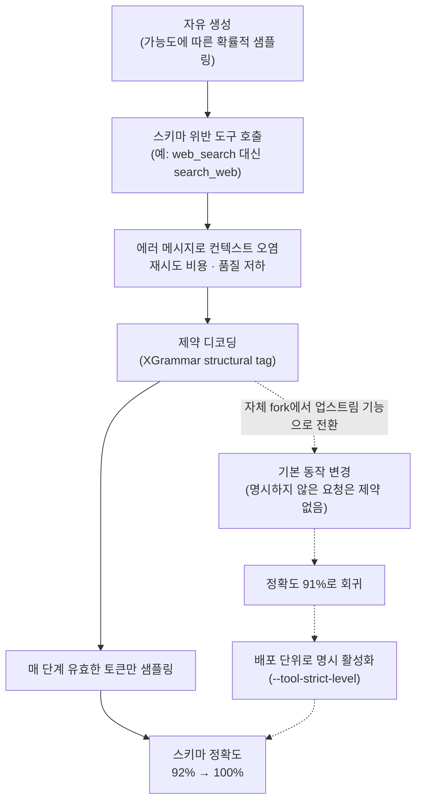
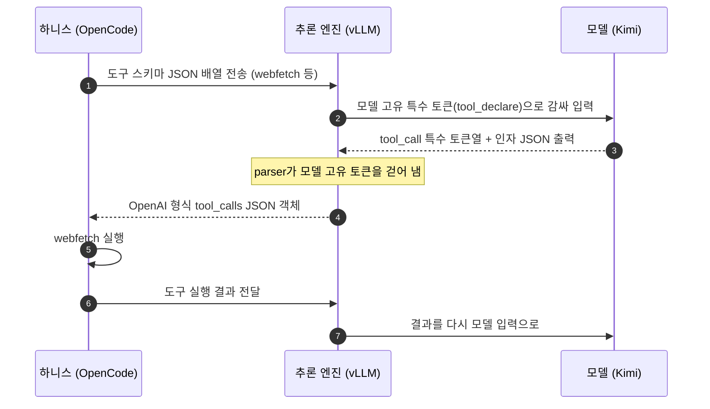

<figure class="post-figure post-figure--header">
<svg role="img" aria-label="왼쪽의 같은 open-weight 모델에서 두 갈래 서빙 길이 갈라진다. 위쪽 길은 제약 없이 자유 생성되어 도구 호출 묶음 몇 개가 깨진 채 도착하고 92%로 표시된다. 아래쪽 길은 스키마 모양의 틀(제약 디코딩)을 통과해 모든 도구 호출이 온전히 도착하고 100%로 표시된다. 왼쪽 아래에는 '품질은 모델만의 것이 아니다'라는 문구가 있다." viewBox="0 0 640 300">
  <title>같은 모델, 두 갈래 서빙 길: 92%와 100%</title>

  <!-- SAME MODEL (source) -->
  <rect x="20" y="116" width="128" height="68" rx="4" fill="none" stroke="currentColor" stroke-width="2.5"/>
  <g fill="currentColor" opacity="0.35">
    <rect x="28" y="122" width="6" height="6"/>
    <rect x="37" y="122" width="6" height="6"/>
    <rect x="46" y="122" width="6" height="6"/>
  </g>
  <text x="84" y="152" text-anchor="middle" font-family="var(--font-body)" font-size="13.5" font-weight="700" fill="currentColor">open-weight 모델</text>
  <text x="84" y="172" text-anchor="middle" font-family="var(--font-body)" font-size="11" fill="currentColor" opacity="0.75">같은 가중치</text>

  <!-- FORK -->
  <path d="M148 150 Q178 150 190 118 Q200 84 230 84 H520" fill="none" stroke="var(--accent-color)" stroke-width="3" stroke-linecap="round" stroke-dasharray="10 6"/>
  <path d="M148 150 Q178 150 190 182 Q200 216 230 216 H520" fill="none" stroke="var(--primary-color)" stroke-width="3" stroke-linecap="round"/>

  <!-- TOP PATH: free generation -->
  <text x="232" y="56" font-family="var(--font-body)" font-size="13" font-weight="700" fill="var(--accent-color)">제약 없이 자유 생성</text>
  <text x="372" y="56" font-family="var(--font-body)" font-size="11" fill="currentColor" opacity="0.75">확률적 샘플링, 사후에야 확인</text>
  <!-- intact packets -->
  <g font-family="var(--font-mono)" font-size="11" text-anchor="middle">
    <rect x="240" y="73" width="36" height="22" rx="2" fill="var(--bg-panel)" stroke="currentColor" stroke-width="2"/>
    <text x="258" y="88" fill="currentColor">{ }</text>
    <rect x="356" y="73" width="36" height="22" rx="2" fill="var(--bg-panel)" stroke="currentColor" stroke-width="2"/>
    <text x="374" y="88" fill="currentColor">{ }</text>
    <rect x="470" y="73" width="36" height="22" rx="2" fill="var(--bg-panel)" stroke="currentColor" stroke-width="2"/>
    <text x="488" y="88" fill="currentColor">{ }</text>
  </g>
  <!-- broken packets (schema-violating calls) -->
  <g fill="var(--bg-panel)" stroke="var(--accent-color)" stroke-width="2" stroke-linejoin="round">
    <path d="M298 73 H312 L308 80 L314 87 L310 95 H298 Z"/>
    <path d="M318 71 H334 V93 H322 L326 85 L320 78 Z" transform="rotate(8 326 82)"/>
    <path d="M412 73 H426 L422 80 L428 87 L424 95 H412 Z"/>
    <path d="M432 71 H448 V93 H436 L440 85 L434 78 Z" transform="rotate(-8 440 82)"/>
  </g>
  <g stroke="var(--accent-color)" stroke-width="2.5" stroke-linecap="round">
    <path d="M318 104 l8 8 M326 104 l-8 8"/>
    <path d="M432 104 l8 8 M440 104 l-8 8"/>
  </g>
  <!-- arrival: 92% -->
  <text x="580" y="96" text-anchor="middle" font-family="var(--font-body)" font-size="30" font-weight="800" fill="var(--accent-color)">92%</text>
  <text x="580" y="118" text-anchor="middle" font-family="var(--font-body)" font-size="10.5" fill="currentColor" opacity="0.8">깨진 호출이 섞여 도착</text>

  <!-- BOTTOM PATH: schema-shaped gate (constrained decoding) -->
  <g stroke="var(--primary-color)" stroke-width="3" fill="var(--bg-panel)">
    <path d="M290 186 H306 V206 H300 V226 H306 V246 H290 Z"/>
    <path d="M350 186 H334 V206 H340 V226 H334 V246 H350 Z"/>
  </g>
  <rect x="306" y="206" width="28" height="20" fill="none" stroke="var(--primary-color)" stroke-width="1.5" stroke-dasharray="3 3"/>
  <text x="320" y="266" text-anchor="middle" font-family="var(--font-body)" font-size="12" font-weight="700" fill="var(--primary-color)">스키마 모양의 틀</text>
  <text x="320" y="282" text-anchor="middle" font-family="var(--font-body)" font-size="10.5" fill="currentColor" opacity="0.75">제약 디코딩</text>
  <!-- raw packet before the gate -->
  <g font-family="var(--font-mono)" font-size="11" text-anchor="middle">
    <rect x="238" y="205" width="36" height="22" rx="2" fill="var(--bg-panel)" stroke="currentColor" stroke-width="2" stroke-dasharray="4 3"/>
    <text x="256" y="220" fill="currentColor" opacity="0.8">{ ?</text>
  </g>
  <!-- intact packets after the gate -->
  <g font-family="var(--font-mono)" font-size="11" text-anchor="middle">
    <rect x="370" y="205" width="36" height="22" rx="2" fill="var(--bg-panel)" stroke="var(--primary-color)" stroke-width="2.5"/>
    <text x="388" y="220" fill="var(--primary-color)">{ }</text>
    <rect x="420" y="205" width="36" height="22" rx="2" fill="var(--bg-panel)" stroke="var(--primary-color)" stroke-width="2.5"/>
    <text x="438" y="220" fill="var(--primary-color)">{ }</text>
    <rect x="470" y="205" width="36" height="22" rx="2" fill="var(--bg-panel)" stroke="var(--primary-color)" stroke-width="2.5"/>
    <text x="488" y="220" fill="var(--primary-color)">{ }</text>
  </g>
  <!-- arrival: 100% -->
  <text x="580" y="226" text-anchor="middle" font-family="var(--font-body)" font-size="30" font-weight="800" fill="var(--primary-color)">100%</text>
  <text x="580" y="248" text-anchor="middle" font-family="var(--font-body)" font-size="10.5" fill="currentColor" opacity="0.8">모든 호출이 스키마 준수</text>

  <!-- tagline -->
  <text x="84" y="232" text-anchor="middle" font-family="var(--font-body)" font-size="12" font-weight="700" fill="currentColor">품질은</text>
  <text x="84" y="250" text-anchor="middle" font-family="var(--font-body)" font-size="12" font-weight="700" fill="currentColor">모델만의 것이</text>
  <text x="84" y="268" text-anchor="middle" font-family="var(--font-body)" font-size="12" font-weight="700" fill="currentColor">아니다</text>
</svg>
<figcaption>같은 open-weight 모델도 서빙 엔진이 제약 디코딩을 켜느냐에 따라 도구 호출 스키마 정확도가 92%와 100%로 갈린다.</figcaption>
</figure>

## 원문 정보

> - **제목**: Fixing Tool-Call Accuracy in vLLM
> - **출처**: Jesse Donkervliet, Junhao Li (Senior Software Engineers) / Ubicloud Blog ([ubicloud.com](https://www.ubicloud.com/blog))
> - **발행**: 2026-10-20 · 약 8분 분량
> - **원문 링크**: <https://www.ubicloud.com/blog/fixing-tool-call-accuracy-in-vllm>
> - **참고한 커뮤니티 토론**: Hacker News — <https://news.ycombinator.com/item?id=50242870> (GeekNews 소개: <https://news.hada.io/topic?id=36103>)

오픈소스 클라우드 사업자 Ubicloud가 Kimi·DeepSeek 같은 open-weight 모델을 직접 서빙하면서 겪은 도구 호출(tool call) 품질 문제와 그 해결기다. 에이전트를 "만들고 운영하는" 쪽, 그중에서도 **모델 아래의 추론 엔진 층**을 다루는 글이라 Articles에 담는다.

> **읽은 범위 메모**: Ubicloud 원문은 본문 전체를 읽었다(본문 중 XGrammar 논문에서 가져온 토큰 마스킹 그림은 이미지라 내용을 확인하지 못했다). GeekNews 페이지(<https://news.hada.io/topic?id=36103>)는 직접 불러올 수 없었다(HTTP 403). 그래서 아래 "커뮤니티 반응"은 GeekNews가 정리한 원 [Hacker News 토론](https://news.ycombinator.com/item?id=50242870)의 댓글 71개를 HN 공개 API로 직접 읽고 정리했다.

## 한 줄 요약 (TL;DR)

vLLM 0.28로 Kimi K2.6을 서빙했을 때 도구 호출의 **스키마 정확도는 92%**(25번 중 2번 실패)였다. 생성 단계마다 스키마를 어기는 토큰을 막는 **제약 디코딩(constrained decoding)**을 켜자 Moonshot AI의 K2VV ToolCall 벤치마크에서 **100%**가 나왔다. 다만 vLLM은 범용 엔진이라 이 기능을 기본으로 꺼 두므로, **모델 품질은 모델만이 아니라 추론 엔진과 그 설정이 함께 결정한다**.

### 한눈에 보기

원문의 인과 사슬을 한 장으로 줄이면 다음과 같다. 점선 가지는 업스트림 전환 뒤의 회귀와 복구다.



## 왜 이 글을 골랐나

이 위키는 에이전트 **하니스**를 여러 번 다뤘다. [Codex agent loop](/2026/06/25/codex-agent-loop.html)는 도구 호출과 그 결과가 매 턴 컨텍스트에 쌓이는 구조를, [무엇이 하니스를 하니스로 만드는가](/2026/08/03/what-makes-a-harness-a-harness.html)는 하니스의 정의를 다뤘다. 그런데 하니스가 아무리 좋아도 모델이 내놓은 도구 호출이 **형식부터 깨져 있으면** 루프는 시작도 못 한다. 이 글은 그 책임이 모델과 하니스 사이, 곧 **서빙 엔진**에도 있다는 점을 실측 수치로 보여 준다.

또 [JEV Essential 1단계 — 구조화 출력과 제약 디코딩](/2026/09/21/jev-structured-output-and-constrained-decoding.html)에서 원리로 다룬 grammar-constrained decoding이 실제 프로덕션 서빙에서 **어떤 버전·플래그·기본값 문제**로 나타나는지 볼 수 있는 좋은 현장 사례이기도 하다.

## 핵심 내용

### 도입: 벤치마크만큼 나오지 않는 open-weight 모델

원문은 "open-weight 모델을 쓰면 품질 벤치마크가 말하는 것과 전혀 다른 결과가 나온다"는, 요즘 AI 모델을 다루는 개발자의 말로 시작한다. 저자들의 주장은 이렇다.

- 도구 호출이 부정확하면 모델은 **엉터리 컨텍스트 위에 계속 쌓아 올린다.** 멀티턴 세션이 흔한 agentic 워크로드에서 특히 결과 품질이 떨어진다.
- 많은 provider와 널리 쓰이는 추론 엔진이 도구 호출 정확도 테스트를 완전히 통과하지 못한다. Ubicloud가 **vLLM 0.28로 Kimi K2.6**을 서빙했을 때 기대한 스키마대로 나온 호출은 **92%**였다.
- vLLM이 최근 **제약 디코딩**을 지원하기 시작했고, 이것이 **vLLM 0.31에서 서버 측 플래그**로 공개되었다. 켜면 최신 Kimi·DeepSeek 모델에서 **100% 스키마 정확도**를 얻을 수 있다.

### 도구 호출 스키마란 무엇인가

LLM이 외부 도구를 부르게 하려면 두 단계가 필요하다. (1) 어떤 도구가 있는지 모델에게 알리고, (2) 구조화된 도구 호출을 출력하는 방법을 알려 준다. 원문은 OpenCode를 Kimi에 연결한 예로 설명한다. OpenCode는 사용 가능한 도구를 JSON 배열로 보내는데, 그중 하나가 웹 페이지를 가져오는 `webfetch`다(원문 발췌, 설명문 일부 생략).

```json
{
  "type": "function",
  "function": {
    "name": "webfetch",
    "parameters": {
      "type": "object",
      "properties": {
        "url":     { "type": "string" },
        "format":  { "type": "string", "enum": ["text", "markdown", "html"], "default": "markdown" },
        "timeout": { "type": "number" }
      },
      "required": ["url"]
    }
  }
}
```

파라미터, 타입, 필수 여부를 담은 이 JSON이 도구의 **스키마**다. 하니스가 모델의 도구 호출을 실행하려면 호출이 이 스키마 규칙을 따라야 한다.

이후 왕복 과정은 다음과 같다.

1. 추론 엔진이 이 JSON을 **모델 고유의 특수 토큰**으로 감싸 모델에 넣는다. 모델이 학습 때 본 도구 선언 형식과 맞추기 위해서다. Kimi의 경우 대략 `<|im_system|>tool_declare<|im_middle|>[...]<|im_end|>` 형태다.
2. 사용자가 페이지를 가져와 달라고 하면 모델은 이런 토큰을 출력할 수 있다.

   ```text
   I'll fetch that page. <|tool_calls_section_begin|><|tool_call_begin|>functions.webfetch:0<|tool_call_argument_begin|>{"url": "https://ubicloud.com", "format": "markdown"}<|tool_call_end|><|tool_calls_section_end|>
   ```

3. 추론 서버의 **parser**가 모델 고유 토큰을 걷어 내고 OpenAI 형식의 `tool_calls` JSON 객체로 바꾼다.
4. 하니스(OpenCode)가 `webfetch`를 실행하고 결과를 다시 모델에 보낸다.



### 스키마 정확도가 중요한 이유

가장 단순한 방법은 모델이 도구 호출을 자유롭게 생성하게 두고, 모델이 문법에 맞는 산문을 쓰리라 믿듯 학습이 충분하리라 믿는 것이다. 현대 모델은 구조화된 패턴을 잘 따르므로 이 방법은 **대부분** 통한다. 그러나 "대부분"이라는 말은 적지 않은 호출이 실패한다는 뜻이고, 그 결과는 다음과 같다.

- 에러 메시지로 인한 **컨텍스트 윈도 오염**
- **모델 성능 저하**
- 에이전트가 호출을 한 번 이상 **재시도**하면서 늘어나는 **비용**

이를 막으려고 Moonshot AI는 **K2VV ToolCall** 벤치마크를 공개했다. provider가 Kimi를 원본과 같은 품질(기본적으로 유효한 도구 호출만 생성하는 동작 포함)로 서빙하는지 검증하는 도구다.

- 워크로드는 **2,000개 요청**이다. 모델이 *언제* 도구 호출을 하는지, 생성된 호출이 *문법적으로 올바른지*(스키마 준수)를 평가하도록 골랐다.
- 지표는 두 가지다. **Trigger similarity**는 언제 도구 호출을 결정하는지가 Moonshot AI 자체 서비스와 얼마나 비슷한지를 본다. **Schema accuracy**는 스키마를 지켜서 실제로 호출할 수 있는 도구 호출의 비율이다(50%라면 절반이 형식 오류).

스키마 정확도가 모자란 근본 원인은 **언어 모델의 확률적 성질**이다. 모델은 가능도에 따라 토큰을 고를 뿐 컴파일러나 타입 체커를 돌리지 않는다. 예를 들어 모델은 여러 도구 호출 데이터셋으로 학습되었기 때문에, 학습 때 본 이름을 지금 환경에 없는데도 낼 수 있다. 사용 가능한 도구가 `web_search`인데 `search_web`을 부르거나, 스키마가 `location`을 기대하는데 `city_name`을 쓰는 식이다.

### 제약 디코딩: "검증"에서 "유도"로

LLM은 토큰마다 다음 토큰일 확률을 계산하고 가중 샘플링으로 다음 토큰을 고른다. 제약 디코딩은 **문법적으로 잘못된 도구 호출로 이어질 토큰을 샘플링하지 못하게 막는다.** 자유롭게 생성한 뒤 사후 검증하는 대신, 추론 엔진이 한 단계씩 생성을 유도하고 매 단계 **유효한 토큰만 허용**한다.

허용 토큰은 도구 스키마가 결정한다. vLLM은 이를 **XGrammar** 라이브러리의 **structural tag**로 구현한다. 원문이 보여 준 Kimi K2.6용 정의 발췌는 다음과 같다.

```python
# Kimi K2.6 tool call syntax:
# <|tool_call_begin|>{function.name}:{index}
# <|tool_call_argument_begin|>{arguments}
# <|tool_call_end|>
TagFormat(
    begin=f"{TOOL_CALL_BEGIN_PREFIX}{name}{TOOL_CALL_SUFFIX}",
    content=SequenceFormat(
        elements=[
            RegexFormat(pattern=r"\d+"),
            ConstStringFormat(value=TOOL_CALL_ARGUMENT_BEGIN),
            JSONSchemaFormat(
                json_schema=parameters,
                any_order=any_order,
                max_whitespace_cnt=max_whitespace_cnt,
            ),
        ]
    ),
    end=TOOL_CALL_END,
)
```

이 정의가 있으면 생성은 다음 경로만 따를 수 있다.

> 도구 호출 시작 → 도구 이름 → 도구 호출 인덱스 → 인자 시작 → 스키마로 제약된 JSON → 도구 호출 끝

잘못된 경로는 생성 중에 차단된다. 예컨대 인덱스 단계에 이르면 엔진은 **정수 토큰만** 샘플링하도록 나머지를 마스킹한다. 원문의 표현으로는 이로써 스키마 정확도가 "best-effort"에서 **런타임 보장**으로 바뀐다. 모델은 여전히 어떤 토큰을 낼지 스스로 정하지만, 그 선택지가 문법적으로 올바른 집합으로 좁혀진다.

성능 비용에 대해 원문은 **무시할 만한 수준**이라고 말한다. XGrammar가 단계별 토큰 마스크를 **미리 계산**해 두고 생성 중에 GPU에서 효율적으로 적용하기 때문이라는 설명이다(구체적인 오버헤드 수치는 제시하지 않는다).

<figure class="post-figure">
<svg role="img" aria-label="XGrammar structural tag가 허용하는 생성 경로를 여섯 단계의 상태 기계로 그린 그림. 도구 호출 시작, 도구 이름, 인덱스, 인자 시작, 스키마로 제약된 JSON, 도구 호출 끝이 한 줄로 이어지고 그 밖의 경로는 차단된다. 인덱스 단계를 확대하면 다음 토큰 후보 중 정수 토큰만 통과하고 나머지 후보는 마스킹되며, 모델은 남은 후보 중에서 스스로 고른다." viewBox="0 0 640 360">
  <title>structural tag의 상태 경로와 인덱스 단계의 토큰 마스킹</title>

  <text x="320" y="24" text-anchor="middle" font-family="var(--font-body)" font-size="13.5" font-weight="700" fill="currentColor">structural tag가 허용하는 유일한 경로</text>

  <!-- STATE CHAIN -->
  <g font-family="var(--font-body)" font-size="11.5" font-weight="700" text-anchor="middle" fill="currentColor">
    <rect x="14" y="40" width="88" height="50" rx="6" fill="none" stroke="currentColor" stroke-width="2"/>
    <text x="58" y="61">도구 호출</text><text x="58" y="77">시작</text>
    <rect x="117" y="40" width="88" height="50" rx="6" fill="none" stroke="currentColor" stroke-width="2"/>
    <text x="161" y="69">도구 이름</text>
    <rect x="220" y="40" width="88" height="50" rx="6" fill="none" stroke="var(--gold)" stroke-width="3.5"/>
    <text x="264" y="69" fill="var(--primary-color)">인덱스</text>
    <rect x="323" y="40" width="88" height="50" rx="6" fill="none" stroke="currentColor" stroke-width="2"/>
    <text x="367" y="61">인자</text><text x="367" y="77">시작</text>
    <rect x="426" y="40" width="88" height="50" rx="6" fill="none" stroke="currentColor" stroke-width="2"/>
    <text x="470" y="61">스키마 제약</text><text x="470" y="77">JSON</text>
    <rect x="529" y="40" width="88" height="50" rx="6" fill="none" stroke="currentColor" stroke-width="2"/>
    <text x="573" y="61">도구 호출</text><text x="573" y="77">끝</text>
  </g>
  <g stroke="currentColor" stroke-width="2" fill="none">
    <path d="M103 65 H115 M110 60 l5 5 l-5 5"/>
    <path d="M206 65 H218 M213 60 l5 5 l-5 5"/>
    <path d="M309 65 H321 M316 60 l5 5 l-5 5"/>
    <path d="M412 65 H424 M419 60 l5 5 l-5 5"/>
    <path d="M515 65 H527 M522 60 l5 5 l-5 5"/>
  </g>
  <!-- XGrammar element hints -->
  <g font-family="var(--font-mono)" font-size="9" text-anchor="middle" fill="currentColor" opacity="0.7">
    <text x="58" y="104">begin</text>
    <text x="161" y="104">name</text>
    <text x="264" y="104">Regex \d+</text>
    <text x="367" y="104">ConstString</text>
    <text x="470" y="104">JSONSchema</text>
    <text x="573" y="104">end</text>
  </g>
  <!-- blocked detours -->
  <g stroke="var(--accent-color)" stroke-width="2" fill="none" stroke-dasharray="4 4" opacity="0.85">
    <path d="M412 112 Q440 128 470 128"/>
  </g>
  <g stroke="var(--accent-color)" stroke-width="2.5" stroke-linecap="round">
    <path d="M472 123 l9 9 M481 123 l-9 9"/>
  </g>
  <text x="490" y="132" font-family="var(--font-body)" font-size="10.5" fill="var(--accent-color)">잘못된 경로는 생성 중 차단</text>

  <!-- ZOOM connectors -->
  <g stroke="var(--gold)" stroke-width="1.5" stroke-dasharray="3 4" fill="none">
    <path d="M220 90 L120 150"/>
    <path d="M308 90 L520 150"/>
  </g>

  <!-- ZOOM PANEL -->
  <rect x="120" y="150" width="400" height="196" rx="6" fill="none" stroke="var(--gold)" stroke-width="2"/>
  <text x="320" y="174" text-anchor="middle" font-family="var(--font-body)" font-size="12" font-weight="700" fill="currentColor">확대: 인덱스 단계의 다음 토큰 후보 (예시)</text>

  <!-- candidate chips: allowed -->
  <g font-family="var(--font-mono)" font-size="13" text-anchor="middle">
    <rect x="145" y="190" width="50" height="30" rx="3" fill="none" stroke="var(--primary-color)" stroke-width="2.5"/>
    <text x="170" y="210" fill="var(--primary-color)" font-weight="700">0</text>
    <rect x="205" y="190" width="50" height="30" rx="3" fill="none" stroke="var(--primary-color)" stroke-width="2.5"/>
    <text x="230" y="210" fill="var(--primary-color)" font-weight="700">1</text>
    <rect x="265" y="190" width="50" height="30" rx="3" fill="none" stroke="var(--primary-color)" stroke-width="2.5"/>
    <text x="290" y="210" fill="var(--primary-color)" font-weight="700">2</text>
  </g>
  <!-- candidate chips: masked -->
  <g font-family="var(--font-mono)" font-size="13" text-anchor="middle" opacity="0.5">
    <rect x="325" y="190" width="50" height="30" rx="3" fill="none" stroke="currentColor" stroke-width="1.5" stroke-dasharray="3 3"/>
    <text x="350" y="210" fill="currentColor">abc</text>
    <rect x="385" y="190" width="50" height="30" rx="3" fill="none" stroke="currentColor" stroke-width="1.5" stroke-dasharray="3 3"/>
    <text x="410" y="210" fill="currentColor">url</text>
    <rect x="445" y="190" width="50" height="30" rx="3" fill="none" stroke="currentColor" stroke-width="1.5" stroke-dasharray="3 3"/>
    <text x="470" y="210" fill="currentColor">}</text>
  </g>
  <g stroke="var(--accent-color)" stroke-width="2.5" stroke-linecap="round">
    <path d="M330 194 L370 216"/>
    <path d="M390 194 L430 216"/>
    <path d="M450 194 L490 216"/>
  </g>

  <!-- mask bar -->
  <g font-family="var(--font-body)" font-size="10.5" text-anchor="middle">
    <rect x="145" y="230" width="170" height="16" rx="2" fill="var(--primary-color)" opacity="0.18"/>
    <text x="230" y="242" fill="currentColor">통과 (정수)</text>
    <rect x="325" y="230" width="170" height="16" rx="2" fill="var(--accent-color)" opacity="0.18"/>
    <text x="410" y="242" fill="currentColor">마스킹</text>
  </g>

  <!-- arrow to sampling -->
  <path d="M230 250 V268" stroke="var(--primary-color)" stroke-width="2" fill="none"/>
  <path d="M225 263 l5 5 l5 -5" stroke="var(--primary-color)" stroke-width="2" fill="none"/>
  <rect x="160" y="272" width="140" height="26" rx="4" fill="none" stroke="var(--primary-color)" stroke-width="2"/>
  <text x="230" y="290" text-anchor="middle" font-family="var(--font-body)" font-size="11.5" font-weight="700" fill="var(--primary-color)">모델이 이 중에서 고름</text>
  <text x="408" y="282" text-anchor="middle" font-family="var(--font-body)" font-size="10.5" fill="currentColor" opacity="0.8">선택은 여전히 모델의 몫,</text>
  <text x="408" y="297" text-anchor="middle" font-family="var(--font-body)" font-size="10.5" fill="currentColor" opacity="0.8">선택지만 문법에 맞게 좁혀진다</text>

  <text x="320" y="330" text-anchor="middle" font-family="var(--font-body)" font-size="10.5" fill="currentColor" opacity="0.75">마스크는 XGrammar가 미리 계산해 생성 중 GPU에서 적용한다</text>
</svg>
<figcaption>structural tag는 생성을 여섯 단계의 한 경로로 묶는다. 인덱스 단계에서는 정수 토큰만 남기고 나머지 후보를 마스킹한다(후보 토큰은 설명용 예시).</figcaption>
</figure>

### 제약 디코딩 동작의 차이: 왜 다시 91%로 떨어졌나

이 글에서 가장 실무적인 부분이다.

- Moonshot AI는 제약 디코딩을 켜 두라고 권장하며, 자사 API도 그렇게 동작한다.
- 그래서 Ubicloud는 처음에 **자체 vLLM fork**에 제약 디코딩을 넣었다. vLLM이 **v0.25**에서 이 기능을 추가하자 Kimi·DeepSeek에 대해 업스트림 기능으로 갈아탔다.
- 얼마 지나지 않아 도구 호출 정확도가 **다시 91%로 떨어졌다.**

분석해 보니 vLLM의 제약 디코딩 구현은 여전히 정확했다. 바뀐 것은 **제약 디코딩을 명시적으로 켜지 않은 요청에 대한 기본 동작**이었다. vLLM은 아주 많은 모델을 지원하도록 설계되었는데, 제약 디코딩 지원은 **모델마다 따로 해야 하는 일**이고 문제는 세 갈래로 나뉜다.

| 문제 유형 | 원문의 설명 |
| --- | --- |
| **모델 자체의 문제** | 어떤 모델은 제약 없는 출력이 도구 스키마나 그 모델의 도구 호출 형식과 크게 다르다. 제약은 모델이 원래 고르지 않았을 토큰을 고르게 만들어 생성을 엉뚱한 방향으로 끌고 간다. gpt-oss-20b, Qwen 3.6, GLM 5.1 사용자들이 이 기능이 기본으로 켜진 뒤 문제를 보고했다. |
| **문법 변환 버그** | vLLM이 모델의 도구 스키마나 호출 형식을 모델별 문법으로 옮기는 과정에 버그가 있을 수 있다. 잘못된 도구 호출, 요청 실패, 제약 디코딩이 조용히 빠지는 현상, 정확도 하락으로 이어진다. |
| **기능 간 상호작용 버그** | 제약 디코딩과 다른 서빙 엔진 기능이 엮이며 생기는 버그. 예컨대 speculative decoding과 함께 쓰면 추측 토큰이 문법에 의해 잘못 거부되어 요청이 실패할 수 있다. |

이 때문에 vLLM 메인테이너들은 제약 디코딩을 켠 뒤 여러 모델에서 문제를 봤고, 모델을 가리지 않는 범용 엔진에는 **기본으로 끄는 쪽이 더 안전한 선택**이었다. 이후 vLLM은 배포 단위로 도구 호출 엄격도를 켤 수 있는 **`--tool-strict-level`** 플래그를 추가했다.

Ubicloud는 관점이 다르다. 이들의 목표는 Kimi와 DeepSeek를 **1st-party provider 수준 품질**로 서빙하는 것이다. 그래서 제약 디코딩을 켜고 K2VV ToolCall을 다시 돌렸고, **서빙하는 모든 모델 버전에서 스키마 정확도 100%**를 확인한 뒤 프로덕션에 배포했다.

> 버전 표기에 대한 메모: 원문은 도입부에서 기능이 "vLLM 0.31에서 서버 측 플래그로 공개"되었다고 하고, 뒷부분에서는 "vLLM이 v0.25에서 이 기능을 추가"했다고 한다. 내부 구현이 먼저 들어오고 사용자용 플래그가 나중에 나왔다고 읽히지만, 원문이 이 순서를 명확히 정리하지는 않는다. 회귀 수치도 도입부의 92%와 이 단락의 91%가 서로 다르게 적혀 있다.

### 결론

LLM을 쓸 때 관찰되는 품질은 **모델만으로 정해지지 않는다.** 추론 엔진도 중요한 역할을 하며, 엔진이나 그 설정을 바꾸면 모델의 출력 품질도 바뀐다. Ubicloud는 Kimi K2.6과 DeepSeek V4 Flash를 서빙하며 도구 호출 스키마 오류로 눈에 띄는 품질 저하를 겪었고, 먼저 자체 vLLM fork로, 이후 vLLM의 새 제약 디코딩 기능을 켜는 방식으로 이를 해결해 K2VV ToolCall 정확도를 **92%에서 100%로** 올렸다.

## 분석과 인사이트

여기부터는 원문 요약이 아니라 내 해석이다. 커뮤니티 의견은 별도 소단락에 따로 모았다.

### 1. "모델 품질"이라는 말에는 서빙 스택이 들어 있다

이 글의 가장 큰 기여는 기술 그 자체보다 **책임 소재를 다시 그은 것**이다. 우리는 흔히 "Kimi가 도구 호출을 잘 못한다"고 말하지만, 같은 가중치라도 어떤 엔진, 어떤 버전, 어떤 플래그로 서빙하느냐에 따라 결과가 92%와 100%로 갈린다. open-weight 모델을 여러 provider에서 골라 쓰는 시대에 벤치마크 점수는 "그 모델"이 아니라 **"그 모델 × 그 서빙 구성"**의 점수다. Moonshot AI가 K2VV라는 **provider 검증용 벤치마크**를 따로 낸 것 자체가, 모델 제작사도 이 간극을 품질 리스크로 본다는 신호다.

### 2. 같은 기능, 반대의 기본값 — 둘 다 합리적이다

vLLM은 끄고 Ubicloud는 켰다. 누가 옳은가가 아니라 **최적화 대상이 다르다.** 수백 개 모델을 지원하는 범용 엔진에게 제약 디코딩은 "일부 모델에서만 검증된 기능"이고, 특정 모델 몇 개에 집중하는 provider에게는 "모델 제작사가 권장하는 정상 동작"이다. 범용 도구의 기본값은 **가장 덜 위험한 값**이지 **내 워크로드에 가장 좋은 값**이 아니다. 실무 교훈은 단순하다. **업그레이드나 fork에서 업스트림으로 옮기는 일은 기본값 변경을 함께 들여오는 일**이고, Ubicloud가 91%로 회귀한 지점이 정확히 거기였다. 구현이 맞아도 기본값이 바뀌면 품질이 떨어진다.

### 3. 형식 보장은 내용 정확성이 아니다

[JEV Essential 1단계](/2026/09/21/jev-structured-output-and-constrained-decoding.html)에서 짚었듯, 제약 디코딩이 보장하는 것은 **스키마를 지킨다**는 것뿐이다. 원문도 K2VV가 *trigger similarity*(언제 호출하느냐)와 *schema accuracy* 두 지표를 본다고 소개하지만, 보고한 숫자는 **schema accuracy 하나**다. 스키마는 맞지만 엉뚱한 URL을 넣은 호출, 불러야 할 때 부르지 않는 경우는 이 100%에 잡히지 않는다. 게다가 원문이 직접 꼽은 첫 번째 문제 유형("제약이 모델이 원래 고르지 않았을 토큰을 고르게 만들어 생성을 엉뚱한 방향으로 끌고 간다")은 바로 이 위험이다. **형식은 오르는데 내용은 나빠질 수 있다.** 그래서 이 글의 결과는 "Kimi·DeepSeek처럼 제작사가 제약 디코딩을 권장하고 그 형식으로 학습된 모델에서는 이득"이라고 좁혀 읽는 편이 정확하다.

### 4. 92%는 생각보다 나쁜 숫자다 (단, 계산을 조심해서)

도구 호출 하나의 성공률이 92%라면, 단순 독립 가정에서 10번 연속 성공할 확률은 0.92¹⁰ ≈ 43%, 50번이면 약 1.5%다(내 계산). 다만 실제 하니스는 실패하면 에러를 돌려주고 재시도하므로 "작업 실패율"로 곧장 옮기면 과장이다. 원문이 강조하는 실제 비용은 **재시도 토큰, 컨텍스트에 남는 에러 메시지, 그 오염 위에서 이어지는 추론의 질 저하**이고, 이쪽이 더 정확한 피해 모델이다. [Codex agent loop](/2026/06/25/codex-agent-loop.html)에서 본 것처럼 에이전트 루프는 매 턴 전체 대화를 다시 보내므로, 실패한 호출과 에러는 **이후 모든 턴의 입력 비용**으로도 남는다.

### 5. 원문을 읽을 때의 유보

- **provider의 글이다.** Ubicloud는 자사 서빙 품질을 알리는 입장이며, 측정도 K2VV ToolCall 하나에 의존한다. 실제 에이전트 과제 성공률 같은 하위 지표는 제시하지 않는다.
- **"오버헤드는 무시할 만하다"에 수치가 없다.** XGrammar 설계에 근거한 주장으로 읽는 것이 맞다.
- **버전 이야기가 조금 엉켜 있다.** 0.25·0.28·0.31의 관계와 92%/91% 수치가 본문에서 매끄럽게 정리되지 않으니, 실제 적용 전에는 쓰는 vLLM 버전의 문서와 릴리스 노트를 직접 확인해야 한다.

### 커뮤니티 반응 (Hacker News 토론)

GeekNews 토픽([news.hada.io/topic?id=36103](https://news.hada.io/topic?id=36103))은 이 글의 [Hacker News 토론](https://news.ycombinator.com/item?id=50242870)을 정리한 것이다. GeekNews 페이지는 직접 불러올 수 없어서(HTTP 403), 아래 내용은 HN 공개 API로 받은 원 토론의 댓글 71개를 직접 읽고 정리했다. 모두 **원문 기사의 주장이 아니라 HN 댓글 작성자들의 의견**이며, 짧게 의역했다.

- **"vLLM을 고친 것인가, 설정한 것인가"**: Aurornis는 제약 디코딩과 제약된 도구 호출 디코딩이 vLLM에 오래전부터 있었기 때문에, 제목만 보면 vLLM을 고친 것처럼 읽히지만 실제로는 "설정을 제대로 하면 되는 문제"였다고 지적했다. 그러면서도 진짜 문제는 vLLM의 도구 호출 설정 방식이 시간에 따라 바뀌며 동작이 달라진 데 있었고, 회귀를 잡아낼 벤치마크를 갖춘 Ubicloud 팀은 칭찬받을 만하며, OpenRouter의 일부 provider는 이 정도로 신경 쓰지 않는다고 덧붙였다. enoch2090은 제목이 "in vLLM"이 아니라 "with vLLM"이었어야 한다고 했다. 이에 공저자 jesdo는 Kimi를 올바르게 동작시키려면 **설정만으로는 불가능했고 코드 수정이 필요했다**고 반박했다. 이후 vLLM 팀이 업스트림에서 고쳤으므로, 지금은 최신 vLLM에서 **`--tool-strict-level`을 `parameter`로 설정**하면 해결된다고 한다. jacquesm은 vLLM이 잘 튜닝하면 훌륭하지만 "깨지기 쉽고 지나치게 복잡하다"고 평했다.
- **제약 디코딩은 분포를 바꾼다, 재시도와 비교해야 한다**: 가장 깊은 논쟁이다. hansvm은 원문이 모델 품질에 미치는 실제 영향은 공개하지 않았다고 아쉬워했다. 스키마 제약 디코딩은 출력 분포를 바꾸므로, 컨텍스트를 오염시키지 않으면서 역시 100%를 얻는 **"되감고 재시도"** 방식과 비교해야 한다는 것이다. 그는 23/25 성공률이면 도구 호출 시도 자체의 토큰이 약 9% 늘 뿐이라고 계산했다. 이어진 논의에서 hansvm은 스키마 제약은 **토큰 단위 재시도와 같지만 시퀀스 전체 재시도와는 다르다**고 정리했다. 예로 든 것이 긴 JSON 문자열이다. 모델이 문자열에 `...`을 써 버리면 제약 디코딩은 결국 그 깨진 문자열을 닫아야 하므로, 이미 "구석에 몰린" 상태가 된다. 그는 문법이 `[ab, ba]`이고 학습 분포가 `[ab, ab, ba, bb]`인 장난감 모델도 들었다. 재시도는 `{ab: 67%, ba: 33%}`라는 원래 비율을 지키지만 제약 디코딩은 `{ab: 50%, ba: 50%}`로 만든다. Creamsicle47은 강제로 분포 밖 토큰을 고르게 하면 이후 샘플링이 더 높은 엔트로피 분포에서 일어날 수 있다고 보탰다. Aurornis는 JSON 필드 순서가 출력 품질에 영향을 주므로 테스트해야 한다고 했고, XGrammar에는 필드 순서를 자유롭게 허용하는 옵션이 있지만 vLLM이 그것을 노출하는지는 모른다고 했다.
- **공저자의 답 — "1st-party와 같은 동작"이 목표였다**: jesdo는 이 질문에 관심이 있어 후속 글에서 다룰 수도 있다고 답했다. 그는 (1) 모델+서빙 스택+하니스의 전체 품질과 (2) 1st-party provider 동작과의 일치도는 서로 다른 관점이고, 이 글은 (2)에 집중했다고 설명했다. Moonshot AI가 제약 디코딩을 기본으로 켜라고 권장하며 실제로 그렇게 서빙한다는 점이 전체 성능에 도움이 된다는 함의라고 보지만, 수치는 없다고 인정했다. 제약 디코딩이 모델 품질을 해칠 수 있다는 연구도 있으며 그 효과는 모델 등 여러 요인에 달려 있다고 했고, OpenAI Responses API도 제약 디코딩을 기본으로 켜는 등 업계 흐름은 제약 쪽으로 가고 있다고 봤다. Qwen 3.8에서도 되느냐는 roger_의 질문에는 vLLM에 지원은 있는 것 같지만, Kimi와 달리 개발사가 켜라고 명확히 권장하지는 않으므로 켠 경우와 끈 경우의 전체 품질을 직접 비교해 보라고 답했다.
- **연쇄 호출에서는 작은 실패율도 크다**: bob1029는 원문의 92%를 인용하며, 호출당 95%라도 순차로 50번 호출해야 하는 작업에서 오류가 없을 확률은 약 8%뿐이라고 계산했다. 에러 피드백으로 회복할 길은 있지만, 에이전트가 계속 잘못된 도구와 인자를 쓴다면 시스템이 제대로 돌지 않는다고 했다. draxen은 프롬프트당 약 300번의 도구 호출이 필요해 2024년부터 OpenAI·Anthropic만 써 왔다며, 그 회사들의 해자가 제약 디코딩에 기반한 100% 도구 호출 정확도와 prompt caching이었다고 주장했다(본인 주장이며 검증된 사실은 아니다).
- **도구 목록은 고정되어 있지 않다**: vLLM의 해당 기능 작업에 참여했다고 밝힌 mmastrac은 도구 호출이 "위험으로 가득하다"고 했다. 모델의 도구가 실행 내내 고정된다는 보장이 없고, 거대한 prefix miss를 피하려고 실행 중에 도구를 추가하는 경우도 있다는 것이다. 그는 완전히 제약된 도구 호출 환경을 선호한다고 했다. xg15는 잘못된 도구 호출과 에러 메시지를 컨텍스트에서 지우는 것이 KV 캐시 재구성 비용을 감수할 만한지 물었고, reactordev는 실제로 도구 호출 에러를 걸러 다른 시스템에 기록하고 에이전트에게는 실패 이유만 남긴 작은 에러 결과를 돌려주는 방식을 쓴다고 답했다.
- **speculative decoding과의 조합**: febed가 DFlash·MTP 같은 가속 기법과 함께 동작하는지, 느려져서 차라리 재시도가 나은 것은 아닌지 묻자, jesdo는 둘은 함께 동작하지만 세심한 통합이 필요하다고 답했다. 잘못 통합하면 버그가 생기고(원문의 세 번째 문제 유형), 성능 오버헤드는 대체로 큰 문제가 아니며, 추측 토큰 중 문법이 허용하지 않는 것은 버려진다는 설명이다.
- **반대 방향의 해법 — 이름을 모델에 맞춰라**: docjay는 이 접근을 "조준경에 맞추려고 총열을 구부리는 것"에 빗댔다. 모델이 `web_search` 대신 `search_web`을 부른다는 원인을 원문이 스스로 짚었으니, 함수 이름을 `search_web`으로 바꾸면 문제가 저절로 풀린다는 것이다.
- **코드에도 쓸 수 있나**: creativeSlumber의 질문에 HanClinto는 형식 문법만 있으면 가능하다며 llama.cpp의 grammar 문서와 C 예제, 직접 해 본 text-to-SQL 실험을 들었다. mmastrac은 가능하지만 추론 엔진 통합이 "매우 어렵다"고 했다. Majromax는 생각보다 덜 유용하다고 봤다. 괄호 불균형처럼 많은 코드 오류는 한참 뒤에야 문법 오류로 드러나는데, 자기회귀 모델은 되돌아가 원래 오류를 고칠 수 없기 때문이다. 반면 도구 호출은 형식·도구 이름·파라미터라는 "어려운" 문법 선택이 앞부분에 몰려 있어 정당화된다고 했다. vonneumannstan과 wolttam은 frontier 모델이 코드 문법 오류를 그렇게 자주 내느냐, 그렇다면 더 큰 문제가 있는 것이라고 회의했다.
- **그 밖에**: `<|...|>` 표기의 정체를 묻는 질문에 jesdo는 모델에게 이것이 **단일 특수 토큰**이며 가독성을 위해 그렇게 렌더링될 뿐이라고 답했다. mmastrac은 사용자가 같은 문자열을 입력해도 여러 일반 토큰으로 쪼개지므로 특수 토큰이 되지 않는다고 설명했다. Muromec은 버그가 있으면 SQL injection처럼 주입될 수도 있다고 경고했다. 그 밖에 sroussey는 Transformers.js에 브라우저 내 구조화 출력·도구 호출용 제약 디코딩이 들어왔다고 알렸고, max-privatevoid는 llama.cpp가 오래전부터 이 기능을 지원해 왔다고 했다.

커뮤니티 반응을 내 식으로 정리하면, 원문의 **"fixing"이라는 프레이밍에는 이견이 있지만(공저자는 코드 수정이 필요했다고 반박), 회귀를 잡아낸 측정 습관은 높이 평가**하는 분위기다. 특히 hansvm이 제기한 "재시도 vs 제약" 논쟁은 위 3번에서 짚은 "형식 보장 ≠ 내용 품질" 문제와 정확히 같은 곳을 가리킨다. 공저자 스스로 "이 글은 1st-party 일치도를 다뤘고 전체 품질은 아직 수치가 없다"고 인정한 만큼, 아직 답이 정해지지 않은 지점이다.

<figure class="post-figure">
<svg role="img" aria-label="재시도와 제약 디코딩의 트레이드오프 비교. 왼쪽 재시도는 자유 생성 후 실패하면 다시 시도하는 방식으로, 토큰 오버헤드(23/25 성공이면 약 9%)가 들고, 에러를 컨텍스트에 남기면 오염되지만 되감고 재시도하면 오염이 없으며, 원래 분포(ab 67%, ba 33%)를 지킨다. 오른쪽 제약 디코딩은 생성 중 마스킹하는 방식으로, 형식 100%를 런타임에 보장하지만 출력 분포가 ab 50%, ba 50%로 바뀌고, 모델별 문법 변환과 기능 상호작용 버그 위험이 있으며, 오버헤드는 무시할 만하다는 것이 원문 주장이다. 가운데에는 '모델이 그 형식으로 학습되었고 제작사가 권장하는가?'라는 판단 축이 있다." viewBox="0 0 640 400">
  <title>재시도 vs 제약 디코딩</title>

  <!-- LEFT: retry -->
  <rect x="16" y="14" width="232" height="330" rx="6" fill="none" stroke="var(--secondary-color)" stroke-width="2"/>
  <text x="32" y="42" font-family="var(--font-body)" font-size="15" font-weight="800" fill="var(--secondary-color)">재시도</text>
  <text x="32" y="60" font-family="var(--font-body)" font-size="10.5" fill="currentColor" opacity="0.75">자유 생성 → 실패하면 다시</text>

  <g font-family="var(--font-body)" fill="currentColor">
    <rect x="32" y="84" width="7" height="7" fill="var(--secondary-color)"/>
    <text x="46" y="92" font-size="12" font-weight="700">토큰 오버헤드</text>
    <text x="46" y="108" font-size="10.5" opacity="0.75">23/25 성공 시 약 9% (hansvm 계산)</text>

    <rect x="32" y="132" width="7" height="7" fill="var(--secondary-color)"/>
    <text x="46" y="140" font-size="12" font-weight="700">에러를 남기면 컨텍스트 오염</text>
    <text x="46" y="156" font-size="10.5" opacity="0.75">되감고 재시도하면 오염 없음</text>

    <rect x="32" y="180" width="7" height="7" fill="var(--secondary-color)"/>
    <text x="46" y="188" font-size="12" font-weight="700">원래 분포를 지킨다</text>
    <text x="46" y="204" font-size="10.5" opacity="0.75">시퀀스 전체를 다시 뽑기 때문</text>
  </g>
  <!-- distribution bar: ab 67 / ba 33 -->
  <g font-family="var(--font-mono)" font-size="10.5" text-anchor="middle">
    <rect x="46" y="222" width="124" height="22" fill="var(--secondary-color)" opacity="0.3"/>
    <rect x="170" y="222" width="62" height="22" fill="none" stroke="var(--secondary-color)" stroke-width="1.5"/>
    <text x="108" y="237" fill="currentColor">ab 67%</text>
    <text x="201" y="237" fill="currentColor">ba 33%</text>
  </g>

  <!-- RIGHT: constrained decoding -->
  <rect x="392" y="14" width="232" height="330" rx="6" fill="none" stroke="var(--primary-color)" stroke-width="2"/>
  <text x="408" y="42" font-family="var(--font-body)" font-size="15" font-weight="800" fill="var(--primary-color)">제약 디코딩</text>
  <text x="408" y="60" font-family="var(--font-body)" font-size="10.5" fill="currentColor" opacity="0.75">생성 중 매 단계 마스킹</text>

  <g font-family="var(--font-body)" fill="currentColor">
    <rect x="408" y="84" width="7" height="7" fill="var(--primary-color)"/>
    <text x="422" y="92" font-size="12" font-weight="700">형식 100% 런타임 보장</text>
    <text x="422" y="108" font-size="10.5" opacity="0.75">유효한 토큰만 샘플링</text>

    <rect x="408" y="132" width="7" height="7" fill="var(--primary-color)"/>
    <text x="422" y="140" font-size="12" font-weight="700">출력 분포가 바뀐다</text>
    <text x="422" y="156" font-size="10.5" opacity="0.75">토큰 단위 재시도와 같은 효과</text>
  </g>
  <!-- distribution bar: ab 50 / ba 50 -->
  <g font-family="var(--font-mono)" font-size="10.5" text-anchor="middle">
    <rect x="422" y="170" width="93" height="22" fill="var(--primary-color)" opacity="0.3"/>
    <rect x="515" y="170" width="93" height="22" fill="none" stroke="var(--primary-color)" stroke-width="1.5"/>
    <text x="468" y="185" fill="currentColor">ab 50%</text>
    <text x="561" y="185" fill="currentColor">ba 50%</text>
  </g>
  <g font-family="var(--font-body)" fill="currentColor">
    <rect x="408" y="216" width="7" height="7" fill="var(--primary-color)"/>
    <text x="422" y="224" font-size="12" font-weight="700">모델별 문법 · 상호작용 버그</text>
    <text x="422" y="240" font-size="10.5" opacity="0.75">예: speculative decoding 조합</text>

    <rect x="408" y="264" width="7" height="7" fill="var(--primary-color)"/>
    <text x="422" y="272" font-size="12" font-weight="700">오버헤드는 무시할 만</text>
    <text x="422" y="288" font-size="10.5" opacity="0.75">원문 주장, 수치는 없음</text>
  </g>

  <!-- CENTER: decision axis -->
  <rect x="260" y="110" width="120" height="124" rx="6" fill="var(--bg-panel)" stroke="var(--gold)" stroke-width="2.5"/>
  <g font-family="var(--font-body)" font-size="11.5" font-weight="700" text-anchor="middle" fill="currentColor">
    <text x="320" y="132" font-size="10" font-weight="400" opacity="0.75">판단 축</text>
    <text x="320" y="152">모델이</text>
    <text x="320" y="168">그 형식으로</text>
    <text x="320" y="184">학습되었고</text>
    <text x="320" y="200">제작사가</text>
    <text x="320" y="216">권장하는가?</text>
  </g>
  <!-- yes → right, unclear → compare -->
  <text x="320" y="88" text-anchor="middle" font-family="var(--font-body)" font-size="10" font-weight="700" fill="var(--primary-color)">예라면</text>
  <text x="320" y="102" text-anchor="middle" font-family="var(--font-body)" font-size="10" font-weight="700" fill="var(--primary-color)">제약 쪽이 이득 →</text>
  <text x="320" y="258" text-anchor="middle" font-family="var(--font-body)" font-size="10" font-weight="700" fill="currentColor">불명확하면</text>
  <text x="320" y="273" text-anchor="middle" font-family="var(--font-body)" font-size="10" fill="currentColor" opacity="0.8">켠 경우와 끈 경우를</text>
  <text x="320" y="288" text-anchor="middle" font-family="var(--font-body)" font-size="10" fill="currentColor" opacity="0.8">직접 비교</text>

  <!-- footnote -->
  <text x="320" y="370" text-anchor="middle" font-family="var(--font-body)" font-size="10.5" fill="currentColor" opacity="0.75">분포 막대는 HN hansvm의 장난감 예: 문법 [ab, ba], 학습 분포 [ab, ab, ba, bb]</text>
  <text x="320" y="388" text-anchor="middle" font-family="var(--font-body)" font-size="10.5" fill="currentColor" opacity="0.75">예: Kimi·DeepSeek는 제작사가 권장 / Qwen 3.8은 직접 비교 권고 (공저자 jesdo)</text>
</svg>
<figcaption>재시도는 원래 분포를 지키고, 제약 디코딩은 형식을 보장하는 대신 분포를 바꾼다. 어느 쪽이 나은지는 모델과 제작사 권장에 달려 있다.</figcaption>
</figure>

## 적용 포인트

- **open-weight 모델을 직접 서빙한다면 도구 호출 스키마 정확도를 따로 재라.** 모델 제작사가 K2VV ToolCall 같은 provider 검증 벤치마크를 내놓았다면 그걸 쓰고, 없으면 자기 도구 스키마로 소규모 회귀 세트를 만든다.
- **제약 디코딩은 "켜져 있으리라" 가정하지 말고 명시적으로 설정한다.** 원문 기준으로 vLLM은 범용 엔진이라 기본으로 꺼 두며, 배포 단위로 켜는 `--tool-strict-level` 플래그가 있다(HN 토론에서 공저자는 최신 vLLM 기준 `parameter` 값을 언급했다). 실제 값과 의미는 쓰는 버전 문서에서 확인한다.
- **엔진 업그레이드와 fork에서 업스트림으로의 전환은 품질 회귀 테스트 대상이다.** Ubicloud의 91% 회귀는 구현이 아니라 **기본값 변경** 때문이었다. 벤치마크를 배포 파이프라인에 넣어 둔다.
- **켜기 전에 모델 궁합을 확인한다.** 제작사가 제약 디코딩을 권장하는지, 그 형식으로 학습된 모델인지 확인한다. 원문은 gpt-oss-20b, Qwen 3.6, GLM 5.1에서 기본 활성화 후 문제 보고가 있었다고 적었다.
- **다른 가속 기능과의 조합을 점검한다.** speculative decoding과 함께 쓰면 추측 토큰이 문법에 잘못 거부되는 버그 사례가 원문에 언급된다. [CS336 10강](/2026/06/26/cs336-lecture-10-inference.html)에서 다룬 speculative decoding을 쓰고 있다면 조합 테스트가 필요하다.
- **스키마 100%가 곧 에이전트 품질 100%는 아니다.** 호출 시점(trigger)의 적절성과 인자 내용은 별도로 평가하고, 하니스 쪽 인자 검증도 유지한다.
- **도구 이름·필드 이름은 모델이 익숙한 관례 쪽으로 붙인다.** 원문의 `search_web`/`web_search`, `city_name`/`location` 예는 모델이 학습 데이터 관례로 끌려간다는 증거다. 이름을 바꿔 줄 수 있다면 그것도 값싼 대책이다.

## 마무리

이 글은 "제약 디코딩을 켰더니 100%가 됐다"는 단순한 결과보다, **왜 그게 기본으로 꺼져 있었는지**를 설명한 부분에서 더 가치가 있다. 범용 엔진은 가장 안전한 기본값을, 특정 모델에 집중하는 provider는 가장 좋은 기본값을 고르며, 그 차이가 사용자에게는 "같은 모델인데 왜 이렇게 다르지?"라는 체감으로 나타난다. HN 토론에서는 이것이 "고친 것"인지 "제대로 설정한 것"인지를 두고 의견이 갈렸고, 제약이 형식 너머의 품질에 주는 영향은 아직 측정이 필요하다는 점에는 공저자도 동의했다. 그래도 open-weight 모델로 에이전트를 운영하는 사람에게는, 모델을 고르는 일만큼 **서빙 스택의 플래그 하나를 확인하는 일**이 중요하다는 점을 실측 수치로 일깨워 주는 글이다.

### 더 읽어보기

- [원문 — Fixing Tool-Call Accuracy in vLLM (Ubicloud)](https://www.ubicloud.com/blog/fixing-tool-call-accuracy-in-vllm)
- [Hacker News 토론 — Fixing Tool-Call Accuracy in vLLM](https://news.ycombinator.com/item?id=50242870) (GeekNews 소개: [news.hada.io/topic?id=36103](https://news.hada.io/topic?id=36103))
- [구조화 출력과 제약 디코딩 — 형식 보장의 원리와 한계 (JEV Essential 1단계)](/2026/09/21/jev-structured-output-and-constrained-decoding.html) — 이 글이 쓰는 grammar-constrained decoding(logit 마스킹)의 원리와 "형식 보장 ≠ 내용 정확성"
- [Jev와 구조화 출력의 재발견 (Sean Goedecke)](/2026/09/20/jev-structured-output-interesting-again.html) — 구조화 출력을 추론 비용·지연 관점에서 다시 본 글
- [CS336 10강 — 추론(Inference)](/2026/06/26/cs336-lecture-10-inference.html) — 원문이 상호작용 버그로 언급한 speculative decoding과 추론 엔진의 기본기
- [Codex의 agent loop를 펼쳐 보기](/2026/06/25/codex-agent-loop.html) — 도구 호출과 그 결과(에러 포함)가 매 턴 컨텍스트에 누적되는 하니스 구조
- [무엇이 하니스를 하니스로 만드는가](/2026/08/03/what-makes-a-harness-a-harness.html) — 모델·서빙 엔진 위에서 도구 호출을 실행하는 하니스의 정의
