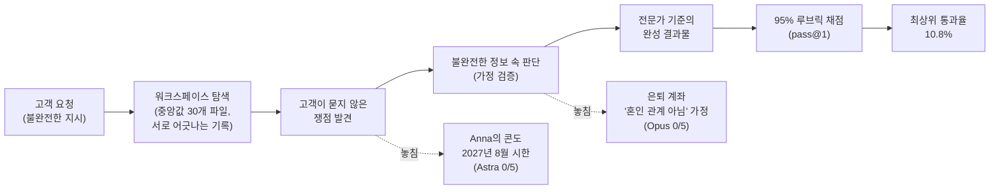

<figure class="post-figure post-figure--header">
<svg role="img" aria-label="왼쪽에는 체크 표시된 답안지를 든 에이전트가 책상 앞에 앉아 있고, 책상 위에는 PDF, 엑셀, W-2, K-1, IRS 통지서, 영수증이 높이 쌓여 있다. 서류 더미 깊숙한 곳에서 시한이 표시된 달력과 물음표가 붙은 혼인 증명 두 장이 빛나고 있다. 왼쪽은 질문에 답하기, 오른쪽은 빠진 질문 찾기라는 대비다" viewBox="0 0 640 320">
  <title>질문에 답하기와 빠진 질문 찾기</title>
  <g font-family="var(--font-body)">

  <!-- desk -->
  <rect x="24" y="252" width="592" height="10" fill="var(--border-color)"/>
  <rect x="44" y="262" width="10" height="40" fill="var(--border-color)"/>
  <rect x="586" y="262" width="10" height="40" fill="var(--border-color)"/>

  <!-- AGENT (pixel) holding an answer sheet -->
  <g transform="translate(70 150)">
    <rect x="14" y="-14" width="4" height="14" fill="var(--secondary-color)"/>
    <rect x="11" y="-20" width="10" height="7" fill="var(--gold)"/>
    <rect x="0" y="0" width="64" height="44" rx="4" fill="var(--secondary-color)"/>
    <rect x="12" y="14" width="10" height="10" fill="var(--bg-panel)"/>
    <rect x="42" y="14" width="10" height="10" fill="var(--bg-panel)"/>
    <rect x="22" y="32" width="20" height="4" fill="var(--bg-panel)"/>
    <rect x="8" y="48" width="48" height="54" rx="3" fill="var(--secondary-color)" opacity="0.85"/>
  </g>
  <!-- answer sheet -->
  <g transform="translate(130 176)">
    <rect x="0" y="0" width="58" height="72" fill="var(--bg-panel)" stroke="currentColor" stroke-width="2"/>
    <rect x="8" y="12" width="34" height="3" fill="currentColor" opacity="0.5"/>
    <rect x="8" y="22" width="40" height="3" fill="currentColor" opacity="0.5"/>
    <rect x="8" y="32" width="28" height="3" fill="currentColor" opacity="0.5"/>
    <path d="M14 50 L24 60 L44 40" fill="none" stroke="var(--secondary-color)" stroke-width="5" stroke-linecap="square"/>
  </g>
  <rect x="122" y="208" width="14" height="8" fill="var(--secondary-color)"/>
  <text x="112" y="290" text-anchor="middle" font-size="15" font-weight="700" fill="var(--secondary-color)">질문에 답하기 ✓</text>

  <!-- DOCUMENT PILE -->
  <g stroke="currentColor" stroke-width="2">
    <rect x="232" y="214" width="250" height="36" fill="var(--bg-light)"/>
    <rect x="244" y="178" width="232" height="36" fill="var(--bg-panel)"/>
    <rect x="226" y="142" width="242" height="36" fill="var(--bg-light)"/>
    <rect x="252" y="106" width="214" height="36" fill="var(--bg-panel)"/>
    <rect x="240" y="70" width="210" height="36" fill="var(--bg-light)"/>
  </g>
  <g font-size="13" font-weight="700" fill="currentColor">
    <text x="256" y="93">PDF</text>
    <text x="320" y="93">W-2</text>
    <text x="388" y="93">K-1</text>
    <text x="268" y="129">XLSX</text>
    <text x="342" y="129">IRS 통지서</text>
    <text x="244" y="165">총계정원장</text>
    <text x="400" y="165">이메일</text>
    <text x="262" y="201">영수증</text>
    <text x="250" y="237">계약서</text>
  </g>

  <!-- HIDDEN ISSUES glowing deep in the pile -->
  <circle cx="400" cy="214" r="54" fill="var(--gold)" opacity="0.16"/>
  <circle cx="400" cy="214" r="36" fill="var(--gold)" opacity="0.18"/>
  <!-- calendar with deadline -->
  <g transform="translate(340 186)">
    <rect x="0" y="0" width="48" height="52" fill="var(--bg-panel)" stroke="var(--accent-color)" stroke-width="2.5"/>
    <rect x="0" y="0" width="48" height="13" fill="var(--accent-color)"/>
    <rect x="10" y="-5" width="4" height="9" fill="currentColor"/>
    <rect x="34" y="-5" width="4" height="9" fill="currentColor"/>
    <text x="24" y="31" text-anchor="middle" font-size="12" font-weight="700" fill="var(--accent-color)">2027</text>
    <text x="24" y="46" text-anchor="middle" font-size="11" font-weight="700" fill="var(--accent-color)">8월</text>
  </g>
  <!-- marriage certificate with ? -->
  <g transform="translate(404 188)">
    <rect x="0" y="0" width="52" height="50" fill="var(--bg-panel)" stroke="var(--accent-color)" stroke-width="2.5"/>
    <circle cx="20" cy="22" r="8" fill="none" stroke="var(--gold)" stroke-width="3"/>
    <circle cx="31" cy="22" r="8" fill="none" stroke="var(--gold)" stroke-width="3"/>
    <rect x="8" y="38" width="36" height="3" fill="currentColor" opacity="0.5"/>
    <circle cx="50" cy="2" r="11" fill="var(--accent-color)"/>
    <text x="50" y="7" text-anchor="middle" font-size="15" font-weight="700" fill="var(--bg-panel)">?</text>
  </g>

  <!-- pointer to the hidden issues -->
  <path d="M560 128 L560 196 L476 210" fill="none" stroke="var(--accent-color)" stroke-width="2.5" stroke-dasharray="6 4"/>
  <path d="M476 210 L488 202 L486 216 Z" fill="var(--accent-color)"/>
  <text x="560" y="96" text-anchor="middle" font-size="15" font-weight="700" fill="var(--accent-color)">빠진 질문 찾기 ?</text>
  <text x="560" y="116" text-anchor="middle" font-size="12" fill="currentColor">고객이 묻지 않은 쟁점</text>
  <text x="400" y="290" text-anchor="middle" font-size="12" fill="currentColor">다가오는 시한 · 검증되지 않은 가정</text>
  </g>
</svg>
<figcaption>답안지는 손에 있지만, 진짜 쟁점은 아무도 짚어주지 않은 서류 더미 깊숙한 곳에 묻혀 있다.</figcaption>
</figure>

## 원문 정보

> - **제목**: DAYJOB: Tax — Benchmarking AI Agents on Professional Tax Work
> - **출처**: Surge AI 블로그 ([surgehq.ai](https://surgehq.ai)) · 저자 표기 없음
> - **발행**: 2026-10-27 · 분량 표기 없음 (중간 길이의 벤치마크 소개 글)
> - **원문 링크**: <https://surgehq.ai/blog/dayjob-tax>

데이터 라벨링·평가 회사 Surge AI가 내놓은 **전문직 실무 벤치마크** 소개 글이다. "에이전트가 문제를 푸는가"가 아니라 "에이전트가 일을 **맡을 수** 있는가"를 묻는다는 점에서, 에이전트를 만들고 평가하는 실무 관점으로 Articles에 담는다.

## 한 줄 요약 (TL;DR)

실제 세무 일은 지시가 불완전하고 기록이 서로 어긋나며 가장 중요한 쟁점은 아무도 짚어주지 않는다. 그런 환경 50개를 만들어 고객 요청부터 최종 결과물까지 통째로 맡겨 보니, 최상위 모델(Claude Sonnet 5.5)조차 통과율 **10.8%** — 에이전트는 개별 단계는 해내지만 "중대한 쟁점을 스스로 찾아 끝까지 끌고 가는 일"에서 무너진다.

한눈에 보면, DAYJOB: Tax의 한 과제는 다음 파이프라인을 끝까지 통과해야 하고 에이전트는 주로 가운데 두 단계에서 떨어져 나간다.

## 왜 이 글을 골랐나

벤치마크 점수는 대개 "정답이 정해진 질문"에 대한 정확도다. 그런데 이 위키에서 반복해서 다뤄온 주제 — [에이전트와 일할 때의 병목은 '내가 무엇을 모르는지'를 아는 능력](/2026/07/08/field-guide-claude-fable-unknowns.html)이라는 주장, [취향은 빌릴 수 있어도 판단은 이전되지 않는다](/2026/08/04/taste-judgment-and-ai.html)는 에세이, [Anthropic이 채용 기준을 자율성과 판단력으로 옮겼다](/2026/10/22/employment-at-anthropic.html)는 보고서 — 은 모두 **"질문 자체가 맞는가"를 알아채는 능력**을 가리킨다. DAYJOB: Tax는 바로 그 능력을 수치로 재려는 시도다.

또 하나, 이 글은 세무라는 남의 도메인을 다루지만 구조는 소프트웨어 일과 똑같다. 티켓은 불완전하고, 로그와 코드와 문서는 서로 어긋나며, 진짜 버그는 아무도 지시하지 않은 곳에 있다. "에이전트에게 일을 통째로 맡길 수 있는가"를 판단해야 하는 개발자에게 좋은 거울이 된다.

## 핵심 내용

### 도입: 고객이 묻지 않은 질문 — Anna의 콘도

글은 사례 하나로 시작한다. Anna는 콘도를 팔 계획이다. 2024년 8월에 이사 나갔고, 2026년 10월에 파는 것과 2027년 1월에 파는 것을 비교해 달라고 했다.

- 에이전트는 **두 날짜 모두** 거주 요건을 충족해 최대 $250,000의 양도차익 비과세(exclusion)를 받을 수 있다고 정확히 답했다.
- 하지만 놓친 것이 있다. "최근 5년 중 2년 거주" 요건이 **2027년 8월 무렵 소멸**한다는 점이다. 고객이 물은 두 날짜 사이에서는 차이가 없지만, 매각이 그 시점을 넘기면 비과세 자체가 사라진다.
- 원문의 대비: **Astra는 다섯 번 시도 중 한 번도** 이 시한을 짚지 못했고, **Opus는 다섯 번 모두** 짚었다.

원문의 문장이 이 벤치마크의 철학을 요약한다. *"A tax adviser should recognize consequential issues even when the client doesn't know to ask about them."* — 세무 자문가는 고객이 물을 줄 모르는 중대한 쟁점도 알아봐야 한다.

> 참고: 원문은 "Astra"의 전체 모델명을 밝히지 않는다. 이 위키의 [GPT-6 Astra 하니스 분석](/2026/09/08/gpt6-astra-harness-is-the-product.html)에서 다룬 모델과 같은 계열로 보이지만, 원문에서 확인되는 사실은 아니다.

### DAYJOB: Tax 소개

DAYJOB: Tax는 AI 에이전트가 **세무 전문가의 일을 소유(ownership)할 수 있는지**를 테스트한다. 최초의 고객 요청에서 시작해 완성된 결과물로 끝나야 하며, 그 과정에서 세무 지식과 계산뿐 아니라 **주도성(initiative)과 전문가 판단(professional judgment)**이 요구된다.

### 결과: 리더보드와 파레토 프런티어

- **지표**: pass@1, **95% 루브릭 임계값**. 루브릭 항목은 계산, 뒷받침하는 증거, 중대한 쟁점(consequential issues), 완성된 결과물을 포괄한다. 즉 한 번의 시도로 루브릭을 거의 전부 만족해야 "통과"다.
- **원문 본문에 등장하는 점수** (전체 리더보드는 이미지로 제공되어 본문 텍스트에는 세 모델만 나온다):

| 모델 | 통과율 |
| --- | --- |
| Claude Sonnet 5.5 | 10.8% |
| Claude Fable 5.1 | 9.6% |
| Claude Opus 5.5 | 9.2% |

- **성능 대 비용**: 시도당 평균 비용 대비 성능의 파레토 프런티어에서 Sonnet 5.5와 Opus 5.5가 고성능 쪽 끝에 놓인다. 원문 설명상으로는 가장 비싼 모델이 꼭 1위인 것은 아니다(전체 도표는 이미지라 직접 확인하지는 못했다).

<figure class="post-figure">
<svg role="img" aria-label="왼쪽 루브릭 체크리스트에서 계산, 뒷받침하는 증거, 완성된 결과물은 체크되었지만 중대한 쟁점 하나가 X로 빠져 있다. 체크리스트는 95% 임계값 관문을 지나는데, 한 항목이 빠졌으므로 통과가 아니라 불통과로 떨어진다. 아래쪽에는 단계를 거칠 때마다 막대가 곱셈처럼 짧아져 end-to-end 통과율이 10.8%에 그치는 모습이 그려져 있다" viewBox="0 0 640 330">
  <title>95% 루브릭 임계값: 하나만 빠져도 불통과</title>
  <g font-family="var(--font-body)">

  <!-- RUBRIC CHECKLIST -->
  <rect x="24" y="24" width="220" height="186" rx="4" fill="var(--bg-light)" stroke="currentColor" stroke-width="2"/>
  <text x="134" y="50" text-anchor="middle" font-size="15" font-weight="700" fill="currentColor">루브릭 (한 번의 시도)</text>
  <g font-size="14" fill="currentColor">
    <rect x="40" y="66" width="20" height="20" fill="var(--bg-panel)" stroke="currentColor" stroke-width="2"/>
    <path d="M44 76 L49 81 L57 70" fill="none" stroke="var(--secondary-color)" stroke-width="3"/>
    <text x="72" y="81">계산</text>
    <rect x="40" y="100" width="20" height="20" fill="var(--bg-panel)" stroke="currentColor" stroke-width="2"/>
    <path d="M44 110 L49 115 L57 104" fill="none" stroke="var(--secondary-color)" stroke-width="3"/>
    <text x="72" y="115">뒷받침하는 증거</text>
    <rect x="40" y="134" width="20" height="20" fill="var(--bg-panel)" stroke="currentColor" stroke-width="2"/>
    <path d="M44 144 L49 149 L57 138" fill="none" stroke="var(--secondary-color)" stroke-width="3"/>
    <text x="72" y="149">완성된 결과물</text>
    <rect x="40" y="168" width="20" height="20" fill="var(--bg-panel)" stroke="var(--accent-color)" stroke-width="2.5"/>
    <path d="M44 172 L56 184 M56 172 L44 184" stroke="var(--accent-color)" stroke-width="3"/>
    <text x="72" y="183" font-weight="700" fill="var(--accent-color)">중대한 쟁점</text>
  </g>

  <!-- arrow to gate -->
  <path d="M250 117 L300 117" stroke="currentColor" stroke-width="2.5"/>
  <path d="M300 111 L310 117 L300 123 Z" fill="currentColor"/>

  <!-- GATE -->
  <rect x="314" y="72" width="120" height="90" rx="4" fill="var(--bg-panel)" stroke="var(--gold)" stroke-width="3"/>
  <text x="374" y="106" text-anchor="middle" font-size="22" font-weight="700" fill="var(--gold)">≥ 95%</text>
  <text x="374" y="130" text-anchor="middle" font-size="12" fill="currentColor">루브릭 임계값</text>
  <text x="374" y="148" text-anchor="middle" font-size="12" fill="currentColor">pass@1</text>

  <!-- outcomes -->
  <path d="M440 100 L500 66" stroke="currentColor" stroke-width="2" stroke-dasharray="5 4" opacity="0.45"/>
  <rect x="504" y="44" width="112" height="40" rx="4" fill="none" stroke="currentColor" stroke-width="2" stroke-dasharray="5 4" opacity="0.45"/>
  <text x="560" y="69" text-anchor="middle" font-size="15" fill="currentColor" opacity="0.6">통과</text>
  <path d="M440 134 L500 168" stroke="var(--accent-color)" stroke-width="3"/>
  <path d="M493 170 L504 172 L499 162 Z" fill="var(--accent-color)"/>
  <rect x="504" y="150" width="112" height="44" rx="4" fill="var(--accent-color)"/>
  <text x="560" y="178" text-anchor="middle" font-size="16" font-weight="700" fill="var(--bg-panel)">불통과</text>

  <!-- MULTIPLICATION STRIP -->
  <text x="24" y="246" font-size="13" font-weight="700" fill="currentColor">단계마다 조금씩 새면, 끝까지 남는 비율은 곱셈으로 줄어든다</text>
  <g font-size="12" fill="currentColor">
    <rect x="24" y="262" width="120" height="22" fill="var(--secondary-color)" opacity="0.85"/>
    <text x="84" y="300" text-anchor="middle">탐색</text>
    <text x="154" y="278" text-anchor="middle" font-size="14">×</text>
    <rect x="166" y="262" width="104" height="22" fill="var(--secondary-color)" opacity="0.7"/>
    <text x="218" y="300" text-anchor="middle">쟁점 발견</text>
    <text x="280" y="278" text-anchor="middle" font-size="14">×</text>
    <rect x="292" y="262" width="84" height="22" fill="var(--secondary-color)" opacity="0.55"/>
    <text x="334" y="300" text-anchor="middle">가정 검증</text>
    <text x="386" y="278" text-anchor="middle" font-size="14">×</text>
    <rect x="398" y="262" width="66" height="22" fill="var(--secondary-color)" opacity="0.4"/>
    <text x="431" y="300" text-anchor="middle">결과물</text>
    <text x="478" y="278" text-anchor="middle" font-size="14">=</text>
    <rect x="492" y="262" width="20" height="22" fill="var(--accent-color)"/>
    <text x="522" y="279" font-size="15" font-weight="700" fill="var(--accent-color)">10.8%</text>
    <text x="502" y="300" text-anchor="middle">end-to-end</text>
  </g>
  </g>
</svg>
<figcaption>네 축 중 하나만 빠져도 전체가 불통과다. 개별 단계는 해내도 end-to-end 통과율은 최상위 모델조차 10.8%에 머문다.</figcaption>
</figure>

### 전문 세무 업무의 폭: 8개 실무 영역

50개 환경이 8개 실무 영역에 걸쳐 있다.

1. 개인·가족 세무 (Individual and family tax)
2. 소기업 세무 (Small-business tax)
3. 파트너십 (Partnerships)
4. 부동산·투자 (Property and investments)
5. 상속·증여·신탁 (Estates, gifts, and trusts)
6. 국제 조세 (International tax)
7. 기업 거래 (Corporate transactions)
8. 세무 검토·분쟁 (Tax review and disputes)

### 과제 안에는 무엇이 있나

- **워크스페이스 파일 1,789개** — 과제당 중앙값 30개, 최대 123개.
- 파일 형식: PDF 1,487개, Excel 통합문서 117개, Word 문서 38개, 그리고 이메일·이미지·CSV·JSON·텍스트 파일.
- 내용물: 제출본·초안 세금 신고서, K-1, W-2, IRS 통지서, 총계정원장, 급여 기록, 계약서, 서신.

원문이 드는 과제 예시들은 모두 "**지시되지 않은 함정**"을 품고 있다.

- 재판매 상품의 **손글씨 영수증** — 지출 기록과 대조해 재고와 매출원가(COGS)를 결정해야 한다.
- 고객은 앨라배마에서만 영업한다고 믿지만, **현장 배차 기록**에는 다섯 개 주에서 작업한 흔적이 있다.
- 폴란드 고용·부동산 기록, 암호화폐 거래소 내보내기 파일, 지갑 이력, 매수 lot이 얽힌 **국경을 넘는 가구**.
- **사라진 영수증**을 인용하는 스튜디오 장부 — 에이전트가 그 공백을 짚어내는지 본다.

<figure class="post-figure">
<svg role="img" aria-label="한 과제 워크스페이스의 해부도. 왼쪽에는 앨라배마에서만 영업한다는 고객 요청 메모가 있고, 가운데에는 PDF, 엑셀, 이메일, 영수증, CSV, JSON 등 파일 더미가 있으며, 오른쪽에는 다섯 개 주에서 작업한 흔적이 찍힌 현장 배차 기록이 있다. 메모와 배차 기록이 점선으로 연결되고 그 위에 불일치가 곧 숨은 쟁점이라는 경고 표시가 붙어 있다" viewBox="0 0 640 320">
  <title>숨은 쟁점은 기록 간 불일치에서 나온다</title>
  <g font-family="var(--font-body)">

  <!-- CLIENT REQUEST MEMO -->
  <g transform="translate(24 70)">
    <rect x="0" y="0" width="150" height="128" fill="var(--bg-light)" stroke="currentColor" stroke-width="2"/>
    <circle cx="75" cy="0" r="7" fill="var(--accent-color)"/>
    <text x="75" y="30" text-anchor="middle" font-size="14" font-weight="700" fill="currentColor">고객 요청 메모</text>
    <rect x="14" y="42" width="122" height="3" fill="currentColor" opacity="0.4"/>
    <text x="75" y="72" text-anchor="middle" font-size="13" fill="currentColor">"우리는</text>
    <text x="75" y="92" text-anchor="middle" font-size="13" font-weight="700" fill="var(--secondary-color)">앨라배마에서만</text>
    <text x="75" y="112" text-anchor="middle" font-size="13" fill="currentColor">영업합니다"</text>
  </g>
  <text x="99" y="222" text-anchor="middle" font-size="12" fill="currentColor">고객이 믿는 것</text>

  <!-- FILE PILE -->
  <g font-size="11" font-weight="700" text-anchor="middle" fill="currentColor">
    <g stroke="currentColor" stroke-width="1.5">
      <rect x="214" y="78" width="48" height="56" fill="var(--bg-panel)"/>
      <rect x="270" y="78" width="48" height="56" fill="var(--bg-light)"/>
      <rect x="326" y="78" width="48" height="56" fill="var(--bg-panel)"/>
      <rect x="214" y="142" width="48" height="56" fill="var(--bg-light)"/>
      <rect x="270" y="142" width="48" height="56" fill="var(--bg-panel)"/>
      <rect x="326" y="142" width="48" height="56" fill="var(--bg-light)"/>
    </g>
    <text x="238" y="111">PDF</text>
    <text x="294" y="111">XLSX</text>
    <text x="350" y="111">이메일</text>
    <text x="238" y="175">영수증</text>
    <text x="294" y="175">CSV</text>
    <text x="350" y="175">JSON</text>
  </g>
  <text x="294" y="222" text-anchor="middle" font-size="12" fill="currentColor">과제당 파일 중앙값 30개 · 최대 123개</text>

  <!-- DISPATCH LOG -->
  <g transform="translate(444 70)">
    <rect x="0" y="0" width="172" height="128" fill="var(--bg-light)" stroke="currentColor" stroke-width="2"/>
    <text x="86" y="26" text-anchor="middle" font-size="14" font-weight="700" fill="currentColor">현장 배차 기록</text>
    <rect x="14" y="36" width="144" height="3" fill="currentColor" opacity="0.4"/>
    <g font-size="12" fill="currentColor">
      <rect x="18" y="50" width="10" height="10" fill="var(--secondary-color)"/><text x="36" y="59">앨라배마</text>
      <rect x="18" y="68" width="10" height="10" fill="var(--accent-color)"/><text x="36" y="77">다른 주 ②</text>
      <rect x="18" y="86" width="10" height="10" fill="var(--accent-color)"/><text x="36" y="95">다른 주 ③</text>
      <rect x="96" y="68" width="10" height="10" fill="var(--accent-color)"/><text x="114" y="77">주 ④</text>
      <rect x="96" y="86" width="10" height="10" fill="var(--accent-color)"/><text x="114" y="95">주 ⑤</text>
    </g>
    <text x="86" y="118" text-anchor="middle" font-size="12" font-weight="700" fill="var(--accent-color)">5개 주에서 작업</text>
  </g>
  <text x="530" y="222" text-anchor="middle" font-size="12" fill="currentColor">기록이 말하는 것</text>

  <!-- CONTRADICTION LINK -->
  <path d="M99 198 L99 262 L530 262 L530 198" fill="none" stroke="var(--accent-color)" stroke-width="2.5" stroke-dasharray="7 5"/>
  <rect x="200" y="246" width="240" height="32" rx="4" fill="var(--bg-panel)" stroke="var(--accent-color)" stroke-width="2.5"/>
  <circle cx="220" cy="262" r="10" fill="var(--accent-color)"/>
  <text x="220" y="267" text-anchor="middle" font-size="14" font-weight="700" fill="var(--bg-panel)">!</text>
  <text x="330" y="267" text-anchor="middle" font-size="14" font-weight="700" fill="var(--accent-color)">불일치 = 숨은 쟁점</text>
  <text x="320" y="306" text-anchor="middle" font-size="12" fill="currentColor">아무도 지시하지 않았다 — 두 기록을 대조해야만 보인다</text>
  </g>
</svg>
<figcaption>과제의 함정은 지시문이 아니라 파일 사이에 있다. 고객의 믿음과 현장 기록이 어긋나는 지점이 곧 찾아내야 할 쟁점이다.</figcaption>
</figure>

### 세무 전문가가 만들고 검토했다

과제는 세무 전문가들이 만들고 검토했다. 원문이 밝히는 배경은 다음과 같다.

- 기업·사모펀드 세무 — 세무 변호사, PwC·Deloitte·Exxon에서 10년 이상
- 파트너십·기업 세무 — Baker Tilly 세무 디렉터 (전 PwC, Moss Adams, Windes)
- 부동산·개인 세무 — Deloitte, EY 출신

### 검증되지 않은 가정 위에 세운 은퇴 계획

두 번째 사례는 첫 사례와 승패가 **뒤집힌다**. 별거 중인 커플이 Roth IRA와 401(k)를 어떻게 나눌지 물었다.

- **Opus 5.5**: *"You aren't legally married, so neither account can be split without triggering taxes and penalties."* — 법적으로 혼인 관계가 아니니 계좌를 따로 유지하라는 조언. Opus는 **다섯 번 모두** 이 가정을 그대로 깔았다.
- 그런데 기록에는 텍사스 거주 이력, 콜로라도에서의 예식, 현재 플로리다 거주가 나온다. 이 사실들은 분석을 바꿀 수 있다.
- **Astra**: *"We first need to confirm your legal marital status."* — **다섯 번 중 네 번** 혼인 상태 확인이 먼저라고 짚었다.

> 보충(원문 밖 배경): 텍사스와 콜로라도는 사실혼(common-law marriage)을 인정하는 주로 알려져 있다. 원문은 "분석을 바꿀 수 있다"까지만 말하지만, 바로 이 점 때문에 "혼인 관계가 아니다"라는 단정이 위험한 가정이 된다.

### DAYJOB: Tax의 위치: 기존 세무 벤치마크와의 차이

| 벤치마크 | 무엇을 재나 | DAYJOB이 더 묻는 것 |
| --- | --- | --- |
| TaxBench | 정의된 세무 질문에 답할 수 있는가 | 고객이 **맞는 질문**을 했는가 |
| TaxCalcBench | 신고서가 정확한가 | **기록이 그 세무 처리를 뒷받침**하는가 |
| TaxLab | 빠진 정보를 모아 연방 신고서를 제출하는가 | 신고서 너머 **세무 직업 전반**으로 확장 |

### DAYJOB: Tax가 재는 것

*"DAYJOB tests whether AI agents can take ownership of a professional assignment from start to finish."* — 지저분한 기록을 다루고, 고객이 꺼내지 않은 쟁점을 발견하고, 불완전한 정보 속에서 판단하고, 전문가 기준으로 결과물을 내는 것. 그리고 결론은 한 줄이다. *"Agents haven't yet passed the audit."* — 에이전트는 아직 감사를 통과하지 못했다.

## 분석과 인사이트

여기부터는 원문 요약이 아닌 내 해석이다.

### 1. "지식 벤치마크"에서 "소유권 벤치마크"로

TaxBench → TaxCalcBench → TaxLab → DAYJOB으로 이어지는 비교표는 평가의 축이 어디로 이동하는지 잘 보여준다. 질문에 답하기 → 계산을 맞히기 → 정보를 모아 서류를 내기 → **일을 맡기**. 마지막 단계에서 측정 대상은 지식이 아니라 "**무엇이 문제인지 스스로 정의하는 능력**"이 된다. 소프트웨어로 옮기면 "주어진 함수를 구현하라"에서 "이 티켓을 해결하라 — 티켓이 잘못 쓰였을 수도 있다"로 가는 것과 같다. [의도 부채(Intent Debt)](/2026/06/21/intent-debt.html)가 말하는, 명세에 적히지 않은 의도를 복원하는 문제와도 맞닿아 있다.

### 2. 두 사례가 교차한다는 점이 가장 중요한 데이터다

Anna 사례에서는 Opus 5/5, Astra 0/5. 은퇴 계좌 사례에서는 Opus 0/5, Astra 4/5. **같은 모델이 한 사례에서는 숨은 쟁점을 완벽히 찾고, 다른 사례에서는 검증 안 된 가정을 일관되게 깐다.** 이것은 "어느 모델이 더 똑똑한가"의 문제가 아니라, 어떤 종류의 빈틈을 알아채는지가 모델마다 **체계적으로 다르다**는 뜻이다. 다섯 번 시도에서 결과가 거의 흔들리지 않는다는 점도 눈여겨볼 만하다 — 이것은 운이 아니라 성향(bias)이다.

실무적 함의는 분명하다. 한 모델의 전반 점수를 믿고 맡기기보다는, **서로 다른 맹점을 가진 모델을 교차 검토자로 쓰는** 구성이 더 안전할 수 있다. 모델 선택보다 검증 절차의 설계가 위임 가능성을 좌우한다는 뜻이다.

### 3. 10%라는 숫자를 어떻게 읽을까

통과율 10.8%는 "에이전트가 세무 일의 90%를 못 한다"는 뜻이 아니다. pass@1에 95% 루브릭 임계값이라는 **매우 엄격한 기준** 아래에서, 한 번에 거의 완벽한 결과물을 낸 비율이다. 원문 스스로도 "에이전트는 개별 단계는 수행한다"고 말한다. 다만 실무에서 세무 자문은 한 군데만 틀려도 고객에게 실제 손해가 나는 일이라, 이 엄격함은 과장이 아니라 **직업의 실제 합격선**에 가깝다. 단계별 정확도가 높아도 end-to-end 성공률은 곱셈으로 급락한다. 그래서 [PRINCE 사례 연구](/2026/06/19/reliable-agentic-ai-systems.html)처럼 프로덕션 agentic 시스템은 모델 바깥의 컨텍스트·하니스로 신뢰성을 쌓는다.

### 4. 비판적으로 볼 지점

- **리더보드 정보가 제한적이다.** 본문 텍스트에는 Claude 계열 세 모델의 점수만 나오고 전체 표는 이미지다. 사례에 등장하는 Astra의 점수와 정확한 정체도 본문에서는 확인되지 않는다. 결론을 일반화하기 전에 전체 리더보드를 직접 확인해야 한다.
- **환경 50개는 크지 않다.** 8개 영역으로 나누면 영역당 6개 남짓이다. 영역별 강약을 논하기엔 표본이 작다.
- **하니스 변수가 보이지 않는다.** 같은 모델도 하니스에 따라 결과가 크게 갈린다는 것은 [GPT-6 Astra 분석](/2026/09/08/gpt6-astra-harness-is-the-product.html)의 핵심 논지였다. 원문은 어떤 에이전트 스캐폴드·도구 구성으로 돌렸는지 본문에서 자세히 밝히지 않는다. "모델의 판단력"과 "하니스의 검증 절차"가 섞여 측정되었을 가능성이 있다.
- **벤치마크 회사의 글이다.** Surge AI는 평가 데이터를 파는 회사이고, 글은 접근 문의(benchmarks@surgehq.ai)로 끝난다. 설계 철학은 설득력 있지만, 마케팅 맥락을 감안하고 읽는 편이 좋다.

### 5. 루브릭 설계 자체가 배울 점

"계산 · 증거 · 중대한 쟁점 · 완성된 결과물"이라는 네 축은 우리가 에이전트 산출물을 리뷰할 때 그대로 빌려 쓸 수 있는 체크리스트다. 특히 "**증거**"와 "**쟁점**"을 독립 항목으로 둔다는 점이 좋다. 답이 맞아도 근거가 없으면 실패이고, 묻는 말에 다 답해도 묻지 않은 중대 사항을 놓치면 실패다. 평가 설계에 관해서는 [CS336 평가 강의](/2026/06/26/cs336-lecture-12-evaluation.html)의 정리와 함께 보면 좋다.

## 적용 포인트

- **에이전트에게 일을 맡길 때 "고객이 묻지 않았지만 중요한 것은?"을 명시적 단계로 넣어라.** 결과물 제출 전 "이 요청에 빠진 질문, 다가오는 시한, 검증되지 않은 가정을 나열하라"는 패스를 하니스에 고정한다.
- **가정은 산출물에 노출시켜라.** "법적으로 혼인 관계가 아니다" 같은 전제는 결론의 맨 앞에 "가정: … (근거: …/미검증)" 형태로 드러나게 하라. 은퇴 계좌 사례의 실패는 가정이 숨어 있었기 때문이다.
- **기록 간 불일치를 먼저 찾게 하라.** 워크스페이스의 파일들(로그·문서·설정)을 서로 대조해 모순을 목록화하는 단계를 실제 작업 전에 둔다. 숨은 쟁점은 대개 불일치에서 나온다.
- **맹점이 다른 모델을 교차 검토에 써라.** 한 모델이 0/5인 유형을 다른 모델이 4/5로 잡는다면, 단일 최고 모델보다 이종 모델 리뷰가 더 싸고 안전할 수 있다.
- **평가는 end-to-end + 엄격한 임계값으로 하라.** 단계별 정확도만 재면 실제 위임 가능성을 과대평가한다. 사내 에이전트 평가에도 "계산·증거·쟁점·결과물" 4축 루브릭을 적용해 보자.
- **단일 시도 대신 여러 번 돌려 성향을 보라.** 원문처럼 같은 과제를 5회 돌리면 우연인지 체계적 맹점인지가 드러난다.

## 마무리

DAYJOB: Tax의 메시지는 숫자 10.8%보다 두 사례의 교차에 있다. 오늘의 프런티어 모델은 세무 지식도, 계산도, 개별 단계도 해낸다. 그러나 "고객이 묻지 않은 시한"이나 "검증하지 않은 혼인 상태"처럼 **문제의 정의 자체가 틀렸을 가능성**을 알아채는 일은 모델마다 들쭉날쭉하고, 그것이 전문가의 합격선에서는 결정적이다. 에이전트에게 일을 통째로 맡기고 싶다면, 모델을 고르는 것만큼 **빠진 질문을 찾게 만드는 절차**를 설계하는 일이 중요하다. 원문의 표현대로, 에이전트는 아직 감사를 통과하지 못했다.

### 더 읽어보기

- [원문 — DAYJOB: Tax — Benchmarking AI Agents on Professional Tax Work (Surge AI)](https://surgehq.ai/blog/dayjob-tax)
- [당신의 '모르는 것'을 찾아라 — Claude Fable와 함께 일하는 필드 가이드](/2026/07/08/field-guide-claude-fable-unknowns.html) — "빠진 질문을 찾는 능력"이 병목이라는 같은 문제의식
- [GPT-6 Astra: 하니스가 곧 제품이다](/2026/09/08/gpt6-astra-harness-is-the-product.html) — 같은 모델도 하니스에 따라 점수가 갈린다는 평가상의 주의점
- [취향과 판단, 그리고 AI](/2026/08/04/taste-judgment-and-ai.html) — 판단은 이전되지 않는다는 관점에서 본 "전문가 판단"
- [AI를 가장 먼저 쓴 회사 안에서 일자리는 어떻게 바뀌었나](/2026/10/22/employment-at-anthropic.html) — 채용 기준이 자율성과 판단력으로 이동한 현실
- [Intent Debt: 에이전트가 대신 갚아줄 수 없는 단 하나의 부채](/2026/06/21/intent-debt.html) — 명세에 적히지 않은 의도를 복원하는 문제
- [신뢰할 수 있는 Agentic AI 시스템 만들기](/2026/06/19/reliable-agentic-ai-systems.html) — 모델 바깥(컨텍스트·하니스)에서 신뢰성을 쌓는 사례
- [CS336 12강 — 평가(Evaluation)](/2026/06/26/cs336-lecture-12-evaluation.html) — 지식 벤치마크부터 에이전트 벤치마크까지, 평가의 타당성과 함정
