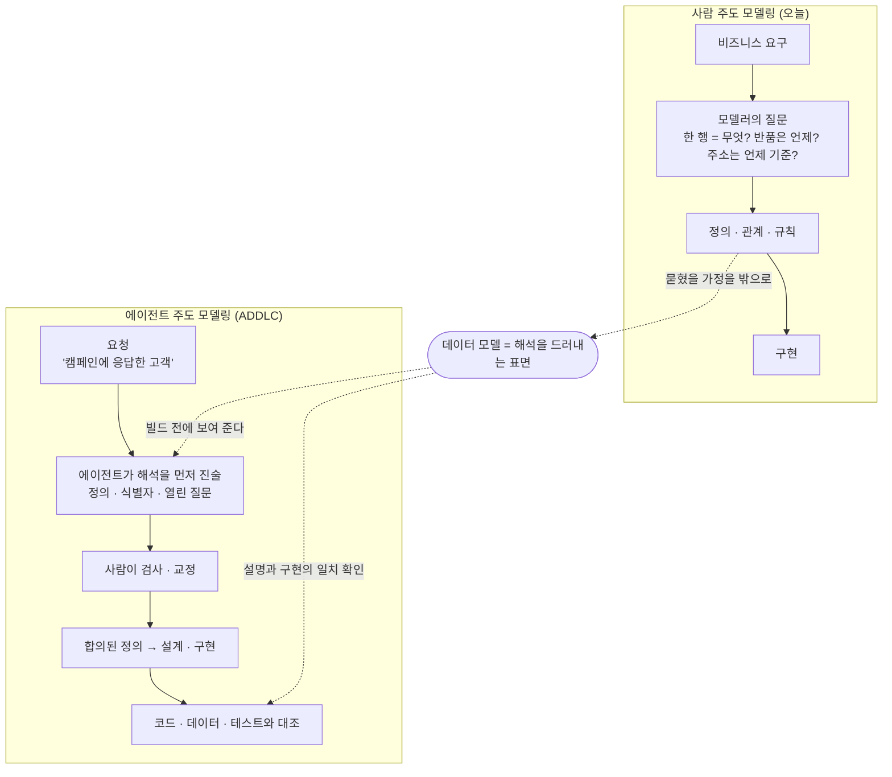

<figure class="post-figure post-figure--header">
<svg role="img" aria-labelledby="dwn-h-title dwn-h-desc" viewBox="0 0 720 340" xmlns="http://www.w3.org/2000/svg">
  <title id="dwn-h-title">테스트는 통과했는데, '응답'은 무슨 뜻이었나</title>
  <desc id="dwn-h-desc">왼쪽에는 에이전트가 완성한 파이프라인이 raw_events에서 stg_email_events를 거쳐 fct_campaign_response로 이어지고 초록 체크와 함께 테스트 통과가 표시되어 있다. 오른쪽에서 사람이 "그런데 '응답'이 무슨 뜻이었지?"라고 묻는다. 아래에는 데이터 모델이 둘 사이에 펼쳐진 해석의 지도로 놓여 있고, 정의·그레인·식별자·상태 항목이 적혀 있다.</desc>
  <defs>
    <marker id="dwn-h-arrow" markerWidth="9" markerHeight="9" refX="7" refY="4" orient="auto">
      <path d="M0 0 L8 4 L0 8 Z" fill="var(--secondary-color)"/>
    </marker>
  </defs>
  <!-- LEFT: agent-built pipeline, all green -->
  <rect x="20" y="20" width="320" height="170" rx="8" fill="var(--bg-light)" stroke="var(--border-color)" stroke-width="2"/>
  <text x="180" y="44" text-anchor="middle" font-size="13" font-weight="700" fill="var(--secondary-color)">에이전트가 완성한 파이프라인</text>
  <g font-size="11" fill="currentColor" text-anchor="middle">
    <rect x="34" y="66" width="86" height="34" rx="4" fill="var(--bg-panel)" stroke="currentColor" stroke-width="1.5"/>
    <text x="77" y="87">raw_events</text>
    <rect x="138" y="66" width="86" height="34" rx="4" fill="var(--bg-panel)" stroke="currentColor" stroke-width="1.5"/>
    <text x="181" y="87">stg_email</text>
    <rect x="242" y="66" width="86" height="34" rx="4" fill="var(--bg-panel)" stroke="var(--secondary-color)" stroke-width="2"/>
    <text x="285" y="82">fct_campaign</text>
    <text x="285" y="95">_response</text>
  </g>
  <path d="M120 83 H134 M224 83 H238" fill="none" stroke="var(--secondary-color)" stroke-width="2" marker-end="url(#dwn-h-arrow)"/>
  <circle cx="96" cy="146" r="20" fill="none" stroke="var(--secondary-color)" stroke-width="3"/>
  <path d="M86 146 L94 154 L108 138" fill="none" stroke="var(--secondary-color)" stroke-width="3.5" stroke-linecap="round" stroke-linejoin="round"/>
  <text x="128" y="142" font-size="12" font-weight="700" fill="var(--secondary-color)">run ✓ · tests passed</text>
  <text x="128" y="160" font-size="11" fill="var(--text-light)">응답 = 클릭 (기존 정의)</text>
  <!-- RIGHT: the human asks -->
  <rect x="392" y="24" width="300" height="62" rx="10" fill="var(--bg-panel)" stroke="var(--accent-color)" stroke-width="2"/>
  <path d="M600 86 L612 104 L620 86" fill="var(--bg-panel)" stroke="var(--accent-color)" stroke-width="2" stroke-linejoin="round"/>
  <path d="M601 85 H619" stroke="var(--bg-panel)" stroke-width="3"/>
  <text x="542" y="52" text-anchor="middle" font-size="14" font-weight="700" fill="currentColor">그런데 '응답'이 무슨 뜻이었지?</text>
  <text x="542" y="72" text-anchor="middle" font-size="11" fill="var(--text-light)">클릭? 아니면 발송 후 7일 내 구매?</text>
  <circle cx="620" cy="122" r="11" fill="var(--bg-panel)" stroke="currentColor" stroke-width="2"/>
  <path d="M620 133 V164 M620 144 L600 156 M620 144 L640 156 M620 164 L608 186 M620 164 L632 186" fill="none" stroke="currentColor" stroke-width="2" stroke-linecap="round"/>
  <!-- links down to the map -->
  <path d="M180 190 V226" fill="none" stroke="var(--gold)" stroke-width="2" stroke-dasharray="5 5"/>
  <path d="M620 190 V226" fill="none" stroke="var(--gold)" stroke-width="2" stroke-dasharray="5 5"/>
  <!-- BOTTOM: the data model as an unfolded map of interpretation -->
  <path d="M90 230 L270 222 L450 230 L630 222 L630 322 L450 330 L270 322 L90 330 Z" fill="var(--bg-light)" stroke="var(--gold)" stroke-width="2" stroke-linejoin="round"/>
  <path d="M270 222 V322 M450 230 V330" fill="none" stroke="var(--gold)" stroke-width="1.5" stroke-dasharray="3 4"/>
  <text x="360" y="252" text-anchor="middle" font-size="14" font-weight="700" fill="var(--gold)">데이터 모델 — 해석의 지도</text>
  <g font-size="11" fill="currentColor">
    <text x="108" y="280">정의: 응답 = ?</text>
    <text x="108" y="302">그레인: 한 행 = 주문?</text>
    <text x="288" y="280">식별자: 수신자 ↔ 고객</text>
    <text x="288" y="302">반품 처리: 팀이 결정</text>
    <text x="468" y="280" fill="var(--secondary-color)">confirmed</text>
    <text x="540" y="280" fill="var(--text-light)">inferred</text>
    <text x="468" y="302" fill="var(--accent-color)">open — 보이는 채로</text>
  </g>
</svg>
<figcaption>파이프라인은 초록불인데 질문은 틀릴 수 있다 — 데이터 모델은 에이전트의 해석을 사람이 펼쳐 보는 지도가 된다</figcaption>
</figure>

## 원문 정보

> - **제목**: Do We Still Need Data Models? — *As agents build data systems, models must help us understand the decisions behind them.*
> - **출처**: Ananth Packkildurai, Data Engineering Weekly ([dataengineeringweekly.com](https://www.dataengineeringweekly.com))
> - **발행**: 2026-10-28 · 분량 표기 없음 (중간 길이의 에세이)
> - **원문 링크**: <https://www.dataengineeringweekly.com/p/do-we-still-need-data-models>

일주일 전 위키에 정리한 같은 저자의 [자기조직화 데이터 스택](/2026/10/22/self-organizing-data-stack.html)의 **직접적인 후속편**이다. 그 글이 "그래프는 엔진이 쓰고 사람은 의미를 쓴다"고 선언했다면, 이 글은 그 선언이 남긴 가장 큰 질문 — *그렇다면 데이터 모델은 이제 무엇을 위해 존재하는가* — 에 답한다.

## 한 줄 요약 (TL;DR)

데이터 모델은 여전히 필요하다. 다만 역할이 바뀐다. 사람 팀이 설계를 합의하기 위해 그리던 산출물에서, **에이전트가 요청을 어떻게 해석했고 무엇을 추론했으며 어디서 사람의 도움이 필요한지를 사람이 검사하는 표면**으로 옮겨 간다. 모델링 기법(Kimball 등)을 버릴 필요는 없고, 모델링을 둘러싼 **대화에 에이전트의 자리를 만들어야** 한다.

## 왜 이 글을 골랐나

첫째, **앞선 글의 빈칸을 정확히 메운다.** [자기조직화 데이터 스택](/2026/10/22/self-organizing-data-stack.html)은 "가독성이 모델의 존재 이유였는데, 에이전트가 소비하는 세계에서는 물리 모델이 사람을 위한 박물관 전시일 필요가 없다"고 했고, 그 인지적 역할을 **의사결정 로그**가 대신한다고 주장했다. 위키의 분석은 그때 "분석가가 SQL로 창고를 탐색하는 문화가 남아 있는 한 물리 모델의 가독성은 여전히 비용 함수에 들어가야 한다"고 이견을 달았다. 이번 글은 저자 스스로 그 지점을 다시 다루며, **모델을 폐기하지 않고 역할을 재정의**하는 쪽으로 한 걸음 물러선다(혹은 정교해진다). 두 글을 나란히 읽어야 저자의 ADDLC(Agentic Data Development Lifecycle) 구상이 온전해진다.

둘째, **실패 사례가 아주 현실적이다.** "테스트를 통과했고 파이프라인도 잘 돌았는데, 질문이 틀렸다." 이 캠페인 응답 예시는 코딩 에이전트를 실무에 붙여 본 사람이라면 한 번쯤 겪은 장면이다. 원문은 이것을 품질 문제가 아니라 **해석(semantic) 문제**로 정확히 분류한다.

셋째, **위키의 두 축을 잇는다.** [dbt 시리즈](/2026/07/12/dbt-essential-curriculum.html)의 팩트/디멘전·세만틱 레이어와 [Ontology 시리즈](/2026/07/19/ontology-essential-curriculum.html)의 의미 계층이, 에이전트 시대에 각자 어떤 자리를 갖는지를 "모두 필요할 수 있지만 모두 필수는 아니다"라는 실용적 구도로 정리한다.

## 핵심 내용

### 출발점: 에이전트가 짓는다면 모델은 왜 필요한가

에이전트는 이미 개발자가 문제를 설명하면 스스로 조사하고, 코드를 쓰고, 테스트하고, 변경을 제안한다. 사람은 여전히 리뷰를 한다. 저자는 앞선 글에서 제안한 **ADDLC**를 이어받아 묻는다 — "에이전트가 데이터를 이해하고 파이프라인을 만들 수 있다면, 데이터 모델은 아직 필요한가?" 답은 **"그렇다, 다만 목적이 바뀐다"**이다.

### 신호(signal)와 언어(language)

저자는 개념의 바닥을 먼저 깐다.

- **신호**: 빨간 신호등, 모니터링 알림, 구매 이벤트. 신호의 쓸모는 **받는 쪽이 어떻게 해석하느냐**에 달려 있다.
- **언어**: 관계·조건·가정을 표현한다. 같은 문장도 사람마다 다르게 읽힌다.

데이터 엔지니어링은 이 둘을 동시에 다룬다. 레코드·이벤트·알림이 신호라면, 요구사항·대화·다이어그램·코드는 그 신호의 의미를 설명하는 언어다. 원문의 핵심 문장은 이렇다 — **"구매 이벤트는 제때 도착하고, 스키마와 맞고, 모든 품질 검사를 통과할 수 있다."** 그래도 그 이벤트만으로는 누군가가 "활성 고객"인지 알 수 없다. "활성", "고객", 그리고 기간에 대한 **공유된 정의**가 시스템 안으로 운반되어야 한다.

이것은 위키의 [데이터 품질은 '사다리'다](/2026/07/18/on-data-quality-basics.html)가 말한 "품질은 용도에 따라 달라진다"와 같은 이야기를 의미 쪽에서 한 것이다. 신호의 품질과 의미의 합의는 서로 다른 층의 문제다.

### 오늘 데이터 모델이 하는 일

사람 주도 개발에서 모델링은 이렇게 흘러간다. 비즈니스 전문가가 필요를 말하고, 모델러가 질문하고 데이터를 살피며, 팀이 그 필요를 **정의·관계·규칙**으로 바꾼 뒤 구현한다. 원문이 드는 매출 데이터셋의 질문들은 교과서적이다.

- 한 행은 무엇을 나타내는가 — 주문인가, 주문 라인인가, 결제인가?
- 반품은 구매일 매출을 줄이는가, 반품일 매출을 줄이는가?
- 주소는 현재 주소인가, 구매 시점의 주소인가?

저자의 요점은 **모델이 다이어그램이나 데이터베이스 설계 이상**이라는 것이다. 모델은 **비즈니스에 관한 결정을 담고**, 모델을 둘러싼 논의가 없었다면 코드 속에 묻혔을 가정을 밖으로 끌어낸다. 예시로 Kimball의 차원 모델링 설계 절차 — 비즈니스 프로세스와 **그레인(grain)**에서 출발해 디멘전과 팩트로 — 를 인용한다. 위키의 [dbt 모델·ref·소스](/2026/07/14/dbt-models-ref-sources.html)가 `fct_`/`dim_` 마트 계층으로 정리한 바로 그 구분이고, "주소는 언제 기준인가"는 [dbt Incremental·Snapshot](/2026/07/14/dbt-incremental-snapshots.html)의 SCD2 유효 구간이 답하는 질문이다.

### 에이전트가 시스템을 지을 때: 캠페인 응답 사례

<figure class="post-figure">
<svg role="img" aria-labelledby="dwn-c-title dwn-c-desc" viewBox="0 0 720 420" xmlns="http://www.w3.org/2000/svg">
  <title id="dwn-c-title">같은 요청, 두 갈래의 해석</title>
  <desc id="dwn-c-desc">맨 위의 요청 "이메일 캠페인에 응답한 고객"에서 길이 둘로 갈라진다. 왼쪽 길은 해석 진술 없이 기존 클릭 정의를 집어 파이프라인이 돌고 테스트도 통과하지만, 유효한 정의로 틀린 질문에 답한다. 가운데에는 에이전트가 빌드 전에 내미는 해석 진술 카드가 있다: 응답은 발송 후 7일 이내 적격 구매, 수신자는 고객 식별자로 연결, 클릭 정의는 참여도용, 반품 처리는 팀이 결정. 카드를 거친 오른쪽 길은 사람이 검사·교정한 합의된 정의로 이어져 설계와 구현, 그리고 코드·데이터·테스트와의 대조로 간다.</desc>
  <defs>
    <marker id="dwn-c-red" markerWidth="9" markerHeight="9" refX="7" refY="4" orient="auto">
      <path d="M0 0 L8 4 L0 8 Z" fill="var(--accent-color)"/>
    </marker>
    <marker id="dwn-c-gold" markerWidth="9" markerHeight="9" refX="7" refY="4" orient="auto">
      <path d="M0 0 L8 4 L0 8 Z" fill="var(--gold)"/>
    </marker>
    <marker id="dwn-c-green" markerWidth="9" markerHeight="9" refX="7" refY="4" orient="auto">
      <path d="M0 0 L8 4 L0 8 Z" fill="var(--secondary-color)"/>
    </marker>
  </defs>
  <!-- request -->
  <rect x="220" y="16" width="280" height="44" rx="8" fill="var(--bg-light)" stroke="currentColor" stroke-width="2"/>
  <text x="360" y="36" text-anchor="middle" font-size="11" fill="var(--text-light)">마케팅 리더의 요청</text>
  <text x="360" y="53" text-anchor="middle" font-size="14" font-weight="700" fill="currentColor">"이메일 캠페인에 응답한 고객"</text>
  <!-- left branch: no statement -->
  <path d="M240 60 C 150 90, 130 160, 130 262" fill="none" stroke="var(--accent-color)" stroke-width="2.5" stroke-dasharray="7 5" marker-end="url(#dwn-c-red)"/>
  <text x="96" y="150" text-anchor="middle" font-size="11" fill="var(--accent-color)">진술 없이</text>
  <text x="96" y="165" text-anchor="middle" font-size="11" fill="var(--accent-color)">바로 빌드</text>
  <!-- centre card: interpretation statement -->
  <path d="M360 60 V86" fill="none" stroke="var(--gold)" stroke-width="2.5" marker-end="url(#dwn-c-gold)"/>
  <rect x="200" y="90" width="320" height="150" rx="8" fill="var(--bg-panel)" stroke="var(--gold)" stroke-width="2.5"/>
  <text x="360" y="114" text-anchor="middle" font-size="13" font-weight="700" fill="var(--gold)">빌드 전 해석 진술 (4항목)</text>
  <g font-size="12" fill="currentColor">
    <text x="218" y="142">① 응답 = 발송 후 7일 이내 적격 구매</text>
    <text x="218" y="166">② 수신자 ↔ 고객: 명시된 식별자로 연결</text>
    <text x="218" y="190">③ 기존 클릭 정의 = 참여도 (다른 용도)</text>
    <text x="218" y="214" fill="var(--accent-color)">④ 반품 처리 = 팀이 결정 (열린 질문)</text>
  </g>
  <!-- right branch: inspected and corrected -->
  <path d="M520 165 C 600 170, 600 200, 594 262" fill="none" stroke="var(--secondary-color)" stroke-width="2.5" marker-end="url(#dwn-c-green)"/>
  <text x="640" y="196" text-anchor="middle" font-size="11" fill="var(--secondary-color)">사람이</text>
  <text x="640" y="211" text-anchor="middle" font-size="11" fill="var(--secondary-color)">검사·교정</text>
  <!-- left outcome -->
  <rect x="16" y="268" width="250" height="136" rx="8" fill="var(--bg-light)" stroke="var(--accent-color)" stroke-width="2"/>
  <text x="141" y="292" text-anchor="middle" font-size="13" font-weight="700" fill="currentColor">기존 '클릭' 정의 적용</text>
  <circle cx="44" cy="322" r="12" fill="none" stroke="var(--secondary-color)" stroke-width="2.5"/>
  <path d="M38 322 L43 327 L51 317" fill="none" stroke="var(--secondary-color)" stroke-width="2.5" stroke-linecap="round" stroke-linejoin="round"/>
  <text x="64" y="327" font-size="12" fill="var(--secondary-color)">파이프라인 실행 · 테스트 통과</text>
  <line x1="32" y1="346" x2="250" y2="346" stroke="var(--border-color)" stroke-width="1" stroke-dasharray="3 3"/>
  <text x="141" y="370" text-anchor="middle" font-size="12" font-weight="700" fill="var(--accent-color)">유효한 정의, 틀린 질문</text>
  <text x="141" y="390" text-anchor="middle" font-size="11" fill="var(--text-light)">초록불이지만 엉뚱한 답</text>
  <!-- right outcome -->
  <rect x="454" y="268" width="250" height="136" rx="8" fill="var(--bg-light)" stroke="var(--secondary-color)" stroke-width="2"/>
  <text x="579" y="292" text-anchor="middle" font-size="13" font-weight="700" fill="currentColor">마케팅이 의도한 정의</text>
  <text x="579" y="314" text-anchor="middle" font-size="12" fill="var(--secondary-color)">발송 후 7일 내 구매</text>
  <line x1="470" y1="328" x2="688" y2="328" stroke="var(--border-color)" stroke-width="1" stroke-dasharray="3 3"/>
  <text x="579" y="350" text-anchor="middle" font-size="11" fill="currentColor">합의된 정의 → 설계 · 구현</text>
  <text x="579" y="368" text-anchor="middle" font-size="11" fill="var(--text-light)">구매 팩트 + 고객·캠페인·날짜 디멘전</text>
  <text x="579" y="390" text-anchor="middle" font-size="11" fill="currentColor">코드 · 데이터 · 테스트와 대조</text>
</svg>
<figcaption>같은 요청이 해석 진술을 거치느냐에 따라 갈린다 — 진술 없이 지은 쪽은 테스트를 통과하고도 틀린 질문에 답한다</figcaption>
</figure>

원문의 중심 사례다. 마케팅 리더가 "이메일 캠페인에 **응답한** 고객"을 요청한다. 에이전트는 기존에 있던 **클릭 기반** "응답" 정의를 쓴다. 파이프라인은 돌고 테스트도 통과한다. 그런데 마케팅이 원한 것은 **이메일 발송 후 7일 이내의 구매**였다. 원문의 표현으로 — **"에이전트는 유효한 정의를 적용했지만, 틀린 질문에 답했다."**

해법은 에이전트가 **빌드 전에 자신의 해석을 진술**하는 것이다. 원문이 제시한 네 항목은 다음과 같다.

1. 응답이란 **이메일 발송 후 7일 이내의 적격 구매**를 뜻한다.
2. 수신자는 **명시된 고객 식별자**를 통해 구매와 연결된다.
3. 기존 클릭 기반 정의는 **참여도(engagement)**를 측정하며 다른 용도에 맞는다.
4. **반품된 구매를 어떻게 처리할지는 팀이 결정해야** 한다.

팀은 이 선택들을 검사하고 고칠 수 있고, 합의된 정의는 설계와 구현으로 이어진다. 저자는 이때도 차원 설계(고객·캠페인·날짜 디멘전을 가진 구매 팩트)가 여전히 쓰일 수 있다고 덧붙인다. 다만 **비즈니스를 향한 뷰가 그 차원 설계와 연결된 채로 유지**되어야 한다.

### 사람이 봐야 하는 것

완성된 테이블이나 성공 메시지만으로는 부족하다. 사람은 다음을 알아야 한다.

- 에이전트가 **정의를 어디서 찾았는지**, 그 정의가 이번 요청에 맞는지
- 관계가 **추론된 것인지, 도메인 소유자가 확인한 것인지**
- 에이전트가 **결정하기에 정보가 부족했던 지점**은 어디인지

원문은 여기에 몇 가지 경계를 긋는다.

- **추론은 출발점일 뿐이다.** 프로파일링 결과 수신자 ID가 고객 ID와 맞아 보여도, 그것은 확정된 정체성 규칙이 아니다. 반품 같은 **미해결 질문은 조용히 해소되지 말고 보이는 채로 남아야** 한다.
- **설명은 실제로 지어진 시스템과 일치해야 한다.** "에이전트는 자기 작업에 대한 그럴듯한 설명을 내놓으면서 실제로는 다른 것을 구현할 수 있다." 그러니 에이전트의 요약을 믿지 말고 정의를 **코드·데이터·테스트와 대조**해야 한다.
- **맥락이 정의를 바꾼다.** 마케팅과 고객지원의 "활성 고객"은 다를 수 있고, 정의는 시간·채널·상품·지역에 따라 달라질 수 있다.
- **상관은 인과가 아니다.** 발송 후 7일 안의 구매는 **시점**을 보여 줄 뿐, 이메일이 구매를 *일으켰다*는 뜻이 아니다. 증분 효과(incremental impact)를 재려면 다른 방법이 필요하다.

### 새 모델링 기법이 필요한가

저자는 ADDLC가 Kimball을 버리거나 새 기법을 도입하길 요구한다고 보지 않는다. 선택은 데이터·워크로드·질문에 달려 있다. 함께 쓸 수 있지만 **모두 필수는 아닌** 구성 요소로 네 가지를 든다.

| 구성 요소 | 담당하는 것 |
| --- | --- |
| **차원 모델링** | 분석용 설계 |
| **세만틱 정의** | 재사용 가능한 비즈니스 용어와 지표 |
| **온톨로지** | 도메인 전반의 개념과 관계 |
| **맥락(context)** | 소유권, 근거(evidence), 결정 이력 |

어떤 팀은 차원 모델 + 명확한 비즈니스 정의로 시작하면 되고, 어떤 팀은 더 넓은 온톨로지가 필요하다. 플랫폼 예로 Palantir AIP 아키텍처를 드는데, 온톨로지를 써서 사람과 에이전트 모두를 위해 데이터·로직·액션·보안을 연결한다는 점에서다. 동시에 저자는 **온톨로지는 구축·유지에 품이 든다**고 못 박는다 — 명확한 목적, 소유자, 분쟁 해결 절차, 비즈니스 변화에 따른 갱신이 필요하다.

마지막으로 원문은 열린 가설 하나를 남긴다. **사람을 위한 모델은, 에이전트를 이끄는 바로 그 정의와 결정들을 검사용으로 보여 주는 하나의 뷰(view)일 수 있다.** 그 뷰가 어떤 모양이어야 하는지는 "아직 배우는 중"이라고 저자는 솔직히 말한다.

### 결론: 모델링 대화에 에이전트의 자리를

그렇다, 데이터 모델은 여전히 필요하다. 에이전트는 일을 하기 위해 데이터를 조직해야 하고, 사람은 데이터가 무엇을 뜻하는지 합의해야 한다. 바뀌는 것은 **모델을 둘러싼 대화**다. ADDLC에서 모델은 에이전트가 요청을 어떻게 이해했는지, 무엇을 추론했는지, 어디서 도움이 필요한지를 보여 줘야 한다. 원문의 마지막 문장 — **"데이터 모델링은 언제나 사람들이 그 대화를 나누도록 도왔다. 이제 그 대화에 에이전트를 위한 자리를 만들어야 한다."**

### 독자 댓글이 보탠 두 가지

원문 댓글에서 나온 두 의견도 실무적으로 유용해 함께 옮긴다(원문 본문이 아닌 독자 의견이다).

- **Nan Deng** — 캠페인 사례는 나쁜 파이프라인이 아니라 **의미의 실패**다. 에이전트가 찾은 정의, 팀이 확인한 정의, 열린 질문을 **파이프라인 옆에 함께 보관**하고, 요약과 SQL이 어긋나면(요약은 "7일 내 구매"라는데 SQL은 클릭으로 필터링하면) **실행을 실패시키자**고 제안한다.
- **Abhishek Pan** — SQL 이전에 **그레인을 명시**하자. 마케팅은 주문당 한 행을 가정하는데 주문 라인 그레인으로 지으면 구매 수가 부풀려진다. 행 수를 고유 주문 ID 수와 대조하는 검사 하나면 잡힌다.

## 분석과 인사이트

<figure class="post-figure">
<svg role="img" aria-labelledby="dwn-v-title dwn-v-desc" viewBox="0 0 720 380" xmlns="http://www.w3.org/2000/svg">
  <title id="dwn-v-title">두 글이 겹치는 자리</title>
  <desc id="dwn-v-desc">두 원이 겹치는 벤 다이어그램. 왼쪽 원은 자기조직화 데이터 스택, 엔진 중심으로 자산은 계약, 다섯 루프, Escalate 루프, 의사결정 로그를 담는다. 오른쪽 원은 데이터 모델은 아직 필요한가, 인터페이스 중심으로 빌드 전 해석 진술, 추론과 확인의 구분, 열린 질문 유지, 사람용 뷰를 담는다. 겹치는 가운데에는 의미는 사람이 소유한다, 모르면 묻는다, 결정을 기록한다가 놓여 있다.</desc>
  <!-- titles -->
  <text x="215" y="24" text-anchor="middle" font-size="14" font-weight="700" fill="var(--secondary-color)">자기조직화 데이터 스택</text>
  <text x="215" y="44" text-anchor="middle" font-size="11" fill="var(--text-light)">엔진(런타임) 중심 · 원문 2026-10-14</text>
  <text x="505" y="24" text-anchor="middle" font-size="14" font-weight="700" fill="var(--accent-color)">데이터 모델은 아직 필요한가</text>
  <text x="505" y="44" text-anchor="middle" font-size="11" fill="var(--text-light)">사람–에이전트 인터페이스 중심 · 원문 2026-10-28</text>
  <!-- circles -->
  <circle cx="270" cy="212" r="150" fill="var(--secondary-color)" fill-opacity="0.08" stroke="var(--secondary-color)" stroke-width="2.5"/>
  <circle cx="450" cy="212" r="150" fill="var(--accent-color)" fill-opacity="0.08" stroke="var(--accent-color)" stroke-width="2.5"/>
  <!-- left-only -->
  <g font-size="12" fill="currentColor" text-anchor="middle">
    <text x="205" y="152">자산 = 계약</text>
    <text x="205" y="190">다섯 루프</text>
    <text x="205" y="228">Escalate 루프</text>
    <text x="205" y="266">의사결정 로그</text>
  </g>
  <!-- right-only -->
  <g font-size="12" fill="currentColor" text-anchor="middle">
    <text x="515" y="152">빌드 전 해석 진술</text>
    <text x="515" y="190">추론 / 확인 구분</text>
    <text x="515" y="228">열린 질문 유지</text>
    <text x="515" y="266">사람용 뷰</text>
  </g>
  <!-- overlap -->
  <g font-size="11" font-weight="700" fill="var(--gold)" text-anchor="middle">
    <text x="360" y="160">의미는</text>
    <text x="360" y="175">사람이 소유</text>
    <text x="360" y="206">모르면</text>
    <text x="360" y="221">묻는다</text>
    <text x="360" y="252">결정을</text>
    <text x="360" y="267">기록한다</text>
  </g>
</svg>
<figcaption>엔진을 다룬 전편과 인터페이스를 다룬 이번 글 — 둘이 겹치는 자리에 ADDLC의 공통 원칙이 놓인다</figcaption>
</figure>

### 자기조직화 데이터 스택과 나란히 읽기

두 글은 같은 ADDLC를 서로 다른 각도에서 비춘다. [자기조직화 데이터 스택](/2026/10/22/self-organizing-data-stack.html)이 **엔진(런타임)이 무엇을 해야 하는가**를 다뤘다면, 이번 글은 **사람과 에이전트 사이의 인터페이스가 무엇이어야 하는가**를 다룬다.

| 관점 | 자기조직화 데이터 스택 (원문 2026-10-14) | 데이터 모델은 아직 필요한가 (원문 2026-10-28) |
| --- | --- | --- |
| 중심 질문 | 그래프를 누가 쓰는가 | 모델은 무엇을 위해 존재하는가 |
| 주인공 | 오케스트레이션 엔진 | 에이전트의 해석과 그것을 검사하는 사람 |
| 사람의 역할 | 의미를 소유하고 외과적 질문에 답한다 | 에이전트의 해석을 검사·교정하고 정의를 합의한다 |
| 물리 모델의 지위 | 엔진이 갈아끼우는 내부 구현으로 강등 | Kimball 등 기존 기법 그대로 유효, 비즈니스 뷰와 연결 유지 |
| 사람이 시스템을 이해하는 곳 | 불변 의사결정 로그 (스타 스키마의 인지적 역할을 대체) | 에이전트를 이끄는 정의·결정을 보여 주는 **사람용 뷰** |
| 모호성 처리 | Escalate 루프 — 근거와 트레이드오프를 붙인 질문 하나 | 빌드 전 해석 진술 + 미해결 질문을 보이는 채로 유지 |
| 검증 | 적대적 검증, 의미 불변식, 원자적 전환 | 설명을 코드·데이터·테스트와 대조 |

가장 흥미로운 변화는 **물리 모델에 대한 태도**다. 앞선 글은 "스타 스키마와 conformed dimension은 사람이 창고를 읽기 위한 것"이라며 물리 모델을 엔진의 내부 구현으로 내려 보냈고, 그 인지적 역할을 의사결정 로그에 넘겼다. 이번 글은 같은 저자가 "Kimball을 버릴 필요 없다"고 말하며, 차원 설계를 **여전히 유효한 분석 설계 도구**로 되살린다. 모순이라기보다는 층을 분리한 것으로 읽힌다 — **물리 구현은 엔진이 바꿀 수 있어도, 그레인·팩트·디멘전이라는 *개념적* 모델은 사람과 에이전트가 공유하는 어휘**로 남는다는 것이다. 위키가 앞선 글에 달았던 이견("가독성은 여전히 비용 함수에 들어가야 한다")에 대해 저자가 스스로 내놓은 답에 가깝다.

또 하나, 앞선 글의 **Escalate 루프**와 이번 글의 **"빌드 전 해석 진술"**은 같은 원리의 두 구현이다. Escalate가 "모호하면 엔진이 멈추고 묻는다"는 *예외 경로*라면, 해석 진술은 "모호하든 아니든 먼저 내 이해를 보여 준다"는 *기본 경로*다. 캠페인 사례가 바로 이 차이를 보여 준다 — 클릭 기반 정의는 **유효한 기존 정의**였기 때문에 에이전트 입장에서 모호하지 않았고, 따라서 Escalate 조건에 걸리지 않았을 것이다. 모호성을 에이전트가 *감지*해야만 질문이 올라가는 설계는, 에이전트가 **확신하며 틀리는** 경우를 놓친다. 그래서 해석 진술은 Escalate의 보완이 아니라 **필수 짝**이라고 본다.

### 모델의 재정의: "설계 산출물"에서 "검사 표면"으로

이 글의 진짜 기여는 데이터 모델의 **고객을 바꾼 것**이다. 지금까지 모델의 독자는 미래의 엔지니어와 분석가였다. 이제 모델은 두 방향으로 읽힌다.

- **에이전트에게는 입력**이다 — 어떤 정의를 쓰고, 어떤 그레인으로 짓고, 어떤 식별자로 조인할지 이끄는 맥락.
- **사람에게는 감사 표면**이다 — 에이전트가 그 입력을 어떻게 해석했는지, 무엇을 추론했고 무엇을 확인받았는지 보여 주는 창.

원문이 "사람용 모델은 에이전트를 이끄는 것과 같은 정의의 한 뷰일 수 있다"고 한 것은 이 양방향성을 하나의 원천으로 묶자는 제안이다. 이는 위키의 [온톨로지란 무엇인가](/2026/07/19/ontology-semantic-layer-vs-data-model.html)가 정리한 구도 — 스키마는 *어떻게 저장하는가*, 온톨로지는 *무엇을 의미하는가* — 에 **"누가 그 의미를 확인했는가"라는 세 번째 축**을 더한 것과 같다. 원문이 네 번째 구성 요소로 든 **맥락(소유권·근거·결정 이력)**이 바로 그 축이고, 앞선 글의 의사결정 로그 YAML(`source: decision:d17` 같은 필드)이 그 구체적 형태다.

### "추론됨"과 "확인됨"의 구분이 핵심 데이터 구조다

원문에서 가장 실무적으로 무거운 문장은 "관계가 추론된 것인지, 도메인 소유자가 확인한 것인지"다. 이는 사실상 **모든 정의·관계에 출처 상태(provenance status) 필드를 붙이라**는 요구다. 위키의 [엔티티 해소](/2026/07/19/ontology-data-mapping-entity-resolution.html) 편이 다룬 매칭 신뢰도와, [온톨로지 거버넌스·진화](/2026/07/19/ontology-governance-evolution-fde-workflow.html)가 다룬 소유자·승인 절차가 여기서 에이전트 워크플로와 만난다.

- 프로파일링이 찾아낸 "수신자 ID ≈ 고객 ID"는 `inferred` 상태로 남아야 하고,
- 도메인 소유자가 승인하면 `confirmed`로 승격되며,
- 반품 처리처럼 아무도 결정하지 않은 것은 `open`으로 **보이는 채로** 남는다.

이 세 상태를 구분하지 않으면, 에이전트의 추론이 다음 에이전트의 "기존 정의"가 된다. 캠페인 사례의 클릭 기반 정의도 어쩌면 그렇게 굳어진 정의였을지 모른다. **추론이 정의로 굳는 경로를 끊는 것**이 이 글이 말하는 모델의 새 책임이라고 읽었다.

### 검증: "설명과 구현의 일치"는 코딩 에이전트의 오래된 숙제다

"그럴듯한 설명을 내놓으면서 다른 것을 구현할 수 있다"는 경고는 데이터에만 해당하지 않는다. 위키의 [코딩이 공짜가 되면 무엇이 비싸지는가](/2026/06/23/fowler-fragments-verification-cognitive-surrender.html)가 짚은 "검증이 비싸진다", 그리고 앞선 글이 강조한 "에이전트가 자기 작업을 채점하게 두지 마라"와 같은 계보다. Nan Deng의 댓글이 제안한 **"요약과 SQL이 어긋나면 실행 실패"**는 이 원칙을 데이터 파이프라인의 CI로 옮긴 구체적 형태다. 자연어 요약과 SQL을 대조하는 일 자체를 LLM에 맡기면 다시 순환에 빠지므로, 정의를 `정의@버전` 같은 **구조화된 참조**로 SQL에 박아 두고 그 참조를 결정론적으로 검사하는 쪽이 현실적이다.

### 이견과 보완

**1. "모든 구성 요소가 필수는 아니다"는 실용적이지만, 출발 순서는 더 분명히 말할 수 있다.** 원문은 차원 모델·세만틱 정의·온톨로지·맥락을 메뉴처럼 제시한다. 하지만 캠페인 사례가 보여 주듯 에이전트 시대에 가장 먼저 깨지는 것은 테이블 설계가 아니라 **정의와 그 출처**다. 개인적으로는 차원 모델보다 **세만틱 정의 + 맥락(출처 상태)**이 먼저라고 본다. 이미 Kimball식 마트가 있는 팀은 많지만, "이 지표 정의를 누가 언제 승인했는가"를 기계가 읽을 수 있는 팀은 드물다. 이 판단은 앞선 글에 대한 위키의 비판 — "세만틱 레이어는 대부분의 조직에서 벽이 아니라 공사 중" — 과도 이어진다.

**2. 해석 진술의 피로 문제.** 모든 요청마다 에이전트가 네 항목짜리 해석을 내밀면, 사람은 곧 읽지 않고 승인한다(rubber-stamping). 원문은 이 운영 비용을 다루지 않는다. 진술 전체가 아니라 **기존 확인된 정의와의 diff**(이번에 새로 추론한 것, 확인된 것과 다른 것, 열린 질문)만 보여 주는 설계가 필요하다고 본다. 이 점에서 앞선 글의 "외과적 질문 하나" 원칙이 좋은 제약이 된다.

**3. 인과 경고는 이 글의 숨은 보석이다.** "7일 내 구매는 시점을 보여 줄 뿐 이메일이 원인이라는 뜻이 아니다"는 데이터 모델링 글에서 드물게 **분석의 인식론**까지 내려간 대목이다. 에이전트는 요청을 문자 그대로 정확히 구현할수록 이 함정에 깊이 빠진다. "응답"을 정확히 정의하는 것과 "효과"를 측정하는 것은 다른 질문이며, 모델(혹은 그 사람용 뷰)이 **이 지표가 답하지 *않는* 질문**을 명시하는 것도 좋은 관행이라고 생각한다.

**4. 온톨로지 비용에 대한 정직함.** Palantir를 예로 들면서도 "구축·유지에 품이 든다, 목적·소유자·분쟁 해결이 필요하다"고 바로 덧붙인 균형은 위키의 [Ontology 시리즈](/2026/07/19/ontology-essential-curriculum.html)·[온톨로지 vs DDD](/2026/07/20/ontology-vs-ddd.html)의 결론과 같다. 온톨로지는 도구가 아니라 **조직의 합의를 유지하는 프로세스**이고, 에이전트가 생긴다고 그 프로세스 비용이 사라지지는 않는다.

## 적용 포인트

- **에이전트에게 "빌드 전 해석 진술"을 강제한다.** 데이터 작업을 맡길 때 프롬프트·하니스 규칙으로 "SQL을 쓰기 전에 ① 사용할 정의와 그 출처 ② 그레인(한 행 = 무엇) ③ 조인 식별자 ④ 열린 질문을 먼저 제시하라"를 고정한다. Abhishek Pan의 제안대로 **그레인은 반드시** 포함시킨다.
- **정의·관계에 출처 상태를 붙인다.** dbt `meta`나 세만틱 레이어 정의에 `status: inferred | confirmed | open`, `confirmed_by`, `decided_at` 같은 필드를 둔다. 에이전트가 `inferred` 정의를 재사용하려 하면 경고하게 한다. ([dbt 세만틱 레이어](/2026/07/14/dbt-semantic-layer-metrics.html), [dbt 테스트·문서화](/2026/07/14/dbt-tests-documentation.html))
- **요약과 구현의 일치를 CI에서 검사한다.** 지표 정의를 `metric_name@version` 같은 참조로 모델에 박고, PR 설명(혹은 에이전트 요약)이 주장하는 정의와 실제 참조가 다르면 실패시킨다.
- **그레인 검사를 기본 테스트로.** 팩트 모델마다 "행 수 = 고유 키 수" 검사(`unique` + 기대 그레인 키)를 둔다. 주문/주문 라인 혼동 같은 부풀림은 이 하나로 상당 부분 잡힌다.
- **같은 이름, 다른 정의를 명시적으로 분리한다.** "활성 고객", "응답"처럼 부서마다 뜻이 다른 용어는 `active_customer_marketing` / `active_customer_support`처럼 정의를 나누고 각 소유자를 둔다. 하나로 뭉뚱그리면 에이전트는 가장 먼저 찾은 것을 쓴다.
- **지표가 답하지 않는 질문을 문서화한다.** 상관 지표(발송 후 N일 내 구매)에는 "인과 효과 아님 — 증분 효과는 실험 설계 필요" 같은 사용 한계를 정의 옆에 적는다.
- **해석 진술은 diff로 받는다.** 확인된 정의와 같은 부분은 생략하고, 새 추론·충돌·열린 질문만 올라오게 해서 사람의 리뷰 피로를 줄인다.

## 마무리

[자기조직화 데이터 스택](/2026/10/22/self-organizing-data-stack.html)이 "엔진이 그래프를 쓴다"고 했을 때 남은 불안은 "그럼 사람은 시스템을 어떻게 이해하나"였다. 이번 글의 답은 담백하다 — **모델로 이해한다. 다만 그 모델은 이제 에이전트의 해석을 비추는 거울이어야 한다.** 테스트가 통과해도 질문이 틀릴 수 있고, 설명이 그럴듯해도 구현이 다를 수 있다는 두 경고는 에이전트에게 데이터 작업을 맡기는 모든 팀이 붙여 둘 만하다. 결국 데이터 모델링은 처음부터 기술이 아니라 **의미에 대한 대화**였고, 달라진 것은 그 대화의 참석자 명단에 에이전트가 추가되었다는 사실뿐이다.

### 더 읽어보기

- [원문 — Do We Still Need Data Models? (Ananth Packkildurai, Data Engineering Weekly)](https://www.dataengineeringweekly.com/p/do-we-still-need-data-models)
- [자기조직화 데이터 스택: 사람은 의미를, 엔진은 그래프를 쓴다](/2026/10/22/self-organizing-data-stack.html) — 같은 저자의 전편, ADDLC의 엔진 쪽 설계(다섯 루프, Escalate, 의사결정 로그)
- [온톨로지란 무엇인가: 데이터 모델·스키마와 의미 계층의 차이](/2026/07/19/ontology-semantic-layer-vs-data-model.html) — 원문이 나열한 차원 모델·세만틱 정의·온톨로지의 층위 구분
- [Ontology Essential Curriculum](/2026/07/19/ontology-essential-curriculum.html) · [엔티티 해소](/2026/07/19/ontology-data-mapping-entity-resolution.html) · [거버넌스·진화](/2026/07/19/ontology-governance-evolution-fde-workflow.html) — 추론된 관계 vs 확인된 관계, 소유자와 분쟁 해결
- [온톨로지 vs 도메인 주도 설계(DDD)](/2026/07/20/ontology-vs-ddd.html) — 같은 단어의 다른 의미를 다루는 또 하나의 전통
- [dbt 모델·ref·소스](/2026/07/14/dbt-models-ref-sources.html) — 팩트/디멘전 마트 계층, Kimball식 설계의 dbt 구현
- [dbt Incremental·Snapshot](/2026/07/14/dbt-incremental-snapshots.html) — "현재 주소 vs 구매 시점 주소"에 대한 SCD2의 답
- [dbt 세만틱 레이어·메트릭](/2026/07/14/dbt-semantic-layer-metrics.html) · [dbt 테스트·문서화](/2026/07/14/dbt-tests-documentation.html) — 재사용 가능한 정의와 그레인·유일성 검사
- [Data Engineering Essential Curriculum](/2026/06/25/data-engineering-essential-curriculum.html) · [데이터 품질·거버넌스](/2026/06/25/data-quality-governance.html) — 모델링·품질·계약의 전체 지도
- [데이터 품질은 '사다리'다](/2026/07/18/on-data-quality-basics.html) · [기술적으로 뛰어난 데이터 팀이 실패하는 이유](/2026/07/20/why-technically-excellent-data-teams-fail.html) — 신호의 품질과 의미의 합의는 다른 문제
- [코딩이 공짜가 되면 무엇이 비싸지는가](/2026/06/23/fowler-fragments-verification-cognitive-surrender.html) · [Intent Debt](/2026/06/21/intent-debt.html) — 설명과 구현의 불일치, 위임할 수 없는 의도
