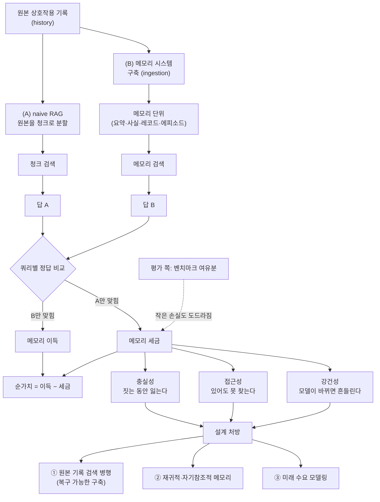
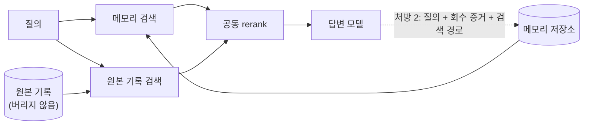

<figure class="post-figure post-figure--header">
<svg role="img" aria-labelledby="mt-h-title mt-h-desc" viewBox="0 0 720 360" xmlns="http://www.w3.org/2000/svg">
  <title id="mt-h-title">메모리 세금 — 가공 공장과 원본 서고</title>
  <desc id="mt-h-desc">왼쪽에 원본 대화 기록 두루마리 더미가 있다. 위쪽 경로에서는 두루마리가 '메모리 시스템' 공장에 들어가 요약 카드로 나오는데, 공장 아래로 증거 조각 몇 개가 바닥에 떨어지고 출구 옆에서 징수원이 '세금' 주화를 걷는다. 아래쪽 경로에서는 naive RAG 서고가 원본 청크를 그대로 꺼내 쓴다. 두 경로 모두 오른쪽의 답으로 이어진다.</desc>
  <defs>
    <marker id="mt-h-arrow" markerWidth="9" markerHeight="9" refX="7" refY="4" orient="auto">
      <path d="M0 0 L8 4 L0 8 Z" fill="currentColor"/>
    </marker>
    <marker id="mt-h-green" markerWidth="9" markerHeight="9" refX="7" refY="4" orient="auto">
      <path d="M0 0 L8 4 L0 8 Z" fill="var(--secondary-color)"/>
    </marker>
  </defs>
  <!-- scroll pile: raw history -->
  <g fill="var(--bg-light)" stroke="currentColor" stroke-width="2">
    <rect x="34" y="196" width="96" height="18" rx="9"/>
    <rect x="40" y="176" width="88" height="18" rx="9"/>
    <rect x="30" y="156" width="92" height="18" rx="9"/>
    <rect x="44" y="136" width="80" height="18" rx="9"/>
  </g>
  <g fill="var(--gold)">
    <circle cx="43" cy="205" r="4"/><circle cx="49" cy="185" r="4"/><circle cx="39" cy="165" r="4"/><circle cx="53" cy="145" r="4"/>
  </g>
  <text x="80" y="236" text-anchor="middle" font-size="13" font-weight="700" fill="currentColor">원본 대화 기록</text>
  <text x="80" y="252" text-anchor="middle" font-size="11" fill="var(--text-light)">(history)</text>
  <!-- upper path into the factory -->
  <path d="M126 140 C 150 110, 168 100, 192 100" fill="none" stroke="currentColor" stroke-width="2" marker-end="url(#mt-h-arrow)"/>
  <!-- factory -->
  <rect x="300" y="26" width="18" height="34" fill="var(--bg-light)" stroke="currentColor" stroke-width="2"/>
  <rect x="330" y="36" width="18" height="24" fill="var(--bg-light)" stroke="currentColor" stroke-width="2"/>
  <path d="M200 60 H360 V170 H200 Z" fill="var(--bg-light)" stroke="currentColor" stroke-width="2"/>
  <path d="M200 60 L240 40 L240 60 L280 40 L280 60" fill="none" stroke="currentColor" stroke-width="2"/>
  <circle cx="240" cy="122" r="18" fill="none" stroke="var(--gold)" stroke-width="3" stroke-dasharray="6 4"/>
  <circle cx="240" cy="122" r="6" fill="var(--gold)"/>
  <text x="310" y="104" text-anchor="middle" font-size="13" font-weight="700" fill="var(--accent-color)">메모리 시스템</text>
  <text x="310" y="124" text-anchor="middle" font-size="11" fill="var(--text-light)">요약 · 추출</text>
  <text x="310" y="140" text-anchor="middle" font-size="11" fill="var(--text-light)">그래프 · 계층</text>
  <!-- lost evidence falling to the floor -->
  <g stroke="var(--accent-color)" stroke-width="1.5" stroke-dasharray="3 4" fill="none">
    <path d="M232 172 V196"/><path d="M276 172 V204"/><path d="M322 172 V194"/>
  </g>
  <g fill="var(--bg-panel)" stroke="var(--accent-color)" stroke-width="2">
    <rect x="224" y="200" width="16" height="10" transform="rotate(-18 232 205)"/>
    <rect x="268" y="208" width="16" height="10" transform="rotate(14 276 213)"/>
    <rect x="314" y="198" width="16" height="10" transform="rotate(-8 322 203)"/>
  </g>
  <path d="M196 222 H368" stroke="currentColor" stroke-width="1.5" opacity="0.5"/>
  <text x="282" y="240" text-anchor="middle" font-size="11" fill="var(--accent-color)">떨어진 증거 조각</text>
  <!-- summary cards out -->
  <path d="M360 110 H392" fill="none" stroke="currentColor" stroke-width="2" marker-end="url(#mt-h-arrow)"/>
  <g fill="var(--bg-panel)" stroke="currentColor" stroke-width="2">
    <rect x="412" y="72" width="54" height="40" rx="3"/>
    <rect x="404" y="82" width="54" height="40" rx="3"/>
    <rect x="396" y="92" width="54" height="40" rx="3"/>
  </g>
  <g stroke="currentColor" stroke-width="1.5" opacity="0.6">
    <path d="M404 104 H440"/><path d="M404 113 H432"/><path d="M404 122 H438"/>
  </g>
  <text x="430" y="152" text-anchor="middle" font-size="11" fill="var(--text-light)">요약 카드</text>
  <!-- tax collector -->
  <circle cx="512" cy="56" r="9" fill="var(--bg-panel)" stroke="currentColor" stroke-width="2"/>
  <path d="M512 65 V92 M512 74 L496 84 M512 74 L526 80 M512 92 L504 112 M512 92 L520 112" fill="none" stroke="currentColor" stroke-width="2" stroke-linecap="round"/>
  <circle cx="538" cy="84" r="12" fill="var(--gold)" stroke="currentColor" stroke-width="2"/>
  <path d="M538 77 V91 M533 81 H543 M533 87 H543" stroke="currentColor" stroke-width="1.5"/>
  <text x="520" y="132" text-anchor="middle" font-size="13" font-weight="700" fill="var(--accent-color)">메모리 세금</text>
  <!-- upper path to answer -->
  <path d="M452 140 C 520 172, 580 182, 614 186" fill="none" stroke="currentColor" stroke-width="2" marker-end="url(#mt-h-arrow)"/>
  <!-- lower path: naive RAG archive -->
  <path d="M134 206 C 170 220, 180 292, 210 292" fill="none" stroke="var(--secondary-color)" stroke-width="2.5" marker-end="url(#mt-h-green)"/>
  <rect x="218" y="262" width="250" height="70" rx="6" fill="var(--bg-light)" stroke="var(--secondary-color)" stroke-width="2"/>
  <path d="M218 297 H468" stroke="var(--secondary-color)" stroke-width="1.5"/>
  <g fill="var(--bg-panel)" stroke="currentColor" stroke-width="1.5">
    <rect x="232" y="270" width="34" height="20" rx="8"/><rect x="274" y="270" width="34" height="20" rx="8"/><rect x="316" y="270" width="34" height="20" rx="8"/>
    <rect x="358" y="270" width="34" height="20" rx="8"/><rect x="400" y="270" width="34" height="20" rx="8"/>
  </g>
  <text x="343" y="315" text-anchor="middle" font-size="13" font-weight="700" fill="var(--secondary-color)">naive RAG 서고</text>
  <text x="343" y="348" text-anchor="middle" font-size="11" fill="var(--text-light)">원본 청크를 그대로 꺼내 검색</text>
  <path d="M470 296 C 560 290, 600 240, 618 212" fill="none" stroke="var(--secondary-color)" stroke-width="2.5" marker-end="url(#mt-h-green)"/>
  <!-- answer -->
  <circle cx="648" cy="194" r="32" fill="var(--bg-panel)" stroke="var(--gold)" stroke-width="3"/>
  <text x="648" y="200" text-anchor="middle" font-size="16" font-weight="700" fill="currentColor">답</text>
  <text x="648" y="150" text-anchor="middle" font-size="11" fill="var(--text-light)">어느 쪽이 더 맞히나?</text>
</svg>
<figcaption>가공한 기억은 정리되어 보이지만, 짓는 동안 증거를 떨어뜨리고 세금을 문다. 메모리의 값은 원본을 그대로 꺼내 쓰는 RAG 대비 순가치로 따져야 한다.</figcaption>
</figure>

## 원문 정보

> - **제목**: *Memory Tax: Dissecting the Net Value of Agent Memory*
> - **저자**: Xuan He, Sining Zhoubian, Ruozhen Yang, Yuhao Wen, Zhineng Wang, Yuyang Hu, Ke Yang, Yuyu Zhang, Ping Nie, Jiawei Han, ChengXiang Zhai — University of Illinois Urbana-Champaign, Tsinghua University, Renmin University of China, Verdent.ai, University of Waterloo
> - **출처**: arXiv:2610.34073v1 [cs.CL] · Hugging Face Papers 소개 페이지
> - **발행**: 2026-10-25 제출 (v1) · 본문 8절 + 부록 A–F
> - **원문 링크**: <https://arxiv.org/abs/2610.34073> · <https://huggingface.co/papers/2610.34073>
> - **프로젝트 페이지**: <https://hexuan21.github.io/MemoryTax/> (저자들은 코드와 결과를 공개하겠다고 밝힘)

"에이전트에 장기 기억을 붙이자"는 요즘 하니스 설계의 단골 주제다. 이 논문은 그 기억 장치가 **가장 단순한 대안보다 실제로 나은지**를 정면으로 묻는다. 그래서 Articles에 담는다. 본문은 arXiv HTML 판을 읽고 정리했다. 다만 표와 그림 안에만 있는 수치는 대부분 옮기지 않았고, 본문 텍스트나 HTML로 읽힌 표에 적힌 숫자만 인용했다. 저자 목록은 arXiv 초록 페이지 기준(11인)이다.

## 한 줄 요약 (TL;DR)

여러 벤치마크와 백본 모델에서 **많은 전용 메모리 시스템이 naive RAG(원본 기록을 청크로 잘라 바로 검색)보다 성적이 낮았다.** 즉 순가치(net value)가 음수인 경우가 많다. 저자들은 RAG를 기준선으로 놓고 메모리의 순가치를, RAG가 못 푼 문제를 풀어 주는 **메모리 이득(memory benefit)**과 RAG가 이미 풀던 문제를 망가뜨리는 **메모리 세금(memory tax)**으로 나눈다. 세금은 정보를 잃고(충실성), 찾기 어렵게 만들고(접근성), 모델이 바뀌면 흔들리는(강건성) 데서 생긴다. 이 현상은 경험 메모리와 월드 모델 메모리에서도 비슷하게 나타난다.

## 왜 이 글을 골랐나

에이전트 메모리는 "있으면 좋은 것"으로 당연하게 여겨진다. 요약하고, 사실을 뽑고, 그래프로 엮고, 계층으로 쌓는다. 이 위키도 [에이전트가 그래프를 도구이자 기억으로 쓰는 방식](/2026/07/21/kg-agentic-knowledge-graph.html)이나 [Opus 5로 그래프 메모리를 싸게 짓는 법](/2026/08/01/graph-engineering-with-opus-5.html)처럼 메모리를 **만드는 쪽**의 글을 여럿 다뤘다.

이 논문은 반대 방향에서 묻는다. "만든 메모리가 원본을 그냥 검색하는 것보다 나은가?" 그리고 그 답이 자주 "아니오"라는 것, 왜 아니오인지를 세 갈래로 해부한다. 메모리를 설계·도입하는 사람에게 **비교 기준선과 손익 계산법**을 주는 글이다. [GraphRAG 포스트](/2026/07/21/kg-graphrag.html)가 "벡터 RAG의 한계를 무엇으로 메우나"를 다뤘다면, 이 논문은 "메우려다 무엇을 잃나"를 다룬다고 볼 수 있다.

### 한눈에 보기

논문의 척추를 한 장으로 그리면 다음과 같다. 같은 원본 기록에서 두 경로로 답을 내고, 쿼리별로 비교해 이득과 세금을 가른 뒤, 세금의 원천과 처방으로 이어진다.

## 핵심 내용

### 문제 설정: 메모리의 "순가치"를 묻다

논문은 메모리 시스템을 세 단계로 형식화한다. 상호작용 기록(history)을 **구축(ingestion)** 과정으로 지속 메모리로 바꾸고, 질의가 오면 메모리 단위를 **검색(retrieval)** 하고, 그것으로 **답(answering)** 을 만든다. 메모리의 형태는 요약, 추출된 사실, 구조화 레코드, 에피소드 항목 등 다양하다.

비교 기준은 **naive 청크 기반 RAG**다. 원본 기록을 최소한으로만 가공해 보관하고 관련 청크를 바로 검색한다. 핵심 질문은 이것이다. 메모리를 짓는 수고가 원본을 직접 검색하는 것보다 **순(net)으로** 이득인가?

### 실험 무대: 시스템 11종, 벤치마크 3종, 백본 3종

평가 대상 메모리 시스템은 구조별로 네 계열이다.

| 계열 | 시스템 |
| --- | --- |
| Flat store | A-Mem, SimpleMem, MemOS |
| 계층/생애주기(Hierarchical/Lifecycle) | MemoryOS, LightMem, OpenViking |
| 그래프 기반 | HippoRAG2, PlugMem, MAGMA |
| 학습된 정책(Trained policy) | Mem-T, Memory-R2 |

기준선 RAG는 꽤 공들인 "naive"다. 원본 기록을 턴 단위로, 세션 경계를 넘지 않게 약 1024자 청크로 자르고, BM25와 dense 검색(Qwen3-Embedding-0.6B)을 따로 돌린 뒤 합집합을 reranker(Qwen3-Reranker-0.6B)로 재정렬한다. 한 번 검색하는 RAG (1rd)와, 백본이 후속 질의를 한 번 더 던지는 RAG (2rd) 두 변형이 있다(1rd·2rd는 논문 표기로, 검색 라운드 수를 뜻한다). 부록의 ablation에서 청킹·검색 방식·임베딩·reranker를 바꿔도 RAG는 비교적 안정적이었고, 턴을 쪼개는 스트리밍 청킹이나 BM25 단독일 때 가장 크게 떨어졌다고 한다.

벤치마크는 LongMemEval-s(500문항 전체), PersonaMem-v2(20% 부분집합), MINT-Eval(10% 부분집합)이고, 백본은 Qwen3.5-4B, Qwen3.6-27B, GPT-5.6 Luna(low)다. 참고선으로 No Context, Full Context, Gold Context(정답 증거만 주는 오라클)도 함께 잰다.

### 관찰: 많은 메모리 시스템이 RAG를 못 이긴다

본문의 전체 판정은 "많은 메모리 시스템이 많은 경우에 RAG를 이기지 못한다"이고, 4.1절은 이것이 **상당히 더 높은 비용에도 불구하고** 벌어진다고 덧붙인다. 그림 1은 정확도 대 토큰 비용을 파레토 도표로, 메모리 저장소 크기를 버블 크기로 보여 준다.

표 1(LongMemEval-s)에서 읽히는 대표 숫자는 다음과 같다(순서대로 Qwen3.5-4B / Qwen3.6-27B / GPT-5.6 Luna).

| 방법 | 4B | 27B | Luna |
| --- | --- | --- | --- |
| RAG (2rd) | 72.2 | 81.4 | 90.0 |
| MAGMA | 60.8 | 68.2 | 76.0 |
| OpenViking | 31.8 | 58.8 | 63.0 |

모든 시스템이 다 진다는 뜻은 아니다. 핵심은 **쿼리 단위로 보면 이득과 손실이 동시에 존재한다**는 점이다(그림 2의 벤 다이어그램). 메모리는 RAG가 놓친 문제를 일부 풀지만, RAG가 이미 풀던 문제를 일부 잃는다. 이 잃는 쪽이 메모리 세금이다.

<figure class="post-figure">
<svg role="img" aria-labelledby="mt-v-title mt-v-desc" viewBox="0 0 640 310" xmlns="http://www.w3.org/2000/svg">
  <title id="mt-v-title">쿼리 단위로 본 메모리 이득과 메모리 세금</title>
  <desc id="mt-v-desc">두 원이 겹친 벤 다이어그램. 왼쪽 원은 RAG가 맞힌 질의, 오른쪽 원은 메모리가 맞힌 질의다. 왼쪽 원에만 속한 영역은 메모리 세금, 오른쪽 원에만 속한 영역은 메모리 이득, 겹친 영역은 둘 다 맞힌 질의다. 아래에 순가치는 이득에서 세금을 뺀 값이라고 적혀 있다.</desc>
  <circle cx="250" cy="145" r="112" fill="var(--secondary-color)" fill-opacity="0.12" stroke="var(--secondary-color)" stroke-width="2.5"/>
  <circle cx="390" cy="145" r="112" fill="var(--accent-color)" fill-opacity="0.10" stroke="var(--accent-color)" stroke-width="2.5"/>
  <text x="210" y="22" text-anchor="middle" font-size="14" font-weight="700" fill="var(--secondary-color)">RAG가 맞힘</text>
  <text x="430" y="22" text-anchor="middle" font-size="14" font-weight="700" fill="var(--accent-color)">메모리가 맞힘</text>
  <text x="196" y="138" text-anchor="middle" font-size="15" font-weight="700" fill="currentColor">메모리 세금</text>
  <text x="196" y="160" text-anchor="middle" font-size="11" fill="var(--text-light)">RAG는 풀던 질의를</text>
  <text x="196" y="175" text-anchor="middle" font-size="11" fill="var(--text-light)">메모리가 틀림</text>
  <text x="320" y="142" text-anchor="middle" font-size="13" font-weight="700" fill="currentColor">둘 다</text>
  <text x="320" y="160" text-anchor="middle" font-size="11" fill="var(--text-light)">맞힘</text>
  <text x="444" y="138" text-anchor="middle" font-size="15" font-weight="700" fill="currentColor">메모리 이득</text>
  <text x="444" y="160" text-anchor="middle" font-size="11" fill="var(--text-light)">RAG가 놓친 질의를</text>
  <text x="444" y="175" text-anchor="middle" font-size="11" fill="var(--text-light)">메모리가 맞힘</text>
  <rect x="170" y="270" width="300" height="32" rx="6" fill="var(--bg-light)" stroke="var(--gold)" stroke-width="2"/>
  <text x="320" y="291" text-anchor="middle" font-size="14" font-weight="700" fill="currentColor">순가치 = 이득 − 세금 (RAG 대비)</text>
</svg>
<figcaption>전체 정확도 한 숫자가 아니라 쿼리 단위로 본다. 메모리는 RAG가 놓친 문제를 일부 풀지만, RAG가 이미 풀던 문제를 일부 잃는다.</figcaption>
</figure>

### 정의: 메모리 이득과 메모리 세금

- **메모리 이득**: RAG가 놓친 질의를 메모리가 맞히는 경우. 대개 추출·집계·재조직·선호 추론에서 나온다. 저자들의 표현으로 "메모리 설계가 의도한 이득".
- **메모리 세금**: RAG가 이미 푸는 질의를 메모리가 틀리는 경우. 메모리 처리 뒤에 증거가 **사라지거나, 가려지거나, 접근하기 어려워져서** 생긴다.
- **순가치**: 둘의 차이. 외부 성능으로 드러나며, 모두 naive RAG 대비로 정의된다.

메모리 연구가 보통 이득만 보고하는 데 반해, 이 논문은 **간과되어 온 세금 쪽**에 초점을 맞춘다.

### 세금의 원천 1: 충실성(Faithfulness) — 짓는 동안 잃는다

정답 메모리 단위(gold memory unit)를 직접 주면 검색 실패가 사라지므로, 남는 격차는 **구축 단계에서 잃은 정보**를 반영한다. 사실 단위 주석(표 2)으로 보면 시스템 간 차이가 극적이다.

| 시스템 | 손실 없음 | 부분 손실 | 큰 손실 | 해당 단위 없음 |
| --- | --- | --- | --- | --- |
| MemoryOS | 98.4% | 0.0% | 0.0% | 1.6% |
| MAGMA | 93.6% | 6.2% | 0.2% | 0.0% |
| MemOS | 85.8% | 9.0% | 2.4% | 2.8% |
| OpenViking | 39.4% | 9.6% | 13.0% | 38.0% |

흥미로운 대목은 MAGMA·LightMem 같은 시스템이다. 정답 메모리를 주면 정답 원본 턴을 줄 때와 거의 비슷한 점수가 나오는데, 정작 원래 점수는 그보다 훨씬 낮다. 정보는 **보존되어 있는데도 꺼내지 못한다**는 뜻이고, 이것이 다음 원천으로 이어진다.

### 세금의 원천 2: 접근성(Accessibility) — 있어도 못 찾는다

반복 검색을 재연(replay)해 보면, 메모리 시스템은 첫 라운드에서 RAG보다 적은 질의를 회수한다. 관련 증거가 "더 깊이 묻혀" 있다. 실패 양상은 세 가지다.

- **파편화(fragmented)**: 하나의 증거가 여러 메모리 단위에 흩어진다.
- **희석(diluted)**: 무관한 내용과 섞여 한 단위 안에서 신호가 약해진다.
- **재서술(rephrased)**: 원문 표현이 바뀌어 질의와의 어휘·의미 정렬이 깨진다.

실제로 질의-증거 유사도는 원본 턴에서 메모리 단위로 넘어가며 대체로 떨어졌다(그림 5). 저자들은 이를 시스템 간 절대 비교가 아니라 **정렬의 이동**으로 읽어야 한다고 조심스럽게 단서를 단다.

<figure class="post-figure">
<svg role="img" aria-labelledby="mt-a-title mt-a-desc" viewBox="0 0 720 400" xmlns="http://www.w3.org/2000/svg">
  <title id="mt-a-title">접근성 세금의 세 가지 실패 양상</title>
  <desc id="mt-a-desc">위쪽에 증거 문장이 강조된 원본 대화 턴이 있고, 질의 화살표가 그 증거에 바로 닿는다. 메모리 구축을 거치면 세 갈래로 변형된다. 첫째 파편화는 증거가 여러 카드로 흩어지고, 둘째 희석은 무관한 문장들 속에 증거가 묻히며, 셋째 재서술은 증거가 다른 말로 바뀌어 질의 화살표와 어긋난다. 세 경우 모두 질의와 증거 사이의 거리가 원본보다 멀어진다.</desc>
  <defs>
    <marker id="mt-a-arrow" markerWidth="9" markerHeight="9" refX="7" refY="4" orient="auto">
      <path d="M0 0 L8 4 L0 8 Z" fill="currentColor"/>
    </marker>
    <marker id="mt-a-green" markerWidth="9" markerHeight="9" refX="7" refY="4" orient="auto">
      <path d="M0 0 L8 4 L0 8 Z" fill="var(--secondary-color)"/>
    </marker>
  </defs>
  <!-- query -->
  <rect x="60" y="44" width="110" height="40" rx="20" fill="var(--bg-light)" stroke="var(--secondary-color)" stroke-width="2"/>
  <text x="115" y="69" text-anchor="middle" font-size="13" font-weight="700" fill="var(--secondary-color)">질의</text>
  <path d="M172 72 H300" fill="none" stroke="var(--secondary-color)" stroke-width="2.5" marker-end="url(#mt-a-green)"/>
  <text x="236" y="62" text-anchor="middle" font-size="11" fill="var(--text-light)">바로 닿음</text>
  <!-- original turn -->
  <rect x="260" y="20" width="220" height="100" rx="6" fill="var(--bg-light)" stroke="currentColor" stroke-width="2"/>
  <text x="370" y="40" text-anchor="middle" font-size="12" font-weight="700" fill="currentColor">원본 대화 턴</text>
  <g stroke="currentColor" stroke-width="2" opacity="0.45">
    <path d="M278 56 H462"/><path d="M278 92 H450"/><path d="M278 106 H430"/>
  </g>
  <rect x="304" y="66" width="140" height="14" rx="3" fill="var(--gold)" fill-opacity="0.35" stroke="var(--gold)" stroke-width="2"/>
  <text x="374" y="77" text-anchor="middle" font-size="10" font-weight="700" fill="currentColor">증거 문장</text>
  <!-- ingestion fan-out -->
  <text x="252" y="126" text-anchor="end" font-size="12" fill="var(--text-light)">메모리 구축</text>
  <g fill="none" stroke="currentColor" stroke-width="2">
    <path d="M370 122 C 370 150, 130 140, 130 168" marker-end="url(#mt-a-arrow)"/>
    <path d="M370 122 V168" marker-end="url(#mt-a-arrow)"/>
    <path d="M370 122 C 370 150, 600 140, 600 168" marker-end="url(#mt-a-arrow)"/>
  </g>
  <!-- panels -->
  <g fill="var(--bg-panel)" stroke="var(--border-color)" stroke-width="1.5">
    <rect x="20" y="176" width="220" height="210" rx="6"/>
    <rect x="260" y="176" width="220" height="210" rx="6"/>
    <rect x="500" y="176" width="200" height="210" rx="6"/>
  </g>
  <text x="130" y="198" text-anchor="middle" font-size="13" font-weight="700" fill="var(--accent-color)">① 파편화</text>
  <text x="370" y="198" text-anchor="middle" font-size="13" font-weight="700" fill="var(--accent-color)">② 희석</text>
  <text x="600" y="198" text-anchor="middle" font-size="13" font-weight="700" fill="var(--accent-color)">③ 재서술</text>
  <!-- 1: fragmented into several cards -->
  <g fill="var(--bg-light)" stroke="currentColor" stroke-width="1.5">
    <rect x="38" y="214" width="56" height="36" rx="3" transform="rotate(-6 66 232)"/>
    <rect x="104" y="226" width="56" height="36" rx="3" transform="rotate(5 132 244)"/>
    <rect x="168" y="212" width="56" height="36" rx="3" transform="rotate(-3 196 230)"/>
  </g>
  <g fill="var(--gold)" fill-opacity="0.35" stroke="var(--gold)" stroke-width="1.5">
    <rect x="46" y="228" width="26" height="8" rx="2" transform="rotate(-6 66 232)"/>
    <rect x="112" y="240" width="24" height="8" rx="2" transform="rotate(5 132 244)"/>
    <rect x="176" y="226" width="22" height="8" rx="2" transform="rotate(-3 196 230)"/>
  </g>
  <text x="130" y="290" text-anchor="middle" font-size="11" fill="var(--text-light)">한 증거가 여러 단위로 흩어짐</text>
  <!-- 2: diluted among unrelated lines -->
  <rect x="300" y="210" width="140" height="78" rx="3" fill="var(--bg-light)" stroke="currentColor" stroke-width="1.5"/>
  <g stroke="currentColor" stroke-width="2" opacity="0.4">
    <path d="M310 222 H430"/><path d="M310 232 H420"/><path d="M310 242 H428"/>
    <path d="M310 262 H424"/><path d="M310 272 H430"/><path d="M310 280 H412"/>
  </g>
  <rect x="340" y="248" width="34" height="8" rx="2" fill="var(--gold)" fill-opacity="0.35" stroke="var(--gold)" stroke-width="1.5"/>
  <text x="370" y="306" text-anchor="middle" font-size="11" fill="var(--text-light)">무관한 내용 속에 신호가 묻힘</text>
  <!-- 3: rephrased, query misaligned -->
  <rect x="530" y="214" width="140" height="56" rx="3" fill="var(--bg-light)" stroke="currentColor" stroke-width="1.5"/>
  <rect x="544" y="236" width="112" height="12" rx="3" fill="none" stroke="var(--accent-color)" stroke-width="2" stroke-dasharray="5 3"/>
  <text x="600" y="232" text-anchor="middle" font-size="10" fill="var(--text-light)">다른 말로 바뀐 증거</text>
  <path d="M520 290 L578 254" fill="none" stroke="var(--secondary-color)" stroke-width="2" stroke-dasharray="4 4" marker-end="url(#mt-a-green)"/>
  <text x="560" y="300" font-size="11" fill="var(--text-light)">질의가 비껴감</text>
  <!-- distance meters -->
  <g font-size="10" fill="var(--text-light)">
    <text x="130" y="332" text-anchor="middle">질의와의 거리</text>
    <text x="370" y="332" text-anchor="middle">질의와의 거리</text>
    <text x="600" y="332" text-anchor="middle">질의와의 거리</text>
  </g>
  <g stroke="var(--accent-color)" stroke-width="2" stroke-dasharray="4 4">
    <path d="M44 356 H216"/><path d="M284 356 H456"/><path d="M518 356 H682"/>
  </g>
  <g fill="var(--secondary-color)"><circle cx="44" cy="356" r="5"/><circle cx="284" cy="356" r="5"/><circle cx="518" cy="356" r="5"/></g>
  <g fill="var(--gold)" stroke="currentColor" stroke-width="1.5"><circle cx="216" cy="356" r="5"/><circle cx="456" cy="356" r="5"/><circle cx="682" cy="356" r="5"/></g>
  <g font-size="11" font-weight="700" fill="var(--accent-color)" text-anchor="middle">
    <text x="130" y="376">멀어짐</text><text x="370" y="376">멀어짐</text><text x="600" y="376">멀어짐</text>
  </g>
</svg>
<figcaption>정보가 보존되어 있어도, 구축이 증거의 모양을 바꾸면 질의와의 정렬이 깨진다. 첫 라운드 검색에서 증거가 "더 깊이 묻히는" 이유다.</figcaption>
</figure>

### 세금의 원천 3: 강건성(Robustness) — 모델이 바뀌면 흔들린다

구축에 쓰는 모델만 바꿔도 점수가 눈에 띄게 변한다. 구축을 고정하고 질의응답 백본을 바꾸면, 많은 시스템에서 RAG보다 변동 폭이 크다. 저자들은 메모리가 "원본 기록 검색을 넘어서는 추가적인 취약성"을 들여올 수 있다고 쓴다. 메모리는 구축 모델과 응답 모델 **두 군데에 의존**하니 흔들릴 지점이 하나 더 있는 셈이다.

### 평가 쪽 문제: 벤치마크 여유분(Headroom)

세금은 시스템 설계뿐 아니라 **평가 설계**에서도 생긴다. 일부 벤치마크에서는 단순한 기준선이 이미 높다. 희귀 어휘 매칭(IDF-keyword)이 절대 정확도 50%를 넘고, RAG-Hybrid가 약 70%에 이른다. RAG가 이미 많이 푸는 벤치마크에서는 메모리가 보탤 여지가 적으니, 작은 손실도 세금으로 도드라진다. 반대로 구축을 거의 하지 않는 가벼운 시스템은 RAG 수준을 물려받으면서 세금을 덜 내기 때문에 이런 환경에서 경쟁력이 있다.

### 일반화: 경험 메모리와 월드 모델 메모리

- **경험 메모리(experiential memory)**: ALFWorld, WebShop, Mind2Web, BigCodeBench, AppWorld, τ²-Bench에서 Memp, ReasoningBank, G-Memory, SkillPro를 ReAct·RAG와 비교했다. 궤적을 워크플로·전략으로 증류하면 웹 과제에서는 RAG를 이길 수 있지만, **도구 사용 과제에서는 여러 메모리 방법이 RAG에 뒤처졌다.**
- **월드 모델 메모리**: Context-as-Memory와 MemoBench에서, 과거 관측을 **그대로 검색해 다시 주입**하는 방식이 강한 일관성을 보였고, 잠재(latent)·KV 캐시 기반 메모리는 이 단순한 방식을 일관되게 넘지 못했다.

메시지는 같다. 가공된 기억이 원본의 직접 재사용을 이기는 것은 당연하지 않다.

### 설계 처방 (6절)

저자들은 깊은 검색·질의 정제·더 강한 백본 같은 흔한 test-time scaling 기법은 일부러 처방에서 뺐다. 대신 세 가지 구조적 방향을 제시한다.

1. **구축 편차를 복구 가능하게 하라.** 평소 메모리 검색과 함께 **원본 기록에서도 검색**하고, 둘을 함께 rerank한 뒤 답을 만든다. 잃은 증거로 돌아갈 길을 남기는 것이다. 여러 시스템에서 일관된 향상과 세금 감소를 보였다고 하나, 개념 증명(proof of concept) 수준으로 제시한다.
2. **재귀적·자기참조적 메모리.** 과거 질의, 회수한 증거, 검색 경로 자체를 메모리로 저장해 깊이 파서 찾은 증거를 다음 비슷한 요구 때 바로 꺼내게 한다. 질의 쪽에서의 질의 간(inter-query) test-time scaling이기도 하다.
3. **과거 정보 너머 미래 수요를 모델링하라.** 미리 짓는(ahead-of-time) 메모리는 비싸고, 그때그때 짓는(just-in-time) 메모리는 사용자 지연을 늘린다. 중간 지점으로 사용자 관심사·접근 패턴에 대한 사전 분포로 구축 노력을 배분하자고 제안한다. 메모리를 "미래 관련성의 암묵적 추천 시스템"으로 보는 관점이다.

처방 1(원본 폴백)과 처방 2(재귀 메모리)를 하나의 흐름으로 겹쳐 그리면 다음과 같다.

### 한계 (저자들이 밝힌 것)

- 기준선은 대표적일 뿐 망라적이지 않고, 대부분 공식 설정을 쓰며 시스템별 튜닝은 제한적이었다.
- 벤치마크는 정적·오프라인·영어 전용이다. 장기 운영, 뒤섞인(interleaved) 세션, 다국어 배포는 다루지 않는다.
- 옴니모달·잠재·파라메트릭 메모리는 연구 범위 밖이다.
- 비용 때문에 부분집합을 썼다(PersonaMem-v2 20%, MINT-Eval 10%, GPT-5.6 Luna에서는 LongMemEval-s도 20%).
- GPT-5.6 Luna(low)보다 강한 최전선 모델은 포함하지 않았다.

## 분석과 인사이트

여기부터는 원문 요약이 아니라 내 해석이다.

### "메모리는 압축이고, 압축은 손실이다"를 측정 가능한 언어로 바꿨다

메모리 구축은 결국 **질의가 오기 전에** 무엇이 중요할지 미리 판단해 정보를 다시 쓰는 일이다. 그 판단이 틀리면 증거가 사라지거나(충실성), 찾기 힘든 모양으로 바뀐다(접근성). 직관적으로는 누구나 아는 이야기지만, 이 논문의 기여는 그것을 **RAG 대비 쿼리 단위 손익**이라는 재현 가능한 회계로 만든 데 있다. "우리 메모리가 정확도 X%"라는 단독 숫자 대신 "RAG보다 몇 개 더 맞히고 몇 개 더 틀렸나"를 보라는 것. 평가 설계 관점에서 [CS336 12강의 "하나의 참된 평가는 없다"](/2026/06/26/cs336-lecture-12-evaluation.html)와 같은 결의 교훈이다.

### 가장 아픈 발견은 충실성이 아니라 접근성이다

정보를 잃는 시스템(OpenViking의 "해당 단위 없음" 38%)은 고치기 쉬운 편이다. 더 미묘한 건 정보를 다 보존하고도 지는 경우다. 요약과 재서술은 사람이 읽기엔 더 깔끔하지만, **질의와의 정렬**이라는 검색의 관점에서는 원문 표현을 지우는 일이 된다. 사용자가 나중에 묻는 말은 대개 원래 대화의 말투와 단어를 닮아 있다. 메모리 단위를 "읽기 좋게" 만들수록 검색은 어려워질 수 있다는 역설이다.

### 강건성은 운영 비용 문제다

구축 모델과 응답 모델 둘 다에 민감하다는 것은 실무에선 **모델 교체 비용**이다. 하니스 쪽 모델을 업그레이드하거나 더 싼 모델로 구축 파이프라인을 돌리는 순간 메모리 품질이 흔들린다. 이미 지어 둔 메모리 저장소는 구축 당시 모델의 판단이 굳어진 산출물이기도 하다. 원본을 버렸다면 되돌릴 길이 없다. 이것이 처방 1(원본 폴백)이 사실상 가장 실용적인 이유라고 본다. [10월 28일에 정리한 스킬 적응 논문](/2026/10/28/skill-adaptation-harness-self-evolution.html)이 "같은 스킬이 모델마다 다르게 듣는다"를 보였다면, 이 논문은 "같은 메모리 설계가 모델마다 다르게 듣는다"를 보여 주는 짝으로 읽힌다.

### 비판적으로 볼 부분

- **기준선이 "naive"치고 강하다.** BM25 + dense 하이브리드에 reranker까지 얹은 RAG는 많은 프로덕션 RAG보다 탄탄하다. 메모리 시스템은 대부분 공식 설정 그대로였다. 공정한 비교인지는 독자가 판단할 몫이고, 저자들도 이를 한계로 적었다. 다만 거꾸로 보면 "잘 만든 RAG를 먼저 갖춰라"라는 실용적 메시지이기도 하다.
- **벤치마크가 RAG 친화적일 가능성.** 저자들 스스로 헤드룸 문제를 짚었다. 단일 사실 회상형 질의가 많은 벤치마크라면 원본 검색이 유리한 게 당연하다. 장기간 누적된 선호 변화, 여러 세션에 걸친 집계처럼 메모리 이득이 큰 질의 분포에서는 결론이 달라질 수 있다.
- **처방의 수치가 본문에 드러나지 않는다.** 6절의 개선 효과는 표로 제시된다고 하지만, 내가 읽은 HTML 본문 텍스트에서는 구체 수치를 확인하지 못했다. 개념 증명으로 받아들이는 게 맞다.
- **정적·영어 전용·부분집합 평가.** 실제 에이전트 메모리는 몇 달씩 쌓이고 덮어써진다. 이 논문은 그 시간 축을 다루지 않는다.

### 이 위키와의 연결

[GraphRAG](/2026/07/21/kg-graphrag.html)와 [Agentic Knowledge Graph](/2026/07/21/kg-agentic-knowledge-graph.html)는 "구조를 더해 검색을 강화한다"는 방향이었다. 이 논문의 평가 대상에도 그래프 기반 계열(HippoRAG2, PlugMem, MAGMA)이 있다. 구조를 더하는 일은 이득의 원천이자 세금의 원천이라는 점을 함께 기억하면 좋다. [생물학 에이전트 사례](/2026/06/19/agents-in-biology.html)에서 "결정론적 검색 계층이 모델 성능보다 중요했다"는 교훈도 같은 방향을 가리킨다. 검색 가능한 원본을 지키는 것이 영리한 가공보다 먼저다.

## 적용 포인트

- **메모리를 도입하기 전에 잘 만든 RAG 기준선부터 세워라.** 턴 단위 청킹(세션 경계 존중) + BM25·dense 하이브리드 + reranker. 이 기준선을 못 이기면 메모리는 비용만 늘린다.
- **평가는 쿼리 단위 손익으로.** 전체 정확도만 비교하지 말고 "RAG만 맞힘(세금)"과 "메모리만 맞힘(이득)"을 따로 세어라. 세금 쪽 사례를 열어 보면 원인이 충실성·접근성·강건성 중 어디인지 드러난다.
- **원본 기록을 버리지 마라.** 메모리 검색과 원본 검색을 병행하고 함께 rerank하는 폴백 경로를 두면, 구축 단계의 실수를 되돌릴 수 있다.
- **메모리 단위의 표현을 점검하라.** 요약·재서술이 원문 키워드를 지우지 않는지, 한 증거가 여러 단위로 흩어지지 않는지 확인한다. 가능하면 원문 인용을 함께 보관한다.
- **모델을 바꿀 때 메모리도 회귀 테스트하라.** 구축 모델과 응답 모델 각각을 바꿨을 때의 점수 변동을 RAG의 변동과 비교한다.
- **잘 찾은 증거를 재사용하라.** 깊은 검색으로 겨우 찾은 질의-증거 쌍을 메모리로 되먹이면, 다음 비슷한 질의의 비용과 실패를 줄일 수 있다.
- **벤치마크의 헤드룸을 먼저 재라.** IDF-keyword 같은 아주 단순한 기준선 점수가 높다면, 그 벤치마크는 메모리의 이득을 보여 주기에 부적합할 수 있다.

## 마무리

"Memory Tax"는 에이전트 메모리를 깎아내리는 글이 아니라 **계산서를 제대로 쓰자는 글**이다. 메모리는 정보를 조직해 RAG가 못 푸는 문제를 풀 수 있지만, 그 대가로 증거를 잃고 묻고 흔든다. 저자들의 결론처럼 메모리는 단독 성능이 아니라 RAG 대비 순가치로 판단해야 한다. 실무자에게 남는 한 문장은 단순하다. 원본을 지키고, 잘 만든 RAG와 쿼리 단위로 비교하고, 세금이 보이면 원본으로 돌아갈 길을 열어 둬라.

### 더 읽어보기

- [원문 — Memory Tax: Dissecting the Net Value of Agent Memory (arXiv:2610.34073)](https://arxiv.org/abs/2610.34073) — 논문 원문 (HTML 판에 표 1·2와 부록 A–F 수록)
- [Hugging Face Papers — 2610.34073](https://huggingface.co/papers/2610.34073) — 소개 페이지
- [프로젝트 페이지](https://hexuan21.github.io/MemoryTax/) — 저자들의 프로젝트 페이지 (코드·결과 공개 예정)
- [GraphRAG: 벡터 RAG의 한계를 그래프로 메우다](/2026/07/21/kg-graphrag.html) — 구조로 검색을 강화하는 쪽의 논리. 이 논문은 그 대가를 잰다
- [Agentic Knowledge Graph: 그래프를 도구이자 기억으로](/2026/07/21/kg-agentic-knowledge-graph.html) — 그래프 기반 에이전트 메모리의 설계
- [Opus 5로 그래프 메모리를 싸게 짓는 법](/2026/08/01/graph-engineering-with-opus-5.html) — 메모리 구축 비용을 줄이는 실전 설정. 이 논문의 "비용 대비 순가치" 관점과 함께 읽기
- [능력에 맞춰 진화하라: 약한 모델을 위한 스킬 적응](/2026/10/28/skill-adaptation-harness-self-evolution.html) — 하니스 구성 요소의 효용이 모델에 따라 갈린다는 짝 논문
- [생물학에 AI 에이전트를 들이는 길](/2026/06/19/agents-in-biology.html) — 결정론적 검색 계층이 모델 성능보다 중요했다는 사례
- [신뢰할 수 있는 Agentic AI 시스템 만들기](/2026/06/19/reliable-agentic-ai-systems.html) — 컨텍스트·하니스 엔지니어링을 신뢰성 관점에서
- [CS336 12강 — 평가](/2026/06/26/cs336-lecture-12-evaluation.html) — 무엇을 기준선으로 어떻게 재느냐가 결론을 바꾼다
