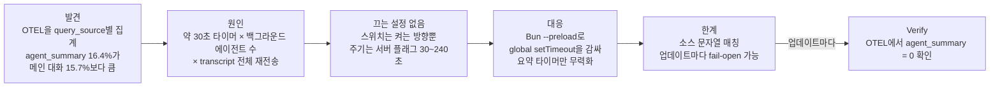
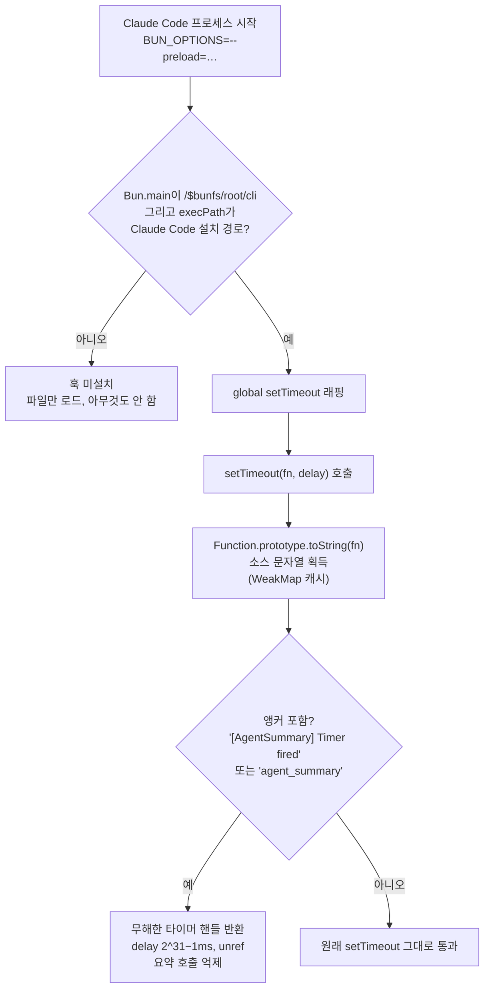

<figure class="post-figure post-figure--header">
<svg role="img" aria-labelledby="aws-h-title aws-h-desc" viewBox="0 0 720 340" xmlns="http://www.w3.org/2000/svg">
  <title id="aws-h-title">거대한 transcript를 통째로 넣고, 나오는 것은 3~5단어 깃발 하나</title>
  <desc id="aws-h-desc">왼쪽의 길게 펼쳐진 transcript 두루마리 전체가 약 30초마다 백그라운드 에이전트마다 가운데의 모델 화로(대개 Opus)로 밀려 들어간다. 오른쪽으로 나오는 것은 에이전트 패널 상태 줄에 꽂히는 3~5단어짜리 작은 깃발 하나뿐이다. 아래 띠에는 입력 대 출력 약 9,000 대 1, 그리고 저자 측 텔레메트리에서 agent_summary가 전체 지출의 16.4%로 메인 대화 15.7%보다 컸다는 수치가 적혀 있다.</desc>
  <defs>
    <marker id="aws-h-arrow" markerWidth="10" markerHeight="10" refX="8" refY="5" orient="auto">
      <path d="M0 0 L10 5 L0 10 Z" fill="var(--accent-color)"/>
    </marker>
  </defs>
  <!-- LEFT: the whole transcript scroll -->
  <text x="140" y="30" text-anchor="middle" font-size="13" font-weight="700" fill="currentColor">에이전트의 transcript 전체</text>
  <rect x="40" y="44" width="200" height="200" rx="4" fill="var(--bg-light)" stroke="currentColor" stroke-width="2"/>
  <rect x="30" y="38" width="220" height="14" rx="7" fill="var(--bg-panel)" stroke="currentColor" stroke-width="2"/>
  <rect x="30" y="236" width="220" height="14" rx="7" fill="var(--bg-panel)" stroke="currentColor" stroke-width="2"/>
  <g stroke="currentColor" stroke-width="3" stroke-linecap="round" opacity="0.55">
    <path d="M58 70 H210"/><path d="M58 86 H190"/><path d="M58 102 H222"/>
    <path d="M58 118 H176"/><path d="M58 134 H214"/><path d="M58 150 H198"/>
    <path d="M58 166 H222"/><path d="M58 182 H168"/><path d="M58 198 H206"/>
    <path d="M58 214 H186"/>
  </g>
  <!-- ARROW: scroll -> furnace -->
  <path d="M256 144 H322" fill="none" stroke="var(--accent-color)" stroke-width="4" marker-end="url(#aws-h-arrow)"/>
  <text x="289" y="124" text-anchor="middle" font-size="11" font-weight="700" fill="var(--accent-color)">약 30초마다</text>
  <text x="289" y="170" text-anchor="middle" font-size="11" fill="currentColor">에이전트마다</text>
  <!-- CENTER: model furnace -->
  <rect x="334" y="84" width="130" height="136" rx="10" fill="var(--bg-panel)" stroke="currentColor" stroke-width="2.5"/>
  <rect x="356" y="132" width="86" height="64" rx="6" fill="none" stroke="currentColor" stroke-width="2"/>
  <path d="M399 190 C372 176 384 158 392 146 C394 160 404 160 402 140 C418 154 428 176 399 190 Z" fill="var(--accent-color)" opacity="0.85"/>
  <path d="M399 188 C390 180 394 170 398 164 C402 172 410 176 399 188 Z" fill="var(--gold)"/>
  <text x="399" y="108" text-anchor="middle" font-size="13" font-weight="700" fill="currentColor">모델</text>
  <text x="399" y="124" text-anchor="middle" font-size="11" fill="var(--text-light)">(대개 Opus)</text>
  <text x="399" y="240" text-anchor="middle" font-size="11" fill="var(--text-light)">"최근 행동을 3~5단어로"</text>
  <!-- ARROW: furnace -> flag (thin, small output) -->
  <path d="M470 152 H540" fill="none" stroke="currentColor" stroke-width="1.5" stroke-dasharray="4 4"/>
  <!-- RIGHT: tiny flag on the agents-panel status line -->
  <rect x="548" y="126" width="150" height="54" rx="6" fill="var(--bg-light)" stroke="currentColor" stroke-width="1.5"/>
  <text x="623" y="118" text-anchor="middle" font-size="12" font-weight="700" fill="currentColor">에이전트 패널 상태 줄</text>
  <path d="M566 170 V138" stroke="currentColor" stroke-width="2"/>
  <path d="M567 139 L590 145 L567 152 Z" fill="var(--secondary-color)"/>
  <text x="600" y="158" font-size="12" font-weight="700" fill="var(--secondary-color)">3~5단어</text>
  <text x="623" y="200" text-anchor="middle" font-size="11" fill="var(--text-light)">UI 갱신에만 쓰임</text>
  <!-- BOTTOM band: the asymmetry -->
  <rect x="30" y="272" width="660" height="54" rx="8" fill="var(--bg-panel)" stroke="var(--border-color)" stroke-width="2"/>
  <text x="360" y="295" text-anchor="middle" font-size="14" font-weight="700" fill="var(--accent-color)">입력 : 출력 ≈ 9,000 : 1</text>
  <text x="360" y="315" text-anchor="middle" font-size="11" fill="currentColor">agent_summary = 전체 지출의 16.4% (메인 대화 15.7%) · Flamerix AI 텔레메트리 기준 추정치</text>
</svg>
<figcaption>상태 줄 3~5단어를 위해 약 30초마다 transcript 전체를 다시 보내는 agent_summary 호출 — 수치는 gist 저자 측 측정·추정이다</figcaption>
</figure>

## 원문 정보

> - **제목**: Claude Code burns ~15–20% of your tokens on a 3-word status line. Here's how to turn it off
> - **출처**: Flamerix AI ([flamerix.ai](https://flamerix.ai)) — GitHub gist (`README.md` + `no-agent-summary.js`, MIT License)
> - **발행**: 2026-10-26 최초 게시 · 2026-10-30 최종 갱신(v3 + docs) · 약 12분 분량(README 기준 추정)
> - **원문 링크**: <https://gist.github.com/flamerix-ai/c3905705cc4205e5de3011fa2e74efce>

이 글은 **Anthropic의 공식 문서가 아니라**, 한 회사(Flamerix AI)가 자사 텔레메트리와 Claude Code 바이너리 분석을 바탕으로 개인 gist에 올린 **비공식 분석 + 우회 스크립트**다. 수치는 그들의 측정·추정이고, 바이너리 내부 동작에 대한 설명도 그들의 리버스 엔지니어링 결과다. Anthropic의 확인이나 반박은 원문에 없다. 그럼에도 "코딩 에이전트 하니스가 내 토큰을 어디에 쓰는가"를 계측으로 밝혀낸 드문 사례라서 Articles에 담는다.

## 한 줄 요약 (TL;DR)

Flamerix AI의 분석에 따르면 Claude Code는 백그라운드 에이전트마다 약 30초 간격으로 **그 에이전트의 전체 transcript를 모델(보통 Opus)에 다시 보내** "최근 행동을 3~5단어로 묘사하라"고 묻고, 그 답은 에이전트 패널의 상태 줄을 채우는 데만 쓰인다. 저자 측 텔레메트리에서 이 `agent_summary` 호출은 **전체 지출의 16.4%로 메인 대화(15.7%)보다 컸고**, 이를 끄는 공식 설정이 없어 `setTimeout`을 가로채는 Bun preload 훅을 만들어 공개했다.

## 왜 이 글을 골랐나

코딩 에이전트를 오래 돌려 본 사람이라면 "왜 이렇게 rate limit에 빨리 닿지?"를 한 번쯤 겪는다. 대개 범인은 내 프롬프트나 긴 컨텍스트라고 가정한다. 이 gist는 그 가정을 깨는 데이터를 내놓는다. **사용자가 요청하지 않은, 하니스가 UI를 위해 몰래 쏘는 사이드 쿼리**가 메인 작업보다 큰 비용을 차지할 수 있다는 것이다.

이 위키에서는 하니스를 "모델을 에이전트로 바꾸는 런타임 계층"으로 여러 번 다뤘다([무엇이 하니스를 하니스로 만드는가](/2026/08/03/what-makes-a-harness-a-harness.html), [Claude Mods: 하니스를 안팎으로 뒤집다](/2026/10/27/claude-mods-harness-inside-out.html)). 이 글은 같은 하니스를 **비용 회계와 관측 가능성(observability)** 의 시각에서 해부한다. 또 tmux 위에서 여러 Claude Code 세션을 관제하는 도구들([tmux-claude-session-manager](/2026/07/11/tmux-claude-session-manager.html), [Orc Camp](/2026/07/19/orc-camp-tmux-agent-dashboard.html))이 해결하려던 "에이전트가 지금 뭘 하나"라는 질문을, Claude Code가 내부적으로 **어떤 비용을 치르며** 풀고 있었는지 보여 준다.

### 한눈에 보기

## 핵심 내용

### 1. 문제: 상태 줄 하나를 위한 전체 transcript 재전송

원문이 설명하는 동작은 다음과 같다.

- 약 **30초마다, 백그라운드 에이전트 하나하나에 대해** Claude Code가 그 에이전트의 **transcript 전체**를 해당 에이전트의 모델(대개 Opus)로 보내 "describe your most recent action in 3-5 words"라고 요청한다.
- 응답은 agents 패널의 **상태 줄을 갱신하는 데만** 쓰이고, 모델이나 사용자 대화로는 돌아가지 않는다.
- 이를 끄는 설정은 없으며, **2.1.232(2026년 8월)부터 기본 활성화**되어 있다.

발견 경위는 Flamerix AI의 DRIM이 Claude Code의 OpenTelemetry export에서 `claude_code.api_request` 이벤트를 `query_source`로 묶어 본 것이다. 결과는 다음 표와 같다.

| `query_source = agent_summary` | 훅 적용 전 1주 | 적용 후 2일 |
|---|---|---|
| Claude Code 전체 지출 중 비중 | **16.4%** (메인 대화: 15.7%) | **0%** |
| 전체 API 요청 중 비중 | **19.7%** (약 5건 중 1건) | **0%** |
| 그 지출 중 Opus 비중 | 96% | — |
| 출력 토큰 1개당 입력 토큰 | 약 9,000 : 1 | — |

원문은 몇 가지 단서를 분명히 단다. 여기서 "지출"은 청구서가 아니라 Claude Code가 요청마다 계산하는 추정치(`cost_usd`)이며, 구독 요금제에서는 돈이 아니라 **rate limit 여유분**을 잃는 셈이다. 또 이들만의 관측이 아니라, Claude Code 저장소의 이슈 [#86879](https://github.com/anthropics/claude-code/issues/86879)에 18~26%라는 독립 측정 4건이 모여 있다고 한다.

시간에 따른 추이도 소개한다. 저자 측 텔레메트리에서 이 비중은 7월 주간 3.5~7%였다가, 2.1.233을 받은 무렵 7.3% → 11.8%로 올랐고, 10월 중순에는 약 16%에 이르렀다.

### 2. 왜 "설정 하나로 끄면" 안 되는가

원문의 "Why there is no setting for this" 절은 이 기능을 끌 공식 수단이 사실상 없다는 점을 바이너리 분석으로 설명한다.

- **문서화된 스위치는 켜는 방향으로만 동작한다.** SDK 옵션 `agentProgressSummaries`의 기본값은 `false`지만, 번들 안에서는 OR 식의 한 항일 뿐이고 이를 쓰는 모든 코드 경로가 `true`를 넣는다. 문서에 없는 `CLAUDE_CODE_AGENT_PROGRESS_SUMMARIES` 환경 변수도 켜기만 할 수 있다.
- **주기는 서버가 정한다.** 모델 계열별 서버 플래그에서 오며 30~240초로 clamp된다. 기본값이 이미 최솟값(30초)이고, 어떤 값으로도 타이머 자체를 끌 수 없다.
- **흔히 떠올리는 환경 변수는 빗나간다.** 일부 패키저가 설정하는 `DISABLE_NON_ESSENTIAL_MODEL_CALLS`는 바이너리에 아예 존재하지 않는다. `CLAUDE_CODE_FORK_SUBAGENT=0`, `CLAUDE_CODE_DISABLE_BACKGROUND_TASKS=1`은 요약을 멈추긴 하지만 fork subagent나 백그라운드 에이전트 자체를 함께 없앤다.
- **prompt cache는 비용을 줄일 뿐 없애지 못한다.** 약 98%의 호출이 캐시에서 transcript를 다시 읽지만, 캐시가 식은 약 2%가 비용의 3분의 1 이상을 차지한다.
- **transcript를 읽는 비용 도구에는 보이지 않는다.** 이 요청은 디스크의 세션 로그에 기록되지 않고([#104358](https://github.com/anthropics/claude-code/issues/104358)) OpenTelemetry export에만 나타난다. 백그라운드 토큰 사용에 관한 문서 절에도 이 항목은 없는 반면, Agent View의 행 요약은 Haiku급 모델이 몇 분마다 갱신한다고 문서화되어 있다고 원문은 대비시킨다.
- **더 싼 변형은 이미 있지만 꺼져 있다.** 2.1.310에는 전체 transcript 대신 약 2k 토큰의 노트를 보내고, 선택적으로 더 작은 모델이 쓰는 `short` 모드가 들어 있다. 기본값은 여전히 전체 transcript이며 서버 플래그로만 바꿀 수 있다.

원문이 정리한 2026년 타임라인은 다음과 같다.

| 버전(공개일) | 변화 |
|---|---|
| 2.1.32 (2/5) | 코드 첫 등장, 공개 빌드에서는 비활성 |
| 2.1.72 (3/9) | SDK opt-in으로 도달 가능 |
| 2.1.117 (4/21) | fork 게이트나 서버 롤아웃을 통해 대화형 CLI에서 도달 가능 |
| ≤ 2.1.220 (7/24) | forked skill은 항상 요약 |
| **2.1.232 (8/13)** | **대화형 백그라운드 에이전트에 기본 활성화** |
| 2.1.300 (10/14) | 주기가 서버에서 조정 가능(30~240초) |
| 2.1.310 (10/23) | 더 싼 `short` 모드 추가, 기본 비활성 |

### 3. 해법: `setTimeout`만 감싸는 Bun preload 훅

`no-agent-summary.js`는 약 70줄짜리 Bun preload다. Claude Code 바이너리는 **수정하지 않고**, 환경 변수 `BUN_OPTIONS=--preload=<path>`로 Claude Code 프로세스가 뜰 때 함께 로드된다.

동작 원리는 이렇다.

- **global `setTimeout`만 감싼다.** 요약 타이머가 이 경로로 걸리기 때문이다. 콜백의 소스 텍스트에 요약기 앵커(예: `[AgentSummary] Timer fired` 로그 문자열, `agent_summary` query-source id)가 들어 있으면, 실제 타이머 대신 **아무 일도 하지 않는 핸들**을 돌려준다. 나머지 타이머는 그대로 통과한다.
- **왜 하필 타이머 훅인가.** 해당 모듈은 미리 컴파일된 Bun bytecode로 배포되므로 바이너리 안의 JS 텍스트를 고쳐도 소용이 없고, API 클라이언트는 감쌀 수 있는 `globalThis.fetch`를 거치지 않는다. 하지만 bytecode로 실행되더라도 `Function.prototype.toString`은 콜백의 소스를 돌려주므로, 문자열로 타이머를 식별할 수 있다.
- **"무한" 대신 정확히 2³¹−1ms.** Node와 Bun은 그보다 큰 delay를 1ms로 취급하므로, 무한대처럼 보이는 값을 넣으면 오히려 즉시 실행된다. 돌려주는 핸들은 `unref()`로 이벤트 루프를 붙잡지 않게 한다(스크립트 기준).
- **Claude Code 안에서만 설치된다(v3).** `Bun.main`이 컴파일된 진입점 `/$bunfs/root/cli`이고 `process.execPath`가 Claude Code 설치 경로(nix의 `.claude-wrapped`, npm의 `claude.exe`, 플랫폼 패키지의 `claude`, 네이티브 설치기의 `claude/versions/<semver>`)일 때만 훅이 걸린다. 다른 `bun` 프로세스는 파일을 로드하되 아무것도 하지 않는다. 단 README가 밝히듯, 다른 바이너리라도 `--outfile cli`로 빌드해 이름을 `claude`로 바꾸면 게이트를 통과해 앵커가 일치하는 타이머가 감싸진다. 이 게이트와 `--preload=` 형식은 댓글 작성자 Bedz01의 제안을 반영한 것이다.

### 4. 설치와 운영상의 함정

원문은 설치 자체보다 **"제대로 걸렸는지"** 에 더 많은 지면을 쓴다. 아래는 원문의 안내를 옮긴 것이며, 이 위키가 설치를 권하는 절차가 아니다.

- **`=` 형식을 쓰라고 안내한다.** `BUN_OPTIONS`는 머신의 모든 `bun`에 전달되는데, `--preload <path>`처럼 공백을 쓰면 `bun install` 등 하위 명령이 `Script not found "install"`로 깨진다.
- **설치 후 데몬 재시작을 요구한다.** 데몬, pty host, 미리 띄워 둔 `bg-spare` 세션은 데몬을 시작한 클라이언트의 환경을 물려받으므로, `claude daemon stop --any`로 재시작해야 한다고 원문은 설명한다.
- **헤드리스 실행에도 필요하다.** `claude -p`, cron, CI, 에디터 통합 모두 환경 변수가 닿아야 한다. 다만 원문에 따르면 `claude -p`는 기본적으로 요약 타이머를 걸지 않으며, 기본 활성 오버헤드는 백그라운드 에이전트를 쓰는 **대화형 세션**에서 생긴다.
- **A/B 대조군.** `CC_AGENT_SUMMARY_MODE=pass`는 훅을 로드하고 로그만 남긴 채 모든 타이머를 통과시킨다. 요약이 돌아오는 것을 보여 줌으로써 `off`의 효과가 훅 덕분임을 증명하는 장치다.

### 5. 검증과 fail-open

원문이 가장 강조하는 대목이다. 매칭은 **소스 텍스트 기반**이므로 업데이트 하나로 조용히 무력화될 수 있다.

- 로그 문자열이나 query-source id의 이름이 바뀔 때
- 콜백이 `fn.bind(...)`(소스가 `toString`에 나오지 않음)나 다른 래퍼를 거쳐 전달될 때
- 문자열이 콜백 밖의 공유 상수로 옮겨질 때
- 타이머가 global `setTimeout`이 아닌 경로(`setInterval`, `require("timers")`, `timers/promises`, 스케줄러 루프)로 옮겨질 때

그래서 업데이트마다 (1) 로그에 `preload active mode=off`가 찍히는지, (2) 백그라운드 서브에이전트를 1~2분 돌렸을 때 `summary timer #1 suppressed (setTimeout, delay=30000)`가 나오는지, (3) OpenTelemetry에서 `query_source = agent_summary`가 0으로 유지되는지를 확인하라고 한다. 원문은 세 번째가 **모든 실패 모드를 잡는 유일한 검사**라고 말한다.

### 6. 효과와 테스트 범위

- 저자들은 2.1.301에서 모든 Claude Code 프로세스에 훅을 걸고 쓰는 동안 `agent_summary` 요청이 0건이었고, 다른 사이드 쿼리가 그 자리를 대신 키우지도 않았다고 보고한다.
- 서브에이전트, 백그라운드 에이전트, forked skill, 백그라운드 세션은 정상 동작한다. 눈에 보이는 변화는 **에이전트별 패널 상태가 더는 갱신되지 않는다는 것**(SDK `task_progress`에 `summary`가 없음)뿐이다.
- 오버헤드는 서로 다른 타이머 콜백마다 `toString` 한 번(`WeakMap` 캐시)이며, `claude --version` 기준 약 10ms → 17ms(1회 측정)였다.
- 테스트는 Linux x64에서 2.1.257~2.1.312를 대상으로 했다. 약 2.5분짜리 에이전트 실행에서 요약 fork 횟수가 "훅 없음 / `pass` / `off`" 순으로 대부분 **5 / 5 / 0**이었다. 2.1.257·2.1.280은 에이전트가 권한 프롬프트에서 멈춰 transcript가 바뀌지 않아 1 / 1 / 0이었다.
- README에 인용된 사용자 보고와 댓글 하나로 macOS(darwin-arm64, 2.1.312)에서도 동작이 확인되었다. 댓글에서는 Windows 2.1.312에서 5 / 5 / 0, 데스크톱 앱의 Code 탭에 번들된 Claude Code(2.1.309)에서도 같은 결과가 나왔다는 보고가 이어졌다. 다만 이는 댓글 작성자가 게이트를 Windows용으로 고친 자체 설치기(v2 기반 훅)로 측정한 것으로, 배포된 v3 스크립트가 그대로 Windows에서 동작한다는 뜻은 아니다(README 본문이 아니라 댓글 작성자의 보고다).

### 7. 댓글에서 보충된 사항

README 밖의 gist 댓글에서 나온 몇 가지도 맥락상 중요하다.

- **SDK/ACP에서는?** 작성자 답변에 따르면 백그라운드 Agent-tool 에이전트는 대개 대화형 모드에서만 요약되지만, **fork subagent(`subagent_type: "fork"`)와 forked skill(`context: fork`)은 SDK를 포함해 무조건 요약**된다.
- **데스크톱 앱.** 한 사용자는 데스크톱 앱 소스에 같은 기능이 있다고 보고하며 로컬 `~/.claude.json`에 캐시된 서버 플래그를 `short` 모드로 고치고 파일을 읽기 전용으로 만드는 우회책(부작용 미검증)을 공유했다(API 호출을 프록시해 실제 실행 여부를 확인하지는 않았다고 밝힘).
- **fail-open 감시를 자동화한 포크.** 다른 사용자는 빌드마다 바이너리에서 앵커 존재를 스캔하고, SessionStart 훅으로 세션 **안에서** 경고를 띄우는 포크를 공개했다. 전체 화면 UI가 stderr 경고를 덮어 버리기 때문이라는 이유가 붙어 있다.

### 8. 면책

원문은 MIT 라이선스이며 "as is"로 제공된다. 클라이언트의 런타임 동작을 바꾸는 것이 사용 중인 서비스 약관과 충돌할 수 있고, 그 확인은 사용자 책임이라고 명시한다. 또한 Anthropic과 무관한 독립 프로젝트임을 밝힌다.

## 분석과 인사이트

여기서부터는 원문 요약이 아니라 내 관점이다.

### 하니스의 "보이지 않는 호출"이라는 회계 문제

가장 인상적인 지점은 해법보다 **발견 방식**이다. 이 호출은 세션 로그에 남지 않으니, transcript를 읽는 비용 도구로는 영원히 찾을 수 없다. OpenTelemetry로 `query_source`별 집계를 했기 때문에 비로소 "메인 대화보다 UI 상태 줄이 더 비싸다"는 역설이 드러났다. 에이전트 하니스는 사용자 요청 외에도 요약·제목 생성·컴팩션·분류 같은 **사이드 쿼리**를 계속 쏜다. 이 위키에서 다룬 [메모리 세금](/2026/10/29/memory-tax-agent-memory-net-value.html)이 "메모리가 순가치를 내는가"를 물었다면, 이 gist는 **UI 편의 기능의 순가치**를 묻는 셈이다. 3~5단어 상태 줄이 그 비용을 정당화하는가?

### 입력:출력 9,000:1이 말해 주는 설계 냄새

출력이 3~5단어인 작업에 전체 transcript를, 그것도 메인 작업과 같은 Opus급 모델로 보낸다는 것은 비용 대비 효용이 극단적으로 비대칭이다. 원문이 지적하듯 **더 싼 `short` 모드(약 2k 토큰 노트 + 선택적 소형 모델)가 이미 코드에 있다**는 사실은, Anthropic도 이 문제를 인지하고 있을 가능성을 시사한다. 다만 기본값을 서버 플래그가 쥐고 있다는 점이 중요하다. 비용 프로필이 **클라이언트 버전이 아니라 서버 설정으로 바뀔 수 있다**는 뜻이다. 오늘의 측정이 내일도 유효하리라는 보장이 없으므로, 일회성 진단이 아니라 지속적 계측이 필요하다.

### prompt cache라는 착시

"98%가 캐시 히트"라는 숫자는 안심을 주지만, 원문은 나머지 2%가 비용의 3분의 1 이상을 차지한다고 말한다. 원문은 그 원인을 분석하지 않는다. 내 추측으로는, 캐시에는 TTL이 있으므로 transcript가 계속 바뀌면서도 호출 간격이 길어지는 경우 콜드 캐시 비중이 커질 수 있다. 한편 원문 측정에서는 transcript가 바뀌지 않으면(예: 권한 프롬프트에서 대기) 이후 타이머가 요약을 건너뛰었으므로, "오래 놀수록 비싸다"고 단정할 수는 없다. 분명한 것은 **동시에 많이 돌수록** 요약 호출 총량이 커진다는 점이다. 백그라운드 에이전트를 여러 개 띄워 두는 운영 방식이야말로 이 기능이 기본 활성화된 이유이자 비용이 커지는 이유라는 점이 아이러니하다.

### 해법 자체에 대해서는 신중해야 한다

훅의 엔지니어링은 깔끔하다. 바이너리를 건드리지 않고, `toString` 결과를 `WeakMap`으로 캐시하고, 2³¹−1ms 경계와 `util.promisify` 호환까지 챙겼다. 그러나 실무에 도입할 때 고려할 점이 있다.

- **전역 `BUN_OPTIONS`는 공급망 표면이다.** 머신의 모든 bun 프로세스가 특정 경로의 JS를 preload하게 된다. v3의 게이트가 Claude Code 밖에서는 아무것도 하지 않게 막지만, 파일 자체는 매번 로드·실행된다. 그 파일의 쓰기 권한 관리가 곧 보안 경계가 된다. 래퍼 스크립트 방식으로 Claude Code에만 주입하는 편이 범위가 좁지만, gist의 래퍼도 `BUN_OPTIONS`를 `export`하므로 에이전트가 Bash 도구로 실행하는 `bun` 같은 자식 프로세스에는 여전히 전달된다. 범위가 줄 뿐 닫히지는 않는다.
- **fail-open은 설계상 피할 수 없다.** 소스 문자열 매칭은 상대 측 코드가 바뀌면 조용히 무력화된다. 원문이 스스로 이를 가장 강조하고, 댓글에서 빌드 스캔 + SessionStart 경고 포크가 나온 것도 같은 이유다. 이런 우회책은 **검증 루프가 함께 있어야만** 의미가 있다.
- **약관과 지원 범위.** 원문 스스로 서비스 약관과의 충돌 가능성을 경고한다. 조직 환경이라면 개인 판단으로 깔기 전에 확인할 일이다.
- **수치의 일반화.** 16.4%는 한 조직의 사용 패턴(백그라운드 에이전트를 많이 쓰는)에서 나온 값이다. 댓글의 한 사용자는 일주일치 transcript를 30초 타이머로 재생(replay)해 웜 캐시 가정하에 약 8%를 추정했다. 내 환경의 비중은 내가 직접 재야 한다.

### 그래서 진짜 교훈은

훅을 깔지 말지보다 중요한 것은 **"하니스가 무엇을 호출하는지 측정할 수 있는가"** 다. [Anthropic이 Claude로 Claude를 출시하는 법](/2026/10/28/anthropic-ships-claude-with-claude.html)에서 보듯 에이전트 런타임은 점점 두꺼워지고, 그 안의 부수 호출은 사용자 시야 밖에서 늘어난다. 이 gist는 OTEL export 하나와 `query_source` 그룹핑만으로 그 블랙박스에 창을 낼 수 있음을 보여 준 사례다. 동시에, gist의 바이너리 분석이 맞다면 이런 기능에 opt-out이 없다는 점이 커뮤니티를 바이너리 리버스 엔지니어링으로 내몬다는 점도 하니스를 만드는 쪽이 새겨 둘 교훈이다.

## 적용 포인트

- **OpenTelemetry export를 켜고 `query_source`별로 집계하라.** 원문·#104358에 따르면 세션 로그 기반 비용 도구로는 이 호출이 보이지 않는다. 메인 대화 대비 사이드 쿼리 비중을 주 단위로 추적한다.
- **백그라운드 에이전트·fork subagent를 많이 쓰는지 먼저 확인하라.** 원문 기준으로 비용은 대화형 세션의 백그라운드 에이전트, 그리고 fork subagent/forked skill에서 발생한다. 그런 사용 패턴이 아니라면 영향이 작을 수 있다.
- **이 위키는 이 스크립트를 직접 검증하거나 설치를 권장하지 않는다.** 그래도 시도한다면 ① 약 70줄의 코드를 직접 읽고, ② 최신 raw URL 대신 특정 gist 리비전(SHA)을 고정하고(raw URL은 작성자가 언제든 바꿀 수 있다), ③ 전역 셸 프로파일 대신 래퍼로 범위를 좁히되 래퍼도 자식 프로세스에 `BUN_OPTIONS`를 물려준다는 점을 알아 두자.
- **쓰기로 했다면 검증까지 한 세트로.** `pass` 모드로 A/B 대조를 하고, 데몬 재시작(`claude daemon stop --any`)까지 마친 뒤 업데이트마다 로그와 OTEL에서 0건 유지를 확인한다.
- **"편의 기능의 순가치"를 내 하니스 설계에도 적용하라.** 직접 에이전트를 만든다면 상태 요약 같은 UI용 호출에 작은 모델·요약된 입력·긴 주기를 기본값으로 두고, 끌 수 있는 스위치를 제공한다.
- **공식 동작 변화를 주시하라.** 주기와 `short` 모드는 서버 플래그로 바뀐다. 측정치는 버전·시점과 함께 기록해 둔다.

## 마무리

Flamerix AI의 gist는 "3단어 상태 줄이 메인 대화보다 비싸다"는 도발적인 제목만큼이나, 그것을 **어떻게 찾아냈고 어떻게 검증하는가**가 값진 글이다. 해법인 Bun preload 훅은 영리하지만 본질적으로 fail-open인 임시방편이고, 원문도 이를 숨기지 않는다. 독자가 가져갈 것은 특정 스크립트보다 태도다. 코딩 에이전트 하니스는 내 토큰을 내가 모르는 곳에 쓸 수 있으며, 그걸 아는 유일한 방법은 하니스 바깥에서 계측하는 것이다. 비공식 분석이라는 출처의 한계를 감안하고, 내 환경에서 직접 재 보는 것부터 시작하자.

### 더 읽어보기

- [원문 — Claude Code burns ~15–20% of your tokens on a 3-word status line (Flamerix AI, GitHub gist)](https://gist.github.com/flamerix-ai/c3905705cc4205e5de3011fa2e74efce)
- [anthropics/claude-code 이슈 #86879](https://github.com/anthropics/claude-code/issues/86879) — 원문이 인용한 독립 측정(18~26%) 모음
- [anthropics/claude-code 이슈 #104358](https://github.com/anthropics/claude-code/issues/104358) — 해당 요청이 세션 로그에 남지 않는다는 이슈
- [무엇이 하니스를 하니스로 만드는가](/2026/08/03/what-makes-a-harness-a-harness.html) — 하니스를 런타임 계층으로 정의한 논문 분석
- [Claude Mods: 하니스를 안팎으로 뒤집다](/2026/10/27/claude-mods-harness-inside-out.html) — 하니스가 사람의 주의를 다루는 방식, 그리고 소음·비용의 한계
- [메모리 세금(Memory Tax)](/2026/10/29/memory-tax-agent-memory-net-value.html) — 에이전트 부가 기능의 "순가치"를 따지는 같은 계열의 질문
- [Claude로 Claude를 출시하는 법](/2026/10/28/anthropic-ships-claude-with-claude.html) — Anthropic 플랫폼 팀이 말하는 에이전트 런타임의 뒷면
- [tmux 안의 Claude Code 함대를 지휘하기](/2026/07/11/tmux-claude-session-manager.html) — 셸 스크립트만으로 세션 상태(working/waiting/idle)를 보여 주는 외부 관제 도구
- [Orc Camp: tmux 위의 코딩 에이전트들을 픽셀 캠프로 관제하기](/2026/07/19/orc-camp-tmux-agent-dashboard.html) — 에이전트 상태 관제를 직접 만든 사이드 프로젝트
