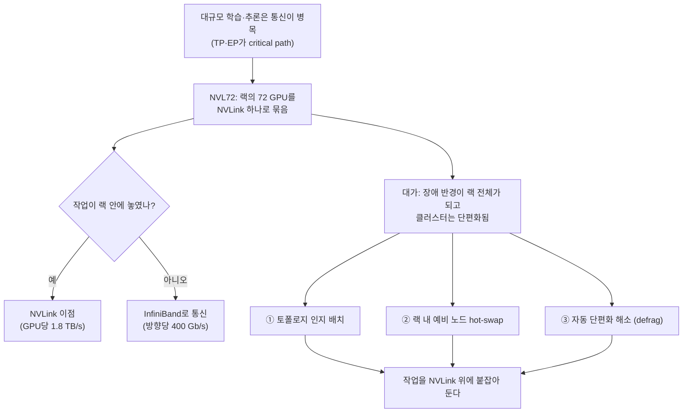
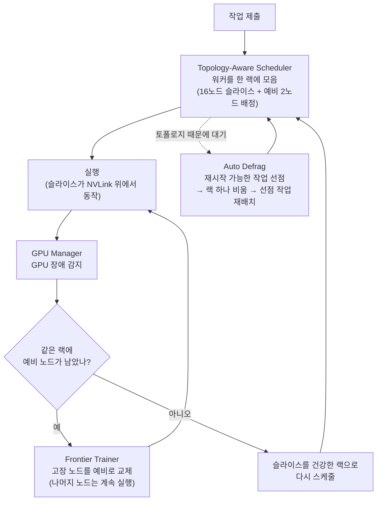

<figure class="post-figure post-figure--header">
<svg role="img" aria-label="18개 노드에 GPU가 4개씩, 모두 72개의 GPU가 꽂힌 랙 하나를 굵은 NVLink 고리가 감싸고 있다. 랙 안에서는 어떤 GPU 쌍이든 같은 빠른 길로 통신한다. 랙 경계 밖으로 나가 옆 랙으로 가는 InfiniBand 선은 가는 점선으로 그려져 대역폭이 줄어드는 것을 보여 준다. 랙이 곧 한 대의 서버라는 이미지다" viewBox="0 0 640 320">
  <title>랙이 곧 서버: NVLink 도메인과 랙 경계</title>
  <g font-family="var(--font-body)">
    <rect x="204" y="16" width="202" height="284" rx="14" fill="none" stroke="var(--gold)" stroke-width="6"/>
    <rect x="204" y="16" width="202" height="284" rx="14" fill="none" stroke="var(--gold)" stroke-width="16" opacity="0.18"/>
    <rect x="220" y="30" width="170" height="262" fill="var(--bg-light)" stroke="currentColor" stroke-width="2"/>
    <rect x="368" y="36" width="14" height="250" fill="var(--gold)" opacity="0.85"/>
    <rect x="228" y="36" width="28" height="10" fill="var(--secondary-color)"/>
    <rect x="262" y="36" width="28" height="10" fill="var(--secondary-color)"/>
    <rect x="296" y="36" width="28" height="10" fill="var(--secondary-color)"/>
    <rect x="330" y="36" width="28" height="10" fill="var(--secondary-color)"/>
    <rect x="358" y="40" width="10" height="2" fill="var(--gold)"/>
    <rect x="228" y="50" width="28" height="10" fill="var(--secondary-color)"/>
    <rect x="262" y="50" width="28" height="10" fill="var(--secondary-color)"/>
    <rect x="296" y="50" width="28" height="10" fill="var(--secondary-color)"/>
    <rect x="330" y="50" width="28" height="10" fill="var(--secondary-color)"/>
    <rect x="358" y="54" width="10" height="2" fill="var(--gold)"/>
    <rect x="228" y="64" width="28" height="10" fill="var(--secondary-color)"/>
    <rect x="262" y="64" width="28" height="10" fill="var(--secondary-color)"/>
    <rect x="296" y="64" width="28" height="10" fill="var(--secondary-color)"/>
    <rect x="330" y="64" width="28" height="10" fill="var(--secondary-color)"/>
    <rect x="358" y="68" width="10" height="2" fill="var(--gold)"/>
    <rect x="228" y="78" width="28" height="10" fill="var(--secondary-color)"/>
    <rect x="262" y="78" width="28" height="10" fill="var(--secondary-color)"/>
    <rect x="296" y="78" width="28" height="10" fill="var(--secondary-color)"/>
    <rect x="330" y="78" width="28" height="10" fill="var(--secondary-color)"/>
    <rect x="358" y="82" width="10" height="2" fill="var(--gold)"/>
    <rect x="228" y="92" width="28" height="10" fill="var(--secondary-color)"/>
    <rect x="262" y="92" width="28" height="10" fill="var(--secondary-color)"/>
    <rect x="296" y="92" width="28" height="10" fill="var(--secondary-color)"/>
    <rect x="330" y="92" width="28" height="10" fill="var(--secondary-color)"/>
    <rect x="358" y="96" width="10" height="2" fill="var(--gold)"/>
    <rect x="228" y="106" width="28" height="10" fill="var(--secondary-color)"/>
    <rect x="262" y="106" width="28" height="10" fill="var(--secondary-color)"/>
    <rect x="296" y="106" width="28" height="10" fill="var(--secondary-color)"/>
    <rect x="330" y="106" width="28" height="10" fill="var(--secondary-color)"/>
    <rect x="358" y="110" width="10" height="2" fill="var(--gold)"/>
    <rect x="228" y="120" width="28" height="10" fill="var(--secondary-color)"/>
    <rect x="262" y="120" width="28" height="10" fill="var(--secondary-color)"/>
    <rect x="296" y="120" width="28" height="10" fill="var(--secondary-color)"/>
    <rect x="330" y="120" width="28" height="10" fill="var(--secondary-color)"/>
    <rect x="358" y="124" width="10" height="2" fill="var(--gold)"/>
    <rect x="228" y="134" width="28" height="10" fill="var(--secondary-color)"/>
    <rect x="262" y="134" width="28" height="10" fill="var(--secondary-color)"/>
    <rect x="296" y="134" width="28" height="10" fill="var(--secondary-color)"/>
    <rect x="330" y="134" width="28" height="10" fill="var(--secondary-color)"/>
    <rect x="358" y="138" width="10" height="2" fill="var(--gold)"/>
    <rect x="228" y="148" width="28" height="10" fill="var(--secondary-color)"/>
    <rect x="262" y="148" width="28" height="10" fill="var(--secondary-color)"/>
    <rect x="296" y="148" width="28" height="10" fill="var(--secondary-color)"/>
    <rect x="330" y="148" width="28" height="10" fill="var(--secondary-color)"/>
    <rect x="358" y="152" width="10" height="2" fill="var(--gold)"/>
    <rect x="228" y="162" width="28" height="10" fill="var(--secondary-color)"/>
    <rect x="262" y="162" width="28" height="10" fill="var(--secondary-color)"/>
    <rect x="296" y="162" width="28" height="10" fill="var(--secondary-color)"/>
    <rect x="330" y="162" width="28" height="10" fill="var(--secondary-color)"/>
    <rect x="358" y="166" width="10" height="2" fill="var(--gold)"/>
    <rect x="228" y="176" width="28" height="10" fill="var(--secondary-color)"/>
    <rect x="262" y="176" width="28" height="10" fill="var(--secondary-color)"/>
    <rect x="296" y="176" width="28" height="10" fill="var(--secondary-color)"/>
    <rect x="330" y="176" width="28" height="10" fill="var(--secondary-color)"/>
    <rect x="358" y="180" width="10" height="2" fill="var(--gold)"/>
    <rect x="228" y="190" width="28" height="10" fill="var(--secondary-color)"/>
    <rect x="262" y="190" width="28" height="10" fill="var(--secondary-color)"/>
    <rect x="296" y="190" width="28" height="10" fill="var(--secondary-color)"/>
    <rect x="330" y="190" width="28" height="10" fill="var(--secondary-color)"/>
    <rect x="358" y="194" width="10" height="2" fill="var(--gold)"/>
    <rect x="228" y="204" width="28" height="10" fill="var(--secondary-color)"/>
    <rect x="262" y="204" width="28" height="10" fill="var(--secondary-color)"/>
    <rect x="296" y="204" width="28" height="10" fill="var(--secondary-color)"/>
    <rect x="330" y="204" width="28" height="10" fill="var(--secondary-color)"/>
    <rect x="358" y="208" width="10" height="2" fill="var(--gold)"/>
    <rect x="228" y="218" width="28" height="10" fill="var(--secondary-color)"/>
    <rect x="262" y="218" width="28" height="10" fill="var(--secondary-color)"/>
    <rect x="296" y="218" width="28" height="10" fill="var(--secondary-color)"/>
    <rect x="330" y="218" width="28" height="10" fill="var(--secondary-color)"/>
    <rect x="358" y="222" width="10" height="2" fill="var(--gold)"/>
    <rect x="228" y="232" width="28" height="10" fill="var(--secondary-color)"/>
    <rect x="262" y="232" width="28" height="10" fill="var(--secondary-color)"/>
    <rect x="296" y="232" width="28" height="10" fill="var(--secondary-color)"/>
    <rect x="330" y="232" width="28" height="10" fill="var(--secondary-color)"/>
    <rect x="358" y="236" width="10" height="2" fill="var(--gold)"/>
    <rect x="228" y="246" width="28" height="10" fill="var(--secondary-color)"/>
    <rect x="262" y="246" width="28" height="10" fill="var(--secondary-color)"/>
    <rect x="296" y="246" width="28" height="10" fill="var(--secondary-color)"/>
    <rect x="330" y="246" width="28" height="10" fill="var(--secondary-color)"/>
    <rect x="358" y="250" width="10" height="2" fill="var(--gold)"/>
    <rect x="228" y="260" width="28" height="10" fill="var(--secondary-color)"/>
    <rect x="262" y="260" width="28" height="10" fill="var(--secondary-color)"/>
    <rect x="296" y="260" width="28" height="10" fill="var(--secondary-color)"/>
    <rect x="330" y="260" width="28" height="10" fill="var(--secondary-color)"/>
    <rect x="358" y="264" width="10" height="2" fill="var(--gold)"/>
    <rect x="228" y="274" width="28" height="10" fill="var(--secondary-color)"/>
    <rect x="262" y="274" width="28" height="10" fill="var(--secondary-color)"/>
    <rect x="296" y="274" width="28" height="10" fill="var(--secondary-color)"/>
    <rect x="330" y="274" width="28" height="10" fill="var(--secondary-color)"/>
    <rect x="358" y="278" width="10" height="2" fill="var(--gold)"/>
    <text x="305.0" y="316" text-anchor="middle" font-size="13" font-weight="700" fill="currentColor">NVL72 랙 · 18노드 × 4 GPU</text>
    <text x="104" y="120" text-anchor="middle" font-size="22" font-weight="800" fill="var(--accent-color)">랙 = 서버</text>
    <text x="104" y="150" text-anchor="middle" font-size="13" fill="currentColor">NVLink 도메인 하나</text>
    <text x="104" y="172" text-anchor="middle" font-size="13" fill="currentColor">72 GPU · 130 TB/s</text>
    <text x="104" y="194" text-anchor="middle" font-size="13" fill="currentColor">GPU당 1.8 TB/s</text>
    <path d="M168 160 L196 160" stroke="var(--gold)" stroke-width="4"/>
    <path d="M196 152 L206 160 L196 168 Z" fill="var(--gold)"/>
    <path d="M406 160 C 450 160, 470 150, 520 150" fill="none" stroke="currentColor" stroke-width="1.5" stroke-dasharray="5 5" opacity="0.7"/>
    <text x="466" y="136" text-anchor="middle" font-size="13" font-weight="700" fill="currentColor">InfiniBand</text>
    <text x="466" y="186" text-anchor="middle" font-size="12" fill="currentColor" opacity="0.8">방향당 400 Gb/s</text>
    <text x="466" y="204" text-anchor="middle" font-size="12" fill="currentColor" opacity="0.8">랙 밖은 가늘어진다</text>
    <g opacity="0.35">
      <rect x="524" y="60" width="90" height="200" fill="var(--bg-light)" stroke="currentColor" stroke-width="2"/>
      <rect x="530" y="68" width="16" height="10" fill="currentColor"/>
      <rect x="550" y="68" width="16" height="10" fill="currentColor"/>
      <rect x="570" y="68" width="16" height="10" fill="currentColor"/>
      <rect x="590" y="68" width="16" height="10" fill="currentColor"/>
      <rect x="530" y="84" width="16" height="10" fill="currentColor"/>
      <rect x="550" y="84" width="16" height="10" fill="currentColor"/>
      <rect x="570" y="84" width="16" height="10" fill="currentColor"/>
      <rect x="590" y="84" width="16" height="10" fill="currentColor"/>
      <rect x="530" y="100" width="16" height="10" fill="currentColor"/>
      <rect x="550" y="100" width="16" height="10" fill="currentColor"/>
      <rect x="570" y="100" width="16" height="10" fill="currentColor"/>
      <rect x="590" y="100" width="16" height="10" fill="currentColor"/>
      <rect x="530" y="116" width="16" height="10" fill="currentColor"/>
      <rect x="550" y="116" width="16" height="10" fill="currentColor"/>
      <rect x="570" y="116" width="16" height="10" fill="currentColor"/>
      <rect x="590" y="116" width="16" height="10" fill="currentColor"/>
      <rect x="530" y="132" width="16" height="10" fill="currentColor"/>
      <rect x="550" y="132" width="16" height="10" fill="currentColor"/>
      <rect x="570" y="132" width="16" height="10" fill="currentColor"/>
      <rect x="590" y="132" width="16" height="10" fill="currentColor"/>
      <rect x="530" y="148" width="16" height="10" fill="currentColor"/>
      <rect x="550" y="148" width="16" height="10" fill="currentColor"/>
      <rect x="570" y="148" width="16" height="10" fill="currentColor"/>
      <rect x="590" y="148" width="16" height="10" fill="currentColor"/>
      <rect x="530" y="164" width="16" height="10" fill="currentColor"/>
      <rect x="550" y="164" width="16" height="10" fill="currentColor"/>
      <rect x="570" y="164" width="16" height="10" fill="currentColor"/>
      <rect x="590" y="164" width="16" height="10" fill="currentColor"/>
      <rect x="530" y="180" width="16" height="10" fill="currentColor"/>
      <rect x="550" y="180" width="16" height="10" fill="currentColor"/>
      <rect x="570" y="180" width="16" height="10" fill="currentColor"/>
      <rect x="590" y="180" width="16" height="10" fill="currentColor"/>
      <rect x="530" y="196" width="16" height="10" fill="currentColor"/>
      <rect x="550" y="196" width="16" height="10" fill="currentColor"/>
      <rect x="570" y="196" width="16" height="10" fill="currentColor"/>
      <rect x="590" y="196" width="16" height="10" fill="currentColor"/>
      <rect x="530" y="212" width="16" height="10" fill="currentColor"/>
      <rect x="550" y="212" width="16" height="10" fill="currentColor"/>
      <rect x="570" y="212" width="16" height="10" fill="currentColor"/>
      <rect x="590" y="212" width="16" height="10" fill="currentColor"/>
      <rect x="530" y="228" width="16" height="10" fill="currentColor"/>
      <rect x="550" y="228" width="16" height="10" fill="currentColor"/>
      <rect x="570" y="228" width="16" height="10" fill="currentColor"/>
      <rect x="590" y="228" width="16" height="10" fill="currentColor"/>
      <rect x="530" y="244" width="16" height="10" fill="currentColor"/>
      <rect x="550" y="244" width="16" height="10" fill="currentColor"/>
      <rect x="570" y="244" width="16" height="10" fill="currentColor"/>
      <rect x="590" y="244" width="16" height="10" fill="currentColor"/>
      <text x="569" y="282" text-anchor="middle" font-size="12" fill="currentColor">다른 랙</text>
    </g>
  </g>
</svg>
<figcaption>NVL72는 랙 하나의 72 GPU를 NVLink로 묶었다. 이득은 작업이 이 고리 안에 머물 때만 생기고, 랙 경계를 넘으면 InfiniBand로 내려간다.</figcaption>
</figure>

## 원문 정보

> - **제목**: Grace Blackwell needs a new scheduler: 27% more usable GPUs from the same racks
> - **출처**: SkyPilot 공식 블로그 / Rohan Sonecha (Member of Technical Staff) ([skypilot.ai](https://skypilot.ai/blog))
> - **발행**: 2026-10-29 · 분량 표기 없음 (중간 길이의 기술 블로그 글)
> - **원문 링크**: <https://skypilot.ai/blog/grace-blackwell-needs-a-new-scheduler>

**먼저 밝혀 둘 점**: 이 글은 GPU 클러스터 스케줄링 플랫폼을 파는 **SkyPilot이 자사 블로그에 쓴 글**이다. 문제 제기(NVL72에서는 배치가 성능을 좌우한다)는 일반적인 기술 논지지만, 해법 파트는 SkyPilot의 Topology-Aware Scheduler, GPU Manager, Frontier Trainer, Auto Defrag 같은 **자사 기능 소개**로 이어지고, 결론도 "팀과 이야기해 보라"는 권유로 끝난다. 이 포스트는 그 둘을 나눠서 읽는다.

AI 인프라를 "만들고 운영하는 실무" 쪽 이야기라 `AI-Engineering`에 담는다. 모델이나 에이전트보다 아래층, GPU 랙과 스케줄러 이야기다.

## 한 줄 요약 (TL;DR)

GB200/GB300 NVL72는 랙 하나의 72 GPU를 NVLink 하나로 묶었지만, **작업이 한 랙 안에 놓일 때만** 그 이점을 얻는다. 그래서 스케줄러가 랙 토폴로지를 알고, 장애가 나도 랙 안에서 복구하고, 흩어진 빈 노드를 모아 랙을 비워 주어야 한다. 원문은 이를 위한 **"랙당 16노드 슬라이스 + 예비 2노드"** 설계를 제시하고, 이것이 SkyPilot 제품에 구현되어 있다고 말한다.

## 왜 이 글을 골랐나

이 위키의 [CS336 8강 — 텐서·파이프라인 병렬](/2026/06/26/cs336-lecture-8-parallelism-2-tensor-pipeline.html)에서 정리한 원칙은 "통신이 많은 병렬화(TP)는 가장 빠른 인터커넥트 안에 둔다"였다. 그때는 "노드 안 8 GPU"가 그 경계였다. NVL72는 이 경계를 **랙 단위(72 GPU)**로 넓혔다. 그런데 경계가 넓어지자 문제가 하드웨어에서 **스케줄링**으로 옮겨 갔다는 게 이 글의 요지다.

- 병렬화 이론([7강](/2026/06/26/cs336-lecture-7-parallelism-1-data-parallel.html), [8강](/2026/06/26/cs336-lecture-8-parallelism-2-tensor-pipeline.html), [4강 MoE](/2026/06/26/cs336-lecture-4-mixture-of-experts.html))이 실제 클러스터 운영에서 어떻게 드러나는지 보여 준다.
- 신뢰성(MTBI), 용량 계획, 단편화(fragmentation)처럼 **운영 수학**이 들어 있어서, 벤더 글인데도 배울 거리가 있다.
- 동시에 벤더 글을 읽을 때 어떤 숫자를 믿고 어떤 숫자를 조심해야 하는지 연습하기 좋은 사례다.

### 한눈에 보기

글의 논리 사슬을 한 장으로 보면 다음과 같다.

## 핵심 내용

### 1. 대규모 학습은 통신 문제다

프런티어 규모의 학습은 모델을 쪼갠다. 텐서 병렬(TP), 전문가 병렬(EP), 파이프라인 병렬(PP)로 모델을 나누고 그 위에 데이터 병렬(DP) 차수를 정한다. 원문은 이 중 **TP와 EP가 critical path 위에 있으므로 NVLink 위에 있어야 한다**고 본다.

- **Tensor Parallelism**: Megatron 방식으로 나누면 블록마다 all-reduce가 한 번 필요하고, forward pass 기준으로 레이어마다 두 번이다. 원문은 Hugging Face가 NVLink에서 InfiniBand로 옮겼을 때 **학습 처리량이 43% 떨어졌다**고 측정한 결과를 인용한다.
- **Expert Parallelism**: MoE 레이어는 dispatch와 combine, 두 번의 all-to-all을 거친다. 원문에 따르면 InfiniBand에서 최적화하지 않은 통신은 **학습 시간의 최대 60%**를 차지할 수 있다. NVL72에서는 64 GPU짜리 expert 그룹이 NVLink 도메인 하나 안에 다 들어간다.

### 2. 추론도 빠른 노드 간 네트워크가 필요하다

추론에서도 모델 병렬화는 의미가 있다. 가중치를 나눠 담으면 GPU 메모리가 남고, 그만큼 KV 캐시를 더 둘 수 있어 동시 처리량과 컨텍스트 길이가 늘어난다(KV 캐시 이야기는 [CS336 10강](/2026/06/26/cs336-lecture-10-inference.html) 참고).

- 원문이 인용한 vLLM 벤치마크에서는 Llama-3.1-70B를 H100 두 장에 TP로 나눴더니 **KV 캐시 블록이 13.9배, 처리량이 3.9배**가 됐다.
- **WideEP**(여러 노드에 걸친 expert parallelism)는 GPU당 expert 수를 줄이지만 all-to-all 트래픽을 늘린다. 원문에 따르면 일반 서버에서는 8 rank를 넘는 순간 **GPU당 대역폭이 18배 떨어진다**. NVL72에서는 이 벽이 사라지고, DeepSeek-R1 기준으로 GB200 NVL72의 32-way EP가 8-GPU B200 서버 대비 **GPU당 처리량이 최대 4.4배**라고 한다.

### 3. 랙이 새로운 서버다

NVL72는 NVLink를 랙 전체로 늘린 구조다. 원문은 랙을 메모리를 공유하는 "하나의 거대한 가속기"처럼 보라고 한다.

- GPU마다 NVLink 포트 18개, 포트당 양방향 100 GB/s, 합쳐서 **GPU당 1.8 TB/s**.
- 랙 내부 총 대역폭은 **130 TB/s**.
- NVSwitch 패브릭은 **non-blocking**이라 어떤 GPU 쌍이든 같은 지연으로 통신한다.

### 4. 덜 쓰는 게 더 낫다: 랙의 일부 노드만 쓰면 신뢰성이 올라간다

이 글에서 가장 흥미로운 부분이다. 랙을 하나의 단위로 다루면 **장애 반경도 랙 전체**가 된다.

- Meta는 4-GPU 노드당 MTBI(평균 중단 간격)를 약 **490일**로 측정했다. 72 GPU 랙(18노드)을 한 단위로 보면 장애 반경이 18배가 되고, 랙당 **약 27일에 한 번** 중단이 생긴다. 128랙 클러스터라면 **약 5시간마다** 어느 랙 하나가 "랙 전체를 쓰는 작업"에 쓸 수 없는 상태가 된다.
- 대안은 **랙마다 예비 노드 2개를 남겨 두는 것**이다. 노드 하나가 죽으면 같은 랙의 예비 노드가 대신 들어간다. 정상일 때 노드 2개가 노는 비용을 감수한다.
- 원문은 NVIDIA의 모델에 SkyPilot이 측정한 **약 2%의 비가용률**을 넣어 계산했다. 결과는 **16노드 슬라이스에서 쓸 수 있는 노드 2,037개, 18노드 슬라이스에서 1,602개(27% 차이)**였다. 9노드 슬라이스보다도 4% 낫다고 한다.
- 8노드 슬라이스와 비교하면 16노드 슬라이스는 NVLink 도메인당 GPU 수가 두 배인데, 비가용률이 약 3.3%를 넘기 전까지는 잃는 용량이 1% 미만이다.
- 16노드 = **64 GPU**, 즉 2의 거듭제곱이라 병렬화 그룹 크기와도 잘 맞는다.

<figure class="post-figure">
<svg role="img" aria-label="왼쪽은 18개 노드로 된 NVL72 랙 하나다. 위의 16노드는 작업 슬라이스(64 GPU), 아래 2노드는 예비 노드로 구분되어 있고, 슬라이스 안의 노드 하나가 고장 나자 같은 랙의 예비 노드가 그 자리를 대신하는 화살표가 그려져 있다. 오른쪽 막대 그래프는 비가용률 약 2%를 가정했을 때 쓸 수 있는 노드 수로, 18노드 슬라이스가 1,602개, 16노드 슬라이스가 2,037개로 27% 차이가 난다" viewBox="0 0 640 340">
  <title>16노드 슬라이스 + 예비 2노드, 그리고 가용 노드 비교</title>
  <g font-family="var(--font-body)">
    <rect x="54" y="28" width="148" height="279" fill="var(--bg-light)" stroke="currentColor" stroke-width="2"/>
    <rect x="60" y="34" width="30" height="11" fill="var(--secondary-color)"/>
    <rect x="94" y="34" width="30" height="11" fill="var(--secondary-color)"/>
    <rect x="128" y="34" width="30" height="11" fill="var(--secondary-color)"/>
    <rect x="162" y="34" width="30" height="11" fill="var(--secondary-color)"/>
    <rect x="60" y="49" width="30" height="11" fill="var(--secondary-color)"/>
    <rect x="94" y="49" width="30" height="11" fill="var(--secondary-color)"/>
    <rect x="128" y="49" width="30" height="11" fill="var(--secondary-color)"/>
    <rect x="162" y="49" width="30" height="11" fill="var(--secondary-color)"/>
    <rect x="60" y="64" width="30" height="11" fill="var(--secondary-color)"/>
    <rect x="94" y="64" width="30" height="11" fill="var(--secondary-color)"/>
    <rect x="128" y="64" width="30" height="11" fill="var(--secondary-color)"/>
    <rect x="162" y="64" width="30" height="11" fill="var(--secondary-color)"/>
    <rect x="60" y="79" width="30" height="11" fill="var(--secondary-color)"/>
    <rect x="94" y="79" width="30" height="11" fill="var(--secondary-color)"/>
    <rect x="128" y="79" width="30" height="11" fill="var(--secondary-color)"/>
    <rect x="162" y="79" width="30" height="11" fill="var(--secondary-color)"/>
    <rect x="60" y="94" width="30" height="11" fill="var(--secondary-color)"/>
    <rect x="94" y="94" width="30" height="11" fill="var(--secondary-color)"/>
    <rect x="128" y="94" width="30" height="11" fill="var(--secondary-color)"/>
    <rect x="162" y="94" width="30" height="11" fill="var(--secondary-color)"/>
    <rect x="60" y="109" width="30" height="11" fill="var(--bg-panel)" stroke="var(--accent-color)" stroke-width="2"/>
    <rect x="94" y="109" width="30" height="11" fill="var(--bg-panel)" stroke="var(--accent-color)" stroke-width="2"/>
    <rect x="128" y="109" width="30" height="11" fill="var(--bg-panel)" stroke="var(--accent-color)" stroke-width="2"/>
    <rect x="162" y="109" width="30" height="11" fill="var(--bg-panel)" stroke="var(--accent-color)" stroke-width="2"/>
    <rect x="60" y="124" width="30" height="11" fill="var(--secondary-color)"/>
    <rect x="94" y="124" width="30" height="11" fill="var(--secondary-color)"/>
    <rect x="128" y="124" width="30" height="11" fill="var(--secondary-color)"/>
    <rect x="162" y="124" width="30" height="11" fill="var(--secondary-color)"/>
    <rect x="60" y="139" width="30" height="11" fill="var(--secondary-color)"/>
    <rect x="94" y="139" width="30" height="11" fill="var(--secondary-color)"/>
    <rect x="128" y="139" width="30" height="11" fill="var(--secondary-color)"/>
    <rect x="162" y="139" width="30" height="11" fill="var(--secondary-color)"/>
    <rect x="60" y="154" width="30" height="11" fill="var(--secondary-color)"/>
    <rect x="94" y="154" width="30" height="11" fill="var(--secondary-color)"/>
    <rect x="128" y="154" width="30" height="11" fill="var(--secondary-color)"/>
    <rect x="162" y="154" width="30" height="11" fill="var(--secondary-color)"/>
    <rect x="60" y="169" width="30" height="11" fill="var(--secondary-color)"/>
    <rect x="94" y="169" width="30" height="11" fill="var(--secondary-color)"/>
    <rect x="128" y="169" width="30" height="11" fill="var(--secondary-color)"/>
    <rect x="162" y="169" width="30" height="11" fill="var(--secondary-color)"/>
    <rect x="60" y="184" width="30" height="11" fill="var(--secondary-color)"/>
    <rect x="94" y="184" width="30" height="11" fill="var(--secondary-color)"/>
    <rect x="128" y="184" width="30" height="11" fill="var(--secondary-color)"/>
    <rect x="162" y="184" width="30" height="11" fill="var(--secondary-color)"/>
    <rect x="60" y="199" width="30" height="11" fill="var(--secondary-color)"/>
    <rect x="94" y="199" width="30" height="11" fill="var(--secondary-color)"/>
    <rect x="128" y="199" width="30" height="11" fill="var(--secondary-color)"/>
    <rect x="162" y="199" width="30" height="11" fill="var(--secondary-color)"/>
    <rect x="60" y="214" width="30" height="11" fill="var(--secondary-color)"/>
    <rect x="94" y="214" width="30" height="11" fill="var(--secondary-color)"/>
    <rect x="128" y="214" width="30" height="11" fill="var(--secondary-color)"/>
    <rect x="162" y="214" width="30" height="11" fill="var(--secondary-color)"/>
    <rect x="60" y="229" width="30" height="11" fill="var(--secondary-color)"/>
    <rect x="94" y="229" width="30" height="11" fill="var(--secondary-color)"/>
    <rect x="128" y="229" width="30" height="11" fill="var(--secondary-color)"/>
    <rect x="162" y="229" width="30" height="11" fill="var(--secondary-color)"/>
    <rect x="60" y="244" width="30" height="11" fill="var(--secondary-color)"/>
    <rect x="94" y="244" width="30" height="11" fill="var(--secondary-color)"/>
    <rect x="128" y="244" width="30" height="11" fill="var(--secondary-color)"/>
    <rect x="162" y="244" width="30" height="11" fill="var(--secondary-color)"/>
    <rect x="60" y="259" width="30" height="11" fill="var(--secondary-color)"/>
    <rect x="94" y="259" width="30" height="11" fill="var(--secondary-color)"/>
    <rect x="128" y="259" width="30" height="11" fill="var(--secondary-color)"/>
    <rect x="162" y="259" width="30" height="11" fill="var(--secondary-color)"/>
    <rect x="60" y="274" width="30" height="11" fill="none" stroke="var(--gold)" stroke-width="2" stroke-dasharray="3 2"/>
    <rect x="94" y="274" width="30" height="11" fill="none" stroke="var(--gold)" stroke-width="2" stroke-dasharray="3 2"/>
    <rect x="128" y="274" width="30" height="11" fill="none" stroke="var(--gold)" stroke-width="2" stroke-dasharray="3 2"/>
    <rect x="162" y="274" width="30" height="11" fill="none" stroke="var(--gold)" stroke-width="2" stroke-dasharray="3 2"/>
    <rect x="60" y="289" width="30" height="11" fill="none" stroke="var(--gold)" stroke-width="2" stroke-dasharray="3 2"/>
    <rect x="94" y="289" width="30" height="11" fill="none" stroke="var(--gold)" stroke-width="2" stroke-dasharray="3 2"/>
    <rect x="128" y="289" width="30" height="11" fill="none" stroke="var(--gold)" stroke-width="2" stroke-dasharray="3 2"/>
    <rect x="162" y="289" width="30" height="11" fill="none" stroke="var(--gold)" stroke-width="2" stroke-dasharray="3 2"/>
    <path d="M64 110 L192 119 M192 110 L64 119" stroke="var(--accent-color)" stroke-width="2"/>
    <path d="M54 272 L202 272" stroke="currentColor" stroke-width="1.5" stroke-dasharray="4 3"/>
    <path d="M52 279 C 16 279, 16 114, 50 114" fill="none" stroke="var(--accent-color)" stroke-width="2.5"/>
    <path d="M42 109 L52 114 L42 119 Z" fill="var(--accent-color)"/>
    <path d="M210 34 L218 34 L218 269 L210 269" fill="none" stroke="currentColor" stroke-width="1.5"/>
    <text x="226" y="134" font-size="14" font-weight="700" fill="var(--secondary-color)">작업 슬라이스</text>
    <text x="226" y="154" font-size="12" fill="currentColor">16노드 = 64 GPU</text>
    <text x="226" y="119" font-size="12" fill="var(--accent-color)">← 고장 → 예비로 교체</text>
    <path d="M210 275 L218 275 L218 300 L210 300" fill="none" stroke="currentColor" stroke-width="1.5"/>
    <text x="226" y="290" font-size="14" font-weight="700" fill="var(--gold)">예비 2노드</text>
    <text x="136" y="334" text-anchor="middle" font-size="12" fill="currentColor">NVL72 랙 하나 (18노드)</text>
    <path d="M380 280 L620 280" stroke="currentColor" stroke-width="2"/>
    <rect x="410" y="131" width="70" height="149" fill="currentColor" opacity="0.35"/>
    <rect x="520" y="90" width="70" height="190" fill="var(--secondary-color)"/>
    <text x="445" y="123" text-anchor="middle" font-size="15" font-weight="800" fill="currentColor">1,602</text>
    <text x="555" y="82" text-anchor="middle" font-size="15" font-weight="800" fill="var(--secondary-color)">2,037</text>
    <text x="445" y="298" text-anchor="middle" font-size="12" fill="currentColor">18노드 슬라이스</text>
    <text x="445" y="314" text-anchor="middle" font-size="11" fill="currentColor" opacity="0.8">(꽉 채워 쓰기)</text>
    <text x="555" y="298" text-anchor="middle" font-size="12" fill="currentColor">16노드 슬라이스</text>
    <text x="555" y="314" text-anchor="middle" font-size="11" fill="currentColor" opacity="0.8">(+ 예비 2)</text>
    <text x="630" y="110" text-anchor="end" font-size="16" font-weight="800" fill="var(--gold)">+27%</text>
    <text x="500" y="30" text-anchor="middle" font-size="13" font-weight="700" fill="currentColor">쓸 수 있는 노드 수</text>
    <text x="500" y="48" text-anchor="middle" font-size="11" fill="currentColor" opacity="0.8">(비가용률 약 2% 가정, 모델 계산)</text>
  </g>
</svg>
<figcaption>"덜 쓰는 게 더 낫다" — 18노드 중 16노드만 작업에 쓰고 2노드를 예비로 남기면, 고장 난 노드를 랙 안에서 바로 갈아 끼울 수 있어 클러스터 전체로는 더 많은 노드를 쓴다.</figcaption>
</figure>

### 5. 현대 스케줄러는 어떻게 작업을 NVLink 위에 붙잡아 두나

#### 5a. 스케줄러가 하드웨어를 알아야 한다

토폴로지를 모르는 스케줄러는 멀티노드 작업을 여러 랙에 흩어 놓는다. 그러면 트래픽이 NVLink(양방향 1.8 TB/s) 대신 InfiniBand(방향당 400 Gb/s)로 지나간다. 단위를 맞추면 NVLink 방향당 900 GB/s 대 InfiniBand 50 GB/s로, 약 18배 차이다.

여기서부터 **SkyPilot 제품 소개**가 시작된다.

- **Topology-Aware Scheduler(TAS)**: 작업의 워커들을 한 랙에 모은다. 여러 랙이 필요한 작업은 16노드(설정 가능) 슬라이스로 나누고, 슬라이스마다 랙 하나와 예비 노드 2개를 배정한다.
- **GPU Manager**: GPU 장애를 감지한다.
- **Frontier Trainer**: 고장 난 노드를 같은 랙의 예비 노드로 바꾸고, 다른 노드는 멈추지 않는다. 예비가 다 떨어지면 그 슬라이스를 건강한 랙으로 다시 스케줄한다.
- 사례로 NVIDIA GR00T 팀이 등장한다. GB300 GPU 512장, 128노드로 GR00T N1.7을 사전학습할 때 랙 인지 배치로 **처리량이 14.4% 올랐다**(iteration 시간 1.59초에서 1.39초). 작업은 정확히 8랙 위에서 돌았다.
- 원문은 이를 바탕으로 1만 GPU 클러스터에서 **학습 1시간당 약 16.7K달러, 하루 약 40만 달러**를 아낄 수 있다고 추정한다.

#### 5b. 단편화가 랙 단위 작업을 막는다

공유 클러스터에서는 작업마다 끝나는 시점이 달라서 빈 노드가 여러 랙에 흩어진다. 전체 빈 용량은 충분해도 **랙 하나를 통째로 비울 수 없어서** 랙 단위 작업을 올리지 못한다.

- **Automatic Defragmentation(Auto Defrag)**: 용량이 아니라 **토폴로지 때문에** 작업이 막힐 때 동작한다. 가장 덜 방해되는 워크로드 조합을 골라 선점(preempt)하고, 랙 하나를 비운 뒤, 선점한 작업은 다른 곳에 다시 스케줄한다.
- 안전하게 재시작할 수 있는 워크로드(체크포인트에서 이어 가는 managed job 등)만 선점한다. 인터랙티브 환경은 관리자가 따로 허용하지 않으면 건드리지 않는다.

<figure class="post-figure">
<svg role="img" aria-label="단편화 해소 전후 비교. 왼쪽(전): 랙 네 개에 빈 노드가 두 개씩 흩어져 있어 빈 노드를 합치면 랙 하나 분량이지만 어느 랙도 통째로 비어 있지 않아 랙 단위 작업이 대기 중이다. 오른쪽(후): Auto Defrag가 랙 4의 재시작 가능한 작업을 선점해 다른 랙의 빈 자리로 옮기고, 통째로 빈 랙 4에 대기하던 랙 단위 작업이 올라갔다" viewBox="0 0 640 330">
  <title>Auto Defrag: 흩어진 빈 노드를 모아 랙 하나를 비운다</title>
  <g font-family="var(--font-body)">
    <text x="140" y="34" text-anchor="middle" font-size="15" font-weight="800" fill="currentColor">전: 빈 노드가 흩어짐</text>
    <rect x="26" y="58" width="52" height="173" fill="var(--bg-light)" stroke="currentColor" stroke-width="1.5"/>
    <rect x="30" y="62" width="44" height="16" fill="currentColor" opacity="0.35"/>
    <rect x="30" y="83" width="44" height="16" fill="currentColor" opacity="0.35"/>
    <rect x="31" y="105" width="42" height="14" fill="none" stroke="currentColor" stroke-width="1.5" stroke-dasharray="3 2"/>
    <rect x="30" y="125" width="44" height="16" fill="currentColor" opacity="0.35"/>
    <rect x="30" y="146" width="44" height="16" fill="currentColor" opacity="0.35"/>
    <rect x="30" y="167" width="44" height="16" fill="currentColor" opacity="0.35"/>
    <rect x="31" y="189" width="42" height="14" fill="none" stroke="currentColor" stroke-width="1.5" stroke-dasharray="3 2"/>
    <rect x="30" y="209" width="44" height="16" fill="currentColor" opacity="0.35"/>
    <text x="52" y="250" text-anchor="middle" font-size="12" fill="currentColor">랙 1</text>
    <rect x="90" y="58" width="52" height="173" fill="var(--bg-light)" stroke="currentColor" stroke-width="1.5"/>
    <rect x="94" y="62" width="44" height="16" fill="currentColor" opacity="0.35"/>
    <rect x="94" y="83" width="44" height="16" fill="currentColor" opacity="0.35"/>
    <rect x="94" y="104" width="44" height="16" fill="currentColor" opacity="0.35"/>
    <rect x="95" y="126" width="42" height="14" fill="none" stroke="currentColor" stroke-width="1.5" stroke-dasharray="3 2"/>
    <rect x="94" y="146" width="44" height="16" fill="currentColor" opacity="0.35"/>
    <rect x="94" y="167" width="44" height="16" fill="currentColor" opacity="0.35"/>
    <rect x="94" y="188" width="44" height="16" fill="currentColor" opacity="0.35"/>
    <rect x="95" y="210" width="42" height="14" fill="none" stroke="currentColor" stroke-width="1.5" stroke-dasharray="3 2"/>
    <text x="116" y="250" text-anchor="middle" font-size="12" fill="currentColor">랙 2</text>
    <rect x="154" y="58" width="52" height="173" fill="var(--bg-light)" stroke="currentColor" stroke-width="1.5"/>
    <rect x="158" y="62" width="44" height="16" fill="currentColor" opacity="0.35"/>
    <rect x="159" y="84" width="42" height="14" fill="none" stroke="currentColor" stroke-width="1.5" stroke-dasharray="3 2"/>
    <rect x="158" y="104" width="44" height="16" fill="currentColor" opacity="0.35"/>
    <rect x="158" y="125" width="44" height="16" fill="currentColor" opacity="0.35"/>
    <rect x="158" y="146" width="44" height="16" fill="currentColor" opacity="0.35"/>
    <rect x="159" y="168" width="42" height="14" fill="none" stroke="currentColor" stroke-width="1.5" stroke-dasharray="3 2"/>
    <rect x="158" y="188" width="44" height="16" fill="currentColor" opacity="0.35"/>
    <rect x="158" y="209" width="44" height="16" fill="currentColor" opacity="0.35"/>
    <text x="180" y="250" text-anchor="middle" font-size="12" fill="currentColor">랙 3</text>
    <rect x="218" y="58" width="52" height="173" fill="var(--bg-light)" stroke="currentColor" stroke-width="1.5"/>
    <rect x="223" y="63" width="42" height="14" fill="none" stroke="currentColor" stroke-width="1.5" stroke-dasharray="3 2"/>
    <rect x="222" y="83" width="44" height="16" fill="var(--gold)"/>
    <rect x="222" y="104" width="44" height="16" fill="var(--gold)"/>
    <rect x="222" y="125" width="44" height="16" fill="var(--gold)"/>
    <rect x="223" y="147" width="42" height="14" fill="none" stroke="currentColor" stroke-width="1.5" stroke-dasharray="3 2"/>
    <rect x="222" y="167" width="44" height="16" fill="var(--gold)"/>
    <rect x="222" y="188" width="44" height="16" fill="var(--gold)"/>
    <rect x="222" y="209" width="44" height="16" fill="var(--gold)"/>
    <text x="244" y="250" text-anchor="middle" font-size="12" fill="currentColor">랙 4</text>
    <text x="140" y="274" text-anchor="middle" font-size="12" fill="var(--accent-color)" font-weight="700">빈 노드는 랙 하나 분량인데도</text>
    <text x="140" y="292" text-anchor="middle" font-size="12" fill="var(--accent-color)" font-weight="700">랙 단위 작업은 대기열에 막힘</text>
    <path d="M296 140 L336 140" stroke="var(--secondary-color)" stroke-width="4"/>
    <path d="M334 130 L348 140 L334 150 Z" fill="var(--secondary-color)"/>
    <text x="320" y="118" text-anchor="middle" font-size="12" font-weight="700" fill="var(--secondary-color)">Auto</text>
    <text x="320" y="170" text-anchor="middle" font-size="12" font-weight="700" fill="var(--secondary-color)">Defrag</text>
    <text x="500" y="34" text-anchor="middle" font-size="15" font-weight="800" fill="currentColor">후: 랙 하나를 통째로 비움</text>
    <rect x="386" y="58" width="52" height="173" fill="var(--bg-light)" stroke="currentColor" stroke-width="1.5"/>
    <rect x="390" y="62" width="44" height="16" fill="currentColor" opacity="0.35"/>
    <rect x="390" y="83" width="44" height="16" fill="currentColor" opacity="0.35"/>
    <rect x="390" y="104" width="44" height="16" fill="var(--gold)"/>
    <rect x="390" y="125" width="44" height="16" fill="currentColor" opacity="0.35"/>
    <rect x="390" y="146" width="44" height="16" fill="currentColor" opacity="0.35"/>
    <rect x="390" y="167" width="44" height="16" fill="currentColor" opacity="0.35"/>
    <rect x="390" y="188" width="44" height="16" fill="var(--gold)"/>
    <rect x="390" y="209" width="44" height="16" fill="currentColor" opacity="0.35"/>
    <text x="412" y="250" text-anchor="middle" font-size="12" fill="currentColor">랙 1</text>
    <rect x="450" y="58" width="52" height="173" fill="var(--bg-light)" stroke="currentColor" stroke-width="1.5"/>
    <rect x="454" y="62" width="44" height="16" fill="currentColor" opacity="0.35"/>
    <rect x="454" y="83" width="44" height="16" fill="currentColor" opacity="0.35"/>
    <rect x="454" y="104" width="44" height="16" fill="currentColor" opacity="0.35"/>
    <rect x="454" y="125" width="44" height="16" fill="var(--gold)"/>
    <rect x="454" y="146" width="44" height="16" fill="currentColor" opacity="0.35"/>
    <rect x="454" y="167" width="44" height="16" fill="currentColor" opacity="0.35"/>
    <rect x="454" y="188" width="44" height="16" fill="currentColor" opacity="0.35"/>
    <rect x="454" y="209" width="44" height="16" fill="var(--gold)"/>
    <text x="476" y="250" text-anchor="middle" font-size="12" fill="currentColor">랙 2</text>
    <rect x="514" y="58" width="52" height="173" fill="var(--bg-light)" stroke="currentColor" stroke-width="1.5"/>
    <rect x="518" y="62" width="44" height="16" fill="currentColor" opacity="0.35"/>
    <rect x="518" y="83" width="44" height="16" fill="var(--gold)"/>
    <rect x="518" y="104" width="44" height="16" fill="currentColor" opacity="0.35"/>
    <rect x="518" y="125" width="44" height="16" fill="currentColor" opacity="0.35"/>
    <rect x="518" y="146" width="44" height="16" fill="currentColor" opacity="0.35"/>
    <rect x="518" y="167" width="44" height="16" fill="var(--gold)"/>
    <rect x="518" y="188" width="44" height="16" fill="currentColor" opacity="0.35"/>
    <rect x="518" y="209" width="44" height="16" fill="currentColor" opacity="0.35"/>
    <text x="540" y="250" text-anchor="middle" font-size="12" fill="currentColor">랙 3</text>
    <rect x="578" y="58" width="52" height="173" fill="var(--bg-light)" stroke="currentColor" stroke-width="1.5"/>
    <rect x="582" y="62" width="44" height="16" fill="var(--accent-color)"/>
    <rect x="582" y="83" width="44" height="16" fill="var(--accent-color)"/>
    <rect x="582" y="104" width="44" height="16" fill="var(--accent-color)"/>
    <rect x="582" y="125" width="44" height="16" fill="var(--accent-color)"/>
    <rect x="582" y="146" width="44" height="16" fill="var(--accent-color)"/>
    <rect x="582" y="167" width="44" height="16" fill="var(--accent-color)"/>
    <rect x="582" y="188" width="44" height="16" fill="var(--accent-color)"/>
    <rect x="582" y="209" width="44" height="16" fill="var(--accent-color)"/>
    <text x="604" y="250" text-anchor="middle" font-size="12" fill="currentColor">랙 4</text>
    <text x="500" y="274" text-anchor="middle" font-size="12" fill="var(--secondary-color)" font-weight="700">재시작 가능한 작업은 다른 랙으로,</text>
    <text x="500" y="292" text-anchor="middle" font-size="12" fill="var(--secondary-color)" font-weight="700">빈 랙 4에 랙 단위 작업이 올라감</text>
    <rect x="70" y="306" width="22" height="16" fill="currentColor" opacity="0.35"/>
    <text x="98" y="319" font-size="11" fill="currentColor">작업</text>
    <rect x="140" y="306" width="22" height="16" fill="var(--gold)"/>
    <text x="168" y="319" font-size="11" fill="currentColor">재시작 가능 작업 (선점 대상)</text>
    <rect x="331" y="307" width="20" height="14" fill="none" stroke="currentColor" stroke-width="1.5" stroke-dasharray="3 2"/>
    <text x="358" y="319" font-size="11" fill="currentColor">빈 노드</text>
    <rect x="410" y="306" width="22" height="16" fill="var(--accent-color)"/>
    <text x="438" y="319" font-size="11" fill="currentColor">랙 단위 작업</text>
  </g>
</svg>
<figcaption>단편화는 용량이 아니라 형태의 문제다. 빈 노드의 총량은 충분해도 한 랙에 모이지 않으면, 재시작 가능한 작업을 옮겨 랙 하나를 비워야 랙 단위 작업이 올라간다.</figcaption>
</figure>

### 6. 결론

원문의 결론은 이렇다. 대규모 AI 워크로드는 기본적으로 분산되어 있고, 통신이 가장 많은 패턴이 critical path 위에 있다. NVL72는 이 문제를 하드웨어로 풀었지만, 실제로 속도를 얻으려면 **랙 인지 배치, 장애 복원력, 동적 재배치**가 함께 있어야 한다. 마지막으로 SkyPilot의 세 기능(TAS, Frontier Trainer, Auto Defrag)을 다시 묶어 소개하고 상담을 권한다.

원문이 소개하는 세 기능이 작업의 생애 주기에서 어디에 끼어드는지 한 장으로 그리면 다음과 같다.

## 분석과 인사이트

여기부터는 원문 요약이 아니라 내 해석이다.

### 일반 기술 논지와 벤더 피치를 나눠 보면

**SkyPilot 제품과 상관없이 유효한 부분**은 다음과 같다.

1. **"빠른 인터커넥트의 경계가 곧 스케줄링 단위"**라는 원칙. 예전엔 노드(8 GPU)였고 지금은 랙(72 GPU)이다. 원문의 논증은 CS336에서 배운 병렬화 배치 원칙을 그대로 랙 크기로 확장한 것이라 설득력이 있다.
2. **장애 반경과 용량의 트레이드오프**. 할당 단위가 커질수록 그 단위가 "온전히 쓸 수 있는 상태"일 확률은 떨어진다. 그래서 단위의 일부를 예비로 남기는 편이 오히려 이득일 수 있다. 원문의 숫자와 상관없이 RAID의 hot spare나 쿠버네티스의 surge 용량과 같은 계열의 아이디어로, 범용적이다.
3. **단편화는 용량 문제가 아니라 형태(shape) 문제**라는 진단. 메모리 할당기의 외부 단편화와 같은 구조이고, 그래서 해법도 결국 "이동(compaction)"이다. 이동하려면 **워크로드가 체크포인트에서 재시작할 수 있어야** 한다는 전제가 붙는데, 원문도 이 전제를 명시한다.

**벤더 피치로 읽어야 하는 부분**은 다음과 같다.

- 제목의 **"27% more usable GPUs"**는 실측 벤치마크가 아니라 **NVIDIA의 용량 모델에 SkyPilot이 측정한 비가용률(약 2%)을 넣은 계산 결과**다. 비교 대상도 "18노드를 꽉 채워 쓰는 슬라이스"라서, 예비 노드를 두는 운영 방식 자체의 이득이지 특정 제품의 이득이 아니다. 같은 정책은 다른 스케줄러로도 (손이 많이 가겠지만) 구현할 수 있다.
- **14.4% 처리량 향상**은 NVIDIA GR00T 팀의 사례다. 비교 기준선은 "노드를 임의 개수의 랙에 흩뜨린 naive 스케줄러"다. 즉 14.4%는 다른 토폴로지 인지 스케줄러가 아니라 무작위 배치 대비 이득이고, 기준선 실행이 몇 랙에 걸쳤는지는 밝히지 않는다. 토폴로지 인지 배치가 의미 있다는 증거로는 충분하지만, SkyPilot 스케줄러가 다른 토폴로지 인지 스케줄러보다 낫다는 증거는 아니다.
- **시간당 16.7K달러, 하루 40만 달러 절감**은 위 14% 수치를 1만 GPU 클러스터로 늘려 잡은 **추정치**다. 마케팅 숫자로 읽는 게 맞다.
- 인용된 외부 수치들(Hugging Face의 43%, MoE 통신 최대 60%, vLLM의 3.9배, WideEP 4.4배, Meta MTBI 490일)은 각자 조건이 다른 출처에서 왔다. 각각은 방향을 보여 주는 근거로 읽고, 서로 곱하거나 더해서 하나의 이득으로 합치지는 말아야 한다.

### 인상적인 점

- **"덜 쓰는 게 더 낫다"**는 결론이 반직관적이면서도 계산으로 뒷받침된다. 18노드 중 16노드만 쓰는 쪽이 클러스터 전체로는 더 많은 노드를 쓴다는 것. 비싼 하드웨어일수록 "꽉 채워 쓰기"가 미덕처럼 보이지만, 할당 단위가 커지면 그 직관이 깨진다.
- 16노드 = 64 GPU라는 **2의 거듭제곱 정렬**까지 짚은 점이 실무적이다. TP·EP 그룹 크기는 보통 2의 거듭제곱이라 72라는 숫자는 원래 애매했다.

### 이견 또는 의문

- 예비 노드 2개는 **비가용률이 낮을 때** 맞는 숫자다. 원문도 8노드 슬라이스와의 비교에서 비가용률 약 3.3%라는 경계를 제시한다. 하드웨어 초기 불량률이 높은 도입 초기라면 최적값이 달라질 수 있다.
- Auto Defrag는 선점되는 쪽 작업의 손실(마지막 체크포인트 이후 진행분, 재시작 비용)을 어떻게 계산하는지 원문에서 구체적으로 드러나지 않는다. "가장 덜 방해되는" 조합의 기준이 핵심일 텐데, 그 부분은 블랙박스로 남는다.
- MTBI 수식 블록은 원문 페이지에서 렌더링되지 않았지만, 본문의 490 / 18 ≈ 27일, 그리고 27일 ÷ 128랙 ≈ 5시간이라는 계산은 확인된다. 다만 이는 노드 장애가 서로 독립이라는 단순 가정에 기댄 값이다.

### 개발자/실무에 주는 함의

GPU 클러스터를 직접 운영하지 않아도, **"하드웨어의 성능은 배치가 결정한다"**는 교훈은 일반적이다. NUMA 노드, 같은 AZ 배치, 데이터 지역성과 같은 원리가 랙 단위로 올라온 것이다. 그리고 할당 단위가 커질수록 **장애 반경, 단편화, 재시작 가능성**이 함께 설계 대상이 된다. 분산 학습 코드를 짤 때 체크포인트와 재시작을 기본으로 깔아 두는 것([Ray Train 분산 학습](/2026/08/24/stage5-ray-train-분산-학습.html) 참고)이 스케줄러 입장에서는 "옮길 수 있는 작업"이라는 자격이 된다는 점도 눈여겨볼 만하다.

## 적용 포인트

- **병렬화 그룹을 인터커넥트 경계에 맞춘다**: TP·EP 그룹은 NVLink 도메인(노드든 랙이든) 안에 두고, DP·PP처럼 통신이 덜 잦은 축만 도메인 밖으로 보낸다.
- **할당 단위를 "꽉 채우기"보다 "예비 포함"으로 설계한다**: 큰 단위로 자원을 잡을 때는 비가용률을 넣어 "예비 N개를 둘 때 실제 쓸 수 있는 용량"을 계산해 본다. 원문의 16+2 구성은 출발점일 뿐, 자기 클러스터의 장애율로 다시 계산한다.
- **그룹 크기는 2의 거듭제곱에 맞춘다**: 슬라이스 크기를 병렬화 차수(예: 64)와 맞추면 남는 GPU가 줄어든다.
- **모든 장기 작업을 재시작 가능하게 만든다**: 체크포인트에서 이어 갈 수 있어야 선점, 재배치, 단편화 해소의 대상이 될 수 있다. 인터랙티브 세션과 배치 작업을 구분해 둔다.
- **벤더 숫자는 출처별로 쪼개 읽는다**: 실측인지 모델 추정인지, 누구의 실험인지, 기준선이 무엇인지 확인하고 나서 도입 판단에 쓴다.
- **스케줄러를 고를 때 질문 목록**: 랙/NVLink 도메인 토폴로지를 아는가? 노드 장애 시 슬라이스 전체를 내리는가, 노드만 교체하는가? 토폴로지 때문에 막힌 작업을 위해 단편화를 해소하는가? 선점 대상은 어떻게 고르는가?

## 마무리

이 글은 SkyPilot의 제품 소개 글이지만, 그 아래에 깔린 논지는 제품과 무관하게 탄탄하다. NVL72는 "빠른 통신의 경계"를 노드에서 랙으로 넓혔고, 그 순간 스케줄러는 랙을 하나의 서버처럼 다뤄야 하는 과제를 떠안았다. 랙 안에 배치하고, 랙 안에서 복구하고, 랙을 비워 줄 수 있어야 한다. 제목의 27%와 14%는 각각 모델 계산과 외부 팀 사례라는 점을 감안해서 읽으면, "할당 단위가 커질수록 일부를 비워 두는 편이 더 많이 쓴다"는 역설이 이 글의 가장 오래 남을 교훈이다.

### 더 읽어보기

- [원문 — Grace Blackwell needs a new scheduler (SkyPilot)](https://skypilot.ai/blog/grace-blackwell-needs-a-new-scheduler)
- [CS336 8강 — 텐서·파이프라인 병렬과 3D 병렬화](/2026/06/26/cs336-lecture-8-parallelism-2-tensor-pipeline.html) — TP를 빠른 인터커넥트 안에 두는 원칙의 출발점
- [CS336 7강 — 데이터 병렬과 ZeRO/FSDP](/2026/06/26/cs336-lecture-7-parallelism-1-data-parallel.html) — NVLink 밖으로 보내도 되는 병렬화 축
- [CS336 4강 — Mixture of Experts](/2026/06/26/cs336-lecture-4-mixture-of-experts.html) — EP의 all-to-all 통신이 왜 무거운지
- [CS336 5강 — GPU: 병목은 연산이 아니라 메모리다](/2026/06/26/cs336-lecture-5-gpus.html) — GPU 하드웨어와 메모리 계층의 기초
- [CS336 10강 — 추론: KV 캐시와 메모리 한계의 게임](/2026/06/26/cs336-lecture-10-inference.html) — 추론에서 모델 병렬화가 KV 캐시를 늘리는 이유
- [Ray Train 분산 학습 — 데이터 샤딩 · 체크포인트](/2026/08/24/stage5-ray-train-분산-학습.html) — 재시작 가능한 분산 학습 작업 만들기
- [vLLM 도구 호출 정확도 92%를 100%로 (Ubicloud)](/2026/10/28/vllm-tool-call-accuracy-constrained-decoding.html) — 같은 서빙 인프라 층의 다른 실무 이야기
