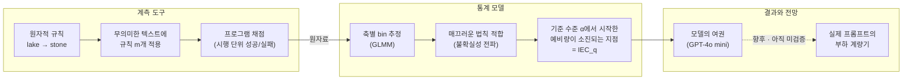

<figure class="post-figure post-figure--header">
<svg role="img" aria-label="한 오크 전사가 단어 치환 규칙 카드(lake → stone 등)를 품에 한가득 쌓아 들고 있다. 점선으로 표시된 용량 한계 아래의 카드는 반듯하게 쌓여 있지만, 한계를 넘는 카드는 기울어지다가 손에서 흘러내려 땅으로 떨어진다. 왼쪽에는 GPT-4o mini의 95% 기준 용량이 약 37~38개 규칙이라고 적혀 있다." viewBox="0 0 640 300">
  <title>동시에 들 수 있는 규칙의 수에는 한계가 있다 — Instruction Capacity</title>
  <text x="320" y="26" text-anchor="middle" font-family="var(--font-body)" font-size="15" font-weight="700" fill="currentColor">동시에 들 수 있는 규칙의 수에는 한계가 있다</text>
  <text x="320" y="282" text-anchor="middle" font-family="var(--font-mono)" font-size="12" fill="var(--accent-color)">instruction capacity · 규칙 m개 = 부하</text>
  <path d="M40 252 H600" stroke="currentColor" stroke-width="2" opacity="0.5"/>
  <!-- WARRIOR -->
  <g>
    <rect x="223" y="138" width="8" height="10" fill="currentColor"/>
    <rect x="215" y="146" width="24" height="26" fill="var(--orc-green)"/>
    <rect x="215" y="154" width="24" height="3" fill="var(--crimson)"/>
    <rect x="219" y="161" width="4" height="3" fill="currentColor"/>
    <rect x="231" y="161" width="4" height="3" fill="currentColor"/>
    <rect x="219" y="166" width="3" height="6" fill="var(--bg-panel)"/>
    <rect x="232" y="166" width="3" height="6" fill="var(--bg-panel)"/>
    <rect x="205" y="174" width="46" height="48" fill="var(--primary-color)"/>
    <rect x="205" y="196" width="46" height="5" fill="currentColor" opacity="0.6"/>
    <rect x="211" y="222" width="12" height="30" fill="currentColor"/>
    <rect x="233" y="222" width="12" height="30" fill="currentColor"/>
    <rect x="251" y="182" width="20" height="8" fill="var(--orc-green)"/>
    <rect x="251" y="204" width="20" height="8" fill="var(--orc-green)"/>
  </g>
  <!-- HELD RULE CARDS (schematic count) -->
  <g fill="var(--bg-panel)" stroke="currentColor" stroke-width="1.8">
    <rect x="268" y="206" width="92" height="12" rx="1"/>
    <rect x="268" y="192" width="92" height="12" rx="1"/>
    <rect x="268" y="178" width="92" height="12" rx="1"/>
    <rect x="268" y="164" width="92" height="12" rx="1"/>
    <rect x="268" y="150" width="92" height="12" rx="1"/>
    <rect x="268" y="136" width="92" height="12" rx="1"/>
    <rect x="268" y="122" width="92" height="12" rx="1"/>
    <rect x="268" y="108" width="92" height="12" rx="1"/>
    <rect x="268" y="94" width="92" height="12" rx="1"/>
    <rect x="268" y="80" width="92" height="12" rx="1"/>
  </g>
  <g stroke="var(--secondary-color)" stroke-width="2">
    <path d="M278 212 H302 M324 212 H348"/>
    <path d="M278 198 H302 M324 198 H348"/>
    <path d="M278 184 H302 M324 184 H348"/>
    <path d="M278 170 H302 M324 170 H348"/>
    <path d="M278 156 H302 M324 156 H348"/>
    <path d="M278 142 H302 M324 142 H348"/>
    <path d="M278 128 H302 M324 128 H348"/>
    <path d="M278 114 H302 M324 114 H348"/>
    <path d="M278 100 H302 M324 100 H348"/>
    <path d="M278 86 H302 M324 86 H348"/>
  </g>
  <g fill="var(--secondary-color)">
    <path d="M308 209 L316 212 L308 215 Z"/>
    <path d="M308 195 L316 198 L308 201 Z"/>
    <path d="M308 181 L316 184 L308 187 Z"/>
    <path d="M308 167 L316 170 L308 173 Z"/>
    <path d="M308 153 L316 156 L308 159 Z"/>
    <path d="M308 139 L316 142 L308 145 Z"/>
    <path d="M308 125 L316 128 L308 131 Z"/>
    <path d="M308 111 L316 114 L308 117 Z"/>
    <path d="M308 97 L316 100 L308 103 Z"/>
    <path d="M308 83 L316 86 L308 89 Z"/>
  </g>
  <text x="372" y="216" font-family="var(--font-mono)" font-size="12" fill="currentColor">lake → stone</text>
  <path d="M150 76 H470" stroke="var(--accent-color)" stroke-width="2" stroke-dasharray="6 5"/>
  <text x="146" y="80" text-anchor="end" font-family="var(--font-body)" font-size="11" font-weight="700" fill="var(--accent-color)">용량 한계</text>
  <!-- OVERLOAD: tilting and falling cards -->
  <g fill="var(--bg-panel)" stroke="var(--accent-color)" stroke-width="1.8">
    <rect x="276" y="60" width="92" height="12" rx="1" transform="rotate(6 322 66)"/>
    <rect x="290" y="44" width="92" height="12" rx="1" transform="rotate(14 336 50)"/>
    <rect x="396" y="104" width="70" height="11" rx="1" transform="rotate(38 431 110)"/>
    <rect x="432" y="168" width="70" height="11" rx="1" transform="rotate(64 467 174)"/>
    <rect x="478" y="240" width="70" height="11" rx="1" transform="rotate(-6 513 246)"/>
  </g>
  <g stroke="var(--accent-color)" stroke-width="1.6" fill="none" opacity="0.7">
    <path d="M384 80 Q404 92 412 104"/>
    <path d="M444 136 Q458 148 462 160"/>
    <path d="M480 204 Q494 218 500 230"/>
  </g>
  <text x="40" y="112" font-family="var(--font-mono)" font-size="12" fill="currentColor" opacity="0.8">GPT-4o mini · q = 0.95</text>
  <text x="40" y="134" font-family="var(--font-body)" font-size="16" font-weight="700" fill="var(--accent-color)">약 37~38개 규칙</text>
  <text x="40" y="236" font-family="var(--font-body)" font-size="11" fill="currentColor" opacity="0.75">카드 수는 도식</text>
</svg>
<figcaption>규칙 하나하나는 가볍지만, 동시에 들 수 있는 개수에는 한계가 있다 — 논문은 그 한계를 GPT-4o mini에서 95% 기준 약 37~38개 규칙으로 측정한다 (카드 수는 도식).</figcaption>
</figure>

## 원문 정보

> - **제목**: Instruction Capacity: Behavior and Degradation of Language Models under Controlled Load
> - **출처**: Hennadii Kutomanov (단독 저자) · arXiv cs.LG ([arxiv.org](https://arxiv.org/abs/2610.36095)) · [Hugging Face Papers](https://huggingface.co/papers/2610.36095)
> - **arXiv ID**: 2610.36095 (v1)
> - **발행**: 2026-10-26 · 70쪽, 그림 20개 (학회/저널 게재 정보 없음 — arXiv 프리프린트)
> - **원문 링크**: <https://arxiv.org/abs/2610.36095>
> - **코드·데이터**: [GitHub — instruction-capacity](https://github.com/kutomanovhennadii/instruction-capacity) · [HF Space](https://huggingface.co/spaces/kutomanovhennadii/iec-instrument) · [GPT-4o mini 측정 데이터셋](https://huggingface.co/datasets/kutomanovhennadii/iec-gpt-4o-mini-2024-07-18)

"프롬프트에 규칙을 너무 많이 넣으면 모델이 일부를 무시한다"는 체감을, 단위와 오차 막대를 가진 **측정량**으로 바꾸려는 시도다. 시스템 프롬프트·에이전트 지침·스킬 파일을 매일 쌓아 올리는 실무자에게 바로 닿는 주제라 Articles에 담는다.

## 한 줄 요약 (TL;DR)

서로 독립적이고 정답을 프로그램으로 계산할 수 있는 "단어 치환 규칙"을 부하 단위로 삼아, 모델이 동시에 몇 개의 규칙을 지키는지를 통계 모델(GLMM + 매끄러운 법칙)로 측정한다. GPT-4o mini의 **instruction capacity**는 95% 정확도 기준 약 **37~38개 규칙**, 모든 단어를 바꿔야 하는 최대 밀도에서는 약 **18~19개 규칙**으로 보고된다.

## 왜 이 글을 골랐나

컨텍스트 엔지니어링의 가장 오래된 직관은 "지시가 많을수록 하나하나의 준수율은 떨어진다"는 것이다. 그런데 이 직관은 대부분 일화나, 서로 다른 종류의 지시가 뒤섞인 벤치마크 점수로만 이야기돼 왔다. 이 논문은 질문을 아주 좁게 깎는다. **추론도 의미도 필요 없는 가장 단순한 지시를 몇 개까지 동시에 들고 있을 수 있는가**, 그리고 그 값의 **불확실성은 얼마인가.**

위키에서 다뤄 온 [하니스의 정의](/2026/08/03/what-makes-a-harness-a-harness.html)나 [프롬프트 그래프](/2026/08/03/prompt-graph-engineering.html)가 "지시를 어떻게 구조화할까"의 문제였다면, 이 논문은 그 구조화가 왜 필요한지를 **용량(capacity)** 이라는 숫자로 뒷받침하려는 계측 쪽의 시도다. 결과 자체보다 **측정을 설계하는 방식**에서 배울 것이 많은 논문이다.

### 한눈에 보기

규칙 하나에서 출발해 모델의 "여권"까지, 논문이 쌓아 올리는 측정의 흐름을 한 장으로 그리면 다음과 같다.

## 핵심 내용

### 1. 문제 제기: 부하를 재는 "단위"가 없다

저자는 기존 연구가 모두 "부하가 커지면 품질이 떨어진다"는 결론에 도달하지만, **모델 간에 비교 가능한, 불확실성을 가진 부하 파라미터**는 아무도 제공하지 않았다고 지적한다. 원인은 **교란(confounding)** 이다. 기존 벤치마크는 종류가 다른 지시를 섞거나, 의미 있는 문장 위에서 실험하거나, 채점을 judge 모델에 맡긴다.

관련 연구(2장)는 Miller의 "매직 넘버 7"과 Cowan의 약 4 단위 작업 기억 용량에서 출발해, instruction tuning(FLAN, InstructGPT), 검증 가능한 지시 벤치마크(IFEval), 멀티턴·롱컨텍스트 연구(MMMT-IF, Multi-IF, "lost in the middle", RULER, NoLiMa), 지시 개수 연구(IFScale 등)까지 훑는다. 그리고 **부하 계측기가 갖춰야 할 9가지 기준**을 세운다.

- 원자성(atomicity), 독립성, 동질성, 프로그램으로 계산 가능한 채점
- 외부 요인 부재, 위치별 해상도(resolution by place), 스케일, 정밀도, 암기 방지

기존 접근을 다섯 갈래(프로그램 채점형 형식 지시, judge 채점형 복합 제약, 의미 있는 글 속 필수 단어, 합성 메모리/컨텍스트 프로브, 위치 요구가 있는 긴 답변)로 나눠 이 기준에 대 보면 어느 것도 전부를 만족하지 못한다. 합성 프로브가 가장 가깝지만, 그것은 **정보 보존**을 재지 **동시 지시 실행**을 재지는 않는다는 것이 저자의 판단이다.

### 2. 계측 도구: 단어 치환 규칙

부하의 단위는 `lake -> stone` 같은 **단일 단어 치환 규칙** 하나다. 규칙 개수 *m*이 곧 부하이며, 저자는 이 단위가 프로토콜·템플릿·어휘로 정의되는 **관례적(conventional) 단위**임을 분명히 한다.

- **어휘**: CMU 발음 사전 123,455개 항목에서 출발해 소문자·1음절·WordNet 단수 명사·세 토크나이저(o200k_base, cl100k_base, Qwen2.5)에서 모두 **단일 토큰**인 단어만 남겨 2,220개로 걸러 낸다.
- **과제 구성**: 규칙 수 *m*, 텍스트에 등장하는 서로 다른 단어 수 *D*, 단어당 반복 횟수 *n*을 파라미터로 의미 없는 텍스트(한 줄 10단어)를 만든다. 규칙·텍스트·순서는 각각의 시드로 통제한다. 치환 결과로 쓰이는 단어는 원문 텍스트에 등장하지 않게 해서, 정답의 모든 치환이 "어느 규칙이 발동했는가"와 1:1로 대응한다.
- **채점**: 프로그램으로 계산한 정답과 줄 단위로 맞춘다. 실패는 세 종류로 분류한다 — 구조는 유지된 채 치환이 틀림(1종), 국소적인 줄 깨짐(2종), 텍스트 구조 자체의 상실(3종).

핵심 설계 원칙은 **계측 도구와 통계 모델의 분리**다. 1차 데이터는 "몇 번째 규칙이, 답변의 몇 번째 단어 위치에서 성공/실패했는가"라는 시행 단위 기록이고, 해석 방식은 나중에 개선할 수 있게 열어 둔다.

<figure class="post-figure">
<svg role="img" aria-label="한 요청의 해부도. 왼쪽 위에는 lake → stone부터 m번째 규칙까지 이어지는 규칙 표가, 왼쪽 아래에는 한 줄 10단어의 의미 없는 입력 텍스트가 있다. 둘이 모델로 들어가 답변이 나오고, 오른쪽에서 답변을 프로그램으로 계산한 정답과 줄 단위로 대조한다. 규칙이 걸린 단어마다 성공(체크) 또는 실패(엑스)가 표시되며, 실패는 1종 치환 오류, 2종 국소적인 줄 깨짐, 3종 텍스트 구조 상실로 구분된다." viewBox="0 0 640 350">
  <title>한 요청의 해부 — 규칙 표 + 무의미한 텍스트 → 답변 → 정답과 줄 단위 대조</title>
  <rect x="16" y="20" width="184" height="118" rx="4" fill="var(--bg-panel)" stroke="currentColor" stroke-width="2"/>
  <text x="108" y="40" text-anchor="middle" font-family="var(--font-body)" font-size="12" font-weight="700" fill="currentColor">규칙 표 (m개 = 부하)</text>
  <text x="30" y="64" font-family="var(--font-mono)" font-size="12" fill="currentColor" opacity="0.7">1.</text>
  <text x="56" y="64" font-family="var(--font-mono)" font-size="12" fill="currentColor">lake → stone</text>
  <text x="30" y="84" font-family="var(--font-mono)" font-size="12" fill="currentColor" opacity="0.7">2.</text>
  <text x="56" y="84" font-family="var(--font-mono)" font-size="12" fill="currentColor">w<tspan font-size="9" dy="3">2</tspan><tspan dy="-3">&#160;→ u</tspan><tspan font-size="9" dy="3">2</tspan></text>
  <text x="56" y="104" font-family="var(--font-mono)" font-size="12" fill="currentColor">⋮</text>
  <text x="30" y="124" font-family="var(--font-mono)" font-size="12" fill="currentColor" opacity="0.7">m.</text>
  <text x="56" y="124" font-family="var(--font-mono)" font-size="12" fill="currentColor">w<tspan font-size="9" dy="3">m</tspan><tspan dy="-3">&#160;→ u</tspan><tspan font-size="9" dy="3">m</tspan></text>
  <rect x="16" y="152" width="184" height="96" rx="4" fill="var(--bg-panel)" stroke="currentColor" stroke-width="2"/>
  <text x="108" y="172" text-anchor="middle" font-family="var(--font-body)" font-size="12" font-weight="700" fill="currentColor">의미 없는 텍스트 (한 줄 10단어)</text>
  <rect x="28" y="184" width="12" height="12" fill="none" stroke="currentColor" stroke-width="1.2" opacity="0.6"/>
  <rect x="44" y="184" width="12" height="12" fill="none" stroke="currentColor" stroke-width="1.2" opacity="0.6"/>
  <rect x="60" y="184" width="12" height="12" fill="var(--secondary-color)"/>
  <rect x="76" y="184" width="12" height="12" fill="none" stroke="currentColor" stroke-width="1.2" opacity="0.6"/>
  <rect x="92" y="184" width="12" height="12" fill="none" stroke="currentColor" stroke-width="1.2" opacity="0.6"/>
  <rect x="108" y="184" width="12" height="12" fill="none" stroke="currentColor" stroke-width="1.2" opacity="0.6"/>
  <rect x="124" y="184" width="12" height="12" fill="none" stroke="currentColor" stroke-width="1.2" opacity="0.6"/>
  <rect x="140" y="184" width="12" height="12" fill="var(--secondary-color)"/>
  <rect x="156" y="184" width="12" height="12" fill="none" stroke="currentColor" stroke-width="1.2" opacity="0.6"/>
  <rect x="172" y="184" width="12" height="12" fill="none" stroke="currentColor" stroke-width="1.2" opacity="0.6"/>
  <rect x="28" y="204" width="12" height="12" fill="none" stroke="currentColor" stroke-width="1.2" opacity="0.6"/>
  <rect x="44" y="204" width="12" height="12" fill="none" stroke="currentColor" stroke-width="1.2" opacity="0.6"/>
  <rect x="60" y="204" width="12" height="12" fill="none" stroke="currentColor" stroke-width="1.2" opacity="0.6"/>
  <rect x="76" y="204" width="12" height="12" fill="none" stroke="currentColor" stroke-width="1.2" opacity="0.6"/>
  <rect x="92" y="204" width="12" height="12" fill="var(--secondary-color)"/>
  <rect x="108" y="204" width="12" height="12" fill="none" stroke="currentColor" stroke-width="1.2" opacity="0.6"/>
  <rect x="124" y="204" width="12" height="12" fill="none" stroke="currentColor" stroke-width="1.2" opacity="0.6"/>
  <rect x="140" y="204" width="12" height="12" fill="none" stroke="currentColor" stroke-width="1.2" opacity="0.6"/>
  <rect x="156" y="204" width="12" height="12" fill="var(--secondary-color)"/>
  <rect x="172" y="204" width="12" height="12" fill="none" stroke="currentColor" stroke-width="1.2" opacity="0.6"/>
  <rect x="28" y="224" width="12" height="12" fill="none" stroke="currentColor" stroke-width="1.2" opacity="0.6"/>
  <rect x="44" y="224" width="12" height="12" fill="var(--secondary-color)"/>
  <rect x="60" y="224" width="12" height="12" fill="none" stroke="currentColor" stroke-width="1.2" opacity="0.6"/>
  <rect x="76" y="224" width="12" height="12" fill="none" stroke="currentColor" stroke-width="1.2" opacity="0.6"/>
  <rect x="92" y="224" width="12" height="12" fill="none" stroke="currentColor" stroke-width="1.2" opacity="0.6"/>
  <rect x="108" y="224" width="12" height="12" fill="var(--secondary-color)"/>
  <rect x="124" y="224" width="12" height="12" fill="none" stroke="currentColor" stroke-width="1.2" opacity="0.6"/>
  <rect x="140" y="224" width="12" height="12" fill="none" stroke="currentColor" stroke-width="1.2" opacity="0.6"/>
  <rect x="156" y="224" width="12" height="12" fill="none" stroke="currentColor" stroke-width="1.2" opacity="0.6"/>
  <rect x="172" y="224" width="12" height="12" fill="none" stroke="currentColor" stroke-width="1.2" opacity="0.6"/>
  <path d="M200 80 Q222 80 228 118 M200 200 Q222 200 228 160" stroke="currentColor" stroke-width="2" fill="none"/>
  <rect x="222" y="112" width="68" height="54" rx="6" fill="var(--bg-panel)" stroke="var(--accent-color)" stroke-width="2.5"/>
  <text x="256" y="136" text-anchor="middle" font-family="var(--font-body)" font-size="13" font-weight="700" fill="var(--accent-color)">모델</text>
  <text x="256" y="154" text-anchor="middle" font-family="var(--font-mono)" font-size="10" fill="currentColor" opacity="0.8">temp 0</text>
  <path d="M290 139 H310" stroke="currentColor" stroke-width="2"/>
  <path d="M310 133 L320 139 L310 145 Z" fill="currentColor"/>
  <rect x="322" y="20" width="302" height="228" rx="4" fill="var(--bg-panel)" stroke="currentColor" stroke-width="2"/>
  <text x="473" y="40" text-anchor="middle" font-family="var(--font-body)" font-size="12" font-weight="700" fill="currentColor">답변 ↔ 정답(프로그램 계산), 줄 단위 대조</text>
  <text x="336" y="70" text-anchor="middle" font-family="var(--font-mono)" font-size="10" fill="currentColor" opacity="0.7">1</text>
  <text x="336" y="102" text-anchor="middle" font-family="var(--font-mono)" font-size="10" fill="currentColor" opacity="0.7">2</text>
  <text x="336" y="134" text-anchor="middle" font-family="var(--font-mono)" font-size="10" fill="currentColor" opacity="0.7">3</text>
  <text x="336" y="166" text-anchor="middle" font-family="var(--font-mono)" font-size="10" fill="currentColor" opacity="0.7">4</text>
  <text x="336" y="198" text-anchor="middle" font-family="var(--font-mono)" font-size="10" fill="currentColor" opacity="0.7">5</text>
  <rect x="352" y="58" width="18" height="16" fill="none" stroke="currentColor" stroke-width="1.2" opacity="0.6"/>
  <rect x="374" y="58" width="18" height="16" fill="none" stroke="currentColor" stroke-width="1.2" opacity="0.6"/>
  <rect x="396" y="58" width="18" height="16" fill="var(--secondary-color)"/>
  <path d="M400 66 L404 70 L410 62" stroke="var(--bg-panel)" stroke-width="2.2" fill="none"/>
  <rect x="418" y="58" width="18" height="16" fill="none" stroke="currentColor" stroke-width="1.2" opacity="0.6"/>
  <rect x="440" y="58" width="18" height="16" fill="none" stroke="currentColor" stroke-width="1.2" opacity="0.6"/>
  <rect x="462" y="58" width="18" height="16" fill="none" stroke="currentColor" stroke-width="1.2" opacity="0.6"/>
  <rect x="484" y="58" width="18" height="16" fill="none" stroke="currentColor" stroke-width="1.2" opacity="0.6"/>
  <rect x="506" y="58" width="18" height="16" fill="var(--secondary-color)"/>
  <path d="M510 66 L514 70 L520 62" stroke="var(--bg-panel)" stroke-width="2.2" fill="none"/>
  <rect x="528" y="58" width="18" height="16" fill="none" stroke="currentColor" stroke-width="1.2" opacity="0.6"/>
  <rect x="550" y="58" width="18" height="16" fill="none" stroke="currentColor" stroke-width="1.2" opacity="0.6"/>
  <rect x="352" y="90" width="18" height="16" fill="none" stroke="currentColor" stroke-width="1.2" opacity="0.6"/>
  <rect x="374" y="90" width="18" height="16" fill="none" stroke="currentColor" stroke-width="1.2" opacity="0.6"/>
  <rect x="396" y="90" width="18" height="16" fill="none" stroke="currentColor" stroke-width="1.2" opacity="0.6"/>
  <rect x="418" y="90" width="18" height="16" fill="none" stroke="currentColor" stroke-width="1.2" opacity="0.6"/>
  <rect x="440" y="90" width="18" height="16" fill="var(--bg-panel)" stroke="var(--accent-color)" stroke-width="2.2"/>
  <path d="M445 94 L453 102 M453 94 L445 102" stroke="var(--accent-color)" stroke-width="2.2"/>
  <rect x="462" y="90" width="18" height="16" fill="none" stroke="currentColor" stroke-width="1.2" opacity="0.6"/>
  <rect x="484" y="90" width="18" height="16" fill="none" stroke="currentColor" stroke-width="1.2" opacity="0.6"/>
  <rect x="506" y="90" width="18" height="16" fill="none" stroke="currentColor" stroke-width="1.2" opacity="0.6"/>
  <rect x="528" y="90" width="18" height="16" fill="var(--secondary-color)"/>
  <path d="M532 98 L536 102 L542 94" stroke="var(--bg-panel)" stroke-width="2.2" fill="none"/>
  <rect x="550" y="90" width="18" height="16" fill="none" stroke="currentColor" stroke-width="1.2" opacity="0.6"/>
  <rect x="352" y="122" width="18" height="16" fill="none" stroke="currentColor" stroke-width="1.2" opacity="0.6"/>
  <rect x="374" y="122" width="18" height="16" fill="none" stroke="currentColor" stroke-width="1.2" opacity="0.6"/>
  <rect x="396" y="122" width="18" height="16" fill="none" stroke="currentColor" stroke-width="1.2" opacity="0.6"/>
  <rect x="418" y="122" width="18" height="16" fill="none" stroke="currentColor" stroke-width="1.2" opacity="0.6"/>
  <rect x="440" y="122" width="18" height="16" fill="none" stroke="currentColor" stroke-width="1.2" opacity="0.6"/>
  <rect x="462" y="122" width="18" height="16" fill="none" stroke="currentColor" stroke-width="1.2" opacity="0.6"/>
  <rect x="514" y="125" width="18" height="16" fill="none" stroke="currentColor" stroke-width="1.2" opacity="0.6"/>
  <rect x="536" y="125" width="18" height="16" fill="none" stroke="currentColor" stroke-width="1.2" opacity="0.6"/>
  <rect x="558" y="125" width="18" height="16" fill="none" stroke="currentColor" stroke-width="1.2" opacity="0.6"/>
  <rect x="478" y="118" width="96" height="27" rx="3" fill="none" stroke="var(--gold)" stroke-width="2.2" stroke-dasharray="5 3"/>
  <rect x="352" y="154" width="18" height="16" fill="none" stroke="currentColor" stroke-width="1.2" opacity="0.6"/>
  <rect x="374" y="154" width="18" height="16" fill="var(--secondary-color)"/>
  <path d="M378 162 L382 166 L388 158" stroke="var(--bg-panel)" stroke-width="2.2" fill="none"/>
  <rect x="396" y="154" width="18" height="16" fill="none" stroke="currentColor" stroke-width="1.2" opacity="0.6"/>
  <rect x="418" y="154" width="18" height="16" fill="none" stroke="currentColor" stroke-width="1.2" opacity="0.6"/>
  <rect x="440" y="154" width="18" height="16" fill="none" stroke="currentColor" stroke-width="1.2" opacity="0.6"/>
  <rect x="462" y="154" width="18" height="16" fill="var(--secondary-color)"/>
  <path d="M466 162 L470 166 L476 158" stroke="var(--bg-panel)" stroke-width="2.2" fill="none"/>
  <rect x="484" y="154" width="18" height="16" fill="none" stroke="currentColor" stroke-width="1.2" opacity="0.6"/>
  <rect x="506" y="154" width="18" height="16" fill="none" stroke="currentColor" stroke-width="1.2" opacity="0.6"/>
  <rect x="528" y="154" width="18" height="16" fill="none" stroke="currentColor" stroke-width="1.2" opacity="0.6"/>
  <rect x="550" y="154" width="18" height="16" fill="none" stroke="currentColor" stroke-width="1.2" opacity="0.6"/>
  <path d="M352 194 q11 -12 22 0 t22 0 t22 0 t22 0 t22 0 t22 0 t22 0 t22 0 t22 0 t20 0" stroke="currentColor" stroke-width="2" fill="none" opacity="0.8"/>
  <path d="M352 224 q11 10 22 -4 t30 6 t26 -8 t34 10" stroke="currentColor" stroke-width="2" fill="none" opacity="0.45" stroke-dasharray="3 4"/>
  <text x="612" y="102" text-anchor="end" font-family="var(--font-body)" font-size="11" font-weight="700" fill="var(--accent-color)">1종</text>
  <text x="612" y="134" text-anchor="end" font-family="var(--font-body)" font-size="11" font-weight="700" fill="var(--gold)">2종</text>
  <text x="612" y="198" text-anchor="end" font-family="var(--font-body)" font-size="11" font-weight="700" fill="currentColor">3종</text>
  <rect x="16" y="264" width="608" height="74" rx="4" fill="var(--bg-panel)" stroke="currentColor" stroke-width="1.5" opacity="0.9"/>
  <rect x="30" y="276" width="18" height="16" fill="var(--secondary-color)"/>
  <path d="M34 284 L38 288 L44 280" stroke="var(--bg-panel)" stroke-width="2.2" fill="none"/>
  <text x="56" y="289" font-family="var(--font-body)" font-size="12" fill="currentColor">성공 — 규칙이 걸린 단어가 정답과 일치</text>
  <rect x="330" y="276" width="18" height="16" fill="var(--bg-panel)" stroke="var(--accent-color)" stroke-width="2.2"/>
  <path d="M335 280 L343 288 M343 280 L335 288" stroke="var(--accent-color)" stroke-width="2.2"/>
  <text x="356" y="289" font-family="var(--font-body)" font-size="12" fill="currentColor"><tspan font-weight="700">1종</tspan> 구조는 유지, 치환이 틀림</text>
  <rect x="30" y="308" width="18" height="16" rx="2" fill="none" stroke="var(--gold)" stroke-width="2.2" stroke-dasharray="5 3"/>
  <text x="56" y="321" font-family="var(--font-body)" font-size="12" fill="currentColor"><tspan font-weight="700">2종</tspan> 국소적인 줄 깨짐</text>
  <path d="M330 316 q5 -8 9 0 t9 0" stroke="currentColor" stroke-width="2" fill="none"/>
  <text x="356" y="321" font-family="var(--font-body)" font-size="12" fill="currentColor"><tspan font-weight="700">3종</tspan> 텍스트 구조 자체의 상실(붕괴)</text>
</svg>
<figcaption>한 요청의 해부 — 규칙 표와 의미 없는 텍스트가 들어가고, 답변은 정답과 줄 단위로 대조되어 단어 위치마다 성공/실패가 기록된다. 실패는 1·2·3종으로 나눠 센다 (규칙 표의 w·u와 표시 위치는 도식).</figcaption>
</figure>

### 3. 통계 모델: 로짓에서 더해지는 부하의 "가격"

각 시행은 베르누이 시행이고, 성공 확률의 로짓 η = ln(π/(1−π))에 각 부하 요인의 기여가 **더해진다**고 본다. 요청마다의 난이도 차이는 정규분포를 따르는 랜덤 효과로 흡수한다(GLMM, 주변 우도 최대화).

- **로그 스케일 bin**: 각 축을 "두 배마다 한 칸"인 bin으로 나누고 bin마다 계수를 따로 추정해, 처음부터 함수 형태를 가정하지 않는다.
- **매끄러운 법칙 적합**: bin 추정치 위에 매끄러운 법칙을 공분산 가중 최소거리 추정으로 맞추고, 불확실성은 delta method로 전파한다.
- **기준 수준 α_phys**: 모든 축이 최소 부하일 때(답변 첫머리·짧은 텍스트·드문 치환) 중간 난이도 요청이 올바르게 치환할 로짓이다.

### 4. Instruction Capacity의 정의

**IEC_q**는 다른 축을 최소 부하에 둔 채 규칙 수만 늘렸을 때, 올바른 치환 확률이 *q*로 떨어지는 규칙 수다. 저자의 표현으로는 규칙이 하나씩 늘 때마다 치르는 "가격"의 누적이 **예비량(reserve)을 소진하는** 지점이다. 여기서 *q*는 전체 요청 평균 정답 비율이므로, 요청 난이도 분산을 적분해 문턱을 구한다.

- *q* = 0.95(신뢰할 수 있는 실행)와 *q* = 0.5 두 수준을 쓴다.
- *q* = 0.5의 문턱은 요청 난이도 분산과 무관하지만, *q* = 0.95는 난이도 분산에 따라 문턱이 올라간다. 분산이 0일 때 문턱은 ln 19 ≈ 2.94 로짓이지만, GPT-4o mini는 σ² = 5.90 ± 0.71이라 문턱이 η* = 4.97로 올라가고, 예비량은 Δ_0.95 = 18.81 − 4.97 = 13.84 로짓이다. *q* = 0.5의 예비량은 α_phys 전체(18.81)다.
- 측정 범위 안에서 예비량이 소진되지 않으면 그 값은 **외삽**이라고 표시한다.

<figure class="post-figure">
<svg role="img" aria-label="예비량 소진 개념도. 가로축은 로그 스케일의 규칙 수 m, 세로축은 로짓 η이다. 선은 m이 1일 때 기준 수준 α_phys 18.81 로짓에서 출발해, 규칙이 늘 때마다 테이블 크기와 규칙 번호의 비용이 쌓이며 내려온다. q 0.95 문턱 η*과 만나는 지점이 IEC_0.95(약 36.6~38.1개), 로짓 0인 q 0.5 문턱과 만나는 지점이 IEC_0.5(약 43.9~46.1개)이다. α_phys와 η* 사이 간격이 0.95 수준의 예비량 13.84 로짓이다. 곡선의 중간 모양은 도식이다." viewBox="0 0 640 340">
  <title>예비량 소진 — 규칙당 가격이 쌓여 문턱을 넘는 지점이 IEC</title>
  <path d="M70 45.0 V290 H600" stroke="currentColor" stroke-width="2" fill="none"/>
  <text x="40" y="39.0" font-family="var(--font-body)" font-size="12" font-weight="700" fill="currentColor">로짓 η</text>
  <text x="335" y="330" text-anchor="middle" font-family="var(--font-body)" font-size="12" font-weight="700" fill="currentColor">규칙 수 m (로그 축) — 다른 축은 최소 부하</text>
  <path d="M80.0 290 V296" stroke="currentColor" stroke-width="1.5"/>
  <text x="80.0" y="310" text-anchor="middle" font-family="var(--font-mono)" font-size="11" fill="currentColor" opacity="0.8">1</text>
  <path d="M152.0 290 V296" stroke="currentColor" stroke-width="1.5"/>
  <text x="152.0" y="310" text-anchor="middle" font-family="var(--font-mono)" font-size="11" fill="currentColor" opacity="0.8">2</text>
  <path d="M224.0 290 V296" stroke="currentColor" stroke-width="1.5"/>
  <text x="224.0" y="310" text-anchor="middle" font-family="var(--font-mono)" font-size="11" fill="currentColor" opacity="0.8">4</text>
  <path d="M296.0 290 V296" stroke="currentColor" stroke-width="1.5"/>
  <text x="296.0" y="310" text-anchor="middle" font-family="var(--font-mono)" font-size="11" fill="currentColor" opacity="0.8">8</text>
  <path d="M368.0 290 V296" stroke="currentColor" stroke-width="1.5"/>
  <text x="368.0" y="310" text-anchor="middle" font-family="var(--font-mono)" font-size="11" fill="currentColor" opacity="0.8">16</text>
  <path d="M440.0 290 V296" stroke="currentColor" stroke-width="1.5"/>
  <text x="440.0" y="310" text-anchor="middle" font-family="var(--font-mono)" font-size="11" fill="currentColor" opacity="0.8">32</text>
  <path d="M512.0 290 V296" stroke="currentColor" stroke-width="1.5"/>
  <text x="512.0" y="310" text-anchor="middle" font-family="var(--font-mono)" font-size="11" fill="currentColor" opacity="0.8">64</text>
  <path d="M70 61.9 H600" stroke="currentColor" stroke-width="1.2" stroke-dasharray="3 4" opacity="0.5"/>
  <text x="66" y="65.9" text-anchor="end" font-family="var(--font-mono)" font-size="11" fill="currentColor">18.81</text>
  <path d="M70 200.3 H600" stroke="var(--accent-color)" stroke-width="1.8" stroke-dasharray="6 4"/>
  <text x="66" y="204.3" text-anchor="end" font-family="var(--font-mono)" font-size="11" font-weight="700" fill="var(--accent-color)">η* = 4.97</text>
  <path d="M70 250.0 H600" stroke="var(--secondary-color)" stroke-width="1.8" stroke-dasharray="2 4"/>
  <text x="66" y="254.0" text-anchor="end" font-family="var(--font-mono)" font-size="11" font-weight="700" fill="var(--secondary-color)">0</text>
  <text x="96" y="53.9" font-family="var(--font-body)" font-size="12" fill="currentColor"><tspan font-weight="700">기준 수준 α_phys</tspan> = 18.81 ± 1.44</text>
  <text x="96" y="192.3" font-family="var(--font-body)" font-size="11" fill="var(--accent-color)"><tspan font-weight="700">q = 0.95 문턱</tspan> (분산 0이면 ln 19 ≈ 2.94, 난이도 분산에 따라 상승)</text>
  <text x="96" y="268.0" font-family="var(--font-body)" font-size="11" fill="var(--secondary-color)"><tspan font-weight="700">q = 0.5 문턱</tspan> (로짓 0, 분산과 무관)</text>
  <path d="M80.0 61.9 C300 71.9 452 144.3 455.9 200.3 Q467.9 218.3 475.4 250.0 L481.4 274.0" stroke="currentColor" stroke-width="3" fill="none"/>
  <circle cx="80.0" cy="61.9" r="5" fill="currentColor"/>
  <text x="150" y="158" font-family="var(--font-body)" font-size="11" fill="currentColor" opacity="0.85">규칙이 늘 때마다 치르는 "가격"이 쌓인다</text>
  <text x="150" y="174" font-family="var(--font-body)" font-size="11" fill="currentColor" opacity="0.85">· 테이블 크기(로그) + 규칙 번호(거듭제곱)</text>
  <circle cx="455.9" cy="200.3" r="6" fill="var(--bg-panel)" stroke="var(--accent-color)" stroke-width="3"/>
  <circle cx="475.4" cy="250.0" r="6" fill="var(--bg-panel)" stroke="var(--secondary-color)" stroke-width="3"/>
  <path d="M455.9 208.3 V290" stroke="var(--accent-color)" stroke-width="1.2" stroke-dasharray="2 3"/>
  <text x="445.9" y="230.3" text-anchor="end" font-family="var(--font-body)" font-size="12" font-weight="700" fill="var(--accent-color)">IEC_0.95 ≈ 36.6~38.1</text>
  <text x="487.4" y="276.0" font-family="var(--font-body)" font-size="12" font-weight="700" fill="var(--secondary-color)">IEC_0.5 ≈ 43.9~46.1</text>
  <path d="M576 61.9 H584 V200.3 H576" stroke="currentColor" stroke-width="2" fill="none"/>
  <text x="570" y="127.1" text-anchor="end" font-family="var(--font-body)" font-size="12" font-weight="700" fill="currentColor">예비량</text>
  <text x="570" y="143.1" text-anchor="end" font-family="var(--font-mono)" font-size="11" fill="currentColor">13.84 로짓</text>
  <text x="600" y="54" text-anchor="end" font-family="var(--font-body)" font-size="10" fill="currentColor" opacity="0.7">곡선 중간 모양은 도식</text>
</svg>
<figcaption>예비량 소진 — 기준 수준 α_phys(18.81)에서 출발한 로짓이 규칙당 가격만큼 깎여 q = 0.95 문턱에 닿는 곳이 IEC_0.95, 0에 닿는 곳이 IEC_0.5다. 시작점·예비량·교차점 값은 원문 보고치, 그 사이 곡선 모양은 도식이다.</figcaption>
</figure>

### 5. GPT-4o mini의 "여권(passport)"

측정 대상은 `gpt-4o-mini-2024-07-18` 스냅샷이다. 요청 2,958건, 실험 지점 1,890개, 시행 642,430회, 텍스트 길이 20~10,240단어, 규칙 1~256개, temperature 0·고정 시드로 총 5시간 43분이 걸렸다. 최종적으로 다섯 축 — **V**(텍스트 길이), **S**(답변 속 단어 위치), **P**(치환 밀도), **M**(규칙 수), **R**(규칙 번호) — 을 쓴다.

축별로 보고된 법칙은 다음과 같다(모두 로짓 단위, ± 는 원문이 보고한 불확실성).

| 축 | 법칙의 형태 | 원문이 보고한 주요 값 |
| --- | --- | --- |
| 단어 위치 S | 쌍곡선(부드러운 최솟값) | 위치가 두 배가 될 때마다 κ_S = −2.67 ± 0.31 |
| 텍스트 길이 V | 전이점 이후 로그 감소 | 전이점 v* ≈ 274단어(146~517), 이후 두 배당 κ_V = −1.60 ± 0.43 |
| 치환 밀도 P | 포화 법칙 | 진폭 A_P = 12.07 ± 2.63, 최대 밀도에서 손실 9.35 ± 1.01 (측정 범위에서 포화 미도달), 저밀도에서 치환 비율 1%당 약 0.18 |
| 규칙 수 M | 로그 법칙 | 두 배당 κ_M = −0.43 ± 0.10 |
| 규칙 번호 R | 거듭제곱 법칙 | γ = 0.74 ± 0.20, 65~128번째 규칙은 1번 규칙보다 1.05 ± 0.12 낮음 |

이 위에서 산출된 용량들이 여권의 핵심이다.

- **Instruction capacity**: IEC_0.95 = 36.58 ± 5.41 (bin 기준) / 38.06 ± 6.13 (법칙 기준). IEC_0.5 = 43.90 ± 6.62 / 46.09 ± 6.61. 두 방법의 차이(1.5, 2.2개)는 불확실성보다 작다. 기준 수준 α_phys = 18.81 ± 1.44, 0.95 수준의 예비량은 13.84 로짓이다.
- **Fatigue capacity(피로 용량)**: 규칙 수가 아니라 답변 속 **단어 위치**를 따라 정의한 용량. FEC_0.95 = 3,277 ± 571단어(측정 범위 안), FEC_0.5 = 11,890 ± 1,839단어(측정 범위 밖, 외삽).
- **Guaranteed instruction capacity(보장 용량)**: 모든 단어를 바꿔야 하는 최대 밀도(p = 1)에서의 용량. IGC_0.95 = 18.69 ± 3.62 / 17.55 ± 4.04, IGC_0.5 = 29.51 ± 5.92 / 29.76 ± 5.11. 예비량은 13.84에서 약 4.5~4.6 로짓으로 3분의 1 수준까지 줄지만 용량은 약 절반으로만 준다.

흥미로운 관찰 두 가지가 덧붙는다. 첫째, 규칙 수 계산에서 **규칙 테이블의 크기**보다 **뒤쪽 번호 규칙의 불리함**이 훨씬 비싸다 — 37번째 규칙 시점의 누적 가격 중 테이블 크기 몫은 약 2.2 로짓, 각 규칙의 번호별 불리함을 합한 몫은 약 11 로짓이다. 둘째, **붕괴(collapse)** 가 잦다. 2,958건 중 995건(33.6%)에서 텍스트 구조가 무너졌고, 규칙 256개 요청 9건은 모두 붕괴해 적합에서 제외됐다. 붕괴 확률의 법칙에는 텍스트 길이와 치환 밀도가 들어가지만 **규칙 수는 들어가지 않는다**(길이가 두 배가 될 때마다 붕괴 odds 약 11배).

<figure class="post-figure">
<svg role="img" aria-label="GPT-4o mini의 Instruction Capacity 여권 카드. 대상 스냅샷 gpt-4o-mini-2024-07-18. 세 용량: IEC_0.95 약 37~38개 규칙(bin 36.58 ± 5.41, 법칙 38.06 ± 6.13), 최대 밀도의 보장 용량 IGC_0.95 약 18~19개 규칙(18.69 ± 3.62, 17.55 ± 4.04), 피로 용량 FEC_0.95 3,277 ± 571 단어. 다섯 축의 법칙 형태: 텍스트 길이 V는 전이점 이후 로그 감소, 단어 위치 S는 쌍곡선, 치환 밀도 P는 포화, 규칙 수 M은 로그, 규칙 번호 R은 거듭제곱. 하단에 기준 수준 18.81 ± 1.44, 시행 642,430회, 요청 2,958건." viewBox="0 0 640 320">
  <title>GPT-4o mini의 여권(passport) — 세 용량과 다섯 축의 법칙</title>
  <rect x="16" y="16" width="608" height="290" rx="10" fill="var(--bg-panel)" stroke="currentColor" stroke-width="2.5"/>
  <text x="36" y="44" font-family="var(--font-mono)" font-size="13" font-weight="700" fill="var(--accent-color)">INSTRUCTION CAPACITY PASSPORT</text>
  <text x="604" y="44" text-anchor="end" font-family="var(--font-mono)" font-size="12" fill="currentColor">gpt-4o-mini-2024-07-18</text>
  <path d="M28 56 H612" stroke="currentColor" stroke-width="1.5" opacity="0.6"/>
  <rect x="36" y="74" width="120" height="132" rx="4" fill="none" stroke="currentColor" stroke-width="1.8"/>
  <g>
    <rect x="78" y="96" width="36" height="30" fill="currentColor"/>
    <rect x="86" y="105" width="6" height="6" fill="var(--bg-panel)"/>
    <rect x="100" y="105" width="6" height="6" fill="var(--bg-panel)"/>
    <rect x="88" y="117" width="16" height="3" fill="var(--bg-panel)"/>
    <rect x="94" y="88" width="4" height="8" fill="currentColor"/>
    <rect x="92" y="84" width="8" height="4" fill="var(--accent-color)"/>
    <rect x="66" y="132" width="60" height="44" fill="var(--secondary-color)"/>
    <rect x="78" y="142" width="36" height="6" fill="var(--bg-panel)"/>
    <rect x="78" y="154" width="24" height="6" fill="var(--bg-panel)"/>
  </g>
  <text x="96" y="196" text-anchor="middle" font-family="var(--font-mono)" font-size="10" fill="currentColor" opacity="0.8">temp 0 · 고정 시드</text>
  <text x="176" y="82" font-family="var(--font-body)" font-size="11" fill="currentColor" opacity="0.75">IEC_0.95 · 95% 신뢰 실행 규칙 수</text>
  <text x="176" y="103" font-family="var(--font-body)" font-size="18" font-weight="700" fill="var(--accent-color)">약 37~38개 규칙</text>
  <text x="176" y="119" font-family="var(--font-mono)" font-size="10.5" fill="currentColor" opacity="0.8">bin 36.58 ± 5.41 · 법칙 38.06 ± 6.13</text>
  <text x="176" y="136" font-family="var(--font-body)" font-size="11" fill="currentColor" opacity="0.75">IGC_0.95 · 최대 밀도(p = 1) 보장 용량</text>
  <text x="176" y="157" font-family="var(--font-body)" font-size="18" font-weight="700" fill="currentColor">약 18~19개 규칙</text>
  <text x="176" y="173" font-family="var(--font-mono)" font-size="10.5" fill="currentColor" opacity="0.8">18.69 ± 3.62 · 17.55 ± 4.04</text>
  <text x="176" y="190" font-family="var(--font-body)" font-size="11" fill="currentColor" opacity="0.75">FEC_0.95 · 답변 속 단어 위치(피로)</text>
  <text x="176" y="211" font-family="var(--font-body)" font-size="18" font-weight="700" fill="currentColor">3,277 ± 571 단어</text>
  <text x="176" y="227" font-family="var(--font-mono)" font-size="10.5" fill="currentColor" opacity="0.8">측정 범위 안</text>
  <path d="M420 70 V230" stroke="currentColor" stroke-width="1" opacity="0.4"/>
  <text x="434" y="84" font-family="var(--font-body)" font-size="12" font-weight="700" fill="currentColor">다섯 축 · 법칙의 형태</text>
  <text x="434" y="112" font-family="var(--font-mono)" font-size="13" font-weight="700" fill="var(--accent-color)">V</text>
  <text x="454" y="112" font-family="var(--font-body)" font-size="12" fill="currentColor">텍스트 길이</text>
  <text x="604" y="112" text-anchor="end" font-family="var(--font-body)" font-size="11" font-weight="700" fill="var(--secondary-color)">전이점 후 로그</text>
  <text x="434" y="137" font-family="var(--font-mono)" font-size="13" font-weight="700" fill="var(--accent-color)">S</text>
  <text x="454" y="137" font-family="var(--font-body)" font-size="12" fill="currentColor">단어 위치</text>
  <text x="604" y="137" text-anchor="end" font-family="var(--font-body)" font-size="11" font-weight="700" fill="var(--secondary-color)">쌍곡선</text>
  <text x="434" y="162" font-family="var(--font-mono)" font-size="13" font-weight="700" fill="var(--accent-color)">P</text>
  <text x="454" y="162" font-family="var(--font-body)" font-size="12" fill="currentColor">치환 밀도</text>
  <text x="604" y="162" text-anchor="end" font-family="var(--font-body)" font-size="11" font-weight="700" fill="var(--secondary-color)">포화</text>
  <text x="434" y="187" font-family="var(--font-mono)" font-size="13" font-weight="700" fill="var(--accent-color)">M</text>
  <text x="454" y="187" font-family="var(--font-body)" font-size="12" fill="currentColor">규칙 수</text>
  <text x="604" y="187" text-anchor="end" font-family="var(--font-body)" font-size="11" font-weight="700" fill="var(--secondary-color)">로그</text>
  <text x="434" y="212" font-family="var(--font-mono)" font-size="13" font-weight="700" fill="var(--accent-color)">R</text>
  <text x="454" y="212" font-family="var(--font-body)" font-size="12" fill="currentColor">규칙 번호</text>
  <text x="604" y="212" text-anchor="end" font-family="var(--font-body)" font-size="11" font-weight="700" fill="var(--secondary-color)">거듭제곱</text>
  <path d="M28 244 H612" stroke="currentColor" stroke-width="1" opacity="0.4" stroke-dasharray="4 3"/>
  <text x="36" y="268" font-family="var(--font-mono)" font-size="11.5" fill="currentColor" opacity="0.85">P&lt;IEC&lt;&lt;ALPHA-PHYS&lt;18.81±1.44&lt;&lt;RESERVE-0.95&lt;13.84&lt;&lt;&lt;&lt;</text>
  <text x="36" y="290" font-family="var(--font-mono)" font-size="11.5" fill="currentColor" opacity="0.85">REQ&lt;2958&lt;&lt;TRIALS&lt;642430&lt;&lt;RULES&lt;1-256&lt;&lt;WORDS&lt;20-10240&lt;</text>
</svg>
<figcaption>GPT-4o mini의 "여권" 한 장 — 세 가지 용량(IEC·IGC·FEC)과 다섯 축(V·S·P·M·R)의 법칙 형태, 하단에는 기준 수준과 측정 규모를 적었다. 모든 수치는 원문 보고치.</figcaption>
</figure>

### 6. 전망: 다른 모델의 여권, 그리고 프롬프트 계량기

- **다른 모델**: 저자는 GPT-4o mini에서 찾은 규칙성이 보편적이라고 가정할 근거가 없다고 명시한다. 치환이 원자적이려면 단어가 측정 대상 모델의 토크나이저에서 단일 토큰이어야 하는데, Anthropic은 Claude 토크나이저를 공개하지 않는다는 점도 짚는다.
- **비용**: 기준 측정은 답변 한도 16,384토큰, 약 1,594만 토큰, $6.03이었다. 모델별 추정치(상한)로 gpt-4.1-mini 약 $45, Claude Opus 5.5 약 $3,800 등이 제시된다. 답변 한도가 커질수록 측정량이 급증하며(128K 토큰 한도에서 약 7,200요청·3.12억 토큰 추정), 반복 측정 설계로 비용을 크게 줄일 수 있다는 것은 저자의 기대로 서술된다.
- **프롬프트 계량기**: 최종 목표는 실제 프롬프트의 지시 무게를 "등가 치환 규칙 수"로 표현하고, 모델의 여권으로 이를 보정하는 것이다. 다만 저자 스스로 이 환산의 타당성은 **아직 실험으로 확립되지 않았다**고 적는다.
- **공개**: 코드는 MIT, 데이터·문서는 CC BY 4.0. 공개된 지점만으로 여권 숫자를 재계산하는 스크립트를 제공하되, 측정 지점을 고르는 적응형 선택 기술은 비공개다.

## 분석과 인사이트

여기서부터는 원문 요약이 아니라 내 해석이다.

**1. 가장 큰 기여는 숫자보다 "측정의 문법"이다.** "37개"라는 숫자는 GPT-4o mini, 특정 템플릿, 특정 어휘에서만 의미가 있다. 저자도 단위를 관례적이라고 못박는다. 오히려 값진 건 **9가지 기준 → 원자적 과제 → 시행 단위 원자료 → 비모수 bin → 매끄러운 법칙 → 불확실성 전파**로 이어지는 설계다. [CS336 평가 강의](/2026/06/26/cs336-lecture-12-evaluation.html)가 강조하듯 "무엇을 알고 싶은가"를 먼저 좁히고, 교란 요인을 제거하고, 오차 막대를 붙이는 순서가 교과서적으로 지켜진다. 사내 에이전트 평가를 설계할 때 그대로 차용할 만한 골격이다.

**2. 규칙의 "개수"보다 "순서"가 더 비싸다는 관찰이 실무적으로 가장 날카롭다.** 37번째 규칙 시점에 테이블 크기의 비용(약 2.2 로짓)보다 규칙 번호의 비용(약 11 로짓)이 훨씬 크다는 결과는, "규칙을 몇 개 넣었나"보다 "중요한 규칙을 몇 번째에 두었나"가 더 중요할 수 있음을 시사한다. 다만 11 로짓은 누적값이다. 한 규칙만 놓고 보면 65~128번째도 1번보다 약 1 로짓 낮을 뿐이지만, 뒤 번호 규칙들의 불리함이 쌓이는 것이 예비량의 대부분을 쓴다. 또 이것은 단어 치환이라는 인공 과제에서 한 모델이 보인 결과이고, 저자는 앞선 규칙이 뒤 규칙에 주는 간섭이 누적된다는 가설을 제시하지만 도구는 형태만 잴 뿐 원인은 별도 검증이 필요하다고 한다. 그래도 긴 시스템 프롬프트·`CLAUDE.md`·스킬 파일의 **뒤쪽에 박힌 규칙이 덜 지켜진다**는 현장 체감과는 방향이 맞는다.

**3. "보장 용량"은 바쁜 실무에 더 가까운 숫자다.** 실제 작업은 규칙이 드문드문 발동하는 상황보다 거의 모든 출력에 무언가를 적용해야 하는 상황이 많다. 같은 모델이라도 밀도가 최대가 되면 신뢰 가능한 규칙 수가 약 절반(18~19개)으로 준다는 결과는, "규칙 수 예산"을 잡을 때 **최선의 조건이 아니라 부하가 가장 높은 조건을 기준**으로 삼아야 한다는 교훈으로 읽힌다.

**4. 붕괴는 규칙 수가 아니라 길이·밀도의 함수다.** 요청의 1/3이 텍스트 구조를 잃었고, 그 확률을 규칙 수가 아닌 길이와 밀도가 좌우한다는 점은 흥미롭다. 출력이 길어질수록 "규칙을 조금씩 틀리는" 실패와는 별개로 "통째로 무너지는" 실패 모드가 존재한다는 뜻이고, 둘을 같은 정확도 지표로 뭉뚱그리면 원인을 놓친다. 저자가 실패를 1·2·3종으로 나눈 것이 바로 그 분리 장치다.

**5. 이견과 한계.** 첫째, 외적 타당성. 추론이 전혀 필요 없는 치환 규칙과 "테스트를 먼저 작성하라", "public API를 바꾸지 마라" 같은 실제 지시 사이의 거리는 크다. 저자의 프롬프트 계량기 구상은 이 간극을 메우는 환산이 성립해야만 작동하는데, 그 부분은 아직 가설이다. 둘째, 단일 모델·단일 스냅샷이다. 최신 frontier 모델이나 reasoning 모델에서 법칙의 **형태**(로그·포화·거듭제곱)가 유지되는지가 진짜 관심사인데, 토크나이저 비공개와 비용(Opus 5.5 상한 약 $3,800 추정)이 그 검증을 가로막는다. 셋째, 적응형 지점 선택 기술이 비공개라는 점은 재현성에 작은 흠이다(다만 공개된 지점만으로 여권을 재계산할 수 있게 한 점은 성실하다). 넷째, 단독 저자의 70쪽 프리프린트로 아직 동료 검토를 거치지 않았다.

**6. 확률을 "if문에 꽂을" 수 있으려면.** 이 논문의 0.95 기준은 [확률 보정](/2026/09/21/jev-probability-calibration.html)에서 다룬 질문과 같은 결을 가진다. 규칙 준수율이 몇 %인지를 알아야 그 위에 자동화의 임계값을 세울 수 있다. 용량을 오차 막대와 함께 내놓는다는 태도 자체가 "LLM을 확률적 부품으로 다루는 엔지니어링"의 좋은 예다.

## 적용 포인트

- **지시 예산을 의식하라.** 시스템 프롬프트·에이전트 지침에 규칙이 수십 개를 넘기 시작하면, 작은 모델에서는 이미 신뢰 구간의 경계에 있을 수 있다고 가정하고 규칙을 통합·삭제한다.
- **중요한 규칙은 앞에 둔다.** 규칙 번호의 비용이 크다는 관찰에 따라, 절대 어기면 안 되는 제약은 지침의 앞쪽에 두고 뒤쪽은 참고성 정보로 채운다.
- **최악의 밀도로 예산을 잡는다.** 거의 모든 출력에 적용되는 규칙(포맷, 네이밍, 금지어)이 많을수록 신뢰 가능한 규칙 수는 줄어든다고 보고 여유를 둔다.
- **긴 출력은 쪼갠다.** 출력 길이가 붕괴 확률을 크게 키운다는 결과를 고려해, 한 번에 수천 단어를 변환시키기보다 청크로 나누고 각 청크를 검증한다.
- **사내 평가에 이 설계를 빌린다.** 원자적·독립적·프로그램 채점 가능한 과제를 만들고, 시행 단위 원자료를 남기고, 결과에 불확실성을 붙인다. judge 모델 없이 채점되는 과제가 가장 싸고 깨끗하다.
- **실패를 종류별로 센다.** "틀린 치환"과 "구조 붕괴"를 한 정확도 숫자로 합치지 말고 분리해 기록한다.

## 마무리

Instruction Capacity는 "프롬프트에 규칙을 너무 많이 넣으면 안 된다"는 오래된 경험칙을, 원자적 과제와 통계 모델로 **단위와 오차 막대가 있는 측정량**으로 바꾸려는 계측 논문이다. GPT-4o mini에 대해 95% 기준 약 37~38개, 최대 밀도에서 약 18~19개라는 여권을 내놓지만, 그 숫자보다 오래 남을 것은 교란을 걷어 내고 불확실성을 정직하게 전파하는 측정의 문법, 그리고 "규칙의 개수보다 순서가 비쌀 수 있다"는 관찰이다. 실제 프롬프트로의 환산과 다른 모델로의 일반화는 아직 열린 문제로 남아 있다.

### 더 읽어보기

- [원문 — Instruction Capacity: Behavior and Degradation of Language Models under Controlled Load (arXiv:2610.36095)](https://arxiv.org/abs/2610.36095)
- [Hugging Face Papers 페이지](https://huggingface.co/papers/2610.36095) — 저자 코멘트와 관련 논문 추천
- [코드·데이터 저장소 (GitHub)](https://github.com/kutomanovhennadii/instruction-capacity) — 공개 지점으로 여권을 재계산하는 스크립트
- [무엇이 하니스를 하니스로 만드는가](/2026/08/03/what-makes-a-harness-a-harness.html) — 지시를 런타임 구조로 감싸는 하니스의 정의
- [프롬프트는 언제 '그래프'가 되는가](/2026/08/03/prompt-graph-engineering.html) — 한 프롬프트에 몰아넣지 않고 쪼개는 구조화의 기준
- [메모리 세금(Memory Tax)](/2026/10/29/memory-tax-agent-memory-net-value.html) — 컨텍스트에 무엇을 얹느냐의 비용을 분해하는 또 하나의 논문
- [DAYJOB: Tax 벤치마크](/2026/10/29/dayjob-tax-agent-benchmark.html) — 정반대 축, 지저분한 실무 전체를 재는 에이전트 벤치마크
- [CS336 12강 — 평가(Evaluation)](/2026/06/26/cs336-lecture-12-evaluation.html) — 무엇을 알고 싶은가에서 출발하는 평가 설계
- [확률 보정 (Calibration)](/2026/09/21/jev-probability-calibration.html) — 확률을 임계값 자동화에 쓰기 위한 조건
