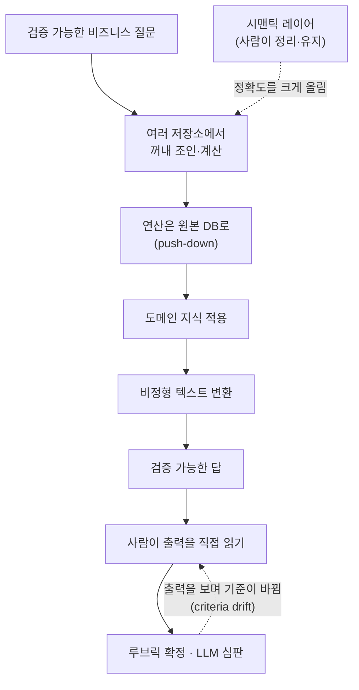

<figure class="post-figure post-figure--header">
<svg role="img" aria-label="주니어 분석가 에이전트가 가운데 서 있다. 왼쪽 위의 테이블 저장소, 왼쪽 아래의 문서, 오른쪽 위의 자유 텍스트 티켓에서 점선이 에이전트로 모이고, 에이전트에서 나간 실선 화살표가 오른쪽 아래의 검증된 답으로 이어진다." viewBox="0 0 700 360" width="520" xmlns="http://www.w3.org/2000/svg">
<title>여러 저장소의 조각을 맞춰 검증된 답을 내는 데이터 에이전트</title>
<g fill="none" stroke="currentColor" stroke-width="3" stroke-linecap="round" stroke-linejoin="round">
<path d="M65 52 V122 A55 16 0 0 0 175 122 V52"/>
<ellipse cx="120" cy="52" rx="55" ry="16"/>
<path d="M65 76 A55 16 0 0 0 175 76" opacity="0.6"/>
<path d="M65 100 A55 16 0 0 0 175 100" opacity="0.6"/>
<path d="M75 200 H150 L170 220 V292 H75 Z"/>
<path d="M150 200 V220 H170"/>
<path d="M90 238 H152 M90 256 H152 M90 274 H132" opacity="0.6"/>
<rect x="530" y="44" width="120" height="86" rx="6"/>
<path d="M546 66 H632 M546 86 H620 M546 106 H600" opacity="0.6" stroke-dasharray="6 5"/>
</g>
<g fill="none" stroke="currentColor" stroke-width="2.5" stroke-dasharray="8 7" opacity="0.7">
<path d="M182 92 L298 128"/>
<path d="M178 250 L298 214"/>
<path d="M524 92 L402 128"/>
</g>
<g fill="none" stroke="var(--accent-color)" stroke-width="3.5" stroke-linecap="round" stroke-linejoin="round">
<path d="M350 62 V80"/>
<circle cx="350" cy="56" r="6"/>
<rect x="308" y="80" width="84" height="66" rx="12"/>
<rect x="300" y="156" width="100" height="104" rx="10"/>
<path d="M300 186 L268 222 M400 186 L430 210"/>
</g>
<circle cx="333" cy="112" r="7" fill="var(--accent-color)"/>
<circle cx="367" cy="112" r="7" fill="var(--accent-color)"/>
<path d="M320 186 H380 M320 208 H366 M320 230 H372" stroke="currentColor" stroke-width="2.5" opacity="0.6" fill="none"/>
<path d="M436 214 L530 246" stroke="currentColor" stroke-width="3.5" fill="none"/>
<polygon points="544,251 524,256 530,238" fill="currentColor"/>
<circle cx="590" cy="250" r="40" fill="none" stroke="var(--gold)" stroke-width="4"/>
<path d="M570 250 L585 266 L612 236" fill="none" stroke="var(--gold)" stroke-width="5" stroke-linecap="round" stroke-linejoin="round"/>
<g fill="currentColor" font-size="28" font-weight="700" text-anchor="middle">
<text x="120" y="176">테이블</text>
<text x="122" y="334">문서</text>
<text x="590" y="172">티켓</text>
<text x="350" y="310">주니어 분석가</text>
<text x="590" y="334">검증된 답</text>
</g>
</svg>
<figcaption>SQL 한 줄이 아니라, 여러 저장소의 조각을 잇고 변환해 검증 가능한 답을 내는 일 — DAB가 재려는 '주니어 분석가'의 모습</figcaption>
</figure>

## 원문 정보

> - **제목**: Can data agents do real analysis?
> - **출처**: dbt Labs YouTube 채널 (<https://www.youtube.com/@dbt-labs>) — 출연: Shreya Shankar
> - **발행**: 2026-10-22 · 영상 약 51분
> - **원문 링크**: <https://www.youtube.com/watch?v=k5YL1NmhwFY>

> **이 글의 근거에 대한 안내** — 필자는 **이 영상을 직접 시청하지 않았다.** 아래 내용은 영상의 메타데이터(YouTube oEmbed·yt-dlp로 확인한 제목·채널·게시일·길이)와 다음 공개 자료를 바탕으로 정리한 것이다. 대담 내용으로 소개하는 부분은 모두 **GeekNews 요약에 기댄 것**이며, 그 요약이 영상의 뉘앙스를 얼마나 정확히 옮겼는지는 확인하지 못했다.
>
> - **GeekNews 요약** — [AI 데이터 에이전트는 실제 분석 업무를 수행할 수 있을까?](https://news.hada.io/topic?id=36272) (2026-10-30 게시)
> - **Data Agent Bench(DAB) 논문** — Ma, Shankar 외, [Can AI Agents Answer Your Data Questions? A Benchmark for Data Agents](https://arxiv.org/abs/2603.20576) (arXiv 2603.20576)
> - **DAB 저장소·리더보드** — [github.com/ucbepic/DataAgentBench](https://github.com/ucbepic/DataAgentBench), [ucbepic.github.io/DataAgentBench](https://ucbepic.github.io/DataAgentBench/)
> - **EvalGen 논문** — Shankar 외, [Who Validates the Validators?](https://arxiv.org/abs/2404.12272) (arXiv 2404.12272)
> - **DocETL 논문** — Shankar 외, [DocETL: Agentic Query Rewriting and Evaluation for Complex Document Processing](https://arxiv.org/abs/2410.12189) (arXiv 2410.12189)
> - **블로그** — Shreya Shankar, [In Defense of AI Evals, for Everyone](https://www.sh-reya.com/blog/in-defense-ai-evals/) (2025-09-05)

데이터 엔지니어링 도구 회사(dbt Labs) 채널에서, 데이터 시스템과 LLM 평가를 함께 연구해 온 사람이 "에이전트가 분석가 일을 할 수 있나"를 정면으로 다룬 대담이라 AI-Engineering에 담는다.

## 한 줄 요약 (TL;DR)

GeekNews 요약을 바탕으로 정리하면, 답은 아직 멀었다는 쪽에 가깝다(필자 요약). 여러 DB를 잇고, 도메인 지식을 쓰고, 비정형 텍스트를 변환해야 하는 현실적 벤치마크(DAB)에서 최고 에이전트의 첫 시도 통과율은 약 61%였다. 질문별 풀이를 프롬프트에 넣어 얻은 80%대 점수는 같은 기준으로 볼 수 없고, 사람이 다듬은 **시맨틱 레이어**를 주면 정확도가 크게 오르며, 평가를 믿으려면 **사람이 출력을 직접 봐야 한다**는 것이다.

## 왜 이 글을 골랐나

이 위키는 최근 "에이전트가 데이터를 제대로 다루려면 무엇이 필요한가"라는 질문을 여러 각도에서 다뤄 왔다. [Anthropic의 셀프서비스 데이터 분석](/2026/06/22/self-service-data-analytics-with-claude.html)은 정확도가 코드 생성이 아니라 거버넌스된 데이터 기반에서 나온다고 했고, [Pinterest Metrics Board](/2026/10/27/pinterest-metrics-board-agent-ready-metrics-layer.html)는 에이전트용 메트릭 레이어를 실제로 만들어 보였다. 이 대담은 같은 질문에 **벤치마크를 만든 연구자** 입장에서 답한다. 현장 사례 글들이 "이렇게 하니 잘 됐다"를 말한다면, 여기서는 "얼마나 안 되는지, 그리고 그 점수를 어떻게 읽어야 하는지"를 말한다는 점이 다르다.

평가 이야기도 함께 나온다. [DAYJOB: Tax 벤치마크](/2026/10/29/dayjob-tax-agent-benchmark.html)에서 본 것처럼 실무형 벤치마크는 점수 자체보다 설계와 해석이 중요하다. Shankar는 LLM-as-judge와 평가 기준 표류(criteria drift)를 연구한 사람이어서, 벤치마크 점수를 어떻게 읽을지에 대한 이야기가 특히 단단하다.

## 핵심 내용

이 섹션은 **GeekNews 요약의 섹션 구성을 따라** 정리한다. 공개 자료로 확인하거나 보충한 부분은 출처를 따로 적었다.

### 1. SQL 생성만으로는 분석 능력을 잴 수 없다

- (GeekNews) 평가하려는 에이전트는 **주니어 분석가**에 가깝다. 여러 DB와 기존 분석 도구를 써서, 매출 계산이나 비재구매 고객 우선순위처럼 **답을 검증할 수 있는** 비즈니스 질문에 답하는 역할이다. "흥미로운 질문을 스스로 찾는 일"은 범위 밖이다.
- (GeekNews) 기존 text-to-SQL 벤치마크는 실제 분석의 일부만 다룬다. 분석가는 여러 도구를 엮고 서로 다른 DB의 데이터를 합치는데, 깨끗하게 정리된 평가는 이 부분을 잘 담지 못한다.
- (GeekNews) CSV나 테이블 전체를 컨텍스트에 넣는 Table QA 방식은 실제 데이터 규모에서 컨텍스트 창을 넘고 비용도 크다. 관계대수로 표현할 수 있는 질의라면 DB에 맡기는 것이 맞다. 다만 LLM이 컨텍스트 안에서 컬럼 선택·필터·조인을 얼마나 잘하는지는 그 자체로 흥미로운 연구 질문이라고 했다.

### 2. 현실적인 분석 환경을 흉내 내는 벤치마크(DAB)

- (GeekNews) 실무자와의 대화에서 나온 설계 원칙은 다음과 같다.
  - 여러 저장소가 공존하는 환경에서 데이터를 꺼내 조인·계산해야 한다.
  - **연산은 원본 DB로 내려보내야(push-down) 한다.** 에이전트는 흔히 `SELECT *`로 전부 가져와 Pandas에서 조인하려 하는데, 대형 웨어하우스에서는 맞지 않는 방식이다.
  - 티커 심볼이나 이동평균의 의미 같은 **도메인 지식**이 필요하다. 일부는 메모리 파일로 제공한다.
  - 자유 텍스트 필드를 읽고 고우선순위 지원 티켓을 고르는 것처럼 **비정형 데이터 변환**이 필요한 질의도 있다.
- (GeekNews) 공개 데이터를 **일부러 망가뜨려** 이런 조건이 드러나게 만들었고, 구축에 약 8개월이 걸렸다.
- (DAB 논문·저장소로 확인) 논문 초록은 DAB가 **여섯 개 산업**에서 프로덕션 데이터 에이전트를 만드는 기업들을 조사한 결과에 기반한다고 밝힌다. 저장소 README는 핵심 속성을 **다중 DB 통합, 형식이 어긋난 키 조인(ill-formatted key joins), 비정형 텍스트 변환, 도메인 지식** 네 가지로 정리한다. UC Berkeley(EPIC Data Lab)와 Hasura PromptQL이 함께 만들었다.

### 3. 성능 개선과 리더보드 과적합

- (GeekNews) 질의를 늘린 미공개 개정판에서 성능이 약 20%p 올랐다. 모델의 코드 작성 능력이 좋아진 덕이 크고, 팀은 자체 하니스 대신 모델 제공사의 기본 하니스를 썼다. 최고 에이전트의 **pass@1(첫 시도 통과율)은 약 61%**였다.
- (GeekNews) 리더보드의 80%대 점수는 같은 기준으로 읽기 어렵다. 일부 참가자는 특정 질문의 풀이 절차를 프롬프트에 직접 넣거나 질의별로 프롬프트를 따로 썼다. 실사용에서 그렇게 돌리기는 어렵고, 운영 측도 정당한 개선과 과적합을 가려내기 힘들다.
- (GeekNews) 강하게 최적화한 프롬프트는 약 85%까지 가지만 여전히 못 푸는 질의가 있다. 벤치마크를 한 번 돌리는 데 약 1만 달러가 든다는 추정도 나왔다.
- (DAB 저장소로 확인) 현재 리더보드에는 실제로 **"Tuned prompt"** 열이 따로 있다. "DAB의 과제 관례를 면밀히 연구해 만든 DAB 전용 사전 프롬프트"를 썼는지 표시하는 열이고, 일부 제출에는 각주(작성자가 만든 힌트, 과제 전용 도구 사용 등)가 붙어 있고, 데이터셋 힌트 파일 사용 여부를 표시하는 "Hints" 열도 따로 있다. 대담에서 말한 과적합 문제를 리더보드 운영에서 표시로 드러내고 있는 셈이다.

### 4. 시맨틱 레이어가 평가 조건 자체를 바꾼다

- (GeekNews) 시맨틱 레이어를 제공한 변형에서는 정확도가 크게 오른다. 이 설정은 원본 데이터와 다르다. 데이터·분석 엔지니어가 데이터를 한 관계형 저장소로 모으고, 키를 맞추고, 컨텍스트와 시맨틱 레이어를 준비한 뒤 에이전트에게 넘긴다.
- (GeekNews) 시맨틱 레이어 구축은 여전히 사람이 이해하고 유지해야 하는 어려운 일이다. 에이전트를 쓰면 구축은 조금 쉬워질 수 있지만, 품질 기준이 낮아지지는 않는다. 부정확한 레이어는 이후 모든 분석을 오염시킨다.
- (GeekNews) 잘 큐레이션된 "gold" 테이블을 갖춘 조직은 드물다. 같은 조직 안에서도 깨끗한 일부와 방대한 원본이 공존하므로 적용 범위를 정해야 한다.

<figure class="post-figure">
<svg role="img" aria-label="같은 에이전트의 두 출발점을 위아래로 비교한 그림. 위 A는 여러 원본 저장소가 곧바로 에이전트에 연결되어, 시행착오를 에이전트가 실행 중에 떠안는다. 아래 B는 여러 원본 저장소를 데이터·분석 엔지니어가 미리 모으고 키를 맞추고 레이어를 준비해, gold 테이블과 시맨틱 레이어를 거쳐 에이전트에 넘기며, 정확도가 크게 오른다." viewBox="0 0 400 640" width="460" xmlns="http://www.w3.org/2000/svg">
<title>원본 직결 대 gold 테이블과 시맨틱 레이어: 노동을 누가 어디서 하나</title>
<g fill="none" stroke="currentColor" stroke-width="2" opacity="0.45">
<rect x="10" y="10" width="380" height="230" rx="10"/>
<rect x="10" y="260" width="380" height="370" rx="10"/>
</g>
<g fill="none" stroke="currentColor" stroke-width="2.5">
<rect x="30" y="60" width="140" height="70" rx="8"/>
<rect x="30" y="310" width="140" height="60" rx="8"/>
<rect x="22" y="510" width="168" height="70" rx="8"/>
</g>
<rect x="30" y="400" width="340" height="80" rx="8" fill="none" stroke="var(--gold)" stroke-width="3"/>
<g fill="none" stroke="var(--accent-color)" stroke-width="3">
<rect x="230" y="60" width="140" height="70" rx="8"/>
<rect x="230" y="510" width="140" height="70" rx="8"/>
</g>
<g stroke="currentColor" stroke-width="2.5" fill="none">
<path d="M172 95 H218"/>
<path d="M100 372 V390"/>
<path d="M106 482 V500"/>
<path d="M192 545 H218"/>
</g>
<g fill="currentColor">
<polygon points="228,95 216,89 216,101"/>
<polygon points="100,398 94,387 106,387"/>
<polygon points="106,508 100,497 112,497"/>
<polygon points="228,545 216,539 216,551"/>
</g>
<g fill="currentColor" font-size="17" font-weight="700">
<text x="26" y="42">A · 원본에 바로 연결</text>
<text x="26" y="292">B · gold 테이블 + 시맨틱 레이어</text>
</g>
<g fill="currentColor" font-size="16" text-anchor="middle">
<text x="100" y="91">원본 저장소</text>
<text x="100" y="113">여러 개</text>
<text x="300" y="101" font-weight="700">에이전트</text>
<text x="200" y="170">시행착오를 에이전트가</text>
<text x="200" y="196">실행 중에 떠안는다</text>
<text x="100" y="336">원본 저장소</text>
<text x="100" y="358">여러 개</text>
<text x="200" y="432" font-weight="700">데이터·분석 엔지니어가 미리</text>
<text x="200" y="458">모으고 · 키 맞추고 · 레이어 준비</text>
<text x="106" y="540">gold 테이블</text>
<text x="106" y="563">+ 시맨틱 레이어</text>
<text x="300" y="551" font-weight="700">에이전트</text>
<text x="200" y="612" font-weight="700" fill="var(--accent-color)">→ 정확도가 크게 오른다</text>
</g>
</svg>
<figcaption>같은 에이전트, 다른 출발점: 차이는 노동을 누가 어디서 했느냐다. 부정확한 레이어는 이후 모든 분석을 오염시킨다.</figcaption>
</figure>

### 5. 질문에 답하는 내부 루프, 질문을 찾는 외부 루프

- (GeekNews) 데이터 도구에는 주어진 질문에 빠르고 정확하게 답하는 **내부 루프**와 무엇을 물을지 찾게 돕는 **외부 루프**가 있다. DB는 내부 루프, BI는 외부 루프에 가깝다.
- (GeekNews) BI의 핵심 혁신은 사람의 **전주의적 처리(preattentive processing)**를 활용한 시각화였다. 차트를 보면 복잡한 추론 이전에 패턴과 질문이 떠오른다. 에이전트에게는 아직 이에 대응하는 것이 뚜렷하지 않다.
- (GeekNews) 에이전트용 도구는 사람용 인터페이스와 다르게 설계해야 한다. 예로 Datadog의 MCP가 언급됐는데, 읽어야 할 토큰과 도구 호출 횟수를 줄이는 것이 목표다.
- (GeekNews) SQL과 관계대수의 가치는 "사람이 SQL을 잘 쓰는 것"보다 **비즈니스 데이터를 잘 모델링하는 것**에 있고, 질의를 에이전트가 쓰더라도 이 기반은 유효할 수 있다고 했다.

<figure class="post-figure">
<svg role="img" aria-label="위아래로 맞물린 두 고리. 위 고리는 외부 루프로, 데이터를 보고 물을 질문을 찾는 BI·시각화와 전주의적 처리가 들어 있고, 그 아래 점선 칸에 에이전트용은 아직 뚜렷하지 않다고 적혀 있다. 아래 고리는 내부 루프로, 질문에 빠르고 정확하게 답하는 DB와 에이전트가 들어 있다. 오른쪽 화살표는 위에서 아래로 질문을, 왼쪽 화살표는 아래에서 위로 답을 나른다." viewBox="0 0 400 560" width="460" xmlns="http://www.w3.org/2000/svg">
<title>질문을 찾는 외부 루프와 질문에 답하는 내부 루프</title>
<circle cx="200" cy="150" r="130" fill="none" stroke="var(--gold)" stroke-width="3.5"/>
<circle cx="200" cy="400" r="130" fill="none" stroke="var(--accent-color)" stroke-width="3.5"/>
<rect x="102" y="178" width="196" height="34" rx="6" fill="none" stroke="currentColor" stroke-width="2" stroke-dasharray="6 5"/>
<g stroke="currentColor" stroke-width="2.5" fill="none">
<path d="M352 190 V352"/>
<path d="M48 362 V200"/>
</g>
<g fill="currentColor">
<polygon points="352,364 345,350 359,350"/>
<polygon points="48,188 41,202 55,202"/>
</g>
<g fill="currentColor" font-size="16" text-anchor="middle">
<text x="200" y="64" font-size="18" font-weight="700">외부 루프</text>
<text x="200" y="94">데이터를 보고</text>
<text x="200" y="116">물을 질문을 찾는다</text>
<text x="200" y="144" font-weight="700">BI · 시각화</text>
<text x="200" y="166">전주의적 처리</text>
<text x="200" y="201">에이전트용: 아직 불분명</text>
<text x="200" y="350" font-size="18" font-weight="700">내부 루프</text>
<text x="200" y="382">주어진 질문에</text>
<text x="200" y="404">빠르고 정확하게 답한다</text>
<text x="200" y="440" font-weight="700">DB · 에이전트</text>
<text x="374" y="282">질문</text>
<text x="26" y="282">답</text>
</g>
</svg>
<figcaption>사람은 차트를 보며 질문을 떠올리지만, 에이전트에게는 외부 루프의 '시각화'에 해당하는 것이 아직 뚜렷하지 않다.</figcaption>
</figure>

### 6. AI와 데이터베이스 사이의 연구 문제

- (GeekNews) 스타트업에서 ML을 할 때 어려운 부분은 모델이 아니라 데이터 준비와 엔지니어링이었고, 이 경험이 "선언한 목표에서 작업을 최적화하는 시스템"에 대한 관심으로 이어졌다.
- (GeekNews) AI 연구와 DB 연구가 나뉘어 있어 그 사이에 걸친 문제는 풀기 어렵다. LLM으로 비정형 데이터를 처리하는 일은 이미지 분류·순위 매기기 같은 크라우드소싱 데이터 관리 연구와 이어진다. 연구 범위도 "LLM으로 데이터 처리하기"에서 **"에이전트를 데이터 시스템의 1차 사용자로 보기"**로 넓어졌다.
- (DocETL 논문으로 보충) 이 흐름은 Shankar의 DocETL 연구와 맞닿아 있다. DocETL은 LLM 기반 문서 처리 파이프라인을 선언적으로 정의하게 하고, 에이전트가 파이프라인을 논리적으로 재작성(rewrite directive)하고 검증 프롬프트를 합성해 최적화하는 시스템이다. 초록에 따르면 네 가지 비정형 문서 분석 과제에서 잘 설계된 baseline 대비 25~80% 더 정확한 출력을 내는 계획을 찾았다. (이 논문이 대담에서 직접 언급됐는지는 GeekNews 요약만으로는 알 수 없다.)

### 7. LLM 심판과 평가 기준의 표류

- (GeekNews) "Who Validates the Validators"는 LLM 심판을 없애자는 연구가 아니라, 개발자가 평가 결과를 **어떻게 신뢰하게 되는지**를 다룬다. 개발자가 실시간으로 단 라벨로 평가 프롬프트를 합성하는 방식을 실험했고, 프로토타입은 ChainForge 위에 만들었다.
- (GeekNews) 예상 밖의 장애물은 **평가 기준이 바뀐다**는 것이었다. 사람은 출력을 충분히 보기 전에는 자기가 무엇을 원하는지 모른다. 예컨대 모델이 상품 리뷰의 어떤 측면을 기대보다 잘 요약하면, 그 강점을 살리도록 루브릭을 바꾸기도 한다.
- (EvalGen 논문으로 확인) 논문은 이 현상을 **criteria drift**라고 부른다. 출력을 채점하려면 기준이 필요한데, 출력을 채점하다 보면 기준이 정해진다. 일부 기준은 관찰한 출력에 **의존적**이어서, 평가를 출력 관찰과 독립적으로 미리 정할 수 있다고 가정하는 접근에 의문을 던진다.

### 8. 사람의 반응을 측정하는 폐쇄형 평가 루프

- (GeekNews) Meta의 광고 네트워크가 예로 나왔다. AI 생성 콘텐츠를 배포하고 어떤 결과가 사람의 상호작용을 끌어내는지 측정할 수 있는 구조다. 배포 채널과 피드백 수집 능력이 모두 있어야 하고, 모든 광고주가 그런 조건을 갖추지는 못한다. AI 출력에 대한 사람의 피드백을 어떻게 얻느냐가 비즈니스 모델의 문제가 될 수 있다고 했다.

### 9. 새 모델이 나오면 평가는 필요 없어질까

- (GeekNews) "In Defense of AI Evals"는 "모델이 좋아지면 평가는 필요 없다"는 주장에 대한 반론이다. Shankar의 경험상 품질-비용 파레토 경계를 가장 크게 움직이는 것은 새 모델이고, 사용자의 프롬프트·하니스 개선 효과는 제한적이다. 그래도 모델 간 차이는 크고 과제마다 다르며, 사용자는 과제 공간의 일부만 경험하므로 자기 경험을 일반화하기 어렵다.
- (블로그로 확인) 블로그 글은 eval을 "애플리케이션 품질의 체계적 측정"으로 정의하고, 출력을 리뷰하고 문제를 알아차리고 도그푸딩하는 것도 이미 오류 분석이라고 본다. 과제가 사후학습(post-training)으로 잘 커버되거나 깊은 도메인 전문성과 규율 있는 도그푸딩이 있을 때는 가벼운 평가도 괜찮지만, 문서 중심의 복잡한 과제는 작게 쪼개서 평가해야 한다고 주장한다.

### 10. 실무 평가의 출발점은 출력을 직접 보는 것

- (GeekNews) "데이터를 직접 보라"는 분석의 원칙은 에이전트 평가에도 그대로 적용된다. 그런데 정형 데이터용 EDA(데이터프레임 요약, 이상치 탐지)에 해당하는 도구가 비정형 에이전트 출력에는 아직 없다. 지금은 스프레드시트에서 LLM 출력을 한 줄씩 읽고, 루브릭을 만들고, 다시 다른 LLM 심판의 결과를 읽는 경우가 많다.
- (GeekNews) 당분간 행 단위 검토는 건너뛰지 말고 체계적으로 해야 한다. 출력을 임베딩해 군집화하는 식으로 EDA 기법을 응용할 수는 있지만, 임베딩이 중요한 특징을 담지 못할 수 있고 해석도 정형 데이터보다 모호하다.

### 11. AI SQL의 비용과 전용 추론 엔진

- (GeekNews) Snowflake, Google BigQuery, Databricks는 SQL 안에서 AI 연산자를 제공한다. 예컨대 "제품에 대해 특정 방식으로 불만을 말한 리뷰"를 필터링할 수 있다. 유용하지만 일부 질의는 비용이 수십만 달러까지 커졌다.
- (GeekNews) 핵심 문제는 **행마다 LLM을 호출**한다는 점이다. 각 행의 프롬프트를 외부 모델에 별도 HTTP 요청으로 보낸다. 진행 중인 연구는 쿼리 플래닝·논리적 재작성과 추론 실행을 묶은 **AI SQL 전용 추론 엔진**으로, AI 연산을 대부분 prefill 기반으로 만들어 디코딩을 없애는 방향을 탐구한다. DB와 GPU가 보통 함께 배치되지 않는다는 인프라 문제도 있다.

### 12. 덤: AI가 쓴 연락 메일과 프롬프트 인젝션

- (GeekNews) 논문마다 긴 코멘트를 붙인 AI 작성 연구 참여 요청 메일이 늘자, Shankar는 자기 웹사이트에 에이전트용 지시문을 넣었다. 목적을 밝히고, 사용한 도구·검색·웹페이지·다른 연락처를 나열하고, 준수 증거로 특정 문구로 시작하라는 내용이었다.
- (GeekNews) 설정 후 첫 주에 메일은 하루 약 5통에서 주 3통 정도로 줄었다. 다만 통계 분석은 하지 않았고 문구가 들어간 메일은 한 통뿐이어서, 지시문 때문인지는 확인되지 않았다고 했다.

## 분석과 인사이트

여기부터는 위 자료를 읽은 **필자의 해석**이다. 영상을 직접 보지 않았으므로 대담의 강조점과 다를 수 있다.

### "61%"는 천장이 아니라 바닥에 가까운 숫자다

GeekNews 요약의 61%(미공개 개정판), DAB 논문 v3 초록의 57% pass@1(104개 질의·17개 데이터셋·4개 DBMS), 리더보드 상단의 80~90%대 점수는 서로 모순된다기보다 **다른 실험**이다. 질의 집합(리더보드 54개, 논문 v3 104개, 대담 시점 미공개 개정판)이 다르고, 무엇보다 **사람의 노동이 얼마나 미리 들어갔는가**가 다르다. 기본 하니스 그대로의 에이전트, DAB에 맞춘 프롬프트와 힌트를 쓴 에이전트, 과제 전용 도구까지 붙인 에이전트는 서로 다른 실험이다. 리더보드에 "Tuned prompt" 열과 각주를 다는 운영 방식은, 숫자 하나로 순위를 매기는 대신 **점수의 출처를 드러내는** 쪽을 택한 것이다. 사내에서 에이전트를 평가할 때도 이 구분을 그대로 가져올 만하다.

### 시맨틱 레이어는 "에이전트를 위한 일"이 아니라 "원래 했어야 할 일"이다

시맨틱 레이어가 정확도를 크게 올린다는 결과는 [Anthropic](/2026/06/22/self-service-data-analytics-with-claude.html)과 [Pinterest](/2026/10/27/pinterest-metrics-board-agent-ready-metrics-layer.html) 사례와 같은 결론이다. 흥미로운 것은 Shankar가 덧붙인 단서다. 레이어를 에이전트로 생성해도 품질 기준은 낮아지지 않고, 부정확한 레이어는 이후 분석을 전부 오염시킨다. 결국 데이터 에이전트의 성능은 [dbt 시맨틱 레이어](/2026/07/14/dbt-semantic-layer-metrics.html) 같은 **모델링 규율**에 달려 있다. "SQL의 가치는 SQL 작성이 아니라 비즈니스 데이터 모델링"이라는 발언과도 이어진다. 질의 작성은 에이전트에게 넘어가도, 무엇이 "매출"이고 어떤 키가 같은 고객인지 정하는 일은 넘어가지 않는다.

### push-down은 에이전트 하니스의 설계 원칙이 된다

에이전트가 흔히 `SELECT *` 후 Pandas 조인으로 간다는 지적(GeekNews)은 흘려들을 일이 아니다. 컨텍스트와 토큰을 아끼라는 하니스 설계 원칙(Datadog MCP 예시)과 DB의 고전적 원칙(연산은 데이터 가까이)이 여기서 만난다. 데이터 에이전트용 도구를 만든다면 "원본 데이터를 많이 보여주는 도구"보다 **"질의를 DB로 내려보내게 유도하는 도구"**가 맞다. 같은 날 정리한 [MCP와 CLI 인터페이스 비교 논문](/2026/10/31/mcp-vs-cli-matched-interfaces-agent-behavior.html)이 보여주듯, 인터페이스 모양 자체가 에이전트의 행동을 바꾼다.

### 외부 루프의 공백이 가장 흥미로운 대목이다

요약 중 가장 오래 남는 부분은 "에이전트에게는 시각화에 해당하는 것이 없다"는 지적이다. 사람 분석가는 차트를 보고 질문을 떠올리는데, 에이전트는 주어진 질문에 답하는 내부 루프에 최적화되어 있다. DAB가 "흥미로운 질문 찾기"를 범위 밖에 둔 것도 정직한 선택이다. 그렇다면 당분간 분석 업무의 분업은 **질문을 찾는 쪽은 사람, 검증 가능한 질문에 답하는 쪽은 에이전트**가 될 것이다. 이는 필자의 추론이고, 대담에서 이런 결론을 냈는지는 알 수 없다.

### 평가 역시 "데이터를 보라"로 돌아온다

criteria drift는 데이터 에이전트에만 해당하는 이야기가 아니다. 루브릭을 먼저 쓰고 LLM 심판을 붙이는 일반적인 순서는 기준이 출력과 독립적이라는 가정 위에 있는데, EvalGen 연구는 그 가정이 깨진다는 것을 보였다. 그래서 "출력을 직접 읽어라"는 조언은 겸손한 태도의 문제가 아니라 **방법론적으로 필요한 단계**다. 아쉬운 점은 그 단계를 돕는 도구(비정형 출력용 EDA)가 미성숙하다는 진단에서 요약이 끝난다는 것이다. 이 부분은 영상 원본을 봐야 더 구체적인 제안이 있는지 알 수 있다.

### 확인하지 못한 것

- GeekNews는 61%를 "질의를 확장한 **미공개** 개정판"의 수치로 소개하는데, arXiv에 공개된 논문 v3(2026-10-07 갱신)의 초록은 104개 질의에서 **57%**를 보고한다. 프로젝트 사이트는 현재 54개 질의·12개 데이터셋으로 안내한다. 대담 시점과 각 버전의 관계를 영상 없이 정확히 맞추지 못했다.
- 대담의 진행자·행사 맥락(dbt Labs의 어떤 프로그램인지)은 확인하지 못했다.
- 시맨틱 레이어 변형의 구체적 정확도 수치는 GeekNews 요약에 없어서 적지 않았다.

## 적용 포인트

- **에이전트 점수에는 "사람이 미리 넣은 노동"을 함께 적는다.** 기본 하니스인지, 과제별 프롬프트·힌트·전용 도구를 썼는지를 점수 옆에 기록해야 다른 실험과 비교할 수 있다.
- **데이터 에이전트를 붙이기 전에 gold 테이블과 시맨틱 레이어의 범위부터 정한다.** 전사 원본에 바로 연결하기보다, 정리된 부분집합에서 시작해 적용 범위를 넓혀 간다.
- **도구 설계에서 push-down을 기본값으로 삼는다.** 전체 조회 결과를 돌려주는 도구 대신, 집계·필터를 DB에서 실행하도록 유도하는 인터페이스를 제공하고 반환 토큰 양을 제한한다.
- **루브릭은 출력을 충분히 본 뒤에 확정한다.** LLM 심판을 붙이기 전에 사람이 표본 출력을 읽고 채점하는 단계를 두고, 기준이 바뀌는 것을 정상으로 받아들인다.
- **AI SQL 연산자는 비용 상한을 두고 쓴다.** 행 단위 LLM 호출 구조라는 점을 전제로 샘플링·작은 모델·사전 필터링으로 호출 수를 줄인다.
- **"질문 찾기"는 아직 사람 몫으로 남겨 둔다.** 대시보드와 시각화로 질문을 발견하는 외부 루프는 유지하고, 에이전트는 검증 가능한 질문에 답하는 내부 루프에 배치한다.

## 마무리

GeekNews 요약과 공개 자료로 재구성한 이 대담의 메시지는 단순하다. 데이터 에이전트는 SQL을 쓸 줄 알지만, 분석은 SQL보다 넓다. 여러 저장소를 잇고, 연산을 데이터 가까이 두고, 도메인 지식과 비정형 텍스트를 다뤄야 한다. 점수를 실제로 올리는 것은 문제별 프롬프트 요령이 아니라 사람이 다듬은 시맨틱 레이어이고, 그 점수를 믿게 해 주는 것은 사람이 직접 출력을 읽는 습관이다. 모델이 좋아질수록 일이 사라지는 것이 아니라, 데이터를 모델링하고 평가 기준을 세우는 일이 더 중요해진다. 영상 원본에서 더 구체적인 제안이 나온다면 이 글을 보강할 생각이다.

### 더 읽어보기

- [원문 영상 — Can data agents do real analysis? (dbt Labs)](https://www.youtube.com/watch?v=k5YL1NmhwFY)
- [GeekNews — AI 데이터 에이전트는 실제 분석 업무를 수행할 수 있을까?](https://news.hada.io/topic?id=36272) — 이 글의 1차 근거가 된 요약
- [Data Agent Bench 논문 (arXiv 2603.20576)](https://arxiv.org/abs/2603.20576) · [저장소·리더보드](https://github.com/ucbepic/DataAgentBench)
- [Who Validates the Validators? (EvalGen, arXiv 2404.12272)](https://arxiv.org/abs/2404.12272) — criteria drift의 출처
- [DocETL (arXiv 2410.12189)](https://arxiv.org/abs/2410.12189) — LLM 기반 문서 처리 파이프라인의 에이전트형 최적화
- [Shreya Shankar — In Defense of AI Evals, for Everyone](https://www.sh-reya.com/blog/in-defense-ai-evals/)
- [Pinterest Metrics Board: 에이전트가 믿고 쓸 수 있는 메트릭 레이어 만들기](/2026/10/27/pinterest-metrics-board-agent-ready-metrics-layer.html) — 시맨틱 레이어를 실제로 만든 현장 사례
- [데이터는 소프트웨어가 아니다: Anthropic의 Claude 셀프서비스 데이터 분석](/2026/06/22/self-service-data-analytics-with-claude.html) — 정확도는 거버넌스된 데이터 기반에서 나온다는 같은 결론
- [DAYJOB: Tax — 세무 전문가의 하루 일을 맡기면 에이전트는 몇 점일까](/2026/10/29/dayjob-tax-agent-benchmark.html) — 실무형 에이전트 벤치마크를 읽는 법
- [dbt 세만틱 레이어 · 메트릭: MetricFlow로 지표 표준화](/2026/07/14/dbt-semantic-layer-metrics.html) — 시맨틱 레이어의 구현 측면
- [같은 능력, 다른 행동: MCP와 CLI 인터페이스는 에이전트의 결정을 바꾼다](/2026/10/31/mcp-vs-cli-matched-interfaces-agent-behavior.html) — 에이전트용 도구 인터페이스 설계
