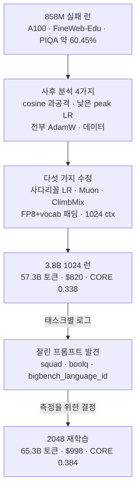

<figure class="post-figure post-figure--header">
<svg role="img" aria-label="헤더 삽화: 왼쪽 GPU 랙과 동전 더미에서 화살표가 오른쪽 모델 카드로 이어지는 구도" aria-labelledby="llm-h-title llm-h-desc" viewBox="0 0 400 320" width="460" xmlns="http://www.w3.org/2000/svg">
  <title id="llm-h-title">연구소 없이, $998로 — 시간 단위로 빌린 GPU 랙에서 3.848B 모델을 키우다</title>
  <desc id="llm-h-desc">위쪽 오른편에 초승달(저녁 시간에 만든 개인 프로젝트). 왼쪽에는 GPU 슬롯 8개가 꽂힌 랙(8× B200)과 그 옆에 쌓인 동전 더미($998)가 있고, "시간 단위 대여"라고 적힌 화살표가 오른쪽의 모델 카드로 이어진다. 모델 카드 아래쪽은 흩어진 무작위 점들이고, 위로 올라갈수록 가지런한 글줄로 바뀐다. 맨 아래 띠에는 65.3B 토큰, 43시간, CORE 0.384가 적혀 있다.</desc>
  <defs>
    <marker id="llm-h-arrow" markerWidth="14" markerHeight="14" refX="8" refY="5" orient="auto" markerUnits="userSpaceOnUse" viewBox="0 0 10 10">
      <path d="M0 0 L10 5 L0 10 Z" fill="var(--accent-color)"/>
    </marker>
  </defs>
  <text x="200" y="34" text-anchor="middle" font-size="21" font-weight="700" fill="currentColor">연구소 없이, $998로</text>
  <circle cx="362" cy="30" r="15" fill="var(--gold)"/>
  <circle cx="370" cy="24" r="13" fill="var(--bg-panel)"/>
  <rect x="40" y="62" width="110" height="178" rx="6" fill="var(--bg-light)" stroke="currentColor" stroke-width="2.5"/>
  <g fill="var(--bg-panel)" stroke="currentColor" stroke-width="1.5">
    <rect x="50" y="70" width="90" height="16" rx="2"/><rect x="50" y="91" width="90" height="16" rx="2"/>
    <rect x="50" y="112" width="90" height="16" rx="2"/><rect x="50" y="133" width="90" height="16" rx="2"/>
    <rect x="50" y="154" width="90" height="16" rx="2"/><rect x="50" y="175" width="90" height="16" rx="2"/>
    <rect x="50" y="196" width="90" height="16" rx="2"/><rect x="50" y="217" width="90" height="16" rx="2"/>
  </g>
  <g fill="var(--accent-color)">
    <rect x="126" y="75" width="6" height="6"/><rect x="126" y="96" width="6" height="6"/>
    <rect x="126" y="117" width="6" height="6"/><rect x="126" y="138" width="6" height="6"/>
    <rect x="126" y="159" width="6" height="6"/><rect x="126" y="180" width="6" height="6"/>
    <rect x="126" y="201" width="6" height="6"/><rect x="126" y="222" width="6" height="6"/>
  </g>
  <g stroke="currentColor" stroke-width="2" opacity="0.5">
    <path d="M58 78 H110"/><path d="M58 99 H110"/><path d="M58 120 H110"/><path d="M58 141 H110"/>
    <path d="M58 162 H110"/><path d="M58 183 H110"/><path d="M58 204 H110"/><path d="M58 225 H110"/>
  </g>
  <text x="95" y="264" text-anchor="middle" font-size="17" font-weight="700" fill="currentColor">8× B200</text>
  <g fill="var(--gold)" stroke="currentColor" stroke-width="1.5">
    <ellipse cx="195" cy="236" rx="20" ry="6"/><ellipse cx="195" cy="228" rx="20" ry="6"/>
    <ellipse cx="195" cy="220" rx="20" ry="6"/><ellipse cx="195" cy="212" rx="20" ry="6"/>
  </g>
  <text x="195" y="264" text-anchor="middle" font-size="17" font-weight="700" fill="var(--accent-color)">$998</text>
  <path d="M160 150 H228" fill="none" stroke="var(--accent-color)" stroke-width="4" marker-end="url(#llm-h-arrow)"/>
  <text x="195" y="136" text-anchor="middle" font-size="16" fill="currentColor">시간 단위</text>
  <text x="195" y="176" text-anchor="middle" font-size="16" fill="currentColor">대여</text>
  <rect x="245" y="62" width="125" height="178" rx="8" fill="var(--bg-panel)" stroke="currentColor" stroke-width="2.5"/>
  <g stroke="currentColor" stroke-width="3" stroke-linecap="round">
    <path d="M260 82 H352"/><path d="M260 96 H340"/><path d="M260 110 H354"/><path d="M260 124 H330"/>
  </g>
  <path d="M307 172 V146" fill="none" stroke="var(--accent-color)" stroke-width="3" marker-end="url(#llm-h-arrow)"/>
  <g fill="var(--text-light)">
    <rect x="258" y="186" width="5" height="5"/><rect x="276" y="200" width="5" height="5"/><rect x="292" y="182" width="5" height="5"/>
    <rect x="268" y="216" width="5" height="5"/><rect x="310" y="208" width="5" height="5"/><rect x="326" y="188" width="5" height="5"/>
    <rect x="340" y="214" width="5" height="5"/><rect x="354" y="196" width="5" height="5"/><rect x="298" y="224" width="5" height="5"/>
    <rect x="284" y="196" width="5" height="5"/><rect x="332" y="226" width="5" height="5"/><rect x="318" y="196" width="5" height="5"/>
    <rect x="262" y="226" width="5" height="5"/><rect x="348" y="182" width="5" height="5"/>
  </g>
  <text x="307" y="264" text-anchor="middle" font-size="17" font-weight="700" fill="currentColor">3.848B 모델</text>
  <rect x="40" y="280" width="330" height="30" rx="4" fill="var(--bg-light)" stroke="currentColor" stroke-width="1.5"/>
  <text x="205" y="301" text-anchor="middle" font-size="16" fill="currentColor">65.3B 토큰 · 43시간 · CORE 0.384</text>
</svg>
<figcaption>저녁 시간에 만든 개인 프로젝트 little-lm: 시간 단위로 빌린 8× B200에서 $998로, 무작위에서 언어가 피어나는 3.848B 모델을 키워 냈다.</figcaption>
</figure>

## 원문 정보

> - **제목**: Training a 3.8B LLM to 0.384 CORE for $998
> - **출처**: Hugo Vergnes 개인 블로그 ([hugovergnes.github.io](https://hugovergnes.github.io/))
> - **발행**: 2026-09-04 (v1.1 업데이트 2026-10-03) · 약 15분 분량 (추정)
> - **원문 링크**: <https://hugovergnes.github.io/little-lm-3-8b/>

"nanoGPT 장난감"과 "연구소가 필요한 규모" 사이, 개인이 수천 달러로 의미 있는 모델을 학습할 수 있는 영역에 대한 1인칭 실전 보고서라 Articles에 담는다.

## 한 줄 요약 (TL;DR)

Karpathy의 nanochat에서 영감을 받은 개인 프로젝트 little-lm으로 **3.848B 파라미터 모델을 65.3B 토큰, 8× B200 43시간, $998에 학습해 CORE 0.384**(GPT-2 1.5B는 0.2565)를 얻었다. 승부처는 Muon·ClimbMix·FP8·사다리꼴 LR 같은 "달러당 능력"을 올리는 선택이었고, 가장 흥미로운 교훈은 **1024 컨텍스트에서 프롬프트가 잘린 3개 태스크가 CORE를 크게 왜곡했다**는 평가 쪽 발견이다.

## 왜 이 글을 골랐나

LLM 사전학습 글은 대개 두 극단으로 갈린다. 수백억 원짜리 연구소의 기술 보고서이거나, 노트북에서 돌리는 교육용 장난감이다. 이 글은 그 사이 — **"내 돈이 타는" 규모** — 에서 실제로 무엇이 효과가 있었고 무엇이 없었는지를 숫자로 남긴다는 점이 귀하다.

이 위키의 [CS336 커리큘럼](/2026/06/26/cs336-llm-from-scratch-curriculum.html)이 강의로 다룬 아키텍처·자원 회계·평가 이론이, 한 개인의 $1,000 예산 안에서 어떻게 의사결정으로 바뀌는지 보여 주는 좋은 실전 사례이기도 하다. 원래 요청은 `ML-Theory`였지만, 글의 무게중심이 이론·수학이 아니라 **학습 인프라·처리량·어블레이션이라는 실무**에 있어 `AI-Engineering`으로 분류했다.

## 핵심 내용

### 결과 한눈에 보기

저자가 제시한 비교표를 그대로 옮기면 다음과 같다.

| 모델 | 파라미터 | 토큰 | 하드웨어 | 시간 | 비용 | CORE |
| --- | --- | --- | --- | --- | --- | --- |
| GPT-2 (OpenAI) | 1.5B | — | — | — | — | 0.2565 |
| nanochat d26 | ~561M | 11.2B | 8× H100 | ~3h | — | ~0.258 |
| nanochat d32 | ~1B | — | 8× H100 | ~33h | ~$1000 | 0.310 |
| little-lm 3.8B (1024 ctx) | 3.848B | 57.3B | 8× B200 | 35.9h | $820 | 0.338 |
| little-lm 3.8B (2048 ctx) | 3.848B | 65.3B | 8× B200 | 43h | $998 | 0.384 |

저자는 모델이 nanochat 변형보다 크고 하드웨어도 다르다는 점(당시 B200이 작업량 대비 H100보다 가성비가 좋았다)을 밝히면서, "nanochat의 $1,000 런과 대략 같은 예산으로 의미 있게 앞섰다"고 평가한다.

### 설정: 설정 파일로 움직이는 학습 프레임워크

little-lm은 소형 decoder-only LLM을 학습하는 **config 기반 프레임워크**다. 모든 런이 YAML 하나로 완전히 정의되고, 컴포넌트가 전역 레지스트리에 자기 등록되어 이름으로 해석되므로 옵티마이저나 데이터셋 교체가 한 줄 변경이다. 저자는 관심사 분리·깔끔한 인터페이스 같은 **평범한 소프트웨어 엔지니어링 규율이 AI 작업에서 매우 중요하다**고 강조한다. 좋은 인프라란 "코드를 거의 손대지 않아도 되는 인프라"이고, 이 보고서 전체가 실험을 브랜치가 아니라 **세 줄짜리 YAML diff**로 표현할 수 있었던 결과라는 것이다.

최종 모델은 Llama 스타일이다: RMSNorm, RoPE, GQA(쿼리 헤드 24, KV 헤드 8), relu² MLP, QK-norm, logit softcap, 레이어별 학습 가능한 residual 스칼라, ResFormer 스타일 value embedding.

| 구성 요소 | 파라미터 |
| --- | --- |
| 토큰 임베딩 | 154.5M |
| LM head (untied) | 154.5M |
| 28개 decoder 레이어 | 2,818.7M |
| Value embedding (14개 테이블) | 721.2M |
| 합계 | 3.848B |

Value embedding이 전체 파라미터의 19%를 차지한다는 점이 눈에 띈다(한 레이어 걸러 하나씩, vocab × kv_dim 테이블 14개).

### 초기 실패: 858M 모델의 사후 분석

첫 탐색은 단일 A100에서 858M Llama 모델을 FineWeb-Edu 16.4B 토큰으로 약 5.8일 학습한 것이었다(AdamW 2.5e-4, cosine decay to zero, 5% warmup, gradient accumulation으로 batch 256, 2048 컨텍스트). 결과는 PIQA 약 60.45% — GPT-2 124M(약 63%)보다 못했고, 생성 결과도 반복적이고 엉성했다. 저자의 사후 분석은 네 가지다.

- **Cosine decay가 너무 공격적**: 스텝의 약 70% 이후 곡선이 완전히 평탄해져, 마지막 30%의 연산이 사실상 아무것도 만들지 못했다.
- **Peak LR이 너무 보수적**: 858M에 2.5e-4는 낮다. 소형 모델은 꽤 공격적으로 가도 된다.
- **모든 곳에 AdamW**: 이 규모에서 행렬 파라미터는 Muon이 토큰당 더 낫다(어블레이션에서 빠르게 확인).
- **데이터**: FineWeb-Edu도 괜찮지만, NVIDIA가 공개한 ClimbMix가 더 나았다.

### 다섯 가지 수정

<figure class="post-figure">
<svg role="img" aria-label="위아래 두 패널의 LR 스케줄 곡선 비교: 위는 cosine decay, 아래는 사다리꼴" aria-labelledby="llm-lr-title llm-lr-desc" viewBox="0 0 380 506" width="440" xmlns="http://www.w3.org/2000/svg">
  <title id="llm-lr-title">cosine decay와 사다리꼴 LR 스케줄 비교 (정성적 모양)</title>
  <desc id="llm-lr-desc">위 패널은 858M 실패 런의 cosine decay: 5% warmup 뒤 곡선을 그리며 0까지 내려가고, 마지막 30% 구간이 음영으로 표시되어 그 구간의 연산이 사실상 아무것도 만들지 못했음을 나타낸다. 아래 패널은 3.8B 런의 사다리꼴 스케줄: 5% warmup, 50%까지 평탄 유지, 마지막 50% 동안 peak의 5%까지 선형 cooldown하며, 마지막 스텝까지 eval loss가 내려갔다.</desc>
  <defs>
    <pattern id="llm-lr-hatch" width="8" height="8" patternUnits="userSpaceOnUse" patternTransform="rotate(45)">
      <path d="M0 0 V8" stroke="currentColor" stroke-width="2" opacity="0.35"/>
    </pattern>
  </defs>
  <!-- PANEL 1: cosine -->
  <text x="40" y="26" font-size="17" font-weight="700" fill="currentColor">Cosine decay (858M 실패 런)</text>
  <rect x="257" y="46" width="93" height="120" fill="url(#llm-lr-hatch)" stroke="var(--crimson)" stroke-width="2" stroke-dasharray="5 4"/>
  <path d="M40 46 V166 H350" fill="none" stroke="currentColor" stroke-width="2" opacity="0.6"/>
  <text x="34" y="62" text-anchor="end" font-size="15" fill="var(--text-light)">LR</text>
  <path d="M40.0 166.0 L55.5 56.0 L63.7 56.2 L71.9 56.8 L80.0 57.9 L88.2 59.3 L96.4 61.2 L104.6 63.4 L112.8 65.9 L120.9 68.9 L129.1 72.1 L137.3 75.6 L145.5 79.5 L153.7 83.5 L161.8 87.8 L170.0 92.2 L178.2 96.8 L186.4 101.4 L194.6 106.2 L202.7 111.0 L210.9 115.8 L219.1 120.6 L227.3 125.2 L235.5 129.8 L243.7 134.2 L251.8 138.5 L260.0 142.5 L268.2 146.4 L276.4 149.9 L284.6 153.1 L292.7 156.1 L300.9 158.6 L309.1 160.8 L317.3 162.7 L325.5 164.1 L333.6 165.2 L341.8 165.8 L350.0 166.0" fill="none" stroke="currentColor" stroke-width="3.5" stroke-linejoin="round"/>
  <g font-size="15" fill="var(--text-light)" text-anchor="middle">
    <text x="56" y="186">5%</text><text x="257" y="186">70%</text><text x="350" y="186" text-anchor="end">100%</text>
  </g>
  <text x="40" y="210" font-size="15" fill="var(--crimson)" font-weight="700">빗금: 마지막 30%</text>
  <text x="40" y="230" font-size="15" fill="currentColor">→ 그 연산이 사실상 아무것도 못 만듦</text>
  <path d="M20 252 H360" stroke="currentColor" stroke-width="1" opacity="0.3"/>
  <!-- PANEL 2: trapezoid -->
  <g transform="translate(0 266)">
    <text x="40" y="26" font-size="17" font-weight="700" fill="currentColor">사다리꼴 (3.8B 런)</text>
    <rect x="195" y="46" width="155" height="120" fill="var(--secondary-color)" opacity="0.15"/>
    <path d="M40 46 V166 H350" fill="none" stroke="currentColor" stroke-width="2" opacity="0.6"/>
    <text x="34" y="62" text-anchor="end" font-size="15" fill="var(--text-light)">LR</text>
    <path d="M40 166 L55.5 56 L195 56 L350 160.5" fill="none" stroke="var(--accent-color)" stroke-width="3.5" stroke-linejoin="round"/>
    <circle cx="350" cy="160.5" r="4" fill="var(--accent-color)"/>
    <text x="120" y="47" text-anchor="middle" font-size="15" fill="currentColor">평탄 유지</text>
    <text x="345" y="76" text-anchor="end" font-size="15" fill="currentColor">선형 cooldown</text>
    <g font-size="15" fill="var(--text-light)" text-anchor="middle">
      <text x="56" y="186">5%</text><text x="195" y="186">50%</text><text x="350" y="186" text-anchor="end">100%</text>
    </g>
    <text x="40" y="210" font-size="15" fill="currentColor">마지막 50%: peak의 5%까지 선형 하강</text>
    <text x="40" y="230" font-size="15" fill="var(--accent-color)" font-weight="700">→ 마지막 스텝까지 eval loss 하강</text>
  </g>
</svg>
<figcaption>같은 연산이라도 꼬리 구간의 LR이 다르다 — cosine은 후반 30%를 "관성으로 흘려보내고", 사다리꼴은 끝까지 배운다 (곡선은 정성적 모양).</figcaption>
</figure>

1. **사다리꼴(trapezoidal) LR 스케줄** — 5% warmup, 평탄 유지, 마지막 50% 동안 peak의 5%까지 선형 cooldown. 모델이 꼬리 구간을 "관성으로 흘려보내지" 않고 끝까지 배운다. 3.8B 런에서는 마지막 스텝까지 eval loss가 내려가고 있었다.
2. **행렬 파라미터는 Muon, 나머지는 AdamW** — Muon은 Newton-Schulz 직교화 비용 때문에 스텝당 느리지만(얕은 accumulation 벤치마크에서 약 25%), 그 비용은 옵티마이저 스텝마다 한 번이라 gradient accumulation 7스텝에서는 약 4%로 희석된다. 저자는 비전·NLP 등 해 본 모든 프로젝트에서 Muon이 Adam보다 수렴이 크게 좋았다고 말한다.
3. **FineWeb-Edu 대신 ClimbMix** — 수렴 속도가 "엄청나게" 뛰었고, Karpathy의 발견과도 일치했다.
4. **FP8 + vocab 패딩** — `torch._scaled_mm`과 동적 tensorwise scaling으로 세 GEMM 모두 FP8 학습, 처리량 +33%. vocab은 50,257 → 50,304(64의 배수)로 패딩했고 이득은 아주 작았다.
5. **2048 대신 1024 컨텍스트** — 컨텍스트를 절반으로 줄이면 같은 메모리에서 배치를 대략 두 배로 할 수 있어 처리량이 약 10% 올랐다. 여전히 MLP가 지배적이라 하드웨어를 효과적으로 쓰고 있다는 신호로 본다.

이후 3.8B 1024 런은 25,000 스텝(57.3B 토큰)에서 eval loss 1.9868, CORE 0.3384에 도달했다. 정상 상태 처리량은 약 480,000 tok/s, 정기 CORE 평가 포함 총 35.9시간. 안정 구간에서 SM activity 92%, SM occupancy 40%였고, B200당 약 1,047 TFLOP/s — Blackwell dense FP8 peak 대비 약 25% MFU, bf16 peak 대비로는 50%(모든 linear 레이어가 FP8로 도는 것은 아니라 저자는 이쪽이 더 의미 있다고 본다). 분산 전략은 평범한 `DistributedDataParallel`이었고, 단일 노드 3.8B에서는 gradient 통신이 병목이 된 적이 없었다고 한다.

### 처리량 끌어올리기

"회사에서는 좋은 모델을 먼저, 싸게 만드는 건 그다음이지만 내 돈이 타면 처리량이 갑자기 훨씬 중요해진다." 노드를 빌리기 전 RTX 5090 한 장에서 858M 베이스라인(bf16, compiled)을 26,144 tok/s에서 37,621 tok/s로 올렸다(누적 +44%).

FP8과 vocab 패딩(합쳐서 +33%)에 더해, 최적화 커널도 썼다. **Liger `FusedLinearCrossEntropyLoss`**는 lm_head matmul을 loss에 융합하고 내부적으로 청크 처리해 `(B*T, vocab)` 로짓 텐서를 통째로 만들지 않는다. 같은 배치에서는 6% 느리지만 VRAM을 약 8GB 돌려받아, 마이크로 배치를 키우면 오히려 앞선다.

| 설정 | 처리량 | VRAM |
| --- | --- | --- |
| Baseline CE, batch 6 | 34,724 tok/s | 27,852 MiB |
| Fused CE, batch 6 | 32,952 tok/s | 19,630 MiB |
| Fused CE, batch 8 | 35,979 tok/s | 24,028 MiB |
| Fused CE, batch 10 | 37,621 tok/s | 28,872 MiB |

저자는 Claude가 "6% 느리다"는 이유로 이 옵션을 바로 기각했지만 전체로 보면 훌륭한 선택이었다고 덧붙인다. 그 밖의 레버는 다음과 같다.

- **Non-gated MLP**: SwiGLU → relu²(행렬곱 3개 → 2개)로 소형 모델에서 183,035 → 214,173 tok/s, VRAM 6GB 절감. 단, SwiGLU의 intermediate 비율 2.75를 relu²에 그대로 쓰면 학습이 눈에 띄게 나빠진다 — non-gated는 4×를 쓰라고 한다.
- **bf16 master weights**: 옵티마이저 master weight를 fp32 대신 bf16으로 두자 1.5B 설정에서 VRAM 27% 절감, 처리량 640K → 1.4M tok/s(2.2×). 품질 비용은 실재하지만 작다(4,000 스텝에서 CORE 0.22 vs 0.23). 저자는 dtype 처리를 "달러당 능력"에서 가장 레버리지가 크면서 덜 논의되는 손잡이로 꼽는다.
- **하드웨어**: 같은 코드, 150M 모델, FP8 기준 RTX 5090 184,662 tok/s vs B200 477,440 tok/s — 하드웨어만으로 2.59×.

### 효과가 없었던 것들

- **flex attention으로 문서 경계 마스킹**: 패킹된 시퀀스에서 토큰이 다른 문서를 보지 못하게 하는 "올바른" 처리지만 이 규모에서는 더 나은 모델로 이어지지 않았다. BOS 정렬 패킹에서는 문서 간 누출이 크게 해롭지 않다는 Karpathy의 관찰과도 일치. 약 10줄짜리 best-fit 패킹으로 대체하고 무조건 `is_causal=True` SDPA로 돌아갔다.
- **Liger RMSNorm·RoPE 커널**: RoPE는 마이크로벤치마크에서 2.2× 빨랐지만 종단 처리량 변화 없음(병목이 아님). RMSNorm은 PyTorch 2.9 내장 `F.rms_norm`보다 오히려 느렸다(0.41ms vs 0.25ms). 둘 다 되돌림.
- **nanochat 스타일 초기화**: 출력 projection을 0으로 두어 residual stream이 항등으로 시작하는 등 이론적으로 더 깔끔하지만, 손실 곡선은 약 1,500 스텝이면 겹쳤고 품질 차이는 측정되지 않았다. 그래도 "더 원칙적"이라 유지.
- **스트리밍 데이터셋**: 실험 초기엔 좋지만 실제 돈을 쓸 때는 위험하다. 네트워크가 멀쩡해도 로컬 샤드가 2~3% 더 빨랐고, 가끔의 네트워크 장애는 학습을 아예 멈추기도 했다. 몇 시간 이상 런이면 시작할 때 몇 분 다운로드하는 편이 낫다.

### 어블레이션 1: Value embedding

| | 파라미터 | Loss @12.5K | CORE @12.5K | 처리량 |
| --- | --- | --- | --- | --- |
| Value embedding on | 3.848B | 2.1075 | 0.3147 | 479,445 tok/s |
| Value embedding off | 3.128B | 2.1171 | 0.3047 | 477,908 tok/s |

Loss 0.46%, CORE 3.2% 개선. Value embedding은 룩업이라 FLOP이 거의 없어 처리량은 같다(메모리와 옵티마이저 상태만 든다). 저자의 "가격 매기기"가 재치 있다. 10,000→12,500 스텝 사이 베이스라인 loss가 0.0194 내려갔는데 value embedding의 우위는 0.0096, 즉 그 절반이므로 약 1,200 스텝 — **파라미터 19% 추가가 학습 약 5% 추가의 가치**라는 계산이다. 또 CORE가 loss보다 약 7배 더 움직였는데(3.2% vs 0.46%), CORE는 결정 경계 근처 항목이 작은 로짓 변화에도 뒤집히는 정확도 지표이고 랜덤 베이스라인 대비로 센터링되어 점수가 낮을 때 상대 차이를 증폭하기 때문이라고 설명한다.

### 어블레이션 2: GQA

1.5B 중간 크기 모델로 MHA, GQA 2:1(KV 6), GQA 3:1(KV 4)을 비교했다.

| | KV 헤드 | Loss @20K | CORE @20K | 처리량 | 학습 시간 |
| --- | --- | --- | --- | --- | --- |
| MHA | 12 | 2.1433 | 0.2857 | 1.235M tok/s | 9.4h |
| GQA 2:1 | 6 | 2.1652 | 0.2618 | 1.414M tok/s | 8.2h |
| GQA 3:1 | 4 | 2.1762 | 0.2812 | 1.380M tok/s | 8.4h |

GQA는 약 12~15% 빠르고 eval loss는 1.0~1.5% 손해다(MHA는 OOM 때문에 마이크로 배치를 줄여야 했던 점이 처리량 차이의 일부를 설명). 저자의 결론은 **이 규모에서 GQA는 학습 단계에서 본전을 못 뽑는다**는 것 — MHA가 GQA 2:1의 최종 loss에 약 7.9시간이면 도달한다(GQA 2:1은 8.2시간). GQA의 진짜 이유는 KV cache가 2~3배 작아지는 추론 쪽이다. 그리고 3:1이 loss는 더 나쁜데 CORE는 더 높은 점을 들어, **이 정도 차이에서 CORE는 순위를 매기기엔 너무 노이즈가 크니 eval loss를 믿는다**고 한다.

### 오해를 부르는 벤치마크: 잘린 프롬프트

<figure class="post-figure">
<svg role="img" aria-label="위아래 두 패널의 토큰 막대 비교: 위는 1,024 창, 아래는 2,048 창" aria-labelledby="llm-tr-title llm-tr-desc" viewBox="0 0 380 480" width="440" xmlns="http://www.w3.org/2000/svg">
  <title id="llm-tr-title">10-shot SQuAD 프롬프트가 1,024 토큰 창에서 잘리는 방식 vs 2,048 토큰 창</title>
  <desc id="llm-tr-desc">두 패널이 위아래로 놓여 있다. 막대는 중앙값 약 1,998 토큰의 10-shot SQuAD 프롬프트로, 앞쪽은 시연 예제 10개, 끝은 약 169 토큰의 테스트 예제(지문과 질문)다. 위 패널(1,024 컨텍스트)에서는 하네스가 마지막 1,024 토큰만 남기므로 중앙값 프롬프트 기준 앞쪽 약 974 토큰, 즉 시연 예제의 약 절반이 잘려 나간다(내 계산). 저자는 모델이 출력 형식을 가르치는 예제를 거의 보지 못해 exact-match에서 0점을 받았다고 설명한다(squad 잘림 100%). 아래 패널(2,048 컨텍스트)에서는 중앙값 프롬프트가 통째로 창에 들어가 squad 잘림 비율이 47%로 줄고 점수가 0.0000에서 0.3114로 오른다.</desc>
  <defs>
    <pattern id="llm-tr-hatch" width="8" height="8" patternUnits="userSpaceOnUse" patternTransform="rotate(45)">
      <path d="M0 0 V8" stroke="currentColor" stroke-width="2" opacity="0.4"/>
    </pattern>
  </defs>
  <!-- PANEL 1: 1024 window -->
  <text x="40" y="24" font-size="17" font-weight="700" fill="currentColor">1,024 컨텍스트</text>
  <text x="40" y="46" font-size="15" fill="var(--text-light)">SQuAD 10-shot ≈ 1,998 토큰 (중앙값)</text>
  <text x="350" y="72" text-anchor="end" font-size="15" font-weight="700" fill="var(--accent-color)">남기는 창: 마지막 1,024</text>
  <rect x="47.6" y="86" width="276.8" height="24" fill="url(#llm-tr-hatch)" stroke="currentColor" stroke-width="1.5"/>
  <rect x="324.4" y="86" width="25.6" height="24" fill="var(--gold)" stroke="currentColor" stroke-width="1.5"/>
  <rect x="47.6" y="86" width="147.4" height="24" fill="var(--bg-panel)" opacity="0.7"/>
  <rect x="47.6" y="86" width="147.4" height="24" fill="none" stroke="var(--crimson)" stroke-width="2" stroke-dasharray="5 4"/>
  <text x="121" y="103" text-anchor="middle" font-size="15" font-weight="700" fill="var(--crimson)">잘려 나감</text>
  <rect x="195" y="80" width="155" height="36" fill="none" stroke="var(--accent-color)" stroke-width="3"/>
  <path d="M186 112 V132" stroke="currentColor" stroke-width="1.5"/>
  <text x="186" y="148" text-anchor="middle" font-size="15" fill="currentColor">시연 예제 10개</text>
  <path d="M337 112 V156" stroke="currentColor" stroke-width="1.5"/>
  <text x="350" y="172" text-anchor="end" font-size="15" fill="currentColor">테스트 예제 ~169</text>
  <text x="40" y="198" font-size="15" fill="currentColor">→ 앞쪽 시연 ~974 토큰 손실 · 0점</text>
  <text x="40" y="218" font-size="15" font-weight="700" fill="var(--crimson)">squad 잘림 100% · 25K 스텝 0.0000</text>
  <path d="M20 236 H360" stroke="currentColor" stroke-width="1" opacity="0.3"/>
  <!-- PANEL 2: 2048 window -->
  <g transform="translate(0 250)">
    <text x="40" y="24" font-size="17" font-weight="700" fill="currentColor">2,048 컨텍스트</text>
    <text x="40" y="46" font-size="15" fill="var(--text-light)">같은 프롬프트, 두 배 창</text>
    <text x="350" y="72" text-anchor="end" font-size="15" font-weight="700" fill="var(--accent-color)">남기는 창: 마지막 2,048</text>
    <rect x="47.6" y="86" width="276.8" height="24" fill="url(#llm-tr-hatch)" stroke="currentColor" stroke-width="1.5"/>
    <rect x="324.4" y="86" width="25.6" height="24" fill="var(--gold)" stroke="currentColor" stroke-width="1.5"/>
    <rect x="40" y="80" width="310" height="36" fill="none" stroke="var(--accent-color)" stroke-width="3"/>
    <path d="M186 112 V132" stroke="currentColor" stroke-width="1.5"/>
    <text x="186" y="148" text-anchor="middle" font-size="15" fill="currentColor">시연 예제 10개</text>
    <path d="M337 112 V156" stroke="currentColor" stroke-width="1.5"/>
    <text x="350" y="172" text-anchor="end" font-size="15" fill="currentColor">테스트 예제 ~169</text>
    <text x="40" y="198" font-size="15" fill="currentColor">→ 중앙값 프롬프트는 통째로 들어감</text>
    <text x="40" y="218" font-size="15" font-weight="700" fill="var(--accent-color)">squad 잘림 47% · 0.0000 → 0.3114</text>
  </g>
</svg>
<figcaption>하네스는 긴 프롬프트의 마지막 max_seq_len 토큰만 남긴다. 1,024 창에서는 중앙값 프롬프트 기준 앞쪽 약 974 토큰 — 시연 예제의 약 절반 — 이 잘려 나갔고(내 계산), SQuAD exact-match는 0점이 됐다. 저자는 모델이 출력 형식을 가르치는 예제를 거의 보지 못한 것을 원인으로 든다 (막대 길이는 토큰 수에 비례).</figcaption>
</figure>

1024로 충분하다고 결론 내리기 쉽지만, 태스크별 로그를 보면 틀렸다. CORE의 22개 태스크 중 3개는 프롬프트가 사실상 1024 토큰에 들어가지 않는다.

| 태스크 | 잘린 프롬프트 | 2.5K 스텝 | 25K 스텝 |
| --- | --- | --- | --- |
| squad | 10570 / 10570 (100%) | 0.1478 | 0.0000 |
| boolq | 3265 / 3270 (99.8%) | 0.5798 | 0.5131 |
| bigbench_language_id | 9965 / 10000 (99.7%) | 0.2454 | 0.2538 |

SQuAD는 학습할수록 0.1478 → 0.0617 → 0.0099 → 0.0007 → 0.0000으로 **단조 감소해 정확히 0**이 된다. 저자는 두 가지로 설명한다. SQuAD는 DCLM 번들에서 10-shot 태스크라 프롬프트 중앙값이 1,998 토큰이고, 하네스는 긴 프롬프트의 **마지막** `max_seq_len` 토큰만 남긴다. 끝에 있는 테스트 예제(지문+질문, 약 169 토큰)는 늘 살아남고, 잘린 것은 앞쪽의 시연 예제들이었다 — 저자의 표현으로는 모델이 "기대하는 출력 형식을 가르치는 예제를 거의 보지 못했다". 그리고 exact-match 채점이라 유창한 문장은 매번 0점이 된다는 것이 저자의 설명이다. 다만 원문 숫자로 따져 보면 시연이 "전부" 사라진 것은 아니다. 중앙값 프롬프트에서 잘리는 것은 앞쪽 약 974 토큰(1,998 − 1,024)이고, 테스트 예제를 뺀 약 855 토큰어치 시연은 남아 있으므로, 중앙값 기준으로는 시연의 약 절반을 잃은 셈이다(내 계산). 저자에 따르면 엔트로피가 높은 초기 모델은 가끔 짧고 일반적인 답을 내 우연히 맞췄지만, 모델이 날카로워질수록 잘 짜인 문장을 이어 쓰며 그 우연이 사라진다 — "언어를 더 잘하게 되자 우연히 맞히는 능력은 나빠졌다." 결국 0.338은 22개 중 3개 태스크가 모델 품질과 무관한 이유로 우연 수준 이하인 상태에서 측정된 값이었다.

### 더 긴 컨텍스트의 효과

컨텍스트를 2048로 두 배, 마이크로 배치를 절반으로 해 옵티마이저 스텝당 토큰 수를 같게 유지하고 재학습했다. 대여 비용을 아끼려 약 28,000 스텝에서 멈춰 warmdown이 끝나지 않았으므로 결과는 하한값이다. **CORE는 0.3384 → 0.3840.** 흥미롭게도 20,000 스텝에서 두 런의 eval loss는 소수점 셋째 자리까지 같은데(2.016) CORE는 0.034 차이가 났다.

| 태스크 | 1024 | 2048 | 잘림 비율 |
| --- | --- | --- | --- |
| squad | 0.0000 | 0.3114 | 100% → 47% |
| boolq | 0.5131 | 0.7095 | 99.8% → 3.2% |
| bigbench_language_id | 0.2538 | 0.2585 | 99.7% → 14% |
| 나머지 19개 태스크 | | | 합산 +0.008 |

squad와 boolq가 이득의 83%다. boolq는 랜덤 베이스라인이 0.62("yes"가 약 62%)라서 CORE 센터링을 거치면 원점수 +0.196이 +0.517로 커진다. 이 둘을 빼면 나머지는 합쳐서 +0.008 — 저자는 이를 "토큰 14% 추가로 얻을 만한 수준"으로 본다. commonsense_qa(-0.072)와 cs_algorithms(-0.031)는 오히려 떨어졌다. (원문은 표에서 "나머지 19개", 본문과 분해표에서 "나머지 20개"라고 써 개수 표기가 엇갈리지만, 어느 쪽이든 합산 이득은 약 +0.008로 같다.)

저자의 결론: **2048은 품질이 아니라 측정을 위한 결정**이었다. 처리량 9%(480K → 437K tok/s)를 내주고, 1024에서 채점 불가능했던 태스크 밖에서는 거의 얻은 게 없다. 또 이 효과는 큰 모델에서 더 크게 나타났다(1.5B는 +0.014, 3.8B는 +0.046). 컨텍스트가 길어지면 태스크가 "열리고", 그다음 얼마나 점수를 얻는지는 모델이 그 태스크를 얼마나 잘하느냐에 달렸다는 해석이다.

### 한계와 열린 질문

저자는 peak LR(nanochat의 `sqrt(768/d_model)` 규칙), LR 스케줄의 대안, QK-norm을 어블레이션하지 않았다고 밝힌다. 대부분 nanochat에서 물려받은 것이며 "다른 사람이 이미 실험 비용을 냈다"는 점에서 소예산에 합리적이지만, Karpathy의 결과가 자신의 모델·데이터·규모로 전이된다고 **믿는** 셈이라고 인정한다. 열린 질문으로는 value embedding 721M을 다른 곳에 쓰는 것과의 비교, 같은 wall-clock에서의 1024 vs 2048, commonsense_qa 퇴보의 원인, nanochat처럼 옵티마이저 내부에서 ZeRO-2 샤딩하기(Muon은 전체 gradient 행렬이 필요하므로 행렬을 쪼개는 대신 랭크마다 행렬을 통째로 맡기는 방식이어야 중복 직교화가 사라진다), 데이터 분석을 든다.

부록에는 전체 config가 실려 있다. 핵심만 추리면 hidden 3072, intermediate 12288(4×, non-gated), 28 레이어, 헤드 24/KV 8, `logit_softcap: 15.0`, 총 배치 2,293,760 토큰(20 × 2048 × 7 grad_accum × 8 GPU), Muon `lr=0.02`(행렬) + 파라미터 그룹별 AdamW, 사다리꼴 스케줄(warmup 0.05 · warmdown 0.50 · final 0.05), Nemotron-ClimbMix + GPT-2 tokenizer, best-fit BOS 정렬 패킹이다.

마무리에서 저자는 2019년 잘 투자받은 연구소의 프런티어 결과였던 GPT-2 1.5B(CORE 0.2565)를, 7년 뒤 혼자 저녁 시간에 시간제 하드웨어와 $998로 크게 앞질렀다고 말한다.

## 분석과 인사이트

여기부터는 원문 요약이 아닌 내 관점이다.

**1. "달러당 능력"이라는 목적 함수가 의사결정을 바꾼다.** 이 글에서 가장 배울 만한 건 개별 트릭보다 판단 기준이다. Fused CE 사례가 상징적이다. 마이크로벤치마크(스텝당 6% 느림)만 보면 기각이 맞지만, 목적 함수를 "같은 VRAM에서 초당 토큰"으로 바꾸면 결론이 뒤집힌다. 반대로 Liger RoPE는 마이크로벤치마크에서 2.2× 빨랐는데 종단 효과는 0이었다. 두 사례 모두 **최적화는 병목과 최종 지표 기준으로 측정해야 한다**는 오래된 성능 엔지니어링 원칙의 재확인이다. AI 어시스턴트가 국소 지표로 성급히 기각했다는 언급도, 에이전트에게 "무엇을 최적화하는지"를 명확히 줘야 한다는 교훈으로 읽힌다.

**2. 가장 값진 발견은 모델이 아니라 측정에 있다.** SQuAD가 단조 감소해 0이 된 현상은 "모델이 이상하다"가 아니라 "하네스가 왼쪽을 자른다"였다. 2048 재학습의 CORE 이득 +0.046 가운데 약 0.038(squad +0.014, boolq +0.024 — 이득의 83%)이 1024에서 프롬프트가 잘리던 두 태스크에서 나왔다는 것, 즉 평가 파이프라인의 truncation 정책 한 줄이 집계 점수를 이만큼 좌우할 수 있다는 것, 그리고 eval loss가 같은 두 런이 CORE로는 0.034 차이 난다는 것은 [CS336 12강](/2026/06/26/cs336-lecture-12-evaluation.html)의 "하나의 참된 평가는 없다"를 아주 구체적으로 보여 준다. 집계 벤치마크를 보기 전에 **태스크별 로그와 프롬프트 길이 분포를 먼저 보라**는 것이 실무적 교훈이다.

**3. 저자는 자기 결과에 정직하다 — 이 점이 글의 신뢰도를 높인다.** 2048 런이 warmdown 전 중단되어 하한값이라는 점, 2048 이득의 대부분이 "측정 해금"이라는 점, 1024 vs 2048 비교가 토큰 수까지 달라 품질 질문은 풀리지 않았다는 점, 주요 하이퍼파라미터가 nanochat에서 물려받은 미검증 가정이라는 점을 모두 스스로 밝힌다. 헤드라인 숫자(0.384)만 인용하면 이 맥락이 사라지므로, 인용할 때는 "2048 컨텍스트로 채점 가능해진 태스크 효과가 큰 몫"이라는 단서를 붙이는 게 맞다.

**4. 몇 가지 숫자는 읽는 방식에 주의가 필요하다.** "파라미터 19% 추가"에서 19%는 3.848B 중 value embedding이 차지하는 비율이고, value embedding을 끈 3.128B 모델 기준으로 보면 약 23% 증가다(내 계산). 또 GQA·value embedding 어블레이션은 설정당 한 번씩 돌린 결과로 보이고(원문에 시드 반복 언급 없음), 저자 스스로 CORE가 체크포인트 사이에 약 0.01씩 튄다고 했으므로, CORE 차이보다 loss 차이 쪽을 신호로 보는 저자의 판단에 동의한다. "Muon ≫ Adam"은 저자의 프로젝트 경험에 기반한 강한 주장이고, 이 글 안에서 정량 비교표가 제시되지는 않았다.

**5. "인프라에 대한 투자"는 개인 프로젝트에서도 바로 회수된다.** 실험을 세 줄 YAML diff로 표현할 수 있었기에 value embedding·GQA·컨텍스트 어블레이션이 가능했다. 연구 코드가 지저분해도 된다는 통념에 대한 좋은 반례이며, [CS336 3강](/2026/06/26/cs336-lecture-3-architectures-hyperparameters.html)에서 정리한 "현대 트랜스포머의 합의"(RMSNorm, RoPE, GQA 등)를 실제로 켜고 끄며 비용을 매겨 본 기록으로도 읽을 수 있다.

## 적용 포인트

- **최적화는 종단 지표로 판단하라**: 커널·설정 변경은 마이크로벤치마크가 아니라 "같은 메모리 예산에서의 tok/s"와 최종 loss로 비교한다. 느리지만 메모리를 아끼는 옵션은 배치 증가로 이득이 될 수 있다.
- **평가 하네스의 truncation 정책을 확인하라**: few-shot 프롬프트 길이 분포를 학습 컨텍스트와 대조하고, 잘림 비율이 높은 태스크는 집계 점수에서 따로 표시한다. 학습할수록 점수가 떨어지는 태스크는 모델보다 측정을 먼저 의심한다.
- **작은 차이는 loss로 판단하라**: 반복 실행 없는 어블레이션에서 CORE류 정확도 지표는 노이즈가 크다. 의사결정은 eval loss를 1차 신호로 쓴다.
- **LR 스케줄의 꼬리를 점검하라**: 학습 후반 loss 곡선이 평탄하다면 cosine decay가 LR을 너무 일찍 죽이고 있는지 확인하고, warmup–hold–linear cooldown 형태를 검토한다.
- **돈이 드는 런은 데이터를 로컬에 두라**: 몇 시간 이상의 런에서 스트리밍은 처리량 손실과 중단 위험이 크다.
- **dtype을 레버로 다뤄라**: FP8 GEMM, bf16 master weight처럼 정밀도 선택이 처리량을 크게 바꾼다. 품질 비용을 작은 런으로 먼저 측정한다.
- **실험을 config diff로 만들어라**: 컴포넌트 레지스트리 + YAML 같은 구조에 초기 투자를 하면 어블레이션 비용이 급격히 떨어진다.

## 마무리

little-lm 회고는 "$1,000로 GPT-2를 이겼다"는 헤드라인보다, 그 과정에서 무엇을 측정하고 어떻게 판단했는지가 더 값진 글이다. 사다리꼴 LR·Muon·ClimbMix·FP8 같은 레시피는 시간이 지나면 바뀌겠지만, 종단 지표로 최적화를 평가하고, 벤치마크 점수의 움직임을 태스크 단위로 해부하며, 자기 결과의 한계를 숫자와 함께 밝히는 태도는 규모와 상관없이 그대로 가져갈 만하다. 개인이 연구소의 영역에 발을 들일 수 있게 된 지금, 이런 정직한 1인칭 기록이야말로 그 "덜 묘사된 영역"의 지도를 채운다.

### 더 읽어보기

- [원문 — Training a 3.8B LLM to 0.384 CORE for $998 (Hugo Vergnes)](https://hugovergnes.github.io/little-lm-3-8b/)
- [CS336 LLM from Scratch 커리큘럼](/2026/06/26/cs336-llm-from-scratch-curriculum.html) — 이 글의 결정들을 체계적인 강의 흐름 안에서 다시 보기
- [CS336 3강 — 아키텍처와 하이퍼파라미터: 현대 트랜스포머의 합의](/2026/06/26/cs336-lecture-3-architectures-hyperparameters.html) — RMSNorm·RoPE·GQA·게이트 MLP 등 little-lm이 켜고 끈 구성 요소의 배경
- [CS336 12강 — 평가(Evaluation): 하나의 참된 평가는 없다](/2026/06/26/cs336-lecture-12-evaluation.html) — 잘린 프롬프트가 CORE를 왜곡한 사례를 평가 이론의 관점에서
