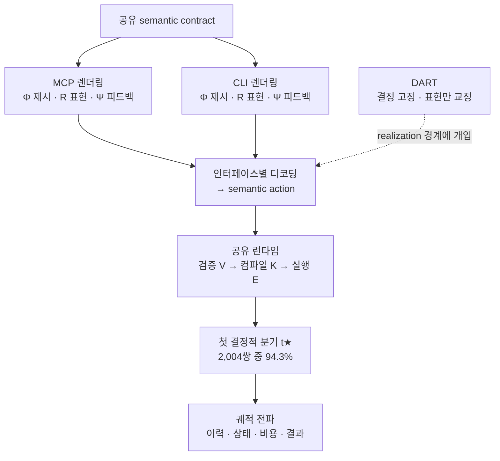
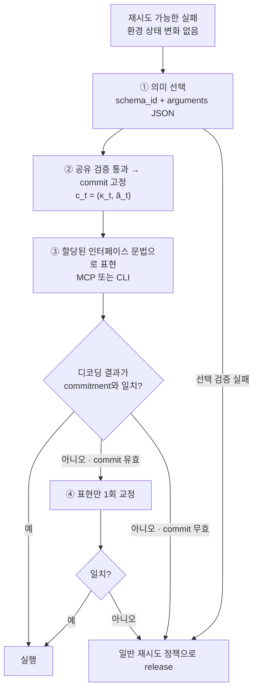

<figure class="post-figure post-figure--header">
<svg role="img" aria-label="위쪽의 두루마리 한 장, 곧 같은 행동이 두 갈래로 나뉜다. 왼쪽 갈래는 중괄호가 적힌 봉인 문서(MCP)로, 오른쪽 갈래는 달러 프롬프트가 뜬 터미널(CLI)로 전달된다. 아래에서 두 진로는 실선과 점선으로 서로 반대쪽 깃발을 향해 벌어지고, 가운데에는 '같은 능력, 다른 궤적'이라고 적혀 있다." viewBox="0 0 640 320" width="540">
  <title>같은 행동, 두 개의 표면, 다른 궤적</title>
  <!-- 공유 semantic action: 두루마리 -->
  <rect x="225" y="14" width="190" height="60" fill="var(--bg-panel)" stroke="currentColor" stroke-width="3"/>
  <rect x="211" y="8" width="16" height="72" fill="var(--gold)" stroke="currentColor" stroke-width="2"/>
  <rect x="413" y="8" width="16" height="72" fill="var(--gold)" stroke="currentColor" stroke-width="2"/>
  <text x="320" y="53" text-anchor="middle" font-family="var(--font-body)" font-size="25" font-weight="700" fill="currentColor">같은 행동</text>
  <!-- 갈림 -->
  <path d="M320 80 V98 H150 V114 M320 98 H490 V114" fill="none" stroke="currentColor" stroke-width="3"/>
  <polygon points="150,124 142,112 158,112" fill="currentColor"/>
  <polygon points="490,124 482,112 498,112" fill="currentColor"/>
  <!-- MCP: 봉인된 JSON 문서 -->
  <rect x="90" y="126" width="120" height="80" fill="var(--bg-panel)" stroke="currentColor" stroke-width="3"/>
  <text x="150" y="176" text-anchor="middle" font-family="var(--font-mono)" font-size="30" font-weight="700" fill="var(--accent-color)">{ }</text>
  <rect x="190" y="190" width="14" height="14" fill="var(--accent-color)" stroke="currentColor" stroke-width="2"/>
  <text x="150" y="236" text-anchor="middle" font-family="var(--font-body)" font-size="25" font-weight="700" fill="currentColor">MCP</text>
  <!-- CLI: 터미널 -->
  <rect x="430" y="126" width="120" height="80" fill="var(--bg-panel)" stroke="currentColor" stroke-width="3"/>
  <rect x="430" y="126" width="120" height="14" fill="currentColor" opacity="0.25"/>
  <text x="490" y="182" text-anchor="middle" font-family="var(--font-mono)" font-size="30" font-weight="700" fill="var(--secondary-color)">$ _</text>
  <text x="490" y="236" text-anchor="middle" font-family="var(--font-body)" font-size="25" font-weight="700" fill="currentColor">CLI</text>
  <!-- 벌어지는 진로 -->
  <path d="M150 246 V262 Q150 284 122 284 H52" fill="none" stroke="var(--accent-color)" stroke-width="4"/>
  <path d="M490 246 V262 Q490 284 518 284 H588" fill="none" stroke="var(--secondary-color)" stroke-width="4" stroke-dasharray="9 6"/>
  <path d="M40 248 V306" stroke="currentColor" stroke-width="3"/>
  <rect x="40" y="248" width="28" height="18" fill="var(--accent-color)" stroke="currentColor" stroke-width="2"/>
  <path d="M600 248 V306" stroke="currentColor" stroke-width="3"/>
  <rect x="572" y="248" width="28" height="18" fill="none" stroke="var(--secondary-color)" stroke-width="3"/>
  <text x="320" y="292" text-anchor="middle" font-family="var(--font-body)" font-size="25" font-weight="700" fill="currentColor">같은 능력, 다른 궤적</text>
</svg>
<figcaption>같은 semantic action을 MCP와 CLI 두 표면으로 건네도, 에이전트의 궤적은 서로 다른 곳에 도착한다.</figcaption>
</figure>

## 원문 정보

> - **제목**: Matched Capabilities, Different Behaviors: A Controlled Study of MCP and CLI Interfaces for Language Agents
> - **출처**: Zhenning Shi, Liang Pang, Yongqi Li (The Hong Kong Polytechnic University · 중국과학원 계산기술연구소) — arXiv cs.AI ([arxiv.org](https://arxiv.org/abs/2610.34298))
> - **발행**: 2026-10-25 (v1) · 본문 11쪽 + 부록, 총 34쪽 분량
> - **원문 링크**: [https://arxiv.org/abs/2610.34298](https://arxiv.org/abs/2610.34298) · 코드: [ModalityDance/MICA](https://github.com/ModalityDance/MICA)

"에이전트에 도구를 MCP로 줄까, CLI로 줄까"라는 실무 논쟁을 **능력을 똑같이 맞춘 통제 실험**으로 다시 따져 본 논문이라 Articles에 담는다. 이 글은 arXiv **v1**(2026-10-25 제출, PDF 본문)을 읽고 썼으며, 아래 수치는 모두 v1의 본문·표·부록에서 옮겼다.

## 한 줄 요약 (TL;DR)

같은 의미의 행동 집합(semantic action contract)에서 MCP와 CLI 인터페이스를 렌더링하고 실행 경로까지 공유시켜도, 에이전트의 점수·토큰 비용·행동 선택·실패와 복구 양상은 모델과 환경에 따라 **크게, 그리고 방향까지 뒤집히며** 달라진다. 저자들은 그 차이가 주로 "행동을 표면 문법으로 표현하는 단계(realization)"에서 생긴다는 것을 찾아내고, 이미 검증된 결정은 그대로 둔 채 표현만 고치는 DART로 6개 설정 모두에서 점수를 올렸다.



## 왜 이 글을 골랐나

코딩 에이전트와 사내 에이전트를 만드는 사람이라면 한 번은 이 질문을 마주한다. MCP 서버로 도구를 노출할까, 그냥 셸 명령을 쓰게 할까? 지금까지의 논의는 대체로 "MCP는 토큰을 많이 먹는다", "CLI가 더 유연하다" 같은 **시스템 단위 비교**였다. 하지만 그런 비교에는 도구 granularity, 프롬프트, 검증 로직, 스캐폴딩이 함께 바뀌어 있어서, 차이가 인터페이스 표현 때문인지 다른 것 때문인지 가를 수 없다. 논문도 바로 이 점(관련 연구 [16], [17])을 출발점으로 삼는다.

이 논문은 그 혼재 변수를 걷어 낸다. 실행 가능한 능력, 검증기, 컴파일러, 실행기, 예산을 모두 고정하고 **모델에게 보이는 표현만** 바꾼다. 그래서 "인터페이스는 수동적인 접근 계층이 아니라 에이전트가 결정을 내리는 환경의 일부"라는 주장을 정량적으로 뒷받침한다. [하니스를 정의한 논문](/2026/08/03/what-makes-a-harness-a-harness.html)이 "도구 계층"을 하니스의 구성 요소로 짚었다면, 이 논문은 그 도구 계층의 **표면 문법 하나**가 정책을 바꿀 수 있음을 보여 준다.

## 핵심 내용

### 1. 문제 설정: "무엇을 할 수 있나"와 "어떻게 보이나"를 떼어 내기

에이전트는 각 단계에서 semantic action a<sub>t</sub> = (u<sub>t</sub>, v<sub>t</sub>), 즉 연산 u<sub>t</sub>와 정규화된 typed 인자 v<sub>t</sub>를 고른다. 같은 연산과 같은 정규화 인자를 가리키면 두 제안은 의미상 같다(≡<sub>sem</sub>)고 본다. 이 semantic action이 MCP와 CLI를 비교하는 공통 단위다.

저자들은 인터페이스를 세 덩어리로 분해한다.

| 구성 요소 | 기호 | 담당하는 것 |
| --- | --- | --- |
| Presentation | Φ | 사용 가능한 능력·인자 타입·제약을 모델에게 보여 주는 방식 |
| Realization | R = (ρ, D) | 응답 프로토콜(컨테이너·문법)과 인터페이스별 디코더 |
| Feedback | Ψ | 실행 결과와 실패 정보를 모델에게 돌려주는 방식 |

모델 응답은 디코딩된 뒤 **공유된** 의미 검증(V) → 네이티브 행동 컴파일(K) → 환경 실행(E)을 거친다. 모델에게 보이는 쪽(Φ, ρ, D, Ψ)만 다르고 그 아래 런타임은 같다.

궤적 비교에는 단계별 상호작용 서명 b<sub>t</sub> = (â<sub>t</sub>, f<sub>t</sub>, ω<sub>t</sub>, r<sub>t</sub>)(의미 제안, 실패 단계, 실행 결과, 복구 상태)를 쓴다. MCP와 CLI의 서명이 처음 달라지는 단계가 **첫 결정적 분기(first consequential divergence) t★**다. 표면 문자열이 달라도 같은 의미 행동으로 디코딩되고 결과가 같으면 아직 분기가 아니다.

### 2. MICA: 계약을 맞춰 만든 두 인터페이스

**MICA(Matched Interface Comparison and Analysis)**는 벤치마크별 공통 의미 계약 C<sub>t</sub>에서 MCP와 CLI를 둘 다 렌더링한다(논문 표현으로는 "controlled MCP-style"/"CLI-style" 문법). 예를 들어 ALFWorld의 `alfworld.go(destination="sofa 1")`는 이렇게 표현된다.

```text
MCP:  <tool_call>{"name":"alfworld__go","arguments":{"destination":"sofa 1"}}</tool_call>
CLI:  <command>bench alfworld go --destination 'sofa 1'</command>
→ 두 디코더 모두 alfworld.go(destination="sofa 1") → 네이티브 "go to sofa 1"
```

적합성 검사는 네 가지다. 등록된 semantic action 커버리지, 왕복(render→decode) 의미 동등성, 공통 네이티브 컴파일, 정책에 보이는 계약 사실의 일관성. 이걸 통과해야 "능력은 같고 표현만 다르다"는 전제가 성립한다.

분석은 두 축으로 진행된다.

- **Matched-state probe**: 환경 상태, 이력, 계약, 모델, 생성 설정을 고정한 결정 지점에서 (Φ, R, Ψ)를 각각 MCP/CLI로 바꾼 2 × 2 × 2 = 8개 조건(C1 MMM … C8 CCC)으로 응답 분포를 샘플링한다. 338개 source state, 조건당 8회 샘플, 총 21,632개 응답이다(T = 0.6).
- **Paired natural trajectory**: 같은 초기 상태에서 MCP 에피소드와 CLI 에피소드를 짝지어(temperature 0) 돌리고, t★ 이후 이력·상태·복구·비용·결과가 어떻게 벌어지는지 추적한다.

### 3. 실험 설정

- **환경**: ALFWorld(가정 내 grounded 상호작용, 134 tasks), WebShop(목표 지향 웹 쇼핑, 100 tasks), ScienceWorld(다단계 과학 추론, 100 tasks)
- **모델**: Qwen3-4B/8B/14B/32B(로컬 체크포인트), DeepSeek-v4-Flash, Gemini-2.5-Flash(API)
- **고정 요소**: 모델, 초기 상태, 공개 정보, 의미 행동 공간, 검증·실행 파이프라인, 생성 설정, 상호작용 예산
- **규모**: 6개 모델 × (134+100+100) tasks = **2,004쌍**의 MCP–CLI 에피소드. 각 벤치마크의 네이티브 인터페이스는 보정용 참고치로 함께 돌렸다.
- **연구 질문**: RQ1 성능·비용, RQ2 의미 결정·복구, RQ3 차이의 기원과 전파, RQ4 DART의 효과

### 4. RQ1 — 같은 능력인데 점수와 비용이 크게 다르다

가장 극적인 사례는 Qwen3-14B다.

| Qwen3-14B | CLI 점수 | MCP 점수 | MCP − CLI | CLI 토큰(k/task) | MCP 토큰(k/task) |
| --- | --- | --- | --- | --- | --- |
| ALFWorld | 56.7 | 20.1 | **−36.6** | 241.9 | 296.8 (+54.9k) |
| WebShop | 59.5 | 64.4 | **+4.9** | 83.1 | 48.1 (−35.0k) |

같은 모델에서 환경만 바꿔도 MCP가 유리한지 불리한지가 **뒤집히고**, 토큰 비용도 반대로 움직인다. 다른 모델에서도 비슷한 역전이 나타난다. Gemini-2.5-Flash는 ALFWorld에서 CLI 56.7, MCP 67.2로 MCP가 앞서고, DeepSeek-v4-Flash는 같은 환경에서 CLI 99.3, MCP 95.5로 CLI가 앞선다.

비용 차이의 메커니즘도 다르다(부록 Table S1). ALFWorld의 Qwen3-14B는 MCP에서 호출 수가 46.9 → 57.1회로 늘었지만 호출당 토큰은 4.46k와 4.50k로 거의 같다. **궤적이 길어진 것**이 비용 증가의 원인이다. WebShop에서는 반대로 호출 수(14.2 → 9.6)와 호출당 토큰(4.26k → 3.23k)이 **모두** 줄었다. 저자들의 결론은 이렇다. 인터페이스 표현은 모델·환경에 따라 달라지는 요인이고, 연산 선택·인자 grounding·행동 표현 사이에서 난이도를 **재분배**한다.

### 5. RQ2 — 표면 오류만이 아니다: 의미 선택, 실패 경로, 복구가 바뀐다

- **의미 선택 자체가 바뀐다.** 디코딩에 성공한 응답만 봐도 WebShop/Qwen3-14B는 MCP에서 `click` 빈도가 +6%p, `search`가 −6%p 이동한다. 형식 오류를 걸러 낸 뒤에도 같은 행동 공간을 다르게 쓴다는 뜻이다.
- **실패 빈도와 실패 위치가 바뀐다.** WebShop에서 MCP는 6개 모델 모두 시도 단위 실패율을 1.1~8.9%p 낮춘다. 남은 실패는 CLI의 표면 디코딩 단계에서 뒤쪽의 availability·execution 단계로 옮겨 간다. ScienceWorld는 실패 구성이 달라, availability와 execution 단계가 차지하는 비중이 더 크다.
- **복구가 이후 결정으로 효과를 실어 나른다.** WebShop/Qwen3-4B에서 실패 후 재시도 수락률은 CLI 50%, MCP 77%이고, 이후 과제 성공률은 각각 18%, 34%다. 복구 경로가 다르면 가시 이력이 달라지고, 그 이력이 다음 결정의 컨텍스트가 된다.

### 6. RQ3 — 차이는 어디서 생기고 어떻게 번지나

**국소 효과는 크고, 구성 요소끼리 강하게 얽힌다.** 8개 조건 factorial 분석에서 realization(R)이 여러 층위에서 가장 큰 국소 변화를 만든다. realization 실패에 대한 R의 효과는 ALFWorld/Qwen3-32B에서 84.4%p, ScienceWorld/Qwen3-4B에서 72.9%p에 이른다. ALFWorld/Qwen3-32B는 realization 프로토콜만 MCP에서 CLI로 바꿔도 realization 실패가 MCP presentation에서는 1% → 87%, CLI presentation에서는 0% → 89%로 뛴다. 상호작용 항도 크다. WebShop/Qwen3-14B의 3원 상호작용(Φ × R × Ψ)은 admission을 37.8%p 바꾼다. 한 구성 요소의 효과가 나머지 구성에 따라 달라진다는 뜻이다.

<figure class="post-figure">
<svg role="img" aria-label="맨 위에 Φ 제시, R 표현, Ψ 피드백 세 스위치가 나란히 있고 가운데 R만 '전환'으로 강조되어 있고, Φ는 묶음별로 고정, Ψ는 MCP로 고정이다. 그 아래 ALFWorld / Qwen3-32B의 realization 실패율 막대가 두 묶음으로 쌓여 있다. 위 묶음(MCP presentation)에서 R = MCP는 1%, R = CLI는 87%이고, 아래 묶음(CLI presentation)에서 R = MCP는 0%, R = CLI는 89%다." viewBox="0 0 380 404" width="460">
  <title>R만 바꿔도 realization 실패율이 급변한다</title>
  <!-- 세 스위치 -->
  <text x="190" y="26" text-anchor="middle" font-family="var(--font-body)" font-size="17" font-weight="700" fill="currentColor">2×2×2 = 8개 조건 중 R 축만 전환</text>
  <rect x="16" y="42" width="108" height="40" fill="var(--bg-panel)" stroke="currentColor" stroke-width="2"/>
  <rect x="136" y="42" width="108" height="40" fill="var(--bg-panel)" stroke="var(--accent-color)" stroke-width="4"/>
  <rect x="256" y="42" width="108" height="40" fill="var(--bg-panel)" stroke="currentColor" stroke-width="2"/>
  <text x="70" y="68" text-anchor="middle" font-family="var(--font-body)" font-size="16" font-weight="700" fill="currentColor">Φ 제시</text>
  <text x="190" y="68" text-anchor="middle" font-family="var(--font-body)" font-size="16" font-weight="700" fill="var(--accent-color)">R 표현</text>
  <text x="310" y="68" text-anchor="middle" font-family="var(--font-body)" font-size="16" font-weight="700" fill="currentColor">Ψ 피드백</text>
  <text x="70" y="104" text-anchor="middle" font-family="var(--font-body)" font-size="15" fill="currentColor" opacity="0.75">패널별 고정</text>
  <text x="190" y="104" text-anchor="middle" font-family="var(--font-body)" font-size="15" font-weight="700" fill="var(--accent-color)">MCP ↔ CLI</text>
  <text x="310" y="104" text-anchor="middle" font-family="var(--font-body)" font-size="15" fill="currentColor" opacity="0.75">MCP 고정</text>
  <!-- 차트 제목 -->
  <text x="16" y="142" font-family="var(--font-body)" font-size="16" font-weight="700" fill="currentColor">realization 실패율</text>
  <text x="16" y="162" font-family="var(--font-body)" font-size="15" fill="currentColor" opacity="0.75">ALFWorld · Qwen3-32B</text>
  <!-- 묶음 A: MCP presentation -->
  <text x="16" y="194" font-family="var(--font-body)" font-size="15" font-weight="700" fill="currentColor">Φ = MCP presentation</text>
  <text x="16" y="223" font-family="var(--font-mono)" font-size="15" fill="currentColor">R = MCP</text>
  <rect x="110" y="208" width="2.2" height="20" fill="none" stroke="currentColor" stroke-width="2"/>
  <text x="120" y="223" font-family="var(--font-body)" font-size="15" font-weight="700" fill="currentColor">1%</text>
  <text x="16" y="255" font-family="var(--font-mono)" font-size="15" fill="currentColor">R = CLI</text>
  <rect x="110" y="240" width="191.4" height="20" fill="var(--accent-color)" stroke="currentColor" stroke-width="2"/>
  <text x="309" y="255" font-family="var(--font-body)" font-size="15" font-weight="700" fill="currentColor">87%</text>
  <!-- 묶음 B: CLI presentation -->
  <text x="16" y="292" font-family="var(--font-body)" font-size="15" font-weight="700" fill="currentColor">Φ = CLI presentation</text>
  <text x="16" y="321" font-family="var(--font-mono)" font-size="15" fill="currentColor">R = MCP</text>
  <path d="M110 306 V326" stroke="currentColor" stroke-width="2"/>
  <text x="120" y="321" font-family="var(--font-body)" font-size="15" font-weight="700" fill="currentColor">0%</text>
  <text x="16" y="353" font-family="var(--font-mono)" font-size="15" fill="currentColor">R = CLI</text>
  <rect x="110" y="338" width="195.8" height="20" fill="var(--accent-color)" stroke="currentColor" stroke-width="2"/>
  <text x="313" y="353" font-family="var(--font-body)" font-size="15" font-weight="700" fill="currentColor">89%</text>
  <!-- 축 -->
  <path d="M110 202 V266 M110 300 V368 H330" fill="none" stroke="currentColor" stroke-width="1.5" opacity="0.5"/>
  <path d="M220 368 V374 M330 368 V374" stroke="currentColor" stroke-width="1.5" opacity="0.5"/>
  <text x="110" y="392" text-anchor="middle" font-family="var(--font-body)" font-size="15" fill="currentColor" opacity="0.75">0</text>
  <text x="220" y="392" text-anchor="middle" font-family="var(--font-body)" font-size="15" fill="currentColor" opacity="0.75">50</text>
  <text x="330" y="392" text-anchor="middle" font-family="var(--font-body)" font-size="15" fill="currentColor" opacity="0.75">100%</text>
</svg>
<figcaption>Ψ(MCP)는 그대로 두고 Φ별로 realization 프로토콜만 MCP에서 CLI로 바꿔도 실패율이 1% → 87%, 0% → 89%로 뛴다. 효과는 축끼리 얽혀 있어, WebShop/Qwen3-14B에서는 Φ × R × Ψ 3원 상호작용이 admission을 37.8%p 바꾼다.</figcaption>
</figure>

**분기는 흔하고 일찍 일어난다.** 2,004쌍 중 **1,889쌍(94.3%)**에서 구조적 분기가 관찰됐고, 첫 분기는 대체로 상호작용 초반에 나타난다. 분기의 주된 원인은 의미 행동 차이이고, realization 차이가 반복적으로 등장하는 두 번째 원인이다. 일단 갈라지면 두 궤적은 다른 토큰 비용과 시도 횟수를 쌓고 다른 최종 결과에 도달한다. 나중에 의미 행동이 다시 일치하기도 하지만, 그때는 이미 다른 이력을 지나온 뒤다.

부록의 짝 궤적 예시가 이를 구체적으로 보여 준다. WebShop에서 CLI는 검색어 `'men's dress shirts …'` 안의 아포스트로피 때문에 따옴표가 닫히지 않아(`invalid argv quoting: No closing quotation`) 재시도해야 했고, 재시도 명령은 아포스트로피를 빼 검색어 자체가 바뀌었다. 이후 궤적은 다른 경로로 흘러 환경 step 한도에 도달해 실패했고, 같은 과제의 MCP 궤적은 성공했다. 사람이 보기엔 사소한 셸 quoting 하나가 이후 상호작용의 방향을 바꾼 사례다.

### 7. RQ4 — DART: 결정은 지키고, 표현만 고친다

MICA 분석은 **realization을 직접 개입할 수 있는 경계**로 지목한다. 의미 행동은 이미 맞았는데 그 표면 표현만 실패하는 경우가 있기 때문이다. 일반적인 재시도는 이럴 때 행동 선택까지 다시 하게 만든다. **DART(Decoupled Action Realization and Targeted Repair)**는 이 둘을 분리한다.

1. **Triggered semantic selection**: 재시도 가능하고 환경 상태가 바뀌지 않은 실패가 나면, 같은 모델에게 인터페이스 문법 없이 `schema_id`와 `arguments`만 담은 JSON으로 의미 행동을 고르게 한다.
2. **Validate & commit**: 공유 검증기를 통과하면 계약 식별자 κ<sub>t</sub>와 묶어 commitment c<sub>t</sub> = (κ<sub>t</sub>, ā<sub>t</sub>)로 고정한다.
3. **Realize & check**: commitment를 할당된 인터페이스(MCP/CLI) 문법으로 표현하게 하고, 디코딩 결과가 commitment와 정확히 일치하는지(연산과 모든 typed 인자) 확인한다.
4. **Repair or release**: 실패했지만 commitment가 여전히 유효하면, 실패한 표현과 피드백을 주고 **표현만 고치는** 교정을 한 번 요청한다. 이것도 안 되면 일반 재시도 정책으로 넘긴다.



결과(Gemini-2.5-Flash, 설정별 Base와 짝 비교):

| 환경 | 점수 Δ (CLI / MCP) | 토큰 Δ k/task (CLI / MCP) |
| --- | --- | --- |
| ALFWorld | +1.5 / **+9.0** | −0.8 / **−27.1** |
| WebShop | +0.8 / +4.4 | +4.8 / −11.2 |
| ScienceWorld | +6.7 / +5.3 | +1.6 / −4.3 |

6개 설정 모두 점수가 올랐고, MCP에서는 세 환경 모두 토큰도 줄었다. 트리거된 개입의 71~100%가 첫 realization에서 수락됐고, 교정 단계까지 간 4건 중 3건이 한 번의 교정으로 수락됐다. 부록 예시 중 하나는 WebShop CLI에서 `18''x18''` 옵션의 아포스트로피가 파싱 중 사라진 경우다. DART는 `webshop.click`과 target 값은 그대로 두고 셸 quoting만 고쳐 구매를 완료했다.

### 8. 논의와 결론

저자들의 메시지는 세 가지다. ① 인터페이스 표현은 의사결정 과정의 일부다. ② 궤적 수준의 행동은 국소 인터페이스 효과가 이력을 타고 번진 결과이므로, 분석 단위는 궤적이어야 한다. ③ 복구에서는 의미 결정과 표현을 분리해야 하며, 검증된 결정을 지키고 표현 특화 부분만 고치는 컨트롤러가 더 믿을 만하다.

## 분석과 인사이트

여기부터는 논문 요약이 아니라 내 해석이다.

**"MCP냐 CLI냐"는 답이 없는 질문이고, 이 논문은 그걸 데이터로 확인시켜 준다.** 가장 실용적인 결론은 승자가 없다는 점이다. Qwen3-14B가 ALFWorld에서는 MCP로 36.6점을 잃고 WebShop에서는 4.9점을 얻는 걸 보면, "우리 팀은 MCP로 통일" 같은 일괄 결정은 모델이나 도메인이 바뀌는 순간 위험해질 수 있다. 인터페이스는 아키텍처 선호의 문제가 아니라 **모델 × 과제 × 인터페이스 조합에 대한 경험적 튜닝 대상**이다. 모델을 교체할 때 프롬프트만 다시 보지 말고 도구 표면도 다시 평가해야 한다는 뜻이기도 하다.

**realization이 지배적 변수라는 발견이 특히 날카롭다.** 실무에서 흔히 보는 "모델이 바보 같은 행동을 한다"는 현상의 상당 부분은 실제로는 "올바른 행동을 골랐는데 셸 quoting이나 JSON 구조가 깨졌다"일 수 있다. WebShop 예시의 아포스트로피 문제는 셸 도구를 쓰는 코딩 에이전트를 운영해 본 사람이라면 익숙할 것이다. 이는 [vLLM 도구 호출 정확도를 제약 디코딩으로 92%에서 100%로 끌어올린 사례](/2026/10/28/vllm-tool-call-accuracy-constrained-decoding.html)와 같은 층위의 문제다. 차이는 해법의 위치다. 제약 디코딩은 서빙 엔진에서 문법을 강제하고, DART는 하니스의 컨트롤러에서 결정과 표현을 분리한다. 둘은 경쟁 관계가 아니라 보완 관계로 읽힌다.

**DART의 설계 원칙은 일반 재시도 루프에 바로 이식할 만하다.** 대부분의 에이전트 루프는 실패하면 에러 메시지를 붙여 "다시 해 봐"라고 한다. 그러면 모델이 표현만 고치면 될 상황에서도 행동 자체를 바꿔 버릴 수 있고, 논문의 복구 분석은 그 비용을 보여 준다. 그런데 DART의 프롬프트(부록 E)를 보면 "failed text는 원래 의도를 확정하지 않는다"며 의미 선택을 **다시** 하게 한다. 엄밀히 말하면 "원래 결정을 보존"한다기보다 "새로 고른 결정을 검증 후 고정하고, 그 뒤로는 표현만 고친다"에 가깝다. 이름이 주는 인상보다 조금 더 보수적인 설계라는 점은 짚어 둘 만하다.

**궤적 단위 분석은 평가 설계에 주는 교훈이 크다.** 94.3%의 짝이 갈라지고 그 분기가 초반에 일어난다는 것은, 최종 점수 하나로 인터페이스나 하니스 변경을 평가하면 메커니즘을 놓친다는 뜻이다. 같은 점수가 전혀 다른 경로에서 나올 수 있다. [Codex agent loop](/2026/06/25/codex-agent-loop.html)처럼 이력이 그대로 다음 프롬프트가 되는 구조에서는, 한 번의 quoting 실패가 이후 모든 결정의 컨텍스트를 바꾼다.

**한계와 이견도 분명하다.**

- **환경이 텍스트 게임·시뮬레이션 계열(ALFWorld, WebShop, ScienceWorld)이다.** 실제 코딩 에이전트나 사내 API 자동화처럼 도구 수가 많고 인자가 복잡한 환경으로 결과가 그대로 옮겨 갈지는 열린 문제다. WebShop은 연산이 `search`와 `click` 두 개뿐이다.
- **여기서 "MCP"는 계약에서 렌더링한 "controlled MCP-style" 텍스트 형식이다.** 부록 프롬프트(Prompt S1)에 따르면 모델은 `<tool_call>` 컨테이너 안에 JSON을, CLI는 `<command>` 안에 argv를 쓴다. 내 해석으로는, 실제 MCP 서버·프로토콜 스택이나 상용 API의 네이티브 function calling, 서빙 측 제약 디코딩을 쓰는 배포 환경과는 결과가 다를 수 있다(원문에 명시된 한계는 아니다).
- **모델 구성이 Qwen3 소형~중형 위주다.** 가장 극단적인 효과는 Qwen3-14B·32B에서 나왔고, DeepSeek-v4-Flash는 ALFWorld 점수가 95~99대로 인터페이스 영향이 상대적으로 작다. 강한 모델일수록 표현 민감도가 줄어드는지는 이 데이터만으로는 단정할 수 없다.
- **DART 평가는 Gemini-2.5-Flash 한 모델에서만 했다.** 6개 설정 모두 개선이라는 결과는 고무적이지만, 모델 간 일반화는 아직 보여 주지 않았다.

## 적용 포인트

- **인터페이스 A/B를 평가 항목에 넣는다.** 모델을 교체하거나 도구를 추가할 때 MCP식 스키마 호출과 CLI식 명령 표현을 같은 과제 세트로 비교한다. 점수뿐 아니라 호출 수와 호출당 토큰을 함께 기록하면 비용 차이가 "궤적이 길어져서"인지 "호출이 무거워서"인지 구분된다.
- **실패를 단계별로 분류해 로깅한다.** decode / schema / availability / execution 중 어디서 실패했는지 나누면, "모델이 틀렸다"와 "표현이 깨졌다"를 구별할 수 있다.
- **재시도 루프에서 결정과 표현을 분리한다.** 표면 형식 오류(파싱, quoting, JSON 구조)라면 "행동을 다시 골라"가 아니라 "이 행동을 그대로 유지하고 형식만 고쳐"라고 요청한다. 의미 행동을 정규화된 JSON으로 먼저 받고, 검증한 뒤 표면 문법으로 렌더링하는 2단계 구조도 고려할 만하다.
- **CLI 도구라면 quoting 함정을 먼저 없앤다.** 여러 단어나 아포스트로피가 들어간 인자는 셸 quoting에서 자주 깨진다. 가능하면 인자를 구조화된 형태로 받거나, 피드백에 정확한 quoting 규칙과 예시를 넣는다. 논문의 CLI 피드백도 "POSIX single quotes로 감싸라"는 교정 지시를 포함한다.
- **평가는 최종 점수가 아니라 궤적으로 본다.** 짝 실행에서 첫 분기 지점을 찾는 습관을 들이면 하니스나 도구 변경이 어디서 효과를 내는지 보인다.

## 마무리

이 논문은 "도구를 무엇으로 노출하느냐"가 단순한 배관 문제가 아니라는 것을 능력이 통제된 실험으로 보여 준다. MCP와 CLI는 같은 일을 할 수 있어도 모델에게는 다른 결정 환경이고, 그 차이는 대부분 행동을 문자열로 옮기는 realization 단계에서 시작돼 이력을 타고 궤적 전체로 번진다. 실무자에게 남는 교훈은 두 가지다. 인터페이스를 모델·과제별로 경험적으로 고르고, 복구 루프에서는 결정과 표현을 분리하라. DART는 그 두 번째 원칙의 간결한 구현이다.

### 더 읽어보기

- [원문 — Matched Capabilities, Different Behaviors (arXiv 2610.34298)](https://arxiv.org/abs/2610.34298) · [코드 저장소](https://github.com/ModalityDance/MICA)
- [vLLM 도구 호출 정확도 92%를 100%로: 제약 디코딩과 서빙 엔진의 기본값](/2026/10/28/vllm-tool-call-accuracy-constrained-decoding.html) — realization 실패를 서빙 엔진 쪽에서 막는 접근. DART와 보완 관계
- [무엇이 하니스를 하니스로 만드는가](/2026/08/03/what-makes-a-harness-a-harness.html) — 도구 계층을 하니스의 구성 요소로 정의한 논문. 인터페이스가 그 안의 결정 변수라는 이 논문과 이어진다
- [Codex의 agent loop를 펼쳐 보기](/2026/06/25/codex-agent-loop.html) — 이력이 다음 프롬프트가 되는 루프 구조. 초반 분기가 궤적 전체로 번지는 이유를 실물 하니스로 확인할 수 있다
