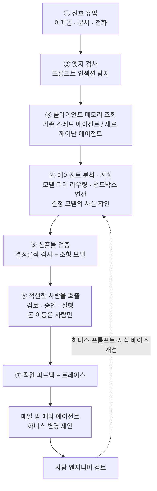

<figure class="post-figure post-figure--header">
<svg role="img" aria-label="가운데 책상에 어드바이저 한 사람이 앉아 있다. 점선 궤도를 따라 작은 에이전트 셋이 그 주위를 돈다. 위쪽 에이전트는 '당신 차례' 카드를 사람에게 내밀고, 좌우 에이전트는 서류를 사람 쪽으로 건넨다. 왼쪽 아래에는 열 칸짜리 달력(10일), 오른쪽 아래에는 자물쇠가 걸린 금고가 있고 금고로 가는 점선은 사람에게서만 나간다." viewBox="0 0 640 340" width="500" xmlns="http://www.w3.org/2000/svg">
<title>에이전트가 사람을 부른다: 열흘짜리 업무와 사람만 여는 금고</title>
<defs><marker id="arca-h-arr" viewBox="0 0 10 10" refX="8" refY="5" markerWidth="7" markerHeight="7" orient="auto-start-reverse"><path d="M0 0 L10 5 L0 10 z" fill="currentColor"/></marker></defs>
<ellipse cx="320" cy="170" rx="160" ry="120" fill="none" stroke="currentColor" stroke-width="2" stroke-dasharray="6 8" opacity="0.4"/>
<g fill="none" stroke="currentColor" stroke-width="3" stroke-linecap="round" stroke-linejoin="round">
<circle cx="320" cy="180" r="24"/>
<path d="M282 250 Q284 212 320 208 Q356 212 358 250"/>
<rect x="230" y="250" width="180" height="14" rx="3"/>
<line x1="246" y1="264" x2="246" y2="300"/>
<line x1="394" y1="264" x2="394" y2="300"/>
</g>
<g fill="var(--bg-panel)" stroke="var(--accent-color)" stroke-width="3">
<rect x="300" y="18" width="40" height="34" rx="6"/>
<rect x="152" y="153" width="40" height="34" rx="6"/>
<rect x="448" y="153" width="40" height="34" rx="6"/>
</g>
<g stroke="var(--accent-color)" stroke-width="3" stroke-linecap="round">
<line x1="320" y1="18" x2="320" y2="9"/>
<line x1="172" y1="153" x2="172" y2="144"/>
<line x1="468" y1="153" x2="468" y2="144"/>
</g>
<g fill="currentColor">
<circle cx="320" cy="7" r="3"/><circle cx="172" cy="142" r="3"/><circle cx="468" cy="142" r="3"/>
<circle cx="311" cy="34" r="3.5"/><circle cx="329" cy="34" r="3.5"/>
<circle cx="163" cy="169" r="3.5"/><circle cx="181" cy="169" r="3.5"/>
<circle cx="459" cy="169" r="3.5"/><circle cx="477" cy="169" r="3.5"/>
</g>
<g stroke="currentColor" stroke-width="2.5" fill="none" marker-end="url(#arca-h-arr)">
<line x1="320" y1="56" x2="320" y2="76"/>
<line x1="320" y1="130" x2="320" y2="150"/>
<line x1="198" y1="176" x2="272" y2="200"/>
<line x1="442" y1="176" x2="368" y2="200"/>
</g>
<rect x="245" y="80" width="150" height="48" rx="6" fill="var(--bg-panel)" stroke="var(--gold)" stroke-width="3"/>
<text x="320" y="113" text-anchor="middle" font-size="26" font-weight="700" fill="currentColor">당신 차례</text>
<g fill="var(--bg-panel)" stroke="currentColor" stroke-width="2">
<rect x="216" y="168" width="18" height="22" rx="2"/>
<rect x="406" y="168" width="18" height="22" rx="2"/>
</g>
<g stroke="currentColor" stroke-width="1.5" opacity="0.7">
<line x1="220" y1="175" x2="230" y2="175"/><line x1="220" y1="181" x2="230" y2="181"/>
<line x1="410" y1="175" x2="420" y2="175"/><line x1="410" y1="181" x2="420" y2="181"/>
</g>
<rect x="22" y="218" width="110" height="12" fill="var(--accent-color)"/>
<g fill="none" stroke="currentColor" stroke-width="2">
<rect x="22" y="230" width="110" height="44"/>
<line x1="44" y1="230" x2="44" y2="274"/><line x1="66" y1="230" x2="66" y2="274"/><line x1="88" y1="230" x2="88" y2="274"/><line x1="110" y1="230" x2="110" y2="274"/>
<line x1="22" y1="252" x2="132" y2="252"/>
</g>
<g fill="var(--secondary-color)" opacity="0.55">
<rect x="25" y="233" width="16" height="16"/><rect x="47" y="233" width="16" height="16"/><rect x="69" y="233" width="16" height="16"/><rect x="91" y="233" width="16" height="16"/><rect x="113" y="233" width="16" height="16"/>
<rect x="25" y="255" width="16" height="16"/><rect x="47" y="255" width="16" height="16"/>
</g>
<text x="77" y="320" text-anchor="middle" font-size="26" font-weight="700" fill="currentColor">10일</text>
<line x1="412" y1="257" x2="506" y2="257" stroke="var(--gold)" stroke-width="3" stroke-dasharray="6 6"/>
<g fill="none" stroke="currentColor" stroke-width="3" stroke-linejoin="round">
<rect x="510" y="214" width="100" height="78" rx="4"/>
<rect x="520" y="224" width="80" height="58" rx="2" opacity="0.5"/>
<circle cx="560" cy="253" r="14"/>
<line x1="560" y1="253" x2="560" y2="243"/>
</g>
<path d="M596 204 V194 a10 10 0 0 1 20 0 V204" fill="none" stroke="var(--gold)" stroke-width="3"/>
<rect x="590" y="203" width="32" height="24" rx="3" fill="var(--bg-panel)" stroke="var(--gold)" stroke-width="3"/>
<circle cx="606" cy="214" r="3" fill="var(--gold)"/>
<text x="560" y="320" text-anchor="middle" font-size="26" font-weight="700" fill="currentColor">사람만</text>
</svg>
<figcaption>에이전트가 열흘에 걸친 과정을 추적하다 적절한 시점에 사람을 불러낸다. 돈을 움직이는 금고는 사람만 연다.</figcaption>
</figure>

## 원문 정보

> - **제목**: Agents Prompt People: Using Agents for Long-Horizon Financial Work
> - **부제**: Arca's head of AI discusses persistent memory, the benefits of a custom harness, and agentic workflows that span days.
> - **출처**: Latent Space Podcast, Richard MacManus ([latent.space](https://latent.space)) — 게스트: Aman Singh(Arca 리드 AI 엔지니어, AI 플랫폼 팀 리드)
> - **발행**: 2026-10-31 · 약 26분 분량(에디토리얼 소개 + 타임스탬프 + 대담 영상/오디오)
> - **원문 링크**: <https://latent.space/p/arca/>

원문은 짧은 에디토리얼과 26분짜리 대담으로 이뤄져 있다. 이 글은 **페이지 본문과, 페이지가 링크한 자동 생성 전사본(VTT)**을 근거로 썼다. 영상·오디오 자체와 페이지에 함께 링크된 **Aman Singh의 AI Engineer New York 발표 영상은 보지 못했다.** 그래서 발표 슬라이드 내용은 진행자가 대담 중에 인용한 부분만 다룬다. 전사본은 자동 생성본이라 고유명사가 틀린 곳이 있다(회사명이 "Orka", 게스트 이름이 "Iman", 프로그램명이 "Out in Space"로 적힌 곳 등). 이름이 불분명한 대목은 본문에서 따로 표시한다. 하니스·메모리·샌드박스를 여러 각도에서 다뤄 온 이 위키에서, **규제 산업의 실제 회사가 그 부품을 어떻게 조립했는지** 보여 주는 사례라서 Articles에 담는다.

## 한 줄 요약 (TL;DR)

Arca는 자산관리 업무의 거의 모든 "배경 작업"을 에이전트에게 맡긴다. 대신 **기억은 클라이언트 단위로 영속화하고, 안전장치는 결정론적으로 능력의 가장자리에 두며, 돈의 이동과 고객 커뮤니케이션은 사람에게 남긴다.** 그 결과 사람이 에이전트를 부르는 구조가 뒤집힌다. 에이전트가 열흘에 걸친 과정을 추적하다가 **적절한 시점에 적절한 사람을 불러낸다.** 원문의 표현으로는 "agents prompt people more than people prompt agents"다.

## 왜 이 글을 골랐나

첫째, 이 위키가 최근 정리한 글들과 정확히 맞물린다. 바로 며칠 전 [Claude로 Claude를 출시하는 법](/2026/10/28/anthropic-ships-claude-with-claude.html)에서 Anthropic의 Managed Agents가 메모리·세션·샌드박스를 플랫폼으로 제공하는 그림을 봤다. 이번 대담에서 진행자는 Anthropic이 같은 컨퍼런스(AI Engineer New York)에서 Managed Agents 워크숍을 열었다고 짚고, 게스트는 모델에는 긍정적이지만 **Managed Agents 같은 제품에 의존하는 데는 회의적**이라고 답한다. 같은 문제를 플랫폼 제공자 쪽과 사용자 쪽에서 함께 볼 수 있는 드문 기회다.

둘째, "롱 호라이즌"을 실제로 겪는 도메인이다. 코딩 에이전트의 장시간 작업은 보통 **계속 돌아가는(long-running)** 작업이다. 원문 에디토리얼은 금융 업무를 "long-horizon work — although not long-running"으로 구분한다. 며칠씩 멈췄다가 이메일 답장이나 전화 한 통으로 다시 깨어나는 작업이라는 뜻이다. [Postgres로 durable workflow 만들기](/2026/06/22/postgres-durable-execution.html)에서 다룬 "멈췄다 재개되는 실행" 문제가 LLM 에이전트 위에서 어떤 모양이 되는지 보여 준다.

셋째, [Claude Mods](/2026/10/27/claude-mods-harness-inside-out.html)가 제안한 "기계가 아니라 사람의 주의를 향하는 하니스"가, 이 회사에서는 이미 **조직 운영 원리**로 쓰이고 있다.

### 한눈에 보기

## 핵심 내용

원문의 타임스탬프 흐름을 따르되, 대담에서 서로 이어지는 주제는 묶어서 정리한다. 인용은 원문(페이지 본문 또는 전사본)의 영어 표현을 옮기되 전사본의 말 더듬음은 정리했고, 한국어 풀이는 내 번역이다.

### 1. Arca는 무엇이고, AI는 어디에 있나

Arca는 스스로를 "AI-native" 자산관리 회사라고 부른다. 에디토리얼에 따르면 최근 General Catalyst가 리드하고 Index Ventures·Venrock이 참여한 **4,850만 달러** 라운드를 유치했다. (자동 전사본의 진행자 도입부에는 이 금액이 "sixty-four million"으로 적혀 있어 페이지 본문과 다르다. 이 글은 페이지 본문 숫자를 따르고, 어느 쪽이 맞는지는 확인하지 못했다.)

서비스 범위는 재무 자문과 재무 설계, 그리고 자산이 늘수록 필요해지는 세금·보험·상속 설계다. 게스트는 고객 예로 사업을 막 매각한 사람, 조기 은퇴를 계획하는 대형 테크 기업 임원, 첫 집을 사려는 소규모 가족을 든다. Singh의 역할은 **AI 플랫폼 팀 리드**다. 그는 이 팀이 "AI로 사업을 운영하기 위한" 하니스와 기반 역량을 만든다고 설명한다.

AI의 위치에 대한 그의 정의가 이 대담 전체의 전제다.

> "the role of AI at Arca is not to replace the advisor. It is to replace all of the work around the advisor."

고객은 AI와 직접 대화하지 않는다. 고객이 경험하는 것은 **사람 어드바이저를 통해 전달되는, 전보다 훨씬 능동적이고 빠른 응대**다. 그 뒤에서는 "시장이 이 고객에게 어떤 영향을 주는가, 이 사람 삶의 어떤 결이 재무에 영향을 주는가"를 계속 생각하는 기계가 돈다는 설명이다.

### 2. 모델 선택: 외부 벤치마크가 아니라 내부 벤치마크

Arca는 Anthropic·OpenAI 등 프런티어 랩의 모델을 쓰고, 그중 Claude가 주력이다. 게스트에 따르면 과거에는 Gemini를 쓰다가 OpenAI로, 다시 Anthropic으로 옮겨 왔다. 이 결정을 이끄는 기준은 **하니스가 사업을 운영하며 보여야 하는 여러 역량을 재는 내부 벤치마크**다. 최근에는 외부 벤치마크 평가가 좋았던 모델 하나가 내부에서는 너무 느리고 비용도 많이 들어 기대만큼 맞지 않았다는 사례를 들었다. (전사본에는 모델명이 "Luna"로 적혀 있는데, 자동 전사라서 정확한 이름인지는 확인하지 못했다.)

라우팅은 **작업 복잡도별 모델 티어**로 한다.

- 세금 계획 지원이나 세금 분석 같은 작업은 **가장 무거운 티어**로 간다. 같은 티어 안에서는 Opus급, Sonnet급, 무거운 GPT 모델 등 비교적 유연하게 고른다.
- 에이전트가 수행하는 수많은 **배경 활동**은 복잡도에 맞춰 더 낮은 티어를 쓴다.
- 어드바이저는 이 선택을 알지 못한다. 완전히 추상화되어 있고, 결정은 내부에서 내린다.

원칙은 **모델 불가지론(model-agnostic)**이다. 특정 공급자나 특정 랩의 하니스에 의존하지 않고 선택지를 열어 둔다. 그래서 하니스도 직접 만들었다. 에디토리얼은 이를 두고 managed agent harness 대신 자체 하니스를 소유하면 필요할 때 모델 공급자를 바꿀 유연성이 생긴다고 정리한다.

### 3. 10만 달러 세금 고지서: 열흘짜리 작업의 분업

진행자가 포트폴리오 리밸런싱부터 거래 실행까지의 분업을 묻자, 게스트는 발표의 세금 고지서 예시로 답한다. 한 고객이 큰 세금 고지서가 나왔다며 이메일을 보낸다. 게스트는 이런 일이 **열흘에 걸쳐** 진행된다고 말한다. 에이전트는 그 결과를 책임지고 끌고 가지만, 할 수 있는 일과 할 수 없는 일이 나뉜다.

- **에이전트의 일**: 이 고객의 돈이 지금 어디에 배분되어 있는지 파악하고, 10만 달러를 마련하려면 무엇을 어떻게 현금화하는 게 가장 좋은지 분석한다. 이 분석은 완전히 자동화되어 있다.
- **에이전트가 못 하는 일**: 실제 자금 이동이나 자산 매각. Arca는 커스터디언(custodian)과 깊이 연동되어 있어 API로 이런 실행을 할 수 있다. 그래도 **돈을 움직이거나 자산을 처분하거나 고객과 직접 소통하는 일**에는 엄격한 human-in-the-loop 가드레일을 둔다.
- **연결 고리**: 에이전트는 실행할 사람을 적시에 불러들이고, 그 사람이 검토하고 조정할 수 있는 계획을 함께 넘긴다.

에디토리얼은 이 지점을 이렇게 요약한다. 에이전트의 역할은 분석과 해법 제안까지이고, 거래와 그 밖의 자금 이동은 사람 어드바이저가 맡는다. 대담 후반에 거래가 실패하면 에이전트가 어떻게 복구하느냐는 질문이 나오자, 게스트는 **지금은 에이전트의 자율 거래 자체를 하지 않는다**고 답한다. 에이전트는 거래를 제안할 뿐이고, 그 거래가 맞는지 판단하고 실행하는 것은 전적으로 전문가의 몫이다.

### 4. 롱 호라이즌 메모리: 깨어난 에이전트는 무엇을 읽나

<figure class="post-figure">
<svg role="img" aria-label="위에서 아래로 그린 신호와 메모리 구조. 맨 위 왼쪽 (a) 기존 이메일 스레드의 새 답장은 같은 에이전트가 이어서 처리하고, 오른쪽 (b) 중간에 걸려 온 전화 같은 새 신호는 새 에이전트를 깨운다. 두 에이전트 모두 가운데의 클라이언트 메모리를 읽고 쓴다. 메모리에는 지금까지 일어난 일, 다음으로 추적할 것, 며칠 안에 바로 할 일, 장기 추적 사항, 누가 어떤 행동을 맡았는지가 담긴다. 맨 아래 reflection(dreaming) 과정이 메모리를 되돌아보고 갱신하는 순환을 이룬다." viewBox="0 0 380 600" width="440" xmlns="http://www.w3.org/2000/svg">
<title>신호, 에이전트, 클라이언트 메모리</title>
<defs><marker id="arca-m-arr" viewBox="0 0 10 10" refX="8" refY="5" markerWidth="7" markerHeight="7" orient="auto-start-reverse"><path d="M0 0 L10 5 L0 10 z" fill="currentColor"/></marker></defs>
<g fill="none" stroke="currentColor" stroke-width="2">
<rect x="10" y="12" width="170" height="60" rx="6"/>
<rect x="200" y="12" width="170" height="60" rx="6" stroke-dasharray="6 4"/>
</g>
<g font-size="15" fill="currentColor" text-anchor="middle">
<text x="95" y="37">(a) 기존 이메일</text>
<text x="95" y="59">스레드의 새 답장</text>
<text x="285" y="37">(b) 새 신호</text>
<text x="285" y="59">예: 중간에 온 전화</text>
</g>
<g stroke="currentColor" stroke-width="2" marker-end="url(#arca-m-arr)">
<line x1="95" y1="74" x2="95" y2="104"/>
<line x1="285" y1="74" x2="285" y2="104"/>
</g>
<g fill="var(--bg-panel)" stroke="var(--accent-color)" stroke-width="2.5">
<rect x="10" y="108" width="170" height="60" rx="6"/>
<rect x="200" y="108" width="170" height="60" rx="6" stroke-dasharray="6 4"/>
</g>
<g font-size="15" fill="currentColor" text-anchor="middle">
<text x="95" y="133">같은 에이전트가</text>
<text x="95" y="155">이어서 처리</text>
<text x="285" y="133">새 에이전트가</text>
<text x="285" y="155">깨어나 파악</text>
</g>
<g stroke="currentColor" stroke-width="2" marker-start="url(#arca-m-arr)" marker-end="url(#arca-m-arr)">
<line x1="95" y1="172" x2="95" y2="222"/>
<line x1="285" y1="172" x2="285" y2="222"/>
</g>
<text x="190" y="202" font-size="15" fill="currentColor" text-anchor="middle">읽고 씀</text>
<rect x="10" y="226" width="360" height="236" rx="8" fill="var(--bg-panel)" stroke="var(--gold)" stroke-width="3"/>
<text x="190" y="256" font-size="17" font-weight="700" fill="currentColor" text-anchor="middle">클라이언트 메모리</text>
<line x1="30" y1="270" x2="350" y2="270" stroke="currentColor" stroke-width="1" opacity="0.4"/>
<g fill="var(--gold)">
<rect x="32" y="287" width="9" height="9"/><rect x="32" y="323" width="9" height="9"/><rect x="32" y="359" width="9" height="9"/><rect x="32" y="395" width="9" height="9"/><rect x="32" y="431" width="9" height="9"/>
</g>
<g font-size="15" fill="currentColor">
<text x="52" y="297">지금까지 일어난 일</text>
<text x="52" y="333">다음으로 추적할 것</text>
<text x="52" y="369">며칠 안에 바로 할 일</text>
<text x="52" y="405">장기 추적 사항</text>
<text x="52" y="441" font-weight="700">누가 어떤 행동을 맡았나</text>
</g>
<g stroke="currentColor" stroke-width="2" marker-end="url(#arca-m-arr)">
<line x1="120" y1="464" x2="120" y2="520"/>
<line x1="260" y1="520" x2="260" y2="464"/>
</g>
<g font-size="15" fill="currentColor">
<text x="112" y="497" text-anchor="end">되돌아봄</text>
<text x="268" y="497">갱신</text>
</g>
<rect x="60" y="524" width="260" height="62" rx="31" fill="none" stroke="var(--secondary-color)" stroke-width="2.5" stroke-dasharray="8 5"/>
<g font-size="15" fill="currentColor" text-anchor="middle">
<text x="190" y="550" font-weight="700">reflection</text>
<text x="190" y="572">(dreaming)</text>
</g>
</svg>
<figcaption>기존 스레드의 후속 신호는 같은 에이전트로, 새 신호는 새 에이전트로 간다. 둘 다 클라이언트 메모리를 읽고 쓰며, 상황을 되돌아보는 reflection(dreaming) 과정이 메모리를 갱신한다.</figcaption>
</figure>

열흘짜리 작업에는 신호가 계속 들어온다. 게스트는 두 경우를 나눠 설명한다.

- 이미 진행 중인 **이메일 스레드에 새 답장**이 오면, 그 스레드를 읽고 반응하던 **같은 에이전트**에게 간다.
- 진행 중인 어떤 과정에도 붙어 있지 않은 **새 신호**(예: 중간에 걸려 온 전화)가 오면, **새 에이전트가 깨어나** 이게 무슨 뜻인지 파악한다.

새로 깨어난 에이전트가 상황을 파악하는 수단이 내부 메모리 시스템이다. 에디토리얼이 인용한 대목은 이렇다.

> "So we have this persistence for every client. What has happened so far? What are we tracking for next? What needs to happen immediately in the next couple of days [and] what are we tracking for the long term? Which individual is responsible for which action? All of this is being tracked by our memory systems that our agents contribute to."

여기에 더해 게스트는 고객과 관련된 세계의 상태를 되돌아보며 메모리를 갱신하는 일종의 **"dreaming" 프로세스**가 있다고 말한다. 이 과정이 롱 호라이즌 작업을 영속화한다. 그래서 새 신호를 받은 에이전트도 "지금 큰 세금 고지서 건이 진행 중이구나, 내 신호는 그 건과 관련 있구나"를 빠르게 알아채고 그 상태에 기여한다.

### 5. 안전장치: 결정론적으로, 능력의 가장자리에서

에디토리얼과 전사본 모두에 있는 핵심 문장은 이것이다.

> "All of our safety restrictions are fully deterministic, and they take the decision-making off the agent's hands."

에디토리얼과 전사본에서 설명한 층위는 다음과 같다.

1. **도구 단위 권한**: 단순한 기록 관리 도구처럼 일부 도구는 에이전트가 직접 실행할 수 있다. 고객에게 위험이 있는 도구는 그렇지 않다.
2. **쓰기 검증**: 데이터를 쓰는 도구가 호출될 때마다 **빠른 LLM 호출로 그 쓰기를 검증**한다. 데이터베이스에 대한 모든 쓰기가 대상이다.
3. **입구의 프롬프트 인젝션 탐지**: 이메일, 문서, 통화처럼 외부에서 들어오는 정보는 프롬프트 인젝션의 표적이 된다. 그래서 가장자리에서 특정 유형의 인젝션이 있는지 검사한다.
4. **출구의 유출 방지**: 웹 검색처럼 데이터가 시스템 밖으로 나가는 경우에 적용한다. 고객에게 캘린더 초대를 보내는 것도 여기에 포함된다. 알려진 PII가 있는지 **결정론적으로 검사**하고, **여러 소형 모델의 합의(consensus)**로 데이터 유출 시도가 없는지 확인한다.

원칙은 가드레일을 **"능력의 가장자리"에 두고, 그보다 이른 곳에는 두지 않는 것**이다(게스트의 표현은 "contain them at the edges of capability … and not earlier than that"). 에이전트가 안에서 생각하고 분석하는 것은 막지 않고, 돈·데이터·사람이 바깥과 맞닿는 경계를 단단히 지킨다는 뜻으로 읽힌다.

### 6. 컴플라이언스는 기본값으로서의 감사 가능성

규제에 대한 질문에 게스트는 이렇게 답한다. 업계는 결과(outcome)를 보지만 **컴플라이언스는 감사 가능성(auditability)을 본다.** Arca 시스템에서는 감사 가능성이 기본값이다. 에이전트의 모든 행동은 **무엇이, 누구에 의해, 시스템의 어느 부분에서, 언제 바뀌었는지**를 담은 변경 로그를 남긴다. 이 로그는 사람 행위자에게도 똑같이 적용된다. UI에서 고객에게 영향을 주는 무언가를 바꾸면 그것도 기록된다.

흥미로운 점은 이 로그가 **두 가지 용도로 쓰인다**는 것이다. 규제 대응용 감사 기록이면서, 동시에 "사람이 UI에서 이걸 바꿨다"는 사실을 에이전트에게 알리는 **에이전트 루프의 입력**이 된다.

### 7. "Agents prompt people more than people prompt agents"

에이전트는 누구를, 언제, 얼마만큼의 맥락과 함께 불러들일까. 게스트는 이것이 업계에서 사람이 일하는 방식과 비슷하다고 말한다. 열흘짜리 과정에는 여러 행위자가 있다. **7단계의 담당자는 아직 그 일을 알 필요가 없고, 적절한 시점에 불려 들어온다.** 에이전트는 긴 메모리와 매일의 reflection으로 현재 상태를 보고, 특정 사람이 개입해야 한다는 신호가 생기면 그 사람을 부른다.

이것이 가능한 이유에 대해 게스트는 두 가지를 든다.

- 업계에서 일이 돌아가는 방식뿐 아니라 **Arca가 일이 어떻게 돌아가길 원하는지(원칙)**까지 에이전트가 쓸 수 있는 맥락으로 **운영화(operationalize)**했다.
- Arca는 SaaS 회사가 아니라 **회사 자체가 그 사업을 한다**("We're actually not a SaaS company. We are … the firm ourselves."). 그래서 일하는 방식 자체를 표준화할 수 있고, 에이전트는 그 표준 방식에 참여하면 된다.

### 8. 왜 인프라를 직접 소유하나, 그리고 AI-native vs AI 도구를 쓰는 회사

진행자는 같은 컨퍼런스에서 Anthropic이 Managed Agents 워크숍을 열었다는 점을 들며 그 방향을 쓸 생각이 있는지 묻는다. 게스트는 Anthropic·OpenAI의 **모델**에는 매우 긍정적이지만, Managed Agents 같은 **제품에 의존하는 것**에는 덜 긍정적이라고 답한다. 이유는 이렇다. Managed Agents의 핵심 중 하나는 모델이 세상에서 일어나는 일과 운영 지식을 메모리로 영속화하는 부분이다. 바로 그 부분을 남에게 맡기는 것이 위험하다는 것이다. 그의 표현으로는 "Owning your intelligence"가 사업에 영향을 줄 수 있는 능력을 준다. 지능을 다른 공급자에게 넘기면, 사업에 꼭 맞춘 무언가를 만드는 데 필요한 통제력을 잃는다.

Anthropic이 금융 서비스에 진출한 것에 대해서는 경쟁이라기보다 **업계를 검증해 주는 신호**로 본다. 대신 구분선을 긋는다. **AI 도구를 가진 서비스 회사**에서는 사용자가 에이전트를 프롬프트해야 일이 된다. **AI-native로 설계된 회사**에서는 에이전트가 사람을 프롬프트하고, 고객을 위해 24시간 돌아가는 능동적 서비스가 된다.

### 9. 샌드박스: 에이전트는 밖에, 코드는 안에, 그리고 코드는 버린다

<figure class="post-figure">
<svg role="img" aria-label="위에서 아래로 그린 샌드박스 파이프라인. 맨 위 에이전트는 샌드박스 밖에 있고 연산을 샌드박스로 넘긴다. 점선 샌드박스 안에서 코드를 작성·실행하고, 두 갈래로 나뉜다. 왼쪽 데이터 경로는 데이터 질의 코드를 엄격한 포맷으로 번역하고, 코드는 폐기하며, 그 포맷에 가드레일을 건 뒤에야 백엔드 데이터에 닿는다. 오른쪽 산출물 경로는 재무 계획 PDF 같은 산출물을 만들고, 결정론적 검사(원시 계좌번호)와 빠른 소형 모델 검사(수익 약속 표현)를 거쳐야 고객과 공유할 수 있는 상태가 된다." viewBox="0 0 400 640" width="460" xmlns="http://www.w3.org/2000/svg">
<title>에이전트는 밖에, 코드는 안에, 그리고 코드는 버린다</title>
<defs><marker id="arca-s-arr" viewBox="0 0 10 10" refX="8" refY="5" markerWidth="7" markerHeight="7" orient="auto-start-reverse"><path d="M0 0 L10 5 L0 10 z" fill="currentColor"/></marker></defs>
<rect x="110" y="10" width="180" height="54" rx="6" fill="var(--bg-panel)" stroke="var(--accent-color)" stroke-width="2.5"/>
<g font-size="16" fill="currentColor" text-anchor="middle">
<text x="200" y="33" font-weight="700">에이전트</text>
<text x="200" y="54">(샌드박스 밖)</text>
</g>
<line x1="200" y1="66" x2="200" y2="100" stroke="currentColor" stroke-width="2" marker-end="url(#arca-s-arr)"/>
<text x="210" y="88" font-size="16" fill="currentColor">연산을 넘김</text>
<rect x="8" y="104" width="384" height="196" rx="8" fill="none" stroke="var(--secondary-color)" stroke-width="2.5" stroke-dasharray="8 6"/>
<text x="20" y="128" font-size="16" font-weight="700" fill="var(--secondary-color)">샌드박스</text>
<rect x="110" y="138" width="180" height="44" rx="6" fill="none" stroke="currentColor" stroke-width="2"/>
<text x="200" y="166" font-size="16" fill="currentColor" text-anchor="middle">코드 작성·실행</text>
<g stroke="currentColor" stroke-width="2" fill="none" marker-end="url(#arca-s-arr)">
<path d="M170 184 L105 216"/>
<path d="M230 184 L295 216"/>
</g>
<g fill="none" stroke="currentColor" stroke-width="2">
<rect x="20" y="220" width="170" height="64" rx="6"/>
<rect x="210" y="220" width="170" height="64" rx="6"/>
</g>
<g font-size="16" fill="currentColor" text-anchor="middle">
<text x="105" y="246">데이터 질의 코드</text>
<text x="105" y="270">(집계·가공)</text>
<text x="295" y="246">산출물 생성</text>
<text x="295" y="270">(재무 계획 PDF)</text>
</g>
<g stroke="currentColor" stroke-width="2" marker-end="url(#arca-s-arr)">
<line x1="105" y1="286" x2="105" y2="318"/>
<line x1="295" y1="286" x2="295" y2="318"/>
<line x1="105" y1="378" x2="105" y2="396"/>
<line x1="105" y1="450" x2="105" y2="468"/>
<line x1="105" y1="528" x2="105" y2="548"/>
<line x1="295" y1="482" x2="295" y2="506"/>
</g>
<rect x="20" y="322" width="170" height="56" rx="6" fill="var(--bg-panel)" stroke="var(--gold)" stroke-width="2.5"/>
<g font-size="16" fill="currentColor" text-anchor="middle">
<text x="105" y="345">엄격한 포맷으로</text>
<text x="105" y="368">번역</text>
</g>
<rect x="20" y="400" width="170" height="50" rx="6" fill="none" stroke="currentColor" stroke-width="2" stroke-dasharray="5 4" opacity="0.8"/>
<text x="92" y="431" font-size="16" fill="currentColor" text-anchor="middle">코드는 폐기</text>
<g fill="none" stroke="currentColor" stroke-width="2" stroke-linejoin="round">
<path d="M150 416 h22 M154 416 v-3 h14 v3 M153 419 l2 19 h12 l2 -19"/>
<line x1="158" y1="423" x2="158" y2="434"/><line x1="164" y1="423" x2="164" y2="434"/>
</g>
<rect x="20" y="472" width="170" height="56" rx="6" fill="var(--bg-panel)" stroke="var(--gold)" stroke-width="2.5"/>
<g font-size="16" fill="currentColor" text-anchor="middle">
<text x="105" y="495">포맷에</text>
<text x="105" y="518">가드레일</text>
</g>
<g fill="none" stroke="currentColor" stroke-width="2">
<path d="M40 562 v50 a65 10 0 0 0 130 0 v-50"/>
<ellipse cx="105" cy="562" rx="65" ry="10"/>
</g>
<text x="105" y="602" font-size="16" fill="currentColor" text-anchor="middle">백엔드 데이터</text>
<rect x="210" y="322" width="170" height="160" rx="6" fill="var(--bg-panel)" stroke="var(--gold)" stroke-width="2.5"/>
<text x="295" y="345" font-size="16" font-weight="700" fill="currentColor" text-anchor="middle">검증기</text>
<g fill="none" stroke="currentColor" stroke-width="1.5">
<rect x="220" y="356" width="150" height="56" rx="4"/>
<rect x="220" y="418" width="150" height="56" rx="4" stroke-dasharray="5 4"/>
</g>
<g font-size="16" fill="currentColor" text-anchor="middle">
<text x="295" y="378">결정론적:</text>
<text x="295" y="401">원시 계좌번호</text>
<text x="295" y="440">소형 모델:</text>
<text x="295" y="463">수익 약속 표현</text>
</g>
<rect x="210" y="510" width="170" height="64" rx="6" fill="none" stroke="var(--accent-color)" stroke-width="2.5"/>
<g font-size="16" fill="currentColor" text-anchor="middle">
<text x="295" y="536">통과해야</text>
<text x="295" y="560">공유 가능 상태</text>
</g>
</svg>
<figcaption>에이전트는 샌드박스 밖에 있다. 데이터 쪽 코드는 엄격한 포맷으로 번역된 뒤 버려지고, 산출물은 결정론적 검사와 소형 모델 검사를 거친다.</figcaption>
</figure>

게스트는 Arca의 에이전트가 **샌드박스 안에 있지 않다**고 분명히 말한다. 샌드박스는 하니스의 한 구성요소이고, 에이전트는 연산을 샌드박스로 **떠넘긴다(offload)**. 민감한 데이터에 대해서는 한 단계를 더 둔다. 에디토리얼이 인용한 설명은 이렇다.

> "We've built systems to make it safe for code inside of that sandbox to access our data. So we have this thing which translates the code it [the agent] wrote into a strict format that we expect, throw away the code, and you install guardrails on that format before it reaches your back end."

에이전트가 코드로 데이터를 질의하고, 집계하고, 가공할 수 있게 하되, **그 코드가 그대로 백엔드에 닿지 않는다**는 것이 요지다. 코드를 미리 정한 엄격한 포맷으로 번역하고, 코드는 버리고, 그 포맷에 가드레일을 건다.

같은 샌드박스에서 에이전트는 고객과 공유할 **재무 계획 PDF** 같은 산출물도 만든다. 산출물이 만들어지는 순간 여러 검증기가 돈다.

- **결정론적 검사**: 예를 들어 원시 계좌번호가 들어가 있는지.
- **빠른 소형 모델 검사**: 산출물을 비준수로 만들 수 있는 요소가 있는지. 예로 든 것은 **수익을 약속하는 표현**이다. (전사본에는 여기서 언급된 모델이 "JEV"로 적혀 있다. 이 위키가 정리한 TypeSafe의 판단 특화 모델 Jev를 가리키는 것으로 보이지만, 자동 전사라 확정하지는 않는다.)

게스트는 이렇게 하면 **사람이 할 때보다 컴플라이언스가 더 좋아진다**고 주장한다. 비준수 문장이 아무리 작게 언급되어도 AI는 지치지 않고 찾아내기 때문이라는 것이다. 이것은 게스트의 주장이고, 대담에서 이를 뒷받침하는 수치는 제시되지 않았다.

### 10. 결정 모델: "작년 세율표"를 쓰려는 순간을 잡아낸다

진행자가 "decision models"를 언급하자 게스트는 관찰 하나를 공유한다. 모델은 재무 지식이 필요한 질문에 **매우 자신 있게** 답한다. 작은 예로, 모델이 **2025년 세율 구간을 기꺼이 그대로 써서** 분석을 끝내 버린다. 이는 분명히 틀렸다.

그래서 하니스 안에서 결정 모델이 감시한다. 모델이 재무 추천처럼 **재무적 엄밀성이 필요한 행동을 하려는 순간을 탐지**하고, 오늘 기준으로 **검증된 사실의 지식 베이스**나 웹 검색을 쓰도록 슬쩍 유도한다. 게스트는 이것을 하니스를 소유해서 할 수 있는 일, 즉 정확성이 중요한 곳에서 모델을 정확하게 만드는 장치의 예로 든다.

### 11. 직원 피드백 → 평가 → 하니스 개선 (메타 에이전트)

진행자는 발표 슬라이드에 있었다는 문장을 인용한다. 모든 직원 수정이나 취소에는 "왜"가 붙고, 그것이 eval이 된다는 내용이다. 게스트는 이것도 **SaaS가 아니라 사업 주체라서 가능한 일**이라고 말한다. 직원에게 피드백을 **요구할 수 있기** 때문이다. 루프는 이렇게 돈다.

1. 피드백은 그것을 만든 **에이전트의 트레이스와 짝지어** 데이터 저장소에 쌓인다.
2. **매일 밤** 실제 환경에서 돈 에이전트들의 트레이스를 모아 그 위에서 **메타 에이전트**를 돌린다. 메타 에이전트는 하니스 변경을 제안한다. 오해를 부르는 도구, 오류가 난 지점, 지식 베이스에서 빠진 지식 같은 것이다.
3. 실제로 프롬프트 변경을 배포하기 전에는 아직 **사람 엔지니어가 루프 안에** 있다.

이유가 솔직하다. 게스트는 에이전트에게 맡겨 두면 **"really nasty prompt changes"**를 만든다고 말한다. **"every little fix becomes the whole prompt"**, 즉 작은 수정 하나하나가 프롬프트 전체를 차지하게 되고, 에이전트는 메타 수준을 유지하며 수정을 일반화하지 못한다고 관찰한다.

### 12. 운영 지식을 에이전트 컨텍스트로

회사가 일하는 방식을 에이전트의 컨텍스트로 바꾸는 방법은 의외로 단순하다. 지식 베이스는 **파일로 표현**되고, 그 관리는 **현업 전문가에게** 넘겼다. 제품 왼쪽에 **"Knowledge" 탭**이 있고, 에이전트가 쓰는 운영 컨텍스트 전체가 거기 있다. 에이전트는 일하면서 지식을 **인용**한다. 그래서 "이 지식이 틀렸다"는 사실이 트레이스 분석에서 드러나고, 지식이 제품의 일부이므로 사람들이 바로 들어가 고칠 수 있다.

### 13. 고객 사례: 숨은 수수료와 능동성

게스트가 든 최근 사례는 아직 고객이 되기 전인 잠재 고객의 이야기다. 이 사람은 기존 어드바이저에게 (전사본 기준) 1,500달러를 내고 있었고, 응대가 느리다고 불평했다. 에이전트는 그의 문서, 명세서, 투자 내역, 본인이 밝힌 목표, 기존 어드바이저에 대한 정보를 분석했다. 그 결과 **본인이 몰랐던 수수료**가 있다는 것, 그리고 그 어드바이저가 **fiduciary가 아니라는 것**(고객의 이익을 위해 행동할 법적 의무가 없다는 것)을 찾아냈다.

게스트는 이 밖에도 다가오는 마감이나 RMD(required minimum distribution, 법정 최소 인출)를 놓칠 위험을 짚는 등의 능동성 사례가 있다고 말한다. 이런 일은 사람이 규모 있게 추적하기 어렵지만 **에이전트에게는 기본 동작**이라는 것이 그의 결론이다. 이 사례들에도 정량적 성과 수치는 제시되지 않았다.

## 분석과 인사이트

여기부터는 내 해석이다.

### "Long-horizon ≠ long-running"이라는 구분이 설계를 바꾼다

이 대담에서 가장 쓸모 있는 개념 구분은 에디토리얼의 이 한 줄이다. 계속 도는 에이전트는 컨텍스트 창과 토큰 예산과 싸운다. **며칠씩 멈췄다 깨어나는** 에이전트의 문제는 다르다. "누가 깨어나느냐"와 "깨어난 자가 무엇을 읽느냐"의 문제다. Arca의 답은 두 축으로 정리된다. 신호 라우팅(같은 스레드면 같은 에이전트, 새 신호면 새 에이전트)과 **클라이언트 단위의 구조화된 메모리**(현재 상태, 다음 할 일, 장기 추적, 담당자)다. 담당자 필드가 있다는 점이 특히 눈에 띈다. 메모리가 "무엇을 알았나"뿐 아니라 **"누가 무엇을 쥐고 있나"를 담는 작업 관리 장부** 역할을 한다. 이 장부가 있어야 "적시에 적절한 사람을 부른다"가 구현 가능해진다. 내가 보기에 "agents prompt people"은 구호라기보다 이 메모리 스키마의 귀결이다.

이 점은 [메모리 세금(Memory Tax)](/2026/10/29/memory-tax-agent-memory-net-value.html)의 경고와 함께 읽어야 한다. 그 논문은 전용 에이전트 메모리가 원본 기록을 검색하는 naive RAG보다 못한 경우가 많고, 충실성·접근성·강건성에서 "세금"이 생긴다고 지적했다. Arca의 "dreaming" 프로세스는 바로 그 요약·재작성 단계라서 세금이 생길 수 있는 지점이다. 대담에서는 메모리가 원본 기록(이메일, 통화, 변경 로그)과 어떻게 대조·검증되는지가 다뤄지지 않았다. 다만 모든 변경이 감사 로그로 남는다는 설계는, 요약 메모리가 틀렸을 때 **되돌아갈 원본**이 있다는 뜻이기도 하다. 이 부분은 내 추론이다.

### 가드레일을 "가장자리"에 두는 것은 모델과 무관한 안전을 만든다

많은 팀이 에이전트 안전을 프롬프트 수준에서 해결하려 한다. "절대 돈을 움직이지 마라"를 시스템 프롬프트에 적는 식이다. Arca의 원칙은 반대다. **위험이 실제로 현실화되는 경계**에 결정론적 검사를 둔다. 돈이 움직이는 API, DB 쓰기, 외부로 나가는 데이터, 외부에서 들어오는 텍스트가 그 경계다. 그 안쪽의 사고는 자유롭게 둔다. 이렇게 하면 모델이 바뀌어도 안전 속성이 유지된다. 모델 불가지론과 결정론적 안전은 **같은 설계 결정의 양면**이다. 모델을 갈아 끼울 수 있으려면 안전이 모델의 착한 행동에 기대면 안 된다.

샌드박스의 "코드를 엄격한 포맷으로 번역하고 코드는 버린다"는 아이디어도 같은 계열이다. 에이전트가 쓴 임의 코드를 그대로 신뢰하는 대신, **검증 가능한 좁은 중간 표현**으로 바꾼 뒤 그 표현에 정책을 건다. 내가 보기에 이는 [vLLM의 constrained decoding](/2026/10/28/vllm-tool-call-accuracy-constrained-decoding.html)이나 구조화 출력이 생성 단계에서 하는 일을 **실행 단계에서** 하는 셈이다. 다만 그 "strict format"이 무엇인지는 공개되지 않았다(쿼리 DSL인지, 제한된 연산 그래프인지 등). 표현력과 안전 사이에서 어디에 선을 그었는지가 이 설계의 진짜 난이도일 텐데, 대담만으로는 알 수 없다.

### "지능을 소유하라"는 Managed Agents에 대한 정확한 반론이다

[Claude로 Claude를 출시하는 법](/2026/10/28/anthropic-ships-claude-with-claude.html)에서 Anthropic은 두뇌(하니스, 세션)와 손(샌드박스)을 분리하고 그 둘을 플랫폼이 운영해 주겠다고 했다. Arca의 반론은 손이 아니라 **두뇌의 기억 쪽**을 겨냥한다. 샌드박스 같은 실행 인프라는 범용 부품이어도 된다. 하지만 "이 회사가 일하는 방식", "이 고객에 대해 지금 무엇을 추적 중인가" 같은 운영 지식과 메모리는 사업의 해자이므로 남의 플랫폼에 두면 안 된다는 것이다. [GPT-6 Astra: 하니스가 곧 제품이다](/2026/09/08/gpt6-astra-harness-is-the-product.html)의 주장을 회사 전략으로 끝까지 밀어붙인 버전이다.

그렇다고 모두가 Arca처럼 해야 한다는 뜻은 아니다. Arca가 자체 하니스를 감당할 수 있는 조건이 대담 곳곳에 드러난다. **회사가 곧 사업 주체**라서 업무를 표준화하고 직원에게 피드백을 요구할 수 있고, 전담 AI 플랫폼 팀이 있다. 이런 조건이 없는 조직이라면 계산이 달라진다. 이는 내 해석이다.

### 메타 에이전트의 한계 고백이 가장 값진 대목이다

"에이전트에게 프롬프트 수정을 맡기면 작은 수정 하나하나가 프롬프트 전체가 된다"는 관찰은 하니스 자기 개선을 시도하는 팀이라면 누구나 귀담아들을 만하다. [능력에 맞춰 진화하라](/2026/10/28/skill-adaptation-harness-self-evolution.html) 같은 연구가 자동 하니스·스킬 진화를 탐색하고 있지만, 현장의 답은 **"제안은 기계가, 일반화와 배포 결정은 사람이"**다. 프롬프트도 코드처럼 리뷰가 필요한 공유 자산이고, 국소 최적화의 누적은 [과부하된 지시문의 용량 문제](/2026/10/30/instruction-capacity-llm-load.html)로 이어진다. 그래서 사람 리뷰는 사치가 아니라 필수에 가깝다.

또 하나 눈여겨볼 점이 있다. 피드백 수집을 **제품의 1급 기능**으로 만든 것이다. 수정이나 취소에 "왜"를 요구하고 그것을 트레이스와 묶는 순간, 현업의 불만이 곧 eval 데이터셋이 된다. 많은 팀이 eval 데이터를 따로 만들려다 지치는데, Arca는 **업무 흐름 자체를 eval 수집기로 설계**했다.

### 아쉬운 점과 열린 질문

- **정량 근거의 부재**: 컴플라이언스가 사람보다 낫다는 주장, 능동적 서비스의 효과, 내부 벤치마크의 구성은 모두 숫자 없이 서술되었다. 26분 인터뷰라는 형식의 한계이기도 하다. 숫자를 원한다면, 세무 전문가의 하루 업무를 통째로 맡겼을 때 최상위 모델도 통과율이 낮았다는 [DAYJOB: Tax 벤치마크](/2026/10/29/dayjob-tax-agent-benchmark.html)와 나란히 놓고 보는 것이 건강하다. 그 벤치마크가 "묻지 않은 쟁점까지 찾아내는 주도성"을 재려 했다는 점에서, Arca가 내세우는 숨은 수수료 발견 같은 능동성이 바로 어려운 영역임을 알 수 있다.
- **비대칭 실패의 처리**: 에이전트가 사람을 **너무 늦게** 부르거나 **아예 부르지 않는** 실패, 즉 누락형 실패를 어떻게 감지하는지는 다뤄지지 않았다. 잘못된 행동은 가드레일이 막지만, 해야 할 일을 하지 않은 것은 가드레일에 걸리지 않는다. "agents prompt people" 구조에서 가장 까다로운 실패 모드라고 나는 생각한다.
- **금액 표기 불일치**: 앞서 적었듯 펀딩 금액이 페이지 본문(4,850만 달러)과 자동 전사본("sixty-four million")에서 다르다.

## 적용 포인트

- **멈췄다 깨어나는 에이전트라면 메모리 스키마부터 설계하라.** "현재 상태 / 지금까지 / 다음 할 일 / 장기 추적 / 담당자" 같은 필드를 정하고, 새로 깨어난 에이전트가 가장 먼저 읽게 하라. 담당자 필드가 사람 호출 로직의 토대가 된다.
- **신호 라우팅 규칙을 명시하라.** 기존 스레드의 후속 신호는 기존 에이전트로, 고아 신호는 새 에이전트와 메모리 조회로 보낸다.
- **안전은 프롬프트가 아니라 경계에서 결정론적으로 강제하라.** 돈/외부 발송/DB 쓰기/외부 입력, 네 경계를 목록화하고 각 경계에 도구 권한, 결정론적 검사, 빠른 모델 검증을 층으로 쌓는다. 경계 안의 사고는 막지 않는다.
- **에이전트가 쓴 코드는 실행 전에 좁은 중간 표현으로 번역하라.** 임의 코드를 그대로 백엔드에 닿게 하지 말고, 검증 가능한 포맷에 정책을 거는 구조를 검토하라.
- **감사 로그를 에이전트의 입력으로도 써라.** 사람과 에이전트의 모든 변경을 "무엇·누가·어디서·언제"로 남기면, 규제 대응과 에이전트 상황 인식을 한 번에 얻는다.
- **"자신만만한 오래된 지식"을 잡는 장치를 두라.** 세율, 한도, 규정처럼 해마다 바뀌는 사실은 검증된 지식 베이스로 강제하고, 모델이 그런 판단을 하려는 순간을 탐지해 유도하라.
- **피드백 수집을 제품 기능으로 만들라.** 수정·취소에 "왜"를 받고 트레이스와 묶어 저장하면 eval 데이터가 업무 중에 쌓인다.
- **메타 에이전트의 프롬프트 수정은 사람이 리뷰하라.** 작은 수정이 누적돼 프롬프트가 비대해지는지를 리뷰 기준에 넣어라.
- **모델 선택은 내부 벤치마크로, 라우팅은 복잡도 티어로.** 외부 리더보드가 아니라 자기 업무의 지연·비용·품질로 판단하고, 사용자에게는 이 선택을 숨겨라.

## 마무리

Arca의 이야기는 "AI가 금융 어드바이저를 대체한다"가 아니다. 어드바이저 **주변의 모든 일**을 에이전트가 맡고, 에이전트가 열흘짜리 과정을 기억하며 적시에 사람을 불러내는 조직 설계에 관한 이야기다. 그 설계를 떠받치는 부품은 새롭지 않다. 클라이언트 단위 메모리, 결정론적 경계 가드레일, 코드를 버리는 샌드박스, 감사 로그, 사람이 검토하는 메타 에이전트다. 새로운 점은 이것들을 **"사람이 에이전트를 부르는" 구도에서 "에이전트가 사람을 부르는" 구도로** 뒤집는 데 일관되게 썼다는 것이다. 수치 근거가 부족하고 누락형 실패에 대한 답이 없다는 한계는 있다. 그래도 규제 산업에서 에이전트를 실제로 굴리는 팀이 어떤 순서로 결정을 내렸는지 보여 주는 드물고 구체적인 증언이다.

### 더 읽어보기

- [원문 — Agents Prompt People: Using Agents for Long-Horizon Financial Work (Latent Space)](https://latent.space/p/arca/)
- [Claude로 Claude를 출시하는 법: 두뇌와 손을 분리하라](/2026/10/28/anthropic-ships-claude-with-claude.html) — Arca가 의존을 꺼린 Managed Agents의 설계를 플랫폼 쪽에서 본 글
- [Claude Mods: 하니스를 안팎으로 뒤집다](/2026/10/27/claude-mods-harness-inside-out.html) — 사람의 주의를 향하는 하니스라는 같은 방향의 아이디어
- [GPT-6 Astra: 하니스가 곧 제품이다](/2026/09/08/gpt6-astra-harness-is-the-product.html) — "하니스를 소유하라"의 제품 관점 근거
- [무엇이 하니스를 하니스로 만드는가](/2026/08/03/what-makes-a-harness-a-harness.html) — 하니스의 정의와 구성요소
- [메모리 세금(Memory Tax)](/2026/10/29/memory-tax-agent-memory-net-value.html) — 요약형 에이전트 메모리가 치르는 비용
- [Postgres 하나면 충분하다: Durable Workflow](/2026/06/22/postgres-durable-execution.html) — 멈췄다 재개되는 장기 실행의 인프라 측면
- [DAYJOB: Tax 벤치마크](/2026/10/29/dayjob-tax-agent-benchmark.html) — 전문 세무 업무에서 에이전트의 주도성과 판단을 잰 결과
- [능력에 맞춰 진화하라: 하니스 자기 진화](/2026/10/28/skill-adaptation-harness-self-evolution.html) — 자동 하니스 개선 연구와 Arca의 "사람 리뷰" 현장 답의 대비
- [Jev와 구조화 출력의 재발견](/2026/09/20/jev-structured-output-interesting-again.html) — 대담에 언급된 것으로 보이는 빠른 판단 모델 Jev
- [확률적 엔지니어링과 24-7 직원](/2026/06/25/probabilistic-engineering-and-the-24-7-employee.html) — 24시간 도는 에이전트 노동과 검증 비대칭
