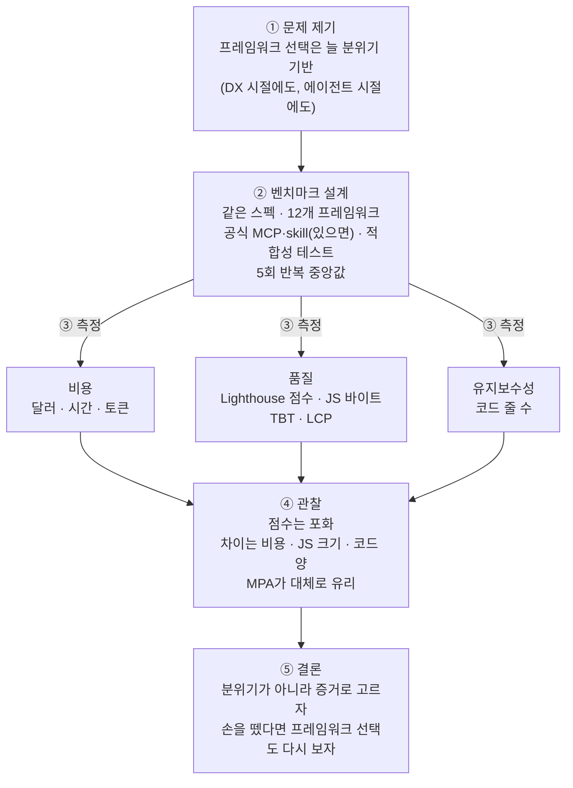

<figure class="post-figure post-figure--header">
<svg role="img" aria-label="스펙 한 장이 12개의 작업대로 나뉘어 들어가고, 작업대마다 높이가 다른 코인 더미와 똑같은 집 한 채가 놓인 그림" viewBox="0 0 480 300" width="520" xmlns="http://www.w3.org/2000/svg">
<title id="jsfw-hdr-title">같은 스펙, 12개 프레임워크, 다른 빌드 비용</title>
<rect x="206" y="12" width="68" height="78" rx="4" fill="var(--bg-panel)" stroke="currentColor" stroke-width="2.5"/>
<path d="M258 12 L274 28 L258 28 Z" fill="currentColor" opacity="0.35"/>
<text x="240" y="50" text-anchor="middle" font-size="19" font-weight="700" fill="currentColor">SPEC</text>
<line x1="218" y1="64" x2="262" y2="64" stroke="currentColor" stroke-width="2" opacity="0.45"/>
<line x1="218" y1="74" x2="252" y2="74" stroke="currentColor" stroke-width="2" opacity="0.45"/>
<line x1="240" y1="90" x2="31" y2="160" stroke="currentColor" stroke-width="1.5" stroke-dasharray="3 4" opacity="0.5"/>
<rect x="16" y="207.28" width="13" height="42.72" fill="var(--gold)" stroke="currentColor" stroke-width="1.2"/>
<line x1="16" y1="244" x2="29" y2="244" stroke="currentColor" stroke-width="0.8" opacity="0.6"/>
<line x1="16" y1="238" x2="29" y2="238" stroke="currentColor" stroke-width="0.8" opacity="0.6"/>
<line x1="16" y1="232" x2="29" y2="232" stroke="currentColor" stroke-width="0.8" opacity="0.6"/>
<line x1="16" y1="226" x2="29" y2="226" stroke="currentColor" stroke-width="0.8" opacity="0.6"/>
<line x1="16" y1="220" x2="29" y2="220" stroke="currentColor" stroke-width="0.8" opacity="0.6"/>
<line x1="16" y1="214" x2="29" y2="214" stroke="currentColor" stroke-width="0.8" opacity="0.6"/>
<path d="M32 250 V234 L39 225 L46 234 V250 Z" fill="none" stroke="var(--accent-color)" stroke-width="1.8"/>
<rect x="37" y="242" width="4" height="8" fill="var(--accent-color)"/>
<rect x="14" y="250" width="34" height="5" fill="currentColor" opacity="0.8"/>
<line x1="17" y1="255" x2="17" y2="266" stroke="currentColor" stroke-width="2"/>
<line x1="45" y1="255" x2="45" y2="266" stroke="currentColor" stroke-width="2"/>
<line x1="240" y1="90" x2="69" y2="160" stroke="currentColor" stroke-width="1.5" stroke-dasharray="3 4" opacity="0.5"/>
<rect x="54" y="205.84" width="13" height="44.16" fill="var(--gold)" stroke="currentColor" stroke-width="1.2"/>
<line x1="54" y1="244" x2="67" y2="244" stroke="currentColor" stroke-width="0.8" opacity="0.6"/>
<line x1="54" y1="238" x2="67" y2="238" stroke="currentColor" stroke-width="0.8" opacity="0.6"/>
<line x1="54" y1="232" x2="67" y2="232" stroke="currentColor" stroke-width="0.8" opacity="0.6"/>
<line x1="54" y1="226" x2="67" y2="226" stroke="currentColor" stroke-width="0.8" opacity="0.6"/>
<line x1="54" y1="220" x2="67" y2="220" stroke="currentColor" stroke-width="0.8" opacity="0.6"/>
<line x1="54" y1="214" x2="67" y2="214" stroke="currentColor" stroke-width="0.8" opacity="0.6"/>
<path d="M70 250 V234 L77 225 L84 234 V250 Z" fill="none" stroke="var(--accent-color)" stroke-width="1.8"/>
<rect x="75" y="242" width="4" height="8" fill="var(--accent-color)"/>
<rect x="52" y="250" width="34" height="5" fill="currentColor" opacity="0.8"/>
<line x1="55" y1="255" x2="55" y2="266" stroke="currentColor" stroke-width="2"/>
<line x1="83" y1="255" x2="83" y2="266" stroke="currentColor" stroke-width="2"/>
<line x1="240" y1="90" x2="107" y2="160" stroke="currentColor" stroke-width="1.5" stroke-dasharray="3 4" opacity="0.5"/>
<rect x="92" y="204.88" width="13" height="45.12" fill="var(--gold)" stroke="currentColor" stroke-width="1.2"/>
<line x1="92" y1="244" x2="105" y2="244" stroke="currentColor" stroke-width="0.8" opacity="0.6"/>
<line x1="92" y1="238" x2="105" y2="238" stroke="currentColor" stroke-width="0.8" opacity="0.6"/>
<line x1="92" y1="232" x2="105" y2="232" stroke="currentColor" stroke-width="0.8" opacity="0.6"/>
<line x1="92" y1="226" x2="105" y2="226" stroke="currentColor" stroke-width="0.8" opacity="0.6"/>
<line x1="92" y1="220" x2="105" y2="220" stroke="currentColor" stroke-width="0.8" opacity="0.6"/>
<line x1="92" y1="214" x2="105" y2="214" stroke="currentColor" stroke-width="0.8" opacity="0.6"/>
<line x1="92" y1="208" x2="105" y2="208" stroke="currentColor" stroke-width="0.8" opacity="0.6"/>
<path d="M108 250 V234 L115 225 L122 234 V250 Z" fill="none" stroke="var(--accent-color)" stroke-width="1.8"/>
<rect x="113" y="242" width="4" height="8" fill="var(--accent-color)"/>
<rect x="90" y="250" width="34" height="5" fill="currentColor" opacity="0.8"/>
<line x1="93" y1="255" x2="93" y2="266" stroke="currentColor" stroke-width="2"/>
<line x1="121" y1="255" x2="121" y2="266" stroke="currentColor" stroke-width="2"/>
<line x1="240" y1="90" x2="145" y2="160" stroke="currentColor" stroke-width="1.5" stroke-dasharray="3 4" opacity="0.5"/>
<rect x="130" y="202.32" width="13" height="47.68" fill="var(--gold)" stroke="currentColor" stroke-width="1.2"/>
<line x1="130" y1="244" x2="143" y2="244" stroke="currentColor" stroke-width="0.8" opacity="0.6"/>
<line x1="130" y1="238" x2="143" y2="238" stroke="currentColor" stroke-width="0.8" opacity="0.6"/>
<line x1="130" y1="232" x2="143" y2="232" stroke="currentColor" stroke-width="0.8" opacity="0.6"/>
<line x1="130" y1="226" x2="143" y2="226" stroke="currentColor" stroke-width="0.8" opacity="0.6"/>
<line x1="130" y1="220" x2="143" y2="220" stroke="currentColor" stroke-width="0.8" opacity="0.6"/>
<line x1="130" y1="214" x2="143" y2="214" stroke="currentColor" stroke-width="0.8" opacity="0.6"/>
<line x1="130" y1="208" x2="143" y2="208" stroke="currentColor" stroke-width="0.8" opacity="0.6"/>
<path d="M146 250 V234 L153 225 L160 234 V250 Z" fill="none" stroke="var(--accent-color)" stroke-width="1.8"/>
<rect x="151" y="242" width="4" height="8" fill="var(--accent-color)"/>
<rect x="128" y="250" width="34" height="5" fill="currentColor" opacity="0.8"/>
<line x1="131" y1="255" x2="131" y2="266" stroke="currentColor" stroke-width="2"/>
<line x1="159" y1="255" x2="159" y2="266" stroke="currentColor" stroke-width="2"/>
<line x1="240" y1="90" x2="183" y2="160" stroke="currentColor" stroke-width="1.5" stroke-dasharray="3 4" opacity="0.5"/>
<rect x="168" y="199.76" width="13" height="50.24" fill="var(--gold)" stroke="currentColor" stroke-width="1.2"/>
<line x1="168" y1="244" x2="181" y2="244" stroke="currentColor" stroke-width="0.8" opacity="0.6"/>
<line x1="168" y1="238" x2="181" y2="238" stroke="currentColor" stroke-width="0.8" opacity="0.6"/>
<line x1="168" y1="232" x2="181" y2="232" stroke="currentColor" stroke-width="0.8" opacity="0.6"/>
<line x1="168" y1="226" x2="181" y2="226" stroke="currentColor" stroke-width="0.8" opacity="0.6"/>
<line x1="168" y1="220" x2="181" y2="220" stroke="currentColor" stroke-width="0.8" opacity="0.6"/>
<line x1="168" y1="214" x2="181" y2="214" stroke="currentColor" stroke-width="0.8" opacity="0.6"/>
<line x1="168" y1="208" x2="181" y2="208" stroke="currentColor" stroke-width="0.8" opacity="0.6"/>
<path d="M184 250 V234 L191 225 L198 234 V250 Z" fill="none" stroke="var(--accent-color)" stroke-width="1.8"/>
<rect x="189" y="242" width="4" height="8" fill="var(--accent-color)"/>
<rect x="166" y="250" width="34" height="5" fill="currentColor" opacity="0.8"/>
<line x1="169" y1="255" x2="169" y2="266" stroke="currentColor" stroke-width="2"/>
<line x1="197" y1="255" x2="197" y2="266" stroke="currentColor" stroke-width="2"/>
<line x1="240" y1="90" x2="221" y2="160" stroke="currentColor" stroke-width="1.5" stroke-dasharray="3 4" opacity="0.5"/>
<rect x="206" y="197.68" width="13" height="52.32" fill="var(--gold)" stroke="currentColor" stroke-width="1.2"/>
<line x1="206" y1="244" x2="219" y2="244" stroke="currentColor" stroke-width="0.8" opacity="0.6"/>
<line x1="206" y1="238" x2="219" y2="238" stroke="currentColor" stroke-width="0.8" opacity="0.6"/>
<line x1="206" y1="232" x2="219" y2="232" stroke="currentColor" stroke-width="0.8" opacity="0.6"/>
<line x1="206" y1="226" x2="219" y2="226" stroke="currentColor" stroke-width="0.8" opacity="0.6"/>
<line x1="206" y1="220" x2="219" y2="220" stroke="currentColor" stroke-width="0.8" opacity="0.6"/>
<line x1="206" y1="214" x2="219" y2="214" stroke="currentColor" stroke-width="0.8" opacity="0.6"/>
<line x1="206" y1="208" x2="219" y2="208" stroke="currentColor" stroke-width="0.8" opacity="0.6"/>
<line x1="206" y1="202" x2="219" y2="202" stroke="currentColor" stroke-width="0.8" opacity="0.6"/>
<path d="M222 250 V234 L229 225 L236 234 V250 Z" fill="none" stroke="var(--accent-color)" stroke-width="1.8"/>
<rect x="227" y="242" width="4" height="8" fill="var(--accent-color)"/>
<rect x="204" y="250" width="34" height="5" fill="currentColor" opacity="0.8"/>
<line x1="207" y1="255" x2="207" y2="266" stroke="currentColor" stroke-width="2"/>
<line x1="235" y1="255" x2="235" y2="266" stroke="currentColor" stroke-width="2"/>
<line x1="240" y1="90" x2="259" y2="160" stroke="currentColor" stroke-width="1.5" stroke-dasharray="3 4" opacity="0.5"/>
<rect x="244" y="193.36" width="13" height="56.64" fill="var(--gold)" stroke="currentColor" stroke-width="1.2"/>
<line x1="244" y1="244" x2="257" y2="244" stroke="currentColor" stroke-width="0.8" opacity="0.6"/>
<line x1="244" y1="238" x2="257" y2="238" stroke="currentColor" stroke-width="0.8" opacity="0.6"/>
<line x1="244" y1="232" x2="257" y2="232" stroke="currentColor" stroke-width="0.8" opacity="0.6"/>
<line x1="244" y1="226" x2="257" y2="226" stroke="currentColor" stroke-width="0.8" opacity="0.6"/>
<line x1="244" y1="220" x2="257" y2="220" stroke="currentColor" stroke-width="0.8" opacity="0.6"/>
<line x1="244" y1="214" x2="257" y2="214" stroke="currentColor" stroke-width="0.8" opacity="0.6"/>
<line x1="244" y1="208" x2="257" y2="208" stroke="currentColor" stroke-width="0.8" opacity="0.6"/>
<line x1="244" y1="202" x2="257" y2="202" stroke="currentColor" stroke-width="0.8" opacity="0.6"/>
<path d="M260 250 V234 L267 225 L274 234 V250 Z" fill="none" stroke="var(--accent-color)" stroke-width="1.8"/>
<rect x="265" y="242" width="4" height="8" fill="var(--accent-color)"/>
<rect x="242" y="250" width="34" height="5" fill="currentColor" opacity="0.8"/>
<line x1="245" y1="255" x2="245" y2="266" stroke="currentColor" stroke-width="2"/>
<line x1="273" y1="255" x2="273" y2="266" stroke="currentColor" stroke-width="2"/>
<line x1="240" y1="90" x2="297" y2="160" stroke="currentColor" stroke-width="1.5" stroke-dasharray="3 4" opacity="0.5"/>
<rect x="282" y="189.36" width="13" height="60.64" fill="var(--gold)" stroke="currentColor" stroke-width="1.2"/>
<line x1="282" y1="244" x2="295" y2="244" stroke="currentColor" stroke-width="0.8" opacity="0.6"/>
<line x1="282" y1="238" x2="295" y2="238" stroke="currentColor" stroke-width="0.8" opacity="0.6"/>
<line x1="282" y1="232" x2="295" y2="232" stroke="currentColor" stroke-width="0.8" opacity="0.6"/>
<line x1="282" y1="226" x2="295" y2="226" stroke="currentColor" stroke-width="0.8" opacity="0.6"/>
<line x1="282" y1="220" x2="295" y2="220" stroke="currentColor" stroke-width="0.8" opacity="0.6"/>
<line x1="282" y1="214" x2="295" y2="214" stroke="currentColor" stroke-width="0.8" opacity="0.6"/>
<line x1="282" y1="208" x2="295" y2="208" stroke="currentColor" stroke-width="0.8" opacity="0.6"/>
<line x1="282" y1="202" x2="295" y2="202" stroke="currentColor" stroke-width="0.8" opacity="0.6"/>
<line x1="282" y1="196" x2="295" y2="196" stroke="currentColor" stroke-width="0.8" opacity="0.6"/>
<path d="M298 250 V234 L305 225 L312 234 V250 Z" fill="none" stroke="var(--accent-color)" stroke-width="1.8"/>
<rect x="303" y="242" width="4" height="8" fill="var(--accent-color)"/>
<rect x="280" y="250" width="34" height="5" fill="currentColor" opacity="0.8"/>
<line x1="283" y1="255" x2="283" y2="266" stroke="currentColor" stroke-width="2"/>
<line x1="311" y1="255" x2="311" y2="266" stroke="currentColor" stroke-width="2"/>
<line x1="240" y1="90" x2="335" y2="160" stroke="currentColor" stroke-width="1.5" stroke-dasharray="3 4" opacity="0.5"/>
<rect x="320" y="189.04" width="13" height="60.96" fill="var(--gold)" stroke="currentColor" stroke-width="1.2"/>
<line x1="320" y1="244" x2="333" y2="244" stroke="currentColor" stroke-width="0.8" opacity="0.6"/>
<line x1="320" y1="238" x2="333" y2="238" stroke="currentColor" stroke-width="0.8" opacity="0.6"/>
<line x1="320" y1="232" x2="333" y2="232" stroke="currentColor" stroke-width="0.8" opacity="0.6"/>
<line x1="320" y1="226" x2="333" y2="226" stroke="currentColor" stroke-width="0.8" opacity="0.6"/>
<line x1="320" y1="220" x2="333" y2="220" stroke="currentColor" stroke-width="0.8" opacity="0.6"/>
<line x1="320" y1="214" x2="333" y2="214" stroke="currentColor" stroke-width="0.8" opacity="0.6"/>
<line x1="320" y1="208" x2="333" y2="208" stroke="currentColor" stroke-width="0.8" opacity="0.6"/>
<line x1="320" y1="202" x2="333" y2="202" stroke="currentColor" stroke-width="0.8" opacity="0.6"/>
<line x1="320" y1="196" x2="333" y2="196" stroke="currentColor" stroke-width="0.8" opacity="0.6"/>
<path d="M336 250 V234 L343 225 L350 234 V250 Z" fill="none" stroke="var(--accent-color)" stroke-width="1.8"/>
<rect x="341" y="242" width="4" height="8" fill="var(--accent-color)"/>
<rect x="318" y="250" width="34" height="5" fill="currentColor" opacity="0.8"/>
<line x1="321" y1="255" x2="321" y2="266" stroke="currentColor" stroke-width="2"/>
<line x1="349" y1="255" x2="349" y2="266" stroke="currentColor" stroke-width="2"/>
<line x1="240" y1="90" x2="373" y2="160" stroke="currentColor" stroke-width="1.5" stroke-dasharray="3 4" opacity="0.5"/>
<rect x="358" y="181.52" width="13" height="68.48" fill="var(--gold)" stroke="currentColor" stroke-width="1.2"/>
<line x1="358" y1="244" x2="371" y2="244" stroke="currentColor" stroke-width="0.8" opacity="0.6"/>
<line x1="358" y1="238" x2="371" y2="238" stroke="currentColor" stroke-width="0.8" opacity="0.6"/>
<line x1="358" y1="232" x2="371" y2="232" stroke="currentColor" stroke-width="0.8" opacity="0.6"/>
<line x1="358" y1="226" x2="371" y2="226" stroke="currentColor" stroke-width="0.8" opacity="0.6"/>
<line x1="358" y1="220" x2="371" y2="220" stroke="currentColor" stroke-width="0.8" opacity="0.6"/>
<line x1="358" y1="214" x2="371" y2="214" stroke="currentColor" stroke-width="0.8" opacity="0.6"/>
<line x1="358" y1="208" x2="371" y2="208" stroke="currentColor" stroke-width="0.8" opacity="0.6"/>
<line x1="358" y1="202" x2="371" y2="202" stroke="currentColor" stroke-width="0.8" opacity="0.6"/>
<line x1="358" y1="196" x2="371" y2="196" stroke="currentColor" stroke-width="0.8" opacity="0.6"/>
<line x1="358" y1="190" x2="371" y2="190" stroke="currentColor" stroke-width="0.8" opacity="0.6"/>
<path d="M374 250 V234 L381 225 L388 234 V250 Z" fill="none" stroke="var(--accent-color)" stroke-width="1.8"/>
<rect x="379" y="242" width="4" height="8" fill="var(--accent-color)"/>
<rect x="356" y="250" width="34" height="5" fill="currentColor" opacity="0.8"/>
<line x1="359" y1="255" x2="359" y2="266" stroke="currentColor" stroke-width="2"/>
<line x1="387" y1="255" x2="387" y2="266" stroke="currentColor" stroke-width="2"/>
<line x1="240" y1="90" x2="411" y2="160" stroke="currentColor" stroke-width="1.5" stroke-dasharray="3 4" opacity="0.5"/>
<rect x="396" y="175.6" width="13" height="74.4" fill="var(--gold)" stroke="currentColor" stroke-width="1.2"/>
<line x1="396" y1="244" x2="409" y2="244" stroke="currentColor" stroke-width="0.8" opacity="0.6"/>
<line x1="396" y1="238" x2="409" y2="238" stroke="currentColor" stroke-width="0.8" opacity="0.6"/>
<line x1="396" y1="232" x2="409" y2="232" stroke="currentColor" stroke-width="0.8" opacity="0.6"/>
<line x1="396" y1="226" x2="409" y2="226" stroke="currentColor" stroke-width="0.8" opacity="0.6"/>
<line x1="396" y1="220" x2="409" y2="220" stroke="currentColor" stroke-width="0.8" opacity="0.6"/>
<line x1="396" y1="214" x2="409" y2="214" stroke="currentColor" stroke-width="0.8" opacity="0.6"/>
<line x1="396" y1="208" x2="409" y2="208" stroke="currentColor" stroke-width="0.8" opacity="0.6"/>
<line x1="396" y1="202" x2="409" y2="202" stroke="currentColor" stroke-width="0.8" opacity="0.6"/>
<line x1="396" y1="196" x2="409" y2="196" stroke="currentColor" stroke-width="0.8" opacity="0.6"/>
<line x1="396" y1="190" x2="409" y2="190" stroke="currentColor" stroke-width="0.8" opacity="0.6"/>
<line x1="396" y1="184" x2="409" y2="184" stroke="currentColor" stroke-width="0.8" opacity="0.6"/>
<path d="M412 250 V234 L419 225 L426 234 V250 Z" fill="none" stroke="var(--accent-color)" stroke-width="1.8"/>
<rect x="417" y="242" width="4" height="8" fill="var(--accent-color)"/>
<rect x="394" y="250" width="34" height="5" fill="currentColor" opacity="0.8"/>
<line x1="397" y1="255" x2="397" y2="266" stroke="currentColor" stroke-width="2"/>
<line x1="425" y1="255" x2="425" y2="266" stroke="currentColor" stroke-width="2"/>
<line x1="240" y1="90" x2="449" y2="160" stroke="currentColor" stroke-width="1.5" stroke-dasharray="3 4" opacity="0.5"/>
<rect x="434" y="170.48" width="13" height="79.52" fill="var(--gold)" stroke="currentColor" stroke-width="1.2"/>
<line x1="434" y1="244" x2="447" y2="244" stroke="currentColor" stroke-width="0.8" opacity="0.6"/>
<line x1="434" y1="238" x2="447" y2="238" stroke="currentColor" stroke-width="0.8" opacity="0.6"/>
<line x1="434" y1="232" x2="447" y2="232" stroke="currentColor" stroke-width="0.8" opacity="0.6"/>
<line x1="434" y1="226" x2="447" y2="226" stroke="currentColor" stroke-width="0.8" opacity="0.6"/>
<line x1="434" y1="220" x2="447" y2="220" stroke="currentColor" stroke-width="0.8" opacity="0.6"/>
<line x1="434" y1="214" x2="447" y2="214" stroke="currentColor" stroke-width="0.8" opacity="0.6"/>
<line x1="434" y1="208" x2="447" y2="208" stroke="currentColor" stroke-width="0.8" opacity="0.6"/>
<line x1="434" y1="202" x2="447" y2="202" stroke="currentColor" stroke-width="0.8" opacity="0.6"/>
<line x1="434" y1="196" x2="447" y2="196" stroke="currentColor" stroke-width="0.8" opacity="0.6"/>
<line x1="434" y1="190" x2="447" y2="190" stroke="currentColor" stroke-width="0.8" opacity="0.6"/>
<line x1="434" y1="184" x2="447" y2="184" stroke="currentColor" stroke-width="0.8" opacity="0.6"/>
<line x1="434" y1="178" x2="447" y2="178" stroke="currentColor" stroke-width="0.8" opacity="0.6"/>
<path d="M450 250 V234 L457 225 L464 234 V250 Z" fill="none" stroke="var(--accent-color)" stroke-width="1.8"/>
<rect x="455" y="242" width="4" height="8" fill="var(--accent-color)"/>
<rect x="432" y="250" width="34" height="5" fill="currentColor" opacity="0.8"/>
<line x1="435" y1="255" x2="435" y2="266" stroke="currentColor" stroke-width="2"/>
<line x1="463" y1="255" x2="463" y2="266" stroke="currentColor" stroke-width="2"/>
<text x="240" y="292" text-anchor="middle" font-size="19" font-weight="700" fill="currentColor">같은 스펙, 다른 값</text>
</svg>
<figcaption>같은 스펙 한 장을 12개 프레임워크에 나눠 맡긴 실험. 코인 더미 높이는 빌드 비용 중앙값($2.67~$4.97, 비용 표 순서)에 비례하고, 집(완성된 앱)은 모두 같다. Lighthouse 점수는 거의 같았고 값은 달랐다.</figcaption>
</figure>

## 원문 정보

> - **제목**: The AI cost of JavaScript frameworks
> - **출처**: Nolan Lawson, 블로그 *Read the Tea Leaves* ([nolanlawson.com](https://nolanlawson.com/))
> - **발행**: 2026-10-28 · 약 12분 분량 (표를 뺀 본문 기준 내 추정)
> - **원문 링크**: <https://nolanlawson.com/2026/10/28/the-ai-cost-of-javascript-frameworks/>
> - **벤치마크 코드**: [nolanlawson/agent-framework-benchmark](https://github.com/nolanlawson/agent-framework-benchmark) (GitHub)

웹 성능 글을 오래 써 온 저자가 "에이전트에게 더 좋은 프레임워크"라는 요즘 주장을 직접 측정해 본 글이다. 코딩 에이전트로 무언가를 만드는 실무와 바로 이어지므로 `AI-Engineering`에 담는다.

## 한 줄 요약 (TL;DR)

같은 Pokémon 앱을 12개 JavaScript 프레임워크·메타 프레임워크로 코딩 에이전트에게 5번씩 만들게 하자, Lighthouse 성능·접근성 점수는 거의 만점 근처에서 차이가 없었다. 대신 **빌드 비용(토큰·시간), 전송되는 JavaScript 양, 코드 줄 수**에서는 눈에 띄는 차이가 났다(다만 실행마다 분산이 크다). 저자는 이 결과를 우승 프레임워크 발표로 쓰지 않는다. 그의 결론은 AI 코딩 시대에도 기술 선택은 **분위기가 아니라 증거로** 할 수 있다는 것이다.

## 왜 이 글을 골랐나

코딩 에이전트를 쓰기 시작하면 "이 프레임워크가 에이전트에게 더 잘 맞는다", "이걸로 갈아엎으니 에이전트 실수가 줄었다" 같은 말을 자주 듣는다. 저자의 지적처럼 이런 말에는 대개 근거가 없다. 이 글은 그 질문을 **재현 가능한 실험**으로 바꿨다. 실험의 장치도 배울 만하다. 공식 MCP·skill이 있으면 설치해 조건을 맞추고, 접근성 트리 기반 적합성 테스트로 에이전트의 꼼수를 막고, 같은 조건을 5번 반복해 중앙값과 범위를 함께 보고한다.

이 위키에서 다뤄 온 주제와도 겹친다. 에이전트가 쓰는 인터페이스(MCP vs CLI)가 행동을 바꾼다는 [MICA 논문 분석](/2026/10/31/mcp-vs-cli-matched-interfaces-agent-behavior.html), 바이브 코딩과 에이전틱 엔지니어링의 경계를 다룬 [Simon Willison 글](/2026/06/25/vibe-coding-and-agentic-engineering.html)과 함께 읽으면, "프레임워크도 에이전트의 작업 환경이자 비용 구조"라는 관점이 생긴다.

## 핵심 내용

### 1. 문제 제기: 웹 개발의 결정은 늘 '분위기 기반'이었다

저자가 오래 품어 온 불만에서 글이 시작된다. 웹 개발 커뮤니티의 결정은 상당수가 **vibes-based**라는 것이다. 프레임워크는 "blazing fast"하고 도구는 개발을 "supercharge"한다는 식의 자랑이 근거 없이 오간다. 저자는 이 흐름을 비판해 온 사람들도 인용한다. Alex Russell은 이를 "frontend's lost decade"라 불렀고, Baldur Bjarnason은 프로그래밍을 "pop culture"라고 했다.

예전에는 이 '증거 알레르기'를 DX(개발자 경험)에 대한 욕구로 설명할 수 있었다고 저자는 본다. 개발자는 React에서 JSX를 치는 느낌이 좋았고, "virtual DOM은 빠르다" 같은 주장은 그 직감을 정당화하는 사후 합리화에 가까웠다는 해석이다(저자는 이 대목에서 Jonathan Haidt를 언급한다).

그런데 개발자가 더 이상 코드를 직접 치지 않아 DX의 제약이 약해진 **에이전트 시대에도** 분위기가 결정을 지배한다. "에이전트에게 더 좋다"는 이유로 프론트엔드를 다시 쓰고, 결과가 "더 빠르고" 에이전트가 "실수를 덜 한다"고 말하지만 근거는 거의 없다. 저자는 이렇게 묻는다. "Did anyone think to ask the agents?" 그리고 직접 벤치마크를 만든다.

### 2. 벤치마크 설계

<figure class="post-figure">
<svg role="img" aria-label="벤치마크 하니스를 위에서 아래로: 스펙, 에이전트, 생성된 앱, 적합성 테스트, 비용·품질·유지보수성 세 축 측정, 5회 반복 중앙값, 그리고 에이전트가 Lighthouse 측정을 모른다는 메모" viewBox="0 0 380 666" width="460" xmlns="http://www.w3.org/2000/svg">
<title id="jsfw-pipe-title">벤치마크 하니스 파이프라인</title>
<defs><marker id="jsfw-pipe-arrow" viewBox="0 0 10 10" refX="8" refY="5" markerWidth="7" markerHeight="7" orient="auto-start-reverse"><path d="M0 0 L10 5 L0 10 Z" fill="currentColor"/></marker></defs>
<rect x="20" y="10" width="340" height="78" rx="6" fill="none" stroke="currentColor" stroke-width="2"/>
<text x="36" y="34" font-size="16" font-weight="700" fill="currentColor">① 스펙</text>
<text x="36" y="56" font-size="15" fill="currentColor">SPEC.md + 디자인 토큰</text>
<text x="36" y="76" font-size="15" fill="currentColor">Tailwind 등 금지 · 사전 생성 금지</text>
<line x1="190" y1="88" x2="190" y2="112" stroke="currentColor" stroke-width="2" marker-end="url(#jsfw-pipe-arrow)"/>
<rect x="20" y="114" width="340" height="78" rx="6" fill="none" stroke="currentColor" stroke-width="2"/>
<text x="36" y="138" font-size="16" font-weight="700" fill="currentColor">② 에이전트</text>
<text x="36" y="160" font-size="15" fill="currentColor">Opus 5.5 (high effort) · 샌드박스</text>
<text x="36" y="180" font-size="15" fill="currentColor">공식 MCP·skill(있으면) · 최신 버전</text>
<line x1="190" y1="192" x2="190" y2="216" stroke="currentColor" stroke-width="2" marker-end="url(#jsfw-pipe-arrow)"/>
<rect x="20" y="218" width="340" height="40" rx="6" fill="none" stroke="currentColor" stroke-width="2"/>
<text x="36" y="244" font-size="16" font-weight="700" fill="currentColor">③ 생성된 앱</text>
<line x1="190" y1="258" x2="190" y2="282" stroke="currentColor" stroke-width="2" marker-end="url(#jsfw-pipe-arrow)"/>
<rect x="20" y="284" width="340" height="58" rx="6" fill="none" stroke="currentColor" stroke-width="2"/>
<text x="36" y="308" font-size="16" font-weight="700" fill="currentColor">④ 적합성 테스트</text>
<text x="36" y="330" font-size="15" fill="currentColor">raw DOM이 아닌 접근성 트리 기준</text>
<line x1="190" y1="342" x2="190" y2="366" stroke="currentColor" stroke-width="2" marker-end="url(#jsfw-pipe-arrow)"/>
<rect x="20" y="368" width="340" height="124" rx="6" fill="none" stroke="var(--accent-color)" stroke-width="2.5"/>
<text x="36" y="392" font-size="16" font-weight="700" fill="currentColor">⑤ 측정 3축</text>
<rect x="28" y="404" width="104" height="78" rx="4" fill="none" stroke="currentColor" stroke-width="1.5"/>
<text x="80" y="426" text-anchor="middle" font-size="15" font-weight="700" fill="currentColor">비용</text>
<text x="80" y="448" text-anchor="middle" font-size="15" fill="currentColor">달러·시간</text>
<text x="80" y="468" text-anchor="middle" font-size="15" fill="currentColor">토큰</text>
<rect x="138" y="404" width="104" height="78" rx="4" fill="none" stroke="currentColor" stroke-width="1.5"/>
<text x="190" y="426" text-anchor="middle" font-size="15" font-weight="700" fill="currentColor">품질</text>
<text x="190" y="448" text-anchor="middle" font-size="15" fill="currentColor">Lighthouse</text>
<text x="190" y="468" text-anchor="middle" font-size="15" fill="currentColor">(모바일)</text>
<rect x="248" y="404" width="104" height="78" rx="4" fill="none" stroke="currentColor" stroke-width="1.5"/>
<text x="300" y="426" text-anchor="middle" font-size="15" font-weight="700" fill="currentColor">유지보수성</text>
<text x="300" y="448" text-anchor="middle" font-size="15" fill="currentColor">코드 줄 수</text>
<text x="300" y="468" text-anchor="middle" font-size="15" fill="currentColor">(빈 줄 제외)</text>
<line x1="190" y1="492" x2="190" y2="516" stroke="currentColor" stroke-width="2" marker-end="url(#jsfw-pipe-arrow)"/>
<rect x="20" y="518" width="340" height="58" rx="6" fill="none" stroke="currentColor" stroke-width="2"/>
<text x="36" y="542" font-size="16" font-weight="700" fill="currentColor">⑥ 반복</text>
<text x="36" y="564" font-size="15" fill="currentColor">프레임워크마다 5회 → 중앙값과 범위</text>
<rect x="20" y="596" width="340" height="62" rx="6" fill="none" stroke="currentColor" stroke-width="1.5" stroke-dasharray="6 4"/>
<text x="36" y="620" font-size="15" fill="currentColor">메모: 에이전트는 Lighthouse 측정을 모름</text>
<text x="36" y="642" font-size="15" fill="currentColor">적합성 테스트 스위트는 받음</text>
</svg>
<figcaption>벤치마크 하니스의 흐름. 측정 3축은 강조 테두리, 점선 상자는 에이전트가 무엇을 알고 무엇을 몰랐는지에 대한 메모다.</figcaption>
</figure>

구조는 단순하다.

1. **PokéAPI**를 쓰는 작지만 사소하지 않은 Pokémon 앱을 설계한다. Pokémon 목록과 타입·기술·게임별 데이터를 보여 주고 검색·필터를 지원한다.
2. 에이전트에게 특정 프레임워크·메타 프레임워크(Next.js, Nuxt, SvelteKit 등)로 앱을 만들게 한다.
3. 에이전트의 꼼수를 막기 위해 결과물을 **스펙 적합성 테스트 스위트**로 검증한다.
4. 개발 시간, 소비 토큰, 코드 줄 수, Lighthouse 성능·접근성 점수로 평가한다.

공정성을 위해 저자가 둔 조건은 이렇다.

- **공식 MCP·skill 사용**: 각 프레임워크의 공식 MCP나 skill을 설치했다(공식 도구가 있는 경우에 한해서다. Gracile+Lit·Qwik·SolidStart·TanStack Start·Vanilla는 설치한 것이 없었고, TanStack Start는 `node_modules`에 skill 파일이 동봉돼 있었다). "학습 데이터에 덜 들어가서 MCP를 만들었으니 그걸 써야 한다"는 반론을 막기 위해서다.
- **과잉 지시 금지**: SSR/CSR 같은 아키텍처도, "최대한 빠르게"라는 요구도 지정하지 않았다. Opus 5.5(high effort)에 스펙을 주고 해당 프레임워크의 최신 버전을 쓰라고만 했다.
- **측정 사실 비공개**: 에이전트는 샌드박스에서 돌았고, Lighthouse로 성능·접근성을 잴 것이라는 사실을 몰랐다. 적합성 테스트 스위트는 받았다.
- **CSS 통제**: Tailwind·Bootstrap 같은 컴포넌트 프레임워크를 쓰지 말고 정해진 스펙 토큰으로 디자인하게 했다. 비교 대상을 CSS가 아니라 JS 프레임워크, CSR vs SSR, SPA vs MPA로 좁히기 위해서다.
- **접근성 트리 기반 테스트**: 특정 HTML 구조를 강제하지 않으려고 raw DOM이 아닌 접근성 트리를 기준으로 테스트했다. shadow DOM을 쓰는 web components 프레임워크가 있어서 이 방식이 필요했다.
- **사전 생성 금지**: Pokémon 수는 유한하므로 모든 HTML을 정적으로 미리 만들면 벤치마크를 통째로 속일 수 있다. 저자는 이를 지시문에서 금지했고 테스트 하니스에서도 명시적으로 검사했다. 동적일 수 있는 대량 데이터를 흉내 내는 것이 목표였기 때문이다.

대상은 12개다. Angular, Astro, Gracile+Lit, Hono+htmx, Next.js, Nuxt, Qwik, React Router, SolidStart, SvelteKit, TanStack Start, 그리고 "Vanilla"(UI 프레임워크 없이 Vite + JS/TS). Hono+htmx는 htmx를 넣고 싶어서 Rails·Django의 JavaScript 대안 격으로 고른 조합이다. Gracile+Lit은 web components의 대표 주자 Lit을 넣기 위해, Lit용 메타 프레임워크로는 Gracile밖에 몰라서 붙인 조합이다.

저자는 스스로 한계를 먼저 밝힌다.

- 이 앱은 하나의 **holotype**, 즉 상호작용이 적은 콘텐츠 중심 사이트일 뿐이다. Figma나 Gmail보다는 Wikipedia에 가깝다.
- 측정값은 **매우 확률적**이다. 에이전트가 이상한 길로 빠져 토큰을 낭비하기도 하고, Lighthouse의 LCP는 실행마다 "가장 큰" 요소를 다르게 고르기도 한다. 그래서 여러 번 돌리고 분산을 정직하게 보고하려 했다고 말한다.

### 3. 결과 ① 비용: 만드는 데 얼마나 드나

각 프레임워크로 같은 앱을 **5번** 만들고 중앙값을 보고했다. 예외는 Angular다. 두 번은 측정 가능한 앱을 만들지 못해서, 코드 크기·성능 지표는 3회분만 썼다. 비용 섹션에는 5회를 모두 반영했다.

| 프레임워크 | 비용(USD, 중앙값) | 시간(분) | 토큰(M) |
| --- | --- | --- | --- |
| Hono+htmx | 2.67 | 8.6 | 4.26 |
| Astro | 2.76 | 8.2 | 4.13 |
| Nuxt | 2.82 | 9.0 | 3.85 |
| Vanilla | 2.98 | 10.1 | 5.00 |
| Next.js | 3.14 | 10.9 | 4.99 |
| Qwik | 3.27 | 10.7 | 5.64 |
| TanStack Start | 3.54 | 10.3 | 7.07 |
| SolidStart | 3.79 | 11.2 | 7.13 |
| React Router | 3.81 | 12.5 | 7.58 |
| SvelteKit | 4.28 | 10.8 | 8.53 |
| Gracile+Lit | 4.65 | 12.1 | 9.04 |
| Angular | 4.97 | 17.2 | 9.76 |

*수치 출처: 원문의 세 차트(Cost per run, Time per run, Tokens per run), 각 5회 중앙값. 표의 정렬은 원문 비용 차트 순서를 따랐다.*

저자가 덧붙인 해석은 다음과 같다.

- 금액은 Claude Code가 보여 주는 **API 가격 환산값**이고 실제 지출이 아니다. 저자는 Max 요금제(월 $100) 안에서 돌렸다.
- **분산이 크다.** React Router의 중앙값은 Hono+htmx보다 약 $1 비싸지만, React Router의 가장 싼 실행($2.82)이 Hono+htmx의 가장 비싼 실행($3.19)보다 싸다.
- 그래도 패턴은 보인다. **SvelteKit, Gracile+Lit, Angular**가 분명히 더 비싸다. SvelteKit은 에이전트가 매번 SvelteKit v3 마이그레이션 가이드를 읽었는데, 저자는 이것이 비용이 높은 이유일 수 있다고 본다. 가이드를 읽은 이유로는 v3가 너무 새로워 Opus 5.5의 학습 데이터에 없기 때문일 것으로 추정한다. Gracile은 에이전트가 프레임워크를 잘 몰라 저장소를 clone하거나 `node_modules`의 컴파일된 소스를 읽었다. Angular는 전체 코드 크기의 함수로 보인다고 한다.
- 시간과 토큰은 비용과 꽤 가깝게 움직인다.

**MCP·skill이 실제로 쓰였는가**도 흥미롭다. 원문의 도구 사용 표에 따르면 Hono skill과 React Router skill은 5/5회 쓰였고, Svelte Claude Code plugin의 MCP도 5/5회 쓰였다. 반면 Nuxt MCP는 한 번도 쓰이지 않았다. Next.js는 skill 파일을 1/5회, `AGENTS.md`를 2/5회 읽었고, TanStack Start는 `node_modules`에 동봉된 skill 파일을 2/5회만 발견했다. Angular는 MCP 3/5·skill tool 4/5·skill 파일 2/5, Astro는 MCP 2/5였다. 저자는 이 편차를 LLM의 확률성으로 본다. 그래도 실험이 유효하다고 판단하는데, 바이브 코더가 에이전트에게 대문자로 "MCP를 써!"라고 외치지는 않을 것이고 아예 건너뛰는 사람도 많을 것이기 때문이다.

또 하나의 의외는 **Vanilla**다. "UI 프레임워크 없이 Vite로" 만들라고 했더니 여러 프레임워크보다 성적이 나빴다. 저자는 이를 프레임워크가 아예 없는 것보다는 (적어도 맨 Vite보다는) 있는 편이 나을 수 있다는 신호로 읽는다.

### 4. 결과 ② 품질: Lighthouse 점수는 포화, 차이는 JS 크기에서

저자는 결과물이 싸게 만들어지는 것만큼 **빠르고 접근 가능해야** 한다고 보고 Lighthouse로 측정했다. 단서가 두 가지 붙는다. 앱이 작아서 크고 복잡한 실제 앱을 대표하지 못한다. 그리고 Lighthouse와 Core Web Vitals는 SPA에 불리해서, TBT나 JS 바이트 같은 지표에서는 MPA 프레임워크가 거의 이길 수밖에 없다. 앱 내부 상호작용 지표도 고려했지만, 복잡도와 변동성이 커지고 업계 표준이 아닌 자작 지표가 되므로 접었다. 보고는 홈 페이지 기준이다.

결과를 요약하면 이렇다.

- **Performance·Accessibility·CLS는 거의 포화**다. 접근성은 모두 100이고, 성능은 97~100이다. CLS는 Vanilla(0.111)를 빼고 모두 0이다.
- 가장 신뢰할 만한 차이는 **전송되는 JavaScript 바이트**이고, 대체로 클라이언트 측 프레임워크 크기를 따라간다. Astro 0 KiB, Vanilla 7, Gracile+Lit 8, Hono+htmx 18, SvelteKit 36, SolidStart·Qwik 40, Nuxt 84, Angular 93, React Router 115, TanStack Start 118, Next.js 142 KiB(모두 원문 수치, 중앙값).
- **TBT(Total Blocking Time)**는 JS 바이트만으로 정해지지 않는다. 메인 스레드를 더 오래 쓰는 앱이 있다. 다만 수치는 모두 작다. Astro·Gracile+Lit·Hono+htmx·SvelteKit·Vanilla는 0 ms, Angular가 103 ms로 가장 컸다.
- **LCP**는 지표 자체의 변덕 때문에 분산이 크지만, 대체로 SPA를 불리하게, MPA를 유리하게 만든다. Astro가 810 ms로 가장 빨랐고 Next.js가 2090 ms로 가장 느렸다. Next.js의 분산은 5개 앱 중 하나만 이미지를 lazy-loading하지 않았기 때문이라고 저자는 설명한다. 분산을 무시하면 LCP는 대체로 JS 번들 크기의 함수다. 예외는 **Qwik**으로, 클라이언트 라우팅을 쓰는 SPA인데도 MPA들과 비슷한 점수를 냈다.

측정 환경은 2025 Framework 13 노트북, Ubuntu 24.04, 4배 CPU throttling, "Slow 4G" 네트워크 throttling이다. Lighthouse는 모바일 테스트만 돌렸다.

<figure class="post-figure">
<svg role="img" aria-label="12개 프레임워크의 전송 JavaScript 크기 막대 차트. Astro 0, Vanilla 7, Gracile+Lit 8, Hono+htmx 18, SvelteKit 36, SolidStart 40, Qwik 40, Nuxt 84, Angular 93, React Router 115, TanStack Start 118, Next.js 142 KiB" viewBox="0 0 380 656" width="460" xmlns="http://www.w3.org/2000/svg">
<title id="jsfw-js-title">같은 앱, 다른 배송 무게: 전송 JavaScript (KiB, 중앙값)</title>
<text x="20" y="24" font-size="15" fill="currentColor">Lighthouse 성능 97~100 · 접근성 100</text>
<text x="20" y="46" font-size="15" font-weight="700" fill="currentColor">차이는 전송 JS 바이트에서 난다</text>
<line x1="20" y1="80" x2="20" y2="590" stroke="currentColor" stroke-width="1.5" opacity="0.6"/>
<text x="26" y="78" font-size="15" fill="currentColor">Astro</text>
<rect x="20" y="84" width="3" height="14" fill="none" stroke="currentColor" stroke-width="1" stroke-dasharray="2 2"/>
<text x="28.0" y="96" font-size="15" font-weight="700" fill="currentColor">0 KiB</text>
<text x="26" y="122" font-size="15" fill="currentColor">Vanilla</text>
<rect x="20" y="128" width="13.3" height="14" fill="var(--accent-color)"/>
<text x="41.3" y="140" font-size="15" font-weight="700" fill="currentColor">7 KiB</text>
<text x="26" y="166" font-size="15" fill="currentColor">Gracile+Lit</text>
<rect x="20" y="172" width="15.2" height="14" fill="var(--accent-color)"/>
<text x="43.2" y="184" font-size="15" font-weight="700" fill="currentColor">8 KiB</text>
<text x="26" y="210" font-size="15" fill="currentColor">Hono+htmx</text>
<rect x="20" y="216" width="34.2" height="14" fill="var(--accent-color)"/>
<text x="62.2" y="228" font-size="15" font-weight="700" fill="currentColor">18 KiB</text>
<text x="26" y="254" font-size="15" fill="currentColor">SvelteKit</text>
<rect x="20" y="260" width="68.4" height="14" fill="var(--accent-color)"/>
<text x="96.4" y="272" font-size="15" font-weight="700" fill="currentColor">36 KiB</text>
<text x="26" y="298" font-size="15" fill="currentColor">SolidStart</text>
<rect x="20" y="304" width="76.0" height="14" fill="var(--accent-color)"/>
<text x="104.0" y="316" font-size="15" font-weight="700" fill="currentColor">40 KiB</text>
<text x="26" y="342" font-size="15" fill="currentColor">Qwik</text>
<rect x="20" y="348" width="76.0" height="14" fill="var(--accent-color)"/>
<text x="104.0" y="360" font-size="15" font-weight="700" fill="currentColor">40 KiB</text>
<text x="26" y="386" font-size="15" fill="currentColor">Nuxt</text>
<rect x="20" y="392" width="159.6" height="14" fill="var(--accent-color)"/>
<text x="187.6" y="404" font-size="15" font-weight="700" fill="currentColor">84 KiB</text>
<text x="26" y="430" font-size="15" fill="currentColor">Angular</text>
<rect x="20" y="436" width="176.7" height="14" fill="var(--accent-color)"/>
<text x="204.7" y="448" font-size="15" font-weight="700" fill="currentColor">93 KiB</text>
<text x="26" y="474" font-size="15" fill="currentColor">React Router</text>
<rect x="20" y="480" width="218.5" height="14" fill="var(--accent-color)"/>
<text x="246.5" y="492" font-size="15" font-weight="700" fill="currentColor">115 KiB</text>
<text x="26" y="518" font-size="15" fill="currentColor">TanStack Start</text>
<rect x="20" y="524" width="224.2" height="14" fill="var(--accent-color)"/>
<text x="252.2" y="536" font-size="15" font-weight="700" fill="currentColor">118 KiB</text>
<text x="26" y="562" font-size="15" fill="currentColor">Next.js</text>
<rect x="20" y="568" width="269.8" height="14" fill="var(--accent-color)"/>
<text x="297.8" y="580" font-size="15" font-weight="700" fill="currentColor">142 KiB</text>
<text x="20" y="624" font-size="15" fill="currentColor">출처: Nolan Lawson 벤치마크</text>
<text x="20" y="646" font-size="15" fill="currentColor">5회 중앙값(Angular 3회)</text>
</svg>
<figcaption>막대 길이는 전송 JavaScript 크기(KiB)에 정확히 비례한다. Astro는 0 KiB라 점선 자리표시만 있다. 출처: Nolan Lawson 벤치마크, 5회 중앙값(Angular 3회).</figcaption>
</figure>

아키텍처 선택도 프레임워크 이름만으로 정해지지 않았다. Gracile 에이전트는 두 번의 실행에서 Lit을 아예 쓰지 않았다. Vanilla 에이전트는 Vite를 쓰라는 것 말고는 자유였는데도 5번 모두 SPA를 만들었다. Angular의 실패도 일부는 SSR/CSR 문제에서 비롯됐다. 두 번의 실행에서 에이전트가 localhost가 아닌 요청을 거부하는 SSR 앱을 만들었는데, 스펙에는 앱이 reverse proxy 뒤에 놓인다고 명시돼 있었다. 저자는 이를 스펙 위반으로 보고 재실행하지 않았다. 원문 하단의 정정 공지에 따르면, 초기 버전은 Angular 에이전트가 동작하는 앱을 만들지 못한 정도를 과장했고, 이후 지표별 반복 횟수를 명확히 하도록 고쳤다.

### 5. 결과 ③ 유지보수성: 코드 줄 수

유지보수성은 cyclomatic complexity 같은 복잡한 지표 대신 오래 쓰여 온 **총 코드 줄 수**(빈 줄을 뺀 소스 줄)로 쟀다.

| 프레임워크 | 코드 줄 수(중앙값) |
| --- | --- |
| Hono+htmx | 1370 |
| Nuxt | 1415 |
| Astro | 1461 |
| Vanilla | 1492 |
| Next.js | 1539 |
| React Router | 1564 |
| SvelteKit | 1611 |
| SolidStart | 1630 |
| TanStack Start | 1697 |
| Gracile+Lit | 1717 |
| Qwik | 1744 |
| Angular | 2009 |

*수치 출처: 원문 "Lines of code" 차트. 5개 앱 중앙값(Angular는 3개).*

저자는 이 차트를 가장 흥미로운 것 중 하나로 꼽는다. 프레임워크의 존재 이유가 결국 유지해야 할 코드를 줄이는 데 있기 때문이다. 그는 Rich Harris의 말을 인용한다.

> "Frameworks are not tools for organizing your code; they are tools for organizing your mind."
> — Rich Harris, "Rethinking reactivity" (원문에서 재인용)

에이전트 시대에는 이 말이 더 무겁다고 저자는 말한다. 코드 크기는 이후 수정 때도 토큰 수에 영향을 주므로, 코드베이스를 시간에 걸쳐 유지하는 **문자 그대로의 비용**이 되기 때문이다. 간결함만이 가치는 아니라는 단서를 달면서도, Hono+htmx가 Angular의 약 70% 코드로 거의 같은 일을 (더 빠르게) 해낸다는 점을 짚는다.

### 6. 결론: 벤치마크가 아니라 '증거로 결정하는 태도'

저자는 개선 여지를 길게 늘어놓는다. Service Worker 오프라인 캐싱, 이미지 최적화, lazy-loading, `fetchpriority`, Speculation Rules API 같은 성능 기법을 요구할 수도 있었다. 하지만 일반적인 바이브 코더가 하지 않을 일이라 일부러 유도하지 않았다. 반복 횟수 늘리기, 다른 코딩 에이전트·effort 수준·프레임워크 버전, MCP·skill 유무 비교, Chromium 외 브라우저, 다른 유형의 앱도 가능하지만 시간 때문에 하지 않았다. 대신 벤치마크를 GitHub에 공개했고, 포크해서 돌린 결과나 발견한 오류를 기꺼이 소개하겠다고 한다.

결론의 요지는 이렇다.

- 목표는 "바이브 코더는 어떤 프레임워크를 골라야 하나"에 대한 최종 벤치마크가 아니다. **AI 코딩 시대에도 분위기가 아니라 증거로 결정할 수 있음을 보여 주는 것**이다. 벤치마크 자체도 대부분 바이브 코딩으로 만들었지만 코드는 직접 리뷰했고, 오류가 있다면 자기 책임이라고 밝힌다.
- 특정 프레임워크를 깎아내리려는 것이 아니다. 누가 이길지 몰랐지만 MPA가 SPA보다 나을 것이라 짐작했다는 점은 글 내내 숨기지 않았다. 복잡한 대시보드나 게임처럼 SPA에 유리한 벤치마크를 만들 수도 있다.
- 프레임워크 저자들이 도구를 개선하면 더 잘할 수 있을 것이다. 저자는 **현재의 MCP·skill이 득보다 해가 클 수 있다는 강한 의심**도 내비친다. 다만 이것은 의심으로 표현됐고, 이 벤치마크가 직접 검증한 결론은 아니다.
- 마지막 질문은 이것이다. 정말 증거로 기술 스택을 고르고 있는가, 아니면 아는 것을 고르고 있는가. 코드를 여전히 직접 읽고 리뷰하고 디버깅한다면 이해할 만한 선택이다. 하지만 거의 손을 뗐다면, 코드를 한 줄씩 치던 시절의 선택에 아직 무슨 애착이 남아 있는가. 소프트웨어를 만드는 방식 전체를 재평가하는 중이라면 `npm install` 뒤에 무엇을 치는지도 재평가할 만하다는 것이다.

원문 부록에는 사용한 프레임워크 버전이 정리돼 있다(예: Next.js 16.4.3, SvelteKit 3.1.0, Astro 7.4.2, Angular 22.2.3, Hono 4.13.14 + htmx 2.0.11 등. Qwik은 테스트 도중 패치 릴리스가 있어 1회차와 2~5회차 버전이 다르다).

## 분석과 인사이트

여기서부터는 원문 요약이 아니라 내 해석이다.

**1. 프레임워크 선택이 '런타임 비용'에서 '빌드·유지 비용'으로 확장됐다.** 지금까지 프레임워크 비교는 주로 사용자 쪽 비용(번들 크기, LCP)과 개발자 쪽 감각(DX)이었다. 이 글은 세 번째 축을 측정 가능하게 만들었다. **에이전트가 이 프레임워크로 일할 때 드는 토큰과 시간**이다. 원문 수치로 내가 계산해 보면, 중앙값 기준 Angular의 빌드 비용은 Hono+htmx의 약 1.9배($4.97 / $2.67)이고 토큰은 Nuxt의 약 2.5배(9.76M / 3.85M)다. 다만 범위가 겹치는 구간이 많아서, 이 배율은 "이 실험 조건에서의 중앙값 차이"로만 읽어야 한다.

**2. '학습 데이터 신선도'가 프레임워크 비용의 숨은 변수다.** SvelteKit이 비쌌던 이유에 대한 저자의 추정, 즉 v3가 너무 새로워 매번 마이그레이션 가이드를 읽었다는 설명은 중요한 함의를 가진다. 내 해석으로는, 에이전트 시대에 **최신 메이저 버전으로 올라가는 것 자체가 일시적인 토큰 세금**이 될 수 있다. 모델이 따라잡으면 사라질 비용이지만, 그 사이에는 MCP·문서가 그 공백을 메워야 한다. 프레임워크 메인테이너에게는 "새 버전을 냈다"와 "에이전트가 새 버전을 싸게 쓸 수 있다" 사이의 간극을 메우는 일이 새 숙제가 된 셈이다.

**3. MCP·skill은 '설치했다'와 '쓰였다'가 다르다.** 원문의 도구 사용 표는 이 글에서 가장 실무적인 데이터라고 본다. 같은 하니스, 같은 모델인데 어떤 skill은 5/5회 호출되고 어떤 MCP는 0회다. [MICA 논문](/2026/10/31/mcp-vs-cli-matched-interfaces-agent-behavior.html)이 보인 것처럼 **인터페이스의 표면이 에이전트의 행동을 바꾼다**. 그렇다면 "공식 MCP를 제공한다"는 사실만으로 에이전트 친화성을 주장하기는 어렵다. 저자가 "득보다 해가 클 수 있다"고 의심한 것도 같은 맥락으로 읽힌다. 동시에 지켜야 할 규칙 수가 늘수록 모델의 지시 준수가 흔들린다는 [Instruction Capacity 분석](/2026/10/30/instruction-capacity-llm-load.html)과 연결해 볼 만한 가설이다(이 연결은 내 추론이고, 원문이 주장한 것은 아니다).

**4. 점수가 포화되면 지표를 바꿔야 한다.** Lighthouse 성능·접근성이 모두 97~100에 몰린 것은 "어느 프레임워크든 괜찮다"는 뜻일 수도 있다. 동시에 **이 앱 규모에서는 그 지표가 변별력을 잃었다**는 뜻이기도 하다. 저자가 JS 바이트·TBT·LCP로 내려가 본 것은 평가 설계의 기본기다. [CS336 평가 강의](/2026/06/26/cs336-lecture-12-evaluation.html)의 "하나의 참된 평가는 없다"는 교훈이 웹 프레임워크 벤치마크에서도 그대로 재현된다.

**5. 동의하면서도 조심할 점.** 이 실험은 단일 모델(Opus 5.5 high effort), 단일 하니스(Claude Code), 단일 holotype(콘텐츠 중심 앱), 프레임워크당 5회라는 좁은 조건 위에 있다. 저자 스스로 그렇게 말하고, MPA에 유리한 지표 편향도 인정한다. 그래서 이 결과를 "Hono+htmx가 에이전트에게 최고"라는 결론으로 옮기면, 저자가 비판한 바로 그 **분위기 기반 결정의 새 버전**이 된다. 이 글의 진짜 산출물은 순위표가 아니라 **질문을 측정으로 바꾸는 하니스 설계**다. 스펙, 적합성 테스트, 꼼수 차단, 반복과 분산 보고가 그 설계를 이룬다.

**6. '손을 뗐다면 애착도 다시 보라'는 도발의 무게.** 마지막 질문은 [아직도 코드를 읽으세요?](/2026/09/18/do-you-still-read-the-code.html)의 Accelerator/Vibecoder 구분과 겹친다. 코드를 계속 읽고 리뷰하는 팀에게 익숙한 프레임워크는 여전히 **사람의 인지 비용**을 낮추는 합리적인 선택이다. Rich Harris가 말한 "organizing your mind"가 바로 이것이다. 반대로 사람이 코드를 거의 보지 않는 흐름이라면, 프레임워크 선택 기준은 에이전트의 토큰·정확도와 사용자에게 가는 바이트 쪽으로 기운다. 어느 쪽에 있는지에 따라 같은 데이터가 다른 결론을 낳는다는 점이 이 글의 숨은 요점이라고 본다.

## 적용 포인트

- **"에이전트에게 더 좋다"는 주장을 들으면 벤치마크를 요구하라.** 비용(토큰·시간), 산출물 품질(성능·접근성), 유지 비용(코드 양) 중 무엇이 좋아진다는 것인지 먼저 쪼개 묻는다.
- **팀의 기술 선택을 작은 A/B 하니스로 검증하라.** 대표 기능 하나를 스펙과 적합성 테스트로 고정하고, 후보 스택별로 에이전트에게 여러 번 만들게 해서 중앙값과 범위를 본다. 원문 저장소([agent-framework-benchmark](https://github.com/nolanlawson/agent-framework-benchmark))가 출발점이 될 수 있다.
- **테스트는 구현이 아니라 계약에 걸어라.** 원문처럼 raw DOM 대신 접근성 트리 기준으로 검증하면, 구현 자유도를 남기면서 에이전트의 꼼수와 회귀를 함께 막을 수 있다.
- **MCP·skill은 설치로 끝내지 말고 실제 호출 여부를 로그로 확인하라.** 원문처럼 "몇 번 중 몇 번 쓰였나"를 세어 보면, 쓰이지 않는 도구 컨텍스트를 걷어낼 근거가 생긴다.
- **새 메이저 버전으로 올릴 때는 에이전트 비용도 계산하라.** 모델 학습 데이터에 없는 버전이라면 마이그레이션 가이드·문서를 컨텍스트로 넣는 비용이 매 작업마다 붙을 수 있다(SvelteKit v3 사례에서 저자가 추정한 현상).
- **코드 줄 수를 다시 비용 지표로 보라.** 에이전트가 수정할 때마다 읽는 코드가 곧 토큰이다. 보일러플레이트가 적은 구성이 장기 유지 비용을 낮출 수 있다.
- **변별력 없는 지표는 아래로 쪼개라.** Lighthouse 총점이 포화되면 JS 바이트·TBT·LCP처럼 차이가 나는 하위 지표로 내려간다.

## 마무리

Nolan Lawson의 글은 순위표처럼 보이지만, 실제 메시지는 방법론에 있다. 같은 스펙을 12개 프레임워크로 5번씩 에이전트에게 만들게 했더니, 사용자에게 보이는 점수는 거의 같았고 차이는 비용·JS 크기·코드 양에서 났다. 그 차이도 실행마다 크게 흔들렸다. 그래서 저자의 결론은 "이 프레임워크를 쓰라"가 아니라 "고르기 전에 재 보라"다. 코드를 직접 치지 않게 된 지금, 프레임워크를 고르는 이유도 다시 따져 볼 때다.

### 더 읽어보기

- [원문 — The AI cost of JavaScript frameworks (Nolan Lawson)](https://nolanlawson.com/2026/10/28/the-ai-cost-of-javascript-frameworks/)
- [벤치마크 저장소 — nolanlawson/agent-framework-benchmark](https://github.com/nolanlawson/agent-framework-benchmark)
- [같은 능력, 다른 행동: MCP와 CLI 인터페이스는 에이전트의 결정을 바꾼다](/2026/10/31/mcp-vs-cli-matched-interfaces-agent-behavior.html) — 도구 인터페이스가 에이전트의 행동·비용을 바꾼다는 통제 실험. MCP·skill 사용률 편차를 읽는 렌즈
- [모델은 규칙을 몇 개까지 지킬 수 있나: Instruction Capacity](/2026/10/30/instruction-capacity-llm-load.html) — 컨텍스트에 규칙이 늘 때의 성능 저하. "MCP·skill이 해가 될 수 있다"는 의심과 연결해 볼 만한 연구
- [바이브 코딩과 에이전틱 엔지니어링이 내가 바라던 것보다 가까워지고 있다 (Simon Willison)](/2026/06/25/vibe-coding-and-agentic-engineering.html) — 원문이 상정한 '전형적인 바이브 코더'와 에이전틱 엔지니어링의 경계
- [아직도 코드를 읽으세요? — Accelerator와 Vibecoder, 두 갈래 길](/2026/09/18/do-you-still-read-the-code.html) — "손을 뗐다면 프레임워크 애착도 다시 보라"는 결론과 맞닿는 갈림길
- [위로가 아니라 옆으로 — LLM이 가져온 새로운 추상화의 본질 (Martin Fowler)](/2026/07/06/llms-new-nature-of-abstraction.html) — 프레임워크라는 추상화가 에이전트 시대에 갖는 의미
- [YAGNI가 아낀 것은 타이핑이 아니었다 (Kent Beck)](/2026/07/03/yagni-cost-was-never-typing.html) — 타이핑 비용이 사라진 뒤에도 남는 코드의 비용
- [CS336 12강 — 평가(Evaluation): 하나의 참된 평가는 없다](/2026/06/26/cs336-lecture-12-evaluation.html) — 포화된 지표와 평가 설계의 일반론
- [주장과 근거: 결론을 증거와 연결하는 논증 만들기](/2026/09/17/claim-evidence-reasoning.html) — "Where are the benchmarks?"라는 태도의 논증 버전
