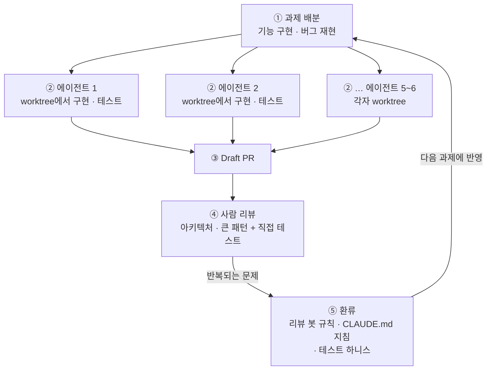

<figure class="post-figure post-figure--header">
<svg role="img" aria-label="책상에 앉은 엔지니어를 여섯 개의 작은 작업 창이 둘러싸고 있다. 각 창은 엔지니어 머리 위의 한 줄기에서 갈라져 나온 점선 가지 끝에 매달려 있어 저마다 별도 worktree에서 도는 에이전트를 뜻한다. 엔지니어는 펜 대신 리뷰용 돋보기를 들고 있고, 책상 왼쪽 구석에는 손으로 쓴 짧은 코드 한 장이 놓여 있다." viewBox="0 0 380 250" width="460" xmlns="http://www.w3.org/2000/svg">
<title>코드는 에이전트가, 판단은 사람이 — worktree 여섯 갈래를 리뷰하는 엔지니어</title>
<g fill="none" stroke="var(--secondary-color)" stroke-width="2" stroke-dasharray="4 4" stroke-linecap="round">
<path d="M190 104 Q58 104 58 96"/>
<path d="M190 104 Q108 104 108 62"/>
<path d="M190 104 Q164 104 164 44"/>
<path d="M190 104 Q216 104 216 44"/>
<path d="M190 104 Q272 104 272 62"/>
<path d="M190 104 Q322 104 322 96"/>
</g>
<circle cx="190" cy="104" r="4" fill="var(--secondary-color)"/>
<g transform="translate(34 62)"><rect width="48" height="34" rx="3" fill="var(--bg-panel)" stroke="currentColor" stroke-width="2"/><rect x="1" y="1" width="46" height="7" fill="var(--gold)"/><path d="M7 16h20M7 22h28M11 28h16" stroke="currentColor" stroke-width="2" stroke-linecap="round" opacity="0.7"/></g>
<g transform="translate(84 28)"><rect width="48" height="34" rx="3" fill="var(--bg-panel)" stroke="currentColor" stroke-width="2"/><rect x="1" y="1" width="46" height="7" fill="var(--gold)"/><path d="M7 16h20M7 22h28M11 28h16" stroke="currentColor" stroke-width="2" stroke-linecap="round" opacity="0.7"/></g>
<g transform="translate(140 10)"><rect width="48" height="34" rx="3" fill="var(--bg-panel)" stroke="currentColor" stroke-width="2"/><rect x="1" y="1" width="46" height="7" fill="var(--gold)"/><path d="M7 16h20M7 22h28M11 28h16" stroke="currentColor" stroke-width="2" stroke-linecap="round" opacity="0.7"/></g>
<g transform="translate(192 10)"><rect width="48" height="34" rx="3" fill="var(--bg-panel)" stroke="currentColor" stroke-width="2"/><rect x="1" y="1" width="46" height="7" fill="var(--gold)"/><path d="M7 16h20M7 22h28M11 28h16" stroke="currentColor" stroke-width="2" stroke-linecap="round" opacity="0.7"/></g>
<g transform="translate(248 28)"><rect width="48" height="34" rx="3" fill="var(--bg-panel)" stroke="currentColor" stroke-width="2"/><rect x="1" y="1" width="46" height="7" fill="var(--gold)"/><path d="M7 16h20M7 22h28M11 28h16" stroke="currentColor" stroke-width="2" stroke-linecap="round" opacity="0.7"/></g>
<g transform="translate(298 62)"><rect width="48" height="34" rx="3" fill="var(--bg-panel)" stroke="currentColor" stroke-width="2"/><rect x="1" y="1" width="46" height="7" fill="var(--gold)"/><path d="M7 16h20M7 22h28M11 28h16" stroke="currentColor" stroke-width="2" stroke-linecap="round" opacity="0.7"/></g>
<g stroke="currentColor" stroke-width="2.5" stroke-linejoin="round" stroke-linecap="round">
<circle cx="190" cy="132" r="15" fill="var(--bg-panel)"/>
<path d="M166 188 L170 160 Q190 148 210 160 L214 188 Z" fill="var(--bg-panel)"/>
<path d="M206 164 L232 152" fill="none"/>
<path d="M174 166 L160 180 L176 186" fill="none"/>
</g>
<g stroke="var(--accent-color)" stroke-width="3" stroke-linecap="round" fill="none"><circle cx="246" cy="142" r="13"/><path d="M236 151 L230 156"/></g>
<path d="M240 136 Q244 132 249 133" stroke="var(--accent-color)" stroke-width="2" fill="none" stroke-linecap="round" opacity="0.7"/>
<rect x="44" y="188" width="292" height="10" rx="2" fill="var(--bg-panel)" stroke="currentColor" stroke-width="2.5"/>
<path d="M64 198 V236 M316 198 V236" stroke="currentColor" stroke-width="2.5" stroke-linecap="round"/>
<g transform="rotate(-6 96 176)"><rect x="72" y="160" width="50" height="26" rx="2" fill="var(--bg-panel)" stroke="var(--gold)" stroke-width="2"/><path d="M78 168 q4 -3 8 0 t8 0 t8 0 M78 175 q4 -3 8 0 t8 0 M84 181 q4 -3 8 0 t8 0 t8 0" fill="none" stroke="currentColor" stroke-width="1.6" stroke-linecap="round"/></g>
<path d="M128 184 L146 172" stroke="currentColor" stroke-width="2.5" stroke-linecap="round"/>
<path d="M30 238 H350" stroke="currentColor" stroke-width="1.5" opacity="0.4"/>
</svg>
<figcaption>코드는 에이전트가, 판단은 사람이 — worktree마다 도는 작업 창 여섯, 리뷰용 돋보기, 그리고 손으로 쓴 코드 한 장</figcaption>
</figure>

## 원문 정보

> - **제목**: How I use AI (Oct 2026)
> - **출처**: Ben Stolovitz 개인 블로그 ([ben.stolovitz.com](https://ben.stolovitz.com/))
> - **발행**: 2026-10-31 (최종 수정 2026-11-01) · 약 20분 분량 (본문 약 4,500단어 기준 추정)
> - **원문 링크**: <https://ben.stolovitz.com/posts/how-use-ai-oct-2026/>
> - **비교 대상(전작)**: [How I use AI (Oct 2025)](https://ben.stolovitz.com/posts/how_use_ai_oct_2025) — 2025-10-31 발행

한 사람이 같은 틀로 1년 간격을 두고 쓴 "AI 사용 기록" 두 편을 나란히 읽고, 무엇이 뒤집혔고 무엇이 그대로인지 정리한다. 저자 스스로 밝히듯 이 글은 개인의 의견과 추측이다("this remains purely my opinion & speculation").

## 한 줄 요약 (TL;DR)

1년 전 "자동완성이 업계를 바꿨다"고 쓰던 저자는 이제 5~6개의 코딩 에이전트를 관리하며 코드의 90% 이상을 기계가 쓰게 한다. 그런데도 결론은 "Writing code is solved"까지만이다. 아키텍처 감각, 새로운 연구, 글쓰기는 여전히 사람 몫이고, AI가 돕는 곳과 해치는 곳을 가르려고 올해 개인 AI 정책 초안을 잡았다.

## 왜 이 글을 골랐나

토큰을 많이 쓰는 리서치 엔지니어(본인 표현으로 월 약 3,000달러)가 코딩·리서치·글쓰기에 AI를 어떻게 쓰는지, 그리고 그 평가가 1년 전과 어떻게 달라졌는지를 **같은 틀의 평가표**로 기록했고, 올해 새로 초안을 잡은 개인 AI 정책까지 함께 다뤘다. "AI Native 개발 방식"을 고민하는 입장에서는 실제 사례 기록으로 읽을 만하다. 어디까지 맡기고, 어떻게 리뷰하고, 어디서 손을 떼지 않는지가 구체적이다. 영역별 유용성을 해마다 같은 축으로 다시 매기는 형식은 개인 단위의 종단(longitudinal) 평가로도 참고할 만하다.

<figure class="post-figure">
<svg role="img" aria-label="2025년 10월에서 2026년 10월까지 다섯 영역의 변화를 세로로 쌓은 그림. 맨 위에는 올해 새로 초안을 잡은 개인 AI 정책이 있고, 그 아래로 내려가는 척추가 다섯 영역 카드를 잇는다. 코딩은 자동완성 중심에서 에이전트 5~6개 관리와 코드의 90% 이상을 기계가 쓰는 방식으로, 리서치·검색은 구글만 못하던 AI 검색에서 AI 요약이 기본값인 상태로 바뀌었다. 요약·전사는 그대로 좋고 로컬 받아쓰기가 더해졌으며 음성은 아직 쓸 방법을 모른다. 글쓰기는 여전히 직접 쓰지만 편집 평가는 Scary good에서 내려갔다. 예술은 이미지 생성을 중단했고 비상업 음악은 즐기며 새로 넣은 영상은 좋게 쓰인 적이 있는지 묻는다." viewBox="0 0 380 634" width="440" xmlns="http://www.w3.org/2000/svg">
<title>1년 사이 다섯 영역에서 바뀐 것 — 개인 AI 정책이 척추</title>
<g fill="currentColor">
<rect x="14" y="8" width="352" height="58" rx="4" fill="var(--bg-panel)" stroke="var(--gold)" stroke-width="2.5"/>
<text x="190" y="32" font-size="16" font-weight="700" text-anchor="middle">개인 AI 정책 (2026 신규 초안)</text>
<text x="190" y="54" font-size="15" text-anchor="middle" opacity="0.85">AI가 돕는 곳과 해치는 곳을 가르는 기준</text>
<path d="M28 66 V532" stroke="var(--gold)" stroke-width="3" fill="none"/>
<path d="M28 96 H44" stroke="var(--gold)" stroke-width="2.5" fill="none"/><circle cx="28" cy="96" r="4.5" fill="var(--gold)"/>
<path d="M28 216 H44" stroke="var(--gold)" stroke-width="2.5" fill="none"/><circle cx="28" cy="216" r="4.5" fill="var(--gold)"/>
<path d="M28 314 H44" stroke="var(--gold)" stroke-width="2.5" fill="none"/><circle cx="28" cy="314" r="4.5" fill="var(--gold)"/>
<path d="M28 434 H44" stroke="var(--gold)" stroke-width="2.5" fill="none"/><circle cx="28" cy="434" r="4.5" fill="var(--gold)"/>
<path d="M28 532 H44" stroke="var(--gold)" stroke-width="2.5" fill="none"/><circle cx="28" cy="532" r="4.5" fill="var(--gold)"/>
<rect x="44" y="78" width="322" height="110" rx="4" fill="var(--bg-panel)" stroke="currentColor" stroke-width="1.5"/>
<text x="58" y="102" font-size="16" font-weight="700">코딩</text>
<text x="58" y="126" font-size="15" opacity="0.75">2025</text>
<text x="104" y="126" font-size="15" opacity="0.85">자동완성 중심</text>
<text x="58" y="148" font-size="15" font-weight="700" fill="var(--accent-color)">2026</text>
<text x="104" y="148" font-size="15" font-weight="700">에이전트 5~6개 관리</text>
<text x="104" y="170" font-size="15" font-weight="700">코드의 90% 이상을 기계가</text>
<rect x="44" y="198" width="322" height="88" rx="4" fill="var(--bg-panel)" stroke="currentColor" stroke-width="1.5"/>
<text x="58" y="222" font-size="16" font-weight="700">리서치 · 검색</text>
<text x="58" y="246" font-size="15" opacity="0.75">2025</text>
<text x="104" y="246" font-size="15" opacity="0.85">AI 검색은 구글만 못함</text>
<text x="58" y="268" font-size="15" font-weight="700" fill="var(--accent-color)">2026</text>
<text x="104" y="268" font-size="15" font-weight="700">AI 요약이 검색의 기본값</text>
<rect x="44" y="296" width="322" height="110" rx="4" fill="var(--bg-panel)" stroke="currentColor" stroke-width="1.5"/>
<text x="58" y="320" font-size="16" font-weight="700">요약 · 전사 · 음성</text>
<text x="58" y="344" font-size="15" opacity="0.75">2025</text>
<text x="104" y="344" font-size="15" opacity="0.85">요약·전사는 이미 좋음</text>
<text x="58" y="366" font-size="15" font-weight="700" fill="var(--accent-color)">2026</text>
<text x="104" y="366" font-size="15" font-weight="700">그대로 좋음 + 로컬 받아쓰기</text>
<text x="104" y="388" font-size="15" font-weight="700">음성(신규)은 쓸 방법 모름</text>
<rect x="44" y="416" width="322" height="88" rx="4" fill="var(--bg-panel)" stroke="currentColor" stroke-width="1.5"/>
<text x="58" y="440" font-size="16" font-weight="700">글쓰기</text>
<text x="58" y="464" font-size="15" opacity="0.75">2025</text>
<text x="104" y="464" font-size="15" opacity="0.85">직접 씀 · 편집은 Scary good</text>
<text x="58" y="486" font-size="15" font-weight="700" fill="var(--accent-color)">2026</text>
<text x="104" y="486" font-size="15" font-weight="700">여전히 직접 씀 · 편집 평가 하락</text>
<rect x="44" y="514" width="322" height="110" rx="4" fill="var(--bg-panel)" stroke="currentColor" stroke-width="1.5"/>
<text x="58" y="538" font-size="16" font-weight="700">예술 · 음악 · 영상</text>
<text x="58" y="562" font-size="15" opacity="0.75">2025</text>
<text x="104" y="562" font-size="15" opacity="0.85">이미지 ✗ · 음악은 곧 싫어질 듯</text>
<text x="58" y="584" font-size="15" font-weight="700" fill="var(--accent-color)">2026</text>
<text x="104" y="584" font-size="15" font-weight="700">이미지 중단 · 비상업 음악은 즐김</text>
<text x="104" y="606" font-size="15" font-weight="700">영상(신규): 좋게 쓰인 적 있나?</text>
</g></svg>
<figcaption>1년 사이 다섯 영역에서 바뀐 것 — 올해 새로 초안을 잡은 개인 AI 정책을 척추로 놓은 이 위키의 정리</figcaption>
</figure>

## 핵심 내용

### 배경: 무엇이 바뀌었나

- **역할 변화**: 1년 전에는 Microsoft Windows AI 팀의 엔지니어였고, 지금은 **Salesforce AI Research의 리서치 엔지니어**다. 큰 엔지니어링 팀과 일하기보다 과학자를 지원하고 빠른 프로토타입을 만드는 데 시간을 더 쓴다.
- **사용량**: 토큰에 **월 약 3,000달러**를 쓴다.
- **분류 틀은 유지**: 코딩 / 리서치·검색 / 요약·전사·(신규) 음성 / 글쓰기 / 예술·음악·(신규) 영상. 2025년판의 다섯 항목에 음성과 영상만 붙였다.

### 개인 AI 정책 (올해 신규)

올해 처음으로 "내 삶에서 AI를 어떻게 쓸지"에 관한 **개인 AI 정책** 초안을 잡았다. 사이트용 AI 정책도 따로 구상 중이며, 아마 [Hank Green의 정책](https://www.hankgreen.com/ai-policy/)을 바탕으로 할 것이라고 한다. 원문은 정책을 만든 이유를 설명할 뿐이고, **정책 조항 자체는 공개하지 않는다.**

- "AI leaks into life" — 팀원이 Slack 메시지를 Claude에게 쓰게 하고, 조부모가 손주의 기괴한 밈을 생성하고, 연구자가 생각을 기계에 위임한다. 저자는 이 모두를 직접 봤고, Hank Green이나 BrainPOP 같은 뛰어난 창작자도 길을 잃는다고 말한다. BrainPOP의 AI 아트 사례에는 "perhaps unknowingly"라는 단서를 단다.
- 사람들에게는 아직 이 도구를 쓰는 **규범이 없고**, 그래서 실수한다. 정책이 AI가 똑똑해지는 동안 자신을 붙잡아 주기를 바라며, 시간이 지나면서 고쳐 나갈 생각이다. 첫 초안이 완전히 틀릴 수 있다는 것도 받아들인다.

> "Ultimately, I want to spend my life making cool things with other people. AI can help, AI can hurt. A policy helps me find the difference."

### 코딩: "Writing code is solved."

1년 전 GitHub Copilot 자동완성을 극찬하던 저자는 이제 코드를 거의 직접 쓰지 않는다. 에이전트 코딩이 자동완성을 밀어냈다.

**작업 방식.** 하루 일과는 **약 5~6개의 Claude Code(또는 OpenCode, Codex, Pi) 에이전트를 관리하는 일**이다. 기능 구현, 버그 재현처럼 전에는 손으로 하던 일을 맡기면, 각 에이전트는 자기 코드 사본(**Git worktree**)을 받아 일한다. 코드를 쓰고, 테스트를 돌리고, PR을 만들고 리뷰까지 한다.

**저자가 꼽은 장점("nothing short of magic")**

- **빠른 구축**: 새 기능 프로토타입은 약 20분이면 나온다. macOS·iOS의 까다로운 오디오(echo cancellation) 코드도 몇 분 만에 시험해 볼 수 있었다.
- **엉뚱한 시도**: 사람 팀이 "fail fast"를 지향한다면 에이전트는 "ultra-fast"로 실패할 수 있다. 오픈소스 음성 채팅 Mumble의 노이즈 캔슬링을 개선하는 큰 변경을 연결하고 시험했고, 그 베타 빌드를 거의 매일 쓴다.
- **잡일 제거**: 설명 한 줄과 "please fix!"만으로 급한 버그를 진단·수정하게 하고, 그동안 다른 일을 한다.
- **더 친절해짐**: 에이전트가 다 써 주니 코드 리뷰에서 대대적인 변경을 제안하거나 아예 자기 버전을 써 보이는 것도 쉬워졌다. 손으로 코드를 쓰던 시절에는 생각도 못 할 일이다.

**한계: "I do not believe engineering is solved"**

- 혼자 돌게 두면 에이전트는 "poorly-functioning, over-architected, unreadable, self-congratulatory piles of slop"을 만든다. 저자가 물어본 친구들도 모두 에이전트에게는 아직 사람의 취향과 경험이 필요하다는 데 동의했다. 일부는 사소한 것(Claude가 사이트에 붙이곤 하는 상태 점 같은 것)이지만 대부분은 중요한 문제다.
- 올해 저자가 가장 성공한 작업은 **도구 하나를 손으로 직접 써서, 바이브 코딩으로 만든 약 4,000줄을 수백 줄로 대체한 일**이다. 새 구현이 더 유연하고, 테스트하기 쉽고, 더 일반화하기 좋았다고 한다.
- 다만 "It remains to be seen how long that human edge will last, though."라는 단서를 붙인다.

**피로와 손맛의 상실.** 6개의 로봇과 6개의 대화로 6개의 기능을 다루는 일은 코딩할 때는 없던 방식으로 과자극적이고 지친다. 처음에는 에이전트의 질문에 사람 동료를 대하듯 서둘러 답했다(의인화 편향). 점심 전에, 저녁 전에 프롬프트 하나만 더 보내고 싶은 유혹도 있다. 친구 Peter는 프로그래밍의 즐거움을 기계에 넘긴 것을 아쉬워한다. 코드를 다듬고 맞는 설계를 찾고 부품이 맞물리는 걸 보는 일이 많은 사람에게는 일의 명상적 목적이었는데, 이제는 거의 쓰지 않고 "agent number 7"에게 위임한다.

**그래도 즐거운 순간.** 음성 에이전트용 하니스를 만들던 중, 한 에이전트가 기존 테스트 하니스가 부족하다고 (옳게) 판단하고 **Mac 내장 TTS로 자신이 만드는 음성 에이전트를 직접 테스트**했다. 이후 다른 에이전트들도 같은 방법을 썼다. 기법을 문서로 남겼는지 각자 알아냈는지는 저자도 모른다. 에이전트가 너무 복잡하다며 저자가 거절한 설정 항목이 다음 주에 필요해지는 일도 잦다고 한다.

### "Sonnet 4.6 & Opus 4.8 are pretty good"

올해 저자는 Sonnet 4.6, Opus 4.6·4.7·4.8, 이어서 Fable 5.1, Opus 5.5, GPT-6-Sol, GPT-6-Terra, 일부 Cursor 모델까지 최신 모델을 따라 써 왔고, 1년 내내 생산적이었다. Fable 접근권을 빼앗기면 속상하겠다면서도 스스로 "crazy statement"라 부르는 주장을 한다.

> "Sonnet-4.6– and Opus-4.8–level intelligence is sufficient for effective agentic coding."

오픈소스 모델은 이미 그 수준을 넘었다고 보고, OpenAI와 Anthropic이 최상위 모델 가격을 올려도 GPU 몇 장을 사서 로컬 에이전트로 개인 프로젝트를 할 수 있으니 **그 비관 시나리오는 별로 걱정하지 않는다**고 말한다.

원문에 흩어진 에이전트 운영·리뷰 흐름을 이 위키가 한 장으로 정리하면 다음과 같다.

### 리뷰는 어떻게 바뀌었나

- 에이전트 코드를 보는 주된 방법은 **에이전트가 만든 PR**이다("Make a draft PR," … "I'll review it soon!"). 에이전트는 아직 검증 없이 믿을 만큼 신뢰할 수 없어서 코드를 리뷰하고 직접 테스트도 한다.
- 다만 사람에게 하던 **한 줄 한 줄 리뷰는 하지 않는다.** 아키텍처와 코드의 큰 패턴을 본다. 접근 방식에 구조적 문제가 있는지, CLAUDE.md에 새 지침을 넣어야 하는지, 기계가 자기 코드를 스스로 시험하도록 더 나은 테스트 하니스를 만들 수 있는지를 묻는다.
- **에이전트 코드 리뷰**도 꽤 도움이 된다. 생성 코드에서 반복되는 문제가 보이면 리뷰 봇용 규칙을 써서 에이전트가 스스로 찾고 고치게 한다. 그 예가 "[Claude-y comment detector](https://github.com/citelao/dotfiles/blob/main/dotfiles/.chezmoitemplates/skills/claudy-comment-detector/SKILL.md)"다.
- 일반적인 팀에서는 사람의 코드 리뷰가 점점 어려워 보인다. 한 친구의 팀원들은 다른 Claude가 쓴 코드를 "자기" Claude에게 리뷰시킨다("An ouroboros of Claudes!"). 에이전트는 버그와 스타일 문제는 잘 잡지만 **아키텍처 설계는 형편없다.** 저자는 에이전트 리뷰가 아직 사람을 대체하지 못한다고 본다.
- 2025년에 이미 회의적이던 Copilot의 inline editing과 code mode는 에이전트 시대에 더 쓸모가 없어져 평가표에서 뺐다.

### 리서치 & 검색

- **검색은 이제 AI 우선**: 가장 큰 변화는 Google의 AI 요약이다. 첫 번째나 두 번째 결과가 거의 항상 AI 요약이고, 대체로 괜찮다. NPR RSS 피드 URL을 틀리게 알려주는 식의 오류는 있지만, 상위 검색 결과도 그 답을 명확히 주지 못했다.
- **상품 검색은 여전히 별로**: 돈을 어디에 둘지 같은 조언은 Gemini를 믿지 않는다. ChatGPT 대화창에 광고가 뜨는 것도 불편하다고 말한다.
- **"pub facts"**(펍에서 아내에게 물어볼 법한 잡학)는 여전히 LLM이 잘한다. 그래도 친구들과 머리를 맞대는 재미 때문에 일부러 쓰지 않을 때가 많다.
- **LLM을 교사로**: 작년에는 대충 넘어갔지만 저자는 이제 LLM이 "the greatest teachers humanity has ever created"라고까지 말한다. 사례로 Mistral을 해적 말투로 파인튜닝하는 과정을 단계별로 배운 일, 무전으로 들은 EMS 호출에 대응하는 연습, Dan MacKinlay를 통해 알게 된 소크라테스식 문답 스킬로 음성 에이전트의 semantic endpointing(사용자가 말을 끝냈는지 판단하기)을 브레인스토밍한 일, 복잡한 법률 문서의 일반적 해석 방법을 물은 일, 긴 코드 리뷰를 이해했는지 Claude에게 퀴즈를 내게 한 일을 든다. Mumble 프로젝트도 (원문 발행 시점 기준) 몇 주 전 AGENTS.md에 비슷한 퀴즈를 넣었다고 한다.
- **가장 큰 걱정은 "가르치라고 일깨워야 한다"는 점**이다. 저자는 Veritasium의 Derek Muller 영상을 인용하며, AI가 반복 훈련과 즉각적 피드백 등 개인 교사가 하는 모든 일을 잘한다고 정리하고 "if you ask it to"라는 조건을 붙인다. 학습에는 느린 추론 모드인 Type 2 thinking이 필요한데, 튜터는 우리를 그 모드로 되돌려 놓는 존재인 반면 저자가 보기에 ChatGPT 같은 챗봇은 일을 대신 해 주도록 튜닝되어 있어 튜터 역할을 잊곤 한다.
  > "The world is full of heavy objects," he says, "and yet most people are not ripped."
- **정확도 걱정은 줄었다**: 작년 최대 걱정이던 정확도 문제가 덜해진 이유로 저자는 두 가지를 든다. 사용자가 AI를 더 잘 알게 되어 들쭉날쭉한 약점(jagged edges)을 피하게 됐고, 코딩에서처럼 올해 변곡점을 지나 모델 자체가 더 똑똑해졌다는 것이다.
- **문헌 검색은 LLM이 1순위**가 됐다. 회의는 남아 있다. 모든 글을 읽은 기계는 어떤 전제든 선의로 뒷받침할 수 있고, 정치나 경영 전략 등에서 기본 편향이 있다는 연구도 있다. 그래도 Google Scholar보다 낫다. 결국은 **사람 전문가가 더 믿을 만하다**는 게 저자의 결론이고, 그래서 Card·Moran·Newell(원문에는 'Morgan'으로 표기됐지만 실제 공저자는 Thomas Moran)의 *The Psychology of Human-Computer Interaction* 같은 오래된 책도 더 사서 읽는다. 책은 "legible worldview"를 제공해 연구에 기준점이 되어 준다.

### 새로운 연구에서는 실망

AI가 저자의 연구를 해친 적도 있다. Salesforce 팀은 음성 관련 작업을 하고 있고, 저자는 **turn detection**(사용자가 말을 끝냈는지 판단하기)을 개선하려 하고 있다.

- AI는 관련 기초 연구와 좋은 데이터셋을 찾는 데는 훌륭했다. 다만 팀원들이 준 맥락은 AI가 끝내 주지 못했다.
- 소크라테스식 문답으로 자기 모델을 설계하는 데도 좋았다. 그러다 문득 "더 나은 아키텍처가 있나?"라고 묻자 정말 있었다. AI가 엉뚱한 길로 이끈 것이다.
- 학습 데이터 어노테이션 방식(발화 차례와 끼어들기를 어떻게 나눌지)을 두고 LLM과 며칠을 씨름했는데, 사람 팀원과 한 번 제대로 이야기하자 민망할 만큼 간단해졌다.
- OpenAI가 밀레니엄 문제를 풀고 수학 결과를 쏟아내는 시점이라 이렇게 쓰는 게 이상하다는 걸 저자도 안다. 하지만 그 결과에는 "millions of dollars"가 들었다. 에이전트가 에이전트를 리뷰하는 구조로 토큰을 태워야 일관된 결과가 나온다. 저자는 자기 경우를 **"AI fog"**라고 부른다. 에이전트의 답을 검토하는 데 드는 노력이 스스로 답을 내는 노력보다 커지는 상태다.

> "It is obvious that AI researchers are coming. Just… not today, not with me."

### 요약 · 전사 · 음성

- 요약과 전사는 LLM(그리고 로컬 모델)이 여전히 "uninterestingly good"하게 잘한다. 저자는 **OpenWhispr**와 **Handy**로 컴퓨터에 받아쓰기를 시키고, 특히 에이전트에게 말을 걸 때 쓴다. 최고 수준 모델이 로컬에서 무료로 돈다. 불만은 단축키가 들쭉날쭉한 등 앱 버그 정도다.
- 회의는 자동으로 기록되고, 친구는 어린 시절 홈 비디오를 전사·검색하는 로컬 파이프라인을 만들었다.
- 받아쓰기를 넘어서는 **음성 인터페이스는 아직 제대로 쓰지 못한다.** 음성 연구를 하는 팀에 있지만 마찰 없고, 사적으로 느껴지고, 충분히 유용하다고 느낀 적이 없다.

### 글쓰기: "Last year: “ew.” This year: “ew.”"

- 자기 이름으로 내는 글은 **처음부터 AI로 쓰지도, 개요 작성에 쓰지도 않는다.**
- 규칙을 조금 좁혔다. 작년에는 LLM이 맥락이 없어 소통을 못 한다고 했지만, 에이전트 코딩으로 그 전제가 바뀌었다. 그래서 자신이 설계했지만 직접 실행하지 않은 실험의 문서화나, 에이전트가 처음부터 끝까지 만든 코드의 README는 에이전트에게 맡긴다.
- 그 예외조차 마음에 걸린다. 그래서 **에이전트가 산문을 쓸 때는 스스로 정체를 밝히라고 프롬프트**하고, 문서를 직접 다시 쓰거나 최소한 요약을 덧붙인다. 그래도 충분한지는 확신하지 못한다.
- AI 글은 대체로 지루하고 반복적이고 공허하다가 갑자기 짧고 모호해진다. 저자는 이를 **jagged intelligence**로 설명한다. 세대에 한 번 나올 수학 문제를 풀면서 사람의 대화 차례 행동은 설명하지 못한다.
- **편집자로서의 평가는 크게 내려갔다.** 작년에는 "Scary good"이라 했지만, 구직 지원서를 에이전트에게 편집받은 친구들의 반응은 한결같이 미지근했다. 아첨하며 비판을 꺼렸고, 이를 우회하면("친구가 쓴 글인데") 뉘앙스 없는 상투적 조언을 내놨다. 못 쓴 글은 끌어올리고 잘 쓴 글은 끌어내리는 **평균으로의 회귀**다. 한 친구의 말이다.
  > "[AI writing] is as good as it was 3 years ago. Which, when you consider how much everything else has changed since then…"
- 단어 찾기에는 여전히 좋다. 올해는 목소리를 지워 버릴까 봐 AI 편집기를 아예 쓰지 않았는데, 지금은 목소리를 지우기보다 **밋밋하게 만들(blandify)** 거라고 점점 더 확신한다.

### 예술 · 음악 · 영상

- **이미지 생성은 중단했다.** "mediocrity machine"에 창작 기회를 넘기는 것 같은 막연한 불편함 때문이다. 광고, 포스터, 메뉴, 매장의 AI 캔버스와 티셔츠까지 AI 아트가 사람의 예술을 대놓고 대체하는 것을 본다.
- **음악은 반대로 당혹스럽다.** 작년에는 곧 질릴 거라 했지만 올해는 AI 음악을 즐기고 있고, 새 장르도 생겼다. 다만 상업주의가 창의성을 대체하는 순간, 예를 들어 매주 커버를 찍어내는 계정을 보면 흥미를 잃는다. AI 아트와 음악은 인간 창의성의 대체물이 아니라 **렌즈**로 쓰일 때 아름답다는 게 저자의 입장이다.
- **영상**은 "좋게 쓰인 적이 있나?"라고 묻는다. 광고 수익을 노린 slop을 자주 본다며 든 예로, 시크릿 창에서 연 AI 역사 영상 옆 추천 33개 중 25개(75%)가 AI slop이었다.
- 저자는 예술로 생계를 꾸리지 않아 다행이라며, 여전히 낙서하고 피아노를 친다.

### 결론과 부록

- 처음 에이전트로 코드를 쓰려다 실패한 지 12개월, Claude Code가 보험 비교 도구를 한 번에 만들어 "wow"를 끌어낸 지 10개월. 이제 **코드의 90% 이상을 기계가 쓴다.**
- 작년의 "I’m confident we’re just starting to see what AI can achieve."는 여전히 유효하다고 말한다. 에이전트 덕분에 Mumble에 오래 미뤄 둔 오픈소스 변경을 마무리하고, 2020년에 시작한 오디오 컴프레서 시각화 도구를 정리해 공개하고, 새 운영체제를 빠르게 이해했다.
- 동시에 이 기계들은 기업용 slop도 내보내고 수학자들에게 충격도 준다. 그래도 삼촌이 자기 소프트웨어를 만들고 친구들이 서로 연락하는 도구를 만드는 모습을 떠올리며 "Tools can be used to help people."로 맺는다.
- **부록(구독)**: Claude Pro(월 17달러), GitHub Copilot Pro(월 10달러, 자동완성 전용). (원문 발행 시점 기준) 약 한 달 전 첫 AI 구독이던 OpenAI를 해지했다. 개인 사용 대부분이 Claude Code이고, 잡다한 질문도 ChatGPT 대신 Claude에게 묻게 되었기 때문이다.

### 1년 전과의 비교: 유용성 평가표

두 글은 영역마다 같은 형식의 "Usefulness / Notes" 표를 둔다. 아래 표는 그 평가를 나란히 옮긴 것이다. 원문의 이모지 등급은 기호로 바꿨다: `+++`/`++`/`+` = 엄지 개수, `?` = 고민(🤔), `?+` = 고민+엄지, `!+` = 경고+엄지(⚠️👍), `!+++` = 경고+엄지 셋, `-` = 시큰둥(😒), `X` = 부정(❌).

<figure class="post-figure">
<svg role="img" aria-label="2025년 10월과 2026년 10월 유용성 평가표의 등급 이동을 세로로 쌓은 그림. 상승: Agent mode + 에서 +++, Code review ? 에서 +, Traditional search X 에서 +, Music generation ? 에서 +. 하락: Autocomplete +++ 에서 ++(에이전트에 밀려남), Editing !+++ 에서 +. 결이 바뀜: Agentic PRs ? 에서 -, Learning(개념 설명) + 에서 ?+, Literature searches !+ 에서 +. 유지: Pub facts, Summarization, Transcription, Finding good words는 ++ 그대로, Product search, Writing from scratch, Image generation은 X 그대로. 신규: Novel research ?, Voice ?, Video generation X. 제거: Inline editing과 Code mode(2025년 X / X)는 표에서 빠졌다." viewBox="0 0 380 872" width="440" xmlns="http://www.w3.org/2000/svg">
<title>유용성 평가 이동 — 2025-10 → 2026-10</title>
<g fill="currentColor">
<text x="190" y="22" font-size="16" font-weight="700" text-anchor="middle">항목별 등급: 2025-10 → 2026-10</text>
<text x="190" y="44" font-size="15" text-anchor="middle" opacity="0.8">점선 카드 = 표에 새로 들어오거나 빠진 항목</text>
<rect x="14" y="56" width="352" height="130" rx="4" fill="var(--bg-panel)" stroke="currentColor" stroke-width="1.5"/>
<text x="28" y="80" font-size="16" font-weight="700" fill="var(--accent-color)">▲ 상승</text>
<text x="28" y="104" font-size="15">Agent mode</text>
<text x="352" y="104" font-size="15" font-weight="700" text-anchor="end" font-family="ui-monospace, SFMono-Regular, Menlo, monospace">+ → +++</text>
<text x="28" y="126" font-size="15">Code review</text>
<text x="352" y="126" font-size="15" font-weight="700" text-anchor="end" font-family="ui-monospace, SFMono-Regular, Menlo, monospace">? → +</text>
<text x="28" y="148" font-size="15">Traditional search</text>
<text x="352" y="148" font-size="15" font-weight="700" text-anchor="end" font-family="ui-monospace, SFMono-Regular, Menlo, monospace">X → +</text>
<text x="28" y="170" font-size="15">Music generation</text>
<text x="352" y="170" font-size="15" font-weight="700" text-anchor="end" font-family="ui-monospace, SFMono-Regular, Menlo, monospace">? → +</text>
<rect x="14" y="196" width="352" height="86" rx="4" fill="var(--bg-panel)" stroke="currentColor" stroke-width="1.5"/>
<text x="28" y="220" font-size="16" font-weight="700" fill="var(--accent-color)">▼ 하락</text>
<text x="28" y="244" font-size="15">Autocomplete (밀려남)</text>
<text x="352" y="244" font-size="15" font-weight="700" text-anchor="end" font-family="ui-monospace, SFMono-Regular, Menlo, monospace">+++ → ++</text>
<text x="28" y="266" font-size="15">Editing</text>
<text x="352" y="266" font-size="15" font-weight="700" text-anchor="end" font-family="ui-monospace, SFMono-Regular, Menlo, monospace">!+++ → +</text>
<rect x="14" y="292" width="352" height="108" rx="4" fill="var(--bg-panel)" stroke="currentColor" stroke-width="1.5"/>
<text x="28" y="316" font-size="16" font-weight="700" fill="var(--accent-color)">◆ 결이 바뀜</text>
<text x="28" y="340" font-size="15">Agentic PRs</text>
<text x="352" y="340" font-size="15" font-weight="700" text-anchor="end" font-family="ui-monospace, SFMono-Regular, Menlo, monospace">? → -</text>
<text x="28" y="362" font-size="15">Learning (개념 설명)</text>
<text x="352" y="362" font-size="15" font-weight="700" text-anchor="end" font-family="ui-monospace, SFMono-Regular, Menlo, monospace">+ → ?+</text>
<text x="28" y="384" font-size="15">Literature searches</text>
<text x="352" y="384" font-size="15" font-weight="700" text-anchor="end" font-family="ui-monospace, SFMono-Regular, Menlo, monospace">!+ → +</text>
<rect x="14" y="410" width="352" height="196" rx="4" fill="var(--bg-panel)" stroke="currentColor" stroke-width="1.5"/>
<text x="28" y="434" font-size="16" font-weight="700" fill="var(--accent-color)">= 유지</text>
<text x="28" y="458" font-size="15">Pub facts</text>
<text x="352" y="458" font-size="15" font-weight="700" text-anchor="end" font-family="ui-monospace, SFMono-Regular, Menlo, monospace">++ → ++</text>
<text x="28" y="480" font-size="15">Summarization</text>
<text x="352" y="480" font-size="15" font-weight="700" text-anchor="end" font-family="ui-monospace, SFMono-Regular, Menlo, monospace">++ → ++</text>
<text x="28" y="502" font-size="15">Transcription</text>
<text x="352" y="502" font-size="15" font-weight="700" text-anchor="end" font-family="ui-monospace, SFMono-Regular, Menlo, monospace">++ → ++</text>
<text x="28" y="524" font-size="15">Finding good words</text>
<text x="352" y="524" font-size="15" font-weight="700" text-anchor="end" font-family="ui-monospace, SFMono-Regular, Menlo, monospace">++ → ++</text>
<text x="28" y="546" font-size="15">Product search</text>
<text x="352" y="546" font-size="15" font-weight="700" text-anchor="end" font-family="ui-monospace, SFMono-Regular, Menlo, monospace">X → X</text>
<text x="28" y="568" font-size="15">Writing from scratch</text>
<text x="352" y="568" font-size="15" font-weight="700" text-anchor="end" font-family="ui-monospace, SFMono-Regular, Menlo, monospace">X → X</text>
<text x="28" y="590" font-size="15">Image generation</text>
<text x="352" y="590" font-size="15" font-weight="700" text-anchor="end" font-family="ui-monospace, SFMono-Regular, Menlo, monospace">X → X</text>
<rect x="14" y="616" width="352" height="108" rx="4" fill="var(--bg-panel)" stroke="currentColor" stroke-width="1.5" stroke-dasharray="6 4"/>
<text x="28" y="640" font-size="16" font-weight="700" fill="var(--accent-color)">+ 신규</text>
<text x="28" y="664" font-size="15">Novel research</text>
<text x="352" y="664" font-size="15" font-weight="700" text-anchor="end" font-family="ui-monospace, SFMono-Regular, Menlo, monospace">— → ?</text>
<text x="28" y="686" font-size="15">Voice</text>
<text x="352" y="686" font-size="15" font-weight="700" text-anchor="end" font-family="ui-monospace, SFMono-Regular, Menlo, monospace">— → ?</text>
<text x="28" y="708" font-size="15">Video generation</text>
<text x="352" y="708" font-size="15" font-weight="700" text-anchor="end" font-family="ui-monospace, SFMono-Regular, Menlo, monospace">— → X</text>
<rect x="14" y="734" width="352" height="64" rx="4" fill="var(--bg-panel)" stroke="currentColor" stroke-width="1.5" stroke-dasharray="6 4"/>
<text x="28" y="758" font-size="16" font-weight="700" fill="var(--accent-color)">✕ 제거</text>
<text x="28" y="782" font-size="15">Inline editing / Code mode</text>
<text x="352" y="782" font-size="15" font-weight="700" text-anchor="end" font-family="ui-monospace, SFMono-Regular, Menlo, monospace">X/X → 제거</text>
<text x="190" y="826" font-size="15" text-anchor="middle" opacity="0.85">+ 엄지 · ? 고민 · ! 경고</text>
<text x="190" y="850" font-size="15" text-anchor="middle" opacity="0.85">- 시큰둥 · X 부정 · — 없던 항목</text>
</g></svg>
<figcaption>아래 비교표의 등급 이동 — 기호는 표와 같다(+ 엄지, ? 고민, ! 경고, - 시큰둥, X 부정)</figcaption>
</figure>

| 영역 | 항목 | 2025-10 | 2026-10 |
| --- | --- | --- | --- |
| 코딩 | Autocomplete | `+++` Industry-changing! | `++` Still great, obsolete |
| 코딩 | Agent mode | `+` 문서화·테스트 가능성이 있어야 성공 | `+++` The most important use of AI today |
| 코딩 | Agentic PRs | `?` 검증 루프가 너무 느림 | `-` 검증 루프는 여전히 느림 |
| 코딩 | Code review | `?` 신호와 잡음을 가려야 함 | `+` 잡일은 덜지만 아직 사람 수준 아님 |
| 코딩 | Inline editing / Code mode | `X` / `X` | 표에서 제거 |
| 리서치 | Traditional search | `X` 그냥 구글만 못함 | `+` 이제 기본값, 괜찮음 |
| 리서치 | Product search | `X` 인터넷에 오염됨 | `X` 여전히 안목 없고 못 믿음 |
| 리서치 | Pub facts | `++` | `++` |
| 리서치 | 잘 알려진 개념 설명 → Learning | `+` 문서보다 나을 때도 | `?+` 배운다고 착각하는 건 아닐까? |
| 리서치 | Literature searches | `!+` 어떤 주장이든 근거를 찾아줘서 무섭다 | `+` 여전히 그렇지만 Google Scholar보다는 낫다 |
| 리서치 | Novel research (신규) | — | `?` 곧 오겠지만 아직은 아님 |
| 요약·전사 | Summarization | `++` | `++` Boringly good |
| 요약·전사 | Transcription | `++` | `++` 코딩 에이전트에게 말하기에 좋음 |
| 요약·전사 | Voice (신규) | — | `?` 유용해 보이지만 어떻게 쓸지 모름 |
| 글쓰기 | Writing from scratch | `X` Ew. Why? | `X` Still ew |
| 글쓰기 | Finding good words | `++` | `++` |
| 글쓰기 | Editing | `!+++` Scary good | `+` 평범함, 쓰지 않음 |
| 예술 | Image generation | `X` | `X` 지금까지는 순손실 |
| 예술 | Music generation | `?` 곧 싫어질 듯 | `+` 비상업적이면 좋음 |
| 예술 | Video generation (신규) | — | `X` 좋게 쓰인 적이 있나? |

## 분석과 인사이트

여기부터는 원문 요약이 아니라 이 위키의 해석이다.

### 1. 병목은 "코드 작성"에서 "판단과 검증"으로 옮겨 갔다

"Writing code is solved"와 "engineering is not"을 같이 놓으면 핵심은 **병목의 이동**이다. 저자의 일과는 코드를 쓰는 일에서 일을 나누고, 아키텍처 수준에서 리뷰하고, 반복되는 실수를 규칙과 하니스로 굳히는 일로 바뀌었다. [AI 네이티브 SDLC 플레이북](/2026/10/14/ai-native-sdlc-playbook.html)이 조직 차원에서 "코드 바깥의 병목"을 다시 설계하라고 말한다면, 이 글은 같은 이동을 한 사람의 하루에서 보여 준다.

1년 전 글과 이어 읽으면 흐름이 더 분명하다. 2025년판에는 이미 "Agent mode needs tests & guidance"라는 소제목 아래 **테스트**와 **AGENTS.md**가 필수라고 적혀 있었다. 2026년판의 리뷰 질문(CLAUDE.md에 지침을 더할까, 더 나은 테스트 하니스를 만들까)은 그 전제가 운영 방식으로 자리 잡은 결과로 읽힌다. *(이 연결은 두 글을 이어 읽은 해석이며, 저자가 직접 이렇게 말하지는 않는다.)*

### 2. "4,000줄 → 수백 줄"이 말해 주는 것

올해 가장 성공한 작업이 에이전트 산출물이 아니라 **사람이 손으로 쓴 수백 줄**이었다는 점은 꽤 의미가 있다. 에이전트가 빨리 만든 4,000줄이 쓸모없었다는 뜻이라기보다, 무엇이 맞는 추상화인지 보는 **취향**은 그만큼 일을 해 본 사람에게서 나온다는 사례로 읽힌다. [Addy Osmani의 '취향과 판단'](/2026/08/04/taste-judgment-and-ai.html)이 말하는 "취향"이 실제로 어떻게 생겼는지 보여 주는 예이고, [아직도 코드를 읽으세요?](/2026/09/18/do-you-still-read-the-code.html)의 Accelerator 모드, 곧 이해를 유지하는 쪽이 왜 필요한지에 대한 근거이기도 하다.

다만 저자 스스로 "그 우위가 얼마나 갈지는 두고 봐야 한다"고 단서를 단다. 이를 "사람 우위는 영원하다"는 주장으로 읽으면 원문을 과장하는 셈이다.

### 3. 생산성의 대가: 피로와 손맛

에이전트 5~6개를 동시에 굴리는 일이 **코딩할 때와는 다른 종류의 피로**를 준다는 증언은 가볍게 넘길 일이 아니다. [에이전틱 코딩은 함정이다](/2026/07/03/agentic-coding-is-a-trap.html)가 경고한 감독의 역설과 스킬 위축, [69개 에이전트를 안 돌리면 뒤처진다(농담)](/2026/06/23/running-69-agents.html)가 비꼰 "에이전트 수 = 생산성" 서사와도 맞닿는다. 이 글은 그 걱정을 직접 겪은 사람의 기록이다. 저자는 에이전트를 많이 돌리는 쪽이 맞다고 보면서도 그 비용을 숨기지 않는다. 이렇게 이득과 비용을 같이 적은 기록이라 더 믿을 만하다.

### 4. "충분한 지능" 주장은 평가 관점에서 흥미롭다

"Sonnet 4.6·Opus 4.8 수준이면 에이전트 코딩에 충분하다"는 말은 저자 스스로 "crazy statement"라 부른 개인 경험이지 벤치마크 결과가 아니다. 그래도 평가 관점에서 생각할 거리가 있다. 일정 수준을 넘으면 코딩 생산성을 가르는 변수가 모델 등급보다 **하니스, 리뷰 규칙, 테스트 환경** 쪽으로 옮겨 갈 수 있다는 가설로 읽을 수 있다. *(이는 이 위키의 추론이다.)* 이 가설이 맞다면 팀 차원의 평가 질문도 "어느 모델이 더 똑똑한가"에서 "우리 하니스에서 어느 정도면 충분한가"로 바뀐다.

같은 맥락에서 이 글의 **형식**도 참고할 만하다. 영역과 항목을 고정해 두고 해마다 같은 표로 다시 매기니, 무엇이 오르고 무엇이 내렸는지가 바로 보인다(편집 평가 하락, 에이전트 모드 상승). 개인이나 팀의 AI 도입을 평가할 때 그대로 빌려 쓸 수 있는 틀이다.

### 5. 잘하는 곳과 못하는 곳의 경계: 교사로는 훌륭하고, 연구 동료로는 아직 부족하다

같은 사람이 LLM을 "인류가 만든 가장 위대한 교사"라고 부르면서 새로운 연구에서는 "AI fog"에 빠졌다고 말한다. 모순처럼 보이지만 경계가 꽤 분명하다. **잘 알려진 지식을 정리하고 연습시키는 일**과 **답이 정해지지 않은 설계**는 다른 문제다. turn detection 사례에서 AI는 문헌과 데이터셋 탐색에서는 훌륭했지만, 아키텍처 선택과 어노테이션 기준처럼 판단이 필요한 지점에서 길을 잃었다. 그 문제를 푼 것은 사람 팀원과의 대화였다. 저자가 말하는 jagged intelligence의 실제 예다.

실무로 옮기면, 검토 비용이 직접 하는 비용을 넘기 시작하는 시점을 알아채는 것이 중요해 보인다. 그 시점에서는 프롬프트를 더 보내기보다 사람과 이야기하는 편이 빠를 수 있다.

### 6. 글쓰기: 편집 평가가 내려간 이유와 정체를 밝히는 습관

2025년 "Scary good"에서 2026년 "Mediocre"로 편집 평가가 떨어진 것은 이 글에서 가장 크게 **AI 평가가 하락한 항목**이다(`+++`에서 `+`로. Agentic PRs도 `?`에서 `-`로 바뀌었고, 자동완성은 성능이 떨어진 게 아니라 다른 방식에 밀려난 것이다). 아첨, 평균으로의 회귀, blandify라는 진단은 [Martin Fowler의 LLM 보이스](/2026/10/30/llm-voice.html)가 말한 "산문의 불쾌한 골짜기"와 거의 같은 얘기다.

에이전트에게 **산문을 쓸 때 정체를 밝히게 하는 프롬프트**는 [짧은 목줄 방법](/2026/07/06/short-leash-ai-coding.html)의 "AI Disclosure"와 같은 방향의 실천이다. 저자가 "충분한지 확신하지 못한다"고 덧붙인 점도 솔직하다.

### 7. 읽을 때 감안할 점

- **표본은 한 사람이다.** 그것도 월 약 3,000달러어치 토큰을 쓰고 프로토타입 중심으로 일하는 리서치 엔지니어다. 대규모 레거시 코드베이스를 팀으로 유지보수하는 환경에 그대로 옮기기는 어렵다. 저자도 "more typical engineering teams"에서는 사람 리뷰가 점점 어려워 보인다고 따로 적는다.
- 부록의 개인 구독(Claude Pro 월 17달러 + Copilot Pro 월 10달러)과 월 3,000달러 토큰 사용량은 규모가 크게 다르다. 토큰 대부분은 업무용일 것으로 보이지만 원문이 이를 명시하지는 않는다. *(추론)*
- 개인 AI 정책은 만든 **이유**만 있고 **조항**은 공개되지 않았다. 정책의 실제 내용을 평가할 근거는 아직 없다.

## 적용 포인트

- **나만의 "How I use AI" 표를 만들자.** 영역(코딩, 리서치, 글쓰기…)과 항목을 고정하고 등급과 한 줄 메모를 남긴 뒤, 6~12개월마다 같은 표로 다시 매긴다. 무엇이 변했는지가 감이 아니라 기록으로 남는다.
- **에이전트는 worktree로 격리해서 병렬로 돌린다.** 작업마다 별도 Git worktree를 주면 서로 간섭하지 않고, 리뷰 단위도 PR 하나로 깔끔해진다.
- **리뷰 초점을 줄 단위에서 구조로 옮긴다.** 에이전트 PR에서는 "구조적 문제가 있나 / 지침(CLAUDE.md·AGENTS.md)을 더해야 하나 / 에이전트가 스스로 검증할 하니스가 있나"를 먼저 묻는다.
- **반복되는 지적은 규칙으로 굳힌다.** 같은 코멘트를 두 번 쓰게 되면 리뷰 봇 규칙이나 스킬(예: 장황한 주석 탐지기)로 만들어 에이전트가 스스로 고치게 한다.
- **가끔은 직접 쓴다.** 핵심 추상화나 도구는 손으로 써 보고, 에이전트 산출물과 크기·테스트 용이성·일반화를 비교해 본다.
- **피로를 관리한다.** 동시에 굴리는 에이전트 수에 상한을 두고, 에이전트 질문에 즉답해야 한다는 강박(의인화 편향)을 의식적으로 내려놓는다.
- **배울 때는 "가르쳐 달라"고 명시한다.** 학습 목적이라면 답을 받지 말고 소크라테스식 문답이나 퀴즈를 요청한다. 에이전트가 만든 큰 변경은 이해했는지 퀴즈로 확인한다.
- **AI fog의 신호를 알아챈다.** 검토 비용이 직접 하는 비용을 넘기 시작하면 프롬프트 대신 사람 동료와 이야기한다.
- **에이전트가 쓴 산문에는 표시를 남긴다.** README나 실험 기록을 에이전트가 썼다면 그렇다고 밝히고, 사람이 쓴 요약을 덧붙인다.
- **개인 AI 정책 초안을 써 본다.** 무엇을 맡기고 무엇을 맡기지 않을지(예: 내 이름으로 내는 글은 직접 쓴다)를 문서로 정해 두고, 해마다 고친다.

## 마무리

이 글은 AI 활용 팁 모음이라기보다 한 엔지니어의 1년치 변화 기록이다. 코드 작성은 거의 넘겼고 검색은 AI 우선이 됐지만, 아키텍처 감각, 새로운 연구, 자기 목소리로 쓰는 글은 넘기지 않았다. AI가 돕는 곳과 해치는 곳을 가르려고 정책 초안까지 잡았다. 1년 전 표와 나란히 놓으면 AI가 무엇을 잘하게 됐는지와 함께, 그 속도에서도 사람이 맡아야 할 몫이 어디 남는지가 보인다. 저자의 말처럼 AI 연구자는 오고 있지만, 아직은 아니다.

### 더 읽어보기

- [원문 — How I use AI (Oct 2026), Ben Stolovitz](https://ben.stolovitz.com/posts/how-use-ai-oct-2026/)
- [전작 — How I use AI (Oct 2025), Ben Stolovitz](https://ben.stolovitz.com/posts/how_use_ai_oct_2025) — 같은 틀로 쓴 1년 전 기록. 자동완성 극찬과 "Agent mode needs tests & guidance"
- [AI 네이티브 SDLC 플레이북: 코드 바깥의 병목을 다시 설계하라](/2026/10/14/ai-native-sdlc-playbook.html) — 같은 병목 이동을 조직 운영 모델로 다룬 글
- [취향과 판단, 그리고 AI (Addy Osmani)](/2026/08/04/taste-judgment-and-ai.html) — "에이전트에게는 아직 사람의 취향이 필요하다"는 주장의 배경
- [아직도 코드를 읽으세요? — Accelerator와 Vibecoder](/2026/09/18/do-you-still-read-the-code.html) — 줄 단위 리뷰를 그만둔 뒤 이해를 어떻게 유지할지
- [에이전틱 코딩은 함정이다 (Lars Faye)](/2026/07/03/agentic-coding-is-a-trap.html) — 피로, 스킬 위축, 손맛 상실에 대한 반대편 시각
- [1분이라도 69개 에이전트를 안 돌리면 뒤처진다 — 농담입니다 (George Hotz)](/2026/06/23/running-69-agents.html) — 에이전트 수에 대한 불안을 비꼰 에세이
- [짧은 목줄(Short Leash) 방법 (Greg Slepak)](/2026/07/06/short-leash-ai-coding.html) — AI Disclosure와 강한 통제를 택한 다른 실무자의 방식
- [LLM 보이스 (Martin Fowler)](/2026/10/30/llm-voice.html) — AI 글쓰기·편집에 대한 비슷한 진단
- [AI가 우리의 실력을 망치고 있는가 (Nature)](/2026/06/23/is-ai-ruining-our-skills.html) — "가르치라고 일깨워야 한다"는 걱정과 이어지는 탈숙련 연구
