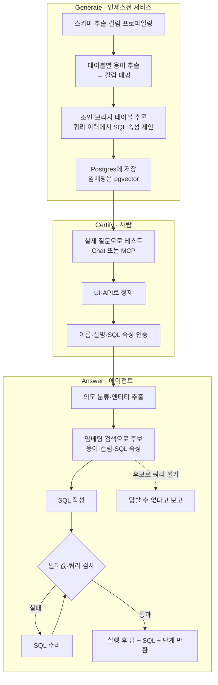

<figure class="post-figure post-figure--header">
<svg role="img" aria-label="아래의 소스 DB 세 개에서 테이블·컬럼 조각이 점선 화살표를 따라 위로 올라가 '의미 계층' 그래프(용어 노드와 관계 엣지)로 정리된다. 맨 위의 에이전트는 이 의미 계층으로만 내려오고, 의미 계층에서 소스 DB로 SQL이 내려간다." viewBox="0 0 380 390" width="440" xmlns="http://www.w3.org/2000/svg" shape-rendering="crispEdges">
  <title>에이전트와 데이터 사이의 의미 계층</title>
  <line x1="190" y1="14" x2="190" y2="6" stroke="currentColor" stroke-width="2"/>
  <rect x="186" y="2" width="8" height="6" fill="var(--accent-color)"/>
  <rect x="140" y="14" width="100" height="46" fill="var(--bg-light)" stroke="currentColor" stroke-width="2"/>
  <rect x="166" y="21" width="8" height="8" fill="var(--accent-color)"/>
  <rect x="206" y="21" width="8" height="8" fill="var(--accent-color)"/>
  <text x="190" y="52" font-size="16" font-weight="700" fill="currentColor" text-anchor="middle">에이전트</text>
  <line x1="190" y1="60" x2="190" y2="88" stroke="currentColor" stroke-width="2.5"/>
  <polygon points="183,86 197,86 190,95" fill="currentColor"/>
  <rect x="30" y="96" width="320" height="126" fill="var(--bg-light)" stroke="var(--accent-color)" stroke-width="3"/>
  <text x="44" y="120" font-size="16" font-weight="700" fill="var(--accent-color)">의미 계층</text>
  <text x="336" y="120" font-size="15" fill="var(--text-light)" text-anchor="end">용어 · 관계</text>
  <g stroke="currentColor" stroke-width="2">
    <line x1="80" y1="178" x2="150" y2="150"/>
    <line x1="150" y1="150" x2="220" y2="186"/>
    <line x1="150" y1="150" x2="290" y2="146"/>
    <line x1="220" y1="186" x2="290" y2="146"/>
    <line x1="220" y1="186" x2="300" y2="200"/>
  </g>
  <g fill="var(--bg-panel)" stroke="var(--secondary-color)" stroke-width="3">
    <circle cx="80" cy="178" r="11"/>
    <circle cx="150" cy="150" r="11"/>
    <circle cx="220" cy="186" r="11"/>
    <circle cx="290" cy="146" r="11"/>
    <circle cx="300" cy="200" r="11"/>
  </g>
  <line x1="190" y1="222" x2="190" y2="282" stroke="currentColor" stroke-width="2.5"/>
  <polygon points="183,280 197,280 190,289" fill="currentColor"/>
  <text x="200" y="262" font-size="15" font-weight="700" fill="currentColor">SQL</text>
  <g stroke="currentColor" stroke-width="2" stroke-dasharray="5 4">
    <line x1="80" y1="288" x2="80" y2="232"/>
    <line x1="300" y1="288" x2="300" y2="232"/>
  </g>
  <polygon points="73,233 87,233 80,224" fill="currentColor"/>
  <polygon points="293,233 307,233 300,224" fill="currentColor"/>
  <g fill="var(--bg-panel)" stroke="currentColor" stroke-width="1.5">
    <rect x="66" y="246" width="28" height="22"/>
    <line x1="66" y1="253" x2="94" y2="253"/>
    <line x1="80" y1="253" x2="80" y2="268"/>
    <rect x="286" y="246" width="28" height="22"/>
    <line x1="286" y1="253" x2="314" y2="253"/>
    <line x1="300" y1="253" x2="300" y2="268"/>
  </g>
  <g stroke="currentColor" stroke-width="2">
    <path d="M48,298 v46 a32,8 0 0 0 64,0 v-46" fill="var(--bg-sunken)"/>
    <path d="M48,320 a32,8 0 0 0 64,0" fill="none"/>
    <ellipse cx="80" cy="298" rx="32" ry="8" fill="var(--bg-light)"/>
    <path d="M158,298 v46 a32,8 0 0 0 64,0 v-46" fill="var(--bg-sunken)"/>
    <path d="M158,320 a32,8 0 0 0 64,0" fill="none"/>
    <ellipse cx="190" cy="298" rx="32" ry="8" fill="var(--bg-light)"/>
    <path d="M268,298 v46 a32,8 0 0 0 64,0 v-46" fill="var(--bg-sunken)"/>
    <path d="M268,320 a32,8 0 0 0 64,0" fill="none"/>
    <ellipse cx="300" cy="298" rx="32" ry="8" fill="var(--bg-light)"/>
  </g>
  <text x="190" y="378" font-size="15" fill="currentColor" text-anchor="middle">소스 DB</text>
</svg>
<figcaption>소스 DB의 테이블·컬럼 조각이 용어와 관계로 된 의미 계층으로 정리되고, 에이전트는 그 계층을 거쳐서만 데이터에 닿는다.</figcaption>
</figure>

## 원문 정보

> - **제목**: Auto Ontology (GitHub 저장소 `NVIDIA/auto-ontology`)
> - **출처**: NVIDIA (github.com/NVIDIA)
> - **형태**: 블로그 글이 아니라 **GitHub 저장소**. `README.md`와 `docs/` 문서, 에이전트용 문서를 직접 읽고 정리했다
> - **읽은 파일**: `README.md`, `docs/mcp.md`, `docs/connections.md`, `docs/conversation-api.md`, `docs/authentication.md`, `DEPLOYMENT.md`, `AGENTS.md`, `skills/nvidia-ontology-query/SKILL.md`와 `references/query-validation.md`, `skills/nvidia-ontology-management/SKILL.md`(일부), `.env.example`(모델 기본값), `pyproject.toml`(버전), `docs/assets/arch.png`
> - **기준 커밋**: `2a24f5d` (2026-11-04, "Install the Ossie converter from apache/ossie-converters (#413)")
> - **라이선스**: Apache License 2.0
> - **원문 링크**: <https://github.com/NVIDIA/auto-ontology>

위키의 온톨로지 시리즈가 다룬 '의미 계층'을, 에이전트 시대의 데이터 질의 도구로 실제 구현한 오픈소스다. 그래서 Articles에 담는다. 코드는 실행하지 않았고, 아래 내용은 문서에 적힌 범위만 다룬다.

## 한 줄 요약 (TL;DR)

Auto Ontology는 엔터프라이즈 DB의 메타데이터에서 **용어(Terms)·SQL 속성(SQL attributes)·관계(Relationships)** 로 된 온톨로지 초안을 LLM으로 생성한다. 사람이 이 초안을 검증하고 **인증(certify)** 하면, 에이전트는 자연어 질문을 그 정의에 맞춰 SQL로 바꾸고 SQL과 수행 단계를 함께 돌려준다. 외부 에이전트에는 **읽기 전용 MCP**·REST API로 노출된다.

## 왜 이 글을 골랐나

데이터 위에 의미 기반 그래프 계층을 올려 에이전트의 질의 생성과 컨텍스트 검색을 돕는 프레임워크이고, **지식 그래프·온톨로지와 에이전트가 맞닿는 지점**에 있다. 위키의 [Ontology Essential 커리큘럼](/2026/07/19/ontology-essential-curriculum.html)은 의미 계층을 사람이 손으로 짓는 FDE의 관점에서 다뤘다. 이 저장소는 같은 문제를 반대쪽에서 푼다. 초안은 LLM이 짓고 사람은 인증하며, 결과물을 가장 먼저 쓰는 쪽은 에이전트다. 에이전트가 쓴 SQL의 정답성을 어떻게 검증하는가라는 **LLM 평가**의 문제도 문서 곳곳에 드러나 있다.

전체 흐름을 한 장으로 보면 다음과 같다.

## 핵심 내용

### 문제 정의: 에이전트에게 필요한 건 '컨텍스트 계층'

README는 에이전트가 문서를 찾고 DB에 질의할 수는 있지만, 에이전트 기반 분석의 관문은 **신뢰성**이라고 말한다. 원문은 이렇게 쓴다.

> "a revenue metric answered faster is worth nothing if the number is wrong."

README가 말하는 에이전트의 필요는 데이터가 어디 있는지, 무엇을 뜻하는지, 써도 되는지, 어떻게 쓰는지, 어디서 왔는지, 무엇과 비슷한지를 알려 주는 **컨텍스트 계층**이다. Auto Ontology는 이 계층을 엔터프라이즈 메타데이터로부터 만들고, 시스템마다 다른 정의를 조정(reconcile)하며, MCP·CLI·API로 어떤 에이전트 하니스에든 노출하는 "open library"라고 소개된다. 기존 시맨틱 모델을 대체하지 않고 **보완한다(complements)** 는 점도 명시한다.

README가 내세우는 역량은 다섯 개의 동사다.

- **Discover**: 메타데이터에서 엔터프라이즈 온톨로지를 생성하고, 기존 온톨로지·시맨틱 모델을 연결하고, AI-ready 지식 그래프를 만든다.
- **Ground**: 메트릭·엔티티·관계에 신뢰할 수 있는 비즈니스 의미를 부여하고, 시스템 간 불일치하는 정의를 조정한다.
- **Validate**: 생성된 쿼리를 인증된 정의·계보(lineage)와 대조하고, 모든 답에 출처(provenance)를 붙인다.
- **Expose**: MCP·CLI·API로 어떤 에이전트 하니스에든 컨텍스트를 제공한다.
- **Learn**: 인증된 수정과 사용 기록을 온톨로지에 되먹여, 질문이 쌓일수록 공유 컨텍스트가 나아진다.

### 온톨로지의 세 가지 정의

"How it works"에서 온톨로지가 담는 것은 세 종류뿐이다.

| 정의 | 문서 설명 |
| --- | --- |
| **Terms** | *Customer*, *Invoice Line* 같은 비즈니스 개념. 설명·동의어를 갖고, 그 값을 담은 컬럼에 매핑된다 |
| **SQL attributes** | 마진이나 이동 합계처럼 용어 아래 두는 **검토된 SQL 표현식**. 에이전트가 이를 재사용하므로 같은 측정값은 늘 같은 방식으로 계산된다 |
| **Relationships** | 테이블이 어떻게 조인되는지(브리지 테이블 포함). 키와 데이터로부터 추론한다 |

<figure class="post-figure">
<svg role="img" aria-label="온톨로지 세 요소의 두 층 구조. 위의 의미 층에는 용어 Invoice Line과 Customer가 각각 설명·동의어를 갖고, 둘은 관계(조인 경로) 엣지로 이어진다. Invoice Line 아래에는 SQL 속성 카드(예: margin)가 매달려 있다. 점선 아래 물리 스키마 층에는 invoicelines, invoices, customers 테이블이 invoiceid, customerid 키로 조인되고, 두 용어는 각자의 테이블 컬럼으로 매핑된다." viewBox="0 0 380 364" width="440" xmlns="http://www.w3.org/2000/svg" shape-rendering="crispEdges">
  <title>용어 · SQL 속성 · 관계 — 의미 층과 물리 스키마 층</title>
  <text x="16" y="30" font-size="16" font-weight="700" fill="var(--accent-color)">의미 층 (온톨로지)</text>
  <rect x="16" y="48" width="150" height="56" fill="var(--bg-light)" stroke="var(--secondary-color)" stroke-width="3"/>
  <text x="91" y="72" font-size="16" font-weight="700" fill="currentColor" text-anchor="middle">Invoice Line</text>
  <text x="91" y="95" font-size="15" fill="var(--text-light)" text-anchor="middle">설명·동의어</text>
  <rect x="214" y="48" width="150" height="56" fill="var(--bg-light)" stroke="var(--secondary-color)" stroke-width="3"/>
  <text x="289" y="72" font-size="16" font-weight="700" fill="currentColor" text-anchor="middle">Customer</text>
  <text x="289" y="95" font-size="15" fill="var(--text-light)" text-anchor="middle">설명·동의어</text>
  <line x1="166" y1="76" x2="214" y2="76" stroke="currentColor" stroke-width="3"/>
  <text x="190" y="122" font-size="15" font-weight="700" fill="currentColor" text-anchor="middle">관계</text>
  <line x1="111" y1="104" x2="111" y2="128" stroke="currentColor" stroke-width="2"/>
  <rect x="56" y="128" width="110" height="56" fill="var(--bg-panel)" stroke="var(--secondary-color)" stroke-width="2" stroke-dasharray="5 3"/>
  <text x="111" y="151" font-size="15" font-weight="700" fill="currentColor" text-anchor="middle">SQL 속성</text>
  <text x="111" y="174" font-size="15" fill="currentColor" text-anchor="middle">예: margin</text>
  <text x="328" y="150" font-size="15" fill="currentColor" text-anchor="end">관계 = 조인 경로</text>
  <text x="328" y="172" font-size="15" fill="var(--text-light)" text-anchor="end">(키·데이터에서 추론)</text>
  <g stroke="currentColor" stroke-width="2" stroke-dasharray="3 3">
    <line x1="32" y1="104" x2="32" y2="256"/>
    <line x1="340" y1="104" x2="340" y2="256"/>
  </g>
  <polygon points="26,254 38,254 32,262" fill="currentColor"/>
  <polygon points="334,254 346,254 340,262" fill="currentColor"/>
  <text x="38" y="206" font-size="15" fill="var(--text-light)">매핑</text>
  <text x="334" y="206" font-size="15" fill="var(--text-light)" text-anchor="end">매핑</text>
  <line x1="8" y1="222" x2="372" y2="222" stroke="currentColor" stroke-width="1.5" stroke-dasharray="8 5"/>
  <text x="190" y="246" font-size="16" font-weight="700" fill="currentColor" text-anchor="middle">물리 스키마 층</text>
  <g fill="var(--bg-sunken)" stroke="currentColor" stroke-width="2">
    <rect x="16" y="262" width="116" height="54"/>
    <rect x="153" y="262" width="90" height="54"/>
    <rect x="268" y="262" width="96" height="54"/>
  </g>
  <g font-size="15" font-family="monospace" fill="currentColor" text-anchor="middle">
    <text x="74" y="283">invoicelines</text>
    <text x="198" y="283">invoices</text>
    <text x="316" y="283">customers</text>
  </g>
  <g fill="var(--bg-panel)" stroke="currentColor" stroke-width="1">
    <rect x="26" y="294" width="28" height="12"/><rect x="58" y="294" width="28" height="12"/><rect x="90" y="294" width="28" height="12"/>
    <rect x="163" y="294" width="22" height="12"/><rect x="187" y="294" width="22" height="12"/><rect x="211" y="294" width="22" height="12"/>
    <rect x="278" y="294" width="24" height="12"/><rect x="304" y="294" width="24" height="12"/><rect x="330" y="294" width="24" height="12"/>
  </g>
  <g stroke="currentColor" stroke-width="3">
    <line x1="132" y1="300" x2="153" y2="300"/>
    <line x1="243" y1="300" x2="268" y2="300"/>
  </g>
  <g stroke="currentColor" stroke-width="1.5">
    <line x1="142.5" y1="300" x2="142.5" y2="330"/>
    <line x1="255.5" y1="300" x2="255.5" y2="330"/>
  </g>
  <g font-size="15" font-family="monospace" fill="currentColor" text-anchor="middle">
    <text x="142" y="348">invoiceid</text>
    <text x="256" y="348">customerid</text>
  </g>
</svg>
<figcaption>용어는 물리 컬럼에 매핑되고, SQL 속성은 용어 아래 매달린 검토된 식이며, 관계는 테이블을 잇는 조인 경로다(용어 이름은 README 예시, 조인은 Quickstart SQL에서 가져옴). 용어→테이블 매핑과 margin 위치는 이름에 기댄 예시이며, 문서가 직접 명시하지 않는다.</figcaption>
</figure>

### Generate → Certify → Answer

전체 흐름은 세 단계다. 온톨로지를 생성하고, 사람이 인증하고, 에이전트가 그 위에서 답한다.

**Generate.** 인제스천 서비스가 소스 DB에서 첫 초안을 만든다.

1. 스키마를 추출하고 컬럼을 프로파일링하며 샘플 값을 카탈로그에 넣는다.
2. 테이블별로 용어를 추출해 컬럼에 매핑한다.
3. 테이블·브리지 테이블 간 조인을 추론하고, **쿼리 이력에서 SQL 속성을 제안**한다.
4. 용어·관계·SQL 속성을 Postgres에 저장하고, 검색용 임베딩은 pgvector에 둔다.

결과는 UI에서 탐색할 수 있는 시맨틱 그래프다. README의 예시에서는 Microsoft 샘플 DB인 Wide World Importers를 한 번 컴파일해 **31개의 용어**가 나왔다.

**Certify.** 사람이 초안을 믿을 만하게 만든다. Chat이나 MCP의 `check_answerable`·`ask_question`으로 실제 질문을 던져 보고, UI·API에서 용어·설명·SQL 속성을 다듬은 뒤, 맞다고 판단되면 이름·설명·SQL 속성을 인증한다.

**Answer.** 질문마다 에이전트는 다음을 수행한다.

1. 의도를 분류하고 질문에 나온 엔티티를 추출한다.
2. 후보 용어·컬럼·SQL 속성을 **임베딩 검색**으로 가져온다.
3. 그 후보로 SQL을 작성한다.
4. 필터 값과 쿼리를 DB에 대고 검사하고, 검사에 실패하면 SQL을 수리한다.
5. 쿼리를 실행해 답과 SQL, 수행 단계를 돌려준다.

후보로 쿼리를 구성할 수 없으면 **이 데이터로는 답할 수 없다고 보고**한다. 예측성 질문은 KumoRFM이 설정된 경우 그쪽으로 넘긴다.

### Quickstart 예시: 답과 함께 돌아오는 SQL과 단계

Quickstart의 질문은 "What was revenue for the USB food flash drive - sushi roll in Pennsylvania in June 2015?"이다. README에 따르면 에이전트는 *revenue*, *product*, *state*를 온톨로지 용어로 해석하고, 관계를 따라 필요한 조인을 찾아 쿼리를 실행한다. 예시 출력의 답은 "$588.80, from 3 invoice lines"이다. 생성된 SQL은 `invoicelines`에 `stockitems`를 붙이고 `invoices → customers → cities → stateprovinces`로 이어지는 6개 테이블 조인이고, Steps에는 해석된 용어, 조인 경로, 필터 값 검증 후 실행이 기록된다.

두 번째 예시는 답할 수 없는 질문이다. Wide World Importers에는 광고 데이터가 없다. 그래서 MCP로 연결된 에이전트가 "return on ad spend"를 물으면, 먼저 `check_answerable`이 "coverage 0.5; no term covers \"ad spend\""를 돌려준다. 에이전트는 매출은 구할 수 있지만 광고비 데이터가 없다고 설명하고, 6월 매출로 대신할지 다른 소스를 연결할지 되묻는다.

### 구성 요소와 모델 역할

README의 컴포넌트 표(How it works 섹션 기준)는 다음과 같다. 아키텍처 그림(`docs/assets/arch.png`)의 제목은 "NVIDIA AI-Q Agent Harness Architecture"로, Agent Harness → Frontend → Backend → PostgreSQL, Ingestion Service → PostgreSQL·Source databases, Backend가 Source databases에 Text-to-SQL 쿼리를 실행하는 경로, Backend와 Ingestion Service가 NVIDIA NIM(LLM + embeddings)을 호출하는 흐름을 보여 준다.

| 컴포넌트 | 기술 | 역할 | 포트 |
| --- | --- | --- | --- |
| Frontend | Next.js, Better Auth, Prisma | Web UI, 인증, 공개 API 게이트웨이 | 3000 |
| Backend | FastAPI (Python 3.12+), LangChain | Text-to-SQL 에이전트, 카탈로그·온톨로지 API | 3001 |
| Ingestion service | FastAPI (Python 3.12+) | 인제스천과 시맨틱 컴파일 | 3002 |
| MCP server | FastMCP | 공개 API 위의 읽기 전용 에이전트 도구 | 3003 |
| Postgres + pgvector | PostgreSQL 17 | 카탈로그·온톨로지·앱 데이터·벡터 저장소 | 5432 |
| HashiCorp Vault | 선택 | 접속 자격 증명 저장 | n/a |

모델은 네 가지 역할로 나뉘고 각각 `<ROLE>_ENDPOINT`/`_API_KEY`/`_MODEL` **트리플릿**으로 설정한다. 비어 있는 필드는 `DEFAULT_MODELS_*`로 폴백한다. 기본값은 build.nvidia.com의 NIM이며, OpenAI 호환 엔드포인트로 바꿀 수 있다. README는 **structured output을 지원하는 모델**을 쓰고, 인제스천과 질의에 **같은 임베딩 모델**을 쓰라고 요구한다.

- `REASONING`: 온톨로지 구축, 답의 SQL·설명 작성, 답변 가능성 채점
- `NON_REASONING`: 빠른 단계(의도 분류, 엔티티 추출, 후보 선택, SQL 검사·수리)
- `EMBED`: 테이블·컬럼·용어·SQL 속성을 pgvector에 색인하고 질문과 매칭
- `RERANK`: 컴파일 중 브리지 테이블 SQL 속성을 만들 때 후보 테이블 순위 매김

소스 엔진은 PostgreSQL, MySQL, Databricks, Snowflake, ClickHouse, Trino, Apache Kyuubi, HeavyDB, DuckDB, SQLite의 10종이다(DuckDB·SQLite는 connection string으로만 추가). 시맨틱 모델 교환 표준인 **Apache Ossie**와 호환되며, Ossie YAML로 모델 정의를 import/export할 수 있다.

### 읽기 전용 MCP: 일부러 '원시 테이블 브라우저'를 빼다

`docs/mcp.md`에서 가장 설계 의도가 뚜렷한 부분이다. MCP 서버는 공개 API의 HTTP 클라이언트일 뿐이다. DB 자격 증명이나 모델 설정은 물론 자체 자격 증명도 갖지 않는다. 인증·권한은 Next.js 계층에 있고 MCP 서버는 그것을 상속한다. 그래서 문서의 표현대로 "a session can do exactly what the person behind it can do"이다. 서버 자체에 토큰을 설정하는 방법도 의도적으로 두지 않았다. 그런 토큰이 있으면 모든 호출자가 그 소유자로 행동하게 되고, 프로토콜상으로는 그 사실이 드러나지 않기 때문이다.

<figure class="post-figure">
<svg role="img" aria-label="MCP 신뢰 경계를 위에서 아래로 쌓은 그림. 에이전트 하니스가 MCP로 auto-ontology-mcp(포트 3003, 읽기 전용 도구 9개, 자체 자격 증명 없음)에 연결되고, 이 서버는 HTTPS로 Next.js 공개 API(포트 3000, 인증·권한 검사)를 호출한다. Next.js가 x-auto-ontology-user-id 헤더를 붙여 FastAPI 백엔드(포트 3001)로 보내며, FastAPI는 이 헤더를 검증 없이 신뢰한다. FastAPI와 인제스천 서비스(포트 3002, 엔드포인트 자체 인증 없음)는 점선으로 표시한 사설 네트워크 안에 있고, 그 아래에 Postgres + pgvector(포트 5432)가 있다." viewBox="0 0 380 604" width="420" xmlns="http://www.w3.org/2000/svg" shape-rendering="crispEdges">
  <title>Auto Ontology MCP 신뢰 경계</title>
  <rect x="60" y="12" width="260" height="44" fill="var(--bg-light)" stroke="currentColor" stroke-width="2"/>
  <text x="190" y="40" font-size="16" font-weight="700" fill="currentColor" text-anchor="middle">에이전트 하니스</text>
  <line x1="190" y1="56" x2="190" y2="84" stroke="currentColor" stroke-width="2.5"/>
  <polygon points="183,83 197,83 190,92" fill="currentColor"/>
  <text x="202" y="79" font-size="15" font-weight="700" fill="currentColor">MCP</text>
  <rect x="40" y="92" width="300" height="84" fill="var(--bg-light)" stroke="currentColor" stroke-width="2"/>
  <text x="190" y="116" font-size="15" font-weight="700" font-family="monospace" fill="currentColor" text-anchor="middle">auto-ontology-mcp :3003</text>
  <text x="190" y="142" font-size="15" fill="var(--secondary-color)" font-weight="700" text-anchor="middle">읽기 전용 도구 9개</text>
  <text x="190" y="164" font-size="15" fill="var(--text-light)" text-anchor="middle">자체 자격 증명 없음</text>
  <line x1="190" y1="176" x2="190" y2="204" stroke="currentColor" stroke-width="2.5"/>
  <polygon points="183,203 197,203 190,212" fill="currentColor"/>
  <text x="202" y="199" font-size="15" font-weight="700" fill="currentColor">HTTPS</text>
  <rect x="40" y="212" width="300" height="64" fill="var(--bg-panel)" stroke="var(--accent-color)" stroke-width="3.5"/>
  <text x="190" y="238" font-size="16" font-weight="700" fill="currentColor" text-anchor="middle">Next.js 공개 API :3000</text>
  <text x="190" y="263" font-size="15" fill="var(--accent-color)" font-weight="700" text-anchor="middle">인증 · 권한 검사</text>
  <line x1="70" y1="276" x2="70" y2="364" stroke="currentColor" stroke-width="2.5"/>
  <polygon points="63,363 77,363 70,372" fill="currentColor"/>
  <text x="84" y="302" font-size="15" font-family="monospace" fill="currentColor">x-auto-ontology-user-id</text>
  <text x="84" y="324" font-size="15" fill="var(--text-light)">헤더를 붙여 전달</text>
  <rect x="16" y="342" width="348" height="174" fill="none" stroke="currentColor" stroke-width="2" stroke-dasharray="7 5"/>
  <text x="352" y="362" font-size="15" font-weight="700" fill="currentColor" text-anchor="end">사설 네트워크</text>
  <rect x="40" y="372" width="300" height="58" fill="var(--bg-sunken)" stroke="currentColor" stroke-width="2"/>
  <text x="190" y="396" font-size="15" font-weight="700" fill="currentColor" text-anchor="middle">FastAPI 백엔드 :3001</text>
  <text x="190" y="420" font-size="15" fill="currentColor" text-anchor="middle">헤더를 검증 없이 신뢰</text>
  <rect x="40" y="444" width="300" height="58" fill="var(--bg-sunken)" stroke="currentColor" stroke-width="2"/>
  <text x="190" y="468" font-size="15" font-weight="700" fill="currentColor" text-anchor="middle">인제스천 서비스 :3002</text>
  <text x="190" y="492" font-size="15" fill="currentColor" text-anchor="middle">엔드포인트 자체 인증 없음</text>
  <line x1="190" y1="516" x2="190" y2="540" stroke="currentColor" stroke-width="2.5"/>
  <polygon points="183,539 197,539 190,548" fill="currentColor"/>
  <rect x="40" y="548" width="300" height="44" fill="var(--bg-light)" stroke="currentColor" stroke-width="2"/>
  <text x="190" y="576" font-size="15" font-weight="700" fill="currentColor" text-anchor="middle">Postgres + pgvector :5432</text>
</svg>
<figcaption>MCP 서버는 공개 API의 HTTP 클라이언트일 뿐이고, 인증·권한은 Next.js 계층에 있다. 3001·3002 포트는 사설 네트워크에 둬야 한다.</figcaption>
</figure>

도구는 모두 **읽기 전용**이다.

| 용도 | 도구 |
| --- | --- |
| 준비 상태 | `check_readiness`: 이 배포가 무엇이든 답할 수 있는가 |
| 용어 | `search_terms`, `get_term`, `get_term_columns`, `get_term_sql_attributes`, `get_sql_attribute`, `describe_table` |
| 답변 가능성 | `check_answerable`: 온톨로지가 이 질문을 다루는가 |
| 질문 | `ask_question`: 답, SQL, 결과 행 |

문서가 밝힌 설계 판단 몇 가지는 다음과 같다.

- **DB·스키마·원시 컬럼을 탐색하는 도구는 일부러 없다.** 소비자는 시맨틱 계층을 거쳐 데이터에 닿아야 하고, 카탈로그 브라우저가 있으면 에이전트가 원시 테이블을 두고 추론하게 된다는 이유다. `describe_table`도 원시 스키마가 아니라 그 테이블이 참여하는 용어와 SQL 속성을 돌려준다.
- **도구는 명시적 허용 목록(allow-list)으로 관리한다.** OpenAPI 스펙의 87개 오퍼레이션을 다 노출하면 "would degrade tool selection badly"라는 이유다. 스펙에서 사라진 항목이 목록에 남아 있으면 시작 시점에 크게 실패한다.
- **핸드셰이크 때 도구 호출 순서를 instructions로 알린다.** 그냥 두면 모델이 곧장 `ask_question`부터 부르는 경향이 있어서다. 쿼리 스킬은 `check_readiness → search_terms → check_answerable → ask_question → 검증` 순서를 권한다.
- **`check_readiness`가 따로 있는 이유.** 답하려면 컴파일된 시맨틱 계층과 살아 있는 DB 연결이 둘 다 필요하다. 하나만 있으면 겉보기엔 정상인데 모든 질문이 몇 분간 모델을 호출한 끝에 모호하게 실패한다. 문서는 이것을 이 배포에서 가장 오해를 부르는 상태라고 부른다.
- `ask_question`은 웹 UI와 같은 `POST /api/chat/completions`를 호출한다. 여러 번의 순차 모델 호출로 보통 수십 초가 걸리며, 결과 행은 100개로 제한되고 `row_count`·`truncated`로 잘린 정도를 알려 준다.

쓰기 작업은 MCP가 아니라 Next.js의 `/api/...` 경로로만 하며, `nvidia-ontology-management` 스킬이 이 경로를 다룬다.

### 에이전트 스킬과 검증 체크리스트

저장소에는 코딩 에이전트용 스킬 세 개(`nvidia-ontology-setup`, `-management`, `-query`)가 있고, `AGENTS.md`가 진입점이다. 흥미로운 것은 쿼리 스킬의 `query-validation.md`다. 이 문서는 "successful execution alone does not prove that the intended question was answered"라는 전제에서 출발해 SQL, 결과 행, 답변 문장을 **각각 따로** 검증하라고 한다. 예를 들어 다음 항목을 본다.

- 조인이 승인된 키와 방향을 쓰는가
- 이미 run 단위인 메트릭이 1:N 조인 뒤에 다시 합산되지 않았는가(fan-out)
- 수량이 비율·평균으로 바뀌지 않았는가
- 비어 있거나 null인 값을 0으로 간주하지 않았는가
- 잘린(truncated) 결과로 전체 목록·순위·합계를 주장하지 않았는가

### 운영 시 문서가 명시한 경고

README와 docs가 스스로 밝힌 주의점이다.

- **포트 3001·3002는 사설 네트워크에 둘 것.** FastAPI는 프런트엔드가 넘기는 `x-auto-ontology-user-id` 헤더를 검증 없이 신뢰하고, 인제스천 서비스의 엔드포인트(ingest, delete, reset, compile)에는 자체 인증이 없다.
- **Vault 없이 UI로 추가한 접속 정보는 비밀번호까지 JSON으로 직렬화되어 Postgres에 암호화 없이 저장된다.** Vault는 기본적으로 꺼져 있고 환경 변수 4개가 모두 설정돼야 켜진다. 일부만 설정하면 경고와 함께 평문 저장으로 폴백한다.
- **KumoRFM 예측**을 켜면 에이전트가 연결된 테이블을 호스팅 서비스에 업로드한다. 기본 상한은 20개 테이블이고, 테이블당 행 수는 따로 설정하지 않으면 무제한이다. 문서는 켜기 전에 조직의 데이터 검토를 거치라고 한다.
- 자가 가입은 비활성화되어 있어 첫 계정은 부트스트랩 관리자다. API 토큰은 소유자 권한으로 동작하고 SHA-256 해시로만 저장되며, 토큰으로는 토큰을 관리할 수 없다.

### 라이선스와 성숙도

- **Apache License 2.0**. 서드파티 컴포넌트는 `THIRD_PARTY_NOTICES.md`에 정리되어 있다.
- **외부 기여는 받지 않는다**("This project is currently not accepting external contributions."). 통합 요청과 버그 리포트는 이슈로 받는다.
- 릴리스 이미지와 Helm 차트는 NGC Catalog(`nvcr.io/nvidia/auto-ontology` 등)에 게시된다. `pyproject.toml`의 버전은 `1.1.0`이다. 문서에 alpha/beta 같은 성숙도 표기는 따로 없다.
- management 스킬은 현재 모델 import·인증 API가 "do not prove atomic promotion"이라고 한계를 밝힌다.
- 텍스트-투-SQL 벤치마크(예: BIRD)는 별도 저장소 [NVIDIA/ontology-sql-eval](https://github.com/NVIDIA/ontology-sql-eval/)로 안내하며, README 본문에 벤치마크 수치는 없다.

## 분석과 인사이트

여기부터는 원문 요약이 아니라 내 해석이다.

**1. '온톨로지'의 범위를 일부러 좁게 잡았다.** [형식 기반 포스트](/2026/07/19/ontology-knowledge-graphs-rdf-owl-property-graphs.html)에서 다룬 RDF/OWL의 클래스 계층이나 기술논리 추론은 문서 어디에도 나오지 않는다. 여기서 온톨로지는 용어(컬럼 매핑), SQL 속성(재사용 가능한 측정식), 관계(조인 경로) 세 가지뿐이다. 성격으로 보면 학술적 온톨로지보다 **비즈니스 글로서리와 시맨틱 레이어**에 가깝다. 다만 목적이 SQL을 맞게 쓰는 것이라면, 이 셋으로 '무엇을(용어)·어떻게 계산하고(SQL 속성)·어떻게 잇는가(관계)'를 다 덮는다. 위키의 [데이터 모델 vs 의미 계층](/2026/07/19/ontology-semantic-layer-vs-data-model.html) 구분으로 보면, 그 의미 계층을 **SQL을 생성하는 데 필요한 만큼만** 구현한 셈이다. '그래프 기반 추론'이라는 기대와 달리, README의 기본 흐름에서는 관계 그래프를 따라 조인 경로를 정하는 수준이고 후보를 찾는 일은 **임베딩 검색**이 맡는다(Answer 2단계). 다만 `.env.example`에는 기본값이 꺼진 선택 기능으로 Neo4j FK 그래프를 이용한 실행 전 조인 경로 검사(`DB_PROBE_JOIN_PATH_CHECK`)와 후보 확장(`HUB_SIBLING_EXPANSION_ENABLED`)도 적혀 있다.

**2. 사람이 하는 '인증'이 신뢰의 근원이다.** 생성은 LLM이 하지만, README가 말하는 'trusted business meaning'은 사람이 certify한 정의에서 나온다. 이는 [Pinterest Metrics Board](/2026/10/27/pinterest-metrics-board-agent-ready-metrics-layer.html)가 에이전트용 메트릭 레이어에 거버넌스를 둔 것, [데이터 모델은 아직 필요한가](/2026/10/29/do-we-still-need-data-models.html)가 에이전트 시대에도 의미 정의가 검증의 기준이 된다고 본 것과 같은 결론이다. 에이전트가 빨라질수록 **사람이 승인한 의미**가 병목이자 자산이 된다. 한편 management 스킬이 인증 API에 원자적 승격 보장이 없다고 스스로 적은 점을 보면, 거버넌스 기능은 아직 다듬는 중으로 보인다(추정).

**3. MCP 설계에서 가장 배울 점은 '빼기'다.** 87개 오퍼레이션 중 9개만 노출하고, 원시 스키마 브라우저를 일부러 뺐다. 에이전트가 테이블을 직접 보고 추론하게 두면 시맨틱 계층을 우회하게 된다. 그래서 인터페이스 자체로 행동을 유도하는 것이다. [MCP와 CLI 인터페이스가 에이전트의 결정을 바꾼다는 논문](/2026/10/31/mcp-vs-cli-matched-interfaces-agent-behavior.html)의 문제의식, 곧 같은 능력이라도 인터페이스 모양이 에이전트의 행동을 바꾼다는 점을 제품 설계로 옮긴 사례로 읽힌다. `check_readiness`·`check_answerable`이라는 **값싼 사전 점검 도구**를 두고 handshake instructions로 호출 순서를 알리는 것도 같은 맥락이다.

**4. '답할 수 없음'을 1급 결과로 다룬다.** Quickstart의 두 번째 예시는 성공이 아니라 거절 사례다. 커버리지가 0.5라고 보고하고 대안을 되묻는다. 텍스트-투-SQL 데모는 보통 답이 나오는 경우만 보여 주는데, 이 저장소는 틀린 답보다 정직한 '모름'을 낫게 본다는 태도를 문서 구조로 드러낸다. LLM 평가의 관점에서는 `query-validation.md`가 실무 체크리스트로 쓸 만하다. fan-out 이중 합산, truncated 결과의 과잉 주장, null을 0으로 보는 실수는 에이전트가 아니라 사람 분석가도 자주 저지르는 오류다.

**5. 보안 경계에 관한 정직함과 그 대가.** 내부 헤더를 그대로 신뢰하고, 인제스천 엔드포인트에 인증이 없고, Vault 없이 쓰면 자격 증명이 평문으로 저장된다. 문서가 이를 숨기지 않고 적어 둔 것은 좋다. 하지만 '기본값 그대로 배포하면 위험하다'는 뜻이기도 하다. 도입을 검토한다면 네트워크 격리와 Vault 구성이 사실상 필수다.

**6. 작은 문서 불일치.** 같은 README 안에서도 "NVIDIA NIM" 섹션의 기본 임베딩·리랭크 모델(`nemotron-3-embed-1b`, `llama-nemotron-rerank-vl-1b-v2`)과 "Models" 표·`.env.example`의 값(`nemotron-3.5-embed-1b`, `nemotron-3.5-rerank-8b`)이 다르고, 컴포넌트 표도 두 번 나오면서 내용이 조금 다르다. 실제 설정은 `.env.example`을 기준으로 보는 편이 안전하다.

## 적용 포인트

- **에이전트용 데이터 계층을 설계한다면 세 가지 정의부터 정리한다.** 용어(무엇), 재사용 가능한 측정식(어떻게 계산), 조인 경로(어떻게 연결)다. 특히 측정식을 SQL 조각으로 고정해 두면 같은 메트릭이 매번 다르게 계산되는 문제를 줄일 수 있다.
- **MCP 서버를 만들 때 도구는 허용 목록으로 최소화한다.** 원시 데이터에 직접 닿는 도구가 정말 필요한지 따져 보고, 값싼 사전 점검 도구(readiness·answerability)와 호출 순서 안내를 함께 제공한다.
- **MCP 서버에 자체 토큰을 두지 않는 패턴을 참고한다.** 권한 검사는 기존 API 게이트웨이에 맡기고, 각 호출이 로그인한 사람의 권한으로 실행되게 한다.
- **텍스트-투-SQL 결과를 평가할 때는 SQL·행·문장을 따로 검증한다.** fan-out 이중 합산, 잘린 결과에 대한 과잉 주장, null을 0으로 처리하는 실수를 체크리스트로 만든다.
- **'답할 수 없음'을 정상 출력으로 설계한다.** 커버리지를 보고하고 대안을 제시하는 쪽이, 그럴듯한 오답보다 운영 비용이 낮다.
- **직접 띄워 본다면** 3001·3002 포트를 사설망에 두고, Vault 4개 변수를 모두 설정하고, KumoRFM은 데이터 검토 전까지 끈다. 모두 문서가 명시한 조건이다.

## 마무리

Auto Ontology는 '온톨로지'라는 큰 말을 **에이전트가 SQL을 틀리지 않게 하는 데 필요한 최소한의 의미 계층**으로 좁혀 구현한 저장소다. LLM이 초안을 만들고 사람이 인증하며, 에이전트는 시맨틱 계층을 거쳐서만 데이터에 닿는다. 그리고 답할 수 없을 때는 답할 수 없다고 말한다. 기능 목록보다 MCP 도구를 일부러 비운 이유, 준비 상태를 먼저 묻게 하는 이유, 검증 체크리스트처럼 **설계 판단을 문서로 남긴 방식**에서 더 많이 배울 수 있다. 위키의 온톨로지 시리즈를 읽었다면, 그 개념이 에이전트 인터페이스와 만났을 때 어떤 모양이 되는지 보여 주는 좋은 실물 사례다.

### 더 읽어보기

- [원문 — NVIDIA/auto-ontology (GitHub 저장소)](https://github.com/NVIDIA/auto-ontology) — README, `docs/`, 스킬 문서
- [NVIDIA/ontology-sql-eval (GitHub 저장소)](https://github.com/NVIDIA/ontology-sql-eval/) — README가 BIRD 등 text-to-SQL 벤치마크 실행용으로 안내하는 별도 저장소(이 포스트에서는 읽지 않음)
- [Ontology Essential Curriculum](/2026/07/19/ontology-essential-curriculum.html) — 의미 계층을 손으로 짓는 FDE 관점의 전체 로드맵
- [온톨로지란 무엇인가: 데이터 모델·스키마와 의미 계층의 차이](/2026/07/19/ontology-semantic-layer-vs-data-model.html) — Auto Ontology가 구현하는 '의미 계층'의 개념적 출발점
- [형식 기반과 그래프: 지식 그래프 · RDF/OWL · 속성 그래프](/2026/07/19/ontology-knowledge-graphs-rdf-owl-property-graphs.html) — Auto Ontology가 채택하지 않은 형식 온톨로지 쪽과 비교해 볼 거리
- [링크 타입과 관계](/2026/07/19/ontology-link-types-relationships.html) — 외래키를 관계로 끌어올리는 사고, Relationships 정의와 대응
- [소스 데이터를 온톨로지로: 백킹 데이터셋과 엔티티 해소](/2026/07/19/ontology-data-mapping-entity-resolution.html) — 용어를 물리 컬럼에 매핑하는 문제의 수작업 버전
- [거버넌스·진화와 FDE 워크플로](/2026/07/19/ontology-governance-evolution-fde-workflow.html) — Certify 단계와 이어지는 권한·계보·버전 관리
- [Pinterest Metrics Board: 에이전트가 믿고 쓸 수 있는 메트릭 레이어](/2026/10/27/pinterest-metrics-board-agent-ready-metrics-layer.html) — 같은 문제를 메트릭 레이어 쪽에서 푼 사례
- [에이전트가 파이프라인을 짜는 시대, 데이터 모델은 아직 필요한가](/2026/10/29/do-we-still-need-data-models.html) — 의미 정의가 에이전트 검증의 기준이라는 관점
- [같은 능력, 다른 행동: MCP와 CLI 인터페이스는 에이전트의 결정을 바꾼다](/2026/10/31/mcp-vs-cli-matched-interfaces-agent-behavior.html) — 도구 인터페이스의 모양이 에이전트 행동을 바꾼다는 연구
