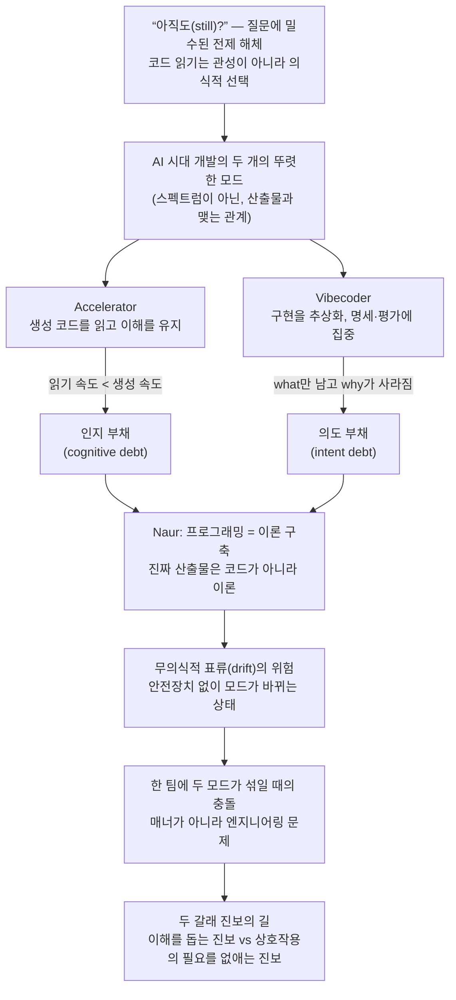

<figure class="post-figure post-figure--header">
<svg role="img" aria-label="갈림길에 선 개발자. 위에는 '아직도 코드를 읽으세요?'라는 질문이 쓰여 있고, 왼쪽 길 끝에는 돋보기로 코드를 읽는 Accelerator의 장면, 오른쪽 길 끝에는 흐려진 코드를 등진 채 체크리스트 명세서를 든 Vibecoder의 장면이 있다. 개발자는 두 길이 갈라지는 지점에 서 있다." viewBox="0 0 680 340" xmlns="http://www.w3.org/2000/svg">
  <title>갈림길에 선 개발자 — 코드를 읽는 Accelerator의 길과 명세에 집중하는 Vibecoder의 길</title>

  <!-- 질문 -->
  <text x="340" y="32" text-anchor="middle" font-size="15" font-weight="700" fill="currentColor">“아직도 코드를 읽으세요?”</text>
  <text x="340" y="50" text-anchor="middle" font-size="9.5" fill="currentColor" opacity="0.6">중요한 것은 어느 길이냐가 아니라, 표류가 아닌 의식적 선택이냐다</text>

  <!-- 두 갈래 길 -->
  <polygon points="306,310 342,310 186,180 158,180" fill="var(--bg-light)" stroke="currentColor" stroke-width="1.5"/>
  <polygon points="338,310 374,310 522,180 494,180" fill="var(--bg-light)" stroke="currentColor" stroke-width="1.5"/>
  <line x1="328" y1="302" x2="178" y2="186" stroke="currentColor" stroke-width="1.2" stroke-dasharray="4 5" opacity="0.4"/>
  <line x1="352" y1="302" x2="502" y2="186" stroke="currentColor" stroke-width="1.2" stroke-dasharray="4 5" opacity="0.4"/>

  <!-- 갈림길의 개발자 -->
  <circle cx="340" cy="236" r="11" fill="var(--bg-panel)" stroke="currentColor" stroke-width="2.2"/>
  <line x1="340" y1="247" x2="340" y2="276" stroke="currentColor" stroke-width="2.2"/>
  <line x1="340" y1="255" x2="322" y2="266" stroke="currentColor" stroke-width="2.2"/>
  <line x1="340" y1="255" x2="358" y2="266" stroke="currentColor" stroke-width="2.2"/>
  <line x1="340" y1="276" x2="328" y2="296" stroke="currentColor" stroke-width="2.2"/>
  <line x1="340" y1="276" x2="352" y2="296" stroke="currentColor" stroke-width="2.2"/>
  <text x="340" y="328" text-anchor="middle" font-size="10" fill="currentColor" opacity="0.65">모듈마다 어느 한쪽 — “halfway in either”는 없다</text>

  <!-- 왼쪽: Accelerator — 돋보기로 코드를 읽는 길 -->
  <text x="139" y="68" text-anchor="middle" font-size="12" font-weight="700" fill="var(--secondary-color)">Accelerator</text>
  <rect x="64" y="76" width="150" height="88" rx="4" fill="var(--bg-panel)" stroke="currentColor" stroke-width="2"/>
  <line x1="76" y1="94" x2="168" y2="94" stroke="currentColor" stroke-width="2.4" opacity="0.55"/>
  <line x1="76" y1="108" x2="196" y2="108" stroke="currentColor" stroke-width="2.4" opacity="0.55"/>
  <line x1="76" y1="122" x2="150" y2="122" stroke="currentColor" stroke-width="2.4" opacity="0.55"/>
  <line x1="76" y1="136" x2="184" y2="136" stroke="currentColor" stroke-width="2.4" opacity="0.55"/>
  <line x1="76" y1="150" x2="132" y2="150" stroke="currentColor" stroke-width="2.4" opacity="0.55"/>
  <circle cx="176" cy="122" r="23" fill="none" stroke="var(--secondary-color)" stroke-width="2.6"/>
  <line x1="193" y1="139" x2="212" y2="158" stroke="var(--secondary-color)" stroke-width="3.2"/>
  <text x="139" y="180" text-anchor="middle" font-size="9.5" fill="currentColor" opacity="0.7">생성된 코드를 읽으며 걷는 길</text>

  <!-- 오른쪽: Vibecoder — 코드를 등지고 명세를 드는 길 -->
  <text x="541" y="68" text-anchor="middle" font-size="12" font-weight="700" fill="var(--accent-color)">Vibecoder</text>
  <!-- 등진 코드 (흐릿하게) -->
  <g opacity="0.35">
    <rect x="580" y="88" width="76" height="60" rx="4" fill="var(--bg-panel)" stroke="currentColor" stroke-width="1.6"/>
    <line x1="588" y1="102" x2="640" y2="102" stroke="currentColor" stroke-width="2"/>
    <line x1="588" y1="114" x2="648" y2="114" stroke="currentColor" stroke-width="2"/>
    <line x1="588" y1="126" x2="626" y2="126" stroke="currentColor" stroke-width="2"/>
    <line x1="588" y1="138" x2="642" y2="138" stroke="currentColor" stroke-width="2"/>
  </g>
  <!-- 명세서 -->
  <path d="M 486 76 L 578 76 L 578 164 L 486 164 Z" fill="var(--bg-panel)" stroke="currentColor" stroke-width="2"/>
  <text x="532" y="92" text-anchor="middle" font-size="9" font-weight="700" fill="currentColor" opacity="0.75">SPEC · EVAL</text>
  <rect x="496" y="102" width="9" height="9" fill="none" stroke="currentColor" stroke-width="1.4"/>
  <path d="M 497 106 L 500 109 L 505 101" fill="none" stroke="var(--secondary-color)" stroke-width="1.8"/>
  <line x1="512" y1="107" x2="566" y2="107" stroke="currentColor" stroke-width="2" opacity="0.55"/>
  <rect x="496" y="120" width="9" height="9" fill="none" stroke="currentColor" stroke-width="1.4"/>
  <path d="M 497 124 L 500 127 L 505 119" fill="none" stroke="var(--secondary-color)" stroke-width="1.8"/>
  <line x1="512" y1="125" x2="556" y2="125" stroke="currentColor" stroke-width="2" opacity="0.55"/>
  <rect x="496" y="138" width="9" height="9" fill="none" stroke="currentColor" stroke-width="1.4"/>
  <line x1="512" y1="143" x2="562" y2="143" stroke="currentColor" stroke-width="2" opacity="0.55"/>
  <text x="541" y="180" text-anchor="middle" font-size="9.5" fill="currentColor" opacity="0.7">코드를 등지고 명세·평가를 드는 길</text>
</svg>
<figcaption>갈림길에 선 개발자 — 왼쪽은 돋보기로 생성된 코드를 읽으며 이해를 유지하는 Accelerator의 길, 오른쪽은 구현을 등지고 명세·평가에 집중하는 Vibecoder의 길. 정당하지 않은 것은 어느 쪽도 아닌 채 표류하는 것뿐이다.</figcaption>
</figure>

## 원문 정보

> - **제목**: Do You Still Read the Code?
> - **출처**: Marek Chotoborski ([zanlib.dev](https://zanlib.dev))
> - **발행**: 2026-09-14 · 약 10분 분량
> - **원문 링크**: <https://zanlib.dev/blog/do-you-still-read-the-code/>

AI가 코드를 쓰는 시대에 "코드를 읽는다"는 행위가 무엇을 의미하는지를 정면으로 다루는 에세이라, AI 시대의 관점·담론을 모으는 `Articles/AI-Essays`에 담는다.

## 한 줄 요약 (TL;DR)

"아직도 코드를 읽으세요?"라는 질문은 코드 읽기가 낡은 습관이라는 이론을 몰래 밀수하고 있다. 저자는 이를 거부하고, AI 시대의 개발을 **Accelerator**(AI로 가속하되 구현에 대한 이해를 유지하는 쪽)와 **Vibecoder**(구현을 추상화하고 명세·평가에 집중하는 쪽)라는 **두 개의 뚜렷한 모드**로 구분한다 — 중요한 것은 어느 쪽이 옳으냐가 아니라, 팀이 어느 모드로 일하는지 **의식적으로 선택하고 서로에게 알리는 것**이다.

글의 흐름을 한 장으로 정리하면 다음과 같다.

## 왜 이 글을 골랐나

이 위키에는 이미 같은 긴장을 다룬 글이 여럿 있다. Simon Willison은 [바이브 코딩과 에이전틱 엔지니어링의 경계가 무너지는 불편함](/2026/06/25/vibe-coding-and-agentic-engineering.html)을 고백했고, antirez는 [코드가 아니라 아이디어를 통제하라](/2026/08/12/control-the-ideas-not-the-code.html)며 리뷰의 단위를 바꾸자고 했으며, Greg Slepak은 반대로 [짧은 목줄](/2026/07/06/short-leash-ai-coding.html)로 모든 diff를 직접 검토하자고 했다.

이 글의 기여는 그 논쟁에 **어휘를 제공한다**는 점이다. "코드를 읽어야 하나 말아야 하나"라는 이분법적 논쟁을, "당신은 어떤 모드로 일하고 있으며, 그 모드가 요구하는 안전장치를 갖추고 있는가"라는 훨씬 생산적인 질문으로 바꾼다. 특히 두 모드가 스펙트럼이 아니라 **뚜렷이 다른 계약(commitment)**이라는 관찰, 그리고 두 모드가 한 팀에 무자각적으로 섞일 때 생기는 충돌을 "예의 문제가 아니라 엔지니어링 문제"로 규정한 대목이 읽을 가치를 만든다.

## 핵심 내용

### "아직도(still)"에 밀수된 이론

"아직도 코드를 읽으세요?"라는 질문의 "아직도"는 코드 읽기가 이미 한물간 습관이라는 전제를 몰래 깔고 들어온다. 저자는 이 전제를 거부한다. 자신이 AI가 생성한 코드를 읽는 것은 관성이 아니라, **배포되는 코드에 대한 직업적 책임에 관한 의식적 선택**이라는 것이다. 다른 선택을 하는 사람들이 있다는 것도 인정하지만, 핵심은 팀이 그 선택에 대해 서로 정렬되어 있어야 한다는 점이다.

### Accelerator와 Vibecoder

<figure class="post-figure">
<svg role="img" aria-label="Accelerator와 Vibecoder 두 모드의 좌우 대비 도해. 왼쪽 Accelerator 패널: AI는 이해를 코드로 번역하는 도구, 생성된 코드를 읽는 것이 계약의 일부, 구현 지식을 유지하며, 위험은 인지 부채. 오른쪽 Vibecoder 패널: 구현을 컴파일러의 기계어처럼 추상화, 명세와 평가에 집중, 구현은 AI에 위임하며, 쌓이는 것은 의도 부채. 가운데에는 '중간은 없다', 아래에는 구분 기준이 코드를 얼마나 쓰느냐가 아니라 산출물과 어떤 관계를 맺느냐라고 쓰여 있다." viewBox="0 0 680 320" xmlns="http://www.w3.org/2000/svg">
  <title>Accelerator vs Vibecoder — 두 개의 뚜렷한 모드</title>

  <text x="340" y="28" text-anchor="middle" font-size="12.5" font-weight="700" fill="currentColor">두 개의 뚜렷한 모드 — 스펙트럼이 아니라 서로 다른 계약</text>

  <!-- 왼쪽: Accelerator -->
  <rect x="30" y="48" width="290" height="200" rx="6" fill="var(--bg-light)" stroke="var(--secondary-color)" stroke-width="2.4"/>
  <text x="175" y="74" text-anchor="middle" font-size="14" font-weight="700" fill="var(--secondary-color)">Accelerator</text>
  <line x1="52" y1="86" x2="298" y2="86" stroke="var(--secondary-color)" stroke-width="1.2" opacity="0.5"/>
  <rect x="50" y="100" width="7" height="7" fill="var(--secondary-color)"/>
  <text x="66" y="108" font-size="10.5" fill="currentColor">AI = 이해를 코드로 번역하는 도구</text>
  <rect x="50" y="124" width="7" height="7" fill="var(--secondary-color)"/>
  <text x="66" y="132" font-size="10.5" fill="currentColor">생성된 코드를 읽는 것 = 계약의 일부</text>
  <rect x="50" y="148" width="7" height="7" fill="var(--secondary-color)"/>
  <text x="66" y="156" font-size="10.5" fill="currentColor">구현 지식을 유지한다</text>
  <rect x="46" y="178" width="258" height="52" rx="4" fill="var(--bg-panel)" stroke="currentColor" stroke-width="1.4"/>
  <text x="175" y="199" text-anchor="middle" font-size="11" font-weight="700" fill="var(--accent-color)">위험: 인지 부채 (cognitive debt)</text>
  <text x="175" y="217" text-anchor="middle" font-size="9.5" fill="currentColor" opacity="0.7">읽는 속도가 생성 속도를 못 따라갈 때의 이해 공백</text>

  <!-- 가운데: 중간은 없다 -->
  <line x1="340" y1="56" x2="340" y2="240" stroke="currentColor" stroke-width="1.4" stroke-dasharray="3 6" opacity="0.4"/>
  <text x="340" y="266" text-anchor="middle" font-size="10" fill="currentColor" opacity="0.7">모듈 단위로 어느 한쪽 — “not halfway in either”</text>

  <!-- 오른쪽: Vibecoder -->
  <rect x="360" y="48" width="290" height="200" rx="6" fill="var(--bg-light)" stroke="var(--accent-color)" stroke-width="2.4"/>
  <text x="505" y="74" text-anchor="middle" font-size="14" font-weight="700" fill="var(--accent-color)">Vibecoder</text>
  <line x1="382" y1="86" x2="628" y2="86" stroke="var(--accent-color)" stroke-width="1.2" opacity="0.5"/>
  <rect x="380" y="100" width="7" height="7" fill="var(--accent-color)"/>
  <text x="396" y="108" font-size="10.5" fill="currentColor">구현 = 컴파일러의 기계어처럼 추상화</text>
  <rect x="380" y="124" width="7" height="7" fill="var(--accent-color)"/>
  <text x="396" y="132" font-size="10.5" fill="currentColor">명세(spec)·평가(eval)에 집중</text>
  <rect x="380" y="148" width="7" height="7" fill="var(--accent-color)"/>
  <text x="396" y="156" font-size="10.5" fill="currentColor">구현은 AI에 위임한다</text>
  <rect x="376" y="178" width="258" height="52" rx="4" fill="var(--bg-panel)" stroke="currentColor" stroke-width="1.4"/>
  <text x="505" y="199" text-anchor="middle" font-size="11" font-weight="700" fill="var(--accent-color)">쌓이는 것: 의도 부채 (intent debt)</text>
  <text x="505" y="217" text-anchor="middle" font-size="9.5" fill="currentColor" opacity="0.7">코드에 what만 남고 why가 기록되지 않는 부채</text>

  <!-- 하단: 구분 기준 -->
  <text x="340" y="296" text-anchor="middle" font-size="11" font-weight="700" fill="currentColor">구분 기준: “AI가 코드를 얼마나 쓰느냐”가 아니라 “개발자가 산출물과 어떤 관계를 맺느냐”</text>
</svg>
<figcaption>Accelerator와 Vibecoder의 대비 — 각 모드는 자기 부채(인지 부채 / 의도 부채)를 가지며, 구분 기준은 AI의 코드 비중이 아니라 개발자와 산출물의 관계다.</figcaption>
</figure>

저자는 AI 시대의 개발자를 두 부류로 나눈다.

- **Accelerator**: AI를 "이해를 코드로 번역하는 도구"로 쓴다. 구현 지식을 유지하고, 생성된 코드를 읽는 것을 자기 계약의 일부로 삼는다. 위험은 **인지 부채(cognitive debt)** — 읽는 속도가 생성 속도를 따라가지 못할 때 쌓이는 이해의 공백이다.
- **Vibecoder**: 구현을 AI에 위임하고 명세(specification)와 평가(evaluation)에 집중한다. 구현은 컴파일러의 기계어처럼 추상화된 것으로 취급한다. 이쪽이 쌓는 것은 인지 부채가 아니라 **의도 부채(intent debt)**다.

중요한 것은 이 구분이 "모델이 코드를 얼마나 많이 쓰느냐"가 아니라 **"개발자가 산출물과 어떤 관계를 맺느냐"**에 관한 것이라는 점이다.

### Naur는 여전히 무패다

저자는 Peter Naur의 1985년 에세이 "Programming as Theory Building"을 소환한다. 프로그래밍의 진짜 산출물은 코드가 아니라 그 밑에 깔린 **이론(theory)**이다. 프로그램의 이론을 가진 프로그래머는 (1) 해법이 현실 세계의 문제와 어떻게 연결되는지 설명할 수 있고, (2) 각 부분이 왜 존재하는지 설명할 수 있으며, (3) 수정 요구에 건설적으로 대응할 수 있다.

저자는 여기에 자기 관찰을 얹는다. 비즈니스 개념에 이름을 붙이고 코드로 구조화하는 행위 자체가 소프트웨어 너머의 가치를 가진다는 것 — 구현은 요구사항을 다시 개념화하도록 강제하는데, Vibecoder는 이 학습을 놓칠 수 있다.

> "Programming is one way to sort the grains of sand of reality."

### 선택과 표류(Choice and Drift)

두 모드는 스펙트럼 위의 점이 아니라 **뚜렷이 구별되는 모드**다.

> "You can be an accelerator in one module and a vibecoder in another, but not halfway in either."

위험한 것은 의도 없는 표류다. 의식하지 못한 채 조금씩 코드를 덜 읽게 된 Accelerator는, Vibecoder가 갖춰야 할 안전장치(명세·평가 체계) 없이 Vibecoder가 되어 버린다. 저자는 상업 프로젝트에서는 생성된 코드를 전부 읽는다고 밝힌다 — 에이전트는 여전히 "멍청한 선택"(시간 비용 무시, React 규칙 위반, 컨텍스트 윈도 오염)을 하기 때문이다.

### 불편한 결혼: 한 팀에 두 모드가 섞일 때

이 글에서 가장 실무적인 대목이다. Accelerator와 Vibecoder가 **기대치 조율 없이** 한 팀에 섞이면 충돌이 생긴다. Accelerator는 저자가 애초에 이해할 생각이 없었던 코드에 대해 "이해를 재구성하는 작업"을 상속받고, Vibecoder는 자신이 일회용으로 취급한 선택들을 설명하라는 요구를 받는다. 저자는 이것이 매너의 문제가 아니라 **엔지니어링 문제**라고 못 박는다. 머지 전에 동료들은 이 코드의 유지보수가 개발자의 이해에 기대는지, 명세·테스트 프로세스에 기대는지, 아니면 그 조합인지 알아야 한다.

> "Before asking whether your colleague still reads code, perhaps consider whether you're still expecting him to maintain yours."

### 읽는 것으로 충분한가

저자는 자신이 속한 Accelerator 진영의 위험도 정직하게 인정한다. 기술은 쓰지 않으면 녹슨다. 직접 타이핑하는 대신 리뷰만 하는 것이 수동 코딩으로 전환할 능력을 보존해 주는지는 불확실하고, 이는 번아웃으로 가는 지름길이 될 수도 있다. 여기서 Bainbridge의 1983년 "자동화의 아이러니" 논문이 인용된다 — 자동화된 시스템에서 인간의 일은 "매우 지루하지만 매우 책임이 무거운" 것이 되는데, 정작 그 책임을 감당할 자질을 획득하거나 유지할 기회는 사라진다는 것이다. 책임을 유지하려면 좋은 의도만으로는 안 되고 **시스템**이 필요하다.

### 의도 부채와 코드 리뷰의 본질

<figure class="post-figure">
<svg role="img" aria-label="의도 부채 도해. 위에는 비밀번호 재설정 링크 만료를 6시간으로 정한 코드 한 줄이 있고, 그 아래로 네 개의 물음표 갈래가 갈라진다: 비즈니스 요구, 관례, 트레이드오프, 그냥 추측. 맨 아래에는 '코드는 what을 보여 주지만 why는 보여 주지 않는다, 이 공백이 의도 부채'라고 쓰여 있다." viewBox="0 0 680 300" xmlns="http://www.w3.org/2000/svg">
  <title>“만료 6시간”의 네 가지 가능한 기원 — 의도 부채</title>

  <!-- 코드 한 줄 (what) -->
  <text x="340" y="26" text-anchor="middle" font-size="10" fill="currentColor" opacity="0.65">코드가 보여 주는 것 — what</text>
  <rect x="170" y="36" width="340" height="42" rx="4" fill="var(--bg-light)" stroke="currentColor" stroke-width="2"/>
  <text x="340" y="62" text-anchor="middle" font-size="13" font-family="monospace" fill="currentColor">reset_link.expires_in = 6.hours</text>

  <!-- 갈라지는 물음표 갈래 -->
  <text x="340" y="112" text-anchor="middle" font-size="12" font-weight="700" fill="var(--accent-color)">이 6시간의 why는?</text>
  <line x1="340" y1="78" x2="95" y2="160" stroke="currentColor" stroke-width="1.4" stroke-dasharray="4 5" opacity="0.5"/>
  <line x1="340" y1="78" x2="258" y2="160" stroke="currentColor" stroke-width="1.4" stroke-dasharray="4 5" opacity="0.5"/>
  <line x1="340" y1="78" x2="422" y2="160" stroke="currentColor" stroke-width="1.4" stroke-dasharray="4 5" opacity="0.5"/>
  <line x1="340" y1="78" x2="585" y2="160" stroke="currentColor" stroke-width="1.4" stroke-dasharray="4 5" opacity="0.5"/>

  <!-- 네 가지 기원 후보 -->
  <rect x="30" y="160" width="130" height="56" rx="5" fill="var(--bg-panel)" stroke="currentColor" stroke-width="1.6"/>
  <text x="95" y="184" text-anchor="middle" font-size="11" font-weight="700" fill="currentColor">비즈니스 요구</text>
  <text x="95" y="205" text-anchor="middle" font-size="14" font-weight="700" fill="var(--accent-color)">?</text>
  <rect x="193" y="160" width="130" height="56" rx="5" fill="var(--bg-panel)" stroke="currentColor" stroke-width="1.6"/>
  <text x="258" y="184" text-anchor="middle" font-size="11" font-weight="700" fill="currentColor">관례</text>
  <text x="258" y="205" text-anchor="middle" font-size="14" font-weight="700" fill="var(--accent-color)">?</text>
  <rect x="357" y="160" width="130" height="56" rx="5" fill="var(--bg-panel)" stroke="currentColor" stroke-width="1.6"/>
  <text x="422" y="184" text-anchor="middle" font-size="11" font-weight="700" fill="currentColor">트레이드오프</text>
  <text x="422" y="205" text-anchor="middle" font-size="14" font-weight="700" fill="var(--accent-color)">?</text>
  <rect x="520" y="160" width="130" height="56" rx="5" fill="var(--bg-panel)" stroke="currentColor" stroke-width="1.6"/>
  <text x="585" y="184" text-anchor="middle" font-size="11" font-weight="700" fill="currentColor">그냥 추측</text>
  <text x="585" y="205" text-anchor="middle" font-size="14" font-weight="700" fill="var(--accent-color)">?</text>

  <!-- 결론 -->
  <text x="340" y="256" text-anchor="middle" font-size="11.5" font-weight="700" fill="currentColor">코드는 what을 보여 주지만 why는 보여 주지 않는다</text>
  <text x="340" y="278" text-anchor="middle" font-size="10.5" fill="var(--accent-color)" font-weight="700">이 공백 = 의도 부채 (intent debt)</text>
</svg>
<figcaption>“만료 6시간” 한 줄 아래에 숨은 네 가지 가능한 기원 — 코드는 무엇(what)을 하는지 보여 주지만 왜(why)인지는 보여 주지 않는다. 이 공백이 의도 부채다.</figcaption>
</figure>

코드 리뷰의 본질은 코드 품질 자체가 아니라 **"구현의 품질로 표현된, 제품에 대한 이해"**를 확인하는 일이다. 문제는 언어 모델이 이제 그 이해를 **흉내 낼 수 있다**는 것 — 그래서 요구사항과 구현을 분리해 검토하는 일이 중요해진다.

저자의 예시: 비밀번호 재설정 링크의 만료 시간이 6시간이라는 코드가 있다. 이 6시간은 비즈니스 요구일 수도, 관례일 수도, 트레이드오프일 수도, 그냥 추측일 수도 있다. 코드는 *무엇을* 하는지 보여 주지만 *왜*는 보여 주지 않는다 — 이것이 의도 부채다. 저자는 이를 다루는 시도들로 Crit(구현이 의도와 일치하는지 확인하는 도구), CodeRabbit의 Change Stack, 커스텀 intent-stack 스킬, 그리고 StrongDM의 "software factory"(사람이 코드를 쓰지도 리뷰하지도 않고, 코드베이스 밖의 시나리오로 에이전트를 검증) 같은 접근을 소개한다.

### 두 갈래 길

결론적으로 진보에는 두 종류가 있다. 하나는 개발자가 구현을 **이해하고 상호작용하도록 돕는** 진보, 다른 하나는 그 상호작용의 **필요 자체를 제거하는** 진보. 둘은 다른 길이고 다른 도구를 요구한다. 그리고 저자의 마지막 일격 — **"코드 읽기를 그만두는 것 자체는 진보가 아니다."**

## 분석과 인사이트

### "얼마나 쓰느냐"가 아니라 "어떤 관계를 맺느냐"

이 글의 가장 날카로운 프레이밍은 Accelerator/Vibecoder 구분의 기준이다. AI 활용 논쟁은 흔히 "코드의 몇 %를 AI가 썼는가"로 흐르는데, 저자는 그 축을 버리고 **개발자와 산출물의 관계**로 축을 옮긴다. 100% AI가 쓴 코드라도 내가 전부 읽고 이해를 유지하면 나는 Accelerator이고, 30%만 AI가 썼어도 그 30%를 블랙박스로 두면 그 모듈에서 나는 Vibecoder다. 이 기준은 Willison이 [경계가 무너진다고 느꼈던 지점](/2026/06/25/vibe-coding-and-agentic-engineering.html)을 정확히 설명해 준다 — 무너진 것은 도구의 경계가 아니라 관계의 경계였다.

### antirez와의 긴장, 그리고 합류점

이 글을 [antirez의 "코드가 아니라 아이디어를 통제하라"](/2026/08/12/control-the-ideas-not-the-code.html)와 나란히 놓으면 흥미롭다. antirez는 함수 단위 리뷰의 무의미함을 말하고, Chotoborski는 상업 코드는 전부 읽는다고 말한다 — 표면적으로는 반대다. 하지만 둘 다 같은 곳을 가리킨다. antirez의 "아이디어 통제"는 이 글의 어휘로 번역하면 **의도 부채를 안 쌓는 Vibecoder의 안전장치**이고, Chotoborski의 "전부 읽기"는 **인지 부채를 안 쌓는 Accelerator의 안전장치**다. 어느 쪽이든 안전장치 없는 중간 지대 — 읽지도 않고 의도도 기록하지 않는 상태 — 가 최악이라는 데에는 두 사람이 일치한다. "halfway in either"는 불가능하다는 이 글의 명제가 논쟁 전체를 정리하는 셈이다.

### 팀 레벨로 끌어올린 것이 진짜 기여

개인 워크플로 담론에 머물던 이 주제를 **팀의 계약 문제**로 끌어올린 것이 이 글의 차별점이라고 본다. "이 PR의 유지보수는 무엇에 기대는가 — 사람의 이해인가, 명세·테스트 프로세스인가"라는 질문은 머지 전에 답해질 수 있고, 답해져야 한다. Fowler가 말한 [검증이 비싸지는 시대](/2026/06/23/fowler-fragments-verification-cognitive-surrender.html)의 비용은 결국 팀 안의 누군가가 치르는데, 모드가 암묵적이면 그 비용이 **동의 없이 전가**된다. "동료가 아직 코드를 읽는지 묻기 전에, 당신이 여전히 그에게 당신 코드의 유지보수를 기대하고 있는지 돌아보라"는 마지막 문장은 이 전가 구조를 한 줄로 찌른다.

### 아쉬운 점: Vibecoder 안전장치의 실증은 아직 얇다

한 가지 유보를 두자면, Vibecoder 경로의 안전장치로 제시된 도구들(Crit, Change Stack, intent-stack, StrongDM의 software factory)은 아직 소개 수준이고, "명세·평가만으로 사람의 이해를 대체할 수 있다"는 명제의 실증은 이 글 안에 없다. Naur의 논지를 따르면 이론은 문서로 온전히 전달되지 않는데, 그렇다면 명세가 아무리 좋아도 의도 부채는 완전히 상환되지 않을 수 있다. 저자 자신도 "읽는 것으로 충분한가는 두고 볼 일"이라며 자기 진영에조차 판단을 유보하는데, 이 정직함이 오히려 글의 신뢰를 높인다.

## 적용 포인트

- **모듈 단위로 자신의 모드를 선언하라.** "이 모듈에서 나는 Accelerator인가 Vibecoder인가"를 스스로 답하고, 중간 지대(읽지도 않고 명세도 없는 상태)에 머물지 않는다.
- **표류를 점검하라.** 최근 머지한 AI 생성 코드 중 설명할 수 없는 부분이 있다면, 의도 없이 Vibecoder로 표류한 것이다 — 읽기로 돌아가거나 명세·평가 체계를 갖춰라.
- **PR에 유지보수 계약을 명시하라.** 이 코드의 유지보수가 "내 이해"에 기대는지 "명세와 테스트"에 기대는지를 리뷰어가 알 수 있게 하라(예: PR 설명에 AI 사용 범위와 검증 방식 기재).
- **매직 넘버에는 why를 남겨라.** "만료 6시간" 같은 값이 비즈니스 요구인지, 관례인지, 추측인지 코드 근처(주석·커밋 메시지·ADR)에 기록해 의도 부채를 줄인다.
- **팀 차원에서 모드 정렬을 논의하라.** 팀원마다 다른 모드로 일하고 있다면, 머지 기준·리뷰 기대치·문서화 수준을 명시적으로 합의한다.
- **Accelerator라면 손을 녹슬게 두지 마라.** Bainbridge의 아이러니를 기억하고, 주기적으로 직접 구현하는 영역을 남겨 수동 코딩 능력을 유지한다.

## 마무리

"아직도 코드를 읽으세요?"라는 질문에 이 글이 내놓는 답은 예/아니오가 아니다. 코드 읽기를 유지하는 것도, 구현을 추상화하는 것도 각자의 부채와 안전장치를 가진 정당한 모드일 수 있지만, **어느 쪽인지 모른 채 표류하는 것과 그 선택을 팀에 알리지 않는 것**만은 정당화되지 않는다. AI가 코드를 쓰는 속도는 계속 빨라질 것이고, 그럴수록 값이 오르는 것은 코드가 아니라 코드에 대한 이해 — Naur가 말한 이론 — 를 누가, 어떤 시스템으로 유지하느냐다. 코드 읽기를 그만두는 것 자체는 진보가 아니라는 저자의 마지막 문장은, 도구가 아무리 발전해도 책임의 소재는 사람이 설계해야 한다는 오래된 진실의 2026년판이다.

### 더 읽어보기

- [원문 — Do You Still Read the Code? (Marek Chotoborski)](https://zanlib.dev/blog/do-you-still-read-the-code/)
- [바이브 코딩과 에이전틱 엔지니어링이 가까워지고 있다 (Simon Willison)](/2026/06/25/vibe-coding-and-agentic-engineering.html) — 이 글이 "관계의 경계"로 설명해 주는, 두 모드의 경계가 무너지는 현장 보고
- [코드가 아니라 아이디어를 통제하라 (antirez)](/2026/08/12/control-the-ideas-not-the-code.html) — Vibecoder 쪽 안전장치(아이디어·설계 통제)의 대표 논변
- [짧은 목줄(Short Leash) 방법 (Greg Slepak)](/2026/07/06/short-leash-ai-coding.html) — Accelerator 쪽 안전장치(모든 diff 직접 검토)의 대표 실천법
- [코딩이 공짜가 되면 무엇이 비싸지는가 (Martin Fowler Fragments)](/2026/06/23/fowler-fragments-verification-cognitive-surrender.html) — 검증 비용과 인지적 항복이라는 같은 문제의 다른 절단면
- [위로가 아니라 옆으로 — LLM이 가져온 새로운 추상화의 본질 (Martin Fowler)](/2026/07/06/llms-new-nature-of-abstraction.html) — "구현을 컴파일러처럼 추상화한다"는 Vibecoder 전제를 검토할 때 필요한 배경
