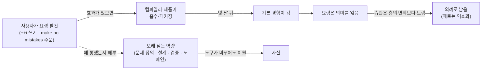

<figure class="post-figure post-figure--header">
<svg role="img" aria-label="시효가 지난 비법을 그린 그림. 왼쪽에서 한 고참 프로그래머가 낡은 주문서를 들고 있다. 주문서에는 you are an experienced software developer, make no mistakes 라는 프롬프트와, 그 아래 지워진 i++ 대신 ++i 라는 옛 요령이 적혀 있다. 가운데 컨베이어 벨트가 같은 요령을 오른쪽의 도구 상자로 실어 나르고, 도구 상자 안에서 그 요령은 이미 기본으로 켜진 체크 항목이 되어 있다. 아래 띠에는 몇 주면 배우고 몇 달이면 낡는다는 반감기 곡선이 그려져 있다." viewBox="0 0 680 300" xmlns="http://www.w3.org/2000/svg">
  <title>시효가 지난 비법 — 고참이 읊는 낡은 주문서와, 그 요령을 이미 기본값으로 흡수한 도구</title>
  <defs>
    <marker id="aisk-arrow" viewBox="0 0 10 10" refX="8" refY="5" markerWidth="7" markerHeight="7" orient="auto-start-reverse">
      <path d="M0,0 L10,5 L0,10 z" fill="var(--secondary-color)"/>
    </marker>
  </defs>

  <!-- ===== LEFT: veteran (generic figure) holding an old spell scroll ===== -->
  <text x="150" y="24" text-anchor="middle" font-size="12" fill="currentColor" font-weight="700" opacity="0.75">몸에 밴 요령</text>

  <!-- generic figure -->
  <circle cx="44" cy="92" r="13" fill="var(--bg-light)" stroke="currentColor" stroke-width="2"/>
  <line x1="44" y1="105" x2="44" y2="158" stroke="currentColor" stroke-width="2.5" stroke-linecap="round"/>
  <line x1="44" y1="120" x2="74" y2="112" stroke="currentColor" stroke-width="2.5" stroke-linecap="round"/>
  <line x1="44" y1="158" x2="32" y2="190" stroke="currentColor" stroke-width="2.5" stroke-linecap="round"/>
  <line x1="44" y1="158" x2="56" y2="190" stroke="currentColor" stroke-width="2.5" stroke-linecap="round"/>
  <!-- speech marks: reciting -->
  <path d="M60 74 q8 -6 16 0" fill="none" stroke="currentColor" stroke-width="1.5" opacity="0.6"/>
  <path d="M58 66 q12 -10 24 0" fill="none" stroke="currentColor" stroke-width="1.5" opacity="0.4"/>

  <!-- scroll -->
  <rect x="76" y="44" width="170" height="150" rx="3" fill="var(--bg-light)" stroke="var(--gold)" stroke-width="2"/>
  <rect x="70" y="38" width="182" height="10" rx="5" fill="var(--bg-panel)" stroke="var(--gold)" stroke-width="2"/>
  <rect x="70" y="190" width="182" height="10" rx="5" fill="var(--bg-panel)" stroke="var(--gold)" stroke-width="2"/>
  <text x="161" y="70" text-anchor="middle" font-size="9" fill="currentColor" opacity="0.7" font-weight="700">커스텀 지시문</text>
  <text x="161" y="92" text-anchor="middle" font-size="10" fill="currentColor" font-family="var(--font-mono)">you are an experienced</text>
  <text x="161" y="107" text-anchor="middle" font-size="10" fill="currentColor" font-family="var(--font-mono)">software developer,</text>
  <text x="161" y="122" text-anchor="middle" font-size="10" fill="currentColor" font-family="var(--font-mono)" font-weight="700">make no mistakes</text>
  <line x1="92" y1="138" x2="230" y2="138" stroke="currentColor" stroke-width="1" opacity="0.25" stroke-dasharray="3 3"/>
  <text x="161" y="160" text-anchor="middle" font-size="10" fill="currentColor" font-family="var(--font-mono)" opacity="0.55">i++  →  ++i</text>
  <line x1="122" y1="157" x2="200" y2="157" stroke="var(--accent-color)" stroke-width="1.6" opacity="0.8"/>
  <text x="161" y="178" text-anchor="middle" font-size="8.5" fill="currentColor" opacity="0.7">(1995년에도 이미 컴파일러가 처리)</text>

  <!-- ===== MIDDLE: conveyor carrying the trick into the product ===== -->
  <text x="340" y="96" text-anchor="middle" font-size="10" fill="currentColor" font-weight="700">효과가 있으면</text>
  <text x="340" y="110" text-anchor="middle" font-size="9" fill="currentColor" opacity="0.75">흡수 · 패키징</text>
  <rect x="276" y="128" width="128" height="14" rx="7" fill="var(--bg-sunken)" stroke="currentColor" stroke-width="1.5"/>
  <circle cx="290" cy="135" r="4" fill="none" stroke="currentColor" stroke-width="1.2"/>
  <circle cx="340" cy="135" r="4" fill="none" stroke="currentColor" stroke-width="1.2"/>
  <circle cx="390" cy="135" r="4" fill="none" stroke="currentColor" stroke-width="1.2"/>
  <!-- package riding the belt -->
  <rect x="318" y="113" width="26" height="15" rx="2" fill="var(--bg-light)" stroke="var(--gold)" stroke-width="1.6"/>
  <line x1="331" y1="113" x2="331" y2="128" stroke="var(--gold)" stroke-width="1.2"/>
  <line x1="262" y1="160" x2="418" y2="160" stroke="var(--secondary-color)" stroke-width="2.2" marker-end="url(#aisk-arrow)"/>
  <text x="340" y="178" text-anchor="middle" font-size="9" fill="currentColor" opacity="0.75">몇 달 뒤</text>

  <!-- ===== RIGHT: tool where the trick is already default ===== -->
  <text x="540" y="24" text-anchor="middle" font-size="12" fill="currentColor" font-weight="700" opacity="0.75">도구의 기본값</text>
  <rect x="432" y="40" width="216" height="158" rx="4" fill="var(--bg-light)" stroke="var(--accent-color)" stroke-width="2"/>
  <rect x="432" y="40" width="216" height="22" rx="4" fill="var(--bg-sunken)" stroke="var(--accent-color)" stroke-width="2"/>
  <circle cx="446" cy="51" r="3.5" fill="currentColor" opacity="0.5"/>
  <circle cx="458" cy="51" r="3.5" fill="currentColor" opacity="0.5"/>
  <circle cx="470" cy="51" r="3.5" fill="currentColor" opacity="0.5"/>
  <text x="560" y="55" text-anchor="middle" font-size="9" fill="currentColor" opacity="0.8">컴파일러 · 모델 · 제품</text>

  <!-- checked default rows -->
  <rect x="450" y="78" width="14" height="14" rx="2" fill="var(--bg-panel)" stroke="var(--secondary-color)" stroke-width="1.8"/>
  <path d="M453 85 l3 3 l6 -7" fill="none" stroke="var(--secondary-color)" stroke-width="2"/>
  <text x="472" y="89" font-size="10" fill="currentColor">쓰이지 않는 반환값 생략</text>

  <rect x="450" y="106" width="14" height="14" rx="2" fill="var(--bg-panel)" stroke="var(--secondary-color)" stroke-width="1.8"/>
  <path d="M453 113 l3 3 l6 -7" fill="none" stroke="var(--secondary-color)" stroke-width="2"/>
  <text x="472" y="117" font-size="10" fill="currentColor">더 나은 기본 동작</text>

  <rect x="450" y="134" width="14" height="14" rx="2" fill="var(--bg-panel)" stroke="var(--secondary-color)" stroke-width="1.8"/>
  <path d="M453 141 l3 3 l6 -7" fill="none" stroke="var(--secondary-color)" stroke-width="2"/>
  <text x="472" y="145" font-size="10" fill="currentColor">유용한 결과에 더 빨리</text>

  <text x="540" y="180" text-anchor="middle" font-size="9.5" fill="currentColor" font-weight="700">= 기본 경험</text>

  <!-- ===== BOTTOM: half-life strip ===== -->
  <line x1="40" y1="222" x2="640" y2="222" stroke="currentColor" stroke-width="1" opacity="0.2"/>
  <line x1="60" y1="282" x2="620" y2="282" stroke="currentColor" stroke-width="1.4" opacity="0.6"/>
  <line x1="60" y1="282" x2="60" y2="234" stroke="currentColor" stroke-width="1.4" opacity="0.6"/>
  <text x="66" y="242" font-size="9" fill="currentColor" opacity="0.75">요령의 가치</text>
  <path d="M60 282 C 90 282, 100 240, 140 238 C 200 236, 230 250, 290 268 C 360 280, 450 281, 620 281" fill="none" stroke="var(--accent-color)" stroke-width="2.4"/>
  <circle cx="140" cy="238" r="4" fill="var(--accent-color)"/>
  <text x="150" y="252" font-size="9.5" fill="currentColor" font-weight="700">몇 주면 익히고</text>
  <text x="330" y="266" font-size="9.5" fill="currentColor" font-weight="700">몇 달이면 낡는다</text>
  <text x="620" y="274" text-anchor="end" font-size="9" fill="currentColor" opacity="0.75">→ 그 순간 밖에서는 가치 없음</text>
</svg>
<figcaption>효과가 있는 요령은 곧 도구의 기본값이 된다. 남는 것은 주문서를 계속 읊는 습관뿐이다.</figcaption>
</figure>

## 원문 정보

> - **제목**: "AI Skills" are worthless in 2026
> - **출처**: Charles Miller, *The Fishbowl* ([fishbowl.pastiche.org](https://fishbowl.pastiche.org/))
> - **발행**: 2026-10-26 · 약 2분 분량 (본문 7문단 내외의 짧은 에세이)
> - **원문 링크**: <https://fishbowl.pastiche.org/2026/10/26/ai-skills>

"AI를 지금 배우지 않으면 뒤처진다"는 압박이 일상이 된 시기에, 오래 일한 프로그래머가 그 압박을 한 걸음 떨어져 바라본 짧은 에세이다.

## 한 줄 요약 (TL;DR)

모델을 잘 다루는 요령은 효과가 있다면 곧 제품에 흡수되어 기본값이 된다. **몇 주면 익힐 수 있고 몇 달이면 쓸모없어질 기술은 그 순간 밖에서는 가치가 없다.** 그러니 최신 흐름을 따라가되, 먼저 올라타려 조급해하기보다 무리와 보조를 맞추며 '제대로 할' 때를 기다려도 된다.

## 왜 이 글을 골랐나

이 위키의 Articles에는 AI 시대에 무엇을 배워야 하는지에 대한 글이 이미 많다. [취향과 판단](/2026/08/04/taste-judgment-and-ai.html), [AI 시대 전문성 재설계](/2026/06/22/ai-era-expertise-redesign.html), [에이전틱 코딩은 함정이다](/2026/07/03/agentic-coding-is-a-trap.html) 같은 글은 대체로 "무엇이 남는가"를 묻는다. 이 에세이는 반대 방향에서 묻는다. **"무엇이 금방 사라지는가."** 짧지만, 학습 시간을 어디에 쓸지 고민하는 개발자에게 꽤 쓸모 있는 기준 하나를 준다. 바로 *기술의 반감기*다.

한눈에 보면, 이 글은 요령의 생애주기(발견 → 흡수 → 기본값 → 의례)와 도구가 바뀌어도 이월되는 역량을 대비한다.

## 핵심 내용

원문은 소제목 없이 이어지는 짧은 글이다. 흐름에 따라 네 덩어리로 나눠 정리한다.

### 1. i++ 가 ++i 보다 느리다는 '상식'

저자가 20대 초반에 C를 배우던 시절, 변수를 증가시키는 두 방법 중 `i++`가 `++i`보다 느리다는 것은 "상식"이었다. 후위 증가는 원래 값을 반환해야 하므로 증가 전에 값을 따로 보관해야 하고, 전위 증가는 그 낭비가 없다는 논리였다.

그런데 저자는 이것이 사실은 **"상식"이 아니라 민간 전승(folklore)**이었다고 말한다. 저자가 스무 살이 된 1995년 무렵에도 가장 기본적인 최적화 컴파일러조차 `i++`의 반환값이 쓰이는지 확인하고, 쓰이지 않으면 값을 보관하는 연산을 생략했기 때문이다.

그리고 한 문장을 덧붙인다. 나이 든 프로그래머를 긁어 보면 몸에 밴 습관이 열두 개쯤은 나오는데, CPU가 분기 예측과 코드 재배치를 하는 시대에는 그런 습관이 오히려 프로그램을 **느리게 만들 가능성도 그만큼 있다**는 것이다.

### 2. "프롬프트 엔지니어링, 기억나세요?"

여기서 글이 방향을 튼다. 모델이 더 잘 동작하게 만드는 요령, 유용한 결과에 더 빨리 닿게 하는 작업 방식은 **효과가 있다면 결국 제품에 다시 흡수되고 패키징되어 몇 달 뒤 기본 경험이 된다**고 보는 게 합리적이라는 것이다.

그런데도 저자는 5년 뒤에도 커스텀 지시문에 "you are an experienced software developer, make no mistakes"를 꾸역꾸역 넣는 고참들이 분명 있을 거라고 확신한다. 1절의 `i++` 미신과 정확히 같은 구조다. 한때 그럴듯했던 요령이 환경이 바뀐 뒤에도 의례처럼 남는다.

### 3. 핵심 주장: 반감기가 짧은 기술은 그 순간 밖에서는 가치가 없다

저자는 선을 분명히 긋는다. **최신 흐름을 따라가는 일이 가치 없다는 말이 아니다.** 오늘 내 일은 오늘 최선을 다해 해내야 하기 때문이다. 다만,

> 몇 주면 익힐 수 있고 몇 달이면 낡아버릴 기술은, 그 순간 밖에서는 아무 가치가 없다.
> (원문: "a skill that can be picked up in a few weeks, and will be obsolete in a few months, has no value outside the moment.")

제목의 "worthless"는 이 문장의 압축이다. AI를 쓰는 능력 자체를 깎아내리는 말이 아니다. 습득 비용도 낮고 수명도 짧은 요령을 '자산'이나 '해자'로 여기지 말라는 뜻이다.

### 4. "AI 열차에 지금 타라"는 압박에 대하여

마지막 문단은 개인적인 일화다. 18개월 전 저자는 붐비는 방에서 한 CEO가 지금 AI 열차에 올라타지 않으면 뒤처진다고 열정적으로 선언하는 것을 지켜봤다.

저자의 반응은 이렇다. Google, Facebook, iPod, iPhone, iPad를 비롯한 수많은 사례가 **먼저 들어가는 것보다 제대로 하는 것이 더 가치 있다**는 것을 보여 준 세상에서, 자신은 무리와 보조를 맞추며(keep pace with the pack) 때가 오면 "Steven Bradbury를 시전할" 준비가 된 상태로 만족한다고 말한다. 그러면서 "내가 나이가 들어서 그런지도 모르겠지만"이라는 단서를 단다.

(배경 메모, 원문에는 설명이 없음: Steven Bradbury는 2002년 솔트레이크시티 동계올림픽 쇼트트랙 1000m 결승에서 꼴찌로 달리다가 앞선 선수들이 모두 넘어지는 바람에 금메달을 딴 호주 선수다. 선두 다툼에 끼지 않고 끝까지 완주할 수 있는 위치에 있다가 기회를 잡는다는 비유로 쓰였다.)

<figure class="post-figure">
<svg role="img" aria-label="Bradbury 비유를 추상화한 그림. 왼쪽부터 오른쪽으로 달리는 트랙이 있다. 앞서 달리던 선두 무리 네 명이 코너에서 서로 뒤엉켜 넘어져 있고 충돌 표시가 있다. 그 뒤에서 페이스를 유지하던 한 명이 점선 경로를 따라 넘어진 무리를 지나 결승선을 통과한다. 위쪽에는 먼저 들어가기, 아래쪽에는 제대로 끝까지라는 대비 라벨이 붙어 있다." viewBox="0 0 640 230" xmlns="http://www.w3.org/2000/svg">
  <title>먼저보다 제대로·끝까지 — 선두 무리가 넘어지는 동안 페이스를 지킨 주자가 완주한다</title>
  <defs>
    <marker id="aisk-arrow2" viewBox="0 0 10 10" refX="8" refY="5" markerWidth="7" markerHeight="7" orient="auto-start-reverse">
      <path d="M0,0 L10,5 L0,10 z" fill="var(--secondary-color)"/>
    </marker>
  </defs>

  <!-- track lanes -->
  <path d="M30 70 L400 70 Q470 70 470 125 Q470 180 540 180 L620 180" fill="none" stroke="currentColor" stroke-width="1.4" opacity="0.35"/>
  <path d="M30 150 L360 150 Q400 150 410 175 Q420 200 470 200 L620 200" fill="none" stroke="currentColor" stroke-width="1.4" opacity="0.35"/>

  <!-- finish line (checker in currentColor) -->
  <g opacity="0.85">
    <rect x="590" y="160" width="8" height="8" fill="currentColor"/>
    <rect x="598" y="168" width="8" height="8" fill="currentColor"/>
    <rect x="590" y="176" width="8" height="8" fill="currentColor"/>
    <rect x="598" y="184" width="8" height="8" fill="currentColor"/>
    <rect x="590" y="192" width="8" height="8" fill="currentColor"/>
    <rect x="598" y="200" width="8" height="8" fill="currentColor"/>
  </g>
  <rect x="590" y="160" width="16" height="48" fill="none" stroke="currentColor" stroke-width="1.2"/>
  <text x="598" y="152" text-anchor="middle" font-size="10" fill="currentColor" font-weight="700">결승</text>

  <!-- pack: generic runners tangled at the corner -->
  <text x="410" y="30" text-anchor="middle" font-size="11" fill="currentColor" font-weight="700">먼저 들어가기</text>
  <text x="410" y="45" text-anchor="middle" font-size="9" fill="currentColor" opacity="0.75">선두 다툼 → 코너에서 뒤엉킴</text>
  <g stroke="currentColor" stroke-width="2" stroke-linecap="round" fill="var(--bg-light)">
    <circle cx="380" cy="92" r="8"/>
    <line x1="388" y1="96" x2="412" y2="104"/>
    <circle cx="420" cy="118" r="8"/>
    <line x1="410" y1="124" x2="392" y2="136"/>
    <circle cx="450" cy="96" r="8"/>
    <line x1="444" y1="102" x2="430" y2="124"/>
    <circle cx="398" cy="140" r="8"/>
    <line x1="406" y1="142" x2="440" y2="138"/>
  </g>
  <!-- collision marks -->
  <g stroke="var(--accent-color)" stroke-width="2.2" stroke-linecap="round">
    <line x1="424" y1="82" x2="434" y2="92"/><line x1="434" y1="82" x2="424" y2="92"/>
    <line x1="370" y1="118" x2="378" y2="126"/><line x1="378" y1="118" x2="370" y2="126"/>
    <line x1="452" y1="130" x2="460" y2="138"/><line x1="460" y1="130" x2="452" y2="138"/>
  </g>

  <!-- the one who kept pace -->
  <g stroke="var(--secondary-color)" stroke-width="2.2" stroke-linecap="round">
    <circle cx="120" cy="138" r="8" fill="var(--bg-panel)"/>
    <line x1="120" y1="146" x2="120" y2="166"/>
    <line x1="120" y1="152" x2="132" y2="146"/>
    <line x1="120" y1="152" x2="108" y2="158"/>
    <line x1="120" y1="166" x2="130" y2="178"/>
    <line x1="120" y1="166" x2="110" y2="178"/>
  </g>
  <path d="M140 165 L350 168 Q395 172 420 182 Q455 192 500 190 L582 186" fill="none" stroke="var(--secondary-color)" stroke-width="2" stroke-dasharray="6 5" marker-end="url(#aisk-arrow2)"/>
  <text x="120" y="200" text-anchor="middle" font-size="11" fill="currentColor" font-weight="700">제대로 · 끝까지</text>
  <text x="120" y="215" text-anchor="middle" font-size="9" fill="currentColor" opacity="0.75">무리와 보조를 맞추며 완주</text>
  <text x="260" y="188" text-anchor="middle" font-size="9" fill="currentColor" opacity="0.75">페이스 유지 (기본기 = 완주할 체력)</text>
</svg>
<figcaption>Bradbury 비유: 선두를 다투던 무리가 넘어지는 동안, 끝까지 달릴 수 있는 위치를 지킨 주자가 결승선을 통과한다.</figcaption>
</figure>

## 분석과 인사이트

여기부터는 원문 요약이 아니라 내 해석이다.

### '기술의 반감기'라는 렌즈가 유용하다

이 글의 가장 큰 기여는 학습 대상을 **습득 비용 × 수명**의 두 축으로 보게 한다는 점이다. 몇 주면 배우고 몇 달이면 낡는 요령은 누구나 쉽게 따라잡을 수 있으니 차별점이 되지 못하고, 곧 기본값이 되니 축적되지도 않는다. 반대로 배우는 데 오래 걸리고 오래 남는 것, 예컨대 문제를 정의하는 능력, 시스템 설계, 검증하는 눈, 도메인 이해는 AI 도구가 바뀌어도 이월된다. [The Untrainable](/2026/06/23/the-untrainable.html)이 "측정할 수 있는 일은 commodity가 된다"고 말한 것과 같은 구조를 개인의 기술 수준에서 본 셈이다.

| 구분 | 예시 | 습득 | 수명 | 투자 성격 |
| --- | --- | --- | --- | --- |
| 순간의 요령 | 프롬프트 주문, 특정 도구의 우회법 | 수 주 | 수 개월 | 오늘의 업무를 위한 비용 |
| 오래 남는 역량 | 문제 정의, 설계, 검증, 도메인 지식 | 수 년 | 수 년 이상 | 자산 |

(표의 분류와 예시는 내가 정리한 것이다. 원문은 "몇 주 / 몇 달" 기준만 제시한다.)

### i++ 비유가 정확한 이유

두 사례에는 공통 구조가 있다. **하부 계층(컴파일러, 모델·제품)이 똑똑해지면서 상부 사용자의 수작업 최적화가 무의미해진다.** 그런데 사람의 습관은 계층이 바뀌는 속도를 따라가지 못한다. 그래서 요령은 효과를 잃은 뒤에도 의례로 남고, 저자 말대로 때로는 역효과를 낸다. Martin Fowler가 [LLM이 추상화의 층을 바꾼다](/2026/07/06/llms-new-nature-of-abstraction.html)고 했을 때의 "층"이 바로 이것이다. 층이 올라갈 때마다 아래층에서 통하던 요령은 수명이 끝난다.

### 동의하지만, 덧붙이고 싶은 것

- **요령과 원리를 구분해야 한다.** "make no mistakes" 같은 주문은 낡지만, 그 요령이 *왜* 통했는지(모델에 맥락과 역할을 주면 출력 분포가 바뀐다)는 다음 세대 도구를 이해하는 데 이월된다. `i++` 미신도 "후위 증가는 원래 값을 보존해야 한다"는 의미론 자체는 C++ 반복자 같은 곳에서 여전히 유효했다. 요령을 쫓는 시간은 아깝지만, 요령을 *해부*하는 시간은 아깝지 않다.
- **"무리와 보조를 맞추기"도 비용이 든다.** 저자는 뒤처지지 않을 만큼은 따라가라고 분명히 말한다. Bradbury 비유가 통하려면 결승선까지 완주할 체력, 즉 기본기가 있어야 한다. 관망과 방치는 다르다. [에이전틱 코딩은 함정이다](/2026/07/03/agentic-coding-is-a-trap.html)가 경고한 스킬 위축은 "열차에 너무 깊이 탄" 쪽의 위험이고, 이 글은 "열차 탑승 자체를 자산으로 착각하는" 쪽의 위험을 짚는다. 두 글은 서로 보완한다.
- **조직 관점의 함의.** "AI 스킬"을 채용 기준이나 교육 KPI로 삼는 조직이라면, 그 스킬이 몇 달 뒤에도 의미가 있을지 먼저 물어야 한다. 반감기가 짧은 항목으로 사람을 평가하면 평가 기준이 매 분기 낡는다.

### 이 글의 한계

짧은 에세이라 근거는 일화와 비유가 전부다. "효과가 있는 요령은 제품에 흡수된다"는 전제는 그럴듯하지만, 어떤 요령은 제품화되기 어렵거나(조직 고유의 맥락, 도메인 지식이 담긴 지시문) 흡수에 몇 달보다 오래 걸릴 수 있다. 하지만 저자도 "지금 일은 지금 잘해야 한다"는 단서를 달았으니, 이 글은 "배우지 말라"가 아니라 **"그것을 자산으로 착각하지 말라"**로 읽는 게 맞다.

## 적용 포인트

- **학습 항목에 반감기 태그를 붙여 보자.** 새로 익히는 것마다 "이건 6개월 뒤에도 유효할까?"를 묻고, 짧은 쪽은 *업무 비용*, 긴 쪽은 *자산*으로 나눠 시간 배분을 의식적으로 정한다.
- **커스텀 지시문·프롬프트를 주기적으로 정리하자.** `AGENTS.md`, 커스텀 지시문 안의 주문 중 모델이나 도구가 이미 기본으로 해 주는 것은 지운다. 낡은 요령은 무해한 게 아니라 잡음이다. ([의도 부채와 AGENTS.md](/2026/08/31/intent-debt-agents-md.html) 참고)
- **요령보다 '왜 통했는지'를 기록하자.** 효과가 있었던 요령은 그 메커니즘을 한 줄로 남긴다. 도구가 바뀌어도 이월되는 건 그 한 줄이다.
- **"먼저 vs 제대로"를 구분하자.** 새 도구 도입 압박이 오면, 지금 들어가지 않을 때 실제로 잃는 것이 무엇인지 따져 본다. 대부분은 따라잡는 데 몇 주면 충분하다.
- **완주할 체력을 기르자.** Bradbury 전략은 기본기가 있을 때만 성립한다. [문제 정의](/2026/07/31/problem-framing-principal-engineer.html), 설계, 검증 같은 오래 가는 역량에 꾸준히 투자한다.

## 마무리

Charles Miller의 글은 짧지만 날카롭다. `i++`가 느리다는 미신이 컴파일러 앞에서 의미를 잃었듯이, 오늘의 프롬프트 요령도 모델과 제품 앞에서 곧 의미를 잃는다. 그러니 요령은 오늘 일을 위해 쓰고, 자산이라 믿지는 말 것. 먼저 올라타는 것보다 끝까지 제대로 달리는 쪽에 시간을 쓰라는 이 조언은, AI가 아니어도 오래 일해 온 사람이라면 몇 번쯤 겪어 본 교훈이기도 하다.

### 더 읽어보기

- [원문 — "AI Skills" are worthless in 2026 (Charles Miller, The Fishbowl)](https://fishbowl.pastiche.org/2026/10/26/ai-skills) — 2분이면 읽는 원문
- [취향과 판단, 그리고 AI (Addy Osmani)](/2026/08/04/taste-judgment-and-ai.html) — 빨리 낡는 요령 대신 이전되지 않는 판단에 대하여
- [The Untrainable (Sarah Guo)](/2026/06/23/the-untrainable.html) — 측정 가능한 것은 commodity가 된다는 같은 구조의 산업판
- [에이전틱 코딩은 함정이다 (Lars Faye)](/2026/07/03/agentic-coding-is-a-trap.html) — AI에 너무 깊이 기댈 때의 스킬 위축
- [AI가 우리의 실력을 망치고 있는가 (Nature)](/2026/06/23/is-ai-ruining-our-skills.html) — 탈숙련에 대한 초기 연구
- [AI 시대, 나의 전문성을 재설계하는 법 (하용호)](/2026/06/22/ai-era-expertise-redesign.html) — 무엇이 오래 남는 전문성인가
- [위로가 아니라 옆으로 — LLM이 가져온 새로운 추상화 (Martin Fowler)](/2026/07/06/llms-new-nature-of-abstraction.html) — 추상화 층이 바뀔 때 요령의 수명이 끝나는 이유
