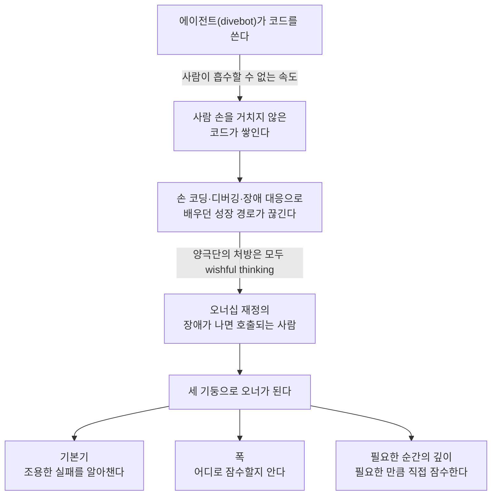

<figure class="post-figure post-figure--header">
<svg role="img" aria-label="옛 해도처럼 그린 바다: 수면 위 배에 시스템의 오너인 엔지니어가 해도를 들고 앉아 있고, 그 아래로 여러 대의 divebot이 각기 다른 깊이로 내려가 금덩이를 캐거나 시설을 짓는다. 한 대는 금덩이를 들고 떠오른다. 해저 오른쪽에는 엉성하게 지어진 시설 옆으로 괴물의 촉수와 눈이 숨어 있고, 그 위에 'Here Be Monsters'라는 옛 해도식 경고문이 적혀 있다." viewBox="0 0 640 320" xmlns="http://www.w3.org/2000/svg">
  <title>Here Be Monsters — 배 위의 오너와 깊은 바다로 내려가는 divebot들</title>
  <defs>
    <marker id="hbm-h-up" viewBox="0 0 10 10" refX="5" refY="5" markerWidth="6" markerHeight="6" orient="auto-start-reverse">
      <path d="M0 0 L10 5 L0 10 z" fill="var(--secondary-color)"/>
    </marker>
  </defs>
  <!-- the sea (opaque token fill, below the waterline) -->
  <rect x="0" y="92" width="640" height="228" fill="var(--bg-light)"/>
  <!-- old-chart depth contours + soundings -->
  <g fill="none" stroke="currentColor" stroke-width="1" opacity="0.22" stroke-dasharray="3 5">
    <path d="M0 150 C 160 132, 330 172, 640 146"/>
    <path d="M0 214 C 180 196, 360 236, 640 206"/>
  </g>
  <g font-size="10" fill="currentColor" opacity="0.65" text-anchor="middle">
    <text x="36" y="128">12</text>
    <text x="300" y="160">40</text>
    <text x="120" y="270">180</text>
    <text x="350" y="252">220</text>
    <text x="620" y="128">?</text>
  </g>
  <!-- water surface -->
  <path d="M0 92 q20 -7 40 0 t40 0 t40 0 t40 0 t40 0 t40 0 t40 0 t40 0 t40 0 t40 0 t40 0 t40 0 t40 0 t40 0 t40 0 t40 0" fill="none" stroke="var(--secondary-color)" stroke-width="2"/>
  <!-- compass rose (sky, top right) -->
  <g transform="translate(588 46)">
    <circle r="20" fill="none" stroke="currentColor" stroke-width="1.5" opacity="0.6"/>
    <polygon points="0,-18 4,0 0,18 -4,0" fill="var(--gold)"/>
    <polygon points="-18,0 0,-4 18,0 0,4" fill="currentColor" opacity="0.55"/>
    <text x="0" y="-25" text-anchor="middle" font-size="10" font-weight="700" fill="currentColor">N</text>
  </g>
  <!-- the ship -->
  <polygon points="56,78 204,78 188,98 74,98" fill="var(--accent-color)"/>
  <rect x="140" y="60" width="28" height="18" fill="var(--bg-panel)" stroke="currentColor" stroke-width="1.5"/>
  <line x1="182" y1="78" x2="182" y2="40" stroke="currentColor" stroke-width="2"/>
  <line x1="182" y1="40" x2="204" y2="52" stroke="currentColor" stroke-width="2"/>
  <!-- gold already hauled up, on deck -->
  <g fill="var(--gold)">
    <polygon points="118,78 124,70 132,72 134,78"/>
    <polygon points="126,78 130,73 138,75 138,78"/>
  </g>
  <!-- the owner: seated engineer holding the sea chart -->
  <g fill="none" stroke="currentColor" stroke-width="2.2" stroke-linecap="round">
    <circle cx="94" cy="50" r="7"/>
    <line x1="94" y1="57" x2="94" y2="72"/>
    <line x1="94" y1="72" x2="106" y2="74"/>
    <line x1="106" y1="74" x2="106" y2="78"/>
    <line x1="94" y1="62" x2="104" y2="64"/>
  </g>
  <rect x="102" y="56" width="14" height="11" fill="var(--gold)" opacity="0.75" stroke="currentColor" stroke-width="1"/>
  <text x="94" y="32" text-anchor="middle" font-size="11" font-weight="700" fill="currentColor">오너</text>
  <!-- descent trails from the winch -->
  <g fill="none" stroke="currentColor" stroke-width="1.3" opacity="0.4" stroke-dasharray="2 4">
    <path d="M182 98 Q 220 108 238 124"/>
    <path d="M182 98 Q 300 120 352 168"/>
    <path d="M182 98 Q 170 160 196 222"/>
    <path d="M182 98 Q 380 140 424 226"/>
  </g>
  <!-- divebots: bodies + portholes + claws + lamp beams -->
  <g transform="translate(240 134)">
    <polygon points="-6,9 6,9 14,34 -14,34" fill="var(--gold)" opacity="0.18"/>
    <rect x="-14" y="-9" width="28" height="18" rx="4" fill="var(--secondary-color)"/>
    <circle r="4" fill="var(--bg-panel)"/>
    <path d="M-10 9 l-4 6 M10 9 l4 6" stroke="currentColor" stroke-width="2"/>
  </g>
  <g transform="translate(356 178)">
    <polygon points="-6,9 6,9 16,40 -16,40" fill="var(--gold)" opacity="0.18"/>
    <rect x="-14" y="-9" width="28" height="18" rx="4" fill="var(--secondary-color)"/>
    <circle r="4" fill="var(--bg-panel)"/>
    <path d="M-10 9 l-4 6 M10 9 l4 6" stroke="currentColor" stroke-width="2"/>
  </g>
  <g transform="translate(198 232)">
    <polygon points="-6,9 6,9 14,40 -14,40" fill="var(--gold)" opacity="0.18"/>
    <rect x="-14" y="-9" width="28" height="18" rx="4" fill="var(--secondary-color)"/>
    <circle r="4" fill="var(--bg-panel)"/>
    <path d="M-10 9 l-4 6 M10 9 l4 6" stroke="currentColor" stroke-width="2"/>
  </g>
  <g transform="translate(428 234)">
    <polygon points="-6,9 6,9 18,38 -18,38" fill="var(--gold)" opacity="0.18"/>
    <rect x="-14" y="-9" width="28" height="18" rx="4" fill="var(--secondary-color)"/>
    <circle r="4" fill="var(--bg-panel)"/>
    <path d="M-10 9 l-4 6 M10 9 l4 6" stroke="currentColor" stroke-width="2"/>
  </g>
  <!-- one divebot surfacing with a nugget -->
  <g transform="translate(296 120)">
    <rect x="-14" y="-9" width="28" height="18" rx="4" fill="var(--secondary-color)"/>
    <circle r="4" fill="var(--bg-panel)"/>
    <polygon points="-6,10 0,16 7,12 4,9" fill="var(--gold)" stroke="currentColor" stroke-width="1"/>
  </g>
  <line x1="296" y1="106" x2="296" y2="98" stroke="var(--secondary-color)" stroke-width="2" marker-end="url(#hbm-h-up)"/>
  <!-- seabed -->
  <path d="M0 290 Q 60 276 120 288 T 240 284 T 360 290 T 480 280 T 640 286 L640 320 L0 320 Z" fill="currentColor" opacity="0.14"/>
  <!-- gold nuggets on the bed -->
  <g fill="var(--gold)" stroke="currentColor" stroke-width="0.8">
    <polygon points="146,288 152,280 160,283 160,289"/>
    <polygon points="236,286 241,279 249,282 248,287"/>
    <polygon points="330,290 335,284 342,286 341,291"/>
  </g>
  <!-- a tidy facility (left) vs a sprawling, crooked one (right) -->
  <g fill="var(--bg-panel)" stroke="currentColor" stroke-width="1.5">
    <rect x="252" y="266" width="34" height="20"/>
    <rect x="262" y="254" width="12" height="12"/>
    <rect x="456" y="262" width="26" height="22" transform="rotate(-6 469 273)"/>
    <rect x="474" y="246" width="14" height="18" transform="rotate(9 481 255)"/>
    <rect x="488" y="268" width="20" height="14" transform="rotate(-12 498 275)"/>
    <rect x="452" y="248" width="10" height="14" transform="rotate(14 457 255)"/>
  </g>
  <!-- the monster: tentacles + an eye in the deep -->
  <g fill="none" stroke="var(--accent-color)" stroke-width="6" stroke-linecap="round" opacity="0.85">
    <path d="M556 320 C 546 286, 598 262, 580 228"/>
    <path d="M592 320 C 604 280, 566 254, 590 214"/>
    <path d="M626 320 C 640 290, 610 270, 628 240"/>
  </g>
  <ellipse cx="604" cy="300" rx="10" ry="6" fill="var(--gold)" stroke="currentColor" stroke-width="1.2"/>
  <rect x="602" y="295" width="4" height="10" fill="currentColor"/>
  <!-- a sea-serpent hump in uncharted water (left) -->
  <path d="M28 196 q14 -16 28 0 q14 -16 28 0 q14 -16 28 0" fill="none" stroke="currentColor" stroke-width="2.5" opacity="0.45" stroke-linecap="round"/>
  <!-- the old-chart cartouche -->
  <path d="M452 150 L620 150 L610 164 L620 178 L452 178 L462 164 Z" fill="var(--bg-panel)" stroke="currentColor" stroke-width="1.5"/>
  <text x="536" y="169" text-anchor="middle" font-size="14" font-style="italic" font-weight="700" letter-spacing="1" fill="var(--accent-color)">Here Be Monsters</text>
</svg>
<figcaption>배 위의 오너와 해저로 내려가는 divebot들 — 해도가 닿지 않는 바다에는 괴물이 산다</figcaption>
</figure>

## 원문 정보

> - **제목**: Here Be Monsters: What Do You Still Need to Know When Agents Do the Work?
> - **출처**: Adrian Quiroga, *Engineering Notes* ([blog.adrq.dev](https://blog.adrq.dev))
> - **발행**: 2026-10-27 · 약 15분 분량
> - **원문 링크**: <https://blog.adrq.dev/here-be-monsters-what-do-you-still-need-to-know-when-agents-do-the-work>

"코드를 다 읽어야 하나, 아예 안 봐도 되나"라는 양극단 사이에서, **시스템을 '소유'한다는 것의 정의**부터 다시 세우는 에세이라 AI-Essays에 담는다.

## 한 줄 요약 (TL;DR)

에이전트가 코드를 쓰는 시대에 시스템의 오너는 "그 코드를 직접 쓴 사람"이 아니라 **"뭔가 잘못됐을 때 알아채고, 필요한 만큼 깊이 잠수할 수 있는 사람"**이다. 그 능력은 **기본기(Fundamentals) · 폭(Breadth) · 필요한 순간의 깊이(Just-in-Time Depth)** 라는 세 기둥으로 만들어진다.

## 왜 이 글을 골랐나

이 위키의 Articles에는 이미 같은 질문을 다른 각도에서 다룬 글이 여럿 쌓여 있다. [아직도 코드를 읽으세요?](/2026/09/18/do-you-still-read-the-code.html)는 "읽는 쪽 vs 안 읽는 쪽"의 갈림길을, [AI가 인시던트를 처리할수록 엔지니어는 시스템과 멀어진다](/2026/09/08/ai-incidents-engineers-lose-touch.html)는 자동화가 운영 감각을 깎아 먹는 문제를, [AI가 우리의 실력을 망치고 있는가](/2026/06/23/is-ai-ruining-our-skills.html)는 탈숙련(deskilling)을 다뤘다.

이 글이 반가운 이유는 **"그래서 무엇을 길러야 하는가"에 대한 구체적인 답**을 내놓기 때문이다. 양극단을 모두 "wishful thinking"이라 비판한 뒤, 오너십을 "장애가 났을 때 전화를 받는 사람"이라는 실용적 정의로 끌어내리고, 그 역할에 필요한 역량을 세 기둥으로 분해한다. 게다가 저자 자신이 에이전트 오케스트레이터를 만들다 겪은 실패와 복구 경험이 근거로 붙어 있어서, 추상적인 커리어 조언에 그치지 않는다.

글 전체의 흐름을 한 장으로 그리면 이렇다.

## 핵심 내용

### 프롤로그: 처음 보는 App.tsx

이야기는 CI 실패에서 시작한다. 저자는 에이전트 워크플로를 충분히 다듬어 두어서 에이전트가 테스트 실패한 브랜치를 커밋하면 놀랄 정도라고 말한다. 그런데 이번에는 테스트가 아니라 **SonarQube가 `App.tsx`의 cyclomatic complexity(순환 복잡도)를 문제 삼았다.**

열어 보니 `App.tsx`는 약 30줄인데, 그중 15줄이 **Codex가 컴포넌트 하나를 통째로 한 줄에 써 넣은 것**이었다. 줄바꿈 문제라면 prettier로 끝나지만, 복잡도는 그것으로 설명되지 않는다. 각 컴포넌트에는 표시 로직과 비즈니스 로직이 꽤 들어 있었고, Codex는 여러 기능을 거치며 그 파일을 "행복하게, 그리고 안정적으로" 고쳐 왔다.

저자는 포매팅 후 코드를 직접 검토했다. 결론은 이렇다. 일반적인 개발자보다 엣지 케이스를 더 꼼꼼히 다뤘고 약간 과하게 설계되긴 했지만, **모두 올바른 코드였고 복잡도는 비즈니스 요구사항이 정당화하는 수준**이었다. 그래서 Codex에게 SonarQube를 만족시키라고 지시했고, Codex는 이를 10개 파일로 나눴다. CI는 통과했고 배포도 끝났다.

다만 저자는 이렇게 덧붙인다. 이번에는 금방 끝났지만 훨씬 나쁘게 흘러갈 수도 있었다. **결국 한 번도 본 적 없는 코드였기 때문이다.** 그리고 글의 명제가 나온다.

> "This is where our industry is headed: Owning a software system will depend a lot less on having written it (or similar systems) by hand; instead, what will become most important is knowing just enough to know when something is wrong, and being willing and able to dive as deep as needed, when needed."

### Divebot과 금덩이: 낙관론자와 회의론자

저자는 이 상황을 비유로 풀어낸다. 당신은 배 위에서 바다 밑바닥의 금덩이를 모으는 일을 한다.

- **예전**: 직접 물에 뛰어들어 바닥까지 헤엄쳐 금을 주웠다. 얕은 광산이 말라 가자 엔지니어들은 더 깊고 위험한 바다에서 채굴할 장비를 만들었고, 팀이 그 장비를 조립·유지하며 계속 해저로 잠수했다. 지형은 계속 바뀌어서 어떤 광산은 마르고 새로운 광산이 생긴다.
- **지금**: 점점 정교해진 **divebot**이 스스로 내려가 채굴 시설을 짓는다. 어디에 지을지만 말하면 업데이트와 금덩이를 들고 떠오른다. 배 위에서 쉬며 금을 얼마나 실을지만 걱정하면 된다. 이것이 **낙관론자(Optimists)** 진영이다.
- **그런데**: divebot이 너무 깊이 내려가 길을 잃고, 무엇을 만들던 중이었는지 잊는다. 금처럼 보이지만 실은 반짝이는 문어 똥을 가져온다. 너무 복잡하고 기괴한 것을 지어 스스로도 유지보수하지 못하고, 다음 세대 divebot이 그것을 갈아엎는다. 해저 시설은 정성껏 설계한 **대성당**에서 숨은 통로와 공포가 도사린 **엉망인 저택**으로 바뀌었다. 그리고 **운영에서 멀리 떨어져 있을수록 실패는 더 극적이다.** 이것이 **회의론자(Skeptics)** 진영이다.

대성당과 기괴한 저택이라는 대비는 [성당, 시장, 그리고 윈체스터 미스터리 하우스](/2026/06/22/cathedral-bazaar-winchester-mystery-house.html)에서 Drew Breunig이 그린 그림과 정확히 겹친다.

### Here Be Monsters: 오너십의 재정의

전통적으로 의미 있는 규모의 시스템을 개발·유지하려면 그 시스템의 **작동 모델(working model)**이 필요했고, 소프트웨어에서는 그 모델을 **코드를 직접 다루며** 얻었다. 수년간의 코드 작성과 읽기, 모든 장애, 밤샘 디버깅, 성공한 릴리스가 오너십에 필요한 관점을 만들어 줬다. 저자는 이 글에서 오너십을 이렇게 정의한다.

> "ownership means you're the one who gets called when something breaks."

에이전트는 이 연결을 뒤집는다. divebot은 누구도 흡수할 수 없는 속도로 결과물을 내고, 예전처럼 "이 코드는 한 번은 사람 손을 거쳤다"고 가정할 수도 없다. 숙련자는 divebot 함대를 지휘하며 예전이라면 팀이 필요했을 규모의 시스템을 만든다. 그래서 저자는 업계의 가장 큰 과제를 이렇게 짚는다. **다음 세대 엔지니어를 어떻게 키울 것인가?**

양 극단의 답은 이렇다.

| 진영 | 극단적 처방 |
| --- | --- |
| 회의론자 쪽 | divebot이 만든 모든 줄을 읽어라. 손으로 짤 수 있어야 하고, 모든 코드가 무엇을 하는지 설명할 수 있어야 한다. |
| 낙관론자 쪽 | 코드는 아예 보지 마라. 무엇을 만들지에 집중하고 어떻게 만드는지는 잊어라. 모델이 알아서 한다. |

저자는 **둘 다 틀렸다**고 본다. 더 나아가 현실적인 진단을 붙인다. 지금의 시니어가 배운 경로(손 코딩, 끝없는 디버깅, 장애 대응)는 오늘의 주니어에게 **경제적으로 불가능**하다. 회사가 주니어가 "손으로 하는 법을 배우는" 몇 년을 후원해 줄 리 없다. "에이전트가 쓴 모든 줄을 이해하라", "시니어와 페어링하라", "꼼꼼히 코드 리뷰하라" 같은 대안도 소수의 회사를 빼면 마찬가지로 wishful thinking이라고 단언한다.

그럼 어디서 출발해야 하나. 저자는 아키텍트·리드·CTO가 일하는 방식을 본다. 그들에게는 시스템의 모델, 즉 **바다의 해도(chart of the waters)**가 있다. 진짜 질문은 **어느 해상도의 해도인가**다.

100만 줄짜리 레거시 코드베이스에서 새벽 2시에 장애를 맡은 SRE를 떠올려 보자. 여러 시간대에서 화난 메시지가 날아온다. 그에게 필요한 것은 이렇다.

- 시스템 전체를 멀리서 내려다본 **고수준 지도**
- **어디로 잠수해야 하는지, 괴물이 어디 사는지** 알 정도의 지식
- **처음 보는 코드베이스에 뛰어들어** 상황을 파악하고, 핫픽스를 올리고, 장애 보고서에 무슨 일이 있었는지 명확히 쓸 수 있는 능력

이것은 시스템 전체에 대한 상세한 지식이 아니다. 복잡한 시스템은 추상화를 쌓아서만 다룰 수 있고, **추상화는 끝까지 이어지며(abstractions all the way down), 모든 층을 이해하는 사람은 없다.** 저자는 두 문장을 대비한다.

- "내가 모듈 X를 썼고 속속들이 안다" — 손 코딩이 주는 것
- "시스템 추상화에 대한 적절한 모델이 있고, 어느 모듈이든 고장 나면 들어가서 고칠 수 있다" — **오너에게 필요한 것**

### 세 기둥: 기본기, 폭, 그리고 필요한 순간의 깊이

<figure class="post-figure">
<svg role="img" aria-label="세 기둥 위에 '오너십 — 장애가 나면 호출되는 사람'이라는 지붕이 얹힌 신전 구조. 왼쪽 기둥은 기본기로, 깊이를 두 배로 늘리자 시간이 네 배로 늘어나는 이차 곡선 그림과 함께 조용한 실패를 알아채는 감각을 뜻한다. 가운데 기둥은 폭으로, 수면 위 부표들이 어디로 잠수할지 알려 주는 지도 역할을 한다. 오른쪽 기둥은 필요한 순간의 깊이로, 직접 잠수하는 의지와 도움을 청하는 겸손을 뜻한다. 기단에는 각각 배울 수 있다, 모아 간다, 연습할 수 있다고 적혀 있다." viewBox="0 0 640 320" xmlns="http://www.w3.org/2000/svg">
  <title>세 기둥: 기본기 · 폭 · 필요한 순간의 깊이 위에 얹힌 오너십</title>
  <defs>
    <marker id="hbm-p-arrow" viewBox="0 0 10 10" refX="5" refY="5" markerWidth="6" markerHeight="6" orient="auto-start-reverse">
      <path d="M0 0 L10 5 L0 10 z" fill="var(--accent-color)"/>
    </marker>
  </defs>
  <!-- roof (pediment) -->
  <polygon points="36,90 320,22 604,90" fill="var(--bg-light)" stroke="currentColor" stroke-width="2"/>
  <text x="320" y="66" text-anchor="middle" font-size="17" font-weight="700" fill="var(--accent-color)">오너십</text>
  <text x="320" y="84" text-anchor="middle" font-size="11" fill="currentColor">장애가 나면 호출되는 사람</text>
  <rect x="36" y="90" width="568" height="12" fill="var(--gold)" opacity="0.8" stroke="currentColor" stroke-width="1.5"/>
  <!-- three pillars -->
  <g fill="var(--bg-panel)" stroke="currentColor" stroke-width="2">
    <rect x="66" y="102" width="128" height="166"/>
    <rect x="256" y="102" width="128" height="166"/>
    <rect x="446" y="102" width="128" height="166"/>
  </g>
  <g fill="currentColor" opacity="0.5">
    <rect x="58" y="102" width="144" height="6"/>
    <rect x="248" y="102" width="144" height="6"/>
    <rect x="438" y="102" width="144" height="6"/>
  </g>
  <!-- pillar titles -->
  <g text-anchor="middle" fill="currentColor">
    <text x="130" y="130" font-size="15" font-weight="700">기본기</text>
    <text x="130" y="145" font-size="10" opacity="0.8">Fundamentals</text>
    <text x="320" y="130" font-size="15" font-weight="700">폭</text>
    <text x="320" y="145" font-size="10" opacity="0.8">Breadth</text>
    <text x="510" y="130" font-size="13" font-weight="700">필요한 순간의 깊이</text>
    <text x="510" y="145" font-size="10" opacity="0.8">Just-in-Time Depth</text>
  </g>
  <!-- icon 1: quadratic curve — 2m→4s, 4m→16s, 16m→256s -->
  <g fill="none" stroke="currentColor" stroke-width="1.5">
    <line x1="90" y1="218" x2="170" y2="218"/>
    <line x1="90" y1="218" x2="90" y2="160"/>
  </g>
  <path d="M90 217 Q 140 216 168 162" fill="none" stroke="var(--accent-color)" stroke-width="2.5"/>
  <text x="128" y="176" text-anchor="middle" font-size="11" font-weight="700" fill="var(--accent-color)">n²?</text>
  <!-- icon 2: sea surface + buoys marking where to dive -->
  <path d="M276 196 q10 -5 20 0 t20 0 t20 0 t20 0 t20 0 t8 0" fill="none" stroke="var(--secondary-color)" stroke-width="2"/>
  <g stroke="currentColor" stroke-width="1.5">
    <line x1="290" y1="194" x2="290" y2="172"/>
    <line x1="322" y1="194" x2="322" y2="166"/>
    <line x1="352" y1="194" x2="352" y2="176"/>
  </g>
  <g fill="var(--gold)" stroke="currentColor" stroke-width="1">
    <polygon points="290,172 302,176 290,180"/>
    <polygon points="322,166 334,170 322,174"/>
    <polygon points="352,176 364,180 352,184"/>
  </g>
  <line x1="322" y1="200" x2="322" y2="220" stroke="var(--accent-color)" stroke-width="2" stroke-dasharray="3 3" marker-end="url(#hbm-p-arrow)"/>
  <!-- icon 3: diver descending + a raised hand asking for help -->
  <line x1="490" y1="160" x2="490" y2="216" stroke="currentColor" stroke-width="1.5" stroke-dasharray="3 3"/>
  <circle cx="490" cy="196" r="6" fill="var(--secondary-color)"/>
  <line x1="490" y1="204" x2="490" y2="218" stroke="var(--accent-color)" stroke-width="2.5" marker-end="url(#hbm-p-arrow)"/>
  <g fill="none" stroke="currentColor" stroke-width="2" stroke-linecap="round">
    <circle cx="536" cy="184" r="6"/>
    <line x1="536" y1="190" x2="536" y2="212"/>
    <line x1="536" y1="196" x2="548" y2="172"/>
  </g>
  <text x="536" y="166" text-anchor="middle" font-size="10" font-weight="700" fill="var(--secondary-color)">도움!</text>
  <!-- pillar descriptions -->
  <g text-anchor="middle" font-size="11.5" fill="currentColor">
    <text x="130" y="242">조용한 실패를</text>
    <text x="130" y="257">알아채는 감각</text>
    <text x="320" y="242">어디로 잠수할지</text>
    <text x="320" y="257">알려 주는 지도·부표</text>
    <text x="510" y="242">직접 잠수하는 의지</text>
    <text x="510" y="257">+ 도움을 청하는 겸손</text>
  </g>
  <!-- stylobate (base) -->
  <rect x="30" y="268" width="580" height="14" fill="var(--gold)" opacity="0.8" stroke="currentColor" stroke-width="1.5"/>
  <g text-anchor="middle" font-size="11" font-weight="700" fill="var(--secondary-color)">
    <text x="130" y="304">배울 수 있다</text>
    <text x="320" y="304">모아 간다 (복리, 유지 필요)</text>
    <text x="510" y="304">연습할 수 있다</text>
  </g>
</svg>
<figcaption>세 기둥이 오너십을 떠받친다 — 기본기로 알아채고, 폭으로 어디로 갈지 알고, 필요할 때 직접 잠수한다</figcaption>
</figure>

#### 1) 기본기 (Fundamentals)

복잡한 시스템에서 가장 음흉한 실패는 **조용한 실패(quiet failures)**다. 대체로는 동작하지만 뭔가 이상하다. 갑자기 느려지거나, 에러율이 오르거나, 거의 늘 잘 되다가 19번째 시도마다 실패한다. 새벽 2시에 호출될 정도는 아니지만 뭔가 어긋났다는 느낌이 드는 수준이다.

오너는 시스템의 실패 모드를 이해해야 하고, 업계는 그것을 가르칠 도구를 이미 갖고 있다. 수십 년간 CS 전공자에게 가르쳐 온 **자료구조·알고리즘, 네트워킹, 동시성, 분산 시스템**이다. 정규 교육이 아니어도 혼자 읽고 배울 수 있다.

저자의 예시는 단순하다. divebot을 2m 아래로 보내면 4초 만에 돌아온다. 4m에서는 16초, 16m에서는 256초가 걸린다. 뭔가 명백히 이상하다. 컴퓨터 과학에서 이것은 quadratic complexity(이차 복잡도)이고, 이를 알아보는 가장 좋은 방법은 **이론을 이해하고 그런 것이 존재한다는 사실을 아는 것**이다.

#### 2) 폭 (Breadth)

저자가 함께 일한 성공적인 엔지니어와 리더들은 기술이든 아니든 거의 모든 주제로 대화할 수 있었다. 특정 분야의 전문가이기도 했지만, 가장 인상적인 것은 **서로 무관해 보이는 분야의 개념을 끌어와 엮어 문제를 푸는 능력**이었다.

이것이 바다의 고수준 지도다. 어떤 바다가 더 위험한지 알려 주고, "여기로 잠수하자"고 말할 수 있게 해 준다. 모든 분야의 전문가 수준 지식이 아니라, **뭔가 이상할 때 무엇을 찾아봐야 할지 알 정도**면 된다. 저자는 이를 탐사를 안내하는 **부표(buoys)**라고 부른다.

"폭은 어떻게 가르치나요? 모든 것에 대한 개론 수업?"이라는 질문에 저자는 처음엔 답하지 못했다가, 결국 **가르칠 수 없는 것**이라고 결론 내린다. "Everything 101"은 없다. 할 수 있는 일은 읽고, 탐색하고, 호기심을 갖도록 장려하는 것이다. 이상했던 장애와 "아, 망했다" 싶은 순간을 기억하고 그것이 내 일과 어떻게 연결되는지 생각한다. 몇 년 전 무관한 프로젝트에서 배운 지식 한 조각이 결정적인 순간에 날아와 문제를 해결한 경험이 셀 수 없이 많았다고 한다. **폭은 복리로 쌓이지만, 유지해야 한다.**

#### 3) 필요한 순간의 깊이 (Just-in-Time Depth)

마지막 기둥은 **어떤 문제든 뛰어들어 알아내려는 능력과 의지**다. 해도에 없는 바다여도, 철창에 들어가 상어와 잠시 헤엄쳐야 해도, 팀을 모아 제대로 된 잠수함을 타고 대왕오징어를 지나 내려가야 해도 마찬가지다. 일을 끝내는 데 필요한 것은 무엇이든 배우려는 의지다.

동시에 이것은 **겸손**이기도 하다. 어떤 잠수는 내 능력 밖이라 도움을 구해야 한다는 걸 아는 것. 모든 잠수를 혼자 할 수는 없고, 모든 잠수가 할 가치가 있는 것도 아니다.

저자의 실제 사례가 이 기둥을 보여 준다. 몇 달 전 에이전트 오케스트레이터를 만들던 중, 에이전트와 서브에이전트의 **안정성 문제와 생명주기(lifecycle) 버그**에 시달렸다. 원하는 동작은 분명했지만 그것을 만든 divebot들이 꽤 아무렇게나 지어 놓아서 버그가 한꺼번에 터졌다. 에이전트가 한 시간에 n번째로 크래시하는 걸 보고, divebot에게 자기가 만든 난장판을 고치게 하는 시도가 몇 번 실패한 뒤, 저자는 몇 년 전에 읽은 **Kubernetes 책**을 떠올렸다. **"level-triggered state machine"**이라는 단어가 눈앞에 떠올랐다고 한다.

그래서 그는 잠수했다. 처음 의도보다 깊이, "level-triggered"라는 용어의 **전기공학적 기원**까지 내려갔다. divebot을 데리고 내려가 **핵심 아키텍처를 처음부터 다시 설계**했고, 그 뒤로 매우 안정적으로 동작한다고 한다. 저자는 이 재작성이 가능했던 이유를 두 가지로 꼽는다. **몇 년 전에 읽은 것을 우연히 기억했고(폭), 필요한 것은 뭐든 배우려고 뛰어들었기 때문(깊이)**이다.

<figure class="post-figure">
<svg role="img" aria-label="이벤트 기반과 상태 수렴 기반의 대비. 왼쪽 edge-triggered 방식에서는 서브에이전트들이 종료 이벤트를 on_exit 핸들러로 보내는데, sub-2의 종료 이벤트 하나가 유실되면 그 죽은 서브에이전트는 영원히 방치된다. 오른쪽 level-triggered 방식에서는 매 순회마다 있어야 할 상태와 실제 상태를 비교해 차이를 메우는 reconcile 루프가 돌기 때문에, 종료 이벤트를 놓쳐도 다음 순회에서 죽은 sub-2가 차이로 드러나 정리된다." viewBox="0 0 640 300" xmlns="http://www.w3.org/2000/svg">
  <title>Edge-triggered vs Level-triggered — 이벤트 하나를 놓치면 vs 매 순회 상태를 비교하면</title>
  <defs>
    <marker id="hbm-l-arrow" viewBox="0 0 10 10" refX="5" refY="5" markerWidth="6" markerHeight="6" orient="auto-start-reverse">
      <path d="M0 0 L10 5 L0 10 z" fill="var(--secondary-color)"/>
    </marker>
  </defs>
  <!-- divider -->
  <line x1="320" y1="20" x2="320" y2="284" stroke="currentColor" stroke-width="1.5" opacity="0.3" stroke-dasharray="4 5"/>
  <!-- ===== LEFT: edge-triggered (event-driven) ===== -->
  <text x="160" y="28" text-anchor="middle" font-size="14" font-weight="700" fill="currentColor">이벤트 기반 (edge-triggered)</text>
  <rect x="80" y="48" width="160" height="38" rx="4" fill="var(--bg-light)" stroke="currentColor" stroke-width="2"/>
  <text x="160" y="66" text-anchor="middle" font-size="12" font-weight="700" fill="currentColor">on_exit 핸들러</text>
  <text x="160" y="80" text-anchor="middle" font-size="10" fill="currentColor" opacity="0.7">이벤트가 와야 반응</text>
  <!-- delivered exit events -->
  <line x1="70" y1="196" x2="112" y2="92" stroke="var(--secondary-color)" stroke-width="2" marker-end="url(#hbm-l-arrow)"/>
  <line x1="250" y1="196" x2="208" y2="92" stroke="var(--secondary-color)" stroke-width="2" marker-end="url(#hbm-l-arrow)"/>
  <text x="62" y="140" text-anchor="middle" font-size="10" fill="currentColor" opacity="0.75">exit</text>
  <text x="258" y="140" text-anchor="middle" font-size="10" fill="currentColor" opacity="0.75">exit</text>
  <!-- the lost exit event -->
  <line x1="160" y1="196" x2="160" y2="150" stroke="var(--accent-color)" stroke-width="2" stroke-dasharray="4 4"/>
  <g stroke="var(--accent-color)" stroke-width="3" stroke-linecap="round">
    <line x1="152" y1="132" x2="168" y2="148"/>
    <line x1="168" y1="132" x2="152" y2="148"/>
  </g>
  <text x="160" y="122" text-anchor="middle" font-size="10" font-weight="700" fill="var(--accent-color)">유실</text>
  <!-- subagents -->
  <g font-size="11" font-weight="700" text-anchor="middle">
    <rect x="40" y="198" width="60" height="32" rx="3" fill="var(--bg-panel)" stroke="currentColor" stroke-width="1.5"/>
    <text x="70" y="218" fill="currentColor">sub-1</text>
    <rect x="130" y="198" width="60" height="32" rx="3" fill="var(--bg-panel)" stroke="var(--accent-color)" stroke-width="2" stroke-dasharray="4 3"/>
    <text x="160" y="218" fill="var(--accent-color)">sub-2 ×</text>
    <rect x="220" y="198" width="60" height="32" rx="3" fill="var(--bg-panel)" stroke="currentColor" stroke-width="1.5"/>
    <text x="250" y="218" fill="currentColor">sub-3</text>
  </g>
  <text x="160" y="256" text-anchor="middle" font-size="11.5" fill="currentColor">종료 이벤트 하나를 놓치면</text>
  <text x="160" y="273" text-anchor="middle" font-size="11.5" font-weight="700" fill="var(--accent-color)">죽은 sub-2가 영원히 방치된다</text>
  <!-- ===== RIGHT: level-triggered (reconcile loop) ===== -->
  <text x="480" y="28" text-anchor="middle" font-size="14" font-weight="700" fill="currentColor">상태 수렴 기반 (level-triggered)</text>
  <rect x="346" y="44" width="120" height="40" rx="4" fill="var(--bg-light)" stroke="currentColor" stroke-width="2"/>
  <text x="406" y="62" text-anchor="middle" font-size="12" font-weight="700" fill="currentColor">있어야 할 상태</text>
  <text x="406" y="76" text-anchor="middle" font-size="10" fill="currentColor" opacity="0.7">desired</text>
  <rect x="490" y="44" width="120" height="40" rx="4" fill="var(--bg-light)" stroke="currentColor" stroke-width="2"/>
  <text x="550" y="62" text-anchor="middle" font-size="12" font-weight="700" fill="currentColor">실제 상태</text>
  <text x="550" y="76" text-anchor="middle" font-size="10" fill="currentColor" opacity="0.7">actual</text>
  <line x1="406" y1="84" x2="446" y2="118" stroke="var(--secondary-color)" stroke-width="2" marker-end="url(#hbm-l-arrow)"/>
  <line x1="550" y1="84" x2="514" y2="118" stroke="var(--secondary-color)" stroke-width="2" marker-end="url(#hbm-l-arrow)"/>
  <rect x="400" y="122" width="160" height="40" rx="4" fill="var(--bg-panel)" stroke="var(--secondary-color)" stroke-width="2.5"/>
  <text x="480" y="140" text-anchor="middle" font-size="12" font-weight="700" fill="currentColor">비교 → 차이를 메운다</text>
  <text x="480" y="155" text-anchor="middle" font-size="10" fill="currentColor" opacity="0.7">reconcile</text>
  <!-- the loop back: every pass, re-observe -->
  <path d="M560 142 C 628 142, 628 100, 600 88" fill="none" stroke="var(--secondary-color)" stroke-width="2" marker-end="url(#hbm-l-arrow)"/>
  <text x="626" y="176" text-anchor="end" font-size="10.5" font-weight="700" fill="var(--secondary-color)">↻ 매 순회 반복</text>
  <line x1="480" y1="162" x2="480" y2="192" stroke="var(--secondary-color)" stroke-width="2" marker-end="url(#hbm-l-arrow)"/>
  <g font-size="11" font-weight="700" text-anchor="middle">
    <rect x="380" y="198" width="60" height="32" rx="3" fill="var(--bg-panel)" stroke="currentColor" stroke-width="1.5"/>
    <text x="410" y="218" fill="currentColor">sub-1</text>
    <rect x="450" y="198" width="60" height="32" rx="3" fill="var(--bg-panel)" stroke="var(--secondary-color)" stroke-width="2.5"/>
    <text x="480" y="218" fill="var(--secondary-color)">sub-2 ✓</text>
    <rect x="520" y="198" width="60" height="32" rx="3" fill="var(--bg-panel)" stroke="currentColor" stroke-width="1.5"/>
    <text x="550" y="218" fill="currentColor">sub-3</text>
  </g>
  <text x="480" y="256" text-anchor="middle" font-size="11.5" fill="currentColor">이벤트를 놓쳐도 다음 순회에서</text>
  <text x="480" y="273" text-anchor="middle" font-size="11.5" font-weight="700" fill="var(--secondary-color)">죽은 sub-2가 차이로 드러나 정리된다</text>
</svg>
<figcaption>이벤트 기반 루프는 신호 하나를 놓치면 끝이지만, level-triggered reconcile 루프는 매번 "있어야 할 것"과 "실제"를 다시 비교한다</figcaption>
</figure>

#### 새로운 인재상: 오너

정리하면, 시스템(바다)의 고수준 지도에서 출발하되 바닥까지 추상화의 층이 이어진다는 걸 이해한다. 그 추상화는 모두 **새기(leak)** 때문에, 오너의 일은 **어디로, 얼마나 깊이 잠수할지 아는 것**이다. 저자는 이것이 더 이상 generalist vs specialist의 문제도, 신화적인 T-shaped 인재의 문제도 아니라고 말한다. 원문에는 specialist · generalist · T-shaped · owner 네 형태를 비교하는 그림이 실려 있는데, owner는 **넓은 가로 막대 아래에 깊이가 제각각인 가는 잠수선 여러 개**가 뻗은 모양이다.

<figure class="post-figure">
<svg role="img" aria-label="수면을 기준선으로 네 가지 역량 모양을 나란히 비교한 그림. 스페셜리스트는 좁고 깊은 막대 하나, 제너럴리스트는 넓고 얕은 막대 하나, T자형은 넓은 가로 막대에 깊은 세로 막대 하나가 붙은 모양이다. 오너는 넓은 가로 막대 아래로 깊이가 제각각인 가는 잠수선 여러 개가 내려가고, 그중 일부는 매우 깊이 닿는다." viewBox="0 0 640 308" xmlns="http://www.w3.org/2000/svg">
  <title>역량의 네 가지 모양 — Specialist · Generalist · T-shaped · Owner</title>
  <!-- column headers -->
  <g text-anchor="middle" fill="currentColor">
    <text x="85" y="26" font-size="14" font-weight="700">Specialist</text>
    <text x="85" y="42" font-size="10.5" opacity="0.7">스페셜리스트</text>
    <text x="245" y="26" font-size="14" font-weight="700">Generalist</text>
    <text x="245" y="42" font-size="10.5" opacity="0.7">제너럴리스트</text>
    <text x="405" y="26" font-size="14" font-weight="700">T-shaped</text>
    <text x="405" y="42" font-size="10.5" opacity="0.7">T자형</text>
  </g>
  <text x="565" y="26" text-anchor="middle" font-size="14" font-weight="700" fill="var(--accent-color)">Owner</text>
  <text x="565" y="42" text-anchor="middle" font-size="10.5" fill="var(--accent-color)">오너</text>
  <!-- shared sea surface (the depth reference) -->
  <path d="M8 60 q10 -5 20 0 t20 0 t20 0 t20 0 t20 0 t20 0 t20 0 t20 0 t20 0 t20 0 t20 0 t20 0 t20 0 t20 0 t20 0 t20 0 t20 0 t20 0 t20 0 t20 0 t20 0 t20 0 t20 0 t20 0 t20 0 t20 0 t20 0 t20 0 t20 0 t20 0 t20 0" fill="none" stroke="var(--secondary-color)" stroke-width="1.5" opacity="0.7"/>
  <!-- faint depth guides -->
  <g stroke="currentColor" stroke-width="1" opacity="0.15" stroke-dasharray="2 5">
    <line x1="8" y1="120" x2="632" y2="120"/>
    <line x1="8" y1="180" x2="632" y2="180"/>
    <line x1="8" y1="240" x2="632" y2="240"/>
  </g>
  <!-- specialist: one narrow, deep bar -->
  <rect x="75" y="64" width="20" height="176" fill="var(--secondary-color)"/>
  <!-- generalist: one wide, shallow bar -->
  <rect x="185" y="64" width="120" height="24" fill="var(--secondary-color)"/>
  <!-- T-shaped: wide bar + one deep stem -->
  <rect x="345" y="64" width="120" height="20" fill="var(--secondary-color)"/>
  <rect x="395" y="84" width="20" height="136" fill="var(--secondary-color)"/>
  <!-- owner: wide bar + many thin dive lines of varying depth, each ending in a diver -->
  <rect x="505" y="64" width="120" height="20" fill="var(--accent-color)"/>
  <g stroke="var(--accent-color)" stroke-width="3" stroke-linecap="round">
    <line x1="514" y1="84" x2="514" y2="130"/>
    <line x1="530" y1="84" x2="530" y2="262"/>
    <line x1="548" y1="84" x2="548" y2="104"/>
    <line x1="566" y1="84" x2="566" y2="196"/>
    <line x1="584" y1="84" x2="584" y2="118"/>
    <line x1="600" y1="84" x2="600" y2="240"/>
    <line x1="616" y1="84" x2="616" y2="150"/>
  </g>
  <g fill="var(--gold)" stroke="currentColor" stroke-width="1">
    <circle cx="514" cy="130" r="3.5"/>
    <circle cx="530" cy="262" r="3.5"/>
    <circle cx="548" cy="104" r="3.5"/>
    <circle cx="566" cy="196" r="3.5"/>
    <circle cx="584" cy="118" r="3.5"/>
    <circle cx="600" cy="240" r="3.5"/>
    <circle cx="616" cy="150" r="3.5"/>
  </g>
  <!-- one-line readings -->
  <g text-anchor="middle" font-size="11" fill="currentColor">
    <text x="85" y="286">좁고 깊게 하나</text>
    <text x="245" y="286">넓고 얕게</text>
    <text x="405" y="286">넓게 + 깊게 하나</text>
  </g>
  <text x="565" y="286" text-anchor="middle" font-size="11" font-weight="700" fill="var(--accent-color)">넓게 + 필요한 곳마다</text>
  <text x="565" y="299" text-anchor="middle" font-size="11" font-weight="700" fill="var(--accent-color)">깊이 제각각</text>
</svg>
<figcaption>역량의 네 가지 모양 — 오너는 넓은 폭 아래로, 필요한 곳마다 깊이가 다른 잠수선을 내린다 (원문 그림의 개념을 바탕으로 새로 그림)</figcaption>
</figure>

새로운 방식에 필요한 사람은 **미지의 영역으로 깊이 잠수할 수 있는 generalist**, 이력서를 부풀리는 의미가 아닌 진짜 "압박 속에서 빨리 배우는 사람(quick learner under pressure)"이다. 저자는 이력서에 "quick learner"라고 쓴 지원자에게 **"복잡한 시스템을 빨리 배워야 했던 경험과 그 방법"**을 묻는다고 한다.

### 미래의 오너들

기본기는 배울 수 있고, 폭은 모아 가는 것이며, 필요한 순간의 깊이는 **연습할 수 있다.** 이 세 기둥이 시스템에 대한 오너십 지분을 키워 준다. 얕은 바다에서 시작해 divebot을 내려보내고, 기본기가 탄탄하고 폭이 괜찮다면 뭔가를 만들어 보라. 단, **뭔가 고장 나면 잠수복을 입고 괴물과 헤엄칠 준비를 하라.**

미래의 거대한 해저 채굴 시설을 누가 책임질지는 아무도 모른다. 하지만 저자는 이 세 기둥을 휘두를 수 있는 사람에게 건다. 라디오에 대해 아무것도 모르면서 음악이 듣고 싶어 낡은 라디오를 분해해 고친 아이, **다시 조립하고 나니 나사 몇 개가 남았더라도** 말이다.

## 분석과 인사이트

여기부터는 원문 요약이 아니라 내 관점이다.

### "오너십 = 호출받는 사람"이라는 정의의 힘

이 글의 가장 큰 기여는 논쟁의 축을 바꾼 것이다. "코드를 읽어야 하나 말아야 하나"는 **입력(내가 무엇을 소비하는가)**에 관한 질문이고, 끝없이 양극단으로 갈린다. 저자는 이것을 **출력(장애가 났을 때 내가 책임질 수 있는가)**에 관한 질문으로 바꾼다. 이렇게 보면 "모든 줄을 읽기"는 과잉이고 "아예 안 보기"는 무책임이라는 결론이 자연스럽게 나온다. 읽을지 말지는 목적이 아니라, 호출받았을 때 대응할 수 있는 상태를 유지하기 위한 **수단**일 뿐이다. [아직도 코드를 읽으세요?](/2026/09/18/do-you-still-read-the-code.html)에서 본 두 갈래 길을 하나로 묶어 주는 정의라고 본다.

### 프롤로그가 사실상 첫 번째 기둥의 시연이다

SonarQube 일화는 단순한 도입부가 아니다. 저자는 처음 보는 코드 앞에서 ① 도구가 낸 신호를 무시하지 않았고(뭔가 잘못됐다는 감지), ② cyclomatic complexity가 무엇을 뜻하는지 알았으며(기본기), ③ 직접 열어서 복잡도가 **정당한지** 판단했다(필요한 순간의 깊이). 흥미로운 건 결론이 "에이전트 코드가 틀렸다"가 아니라 **"맞았다, 다만 정리가 필요했다"**였다는 점이다. 오너의 판단은 에이전트를 의심하는 것이 아니라 **검증하는 것**이고, 그 결과가 "에이전트가 옳았다"일 수도 있다. 회의론자의 반사적 불신과도, 낙관론자의 무조건적 신뢰와도 다른 태도다.

### 폭은 "가르칠 수 없다"는 정직함, 그러나 설계할 수는 있다

"폭은 가르칠 수 없다"는 결론은 정직하지만, 조직 입장에서는 무력하게 들릴 수 있다. 나는 폭을 **직접 가르칠 수는 없어도 노출 기회를 설계할 수는 있다**고 본다. 장애 회고(postmortem)를 팀 전체가 읽게 하기, 다른 팀의 아키텍처 리뷰에 참관하기, 전혀 다른 도메인의 기술 서적을 읽는 스터디 같은 것들이다. 저자의 level-triggered 일화도 결국 "몇 년 전 우연히 읽은 Kubernetes 책"에서 나왔다. 우연을 늘리는 장치는 만들 수 있다. 이 위키가 Python·PostgreSQL·Rust·Data-Engineering·LLM을 가로지르는 도장깨기 구조를 갖는 것도, 돌아보면 폭이라는 부표를 깔아 두는 작업에 가깝다.

### level-triggered 일화가 보여 주는 것: 에이전트는 자기 난장판을 못 치운다

이 사례에서 눈여겨볼 대목은 "divebot에게 자기 난장판을 고치게 하는 시도가 여러 번 실패했다"는 부분이다. 에이전트는 국소적 수정에는 강하지만, **문제의 틀 자체를 바꾸는 개념(이벤트 기반 → 상태 수렴 기반)**을 스스로 끌어오지는 못했다. 그 개념은 사람의 폭에서 왔고, 이후 재설계는 다시 divebot과 함께했다. 즉 **사람은 프레임을, 에이전트는 구현을** 맡는 분업이다. [코드가 아니라 아이디어를 통제하라](/2026/08/12/control-the-ideas-not-the-code.html)에서 antirez가 말한 "아이디어를 통제하라"와 같은 결론에 실제 사례로 도달한 셈이다. 원문 댓글에서도 한 독자가 "매 순회마다 있어야 할 것과 실제 있는 것을 비교하면, 종료 이벤트를 놓쳐도 죽은 서브에이전트가 빠져나가지 못한다"며 이 패턴이 에이전트 생명주기에 잘 맞는다고 공감한다.

### 이견: 주니어 문제에 대한 답은 아직 절반이다

저자는 "손 코딩으로 수년간 배우는 경로는 경제적으로 불가능하다"고 정확히 진단하지만, 그 대안인 세 기둥도 결국 **개인의 호기심과 의지**에 많이 기댄다. 기본기는 학교가, 폭은 호기심이, 깊이는 연습이 만든다고 했는데, 깊이를 "연습"할 기회, 즉 실제로 잠수해 볼 안전한 장애를 누가 제공하느냐는 열려 있다. 원문 댓글에서도 "주니어가 의도적으로 결함을 심어 둔 에이전트 코드를 샌드박스에서 디버깅하게 해야 하나?", "남이 쓴 코드에서 올바른 모듈을 찾는 연습으로 무엇을 주겠나?" 같은 질문이 나온 걸 보면, 독자들도 같은 공백을 느낀 것 같다. 이 부분은 [AI가 인시던트를 처리할수록 엔지니어는 시스템과 멀어진다](/2026/09/08/ai-incidents-engineers-lose-touch.html)가 지적한 "자동화가 연습 기회 자체를 없앤다"는 문제와 맞물려 있어서, 조직 차원의 설계가 필요한 영역으로 보인다.

### 추상화가 새는 곳을 아는 것이 곧 오너십

저자가 Joel Spolsky의 "The Law of Leaky Abstractions"를 끌어온 것은 적절하다. LLM과 에이전트는 개발자와 코드 사이에 **새로운 추상화 층**을 하나 더 얹었고, 그 층은 기존 층보다 훨씬 비결정적으로 샌다. [위로가 아니라 옆으로 — LLM이 가져온 새로운 추상화의 본질](/2026/07/06/llms-new-nature-of-abstraction.html)에서 Martin Fowler가 말했듯 이 추상화는 "더 높은 층"이 아니라 "옆으로 비켜선" 층이다. 그래서 "에이전트라는 층이 어디서 새는지"를 아는 감각이 오너에게 새로 요구된다. 프롤로그의 "15개 컴포넌트를 한 줄씩"은 그런 누수가 겉으로 드러난 사례였다.

## 적용 포인트

- **오너십을 기준으로 리뷰 강도를 정한다.** "이 영역에서 장애가 나면 내가 호출되는가?"를 먼저 묻고, 그렇다면 최소한 고수준 지도(모듈 경계, 데이터 흐름, 실패 지점)는 머릿속에 있도록 유지한다. 모든 줄을 읽을 필요는 없다.
- **도구 경고를 "잡음"으로 넘기지 않는다.** SonarQube 같은 정적 분석, 복잡도 예산, 의존성 diff 알림은 "어디로 잠수할지" 알려 주는 부표다. 경고가 뜨면 열어서 **정당한 복잡도인지 판단**한 뒤 에이전트에게 정리를 맡긴다.
- **조용한 실패의 신호에 기본기를 대입한다.** 입력이 2배일 때 시간이 4배라면 이차 복잡도를, 19번째마다 실패하면 경합이나 자원 고갈을 의심한다. 자료구조·알고리즘·동시성·분산 시스템을 "면접용"이 아니라 "알람 해석용"으로 다시 본다.
- **폭을 의도적으로 쌓는다.** 남의 장애 회고 읽기, 다른 분야 기술서 한 권, 이상했던 장애와 "아, 망했다" 싶었던 순간을 기록해 두기. 당장 쓸모없어 보이는 지식이 몇 년 뒤 부표가 된다.
- **에이전트가 같은 버그를 반복하면 프레임을 의심한다.** 에이전트에게 자기 코드를 고치게 하는 시도가 두세 번 실패하면, 국소 수정을 멈추고 **설계 개념 자체**(예: 이벤트 기반 → level-triggered reconcile 루프)를 바꿀 때인지 검토한다.
- **"빨리 배운 경험"을 말할 수 있게 준비한다.** 복잡한 시스템을 짧은 시간에 파악했던 경험과 그 방법을 정리해 두면, 면접에서도 실제 장애 대응에서도 쓸 수 있다.
- **잠수의 한계를 인정한다.** 혼자 감당할 수 없는 깊이라면 빨리 도움을 요청하는 것도 just-in-time depth의 일부다.

## 마무리

"Here Be Monsters"는 옛 해도에서 미지의 바다에 적던 경고문이다. 에이전트가 코드를 쓰는 시대에는 내가 오너인 시스템에도 직접 가 보지 않은 바다가 점점 늘어난다. 저자의 답은 그 바다를 모두 직접 헤엄쳐 보라는 것도, 아예 신경 쓰지 말라는 것도 아니다. **기본기로 이상 신호를 알아채고, 폭으로 어디가 위험한지 짐작하고, 필요할 때는 잠수복을 입고 직접 내려가라**는 것이다. 코드를 직접 쓰는 일이 줄어들수록 "장애 때 전화를 받을 수 있는 사람"이 되는 법은 오히려 더 의식적으로 길러야 한다. 그리고 그것은 시니어만의 문제가 아니라 다음 세대를 어떻게 키울지에 대한 업계 전체의 숙제로 남는다.

### 더 읽어보기

- [원문 — Here Be Monsters: What Do You Still Need to Know When Agents Do the Work? (Adrian Quiroga)](https://blog.adrq.dev/here-be-monsters-what-do-you-still-need-to-know-when-agents-do-the-work)
- [아직도 코드를 읽으세요? — Accelerator와 Vibecoder, 두 갈래 길](/2026/09/18/do-you-still-read-the-code.html) — 이 글이 "둘 다 틀렸다"고 한 양극단을 다룬 글
- [성당, 시장, 그리고 윈체스터 미스터리 하우스](/2026/06/22/cathedral-bazaar-winchester-mystery-house.html) — divebot이 지은 "엉망인 저택" 비유의 원형
- [AI가 인시던트를 처리할수록 엔지니어는 시스템과 멀어진다](/2026/09/08/ai-incidents-engineers-lose-touch.html) — 오너십(호출받는 사람)과 운영 감각의 상실
- [AI가 우리의 실력을 망치고 있는가](/2026/06/23/is-ai-ruining-our-skills.html) — 탈숙련과 다음 세대 훈련 문제
- [위로가 아니라 옆으로 — LLM이 가져온 새로운 추상화의 본질](/2026/07/06/llms-new-nature-of-abstraction.html) — 에이전트라는 새 추상화 층은 어디서 새는가
- [코드가 아니라 아이디어를 통제하라](/2026/08/12/control-the-ideas-not-the-code.html) — 사람은 프레임, 에이전트는 구현이라는 분업
- ['AI 스킬'은 2026년에 가치가 없다](/2026/10/27/ai-skills-are-worthless.html) — 금방 낡는 요령이 아니라 오래가는 기본기에 투자하라는 같은 결의 주장
- [AI 시대, 나의 전문성을 재설계하는 법](/2026/06/22/ai-era-expertise-redesign.html) — 전문성의 모양을 다시 그리는 또 다른 시각
