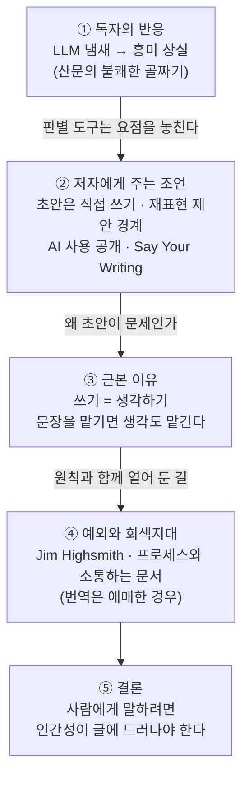

<figure class="post-figure post-figure--header">
<svg role="img" font-family="var(--font-body)" aria-label="왼쪽에는 반듯하게 정렬된 문서 앞에 매끈하지만 표정 없는 가면이 있고(LLM 보이스), 오른쪽에는 비뚤고 고친 흔적이 남은 손글씨 원고와 펜, 작은 하트가 있다(사람의 목소리). 가운데에는 아래로 꺼지는 골짜기 곡선과 함께 '산문의 불쾌한 골짜기 — 흥미가 꺾이는 곳'이라는 표시가 있다." viewBox="0 0 640 330" xmlns="http://www.w3.org/2000/svg">
  <title>산문의 불쾌한 골짜기 — 표정 없는 가면과 온기 있는 손글씨</title>

  <!-- ground -->
  <line x1="20" y1="296" x2="620" y2="296" stroke="currentColor" stroke-width="1.5" opacity="0.3"/>

  <!-- ===== LEFT: smooth, expressionless mask (LLM voice) ===== -->
  <!-- perfectly regular page -->
  <rect x="132" y="70" width="112" height="156" rx="3" fill="var(--bg-light)" stroke="currentColor" stroke-width="2"/>
  <g stroke="currentColor" stroke-width="2" opacity="0.45">
    <line x1="146" y1="92" x2="230" y2="92"/>
    <line x1="146" y1="106" x2="230" y2="106"/>
    <line x1="146" y1="120" x2="230" y2="120"/>
    <line x1="146" y1="134" x2="230" y2="134"/>
    <line x1="146" y1="148" x2="230" y2="148"/>
    <line x1="146" y1="162" x2="230" y2="162"/>
    <line x1="146" y1="176" x2="230" y2="176"/>
    <line x1="146" y1="190" x2="230" y2="190"/>
    <line x1="146" y1="204" x2="230" y2="204"/>
  </g>
  <!-- mask -->
  <ellipse cx="112" cy="160" rx="54" ry="70" fill="var(--bg-panel)" stroke="currentColor" stroke-width="2.5"/>
  <!-- glossy sheen -->
  <path d="M78,118 Q88,100 108,96" fill="none" stroke="var(--gold)" stroke-width="3" stroke-linecap="round" opacity="0.8"/>
  <!-- blank almond eyes -->
  <path d="M82,148 Q94,140 106,148 Q94,154 82,148 Z" fill="currentColor" opacity="0.85"/>
  <path d="M118,148 Q130,140 142,148 Q130,154 118,148 Z" fill="currentColor" opacity="0.85"/>
  <!-- flat mouth -->
  <line x1="96" y1="196" x2="128" y2="196" stroke="currentColor" stroke-width="2.5" stroke-linecap="round"/>
  <!-- mask strap -->
  <line x1="58" y1="156" x2="44" y2="150" stroke="currentColor" stroke-width="2" opacity="0.6"/>

  <text x="140" y="258" text-anchor="middle" font-size="13" font-weight="700" fill="currentColor">매끈하지만 표정 없는 문장</text>
  <text x="140" y="276" text-anchor="middle" font-size="10.5" fill="currentColor" opacity="0.7">LLM 보이스 — 고쳐도 잘 빠지지 않는다</text>

  <!-- ===== MIDDLE: the valley ===== -->
  <text x="320" y="70" text-anchor="middle" font-size="12" font-weight="700" fill="var(--accent-color)">산문의</text>
  <text x="320" y="86" text-anchor="middle" font-size="12" font-weight="700" fill="var(--accent-color)">불쾌한 골짜기</text>
  <path d="M262,116 C290,116 298,120 306,150 Q320,196 334,150 C342,120 350,116 378,116" fill="none" stroke="var(--accent-color)" stroke-width="2.5" stroke-linecap="round"/>
  <circle cx="320" cy="172" r="4" fill="var(--accent-color)"/>
  <text x="320" y="206" text-anchor="middle" font-size="10.5" fill="currentColor" opacity="0.8">읽을수록</text>
  <text x="320" y="221" text-anchor="middle" font-size="10.5" fill="currentColor" opacity="0.8">흥미가 시든다</text>

  <!-- ===== RIGHT: clumsy but warm handwriting (human voice) ===== -->
  <g transform="rotate(-3 460 148)">
    <rect x="400" y="70" width="122" height="156" rx="3" fill="var(--bg-light)" stroke="currentColor" stroke-width="2"/>
    <g fill="none" stroke="var(--secondary-color)" stroke-width="2" stroke-linecap="round">
      <path d="M414,94 q8,-5 16,0 t16,0 t16,0 t16,0 t16,0"/>
      <path d="M414,112 q7,-4 14,0 t14,0 t14,0 t14,0"/>
      <path d="M414,130 q8,-5 16,0 t16,0 t16,0 t16,0 t12,0"/>
      <path d="M414,148 q7,-4 14,0 t14,0 t14,0"/>
      <path d="M414,166 q8,-5 16,0 t16,0 t16,0 t16,0"/>
      <path d="M414,184 q7,-4 14,0 t14,0"/>
    </g>
    <!-- crossed-out word: drafting = thinking -->
    <line x1="470" y1="148" x2="506" y2="148" stroke="currentColor" stroke-width="2" opacity="0.6"/>
    <path d="M470,152 L506,144" stroke="var(--accent-color)" stroke-width="2" stroke-linecap="round"/>
    <!-- small heart -->
    <path d="M492,200 c-4,-6 -12,-2 -8,4 l8,8 l8,-8 c4,-6 -4,-10 -8,-4 Z" fill="var(--accent-color)" opacity="0.85"/>
  </g>
  <!-- pen -->
  <g transform="rotate(38 560 150)">
    <rect x="552" y="96" width="14" height="78" rx="3" fill="var(--bg-panel)" stroke="currentColor" stroke-width="2"/>
    <rect x="552" y="96" width="14" height="14" rx="2" fill="var(--gold)" opacity="0.8"/>
    <path d="M552,174 L559,190 L566,174 Z" fill="currentColor"/>
  </g>

  <text x="490" y="258" text-anchor="middle" font-size="13" font-weight="700" fill="currentColor">서툴지만 온기 있는 문장</text>
  <text x="490" y="276" text-anchor="middle" font-size="10.5" fill="currentColor" opacity="0.7">사람의 목소리 — 쓰면서 생각한다</text>
</svg>
<figcaption>LLM이 쓴 것 같은 매끈한 문장은 독자를 '산문의 불쾌한 골짜기'에 빠뜨린다. Fowler는 서툴더라도 사람이 쓴 글을 더 읽고 싶다고 말한다.</figcaption>
</figure>

## 원문 정보

> - **제목**: LLM Voice
> - **출처**: Martin Fowler ([martinfowler.com](https://martinfowler.com))
> - **발행**: 2026-10-29 · 약 4분 분량
> - **원문 링크**: <https://martinfowler.com/bliki/LLM-Voice.html>

소프트웨어 글쓰기의 대표 저자 중 한 명이 "LLM이 쓴 것 같은 글"에 대한 독자의 반응과 저자의 책임을 짧게 정리한 bliki 글이다. AI 시대에 글을 쓴다는 것의 의미를 묻는 에세이로 보고 `AI-Essays`에 담는다.

## 한 줄 요약 (TL;DR)

LLM이 쓴 것 같은 글은 읽을수록 계속 읽고 싶은 마음이 시드는 **"산문의 불쾌한 골짜기"**에 빠진다. 그러니 사람에게 말을 걸고 싶다면 초안부터 직접 쓰고, AI를 썼다면 어떻게 썼는지 밝히며, 글에 자기 인간성이 드러나게 하라는 것이 Fowler의 주장이다.

## 왜 이 글을 골랐나

개발자는 생각보다 많이 쓴다. 설계 문서, PR 설명, ADR, 인시던트 리포트, 블로그 글을 쓰고, 이 위키도 그런 글의 모음이다. LLM이 이 모든 글을 대신 써 줄 수 있게 되면서 "써도 되는가"보다 **"쓰면 무엇을 잃는가"**를 따져야 할 때가 됐다.

이 위키는 이미 비슷한 질문을 몇 번 다뤘다. Lorin Hochstein은 [LLM이 써 줄 인시던트 리포트](/2026/06/19/llm-written-incident-report-future.html)를 걱정하며 "쓰기는 곧 사고하기"라고 했고, Fowler 자신도 [Fragments에서 '인지적 항복'](/2026/06/23/fowler-fragments-verification-cognitive-surrender.html)을 경고했다. 이번 글은 같은 문제를 **독자 쪽 감각**에서 시작해 **저자 쪽 실천**으로 정리한다는 점에서 짧지만 실용적이다.

글 전체의 흐름을 한 장으로 보면 다음과 같다.

## 핵심 내용

### 산문의 불쾌한 골짜기 (uncanny valley of prose)

Fowler는 글을 읽다가 LLM이 썼다는 느낌이 들면 읽고 싶은 마음이 사라진다고 고백한다. 그는 이를 "we are in an uncanny valley of prose"라고 표현한다. 사람을 거의 닮았지만 완전히 같지는 않은 로봇이 오히려 거부감을 일으킨다는 **불쾌한 골짜기(uncanny valley)** 개념을 글에 적용한 것이다.

LLM 판별 도구에 대해서는 경계한다. 첫째, 정확도가 의심스럽다. 둘째, 더 근본적으로 그런 도구는 **요점을 놓친다**. 독자의 거부감은 사람의 반응이고, 도구를 돌려 볼 생각을 하기도 전에 이미 일어난다.

### 자기 판단에 대한 단서

Fowler는 자신이 LLM 보이스를 정확히 가려낸다고 자신하지 않는다. 예를 들어 "sales motion" 같은 표현이 어색하게 들리지만, 실제로 사람들이 쓰는 것도 들었다. 그래서 이런 표현은 기계가 썼다는 신호라기보다 **세대 차이**일 수 있다고 본다. 자기 감각이 틀릴 수 있음을 먼저 밝혀 두는 것이다.

### 저자에게 주는 조언

<figure class="post-figure">
<svg role="img" font-family="var(--font-body)" aria-label="LLM 활용의 허용 범위 스펙트럼. 왼쪽에서 오른쪽으로 갈수록 LLM에 맡기는 몫이 커진다. 검색 도구로 쓰고 원출처 확인은 OK, 개요 잡기는 아마 OK, 재표현 제안 수용은 위험, 초안 작성은 피하라." viewBox="0 0 640 210" xmlns="http://www.w3.org/2000/svg">
  <title>LLM 활용의 허용 범위 스펙트럼</title>

  <!-- direction axis -->
  <text x="30" y="26" font-size="10.5" fill="currentColor" opacity="0.75">LLM에 맡기는 몫: 적음</text>
  <text x="610" y="26" text-anchor="end" font-size="10.5" fill="currentColor" opacity="0.75">많음</text>
  <line x1="165" y1="22" x2="572" y2="22" stroke="currentColor" stroke-width="1.5" opacity="0.5"/>
  <path d="M572,17 L582,22 L572,27 Z" fill="currentColor" opacity="0.5"/>

  <!-- card 1: search + verify -->
  <rect x="30" y="44" width="134" height="150" rx="4" fill="var(--bg-light)" stroke="currentColor" stroke-width="1.8"/>
  <rect x="30" y="44" width="134" height="8" rx="2" fill="var(--secondary-color)"/>
  <text x="97" y="82" text-anchor="middle" font-size="12.5" font-weight="700" fill="currentColor">검색 도구로 쓰기</text>
  <text x="97" y="102" text-anchor="middle" font-size="10" fill="currentColor" opacity="0.75">찾은 내용은</text>
  <text x="97" y="116" text-anchor="middle" font-size="10" fill="currentColor" opacity="0.75">원출처에서 확인</text>
  <rect x="62" y="146" width="70" height="28" rx="14" fill="var(--secondary-color)" fill-opacity="0.15" stroke="var(--secondary-color)" stroke-width="2"/>
  <text x="97" y="165" text-anchor="middle" font-size="12" font-weight="700" fill="currentColor">OK</text>

  <!-- card 2: outline -->
  <rect x="178" y="44" width="134" height="150" rx="4" fill="var(--bg-light)" stroke="currentColor" stroke-width="1.8"/>
  <rect x="178" y="44" width="134" height="8" rx="2" fill="var(--secondary-color)" opacity="0.55"/>
  <text x="245" y="82" text-anchor="middle" font-size="12.5" font-weight="700" fill="currentColor">개요(outline) 잡기</text>
  <text x="245" y="102" text-anchor="middle" font-size="10" fill="currentColor" opacity="0.75">뼈대만 함께,</text>
  <text x="245" y="116" text-anchor="middle" font-size="10" fill="currentColor" opacity="0.75">문장은 저자가 직접</text>
  <rect x="205" y="146" width="80" height="28" rx="14" fill="var(--secondary-color)" fill-opacity="0.08" stroke="var(--secondary-color)" stroke-width="2" stroke-dasharray="5 3"/>
  <text x="245" y="165" text-anchor="middle" font-size="12" font-weight="700" fill="currentColor">아마 OK</text>

  <!-- card 3: rephrasing -->
  <rect x="326" y="44" width="134" height="150" rx="4" fill="var(--bg-light)" stroke="currentColor" stroke-width="1.8"/>
  <rect x="326" y="44" width="134" height="8" rx="2" fill="var(--gold)"/>
  <text x="393" y="82" text-anchor="middle" font-size="12.5" font-weight="700" fill="currentColor">재표현 제안 수용</text>
  <text x="393" y="102" text-anchor="middle" font-size="10" fill="currentColor" opacity="0.75">"더 매끄러운 문장"은</text>
  <text x="393" y="116" text-anchor="middle" font-size="10" fill="currentColor" opacity="0.75">하나씩 따져 보기</text>
  <rect x="358" y="146" width="70" height="28" rx="14" fill="var(--gold)" fill-opacity="0.15" stroke="var(--gold)" stroke-width="2"/>
  <text x="393" y="165" text-anchor="middle" font-size="12" font-weight="700" fill="currentColor">위험</text>

  <!-- card 4: drafting -->
  <rect x="474" y="44" width="134" height="150" rx="4" fill="var(--bg-light)" stroke="currentColor" stroke-width="1.8"/>
  <rect x="474" y="44" width="134" height="8" rx="2" fill="var(--accent-color)"/>
  <text x="541" y="82" text-anchor="middle" font-size="12.5" font-weight="700" fill="currentColor">초안 작성</text>
  <text x="541" y="102" text-anchor="middle" font-size="10" fill="currentColor" opacity="0.75">고쳐도 LLM 보이스가</text>
  <text x="541" y="116" text-anchor="middle" font-size="10" fill="currentColor" opacity="0.75">좀처럼 빠지지 않는다</text>
  <rect x="501" y="146" width="80" height="28" rx="14" fill="var(--accent-color)" fill-opacity="0.15" stroke="var(--accent-color)" stroke-width="2.5"/>
  <text x="541" y="165" text-anchor="middle" font-size="12" font-weight="700" fill="currentColor">피하라</text>
</svg>
<figcaption>Fowler의 글에서 읽어 낸 LLM 활용의 허용 범위(위키 정리) — 문장을 맡길수록 저자의 목소리와 생각이 함께 빠져나간다.</figcaption>
</figure>

- **LLM에게 초안을 쓰게 하지 말라.** 원문 표현으로는 "authors should not fall into the trap of getting the LLM to write a draft". 사람이 아무리 많이 고쳐도 LLM 보이스는 좀처럼 빠지지 않는다는 이유다(전문 편집자가 손본 드문 예외는 있다고 각주에서 덧붙인다).
- **LLM의 재표현(rephrasing) 제안도 조심해서 받아들이라.**
- **Fowler는 개요(outline)까지만 LLM을 쓰는 사람들이 있다고 들었다고 전한다.** 다만 문장은 저자가 직접 써야 한다. Fowler 자신은 구조를 잡는 데에도 AI를 쓰지 않는다.
- **AI를 썼다면 어떻게 썼는지 밝히게 한다.** 이는 Fowler 사이트의 기고 정책으로, 보통 감사의 말(acknowledgments)에 적는다. 이유는 투명성, 그리고 독자가 유용한 AI 활용법을 배울 수 있게 하기 위해서다. Fowler 자신은 AI를 검색 도구로만 쓰고, 찾은 내용은 원출처에서 확인한다고 말한다. 이 글의 감사의 말에는 "I did not use AI or LLMs in any way while writing this post."라고 적혀 있다.
- **"Say Your Writing"**: 쓸 만한 초안이 나오면 소리 내어(꼭 목소리를 내지 않더라도 입으로 말하듯) 읽어 보라는, 그가 예전에 bliki에 쓴 조언이다. Fowler 자신은 머릿속으로 말한 뒤 받아 적고 다시 고친다. 그는 이 조언이 LLM 시대에 더 중요해졌다고 말한다. 글쓰기는 기술이고, LLM에 맡길수록 그 기술은 약해지기 때문이다.

### 쓰기는 생각의 도구다

Fowler는 언젠가 LLM이 너무 좋아져 사람의 글과 구별할 수 없게 될 수도 있는데, 여러 면에서 그쪽이 더 걱정스럽다고 말한다. 그 이유가 여기서 나온다. "Like most writers, I find writing an almost-essential tool for thinking." 글을 쓰면서 생각이 정리된다는 것이다. 그래서 문장을 LLM에 맡기면 **생각과 이해까지 함께 맡기는 셈**이 될 위험이 있다.

### 예외들

Fowler는 원칙만 내세우지 않고, 받아들일 수 있는 경우와 애매한 경우를 구체적으로 든다.

- **Jim Highsmith**: 파킨슨병 때문에 글쓰기가 어려워진 Highsmith에게는 LLM과의 작업이 글쓰기에 필수다. Fowler는 그의 경우라면 LLM 보이스를 기꺼이 받아들인다.
- **비원어민 동료**: 많은 동료에게 영어는 두 번째, 네 번째 언어다. Fowler는 이를 "더 애매한(awkward) 경우"라고 부른다. 동료들이 LLM 번역에 기대는 사정은 이해하지만, 그래도 매끄럽지만 영혼 없는 글보다 사람이 쓴 서툰 글을 더 읽고 싶다고 말한다.
- **일상적 문서**: 서식 편지나 아무도 읽지 않을 보고서는 LLM이 써도 무방하다. 이 대목에서 Michael Nygard의 말을 인용한다. "You're communicating with a process rather than a human." 사람이 아니라 **프로세스**와 소통하는 글이라는 뜻이다.

### 결론

사람과 소통하고 싶다면, 원문 표현대로 "my humanity has to shine (or at least ooze) out of my prose." 즉 자신의 인간성이 글에서 빛나야 한다. 빛나지 못한다면 스며 나오기라도 해야 한다.

## 분석과 인사이트

> 아래는 원문 요약이 아니라 이 위키의 해석이다.

**1. 판별의 문제를 관계의 문제로 바꾼다.** LLM 글에 대한 논의는 흔히 "어떻게 잡아낼 것인가"로 흐른다. Fowler는 그 질문을 내려놓는다. 독자가 이미 흥미를 잃었다면 판별기의 결과는 의미가 없다. 중요한 것은 **독자와 저자 사이의 신뢰**이고, 도구로는 그것을 되찾을 수 없다. 코드 리뷰에 빗대면, 리뷰어가 "이 PR은 생각 없이 생성된 것 같다"고 느끼는 순간 리뷰의 질이 떨어지는 것과 같다.

**2. '프로세스와 소통하는 글'이라는 구분이 유용하다.** Nygard의 문장은 이 글에서 가장 실무적인 기준이다. 개발자가 쓰는 글을 이 기준으로 나눠 보면 이렇다. 릴리스 노트의 정형 항목, 컴플라이언스용 체크리스트, 자동 생성되는 변경 요약은 프로세스를 상대하는 글이다. 반면 설계 제안서, ADR의 "왜", 포스트모템의 서사, 동료에게 보내는 피드백은 사람을 상대하는 글이다. LLM을 쓸지 고민될 때 "이 글을 읽는 건 사람인가, 프로세스인가"를 먼저 물으면 된다.

**3. 초안을 맡기지 말라는 조언의 진짜 근거는 '쓰기 = 생각하기'다.** 문체가 어색해진다는 것은 겉으로 드러나는 증상일 뿐이다. 초안을 쓰는 과정이 곧 생각을 다듬는 과정이므로, 초안을 맡기면 생각할 기회를 잃는다. Hochstein의 [인시던트 리포트 글](/2026/06/19/llm-written-incident-report-future.html)과 정확히 같은 결론이고, Fowler가 [Fragments에서 다룬 '인지적 항복'](/2026/06/23/fowler-fragments-verification-cognitive-surrender.html)을 글쓰기 버전으로 옮긴 셈이다.

**4. 단서를 다는 태도가 설득력을 높인다.** Fowler는 자기 감각이 틀릴 수 있다고 인정하고, 예외를 구체적인 사람의 이름으로 든다. 그 덕분에 "LLM 글은 나쁘다"는 단순한 주장이 "누구에게, 어떤 글에서, 왜 문제인가"라는 판단 기준으로 바뀐다. AI 담론에서 열광과 회의 사이의 [균형 감각](/2026/06/19/martin-fowler-fragments-llm-era.html)을 꾸준히 강조해 온 그다운 서술이다.

**5. 이견 한 가지.** 비원어민의 경우 "서툰 사람의 글이 낫다"는 선호는 독자로서는 이해되지만, 저자 쪽에서 보면 비용이 다르다. 영어가 네 번째 언어인 엔지니어에게 서툰 글은 실제로 평가나 기회에 불이익을 줄 수 있다. 현실적인 타협은 **생각과 초안은 모국어로 직접 쓰고, LLM은 번역·교정에만 쓰고, 그 사실을 밝히는 것**일 것이다. 이렇게 하면 Fowler가 지키려는 핵심, 즉 생각은 저자가 한다는 원칙은 지킬 수 있다. 원문은 이 구체적인 타협안까지 제시하지는 않으므로, 이 부분은 이 위키의 제안이다.

**6. 이 위키에 대한 함의.** 이 위키의 Articles 포스트도 에이전트의 도움으로 작성된다. Fowler의 기준을 적용하면 두 가지가 따라 나온다. 하나는 원문 요약과 자기 분석을 분명히 나누는 것이고, 다른 하나는 어떤 도구를 어떻게 썼는지 투명하게 밝히는 것이다. 이 글을 소개하는 일 자체가 그 기준을 시험받는 일이기도 하다.

## 적용 포인트

- **독자를 먼저 확인하라.** 쓰기 전에 "이 글은 사람과 소통하는가, 프로세스와 소통하는가"를 묻는다. 프로세스용 문서라면 LLM에 맡겨도 된다. 사람에게 쓰는 글이라면 직접 쓴다.
- **초안은 직접 쓰라.** 설계 문서나 ADR의 첫 문단은 거칠어도 직접 쓴다. LLM은 그다음 단계에서 오탈자, 누락, 반론을 점검하는 리뷰어로 쓴다.
- **재표현 제안은 하나씩 따져 보라.** "더 매끄러운 문장"을 그대로 받아들이기 전에, 원래 문장이 담던 뉘앙스가 사라지지 않았는지 확인한다.
- **소리 내어 읽어 보라 (Say Your Writing).** 말로 했을 때 어색한 문장은 글로도 어색하다. 말하듯 쓰면 자기 목소리가 남는다.
- **AI 사용을 밝히라.** 블로그 글이나 사내 문서에 "AI를 어디에 어떻게 썼는지" 한 줄로 적는 습관을 들인다. 검색에만 썼다면 그 사실과 원출처 확인 여부를 함께 적는다.
- **AI가 찾아 준 사실은 원출처에서 확인하라.** Fowler처럼 AI를 검색 도구로 쓰더라도 인용과 수치는 원문에서 다시 확인한다.

## 마무리

"LLM Voice"는 짧은 글이지만 핵심은 분명하다. 독자는 판별기보다 먼저 기계가 쓴 글을 알아채고 흥미를 잃는다. 그러니 사람에게 말하려면 생각과 문장을 스스로 만들어야 한다. Fowler는 건강과 프로세스용 문서라는 예외를 열어 두고 번역은 회색지대로 남겨 두면서도, 사람을 향한 글에서는 저자의 인간성이 드러나야 한다는 원칙을 지킨다. 코드는 점점 에이전트가 쓰더라도, 동료를 설득하는 글만큼은 직접 쓸 이유가 여기에 있다.

### 더 읽어보기

- [원문 — Martin Fowler, "LLM Voice"](https://martinfowler.com/bliki/LLM-Voice.html)
- [Martin Fowler, "Say Your Writing"](https://martinfowler.com/bliki/SayYourWriting.html) — 원문이 LLM 시대에 더 중요해졌다고 말하는, 말하듯 쓰라는 조언
- [LLM이 써 줄 인시던트 리포트의 미래가 두렵다 (Lorin Hochstein)](/2026/06/19/llm-written-incident-report-future.html) — "쓰기는 곧 사고하기"를 인시던트 리포트에 적용한 글
- [코딩이 공짜가 되면 무엇이 비싸지는가 — Martin Fowler의 Fragments (4월 2일)](/2026/06/23/fowler-fragments-verification-cognitive-surrender.html) — 생각을 위임하는 '인지적 항복'에 대한 경고
- [Martin Fowler의 Fragments로 읽는 LLM 시대의 균형 감각](/2026/06/19/martin-fowler-fragments-llm-era.html) — 열광과 회의 사이에서 균형을 잡는 Fowler의 시각
- [그냥 그렇게 말하면 된다 (Caleb Gross)](/2026/06/22/you-can-just-say-it.html) — 의도와 형식이라는 렌즈로 본 창작과 'AI slop'
- [취향과 판단, 그리고 AI (Addy Osmani)](/2026/08/04/taste-judgment-and-ai.html) — 에이전트에게 넘길 수 없는 '이름을 거는 일'
