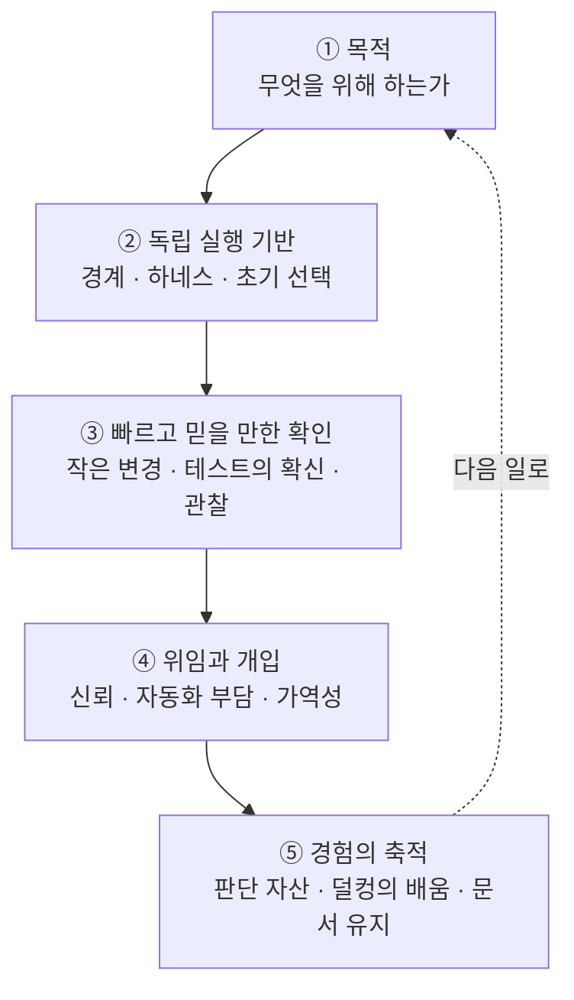

<figure class="post-figure post-figure--header">
<svg role="img" aria-labelledby="airef-hdr-title" aria-label="사람이 AI에게 왜·범위·제약과 우선순위 꼬리표가 붙은 일 꾸러미를 건네고, 아래에는 코드 단위에서 작업 단위, 업무 단위로 오르는 신뢰의 계단이 있다" viewBox="0 0 380 360" width="440" xmlns="http://www.w3.org/2000/svg" font-family="Pretendard, sans-serif">
<title id="airef-hdr-title">AI에게 일을 맡긴다는 것 — 일 꾸러미와 신뢰의 계단</title>
<g fill="none" stroke="currentColor" stroke-width="4" stroke-linecap="round" stroke-linejoin="round">
<circle cx="55" cy="66" r="16"/>
<line x1="55" y1="82" x2="55" y2="140"/>
<line x1="55" y1="100" x2="115" y2="80"/>
<line x1="55" y1="140" x2="42" y2="176"/>
<line x1="55" y1="140" x2="68" y2="176"/>
</g>
<g stroke-linecap="round" stroke-linejoin="round">
<line x1="323" y1="50" x2="323" y2="36" stroke="var(--accent-color)" stroke-width="3"/>
<circle cx="323" cy="33" r="4" fill="var(--accent-color)"/>
<rect x="292" y="50" width="62" height="52" rx="10" fill="var(--bg-panel)" stroke="var(--accent-color)" stroke-width="3"/>
<rect x="306" y="68" width="10" height="10" fill="currentColor"/>
<rect x="330" y="68" width="10" height="10" fill="currentColor"/>
<line x1="310" y1="90" x2="336" y2="90" stroke="currentColor" stroke-width="3"/>
<rect x="300" y="110" width="46" height="64" rx="6" fill="var(--bg-panel)" stroke="var(--accent-color)" stroke-width="3"/>
<line x1="300" y1="124" x2="265" y2="80" stroke="var(--accent-color)" stroke-width="4"/>
</g>
<text x="55" y="204" text-anchor="middle" font-size="16" font-weight="700" fill="currentColor">사람</text>
<text x="323" y="204" text-anchor="middle" font-size="16" font-weight="700" fill="currentColor">AI</text>
<rect x="115" y="62" width="150" height="36" rx="4" fill="var(--bg-panel)" stroke="var(--gold)" stroke-width="3"/>
<text x="190" y="86" text-anchor="middle" font-size="16" font-weight="700" fill="currentColor">일 꾸러미</text>
<line x1="190" y1="98" x2="190" y2="178" stroke="currentColor" stroke-width="2" stroke-dasharray="3 3"/>
<g font-size="15" fill="currentColor" text-anchor="middle">
<rect x="122" y="108" width="136" height="28" rx="5" fill="var(--bg-panel)" stroke="currentColor" stroke-width="2"/>
<text x="190" y="127">왜 (목적)</text>
<rect x="122" y="144" width="136" height="28" rx="5" fill="var(--bg-panel)" stroke="currentColor" stroke-width="2"/>
<text x="190" y="163">범위 (경계)</text>
<rect x="122" y="180" width="136" height="28" rx="5" fill="var(--bg-panel)" stroke="currentColor" stroke-width="2"/>
<text x="190" y="199">제약 · 우선순위</text>
</g>
<text x="30" y="254" font-size="15" font-weight="700" fill="currentColor">신뢰가 쌓이는 계단</text>
<rect x="30" y="300" width="105" height="40" fill="var(--bg-panel)" stroke="currentColor" stroke-width="2.5"/>
<rect x="137" y="270" width="105" height="70" fill="var(--bg-panel)" stroke="var(--secondary-color)" stroke-width="2.5"/>
<rect x="244" y="240" width="105" height="100" fill="var(--bg-panel)" stroke="var(--gold)" stroke-width="3"/>
<g font-size="15" fill="currentColor" text-anchor="middle">
<text x="82" y="326">코드 단위</text>
<text x="189" y="296">작업 단위</text>
<text x="296" y="266">업무 단위</text>
</g>
</svg>
<figcaption>AI에게 일을 맡긴다는 것 — 왜 하는지와 제약·우선순위, 맡긴 범위를 함께 건네고, 앞선 일을 잘 해낸 경험이 쌓이며 맡기는 범위가 코드에서 작업, 업무 단위로 넓어진다.</figcaption>
</figure>

## 원문 정보

> - **제목**: AI 러닝과 단상
> - **출처**: Daily Kiwi (@whitekiwi), Medium ([medium.com/@whitekiwi](https://medium.com/@whitekiwi))
> - **발행**: 2026-11-01 · 분량 표기 미확인(다섯 장에 걸친 장문 에세이)
> - **원문 링크**: <https://medium.com/@whitekiwi/ai-%EB%9F%AC%EB%8B%9D%EA%B3%BC-%EB%8B%A8%EC%83%81-6a16a57a753b>

한국어로 쓰인 실무자의 AI 협업 회고다. 원문 페이지는 직접 열리지 않았지만(HTTP 403), 저자의 Medium RSS 피드(`medium.com/feed/@whitekiwi`)에 **본문 전문**이 실려 있어 그 텍스트를 바탕으로 정리했다. 이 포스트의 인용은 모두 그 피드 본문에서 그대로 옮겼다. 다만 서문 뒤에 들어 있는 그림 한 장은 피드에서 내용을 확인하지 못했다.

## 한 줄 요약 (TL;DR)

AI에게 일을 맡기는 일은 사람에게 일을 맡기는 일과 닮았다. 구현이 빨라질수록 중요한 것은 **무엇을 왜 만드는지, 어떤 경계 안에서 일하게 할지, 결과를 어떻게 빠르고 믿을 만하게 확인할지, 어디에 사람이 개입할지, 한 번의 경험을 어떻게 다음 일로 잇는지**다. 저자는 이 다섯 질문을 단정이 아닌 "지금의 생각"으로 정리한다.

## 왜 이 글을 골랐나

이 위키의 Articles에는 위임과 검증을 다룬 글이 이미 여럿 있다. [에이전트에게 얼마나 맡길 것인가 (Martin Fowler)](/2026/07/18/fowler-fragments-agent-autonomy.html)가 큰 틀의 질문을 던지고, [짧은 목줄 방법](/2026/07/06/short-leash-ai-coding.html)은 한쪽 극단의 규율을, [Loop Engineering](/2026/06/19/loop-engineering.html)은 반대쪽 시스템 설계를 보여 준다. 이 글은 그 사이에서 **한 실무자가 자기 작업 환경에서 실제로 부딪힌 일**을 다섯 질문으로 정리했다는 점이 다르다. 레포는 나눴는데 DB는 공유하고 있었다는 일화, 결과를 매번 검토하다 보니 그 검토가 별도 업무가 됐다는 경험처럼 손에 잡히는 사례가 많다.

또 저자는 아직 측정하지 않은 것과 직접 확인하지 않은 것을 꼬박꼬박 구분해서 쓴다. 과장 없는 실무 노트를 읽는다는 것 자체가 이 글의 가치라고 본다.

## 핵심 내용

서문에서 저자는 AI를 쓰며 반복해서 느끼는 점을 이렇게 적는다.

> "왜 하는지 알아야 판단할 수 있고, 담당 범위가 분명해야 독립적으로 일할 수 있으며, 피드백과 경험이 쌓여야 더 많은 일을 맡길 수 있다."

이어 구현 속도가 빨라질수록 "무엇을 만들지, 어떤 구조에서 일할지, 결과를 어떻게 확인할지, 언제 사람이 개입할지"가 더 중요하게 느껴졌다고 말한다. 그리고 그 생각을 다섯 질문으로 나눈다. 저자는 이 다섯 질문을 방향 판단에서 배움의 연결로 이어지는 하나의 흐름으로 묶으면서도, 실제 작업에서는 이 질문들을 오가게 된다고 덧붙인다.

다섯 질문의 흐름을 그림으로 보면 다음과 같다.

### 1. 무엇을 위해 이 일을 하는가?

- **상위의 이유가 있으면 하던 일도 다시 판단할 수 있다.** 목표에서 방법이, 방법에서 세부 작업이 나온다. 저자는 테스트 자동화 플랫폼의 상위 목표를 '변화의 속도에 확신을 주는 것'으로 들고, CI/CD 연결이나 테스트 선택, 케이스 생성은 그 목표에 다가가는 방법이라고 설명한다. 목표가 분명하면 지금 필요한 기능과 나중에 해도 될 기능을 나눌 수 있고, 더 싼 방법이 생겼을 때 방향을 바꿀 수도 있다.
  > "특정 기능을 만들고 있다는 이유만으로 계속 만드는 것이 타당해지지는 않는다."
- AI에게도 무엇을 할지와 함께 **왜 하는지, 제약과 우선순위**를 전달하는 것이 유효해 보인다고 한다. 다만 AI의 판단이 목표를 임의로 넓히지 않도록 **맡긴 범위**도 함께 줘야 한다고 덧붙인다.
- **필요한 해법은 다른 사람도 고민했을 가능성이 높다.** 레퍼런스를 찾아보면 선택지가 넓어지지만 전제와 규모는 우리 조건과 비교해야 한다. 지금 하는 일을 개선하는 방법만 찾지 말고, 그 일을 아예 없애거나 경로를 바꿀 대안도 보자고 한다. AI가 "주어진 판 위에서만" 답을 찾는다고 느껴지면 판 자체도 검토 대상으로 열어 두라는 것이다. ADR, 모듈 경계, 작은 변경, 빠른 피드백은 소프트웨어와 사람의 협업에서 이미 다뤄 온 문제라는 지적도 여기서 나온다.

### 2. AI가 독립적으로 일하려면 어떤 기반이 필요한가?

- **경계가 명확하면 함께 생각하고 건드릴 범위가 작아진다.** 같은 레포에서 폴더만 나눠 두었더니 작업이 진행되면서 결합되고 엉켰다는 경험이 출발점이다. 레포·서비스·리소스를 실제로 나누면 경계가 분명해진다. 그런데 작업별로 레포를 복제해 두고도 실행 상태를 저장하는 DB는 공유하고 있었다는 일화가 붙는다.
  > "코드가 나뉘었다고 실제 자원까지 격리된 것은 아니었다."
- 병렬 작업에서도 공용 인터페이스가 정해지지 않았거나 같은 자원을 계속 고쳐야 하면 조율과 통합에서 기다리게 된다. 저자는 담당 결과, 수정 권한, 만나는 인터페이스를 분명히 하되 분리 때문에 늘어나는 통신·배포·운영 비용도 함께 보자고 한다.
- **도구와 실행 환경도 독립적으로 쓸 수 있어야 한다.** 저자는 하네스를 쥐어 준다는 말을 "도구·실행 환경·검증·피드백을 연결해 주는 것"으로 이해한다. 설치만 돼 있고 호출하기 어렵거나, 결과를 사람이 해석해서 다시 전달해야 하면 작업은 그 지점에서 멈춘다. 개인 노트북을 함께 쓸 때 computer use가 자신의 작업 환경과 겹쳤다는 경험도 적는다. 별도 컴퓨터나 클라우드 환경을 주는 쪽으로 생각을 넓히면 브라우저·프로세스·파일까지 경계 설계의 대상이 된다. Anthropic이 실행 환경, 세션 기록, 에이전트 실행 루프를 분리한 사례도 같은 맥락에서 읽었다고 한다.
- **초기 선택은 이후 반복 비용을 만든다.** 스택, 언어, 인터페이스, 격리 경계, 빌드·테스트 도구는 소비자와 데이터와 호환성 약속이 쌓이기 전에 고르는 편이 대체로 싸다. 초기에는 모르는 것이 많으니 바꾸기 어려운 선택은 작은 실험으로 확인하거나 교체 가능한 경계를 두고, 바꾸기 쉬운 세부 구현에는 재량을 넓히자고 한다. 검토의 무게는 이름이나 코드 크기가 아니라 **파급 범위와 이행 비용**에 달려 있다. 구현이 빨라진 만큼 구조 개선이나 새 스택도 적극적으로 검토할 수 있지만, 데이터 이행·호환성·운영 비용은 코드가 빨리 써진다고 줄지 않는다는 단서를 단다.

### 3. 결과를 어떻게 빨리, 믿을 만하게 확인할 수 있을까?

- **빠른 피드백과 작은 변경은 함께 간다.** 변경하고 확인하고 다시 고치는 주기가 짧을수록 AI가 일을 이어 가기 쉽다. 저자는 SWC와 Turborepo를 후보로 들면서도 역할을 나눠 설명한다. SWC는 코드 변환을 개선하는 도구이고 타입 검증은 별도로 확인해야 한다. Turborepo는 작업 결과를 재사용하는 도구이고 캐시의 입력·출력과 결정성이 맞아야 한다. 그러니 먼저 무엇을 기다리고 있는지 확인하고, 적용 전후를 비교하자고 한다.
- 변경도 작게 나눈다. 공통 컴포넌트를 먼저 수정하고 그것을 쓰는 비즈니스 로직은 다음 PR로 보내는 식이다. 먼저 내보내는 변경은 기존 소비자와 호환돼야 한다. 중간 상태를 유지하기 어려우면 같은 PR 안의 논리적 커밋으로 나눌 수도 있다. 크기의 기준은 "독립적으로 이해하고 확인할 수 있는지"다.
- **통과하는 테스트와 확신의 관계를 살핀다.** 저자가 느낀 문제는 테스트가 쌓이면서 CI/CD와 개발 사이클이 느려진 것이었다. 그래서 검사를 늘리는 일, 확신이 커지는 일, 그 확신을 얻는 데 드는 비용을 함께 생각하게 됐다고 한다. 테스트는 무엇을 보호하는지, 어떤 잘못된 동작에서 실패해야 하는지 설명할 수 있어야 한다. 기대값이 현재 구현을 그대로 따라 쓰는 일이 없도록 요구사항이나 확인된 사례에 근거해야 한다.
- 저자는 타락한스벨트전도사의 「AI가 짠 테스트 절반은 허수였습니다 — 뮤테이션 테스트」와 Stryker 문서를 함께 읽었다고 밝힌다. 뮤테이션 테스트는 검증 공백을 찾는 수단이지만 "점수가 요구사항의 옳음까지 보장하지는 않"으며, 그 글의 수치는 해당 프로젝트의 사례로 받아들였다고 선을 긋는다.
- 현재는 가벼운 검사를 CI/CD에 두고 E2E는 필요할 때 로컬에서 돌리는 방식을 시도하는 중이다. 테스트 자동화 플랫폼에서는 AI가 변경을 분석해 필요한 테스트를 고르고, 빠진 케이스를 리포트하고 생성하는 흐름을 **구상 중**이라고 한다. 남은 질문도 함께 적는다. 공유 패키지·설정·스키마 변경은 영향이 넓을 수 있고, AI가 고른 테스트만 통과했다고 그 선택이 충분했는지는 알 수 없다는 것이다.
- **관찰할 수 있어야 고칠 곳을 고를 수 있다.** 실패 로그, 실행 이력, dry run, 성능 지표가 있어야 병목과 개입 지점을 찾는다. 반복 작업 관리 도구 Locron에서 로그·이력·판단 이유를 조회하는 것, 지식 도구 ObsDog에서 저장량과 실제 검색·사용·도움 여부를 구분하는 것이 예로 나온다.
  > "지식을 많이 쌓았다는 것과 그 지식이 일에 쓰였다는 것은 다른 관찰이다."
- 저자는 첫 유효 피드백까지 걸린 시간, 사람이 기다리거나 검토한 시간, 놓친 문제와 재작업을 보고 싶다고 하면서 다음 문장으로 선을 긋는다.
  > "아직 측정한 성과는 없고, 앞으로 확인해 보고 싶은 것들이다."

### 4. 어디까지 맡기고, 사람은 어디에 개입할까?

- **더 많은 일을 맡기는 데에는 신뢰가 필요하다.** 저자가 AI에 맡기는 범위는 코드 단위에서 작업 단위로, 다시 업무 단위로 넓어졌다. 기술 발전도 있었지만 앞선 일을 잘 해낸 경험이 다음 단계로 넘어가게 했다고 느낀다. 그래서 **신뢰가 쌓일 대상**이 있어야 한다고 본다. 역할과 품질 관리가 이어지는 코드리뷰봇이나 모니터링 에이전트가 있으면 성과, 실패, 개선을 같은 대상에 연결할 수 있다. 저자는 이것을 "기대하는 방향"이라고 표현한다. 신뢰를 판단할 때는 통과 횟수와 함께 놓친 문제, 잘못된 지적, 교정, 재작업도 봐야 하고, 모델·규칙·업무가 바뀌면 어디까지 다시 확인할지는 남은 질문이라고 한다.
- **사람이 매번 끼어야 하는 자동화는 다시 일이 된다.** 자동화 결과를 매번 직접 검토했더니 점점 지루하고 부담스러워졌고, 그 검토가 별도 업무가 됐다고 한다. 요청하고 설정하고 읽고 고치고 전달하는 비용이 남아 있으면 자동화 자체를 덜 쓰게 된다. AI에게 직렬로 지시하면 사람이 계속 다음 행동을 공급해야 한다. 결과까지 위임하면 다른 일을 병행할 여지가 생기지만, 동시에 몇 개를 돌리느냐보다 완료된 일의 가치, 사람의 투입 시간, 인계·통합 비용, 품질을 봐야 한다고 말한다.
- 저자는 매 요청마다 goal과 검증 방법을 직접 적지는 않는다고 밝힌다. 완료 기준이 의미 있는 작업이라면 AI가 요청과 맥락에서 기준을 끌어내고 단계를 나눠 주는 방식이 좋겠고, 탐색이나 대화에는 확인할 질문과 관찰 범위 정도면 충분할 수 있다고 본다. 사람의 판단은 의도나 큰 영향이 불명확한 부분에 모이면 좋겠다는 것이다. 도입을 추진 중인 코드리뷰 플랫폼에 대해서는 "직접 동작을 확인한 내용은 아니지만"이라고 전제한 뒤 룰 관리까지 작업 흐름에 넣는 방향이 흥미롭다고 적는다.
- **개입할 곳은 변경 비용과 실행의 영향을 함께 보고 고른다.** 저자는 두 가지 기준을 든다. 하나는 나중에 바꾸기 어려운 선택이다. 인터페이스, 언어, 스택, 데이터 설계가 여기에 속한다. 다른 하나는 실행 효과를 되돌릴 수 있는지다. 메일이나 슬랙 메시지는 지워도 이미 읽은 사람의 판단과 후속 행동은 회수하기 어렵다.
  > "설계의 교체 비용과 실행 효과의 가역성은 구분해서 봐야 한다."
- 그래서 조회, 초안, 되돌릴 수 있는 편집은 합의된 범위에서 자유롭게 맡기고, 회수하기 어려운 실행은 대상·내용·범위가 구체적으로 보이는 지점에서 판단할 수 있으면 좋겠다고 한다. 이미 준 권한 안의 같은 결정을 매번 승인받는 부담은 줄이고, 새 대상이나 예상하지 못한 영향에 개입을 모으는 방향이다. 결과가 불명확한 외부 실행은 중복 실행 여부부터 확인할 수 있어야 한다는 단서도 붙인다.

<figure class="post-figure">
<svg role="img" aria-labelledby="airef-s4-title" aria-label="개입 지점 고르기: 위에서부터 설계의 교체 비용 축, 실행 효과의 가역성 축, 그리고 두 축에서 나온 결론을 세로로 쌓은 그림" viewBox="0 0 380 520" width="440" xmlns="http://www.w3.org/2000/svg" font-family="Pretendard, sans-serif">
<title id="airef-s4-title">설계의 교체 비용과 실행 효과의 가역성으로 개입 지점 고르기</title>
<defs>
<marker id="airef-s4-arrow" viewBox="0 0 10 10" refX="8" refY="5" markerWidth="7" markerHeight="7" orient="auto-start-reverse"><path d="M0,0 L10,5 L0,10 z" fill="currentColor"/></marker>
</defs>
<g fill="currentColor" font-size="15">
<text x="20" y="30" font-size="16" font-weight="700">① 설계의 교체 비용</text>
<rect x="20" y="42" width="108" height="30" rx="15" fill="none" stroke="currentColor" stroke-width="2"/>
<text x="74" y="62" text-anchor="middle">바꾸기 쉬움</text>
<text x="140" y="62">세부 구현</text>
<rect x="20" y="82" width="108" height="30" rx="15" fill="none" stroke="var(--accent-color)" stroke-width="2.5" stroke-dasharray="5 3"/>
<text x="74" y="102" text-anchor="middle">바꾸기 어려움</text>
<text x="140" y="102">인터페이스·언어·</text>
<text x="140" y="122">스택·데이터 설계</text>
<line x1="20" y1="140" x2="360" y2="140" stroke="currentColor" stroke-width="1" stroke-opacity="0.35"/>
<text x="20" y="166" font-size="16" font-weight="700">② 실행 효과의 가역성</text>
<rect x="20" y="178" width="108" height="30" rx="15" fill="none" stroke="currentColor" stroke-width="2"/>
<text x="74" y="198" text-anchor="middle">되돌림 가능</text>
<text x="140" y="198">조회·초안·</text>
<text x="140" y="218">되돌릴 수 있는 편집</text>
<rect x="20" y="228" width="108" height="30" rx="15" fill="none" stroke="var(--accent-color)" stroke-width="2.5" stroke-dasharray="5 3"/>
<text x="74" y="248" text-anchor="middle">회수 어려움</text>
<text x="140" y="248">메일·슬랙 메시지</text>
</g>
<line x1="190" y1="268" x2="190" y2="296" stroke="currentColor" stroke-width="2.5" marker-end="url(#airef-s4-arrow)"/>
<g fill="currentColor" font-size="15">
<text x="20" y="322" font-size="16" font-weight="700">③ 그래서 개입 지점은</text>
<rect x="20" y="334" width="340" height="58" rx="6" fill="var(--bg-panel)" stroke="var(--secondary-color)" stroke-width="2.5"/>
<text x="34" y="357">조회·초안·되돌릴 수 있는 편집</text>
<text x="34" y="381" font-weight="700">→ 합의된 범위에서 자유롭게 위임</text>
<rect x="20" y="404" width="340" height="104" rx="6" fill="var(--bg-panel)" stroke="var(--accent-color)" stroke-width="2.5" stroke-dasharray="6 3"/>
<text x="34" y="427">바꾸기 어려운 선택 · 회수 어려운 실행</text>
<text x="34" y="451" font-weight="700">→ 사람이 개입</text>
<text x="34" y="475">실행은 대상·내용·범위가</text>
<text x="34" y="497">구체적으로 보이는 지점에서 판단</text>
</g>
</svg>
<figcaption>개입 지점 고르기 — "설계의 교체 비용과 실행 효과의 가역성은 구분해서 봐야 한다." 메일·슬랙 메시지는 지워도 이미 읽은 사람의 판단과 후속 행동은 회수하기 어렵다. 이미 준 권한 안의 같은 결정은 매번 승인받지 않고, 새 대상이나 예상하지 못한 영향에 개입을 모은다.</figcaption>
</figure>

### 5. 한 번의 경험이 다음 일을 어떻게 바꿀까?

- **구현뿐 아니라 이미 내린 판단도 자산이 된다.** 라이브러리와 컴포넌트는 구현을, 공용 인프라와 룰은 운영의 기본값을, 결정 기록은 판단의 이유를 다음 작업에 넘겨준다. 저자는 앞선 개선이 다음 작업의 출발점을 높이는 것을 '복리'라고 부른다. 개인 프로젝트마다 DB, 인증, 백업을 반복해서 고민하다가 재사용할 컴포넌트와 기본 선택, 그 이유를 정리했더니 AI가 이미 결정된 전제에서 출발할 수 있었다고 한다.
  > "재사용되는 것은 구현뿐 아니라 판단의 이유이기도 했다."
- ADR처럼 무엇을 왜 골랐고 어디까지 적용되는지 남기면, 현재 기능과 예정 기능과 지금 감수하는 제약을 구분할 수 있다. 그러면 예정된 기능을 이미 있다고 가정하는 혼동도 줄어든다. 다만 공용 자산은 다음 작업에서 실제로 찾아 쓰고 개선해야 효과가 나고, 재사용으로 생기는 결합도 관리해야 한다.
- **'덜컹'한 순간의 배움이 다음 행동까지 이어져야 한다.** 저자는 「딸깍과 덜컹」이라는 발표에서 들은 이야기를 소개한다. AI가 질문하거나 내가 "그거 아니야"라고 말하는 순간을 어떻게 넘기느냐가 중요하다는 내용이고, 저자는 이를 암묵지와 연결해 기억한다. 발표의 정확한 표현이 아니라 자신이 받아들인 생각을 적는다고 밝혀 둔다. 컨벤션, 선호, 예외는 기대가 어긋나는 순간에 드러난다. 그때 설명한 이유와 조건을 다음 작업에서 다시 꺼내 쓸 수 있으면 같은 설명을 되풀이할 일이 줄어든다.
- 저자에게 목적은 러닝이 쌓이는 것이다. 저장·회수·주입 구조는 그 방법이고, ObsDog는 지금 고른 수단일 뿐이다. 반복되는 기계적 조건은 코드와 자동 검사로, 맥락에 따라 달라지는 판단은 이유와 조건을 갖춘 지식으로 남긴다. 효과는 저장한 문서 수가 아니라 **반복 질문, 실수, 재작업이 줄었는지**로 보고 싶다고 한다. 같은 문제가 다시 생기면 원인을 지식이 없었는지, 못 찾았는지, 적용 조건을 오해했는지, 행동에 반영되지 않았는지로 나눠 살핀다.
- **쌓인 문서와 코드도 계속 적절한 상태로 바뀌어야 한다.** AI는 문서를 많이 쓰지만 그 문서가 유용한지, 양과 구조가 적절한지는 잘 관리되지 않는다. 저자는 내용만 커지고 구조는 그대로인 문서가 특히 눈에 띈다고 한다. 지금 판단에 필요한 설명과 결정 이유는 가까이 두고 긴 경과와 원시 기록은 연결해 두라고 권한다. 문서의 적절성을 길이로 정하기보다 답을 찾는 비용, 한 사실이 바뀔 때 고칠 위치의 수, 중복과 모순을 보자고 한다.
  > "자산을 쌓는 일에는 쓸 수 있는 상태로 유지하는 비용까지 포함된다."

### 지금의 생각과 참고 자료

맺음말에서 저자는 직접 경험하거나 글을 읽거나 대화하면서 인사이트가 생기고, 그 과정에서 이전 생각이 "심심치 않게" 바뀐다고 적는다. 이 글은 그런 지금의 생각을 정리해 공유하는 것이라고 한다. 참고 자료로는 Kent Beck(Augmented Coding), Mitchell Hashimoto(My AI Adoption Journey), Birgitta Böckeler(Harness engineering), Ethan Mollick(Management as AI superpower), Simon Willison(Hoard things you know how to do), Anthropic(Scaling Managed Agents), METR, DORA, Microsoft(Bulkhead pattern), Michael Nygard(Documenting Architecture Decisions) 등을 든다.

## 분석과 인사이트

여기서부터는 원문 요약이 아니라 **내 해석**이다.

### 1. '사람에게 맡기듯'이라는 비유가 프레임 전체를 지탱한다

다섯 질문은 결국 위임의 기본 원칙(목적 공유, 권한 범위, 완료 기준, 신뢰에 비례하는 재량, 회고)을 AI에 그대로 적용한 것으로 읽힌다. 저자 스스로도 ADR, 모듈 경계, 작은 변경, 빠른 피드백은 이미 다뤄 온 문제라고 말한다. 나는 이 글의 핵심 메시지를 **"AI 협업의 새 문제 대부분은 옛 문제의 재발견"**이라고 정리하고 싶다. AI 시대에 새 방법론부터 찾는 사람에게, 이미 가진 레퍼런스를 다시 펴 보라는 차분한 제안이다. 이 관점은 [YAGNI가 아낀 것은 타이핑이 아니었다 (Kent Beck)](/2026/07/03/yagni-cost-was-never-typing.html)가 코드 생성이 공짜가 돼도 옛 원칙이 살아남는 이유를 설명하는 방식과도 통한다.

### 2. "가역성"을 두 종류로 나눈 것이 가장 실용적인 대목이다

흔히 "되돌리기 어려운 결정은 신중하게"라고 한 덩어리로 말한다. 저자는 이것을 **설계의 교체 비용**과 **실행 효과의 가역성**으로 쪼갰다. 에이전트 권한을 설계할 때 바로 쓸 수 있는 구분이라고 생각한다. 로컬 코드 편집은 설계상 중요하더라도 실행 효과는 되돌릴 수 있다. 반대로 슬랙 메시지 한 통은 설계상 사소해도 실행 효과는 되돌릴 수 없다. 두 축이 다르니 승인 정책도 달라야 한다. [짧은 목줄 방법](/2026/07/06/short-leash-ai-coding.html)처럼 모든 diff를 사람이 보는 극단과, 모든 것을 위임하는 극단 사이에 놓을 수 있는 **원칙 있는 중간 지점**이다.

### 3. "검토가 별도 업무가 된다"는 고백은 human-in-the-loop 설계의 맹점을 찌른다

사람을 루프에 넣는 것은 흔히 안전장치로만 여겨진다. 하지만 저자의 경험처럼 매번 검토해야 하는 자동화는 사람에게 새 업무를 만들고, 결국 덜 쓰이게 된다. 나는 이것을 **개입의 총량을 줄이고 개입 지점을 모으는 설계 문제**로 읽는다. 승인 피로가 쌓이면 검토는 형식이 되고, 형식적인 검토는 안전장치 역할을 못 한다. [에이전트에게 얼마나 맡길 것인가](/2026/07/18/fowler-fragments-agent-autonomy.html)가 던진 질문에 대한 현장의 답 하나로 볼 만하다.

### 4. 테스트를 "개수"가 아니라 "확신의 비용"으로 본다

AI가 테스트를 많이 만들수록 좋다는 직관이 있다. 저자는 테스트가 쌓이면서 사이클이 느려진 경험을 들어 이 직관을 뒤집는다. 뮤테이션 점수조차 요구사항의 옳음을 보장하지 않는다고 선을 긋는 데서 균형 감각이 보인다. [코딩이 공짜가 되면 무엇이 비싸지는가](/2026/06/23/fowler-fragments-verification-cognitive-surrender.html)가 말한 "검증이 비싸지는 시대"를 테스트 운영 차원에서 구체화한 사례로 읽힌다. 다만 AI가 테스트를 선택해 실행하는 흐름은 저자도 아직 구상 단계라고 했다. 선택 실행이 놓치는 실패를 어떻게 잡을지는 열린 문제로 남아 있다.

### 5. '판단의 이유'를 자산으로 보는 관점은 의도 부채 논의와 맞닿는다

"재사용되는 것은 구현뿐 아니라 판단의 이유"라는 문장은 [Intent Debt (Addy Osmani)](/2026/06/21/intent-debt.html)가 말하는 의도 부채의 반대편, 즉 **의도 자산**을 쌓는 실천으로 읽을 수 있다. 저장량이 아니라 반복 질문·실수·재작업의 감소로 효과를 재겠다는 기준은 [메모리 세금(Memory Tax)](/2026/10/29/memory-tax-agent-memory-net-value.html)의 "메모리의 순가치" 논의와도 방향이 같다. 쌓는 것과 쓰이는 것은 다르다는 얘기다.

### 아쉬운 점과 이견

- 저자가 정직하게 밝혔듯 **측정된 성과가 아직 없다.** 다섯 질문은 설득력 있지만 경험에서 나온 가설이다. 첫 유효 피드백까지의 시간이나 재작업량 같은 지표가 실제로 쌓인 뒤의 후속 글이 기다려진다.
- "신뢰가 쌓일 대상"을 중앙에서 관리하자는 제안은 매력적이다. 하지만 원문도 남은 질문으로 둔 것처럼, 모델이 바뀌면 그 신뢰가 얼마나 이어지는지가 실무에서 가장 어려운 부분일 것이다. 나는 같은 코드리뷰봇이라도 모델 교체 뒤에는 사실상 새 동료로 보고 재평가 범위를 정해야 한다고 본다. 이 부분은 원문이 아니라 내 의견이다.
- Locron, ObsDog, 「딸깍과 덜컹」 발표 같은 고유명사는 원문에 설명이 짧게만 나온다. 외부 독자는 그 맥락을 추측해야 한다. 이 포스트에서도 원문에 적힌 범위 밖의 정보는 덧붙이지 않았다.

## 적용 포인트

- **작업 지시에 "왜"와 "범위"를 함께 넣는다.** 상위 목표와 제약, 우선순위를 주되 목표를 임의로 넓히지 않도록 맡긴 범위를 명시한다.
- **격리를 코드 경계에서 끝내지 않는다.** 작업별 레포를 나눴다면 DB, 브라우저, 프로세스, 파일 같은 실행 자원도 실제로 분리됐는지 점검한다.
- **하네스는 "설치"가 아니라 "AI가 결과를 읽고 다음 행동을 이어 갈 수 있는가"로 점검한다.** 사람이 결과를 해석해 다시 전달해야 하는 지점이 곧 병목이다.
- **빌드·테스트 개선 도구는 무엇을 기다리는지 먼저 측정한 뒤 넣는다.** 도입 전후를 비교하고, 도구가 대신해 주지 않는 검증(예: SWC 도입 뒤 타입 검사)을 따로 챙긴다.
- **테스트마다 "무엇을 보호하고 어떤 잘못에서 실패해야 하는가"를 말할 수 있게 한다.** 기대값은 현재 구현이 아니라 요구사항이나 확인된 사례에서 가져온다.
- **승인 정책을 두 축으로 나눈다.** 바꾸기 어려운 설계(인터페이스·스택·데이터 설계)와 되돌리기 어려운 실행(메시지 전송, 운영 데이터·외부 자원 반영)에 개입을 모으고, 조회·초안·되돌릴 수 있는 편집은 합의된 범위에서 자유롭게 맡긴다.
- **"그거 아니야"라고 말한 순간을 기록한다.** 그때 설명한 이유와 조건을 다음 작업에서 꺼내 쓸 수 있게 남기고, 반복되는 기계적 조건은 자동 검사로 옮긴다.
- **지식 자산의 효과는 저장량이 아니라 반복 질문·실수·재작업의 감소로 본다.** 문서는 길이가 아니라 답을 찾는 비용과 한 사실이 바뀔 때 고칠 위치의 수로 점검한다.

## 마무리

「AI 러닝과 단상」은 새 방법론을 내세우는 글이 아니다. AI에게 일을 맡겨 온 한 실무자가 목적, 경계, 검증, 위임, 축적이라는 오래된 질문을 다시 꺼내 자기 경험에 비춰 본 기록이다. 레포를 나눴는데 DB는 공유하고 있었다는 일화, 검토가 별도 업무가 된 경험, 설계의 교체 비용과 실행의 가역성을 구분한 대목처럼 바로 써먹을 관찰이 많다. 측정하지 않은 것은 측정하지 않았다고 말하는 절제도 이 글의 장점이다. 구현이 빨라질수록 무엇을 왜 만들고 어디에 사람이 서야 하는지가 더 중요해진다는 메시지를, 단정 대신 "지금의 생각"으로 전하는 글이다.

### 더 읽어보기

- [원문 — AI 러닝과 단상 (Daily Kiwi, Medium)](https://medium.com/@whitekiwi/ai-%EB%9F%AC%EB%8B%9D%EA%B3%BC-%EB%8B%A8%EC%83%81-6a16a57a753b)
- [에이전트에게 얼마나 맡길 것인가 — Martin Fowler의 Fragments](/2026/07/18/fowler-fragments-agent-autonomy.html) — 위임과 신뢰라는 같은 질문의 큰 틀
- [짧은 목줄(Short Leash) 방법](/2026/07/06/short-leash-ai-coding.html) — 모든 diff를 사람이 보는 쪽 극단, 개입 지점 논의의 비교 대상
- [Loop Engineering (Addy Osmani)](/2026/06/19/loop-engineering.html) — 사람이 다음 행동을 계속 공급하는 직렬 지시에서 벗어나는 시스템 설계
- [코딩이 공짜가 되면 무엇이 비싸지는가 — Martin Fowler의 Fragments](/2026/06/23/fowler-fragments-verification-cognitive-surrender.html) — 검증 비용이라는 3장의 배경
- [Intent Debt (Addy Osmani)](/2026/06/21/intent-debt.html) — '판단의 이유를 자산으로'와 맞닿는 의도 부채 개념
- [메모리 세금(Memory Tax)](/2026/10/29/memory-tax-agent-memory-net-value.html) — 쌓인 지식의 양과 실제 순가치를 구분하는 관점
- [YAGNI가 아낀 것은 타이핑이 아니었다 (Kent Beck)](/2026/07/03/yagni-cost-was-never-typing.html) — 코드 생성이 공짜가 돼도 옛 원칙이 살아남는 이유 (원문 참고문헌의 Kent Beck 글은 'Augmented Coding: Beyond the Vibes')
- [무엇이 하니스를 하니스로 만드는가](/2026/08/03/what-makes-a-harness-a-harness.html) — '하네스'라는 용어의 정의를 다룬 논문 (원문이 참고한 것은 Böckeler의 Harness engineering)
