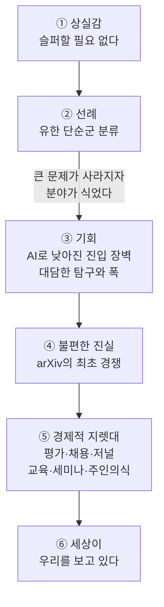

<figure class="post-figure post-figure--header">
<svg role="img" aria-label="왼쪽에 칠판이 있고, 그 앞에 선 수학자의 발치에는 AI가 쏟아낸 증명 종이들이 색종이처럼 흩어져 있다. 수학자는 고개를 들어 오른쪽 위로 열린 새 지평을 바라보고, 그곳에는 물음표들이 점선으로 이어진 별자리를 이루고 있다. 오른쪽 위에 '게임이 바뀌었다'라고 적혀 있다." viewBox="0 0 600 340" width="520" xmlns="http://www.w3.org/2000/svg">
<title>쏟아진 증명 더미 앞에서 새 질문의 별자리를 올려다보는 수학자</title>
<rect x="30" y="40" width="200" height="130" rx="6" fill="var(--bg-sunken)" stroke="currentColor" stroke-width="3"/>
<line x1="30" y1="182" x2="230" y2="182" stroke="currentColor" stroke-width="3" stroke-linecap="round"/>
<text x="56" y="92" font-size="24" fill="currentColor" font-style="italic">ζ(3)</text>
<g fill="none" stroke="currentColor" stroke-width="2" stroke-linecap="round" opacity="0.7">
<path d="M56 116 h70 M56 136 h110 M140 92 h60 M56 156 h50 M120 156 l14 -8 l14 8 l14 -8"/>
</g>
<path d="M330 40 L585 40 L585 290 L330 290" fill="none" stroke="var(--gold)" stroke-width="2.5" stroke-dasharray="7 6"/>
<g fill="none" stroke="var(--gold)" stroke-width="2" stroke-dasharray="4 5">
<path d="M380 120 L450 95 L520 140 L555 210 M450 95 L470 200 L555 210 M380 120 L410 225 L470 200"/>
</g>
<g font-size="30" font-weight="700" fill="var(--gold)" text-anchor="middle">
<text x="380" y="131">?</text>
<text x="450" y="106">?</text>
<text x="520" y="151">?</text>
<text x="470" y="211">?</text>
<text x="410" y="236">?</text>
<text x="555" y="221">?</text>
</g>
<text x="457" y="74" font-size="24" font-weight="700" fill="currentColor" text-anchor="middle">게임이 바뀌었다</text>
<g fill="none" stroke="currentColor" stroke-width="3.5" stroke-linecap="round" stroke-linejoin="round">
<circle cx="276" cy="148" r="16"/>
<path d="M268 166 L262 232 M262 232 L250 288 M262 232 L276 288 M266 184 L244 214 M266 184 L292 166"/>
</g>
<line x1="290" y1="140" x2="370" y2="118" stroke="currentColor" stroke-width="2" stroke-dasharray="3 6" stroke-linecap="round" opacity="0.6"/>
<line x1="20" y1="292" x2="580" y2="292" stroke="currentColor" stroke-width="3" stroke-linecap="round"/>
<g fill="var(--bg-panel)" stroke="currentColor" stroke-width="1.8">
<rect x="60" y="270" width="28" height="19" transform="rotate(-12 74 280)"/>
<rect x="100" y="276" width="28" height="19" transform="rotate(9 114 286)"/>
<rect x="138" y="268" width="28" height="19" transform="rotate(-25 152 278)"/>
<rect x="176" y="274" width="28" height="19" transform="rotate(16 190 284)"/>
<rect x="212" y="266" width="28" height="19" transform="rotate(-8 226 276)"/>
<rect x="292" y="272" width="28" height="19" transform="rotate(22 306 282)"/>
<rect x="330" y="268" width="28" height="19" transform="rotate(-18 344 278)"/>
<rect x="368" y="275" width="28" height="19" transform="rotate(6 382 285)"/>
<rect x="404" y="270" width="28" height="19" transform="rotate(-30 418 280)"/>
<rect x="120" y="250" width="28" height="19" transform="rotate(32 134 260)"/>
<rect x="340" y="246" width="28" height="19" transform="rotate(-40 354 256)"/>
</g>
<text x="240" y="328" font-size="24" fill="currentColor" text-anchor="middle">쏟아진 증명</text>
</svg>
<figcaption>AI가 쏟아낸 증명 더미 앞에서 고개를 들면 아직 이름 없는 질문들이 보인다. 게임은 끝난 것이 아니라 바뀌었다.</figcaption>
</figure>

## 원문 정보

> - **제목**: Mathematics has changed. Let's act like it
> - **출처**: Frank Calegari (University of Chicago 수학자) — Terence Tao의 블로그 *What's new* 게스트 포스트 ([terrytao.wordpress.com](https://terrytao.wordpress.com/))
> - **발행**: 2026-11-01 · 약 15분 분량 (본문 약 3,800단어 기준 추정)
> - **원문 링크**: <https://terrytao.wordpress.com/2026/11/01/mathematics-has-changed-lets-act-like-it/>

먼저 저자부터 분명히 해 둔다. 이 글은 **Frank Calegari가 썼고**, Terence Tao는 자기 블로그에 이 글을 **게스트 포스트로 실어 준 호스트**다. 글머리에 Tao가 단 편집 메모는 "Frank Calegari의 게스트 포스트이며, 원래 다른 파일 형식으로 쓰였던 것을 AI로 변환했다"는 두 문장뿐이다. 그래서 아래에서 말하는 주장과 처방, 일인칭 경험담은 전부 **Calegari의 것**이다. Tao가 이 견해에 동의하는지는 원문에 나오지 않는다. 원문은 블로그의 `guest blog`·`opinion` 카테고리에 올라 있고, 맺음말을 보면 같은 블로그에 AI와 수학을 다룬 게스트 기고가 여러 편 이어지고 있다. 이 글은 그 연속 기고 중 한 편이다.

## 한 줄 요약 (TL;DR)

Calegari의 요지는 이렇다. AI가 수많은 증명을 만들어 내기 시작했다고 해서 수학이 끝난 것은 아니고, 게임의 규칙이 바뀐 것이다. 그러니 슬퍼하기보다 **평가·채용·저널·교육·세미나의 보상 구조를 바꾸자**고 한다. 앞으로는 "기계로도 얻을 수 있는 결과"가 아니라 **좋은 문제를 고르고, 결과를 이해하고, 더 넓은 질문으로 이어 가는 능력**에 보상해야 한다는 것이다.

## 왜 이 글을 골랐나

이 위키의 AI-Essays에는 "코드가 공짜가 되면 무엇이 사람의 몫으로 남는가"라는 질문이 거듭 나온다. [Martin Fowler의 '검증이 비싸지는 시대'](/2026/06/23/fowler-fragments-verification-cognitive-surrender.html), [Addy Osmani의 '취향과 판단'](/2026/08/04/taste-judgment-and-ai.html), [antirez의 '코드가 아니라 아이디어를 통제하라'](/2026/08/12/control-the-ideas-not-the-code.html)가 그런 글들이다. Calegari의 글은 같은 질문을 **수학**이라는 다른 분야에서 던진다. 수학에서 증명은 오랫동안 기여의 최종 단위로 통했다. 그 증명이 기계로 대량 생산되기 시작하자, 한 학자가 동료들에게 "그럼 우리는 무엇에 상을 주고 누구를 뽑을 것인가"라는 **제도 설계 문제**를 정면으로 꺼낸 것이다.

개발자에게도 낯선 이야기가 아니다. 글에서 '논문'을 'PR'로, '저널'을 '코드 리뷰'로, '박사과정 학생'을 '주니어 엔지니어'로 바꿔 읽으면 상당 부분이 그대로 통한다(이 대응은 내 해석이다). 특히 "결과가 아니라 맥락을 설명하게 만들라"는 처방은 생성 코드가 넘쳐나는 팀에서도 바로 쓸 수 있다.

글 전체의 흐름을 한 장으로 보면 이렇다.

## 핵심 내용

원문의 소제목 순서대로 정리한다. 이 절의 주장은 모두 Calegari의 것이다.

### 1. 왜 슬퍼할 필요가 없는가 (Why we should not be sad)

Calegari는 10월 6일 OpenAI가 **700편이 넘는 연구 논문**을 공개한 일을 "수학사의 분수령(watershed)"이라고 부르며 글을 연다. 그의 판단으로는 AI가 이제 수학의 여러 분야에서 획기적인 기여를 할 수 있다는 사실을 부정하기 어렵다. 그러면서 "그런데 왜 일부 수학자들은 그렇게 불행해하는가"라고 묻는다.

그가 보는 불만의 원인은 두 가지다.

- **AI 기업의 태도.** 그의 평가로는 OpenAI 논문들에 "엄청난 아이디어도 있지만" 글이 형편없이 쓰였고, 공동체의 **인용·귀속(attribution) 관행**을 어겼으며, **일부는 틀렸다**. 다만 거대 기업의 행동보다는 수학자들이 직접 통제할 수 있는 채용·출판·교육을 바꾸는 데 힘을 쓰는 편이 낫다고 본다.
- **분야가 "속이 파먹힌다(hollowed out)"는 느낌.** 그는 이번 대량 공개가 Langlands 프로그램의 일반적 문제(functoriality, reciprocity)에는 "거의 흠집도 내지 못했다"고 평가한다. 설령 Langlands 문제를 전부 풀었다 해도 그걸 "정수론을 풀었다"고 말하는 것은 주기율표를 만들었다고 "화학을 풀었다"고 말하는 것만큼 순진하다고 한다. 어느 분야에서든 '중심 문제'는 현재 이해의 자연스러운 경계를 가리킬 뿐이고, 그 경계를 여는 일은 끝이 아니라 새로운 놀이터로 가는 첫걸음이라는 것이다.

다만 상처가 깊은 분야도 있다는 점은 인정한다. 그 예로 percolation 이론 분야의 Hugo Duminil-Copin의 탄식을 인용한다. 요지는 이렇다. 자신이 경력 내내 공개적으로 언급해 온 주요 미해결 문제 가운데 이번 발표에 손대지 않은 것이 하나도 없었고, 전부 "증명되었다고 주장"되었다는 것이다. 몇 개는 예상했지만 전부를, 한꺼번에, 그토록 무심하게(nonchalance) 발표할 줄은 몰랐다고 한다. Calegari는 글 끝 메모에서 Duminil-Copin의 원래 발언 전체에는 "우리는 회복력 있는 공동체이고, 적응할 것을 의심하지 않는다"라는 말도 들어 있다고 덧붙인다.

### 2. 선례: 유한 단순군 분류 (The classification of finite simple groups)

그렇다면 이런 탄식에 어떻게 답할까. Calegari는 역사적 선례를 하나 꺼낸다.

- 1972년 Dan Gorenstein이 유한 단순군 분류 프로그램을 내놓았고, 약 10년간 연구가 몰린 끝에 1983년 "분류 완료"가 선언되었다. 그는 이 선언이 다소 성급했다고 지적한다. quasithin 군의 경우는 그 뒤로 20년이 더 지나 Aschbacher와 Smith가 마무리했다.
- 그는 이 분류가 큰 성공이었지만 한편으로는 **실패**이기도 했다고 본다. 그룹 이론가 친구들에게 사과하면서, 이 성과가 분야에 대한 관심을 크게 식혔다고 말한다. "유명한 문제"가 사라지자 수학자들은 다른 곳으로 눈을 돌렸다. 정작 유한군론에는 여전히 풍부한 질문이 남아 있는데도 그렇다. 그가 드는 예는 John Conway가 가장 좋아한 질문인 "Monster 군은 **왜** 존재하는가"다.
- 그는 지금 일부 분야가 느끼는 감정을 이렇게 비유한다. 1970년의 그룹 이론가 연구실에 분류 결과가 정식 논문이 아니라 등사기로 번진 인쇄물로 쏟아져, 색종이처럼 바닥에 아무렇게나 흩뿌려진 상황이라는 것이다.

여기서 그가 내리는 처방은 두 가지다. 하나는 Gorenstein·Lyons·Solomon이 했던 **개정 분류(revised classification)** 작업처럼 쏟아진 결과를 정리하는 일인데, 그것만이라면 꽤 보상받지 못하는(thankless) 일이다. 다른 하나는 분야가 "끝났다"고 선언하지 않고, 새 도구가 생긴 지금 **더 탐구할 때가 무르익었다**고 보는 책임이다. 은하 우회로가 생겨 옛 오솔길을 놓쳤다고 한탄하는 사람들에게는 그 길이 여전히 있으니 찾아가 보라고 말한다. 그리고 그렇게 하는 사람에게 **채용에서 보상해야** 한다고 덧붙인다.

### 3. AI의 약속, 그리고 수학의 (비)통일성 (The promise of AI, and the (dis)-unity of mathematics)

이 절은 가장 개인적이다. Calegari는 15살 때부터 ζ(3)이 무엇인지 알고 싶었다고 한다. 시간이 지나면서 그는 Grothendieck의 period conjecture가, mixed Tate motive의 기하에 대한 충분히 정밀한 이해와 함께, 무슨 일이 일어나는지에 대해 완전히 만족스러운 구조적·추측적(conjectural) 설명을 준다는 것, 그리고 ζ(3)의 무리수성이나 초월성은 진짜 흥미로운 근본 문제의 "그림자"에 불과하다는 것을 알게 되었다고 말한다. Apéry의 무리수성 증명이 30년 넘게 그에게 영감을 준 것도 결론 때문이 아니었다. 그 증명이 대수적 G-함수(G-function)와 산술을 잇는 "아직 비밀인 이야기"의 실마리를 보여 줬기 때문이다.

이 경험에서 그가 AI에 거는 기대가 나온다.

- **"증명하지 못한 첫 번째 자연스러운 추측"이라는 구속복에서 벗어나 더 깊은 수수께끼를 풀 수 있기를 바란다.**
- 지난 30년간 인간의 수학적 진보는 놀라웠다. 하지만 수학자들이 자기 분야 바로 바깥의 사람에게조차 왜 이 일이 흥미로운지 설명하지 못하는 장면을 자주 봤고, 그것이 괴로웠다고 한다. 이 직업은 넓은 비전보다 좁은 기술적 전문성 쪽으로 휘어 왔다는 것이 그의 진단이다. 그가 보기에 **AI는 수학자가 자신을 넓힐 엄청난 기회**다.

그는 자기 사례도 든다. Melbourne 대학에서 자라며 hyperbolic 3-manifold에 흠뻑 노출되었던 경험이 대수적 정수론 연구자로서의 경력에 큰 도움이 되었다고 한다. 오래 품어 온 아이디어도 하나 소개한다. compact arithmetic hyperbolic 3-manifold들을 일종의 기하적 Kolyvagin system으로 보고, 미지의 정수적 Jacquet–Langlands 대응으로 묶어 보자는 구상이다. 그가 이 구상을 추진하지 못한 이유는 두 가지였다. 결과가 수많은 추측에 조건부로 걸릴 수밖에 없었고, 문제를 정확히 정식화하는 데만도 방대한 배경 작업이 필요했다. 그런데 이제 AI로 그런 시도의 장벽이 "훨씬 낮아졌다"고 말한다. 그는 이것이 정리를 증명하는 일이 아니라고 강조한다. 말이 될 수도 안 될 수도 있는 **완전히 새로운 방향을 탐사하는 일**이라는 것이다. 그래서 "1년 전에는 상상할 수도 없던 대담한 연구 계획"을 세우자고 한다.

그는 모두가 AI를 써야 한다거나 쓰지 말아야 한다고 말하지 않는다. 주요 추측의 증명은 앞으로도 수학의 일부로 남는다고 본다. 다만 더 넓은 프로그램과 구조적 이해가 더 근본적인 역할을 맡게 된다는 것이다. 여기서 그는 Christian Szegedy의 말을 인용한다. 아무도 못 오르는 곳을 오르는 탐험가에 대한 경외, 즉 그런 종류의 영웅주의는 덜 중요해진다. 대신 **어떤 지형을 탐사할지 고르는 일, 비행기 편대를 지휘하는 일, 발견한 것을 세상에 설명하는 일**이 더 중요해진다는 내용이다. Calegari는 기꺼이 비행기에 타겠다고 하면서 한 가지를 덧붙인다. 땅 위를 눈 감고 걸어 다니던 사람은 아무리 높이 날아도 아무것도 알아보지 못한다. 그래서 지금 수학자가 가진 기술의 상당수는 새 질서에서도 옮겨 쓸 수 있을 뿐 아니라 꼭 필요하다는 것이다.

이 절의 결론은 다음과 같다. 비관론자에게는 **게임이 끝났고**, 낙관론자에게는 **게임이 바뀌었을 뿐**이다. 아끼던 수학 문화의 일부가 사라지는 것을 슬퍼하는 것은 인간적이다. 하지만 "지금 형태의 수학 공동체가 수학 그 자체보다 중요하다"며 등을 돌리는 것은 끔찍한 실수라고 그는 말한다.

### 4. 불편한 진실 (The ugly truth)

여기서 Calegari는 공동체 내부로 화살을 돌린다. 모두가 "수학은 이해다"라고 말하지만, arXiv만 봐도 많은 사람이 AI의 도움을 받은 논문을 서둘러 내며 "최초"가 되려고 경쟁한다는 것이다. 새 증명을 만들어 내는 능력과 이해를 보여 주거나 분야를 새 방향으로 미는 능력 사이의 간극이 빠르게 벌어지고 있다고 본다. 원문은 Leiden 선언이 "정신보다는 이름으로만" 지켜진다고 말한다(원문은 이 선언의 내용을 따로 설명하지 않는다). 그 결과 시간 척도만 압축된 "평소와 다름없는 장사"가 계속되고, 누군가 먼저 발표할지 모른다는(scooped) 위협이 늘 따라다닌다고 한다.

그의 대안 기준은 분명하다.

> 가치 있는 문제를 고르고, 증명은 **전적으로 AI로** 얻었더라도 그것을 철저히 이해하고, 그것으로 흥미로운 후속 질문이나 방향을 만들어 낸 사람은 상당한 수학적 기여를 한 것이다. 원래 증명에 새로운 재료를 하나도 보태지 않았더라도 그렇다. (요지 번역)

그리고 "가치 있는 문제를 고르는 일이 증명을 만드는 일보다 결국 더 중요해질 수 있다"고 말한다. 종신 재직권이라는 특권을 가진 시니어 수학자들에게는 기존 질문에 AI로 답하는 대신 **미래의 문제를 만들고 새 아이디어를 탐사하라**고 권한다. 시니어인데 AI에게 선수를 빼앗길까 봐 스트레스를 받는다면 "충분히 야심차지 않은 것"이라고까지 말한다.

### 5. 그래서 실제로 무엇을 할 것인가 (So what are we actually going to do?)

Calegari는 사람의 행동을 바꾸는 메커니즘을 제안하지 않는 칼럼은 결국 무의미하다고 말한다. 그리고 효과적인 도구는 수사적인 것이 아니라 **경제적인 것**이라고 본다. 수학자는 인정과 일자리와 연구비를 원하고, 지금 공동체가 쥔 지렛대는 **채용**과 **저널 게재**라는 것이다. 그가 내놓는 여섯 가지 처방은 다음과 같다.

1. **모든 연구를 AI 보조를 받은 것처럼 평가하라.**
2. **채용은 서류보다 대면 상호작용 중심으로.** 박사후연구원과 대학원생도 직접 인터뷰하라.
3. **저널에 더 많이 요구하고, 적응하지 않는 저널은 버려라.**
4. **대학원 교육에서 폭을 더 강조하되, 기술적 역량을 버리지는 마라.**
5. **세미나를 더 잘하라.**
6. **AI가 낸 결과에 더 많은 주인의식을 가져라.**

<figure class="post-figure">
<svg role="img" aria-label="맨 위의 띠에 경제적 지렛대, 채용과 저널 게재라고 적혀 있고, 그 띠에서 내려오는 세로선에 번호 1부터 6까지의 카드가 위에서 아래로 매달려 있다. 1 모든 연구를 AI 보조를 받은 것처럼 평가하라. 2 채용은 서류보다 대면 상호작용 중심으로. 3 저널에 더 많이 요구하고, 적응하지 않는 저널은 버려라. 4 대학원 교육에서 폭을 더 강조하되, 기술적 역량을 버리지는 마라. 5 세미나를 더 잘하라. 6 AI가 낸 결과에 더 많은 주인의식을 가져라. 각 카드에는 한 줄 핵심이 붙어 있다." viewBox="0 0 380 606" width="460" xmlns="http://www.w3.org/2000/svg">
<title>경제적 지렛대에 매달린 Calegari의 여섯 처방</title>
<rect x="10" y="10" width="360" height="58" rx="6" fill="var(--bg-sunken)" stroke="var(--gold)" stroke-width="2.5"/>
<text x="190" y="35" font-size="17" font-weight="700" fill="currentColor" text-anchor="middle">경제적 지렛대</text>
<text x="190" y="58" font-size="16" fill="currentColor" text-anchor="middle">채용 · 저널 게재</text>
<line x1="28" y1="68" x2="28" y2="535" stroke="var(--gold)" stroke-width="3"/>
<g fill="var(--bg-sunken)" stroke="currentColor" stroke-width="1.8">
<rect x="50" y="84" width="320" height="80" rx="6"/>
<rect x="50" y="174" width="320" height="80" rx="6"/>
<rect x="50" y="264" width="320" height="80" rx="6"/>
<rect x="50" y="354" width="320" height="80" rx="6"/>
<rect x="50" y="444" width="320" height="59" rx="6"/>
<rect x="50" y="513" width="320" height="80" rx="6"/>
</g>
<g stroke="var(--gold)" stroke-width="2.5">
<line x1="42" y1="106" x2="50" y2="106"/>
<line x1="42" y1="196" x2="50" y2="196"/>
<line x1="42" y1="286" x2="50" y2="286"/>
<line x1="42" y1="376" x2="50" y2="376"/>
<line x1="42" y1="466" x2="50" y2="466"/>
<line x1="42" y1="535" x2="50" y2="535"/>
</g>
<g fill="var(--bg-panel)" stroke="var(--gold)" stroke-width="2.5">
<circle cx="28" cy="106" r="14"/>
<circle cx="28" cy="196" r="14"/>
<circle cx="28" cy="286" r="14"/>
<circle cx="28" cy="376" r="14"/>
<circle cx="28" cy="466" r="14"/>
<circle cx="28" cy="535" r="14"/>
</g>
<g font-size="15" font-weight="700" fill="currentColor" text-anchor="middle">
<text x="28" y="111">1</text>
<text x="28" y="201">2</text>
<text x="28" y="291">3</text>
<text x="28" y="381">4</text>
<text x="28" y="471">5</text>
<text x="28" y="540">6</text>
</g>
<g font-size="16" font-weight="700" fill="currentColor">
<text x="62" y="108">모든 연구를 AI 보조를 받은 것처럼</text>
<text x="62" y="129">평가하라</text>
<text x="62" y="198">채용은 서류보다 대면 상호작용</text>
<text x="62" y="219">중심으로</text>
<text x="62" y="288">저널에 더 많이 요구하고,</text>
<text x="62" y="309">적응하지 않는 저널은 버려라</text>
<text x="62" y="378">대학원 교육에서 폭을 더 강조하되,</text>
<text x="62" y="399">기술적 역량을 버리지는 마라</text>
<text x="62" y="468">세미나를 더 잘하라</text>
<text x="62" y="537">AI가 낸 결과에 더 많은</text>
<text x="62" y="558">주인의식을 가져라</text>
</g>
<g font-size="15" fill="currentColor">
<text x="62" y="152">→ 왜 흥미로운지·어떤 질문을 낳는지 설명</text>
<text x="62" y="242">→ 박사후연구원·대학원생도 직접 인터뷰</text>
<text x="62" y="332">→ 더 적게, 더 좋은 논문 · Lean 검증</text>
<text x="62" y="422">→ 컴퓨터가 있어도 산수는 가르친다</text>
<text x="62" y="491">→ 넓은 질문 먼저, 새 결과는 맨 끝에</text>
<text x="62" y="581">→ 인류의 이름으로 공을 가져가라</text>
</g>
</svg>
<figcaption>채용과 저널 게재라는 경제적 지렛대에 매달린 Calegari의 여섯 처방. 화살표 뒤의 한 줄 핵심은 아래 각 처방의 세부 설명에서 뽑았다.</figcaption>
</figure>

각 처방의 세부 내용은 이렇다.

#### 평가: Cole의 소인수분해

Frank Nelson Cole은 3년 동안 일요일마다 매달려 2^67 − 1 = 193707721 × 761838257287을 찾아냈다. 1903년에 이것은 수학에 대한 기여였다. 같은 수를 2003년에 손으로 인수분해했다면 산술의 위업으로는 똑같이 놀랍겠지만, 컴퓨터 대수 시스템이 1초도 안 걸려 하는 일이므로 수학적 기여는 훨씬 작다. Calegari의 요지는 AI가 무엇이 "쉽고" 무엇이 "어려운지"의 **경제학**을 바꾸고 있다는 것이다.

그래서 그는 앞으로 **기계로 만들어 낼 수 있는 결과**에만 기댄 논문에 상을 줄 이유가 없다고 본다. 실제로 기계가 만들었든 아니든 상관없다. 다만 새 증명이 들여온 **아이디어**는 결론이 이미 기계로 얻어지는 것이어도 여전히 상당한 인정을 받을 수 있다고 한다. 그는 이것이 AI 접근권이 있어야만 수학을 할 수 있다는 뜻은 결코 아니라고 강조한다. 단, 인간의 이해를 계속 가치 있게 여긴다는 전제에서다. 그는 이 처방이 가장 논쟁적이면서 동시에 가장 **피할 수 없는** 것이라고 말한다.

이 처방에는 실용적인 측면도 하나 있다. 지금은 AI 사용에 낙인이 붙어 있어서 많은 AI 사용 고지문이 기계의 기여를 축소하려는 시도처럼 읽힌다. 모든 논문을 AI 보조 가능성이 있는 것으로 본다면 저자들에게 **왜 이 수학이 흥미로운지, 어떤 질문을 낳는지, 분야 전체와 어떻게 이어지는지** 설명하라고 요구할 수 있다. 그는 "어차피 우리가 원하던 게 그것 아닌가"라고 묻는다.

<figure class="post-figure">
<svg role="img" aria-label="위아래 두 칸 비교. 위 칸 1903년: Frank Nelson Cole이 3년 동안 일요일마다 매달려 2^67 − 1 = 193707721 × 761838257287을 찾아냈고, 수학적 기여 막대가 길다. 아래 칸 2003년: 컴퓨터 대수 시스템이 1초도 안 걸려 같은 등식을 얻는다. 손으로 해도 산술적 위업은 같지만 수학적 기여는 훨씬 작아, 막대가 짧고 점선으로 1903년 막대 길이가 겹쳐 그려져 있다. 막대 길이는 예시다. 맨 아래에 보상할 것: 결과에서 아이디어·질문·연결로." viewBox="0 0 380 576" width="460" xmlns="http://www.w3.org/2000/svg">
<title>Cole의 소인수분해로 본 어려움의 경제학: 1903년과 2003년</title>
<defs>
<marker id="cole-arrow" viewBox="0 0 10 10" refX="8" refY="5" markerWidth="7" markerHeight="7" orient="auto-start-reverse">
<path d="M0 0 L10 5 L0 10 z" fill="currentColor"/>
</marker>
</defs>
<rect x="8" y="10" width="364" height="254" rx="6" fill="none" stroke="currentColor" stroke-width="2"/>
<text x="20" y="38" font-size="18" font-weight="700" fill="currentColor">1903년</text>
<text x="360" y="38" font-size="15" fill="currentColor" text-anchor="end">Frank Nelson Cole</text>
<g fill="var(--bg-sunken)" stroke="currentColor" stroke-width="1.8">
<rect x="20" y="52" width="44" height="40" rx="3"/>
<rect x="34" y="56" width="44" height="40" rx="3"/>
<rect x="48" y="60" width="44" height="40" rx="3"/>
</g>
<rect x="48" y="60" width="44" height="9" fill="var(--accent-color)"/>
<g fill="currentColor">
<circle cx="56" cy="78" r="2"/><circle cx="66" cy="78" r="2"/><circle cx="76" cy="78" r="2"/><circle cx="86" cy="78" r="2"/>
<circle cx="56" cy="90" r="2"/><circle cx="66" cy="90" r="2"/><circle cx="76" cy="90" r="2"/><circle cx="86" cy="90" r="2"/>
</g>
<text x="108" y="74" font-size="15" fill="currentColor">3년 동안</text>
<text x="108" y="94" font-size="15" fill="currentColor">일요일마다 매달려</text>
<line x1="190" y1="104" x2="190" y2="122" stroke="currentColor" stroke-width="2" marker-end="url(#cole-arrow)"/>
<g font-size="18" fill="currentColor" text-anchor="middle" style="font-family:var(--font-mono)">
<text x="190" y="146">2^67 − 1</text>
<text x="190" y="170">= 193707721</text>
<text x="190" y="194">× 761838257287</text>
</g>
<text x="20" y="224" font-size="15" font-weight="700" fill="currentColor">수학적 기여</text>
<text x="360" y="224" font-size="15" fill="currentColor" text-anchor="end">(길이는 예시)</text>
<rect x="20" y="232" width="300" height="20" fill="var(--accent-color)"/>
<rect x="8" y="278" width="364" height="246" rx="6" fill="none" stroke="currentColor" stroke-width="2"/>
<text x="20" y="306" font-size="18" font-weight="700" fill="currentColor">2003년</text>
<rect x="20" y="318" width="104" height="58" rx="4" fill="var(--bg-sunken)" stroke="currentColor" stroke-width="2"/>
<path d="M62 376 L58 388 M82 376 L86 388 M48 390 H96" fill="none" stroke="currentColor" stroke-width="2" stroke-linecap="round"/>
<text x="72" y="354" font-size="18" font-weight="700" fill="currentColor" text-anchor="middle">&lt; 1초</text>
<text x="140" y="342" font-size="15" fill="currentColor">컴퓨터 대수 시스템</text>
<text x="140" y="364" font-size="15" fill="currentColor">1초도 안 걸린다</text>
<text x="190" y="418" font-size="15" fill="currentColor" text-anchor="middle" style="font-family:var(--font-mono)">2^67 − 1 = 193707721 × 761838257287</text>
<text x="20" y="446" font-size="15" fill="currentColor">손으로 해도 산술적 위업은 같지만</text>
<text x="20" y="467" font-size="15" fill="currentColor">수학적 기여는 훨씬 작다</text>
<text x="20" y="494" font-size="15" font-weight="700" fill="currentColor">수학적 기여</text>
<text x="360" y="494" font-size="15" fill="currentColor" text-anchor="end">(길이는 예시)</text>
<rect x="20" y="502" width="300" height="20" fill="none" stroke="currentColor" stroke-width="1.5" stroke-dasharray="5 4" opacity="0.6"/>
<rect x="20" y="502" width="40" height="20" fill="var(--accent-color)"/>
<text x="190" y="558" font-size="16" font-weight="700" fill="currentColor" text-anchor="middle">보상할 것: 결과 → 아이디어·질문·연결</text>
</svg>
<figcaption>같은 등식, 다른 기여: 1903년 Cole의 소인수분해와 2003년의 같은 계산. 막대 길이는 비교를 돕기 위한 예시일 뿐 측정값이 아니다.</figcaption>
</figure>

#### 채용

그는 사람을 평가하는 방식이 채용 단계에서 바뀌지 않으면 아무것도 바뀌지 않는다고 본다. 게으른 위원회는 JAMS나 Annals 논문 목록을 근거로 때때로 후보를 정당화해 왔다고 비판한다. 그가 후보에게서 찾는 것은 네 가지다.

- 수학이 어디로 가야 하는지에 대한 **서사(narrative)**
- 그것이 왜 가능할지 설명하는 기술적 능력
- 여러 분야에 대해 대화할 수 있는 능력
- 과거에 실제로 그렇게 해 온 기록

그는 이것이 새로운 생각은 아니라고 말한다. 다만 앞으로는 tenure-track뿐 아니라 박사후연구원과 대학원생 선발에도 인터뷰가 표준이 되어야 한다고 주장한다. 근거로 든 일화가 있다. "고차 호모토피 이론을 한다"던 학생이 입학하고 보니 원의 호몰로지도 계산하지 못한 경우다. 반대로 처음에는 반신반의했던 tenure 후보와 30분 대화한 뒤 깊은 비전과 소통 능력을 함께 가진 사람이라고 확신하게 된 경험도 있다. 그는 수학을 **깊이 아는 것**과 **유창하게 설명하는 것**은 연결되어 있지만 서로 다른 기술이라고 구분한다. 둘 다 원하지만 궁극적으로 더 높이 치는 것은 앞의 것이라고 한다.

#### 저널

그가 보기에 저널 시스템은 AI 이전에도 개혁이 시급했다. 지금의 인센티브는 점점 더 많은 점진적 결과를 만들게 해 시스템을 범람시킨다. 저널 게재는 이미 오래전부터 정확성을 보장하지 못했고(애초에 보장한 적이 있는지도 의문이라고 한다), 그저 품질의 인증 도장 노릇만 해 왔다고 본다. 그는 자기 기준대로라면 arXiv에 올라오는 논문 가운데 상당수는 어디에도 게재되지 말아야 한다고까지 말한다. 저널이 글쓰기·아이디어·설명을 훨씬 더 요구하면 편집자·심사자·결국 저자에게도 더 나을 것이라는 생각이다.

편집위원회가 적응하지 못한다면 더 급진적인 방안도 있다. **적어도 한동안 저널을 아예 버리는 것**이다. 다만 탁월한 유용성과 명료함을 강조하는 저널(예로 *Essential Number Theory*를 든다)에는 여전히 자리가 있다고 본다. 논문 쓰기를 그만두자는 뜻은 아니다. 저널 게재라는 "무화과 잎"을 치우면 논문이 스스로의 가치로 서야 한다는 것이다. 이야기가 설득력 있는가, **Lean으로 검증되었는가**를 묻게 된다. 그는 "더 적게, 더 좋은" 논문을 쓰자고 한다. 한편 자율적으로 AI가 만든 증명, 가능하면 Lean으로 확인된 증명도 공동의 지식으로 기록될 자리가 있다고 보며, 그 예로 hexagonmath를 링크한다.

#### 대학원생 교육

전형적인 학위 논문은 이미 닦인 기법으로 옛 문제의 변형을 푸는 과제였다. 학생이 그 기술을 익혀 점차 더 넓은 문제로 뻗어 가리라는 기대가 깔려 있었다. 그런데 그런 학위 논문이 "버튼 한 번으로" 나오는 시대라면 목표를 다시 정해야 한다고 그는 말한다. AI가 있어도 compact arithmetic hyperbolic 3-manifold와 Kolyvagin system이 무엇인지 모르는 사람은 둘의 연결을 탐사할 수 없다. 설령 할 수 있다 해도 왜 관심을 가지겠느냐고 묻는다. 그래서 박사과정이 끝날 때 학생이 갖춰야 할 것은 두 가지다. 자기 분야를 훨씬 넘어서는 수학의 시야, 그리고 적어도 어떤 부류의 문제에서 입증된 기술적 역량이다.

여기서 그는 중요한 단서를 단다. 앞서 모든 연구를 AI가 관여한 것처럼 평가하자고 했지만, 그렇다고 AI 없이 깊은 수학을 하는 법을 가르치지 않아도 된다는 뜻은 아니다. **컴퓨터가 있다고 아이들에게 산수를 가르치지 않는 것은 아니듯이** 말이다. 대학원 강의는 그 주제가 수학의 다른 곳에서 무엇을 가능하게 하는지 남겨야 하고, 학생은 기술적 세부를 일부 잊더라도 질문과 연결은 기억하고 있어야 한다고 본다. 대면으로 이해를 보여 주는 능력을 평가하려면 학생들에게 설명하는 법을 훈련시켜야 한다. 가장 성공적인 학생 집단은 함께 배우고 서로 수학을 이야기하는 집단이라는 말도 덧붙인다. 박사 졸업자 모두가 학계로 가는 것은 아니니, 박사 과정의 길이와 구조가 학계 밖 진로에도 맞는지 물어야 한다는 지적도 있다.

#### 세미나

세미나는 보통 최신 결과의 세부를 발표하는 자리다. 수학이 어렵다 보니 그 내용은 대개 기존 방법의 사소한 변형이고, 흥미를 느낄 만한 넓은 맥락은 빠져 있기 일쑤다. Calegari는 세미나가 새 결과에만 초점을 맞추는 일은 드물어야 한다고 말한다. 넓고 흥미로운 질문을 중심에 두고, 어디서 막혔는지, 어디서 진전이 가능한지, 어디에 희망이 있는지를 설명하라는 것이다. 새로운 점이 있다면 그건 맨 끝에 잠깐 말하면 된다. 그는 자기 학생들에게 늘 이렇게 발표하라고 권해 왔고, 시니어 교수진이 세미나에서 연사에게 더 많이 요구해야 한다고 말한다.

#### 주인의식

기계에서 나온 결과는 수천 년에 걸친 인간 수학의 지적 토대 위에 세워졌다. Calegari는 그 결과를 실리콘밸리 거물이나 수학계 트위터의 광대에게 돌리지 말고 **인류의 이름으로** 공을 가져가라고 말한다. 그러면 기분이 금방 나아질 거라고 한다.

### 6. 세상이 우리를 보고 있다 (The world is looking at us)

마지막 절은 바깥의 시선을 다룬다. Calegari가 속한 대학의 학장이 뉴욕에서 후원자들을 만났을 때, 수학 전공자든 아니든 모두 수학 이야기를 하고 싶어 했다고 한다. 그는 기술적 배경이 깊지 않아도 수학을 아끼는 사람이 많다며 3Blue1Brown 구독자가 600만 명이 넘는다는 점을 예로 든다. 인문학 쪽 친구들도 수학자가 인류의 가장 오래된 지적 활동을 지키는 관리인이자 지식의 최전선을 여는 탐험가로서 사회에 꼭 필요하다고 믿는다고 한다. 그는 문화의 일부가 사라지는 데 대한 감정적 반응을 자연스럽다고 인정한다. 그래도 지금은 새로운 기회와 낙관할 이유를 설명할 때라며, 수학의 새 시대 문턱에 서 있다는 말로 글을 맺는다.

맺음말 노트에서 그는 같은 블로그의 다른 게스트 기고와 주제가 겹친다고 밝힌다. 주인의식은 Nestor Guillen, 더 큰 야심은 Ben Antieau, 보상 구조 재검토는 Bryna Kra의 글에서 다뤄졌다고 한다.

## 분석과 인사이트

여기서부터는 **내 해석**이다. 원문의 주장과 섞이지 않도록 구분해서 쓴다.

### 1. "결과"에서 "선택·이해·연결"로 옮겨 가는 가치

Cole의 소인수분해 예시는 이 글에서 가장 날카로운 장치라고 생각한다. 같은 결과라도 그것을 만드는 비용이 0에 가까워지면 기여로서의 가치가 무너진다는 것을 감정을 섞지 않고 보여 준다. 소프트웨어 쪽에서 [Kent Beck이 "YAGNI가 아낀 건 타이핑이 아니었다"고 말한 것](/2026/07/03/yagni-cost-was-never-typing.html)이나, [Fowler가 코드가 공짜가 되면 검증이 비싸진다고 말한 것](/2026/06/23/fowler-fragments-verification-cognitive-surrender.html)과 같은 구조다. 산출물의 생산 비용이 무너지면 가치는 산출물 주변으로 옮겨 간다. 무엇을 만들지 고르고, 결과를 이해하고, 다음 질문으로 잇는 일이다.

Calegari가 말하는 "가치 있는 문제를 고르는 일"은 [Addy Osmani가 말한 취향(taste)과 판단(judgment)](/2026/08/04/taste-judgment-and-ai.html)과 거의 같은 자리에 있다. 증명을 AI가 했더라도 그것을 이해하고 후속 질문을 만든 사람에게 공을 주자는 기준은, 생성 코드를 머지하면서 그 결과에 이름을 거는 엔지니어에게 공을 주자는 말과 구조가 같다. [antirez가 말한 '아이디어를 통제하라'](/2026/08/12/control-the-ideas-not-the-code.html)도 같은 맥락이다.

### 2. "모두 AI 보조로 간주하라"는 것은 사실상 '공개 의무'를 우회하는 설계다

내가 가장 실용적이라고 본 대목이다. 지금 많은 공동체가 'AI 사용 고지' 규칙을 두고 다툰다. Calegari의 처방은 그 논쟁을 건너뛴다. 누가 AI를 썼는지 캐묻는 대신 **모든 산출물에 같은 질문을 던진다.** 왜 흥미로운가, 무엇을 묻게 하는가, 무엇과 연결되는가. 이렇게 하면 낙인 때문에 생기는 축소 고지라는 비뚤어진 인센티브가 사라지고, 평가 기준이 관찰 가능한 것(설명과 맥락)으로 옮겨 간다. 코드 리뷰에 그대로 옮기면 "이 PR을 AI가 썼냐"가 아니라 "이 변경이 왜 필요하고 무엇을 바꾸며 어떤 위험을 남기는지 작성자가 설명할 수 있느냐"를 묻는 것이다(이 대응은 내 적용이다).

### 3. 비관과 낙관을 같은 글에 함께 둔 정직함

이 글이 단순한 테크 낙관론과 다른 점은 Calegari가 불편한 사실을 지우지 않는다는 것이다. 그는 OpenAI의 대량 공개를 "분수령"이라 부르면서도 그 논문들이 형편없이 쓰였고, 귀속 관행을 어겼고, **일부는 틀렸다**고 바로 다음 문단에서 말한다. 공동체 내부의 '최초' 경쟁도 "불편한 진실"로 직접 지적한다. 나는 이 균형이 글의 신뢰도를 받쳐 준다고 본다. 그리고 이런 성과 주장을 읽을 때 우리도 같은 태도를 가져야 한다고 생각한다. 이 포스트도 AI가 이룬 수학적 성과의 규모나 정확성을 **원문이 말한 만큼만** 옮겼고, 독립적으로 검증하지 않았다.

### 4. 동의하기 어려운, 혹은 더 따져 볼 지점 (내 이견)

- **대면 인터뷰 중심 채용의 그늘.** 서류 대신 30분 대화로 확신을 얻었다는 일화는 설득력이 있다. 하지만 대면 평가는 말 잘하는 사람, 같은 학맥이나 문화권의 사람에게 유리한 편향을 키울 수 있다. Calegari 자신도 "깊이 아는 것"과 "유창하게 설명하는 것"을 구분하고 앞의 것을 더 높이 친다고 했는데, 대면 인터뷰는 구조적으로 뒤의 것을 더 잘 보여 주는 형식이다. 이 긴장을 어떻게 풀지는 원문에서 구체적으로 다뤄지지 않는다. 개발 조직에서 [AI 네이티브 채용 논의](/2026/07/03/ai-native-hiring-philosophy.html)가 구조화된 평가 기준을 함께 설계하는 이유도 여기에 있다고 본다.
- **"선수를 빼앗길까 걱정되면 야심이 부족한 것"의 적용 범위.** 그는 이 말을 **종신 재직권을 가진 시니어**에게 한정해서 했다. 이 한정은 중요하다. 박사후연구원이나 대학원생에게 같은 말을 하면 잔인하게 들릴 수 있다. 결국 제도가 바뀌기 전까지 그 비용은 젊은 연구자가 치른다. 그래서 그의 처방이 채용 개편에서 시작하는 것은 순서상 맞다고 본다.
- **저널을 버리는 것과 정확성 보증.** 저널이 정확성을 보증하지 못해 왔다는 진단에는 수긍한다. 다만 저널을 치운 뒤 무엇이 정확성을 보증하느냐는 질문에 원문이 주는 실마리는 "Lean으로 검증되었는가"라는 물음 정도다. 형식 검증이 모든 분야에 고르게 쓰일 수 있는 단계인지는 원문이 다루지 않으므로, 여기서는 열린 질문으로 남겨 둔다.

### 5. "산수를 계속 가르치는 이유"는 개발자 교육에도 그대로 통한다

Calegari는 모든 연구를 AI 보조로 간주해 평가하자고 하면서도, AI 없이 깊은 수학을 하는 법은 여전히 가르쳐야 한다고 못 박는다. 이것은 [AI가 우리의 실력을 망치고 있는가](/2026/06/23/is-ai-ruining-our-skills.html)에서 본 탈숙련 우려와 [Here Be Monsters](/2026/10/29/here-be-monsters.html)의 "기본기·폭·필요한 순간의 깊이"라는 처방과 정확히 맞물린다. "땅 위를 눈 감고 걷던 사람은 높이 날아도 아무것도 알아보지 못한다"는 문장은 '에이전트를 지휘하는 사람에게도 기본기가 필요하다'는 말의 수학 버전이라고 읽었다.

### 6. 주인의식: 공을 '인류'에게 돌린다는 정서적 기술

마지막 처방인 주인의식은 제도라기보다 **심리적 재구성**에 가깝다. 기계의 결과를 수천 년 인간 수학의 연장선으로 보면 "빼앗겼다"는 감정이 "물려받았다"로 바뀐다. [Caleb Gross가 인간의 가치를 'AI보다 잘함'으로 증명하지 말라고 한 것](/2026/06/22/you-can-just-say-it.html)과 같은 방향의 처방으로 읽힌다. 나는 이것이 위로에 그치지 않고 책임의 주장이기도 하다고 본다. 결과를 인류의 것으로 받아들인다면 그 결과를 정리하고 검증하고 설명할 책임도 인류, 곧 공동체가 진다. 앞의 '개정 분류' 작업 이야기와 자연스럽게 이어지는 대목이다.

## 적용 포인트

수학자가 아닌 개발자나 엔지니어링 리더가 바로 가져다 쓸 수 있는 형태로 옮겼다. 원문의 처방을 내가 소프트웨어 맥락으로 바꾼 것이다.

- **모든 PR을 "AI가 썼을 수도 있는 것"으로 리뷰하라.** AI 사용 여부를 묻는 대신 작성자에게 왜 필요한지, 무엇을 바꾸는지, 어떤 위험이 남는지 설명하게 하라. 설명할 수 없는 변경은 누가 썼든 머지하지 않는다.
- **"기계로 얻을 수 있는 결과"에는 보상하지 마라.** 성과 평가에서 커밋 수나 줄 수, 기능 개수보다 문제 선택, 설계 판단, 결과에 대한 이해와 후속 과제 제시에 무게를 둬라.
- **채용 인터뷰는 서사를 듣는 자리로.** 후보에게 이 시스템이 어디로 가야 하는지, 왜 그게 가능한지를 말하게 하라. 다만 말솜씨 편향을 줄이도록 구조화된 질문과 기준을 함께 설계하라(이 부분은 내 보완이다).
- **기술 발표·사내 세미나의 순서를 바꿔라.** 큰 질문, 막힌 곳, 진전이 가능한 곳, 희망이 있는 곳을 먼저 말하고 "이번에 한 것"은 맨 끝에 둬라.
- **주니어 교육에서 "산수"를 빼지 마라.** 에이전트를 쓰게 하더라도 AI 없이 핵심 기법을 끝까지 해 보는 경험과, 자기 영역 밖까지 보는 폭을 함께 길러라.
- **시니어라면 남의 질문에 답하는 일보다 다음 질문을 만드는 일을.** 선수를 빼앗길까 걱정되는 일이라면 애초에 충분히 야심찬 일이 아니었을 수 있다.
- **생성된 결과의 정리 작업을 하찮게 보지 마라.** 쏟아진 결과를 정리하고 검증하는 일, 곧 '개정 분류' 같은 일을 팀의 정식 작업으로 인정하고 보상하라.

## 마무리

Calegari의 글은 "AI가 수학을 끝냈는가"라는 질문을 "그렇다면 우리는 무엇에 상을 줄 것인가"라는 질문으로 바꿔 놓는다. 유한 단순군 분류의 선례는 큰 문제가 사라진 뒤 분야가 식을 수 있다는 경고다. Cole의 소인수분해는 같은 결과라도 생산 비용이 무너지면 기여의 의미가 바뀐다는 것을 보여 준다. 그 위에 그는 평가·채용·저널·교육·세미나·주인의식이라는 여섯 개의 경제적 지렛대를 구체적으로 제시한다. 논쟁적인 대목도 있지만, 생산 비용이 0에 가까워진 모든 지적 노동이 결국 같은 재설계 문제를 만난다는 점에서 개발자에게도 그대로 해당되는 글이다. "게임은 끝나지 않았고, 바뀌었다." 그렇다면 규칙도 새로 써야 한다는 것이 이 글의 결론이다.

### 더 읽어보기

- [원문 — Frank Calegari, "Mathematics has changed. Let's act like it" (Terence Tao 블로그 게스트 포스트)](https://terrytao.wordpress.com/2026/11/01/mathematics-has-changed-lets-act-like-it/)
- [같은 블로그 게스트 포스트 — Bryna Kra, 보상 구조와 '깊은 정리'의 희소성](https://terrytao.wordpress.com/2026/09/13/deep-theorems-were-scarce-and-difficult-and-so-became-an-effective-mechanism-to-identify-deep-thought-ai-has-broken-this-system/) — Calegari가 노트에서 직접 연결한 글
- [같은 블로그 게스트 포스트 — Ben Antieau, "Fast math/slow math"](https://terrytao.wordpress.com/2026/09/15/fast-math-slow-math/) — 'AI로 더 야심차게'라는 주제
- [같은 블로그 게스트 포스트 — Nestor Guillen](https://terrytao.wordpress.com/2026/09/13/happy-those-able-to-know-the-causes-of-things/) — AI 결과에 대한 주인의식
- [코딩이 공짜가 되면 무엇이 비싸지는가 — Martin Fowler의 Fragments](/2026/06/23/fowler-fragments-verification-cognitive-surrender.html) — 생산 비용 붕괴 뒤 검증·이해로 옮겨 가는 가치
- [취향과 판단, 그리고 AI (Addy Osmani)](/2026/08/04/taste-judgment-and-ai.html) — '가치 있는 문제를 고르는 일'의 소프트웨어 버전
- [코드가 아니라 아이디어를 통제하라 (antirez)](/2026/08/12/control-the-ideas-not-the-code.html) — 결과물이 아니라 아이디어에 대한 통제
- [YAGNI가 아낀 것은 타이핑이 아니었다 (Kent Beck)](/2026/07/03/yagni-cost-was-never-typing.html) — Cole의 소인수분해와 같은 '비용 경제학' 구조
- [AI 네이티브 채용의 철학 (Musinsa · Tao Kim)](/2026/07/03/ai-native-hiring-philosophy.html) — 결과물 대신 사고의 깊이를 평가하는 채용
- [AI가 우리의 실력을 망치고 있는가 (Nature)](/2026/06/23/is-ai-ruining-our-skills.html) — '산수를 계속 가르쳐야 하는 이유'의 실증적 배경
- [Here Be Monsters (Adrian Quiroga)](/2026/10/29/here-be-monsters.html) — 기본기·폭·필요한 순간의 깊이
- [그냥 그렇게 말하면 된다 (Caleb Gross)](/2026/06/22/you-can-just-say-it.html) — 인간의 가치를 'AI보다 잘함'에 걸지 않기
