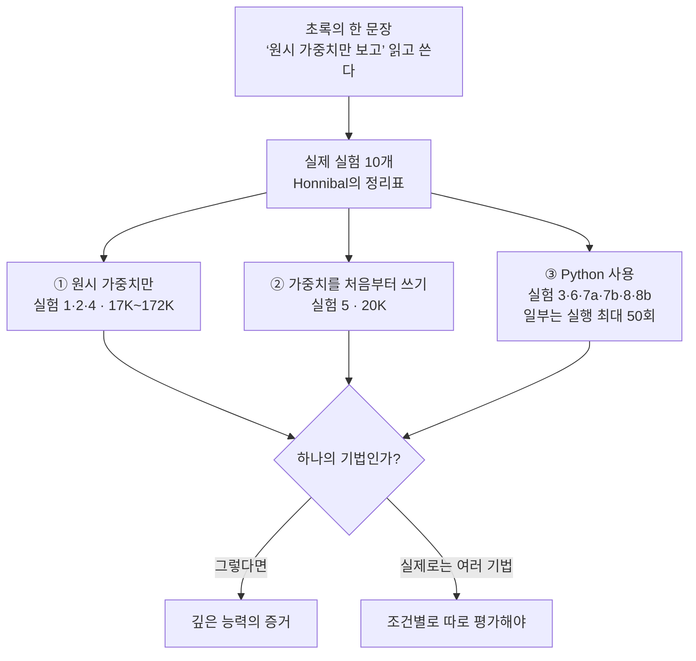

<figure class="post-figure post-figure--header">
<svg role="img" aria-label="무대 위 마술사가 공 대신 가중치 행렬을 띄우는 하나의 마술을 보여 주지만, 막 뒤에서는 장치 소품, 손바닥 숨기기, 강제 선택이라는 서로 다른 기법을 쓰고 있다" viewBox="0 0 380 330" width="460"><title>하나의 마술, 막 뒤의 세 가지 기법</title><g fill="none" stroke="currentColor" stroke-width="2" stroke-linejoin="round" stroke-linecap="round"><path d="M10 8 H370" stroke-width="3"/><path d="M10 8 V178 M370 8 V178"/></g><g fill="var(--accent-color)" opacity="0.85"><path d="M12 10 H70 Q58 60 64 110 Q52 150 40 176 H12 Z"/><path d="M368 10 H310 Q322 60 316 110 Q328 150 340 176 H368 Z"/><path d="M12 10 H368 V26 Q345 34 322 26 Q299 34 276 26 Q253 34 230 26 Q207 34 190 26 Q173 34 150 26 Q127 34 104 26 Q81 34 58 26 Q35 34 12 26 Z"/></g><g fill="none" stroke="currentColor" stroke-width="1.2" opacity="0.45"><path d="M30 30 Q26 100 24 172 M48 30 Q44 100 34 172 M350 30 Q354 100 356 172 M332 30 Q336 100 346 172"/></g><path d="M10 178 H370" stroke="currentColor" stroke-width="3"/><path d="M24 186 H356" stroke="currentColor" stroke-width="1.2" stroke-dasharray="4 4" opacity="0.6"/><g fill="currentColor"><rect x="104" y="58" width="26" height="22" rx="2"/><rect x="98" y="78" width="38" height="5" rx="2"/><circle cx="117" cy="94" r="11" fill="none" stroke="currentColor" stroke-width="2.4"/><path d="M100 176 L106 110 H128 L134 176 Z"/></g><path d="M128 120 L170 104" stroke="currentColor" stroke-width="3.2" stroke-linecap="round"/><path d="M170 104 L180 98" stroke="var(--gold)" stroke-width="2.4" stroke-linecap="round"/><g fill="none" stroke="var(--gold)" stroke-width="1.6" stroke-dasharray="3 4" opacity="0.9"><path d="M186 90 L200 80 M188 106 L202 112"/></g><g stroke="currentColor" stroke-width="1.4"><rect x="210" y="56" width="22" height="22" fill="var(--gold)" opacity="0.85"/><rect x="232" y="56" width="22" height="22" fill="var(--gold)" opacity="0.35"/><rect x="254" y="56" width="22" height="22" fill="none"/><rect x="276" y="56" width="22" height="22" fill="var(--gold)" opacity="0.6"/><rect x="210" y="78" width="22" height="22" fill="none"/><rect x="232" y="78" width="22" height="22" fill="var(--gold)" opacity="0.85"/><rect x="254" y="78" width="22" height="22" fill="var(--gold)" opacity="0.35"/><rect x="276" y="78" width="22" height="22" fill="none"/><rect x="210" y="100" width="22" height="22" fill="var(--gold)" opacity="0.6"/><rect x="232" y="100" width="22" height="22" fill="none"/><rect x="254" y="100" width="22" height="22" fill="var(--gold)" opacity="0.85"/><rect x="276" y="100" width="22" height="22" fill="var(--gold)" opacity="0.35"/><rect x="210" y="122" width="22" height="22" fill="var(--gold)" opacity="0.35"/><rect x="232" y="122" width="22" height="22" fill="var(--gold)" opacity="0.6"/><rect x="254" y="122" width="22" height="22" fill="none"/><rect x="276" y="122" width="22" height="22" fill="var(--gold)" opacity="0.85"/></g><text x="254" y="166" text-anchor="middle" font-size="16" font-weight="700" fill="currentColor">가중치 행렬</text><text x="190" y="214" text-anchor="middle" font-size="16" font-weight="700" fill="var(--accent-color)">막 뒤에서는 매번 다른 기법</text><g fill="none" stroke="currentColor" stroke-width="1.6" stroke-dasharray="5 4"><rect x="8" y="226" width="114" height="98" rx="6"/><rect x="133" y="226" width="114" height="98" rx="6"/><rect x="258" y="226" width="114" height="98" rx="6"/></g><g fill="none" stroke="currentColor" stroke-width="2" stroke-linejoin="round"><rect x="40" y="244" width="50" height="40"/><path d="M40 270 H90" stroke-dasharray="4 3"/><path d="M46 256 h38"/></g><circle cx="65" cy="277" r="5" fill="var(--gold)" stroke="currentColor" stroke-width="1.4"/><g fill="none" stroke="currentColor" stroke-width="2" stroke-linejoin="round" stroke-linecap="round"><path d="M172 288 V262 M181 286 V254 M190 286 V252 M199 286 V256 M208 290 L216 272"/><path d="M168 284 Q170 296 190 296 Q212 296 210 284"/></g><circle cx="190" cy="282" r="5" fill="var(--gold)" stroke="currentColor" stroke-width="1.4"/><g stroke="currentColor" stroke-width="1.6" stroke-linejoin="round"><rect x="281" y="250" width="26" height="36" rx="3" fill="var(--bg-panel)" transform="rotate(-18 294 286)"/><rect x="292" y="246" width="26" height="36" rx="3" fill="var(--bg-panel)" transform="rotate(-6 305 282)"/><rect x="304" y="246" width="26" height="36" rx="3" fill="var(--gold)" transform="rotate(6 317 282)"/><rect x="315" y="250" width="26" height="36" rx="3" fill="var(--bg-panel)" transform="rotate(18 328 286)"/></g><g font-size="15" fill="currentColor" text-anchor="middle"><text x="65" y="314">장치 소품</text><text x="190" y="314">손바닥 숨기기</text><text x="315" y="314">강제 선택</text></g></svg>
<figcaption>관객에게는 하나의 마술로 보이지만 막 뒤의 기법은 매번 다르다 — Honnibal이 '가중치를 읽고 쓴다'는 실험 묶음에 빗댄 비유</figcaption>
</figure>

## 원문 정보

> - **제목**: The 'Astra can read and write weights to improve Qwen' post is misleading
> - **출처**: Matthew Honnibal ([honnibal.dev](https://honnibal.dev))
> - **발행**: 2026-11-03 · 약 5분 분량
> - **원문 링크**: <https://honnibal.dev/blog/astra-read-write-misleading>
> - **비판 대상**: Rikiya Takehi\*, Jayden Teoh\*, Alex Zhang, Omar Khattab (MIT CSAIL), "[Sparks of Weight-Space Programming: LLMs can natively read & write neural network weights](https://rikiyat.github.io/blog/weight-space-programming/)" (Rikiya Takehi 블로그, 2026-11-02)

spaCy를 만든 전산언어학자이자 Explosion 공동 창업자가, 하루 전에 나온 "LLM이 신경망 가중치를 직접 읽고 쓴다"는 연구 블로그 글의 **보고 방식**을 비판한 짧은 글이다. 새 기술을 소개하는 글이라기보다, AI 능력에 관한 주장을 어떻게 읽어야 하는지에 대한 관점 글이라 `AI-Essays`에 담는다.

원문 제목의 'Astra can read and write weights to improve Qwen' post는 Honnibal이 비판 대상 글을 부르는 이름이다. 실제 제목은 위의 "Sparks of Weight-Space Programming"이다. 저자와 소속, 발행일은 비판 대상 페이지의 저자 표기와 메타데이터에서 직접 확인했다.

## 한 줄 요약 (TL;DR)

"원시 가중치만 보고(just by looking at the raw weights)" 읽고 쓴다는 설정은 작은 네트워크(17K~172K 가중치)를 다룬 실험 1·2·4에만 해당한다. 헤드라인인 Qwen 실험은 Python으로 가중치를 분석하고 모델을 최대 50번 돌려 보는, **다른 기법**이다. Honnibal은 이 둘을 한 능력처럼 한 글에 묶으면 실제로 증명되지 않은 깊은 능력을 암시하게 된다고 주장한다.

한눈에 보면, 초록의 한 문장은 실제로는 접근 조건이 다른 세 갈래의 실험으로 나뉜다(접근 권한 기준으로 이 글에서 묶은 것이다).

## 왜 이 글을 골랐나

"LLM이 가중치를 읽고 쓴다"는 인상적인 주장을 **실험 설계 수준에서** 해부한 반박이다. 결과 수치(7.9% → 48.1%)를 의심하는 것이 아니라, 그 수치가 **어떤 조건에서** 나왔고 초록이 그 조건을 어떻게 뭉뚱그렸는지를 표 하나로 보여 준다. 과장된 주장을 가려내는 평가의 눈을 기르는 데 좋은 교재라서 골랐다.

LLM 평가에 관심이 있다면 익숙한 문제다. [CS336 12강](/2026/06/26/cs336-lecture-12-evaluation.html)이 말하는 "무엇을 알고 싶은가에 따라 평가가 달라진다"는 원칙이, 이 글에서는 "어떤 도구와 접근 권한을 주고 잰 능력인가"라는 질문으로 나타난다.

## 핵심 내용

원문에는 소제목이 없다. 아래는 글의 흐름을 따라 나눈 정리다.

### 1. 마술사의 비유

Honnibal은 무대 마술로 글을 연다. 마술사는 같은 마술을 여러 방법으로 한다. 한 번은 장치가 있는 소품을 쓰고, 다음에는 소품에 장치가 없다는 걸 보여 주면서 물건을 손바닥에 숨기고, 세 번째는 강제 선택을 쓴다. 관객은 기법이 하나라고 가정하기 때문에, 매번 자기 가설이 깨지는 것처럼 느낀다. 그는 "Astra 글의 실험들이 거의 이런 식으로 작동한다"고 말한다.

### 2. 초록이 주는 인상

Honnibal은 비판 대상 글의 초록을 그대로 인용한다. 핵심 문장은 이렇다.

> "Just by looking at the raw weights, GPT-6 Astra can tell what a network was trained to do."

같은 초록의 다음 단락은 Astra가 Qwen3.5-0.8B에서 추론 루프를 일으키는 가중치 문제를 찾아 가중치의 0.016%를 고쳤고, 그 결과 MATH-500이 7.9%에서 48.1%로, IFEval이 3배로 올랐다고 쓴다.

Honnibal의 질문은 하나다. 이걸 읽으면 Qwen 실험도 "원시 가중치만 보고" 한 거라고 생각하지 않겠는가? 그는 그렇지 않다고 답한다.

> "those latter two aren't just working with raw weights, they write Python programs."

여기서 "latter two"는 게임 네트워크를 개선하는 실험과 Qwen의 수학 실력을 개선하는 실험을 가리킨다.

### 3. 실험 요약표

Honnibal이 정리한 표를 옮기면 다음과 같다(용어만 번역했고 수치는 원문 그대로다).

<figure class="post-figure">
<svg role="img" aria-label="Honnibal 표의 실험 10개를 접근 권한별로 묶은 세로 카드. 원시 가중치만 보는 실험 1, 2, 4는 17K에서 172K 크기라 크기 막대가 거의 보이지 않고, 가중치를 처음부터 쓰는 실험 5는 20K, Python을 쓰는 실험 3, 6, 7a, 7b, 8, 8b는 1.5M에서 800M 크기이며 이 중 6, 7b, 8, 8b만 네트워크를 실행한다" viewBox="0 0 380 914" width="460"><title>실험별 접근 권한과 네트워크 크기</title><text x="8" y="20" font-size="15" text-anchor="start" fill="currentColor">읽기=원시 가중치 읽기 · 쓰기=가중치 쓰기</text><text x="8" y="42" font-size="15" text-anchor="start" fill="currentColor">Py=Python · 실행=네트워크 실행</text><rect x="8" y="54" width="40" height="20" rx="4" fill="var(--accent-color)" stroke="currentColor" stroke-width="1.2"/><text x="56" y="69" font-size="15" text-anchor="start" fill="currentColor">= Yes</text><rect x="118" y="54" width="40" height="20" rx="4" fill="none" stroke="currentColor" stroke-width="1.2" stroke-dasharray="3 3" opacity="0.6"/><text x="166" y="69" font-size="15" text-anchor="start" fill="currentColor">= No</text><text x="8" y="98" font-size="15" text-anchor="start" fill="currentColor">막대 길이 = 네트워크 크기 (선형 눈금)</text><text x="8" y="138" font-size="16" text-anchor="start" fill="var(--accent-color)" font-weight="700">원시 가중치만 (도구·실행 없음)</text><rect x="4" y="146" width="372" height="64" rx="6" fill="var(--bg-panel)" stroke="currentColor" stroke-width="2"/><text x="14" y="168" font-size="15" text-anchor="start" fill="currentColor"><tspan font-weight="700">1</tspan>  게임 맞히기 (PPO MLP)</text><text x="366" y="168" font-size="15" text-anchor="end" fill="currentColor" font-weight="700">4/4 정답</text><rect x="14" y="180" width="50" height="22" rx="4" fill="var(--accent-color)" stroke="currentColor" stroke-width="1.2"/><text x="39" y="196" font-size="15" text-anchor="middle" fill="var(--bg-panel)" font-weight="700">읽기</text><rect x="70" y="180" width="50" height="22" rx="4" fill="none" stroke="currentColor" stroke-width="1.2" stroke-dasharray="3 3" opacity="0.55"/><text x="95" y="196" font-size="15" text-anchor="middle" fill="currentColor" opacity="0.5">쓰기</text><rect x="126" y="180" width="50" height="22" rx="4" fill="none" stroke="currentColor" stroke-width="1.2" stroke-dasharray="3 3" opacity="0.55"/><text x="151" y="196" font-size="15" text-anchor="middle" fill="currentColor" opacity="0.5">Py</text><rect x="182" y="180" width="50" height="22" rx="4" fill="none" stroke="currentColor" stroke-width="1.2" stroke-dasharray="3 3" opacity="0.55"/><text x="207" y="196" font-size="15" text-anchor="middle" fill="currentColor" opacity="0.5">실행</text><text x="286" y="197" font-size="15" text-anchor="end" fill="currentColor" font-weight="700">17K</text><line x1="290" y1="181" x2="290" y2="201" stroke="currentColor" stroke-width="1.2"/><rect x="290" y="184" width="0.002" height="14" fill="var(--gold)"/><rect x="4" y="216" width="372" height="64" rx="6" fill="var(--bg-panel)" stroke="currentColor" stroke-width="2"/><text x="14" y="238" font-size="15" text-anchor="start" fill="currentColor"><tspan font-weight="700">2</tspan>  도형 맞히기 (diffusion)</text><text x="366" y="238" font-size="15" text-anchor="end" fill="currentColor" font-weight="700">3/3 정답</text><rect x="14" y="250" width="50" height="22" rx="4" fill="var(--accent-color)" stroke="currentColor" stroke-width="1.2"/><text x="39" y="266" font-size="15" text-anchor="middle" fill="var(--bg-panel)" font-weight="700">읽기</text><rect x="70" y="250" width="50" height="22" rx="4" fill="none" stroke="currentColor" stroke-width="1.2" stroke-dasharray="3 3" opacity="0.55"/><text x="95" y="266" font-size="15" text-anchor="middle" fill="currentColor" opacity="0.5">쓰기</text><rect x="126" y="250" width="50" height="22" rx="4" fill="none" stroke="currentColor" stroke-width="1.2" stroke-dasharray="3 3" opacity="0.55"/><text x="151" y="266" font-size="15" text-anchor="middle" fill="currentColor" opacity="0.5">Py</text><rect x="182" y="250" width="50" height="22" rx="4" fill="none" stroke="currentColor" stroke-width="1.2" stroke-dasharray="3 3" opacity="0.55"/><text x="207" y="266" font-size="15" text-anchor="middle" fill="currentColor" opacity="0.5">실행</text><text x="286" y="267" font-size="15" text-anchor="end" fill="currentColor" font-weight="700">24K</text><line x1="290" y1="251" x2="290" y2="271" stroke="currentColor" stroke-width="1.2"/><rect x="290" y="254" width="0.002" height="14" fill="var(--gold)"/><rect x="4" y="286" width="372" height="64" rx="6" fill="var(--bg-panel)" stroke="currentColor" stroke-width="2"/><text x="14" y="308" font-size="15" text-anchor="start" fill="currentColor"><tspan font-weight="700">4</tspan>  Kinetix 정책 고치기</text><text x="366" y="308" font-size="15" text-anchor="end" fill="currentColor" font-weight="700">0% → 100%</text><rect x="14" y="320" width="50" height="22" rx="4" fill="var(--accent-color)" stroke="currentColor" stroke-width="1.2"/><text x="39" y="336" font-size="15" text-anchor="middle" fill="var(--bg-panel)" font-weight="700">읽기</text><rect x="70" y="320" width="50" height="22" rx="4" fill="var(--accent-color)" stroke="currentColor" stroke-width="1.2"/><text x="95" y="336" font-size="15" text-anchor="middle" fill="var(--bg-panel)" font-weight="700">쓰기</text><rect x="126" y="320" width="50" height="22" rx="4" fill="none" stroke="currentColor" stroke-width="1.2" stroke-dasharray="3 3" opacity="0.55"/><text x="151" y="336" font-size="15" text-anchor="middle" fill="currentColor" opacity="0.5">Py</text><rect x="182" y="320" width="50" height="22" rx="4" fill="none" stroke="currentColor" stroke-width="1.2" stroke-dasharray="3 3" opacity="0.55"/><text x="207" y="336" font-size="15" text-anchor="middle" fill="currentColor" opacity="0.5">실행</text><text x="286" y="337" font-size="15" text-anchor="end" fill="currentColor" font-weight="700">172K</text><line x1="290" y1="321" x2="290" y2="341" stroke="currentColor" stroke-width="1.2"/><rect x="290" y="324" width="0.015" height="14" fill="var(--gold)"/><text x="8" y="380" font-size="16" text-anchor="start" fill="var(--accent-color)" font-weight="700">가중치를 처음부터 쓰기</text><rect x="4" y="388" width="372" height="64" rx="6" fill="var(--bg-panel)" stroke="currentColor" stroke-width="1.2" stroke-dasharray="6 4"/><text x="14" y="410" font-size="15" text-anchor="start" fill="currentColor"><tspan font-weight="700">5</tspan>  MinAtar MLP 새로 쓰기</text><text x="366" y="410" font-size="15" text-anchor="end" fill="currentColor" font-weight="700">PPO-100M 능가</text><rect x="14" y="422" width="50" height="22" rx="4" fill="none" stroke="currentColor" stroke-width="1.2" stroke-dasharray="3 3" opacity="0.55"/><text x="39" y="438" font-size="15" text-anchor="middle" fill="currentColor" opacity="0.5">읽기</text><rect x="70" y="422" width="50" height="22" rx="4" fill="var(--accent-color)" stroke="currentColor" stroke-width="1.2"/><text x="95" y="438" font-size="15" text-anchor="middle" fill="var(--bg-panel)" font-weight="700">쓰기</text><rect x="126" y="422" width="50" height="22" rx="4" fill="none" stroke="currentColor" stroke-width="1.2" stroke-dasharray="3 3" opacity="0.55"/><text x="151" y="438" font-size="15" text-anchor="middle" fill="currentColor" opacity="0.5">Py</text><rect x="182" y="422" width="50" height="22" rx="4" fill="none" stroke="currentColor" stroke-width="1.2" stroke-dasharray="3 3" opacity="0.55"/><text x="207" y="438" font-size="15" text-anchor="middle" fill="currentColor" opacity="0.5">실행</text><text x="286" y="439" font-size="15" text-anchor="end" fill="currentColor" font-weight="700">20K</text><line x1="290" y1="423" x2="290" y2="443" stroke="currentColor" stroke-width="1.2"/><rect x="290" y="426" width="0.002" height="14" fill="var(--gold)"/><text x="8" y="482" font-size="16" text-anchor="start" fill="var(--accent-color)" font-weight="700">Python 사용</text><rect x="4" y="490" width="372" height="64" rx="6" fill="var(--bg-panel)" stroke="currentColor" stroke-width="1.2" stroke-dasharray="6 4"/><text x="14" y="512" font-size="15" text-anchor="start" fill="currentColor"><tspan font-weight="700">3</tspan>  문자 transformer head 찾기</text><text x="366" y="512" font-size="15" text-anchor="end" fill="currentColor" font-weight="700">3/3 정답</text><rect x="14" y="524" width="50" height="22" rx="4" fill="none" stroke="currentColor" stroke-width="1.2" stroke-dasharray="3 3" opacity="0.55"/><text x="39" y="540" font-size="15" text-anchor="middle" fill="currentColor" opacity="0.5">읽기</text><rect x="70" y="524" width="50" height="22" rx="4" fill="none" stroke="currentColor" stroke-width="1.2" stroke-dasharray="3 3" opacity="0.55"/><text x="95" y="540" font-size="15" text-anchor="middle" fill="currentColor" opacity="0.5">쓰기</text><rect x="126" y="524" width="50" height="22" rx="4" fill="var(--accent-color)" stroke="currentColor" stroke-width="1.2"/><text x="151" y="540" font-size="15" text-anchor="middle" fill="var(--bg-panel)" font-weight="700">Py</text><rect x="182" y="524" width="50" height="22" rx="4" fill="none" stroke="currentColor" stroke-width="1.2" stroke-dasharray="3 3" opacity="0.55"/><text x="207" y="540" font-size="15" text-anchor="middle" fill="currentColor" opacity="0.5">실행</text><text x="286" y="541" font-size="15" text-anchor="end" fill="currentColor" font-weight="700">7.2M</text><line x1="290" y1="525" x2="290" y2="545" stroke="currentColor" stroke-width="1.2"/><rect x="290" y="528" width="0.648" height="14" fill="var(--gold)"/><rect x="4" y="560" width="372" height="64" rx="6" fill="var(--bg-panel)" stroke="currentColor" stroke-width="1.2" stroke-dasharray="6 4"/><text x="14" y="582" font-size="15" text-anchor="start" fill="currentColor"><tspan font-weight="700">6</tspan>  9×9 바둑 네트워크 쓰기</text><text x="366" y="582" font-size="15" text-anchor="end" fill="currentColor" font-weight="700">PPO 능가</text><rect x="14" y="594" width="50" height="22" rx="4" fill="none" stroke="currentColor" stroke-width="1.2" stroke-dasharray="3 3" opacity="0.55"/><text x="39" y="610" font-size="15" text-anchor="middle" fill="currentColor" opacity="0.5">읽기</text><rect x="70" y="594" width="50" height="22" rx="4" fill="var(--accent-color)" stroke="currentColor" stroke-width="1.2"/><text x="95" y="610" font-size="15" text-anchor="middle" fill="var(--bg-panel)" font-weight="700">쓰기</text><rect x="126" y="594" width="50" height="22" rx="4" fill="var(--accent-color)" stroke="currentColor" stroke-width="1.2"/><text x="151" y="610" font-size="15" text-anchor="middle" fill="var(--bg-panel)" font-weight="700">Py</text><rect x="182" y="594" width="50" height="22" rx="4" fill="var(--accent-color)" stroke="currentColor" stroke-width="1.2"/><text x="207" y="610" font-size="15" text-anchor="middle" fill="var(--bg-panel)" font-weight="700">실행</text><text x="286" y="611" font-size="15" text-anchor="end" fill="currentColor" font-weight="700">1.5M</text><line x1="290" y1="595" x2="290" y2="615" stroke="currentColor" stroke-width="1.2"/><rect x="290" y="598" width="0.135" height="14" fill="var(--gold)"/><rect x="4" y="630" width="372" height="64" rx="6" fill="var(--bg-panel)" stroke="currentColor" stroke-width="1.2" stroke-dasharray="6 4"/><text x="14" y="652" font-size="15" text-anchor="start" fill="currentColor"><tspan font-weight="700">7a</tspan>  아첨하는 Gemma 3 찾기</text><text x="366" y="652" font-size="15" text-anchor="end" fill="currentColor" font-weight="700">실패</text><rect x="14" y="664" width="50" height="22" rx="4" fill="none" stroke="currentColor" stroke-width="1.2" stroke-dasharray="3 3" opacity="0.55"/><text x="39" y="680" font-size="15" text-anchor="middle" fill="currentColor" opacity="0.5">읽기</text><rect x="70" y="664" width="50" height="22" rx="4" fill="none" stroke="currentColor" stroke-width="1.2" stroke-dasharray="3 3" opacity="0.55"/><text x="95" y="680" font-size="15" text-anchor="middle" fill="currentColor" opacity="0.5">쓰기</text><rect x="126" y="664" width="50" height="22" rx="4" fill="var(--accent-color)" stroke="currentColor" stroke-width="1.2"/><text x="151" y="680" font-size="15" text-anchor="middle" fill="var(--bg-panel)" font-weight="700">Py</text><rect x="182" y="664" width="50" height="22" rx="4" fill="none" stroke="currentColor" stroke-width="1.2" stroke-dasharray="3 3" opacity="0.55"/><text x="207" y="680" font-size="15" text-anchor="middle" fill="currentColor" opacity="0.5">실행</text><text x="286" y="681" font-size="15" text-anchor="end" fill="currentColor" font-weight="700">270M</text><line x1="290" y1="665" x2="290" y2="685" stroke="currentColor" stroke-width="1.2"/><rect x="290" y="668" width="24.300" height="14" fill="var(--gold)"/><rect x="4" y="700" width="372" height="64" rx="6" fill="var(--bg-panel)" stroke="currentColor" stroke-width="1.2" stroke-dasharray="6 4"/><text x="14" y="722" font-size="15" text-anchor="start" fill="currentColor"><tspan font-weight="700">7b</tspan>  7a + attention 보기</text><text x="366" y="722" font-size="15" text-anchor="end" fill="currentColor" font-weight="700">3/3 정답</text><rect x="14" y="734" width="50" height="22" rx="4" fill="none" stroke="currentColor" stroke-width="1.2" stroke-dasharray="3 3" opacity="0.55"/><text x="39" y="750" font-size="15" text-anchor="middle" fill="currentColor" opacity="0.5">읽기</text><rect x="70" y="734" width="50" height="22" rx="4" fill="none" stroke="currentColor" stroke-width="1.2" stroke-dasharray="3 3" opacity="0.55"/><text x="95" y="750" font-size="15" text-anchor="middle" fill="currentColor" opacity="0.5">쓰기</text><rect x="126" y="734" width="50" height="22" rx="4" fill="var(--accent-color)" stroke="currentColor" stroke-width="1.2"/><text x="151" y="750" font-size="15" text-anchor="middle" fill="var(--bg-panel)" font-weight="700">Py</text><rect x="182" y="734" width="50" height="22" rx="4" fill="var(--accent-color)" stroke="currentColor" stroke-width="1.2"/><text x="207" y="750" font-size="15" text-anchor="middle" fill="var(--bg-panel)" font-weight="700">실행</text><text x="286" y="751" font-size="15" text-anchor="end" fill="currentColor" font-weight="700">270M</text><line x1="290" y1="735" x2="290" y2="755" stroke="currentColor" stroke-width="1.2"/><rect x="290" y="738" width="24.300" height="14" fill="var(--gold)"/><rect x="4" y="770" width="372" height="64" rx="6" fill="var(--bg-panel)" stroke="currentColor" stroke-width="1.2" stroke-dasharray="6 4"/><text x="14" y="792" font-size="15" text-anchor="start" fill="currentColor"><tspan font-weight="700">8</tspan>  Qwen3.5 수학 고치기</text><text x="366" y="792" font-size="15" text-anchor="end" fill="currentColor" font-weight="700">7.9% → 48.1%</text><rect x="14" y="804" width="50" height="22" rx="4" fill="none" stroke="currentColor" stroke-width="1.2" stroke-dasharray="3 3" opacity="0.55"/><text x="39" y="820" font-size="15" text-anchor="middle" fill="currentColor" opacity="0.5">읽기</text><rect x="70" y="804" width="50" height="22" rx="4" fill="var(--accent-color)" stroke="currentColor" stroke-width="1.2"/><text x="95" y="820" font-size="15" text-anchor="middle" fill="var(--bg-panel)" font-weight="700">쓰기</text><rect x="126" y="804" width="50" height="22" rx="4" fill="var(--accent-color)" stroke="currentColor" stroke-width="1.2"/><text x="151" y="820" font-size="15" text-anchor="middle" fill="var(--bg-panel)" font-weight="700">Py</text><rect x="182" y="804" width="50" height="22" rx="4" fill="var(--accent-color)" stroke="currentColor" stroke-width="1.2"/><text x="207" y="820" font-size="15" text-anchor="middle" fill="var(--bg-panel)" font-weight="700">실행</text><text x="286" y="821" font-size="15" text-anchor="end" fill="currentColor" font-weight="700">800M</text><line x1="290" y1="805" x2="290" y2="825" stroke="currentColor" stroke-width="1.2"/><rect x="290" y="808" width="72.000" height="14" fill="var(--gold)"/><rect x="4" y="840" width="372" height="64" rx="6" fill="var(--bg-panel)" stroke="currentColor" stroke-width="1.2" stroke-dasharray="6 4"/><text x="14" y="862" font-size="15" text-anchor="start" fill="currentColor"><tspan font-weight="700">8b</tspan>  같은 과제, Gemma 3</text><text x="366" y="862" font-size="15" text-anchor="end" fill="currentColor" font-weight="700">실패</text><rect x="14" y="874" width="50" height="22" rx="4" fill="none" stroke="currentColor" stroke-width="1.2" stroke-dasharray="3 3" opacity="0.55"/><text x="39" y="890" font-size="15" text-anchor="middle" fill="currentColor" opacity="0.5">읽기</text><rect x="70" y="874" width="50" height="22" rx="4" fill="var(--accent-color)" stroke="currentColor" stroke-width="1.2"/><text x="95" y="890" font-size="15" text-anchor="middle" fill="var(--bg-panel)" font-weight="700">쓰기</text><rect x="126" y="874" width="50" height="22" rx="4" fill="var(--accent-color)" stroke="currentColor" stroke-width="1.2"/><text x="151" y="890" font-size="15" text-anchor="middle" fill="var(--bg-panel)" font-weight="700">Py</text><rect x="182" y="874" width="50" height="22" rx="4" fill="var(--accent-color)" stroke="currentColor" stroke-width="1.2"/><text x="207" y="890" font-size="15" text-anchor="middle" fill="var(--bg-panel)" font-weight="700">실행</text><text x="286" y="891" font-size="15" text-anchor="end" fill="currentColor" font-weight="700">270M</text><line x1="290" y1="875" x2="290" y2="895" stroke="currentColor" stroke-width="1.2"/><rect x="290" y="878" width="24.300" height="14" fill="var(--gold)"/></svg>
<figcaption>실험별 접근 권한(채움 = Yes, 점선 = No)과 네트워크 크기(선형 막대). 원시 가중치만 보는 실험은 모두 172K 이하라 막대가 거의 보이지 않는다. 실행 횟수와 각주는 아래 표를 참고</figcaption>
</figure>

| # | 실험 | 크기 | 원시 가중치 읽기 | 가중치 쓰기 | Python | 네트워크 실행 | 결과 |
| --- | --- | --- | --- | --- | --- | --- | --- |
| 1 | PPO MLP가 학습한 게임 맞히기 | 17K | Yes | No | No | No | 4/4 정답 |
| 2 | diffusion MLP가 생성하는 도형 맞히기 | 24K | Yes | No | No | No | 3/3 정답 |
| 3 | 문자 단위 transformer의 언어·copying head 찾기 | 7.2M | No | No | Yes | No | 3/3 정답 |
| 4 | 멈춘 Kinetix 자동차 정책 고치기 | 172K | Yes | Yes | No | No¹ | 0% → 100%² |
| 5 | MinAtar 게임 MLP를 처음부터 쓰기 | 20K | No³ | Yes | No | No | PPO-100M 능가⁴ |
| 6 | 9×9 바둑 네트워크 쓰기 | 1.5M | No | Yes | Yes | Yes (0–50회) | PPO 능가 |
| 7a | 아첨(sycophantic)하는 Gemma 3 찾기 | 270M | No | No | Yes | No | 실패 |
| 7b | 같은 과제, attention 패턴을 보면서 | 270M | No | No | Yes | Yes⁵ | 3/3 정답 |
| 8 | Qwen3.5의 수학 고치기 | 800M | No | Yes | Yes | Yes (50회) | 7.9% → 48.1% |
| 8b | 같은 과제, Gemma 3에서 | 270M | No | Yes | Yes | Yes (50회) | 실패 |

1. 실패 장면을 녹화한 에피소드 하나를 받았다.
2. 한 번의 시도로, 가중치의 3.5%를 바꿨다.
3. 가중치가 0에서 시작하므로 읽을 것이 없다.
4. PPO-500M과 비교하면 Breakout에서만 이긴다(517 vs. 25). Seaquest(53 vs. 89)와 Asterix(53 vs. 55)에서는 진다.
5. 최대 16개 텍스트를 돌려 보되, 출력은 보지 못하고 attention 패턴만 본다.

### 4. "원시 가중치만"은 어디까지인가

Honnibal에 따르면 "원시 가중치만 보고"라는 설정, 즉 원시 부동소수점을 컨텍스트에 넣고 도구 없이 네트워크도 돌리지 않는 설정은 **실험 1, 2, 4에만** 등장한다. 이 실험들의 네트워크는 17K~172K 가중치 규모다. 실제 언어 모델을 다룬 실험은 모두 Python을 쓰고, 헤드라인인 Qwen 실험은 최대 50배치의 연습 문제로 모델을 돌려 볼 수도 있었다.

### 5. Qwen 결과가 실제로 보여 주는 것

Honnibal은 Qwen 결과를 깎아내리지 않는다. 그가 보기에 이 결과는 Astra에게 프롬프트를 주면 **인간 ML 엔지니어가 할 법한 작업을 스스로 고안하고 수행할 수 있다**는 것을 보여 준다. 인간 ML 엔지니어도 가중치를 분석하거나 "직접" 수정하는 코드 조각을 늘 짠다. 그걸 생산적으로 해내는 방법을 찾는 건 "not nothing"이고, 1~2년 전 AI 모델이라면 이 과제들을 모두 실패했을 것이라고 그는 인정한다.

### 6. 왜 한 글에 묶으면 안 되는가

Honnibal의 결론은 이렇다. **그가 보기에** Qwen 결과를 비롯해 Python을 쓰는 실험들은 가중치를 직접 읽는 실험들과 **같은 글이나 논문에 들어가면 안 된다**.

이유는 다음과 같다. "작은 게임용 가중치를 처음부터 쓰기"와 "큰 모델의 특정 과제 성능 올리기"를 **하나의 기법**으로 모두 해냈다면, 그건 깊은 능력을 뜻한다. 가중치에 대한 일종의 '게슈탈트'(처음부터 써낼 수 있을 정도)와 큰 기존 네트워크에 대한 이해를 함께 보여 준 셈이기 때문이다. 하지만 Honnibal은 여기서는 그렇지 않다고 말한다.

> "But that's not at all true here, because it's not a single technique."

## 분석과 인사이트

여기서부터는 내 해석이다. 원문 요약과 구분해 읽어 주길 바란다.

### 비판의 정확한 과녁은 "결과"가 아니라 "묶음"이다

Honnibal은 어떤 수치도 틀렸다고 하지 않는다. 재현이 안 된다고도 하지 않는다. 그가 문제 삼는 건 **초록 수준의 프레이밍**이다. 서로 다른 조건(접근 권한, 도구, 실행 횟수, 모델 크기)에서 나온 결과를 한 문장 흐름에 이어 붙이면, 독자는 가장 강한 조건(원시 가중치만)과 가장 인상적인 결과(48.1%)를 머릿속에서 합친다. 그렇게 합쳐진 능력은 어떤 실험도 단독으로 증명하지 않았다. 마술 비유가 정확히 이 지점을 겨눈다.

### 공정하게 보면, 원 글도 본문에서는 도구 사용을 밝힌다

이 부분은 내가 비판 대상 글을 직접 읽고 확인한 것이고, Honnibal의 글에는 없는 내용이다. "Sparks of Weight-Space Programming"의 TL;DR은 "using a variety of recent tools and algorithms or even via direct weight editing"이라고 도구 사용을 언급한다. 본문에도 "Real-World Relevant Scenarios (Scaling Up and Tool-use)"라는 단락이 있어, 여기서부터는 네트워크가 컨텍스트에 들어가지 않고 도구를 쓴다고 밝힌다. Qwen 실험 설정에도 "a Python kernel over the weights (no GPU)"와 10·25·50회의 forward pass 예산이 적혀 있다.

그러니 정보가 **숨겨진** 것은 아니다. 문제는 **어디에 무엇을 두었느냐**다. Honnibal이 인용한 초록의 두 단락은 "Just by looking at the raw weights"로 시작해 "Likewise"로 Qwen 결과로 넘어간다. Honnibal의 비판은 그 연결어 하나가 만드는 착시에 대한 것이라고 나는 읽었다.

### 헤드라인 수치는 실행 예산에 민감하다

이것도 원 글의 표에서 내가 확인한 내용이다. Qwen 실험에서 MATH-500은 forward pass 10회일 때 12.3%, 25회일 때 14.1%, 50회일 때 48.1%였다. 원 글 스스로 10·25회에서는 루프가 거의 사라지지 않았다고 쓴다. 48.1%라는 숫자는 "가중치를 보고 고쳤다"보다 "50번 돌려 보며 고쳤다"는 조건에 크게 기대고 있다는 뜻으로 읽힌다(내 추론이다). Honnibal 표의 "Yes (50 passes)" 한 칸이 그만큼 무겁다.

원 글은 한계도 스스로 적었다. 루프를 고치는 것은 수학을 잘하게 만드는 것과 같지 않고, 모델이 이미 풀 수 있던 답을 끝까지 내게 해 줄 뿐이라는 것이다. 루프가 드문 Gemma 3 270M에서는 개선하지 못했고(Honnibal 표의 8b), 원 글은 이를 가중치 편집이 "가려진 능력의 장애물은 치울 수 있어도 없는 능력을 더할 수는 없었다"고 정리한다. 이 단서까지 함께 읽으면 Qwen 결과의 위치가 더 분명해진다. 인상적인 엔지니어링이지만, 초록이 풍기는 "가중치 독해력"의 증거로는 약하다.

### 평가하는 사람에게 남는 질문: "어떤 조건에서 잰 능력인가"

에이전트 시대의 벤치마크 수치는 점점 **모델 + 하니스 + 예산**의 합이 된다. 위키에 정리한 [GPT-6 Astra: 하니스가 곧 제품이다](/2026/09/08/gpt6-astra-harness-is-the-product.html)는 같은 모델이 하니스에 따라 54.8%와 99.9%로 갈린다는 주장을 다뤘다. [MCP와 CLI 인터페이스 비교 논문](/2026/10/31/mcp-vs-cli-matched-interfaces-agent-behavior.html)도 같은 능력을 다른 인터페이스로 주면 행동이 달라진다는 것을 보였다. Honnibal의 표는 이 흐름에서 자연스러운 다음 단계다. 결과마다 **접근 권한(원시 가중치 / Python / 실행)과 예산**을 열로 펼치기만 해도, 한 문장 주장이 실제로는 몇 개의 서로 다른 주장인지 드러난다.

### 이견이 있다면

Honnibal의 "같은 글이나 논문에 들어가면 안 된다"는 다소 강한 처방이다. 내 생각에는 한 글에 담되 **초록과 헤드라인에서 조건별로 주장을 분리**하는 정도로도 대부분의 문제가 풀린다. 원 글처럼 "Weight-Space Programming"이라는 우산 개념을 세우려는 연구라면, 스펙트럼 전체(도구 없음 ~ 도구와 실행 허용)를 한 곳에서 보여 주는 것에도 가치가 있다. 다만 그러려면 Honnibal이 만든 것 같은 조건표가 본문 맨 앞에 있어야 한다. 이 점에서 그의 표는 비판이면서 동시에 좋은 보고 형식의 예시다.

## 적용 포인트

- **결과 하나에 조건 열을 붙여 읽는다.** AI 능력 주장을 볼 때 "도구 사용 여부 / 실행·피드백 횟수 / 모델·과제 규모 / 실패 사례"를 표로 다시 그려 본다. Honnibal의 표가 그대로 템플릿이 된다.
- **연결어를 의심한다.** 초록의 "Likewise", "Similarly", "even" 같은 말이 서로 다른 조건의 결과를 이어 붙이고 있지 않은지 본다.
- **예산별 곡선을 찾는다.** 헤드라인 수치가 최대 예산에서만 나오는지, 중간 예산에서는 어떤지 확인한다(이 경우 10·25회 대 50회).
- **실패 행을 같이 본다.** 7a·8b처럼 실패한 조건은 능력의 경계를 알려 준다. 성공한 행만으로 일반화하지 않는다.
- **내 평가 보고서에도 같은 원칙을 적용한다.** 사내 LLM 평가 결과를 공유할 때 하니스·도구·재시도 횟수를 결과와 같은 표에 둔다. 서로 다른 설정의 결과는 한 문장에 섞어 요약하지 않는다.

## 마무리

Honnibal의 글은 짧지만, 정리한 표 하나가 핵심을 다 보여 준다. "LLM이 가중치를 읽고 쓴다"는 문장 안에는 사실 원시 가중치를 읽는 작은 실험, 처음부터 가중치를 쓰는 실험, Python과 실행 예산을 쓰는 큰 모델 실험이 섞여 있다. 각각은 따로 보면 흥미로운 결과일 수 있다. 하지만 한 기법처럼 묶는 순간 증명되지 않은 능력을 암시하게 된다. 수치를 의심하기 전에 **그 수치가 어떤 조건에서 나왔는지**부터 묻는 습관이 이 글이 남기는 가장 실용적인 교훈이다.

### 더 읽어보기

- [원문 — The 'Astra can read and write weights to improve Qwen' post is misleading (Matthew Honnibal)](https://honnibal.dev/blog/astra-read-write-misleading)
- [비판 대상 — Sparks of Weight-Space Programming: LLMs can natively read & write neural network weights (Takehi·Teoh·Zhang·Khattab, MIT CSAIL)](https://rikiyat.github.io/blog/weight-space-programming/)
- [GPT-6 Astra: 하니스가 곧 제품이다](/2026/09/08/gpt6-astra-harness-is-the-product.html) — 같은 Astra 모델의 성능이 하니스에 따라 갈린다는 분석. "어떤 조건에서 잰 능력인가"라는 질문의 배경
- [같은 능력, 다른 행동: MCP와 CLI 인터페이스는 에이전트의 결정을 바꾼다](/2026/10/31/mcp-vs-cli-matched-interfaces-agent-behavior.html) — 인터페이스 조건을 통제한 실험 설계의 예
- [CS336 12강 — 평가(Evaluation): 하나의 참된 평가는 없다](/2026/06/26/cs336-lecture-12-evaluation.html) — 평가의 타당성과 함정을 정리한 강의 노트
- [그것들은 가중치로 만들어졌다](/2026/06/19/made-out-of-weights.html) — "가중치를 읽는다"는 말의 대상인 가중치 자체를 다룬 짧은 픽션 분석
- [논증 오류 고치기: 오류명보다 끊어진 추론을 복구하는 법](/2026/09/17/repairing-logical-fallacies.html) — 과장된 주장의 끊어진 추론을 찾아 고치는 연습
