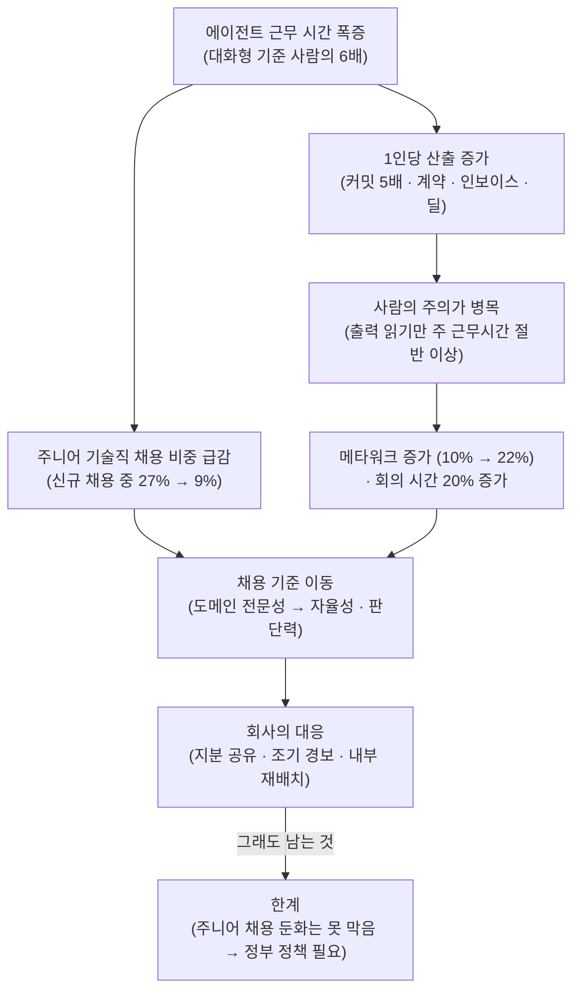

<figure class="post-figure post-figure--header">
<svg role="img" aria-label="왼쪽에서 손을 든 Claude 에이전트 열두 무리가 동시에 '검토해 주세요'라고 요청하며 출력 조각을 쏟아내고, 그 출력은 좁아지는 깔때기를 지나 오른쪽의 엔지니어 한 사람에게 한 번에 하나씩만 도착한다. 깔때기의 좁은 목이 사람의 주의라는 병목이다" viewBox="0 0 640 320">
  <title>에이전트 군단과 사람의 주의라는 병목</title>
  <g font-family="var(--font-body)">

  <!-- AGENT HORDE — 손을 든 에이전트 무리 -->
    <g transform="translate(28 74)">
      <rect x="0" y="0" width="30" height="26" rx="3" fill="var(--secondary-color)" opacity="0.88"/>
      <rect x="7" y="9" width="5" height="5" fill="var(--bg-panel)"/><rect x="18" y="9" width="5" height="5" fill="var(--bg-panel)"/>
      <path d="M30 6 L38 -6" stroke="var(--secondary-color)" stroke-width="3" stroke-linecap="round"/>
      <rect x="35" y="-11" width="6" height="6" fill="var(--secondary-color)"/>
    </g>
    <g transform="translate(82 74)">
      <rect x="0" y="0" width="30" height="26" rx="3" fill="var(--secondary-color)" opacity="0.88"/>
      <rect x="7" y="9" width="5" height="5" fill="var(--bg-panel)"/><rect x="18" y="9" width="5" height="5" fill="var(--bg-panel)"/>
      <path d="M30 6 L38 -6" stroke="var(--secondary-color)" stroke-width="3" stroke-linecap="round"/>
      <rect x="35" y="-11" width="6" height="6" fill="var(--secondary-color)"/>
    </g>
    <g transform="translate(136 74)">
      <rect x="0" y="0" width="30" height="26" rx="3" fill="var(--secondary-color)" opacity="0.88"/>
      <rect x="7" y="9" width="5" height="5" fill="var(--bg-panel)"/><rect x="18" y="9" width="5" height="5" fill="var(--bg-panel)"/>
      <path d="M30 6 L38 -6" stroke="var(--secondary-color)" stroke-width="3" stroke-linecap="round"/>
      <rect x="35" y="-11" width="6" height="6" fill="var(--secondary-color)"/>
    </g>
    <g transform="translate(28 124)">
      <rect x="0" y="0" width="30" height="26" rx="3" fill="var(--secondary-color)" opacity="0.88"/>
      <rect x="7" y="9" width="5" height="5" fill="var(--bg-panel)"/><rect x="18" y="9" width="5" height="5" fill="var(--bg-panel)"/>
      <path d="M30 6 L38 -6" stroke="var(--secondary-color)" stroke-width="3" stroke-linecap="round"/>
      <rect x="35" y="-11" width="6" height="6" fill="var(--secondary-color)"/>
    </g>
    <g transform="translate(82 124)">
      <rect x="0" y="0" width="30" height="26" rx="3" fill="var(--secondary-color)" opacity="0.88"/>
      <rect x="7" y="9" width="5" height="5" fill="var(--bg-panel)"/><rect x="18" y="9" width="5" height="5" fill="var(--bg-panel)"/>
      <path d="M30 6 L38 -6" stroke="var(--secondary-color)" stroke-width="3" stroke-linecap="round"/>
      <rect x="35" y="-11" width="6" height="6" fill="var(--secondary-color)"/>
    </g>
    <g transform="translate(136 124)">
      <rect x="0" y="0" width="30" height="26" rx="3" fill="var(--secondary-color)" opacity="0.88"/>
      <rect x="7" y="9" width="5" height="5" fill="var(--bg-panel)"/><rect x="18" y="9" width="5" height="5" fill="var(--bg-panel)"/>
      <path d="M30 6 L38 -6" stroke="var(--secondary-color)" stroke-width="3" stroke-linecap="round"/>
      <rect x="35" y="-11" width="6" height="6" fill="var(--secondary-color)"/>
    </g>
    <g transform="translate(28 174)">
      <rect x="0" y="0" width="30" height="26" rx="3" fill="var(--secondary-color)" opacity="0.88"/>
      <rect x="7" y="9" width="5" height="5" fill="var(--bg-panel)"/><rect x="18" y="9" width="5" height="5" fill="var(--bg-panel)"/>
      <path d="M30 6 L38 -6" stroke="var(--secondary-color)" stroke-width="3" stroke-linecap="round"/>
      <rect x="35" y="-11" width="6" height="6" fill="var(--secondary-color)"/>
    </g>
    <g transform="translate(82 174)">
      <rect x="0" y="0" width="30" height="26" rx="3" fill="var(--secondary-color)" opacity="0.88"/>
      <rect x="7" y="9" width="5" height="5" fill="var(--bg-panel)"/><rect x="18" y="9" width="5" height="5" fill="var(--bg-panel)"/>
      <path d="M30 6 L38 -6" stroke="var(--secondary-color)" stroke-width="3" stroke-linecap="round"/>
      <rect x="35" y="-11" width="6" height="6" fill="var(--secondary-color)"/>
    </g>
    <g transform="translate(136 174)">
      <rect x="0" y="0" width="30" height="26" rx="3" fill="var(--secondary-color)" opacity="0.88"/>
      <rect x="7" y="9" width="5" height="5" fill="var(--bg-panel)"/><rect x="18" y="9" width="5" height="5" fill="var(--bg-panel)"/>
      <path d="M30 6 L38 -6" stroke="var(--secondary-color)" stroke-width="3" stroke-linecap="round"/>
      <rect x="35" y="-11" width="6" height="6" fill="var(--secondary-color)"/>
    </g>
    <g transform="translate(28 224)">
      <rect x="0" y="0" width="30" height="26" rx="3" fill="var(--secondary-color)" opacity="0.88"/>
      <rect x="7" y="9" width="5" height="5" fill="var(--bg-panel)"/><rect x="18" y="9" width="5" height="5" fill="var(--bg-panel)"/>
      <path d="M30 6 L38 -6" stroke="var(--secondary-color)" stroke-width="3" stroke-linecap="round"/>
      <rect x="35" y="-11" width="6" height="6" fill="var(--secondary-color)"/>
    </g>
    <g transform="translate(82 224)">
      <rect x="0" y="0" width="30" height="26" rx="3" fill="var(--secondary-color)" opacity="0.88"/>
      <rect x="7" y="9" width="5" height="5" fill="var(--bg-panel)"/><rect x="18" y="9" width="5" height="5" fill="var(--bg-panel)"/>
      <path d="M30 6 L38 -6" stroke="var(--secondary-color)" stroke-width="3" stroke-linecap="round"/>
      <rect x="35" y="-11" width="6" height="6" fill="var(--secondary-color)"/>
    </g>
    <g transform="translate(136 224)">
      <rect x="0" y="0" width="30" height="26" rx="3" fill="var(--secondary-color)" opacity="0.88"/>
      <rect x="7" y="9" width="5" height="5" fill="var(--bg-panel)"/><rect x="18" y="9" width="5" height="5" fill="var(--bg-panel)"/>
      <path d="M30 6 L38 -6" stroke="var(--secondary-color)" stroke-width="3" stroke-linecap="round"/>
      <rect x="35" y="-11" width="6" height="6" fill="var(--secondary-color)"/>
    </g>

  <!-- speech bubble -->
  <g transform="translate(70 22)">
    <rect x="0" y="0" width="118" height="28" rx="6" fill="none" stroke="var(--secondary-color)" stroke-width="2"/>
    <path d="M24 28 L18 40 L36 28" fill="var(--bg-panel)" stroke="var(--secondary-color)" stroke-width="2" stroke-linejoin="round"/>
    <text x="59" y="19" text-anchor="middle" font-size="13" font-weight="700" fill="var(--secondary-color)">검토해 주세요!</text>
  </g>

  <!-- FUNNEL — 사람의 주의 -->
  <path d="M236 52 L412 146 L412 174 L236 268 Z" fill="var(--gold)" fill-opacity="0.12" stroke="var(--gold)" stroke-width="2.5" stroke-linejoin="round"/>
  <rect x="412" y="146" width="58" height="28" fill="none" stroke="var(--gold)" stroke-width="2.5"/>

  <!-- queued output fragments piling up in the wide mouth -->
  <g fill="currentColor" opacity="0.55">
      <rect x="200" y="92" width="12" height="8" rx="1"/>
      <rect x="214" y="130" width="12" height="8" rx="1"/>
      <rect x="198" y="168" width="12" height="8" rx="1"/>
      <rect x="222" y="204" width="12" height="8" rx="1"/>
      <rect x="206" y="238" width="12" height="8" rx="1"/>
      <rect x="252" y="110" width="12" height="8" rx="1"/>
      <rect x="268" y="150" width="12" height="8" rx="1"/>
      <rect x="250" y="188" width="12" height="8" rx="1"/>
      <rect x="276" y="226" width="12" height="8" rx="1"/>
      <rect x="300" y="130" width="12" height="8" rx="1"/>
      <rect x="312" y="166" width="12" height="8" rx="1"/>
      <rect x="296" y="200" width="12" height="8" rx="1"/>
      <rect x="338" y="150" width="12" height="8" rx="1"/>
      <rect x="350" y="174" width="12" height="8" rx="1"/>
      <rect x="372" y="158" width="12" height="8" rx="1"/>
  </g>
  <!-- the single item that makes it through -->
  <rect x="432" y="155" width="16" height="10" rx="1" fill="var(--accent-color)"/>
  <path d="M474 160 H500" stroke="var(--accent-color)" stroke-width="2.5" stroke-linecap="round"/>
  <path d="M494 154 L502 160 L494 166" fill="none" stroke="var(--accent-color)" stroke-width="2.5" stroke-linecap="round" stroke-linejoin="round"/>

  <!-- ENGINEER — 엔지니어 한 사람 -->
  <g transform="translate(556 168)">
    <path d="M-34 76 Q-34 34 0 30 Q34 34 34 76 Z" fill="currentColor" opacity="0.9"/>
    <circle cx="0" cy="6" r="20" fill="currentColor" opacity="0.9"/>
    <path d="M-3 -13 Q1 -28 7 -14" fill="none" stroke="currentColor" stroke-width="3" stroke-linecap="round" opacity="0.9"/>
    <rect x="-12" y="2" width="5" height="5" fill="var(--bg-panel)"/>
    <rect x="-1" y="2" width="5" height="5" fill="var(--bg-panel)"/>
    <path d="M-10 -4 l6 2 M2 -2 l6 -2" stroke="var(--bg-panel)" stroke-width="2" stroke-linecap="round"/>
  </g>

  <!-- labels -->
  <text x="20" y="300" font-size="13" font-weight="700" fill="var(--secondary-color)">에이전트 근무 시간 = 사람의 6배</text>
  <text x="330" y="300" text-anchor="middle" font-size="13" font-weight="700" fill="var(--gold)">병목: 사람의 주의</text>
  <text x="556" y="300" text-anchor="middle" font-size="12" fill="currentColor" opacity="0.8">한 번에 하나씩</text>
  </g>
</svg>
<figcaption>"Claude 군단이 저마다 내 주의를 달라고 한다" — 에이전트는 사람보다 여섯 배 더 일하지만, 그 출력은 사람의 주의라는 좁은 깔때기를 하나씩 통과해야 한다.</figcaption>
</figure>

## 원문 정보

> - **제목**: How employment is changing at Anthropic
> - **출처**: Anthropic Economics 팀 — Nathan Wilmers, Regina Catipon, Maxim Massenkoff, Peter McCrory ([anthropic.com](https://www.anthropic.com/research)) · Technical Report, The Anthropic Institute
> - **발행**: 2026-10-16 · 분량 표기 없음 (장문의 기술 보고서, 그림 8개)
> - **원문 링크**: <https://www.anthropic.com/research/employment-at-anthropic>

"AI가 일자리를 없앤다"는 논쟁에 외부 추정이 아니라 **프런티어 AI 회사 자신의 내부 데이터**(고용·채용 기록, AI 사용 텔레메트리, 산출 지표, 설문, Slack·캘린더, 인터뷰 17건)로 답한 드문 보고서라 Articles에 담는다.

## 한 줄 요약 (TL;DR)

AI를 가장 깊게 도입한 Anthropic에서는 에이전트가 사람보다 6배 많은 시간을 일하게 되면서 **1인당 산출은 크게 늘었지만 주니어 기술직 채용 비중은 급감**했고, 일의 중심은 "직접 하기"에서 **에이전트를 관리·검토하는 메타워크**로 옮겨갔으며, 이제 병목은 **사람의 주의와 판단**이다. 저자들은 지분 공유·조기 경보 시스템·내부 재배치가 충격을 완화할 수 있지만 주니어 채용 둔화는 막지 못하며, 정부 정책이 함께 필요하다고 결론짓는다.

## 왜 이 글을 골랐나

이 위키의 AI-Industry 글들은 대체로 **바깥에서 본 관찰**이었다. [AI는 왜 엔지니어를 대체하지 못했나](/2026/06/19/ai-hasnt-replaced-engineers.html)는 "AI 해고" 서사가 상당 부분 AI 워싱이라고 짚었고, [취업도 소프트웨어도 망가졌다](/2026/06/25/jobs-and-software-is-fucked.html)는 구직자 입장에서 채용 시장의 적대화를 기록했다. 이 보고서는 반대편, 즉 **AI를 만드는 회사가 자기 조직에 AI를 극단적으로 적용했을 때 무슨 일이 생겼는지**를 숫자로 보여준다.

저자들의 전제는 "프런티어 도입 기업은 경제 전체의 선행 지표일 수 있다"는 것이다. 그렇다면 여기서 관찰된 패턴(주니어 채용 감소, 메타워크 증가, 채용 기준 이동)은 몇 년 뒤 다른 회사에서 일할 개발자들에게 미리 보는 예고편이 된다. 동시에 이해당사자가 직접 쓴 보고서라는 점도 염두에 두고 비판적으로 읽을 필요가 있다.

보고서의 흐름을 한 장으로 그리면 다음과 같다.

## 핵심 내용

보고서 맨 앞의 네 가지 핵심 발견은 다음과 같다.

1. AI 에이전트의 근무 시간이 빠르게 늘어나는 동안 **주니어 기술직 채용 비중이 줄었다.** 8월 기준, 대화형(interactive) 에이전트 근무 시간이 직원 근무 시간의 **6배**다.
2. 에이전트가 확산되면서 코드·영업·계약 처리에서 **1인당 산출이 늘었다.** 같은 직원을 시간에 따라 추적해도 새 AI 도구를 도입한 뒤 산출이 올랐다.
3. **사람의 주의가 에이전트 산출의 병목이다.** 비기술직 직원도 Claude 에이전트의 출력을 전부 읽으려면 주 근무시간의 절반이 든다. 직원들은 가시성 도구·모니터링 파이프라인을 만드는 "메타워크"로 대응한다.
4. 채용 매니저들은 기술 도메인 전문성과 구현 능력보다 **자율성과 판단력**을 점점 더 우선한다.

### 프런티어의 노동 수요: 누구를 덜 뽑고 누구를 더 뽑나

- **1인당 매출**: 창업 약 5년 차 시점 기준, Anthropic의 직원 1인당 매출은 같은 성장 단계의 Meta·Google보다 **2~4배** 높다(각사 10-K, 2025년 달러로 디플레이트).
- **주니어 기술직 감소**: 주니어 기술직 수요가 줄었다는 논의는 2026년 1월 핵심 기술 조직에서 시작됐다. Claude에 가장 많이 의존하는 팀일수록 코딩·버그 찾기를 Claude에 넘길 수 있었다.
  - 기술 부서 직원 중 주니어 비중: **21% → 14%** (2025년 초 이후)
  - 기술직 신규 채용 중 주니어 비중: **27% → 9%**
  - 주니어 채용 공고는 2025년 12월 이후 특히 급감
- **매니저 설문(4월)**: 과반이 AI 때문에 **다른 스킬**을 보고 뽑는다고 답했고, ML 매니저의 약 1/3, SWE 매니저의 약 1/5은 AI 때문에 **덜 뽑는다**고 답했다.
- **부서 구성 변화**: 기술 부서의 고용 비중은 1년간 61% → 56%. 기술 인원 절대 수는 늘었지만 영업·재무·채용 쪽 증가가 더 빨랐다. 반면 **행정·사무 기능**은 에이전트 비서·자동 검토·티켓 아웃소싱 덕에 인원이 늘지 않았다.
- **모두가 코딩한다**: 기준 시점에 커밋이 없던 비기술직 직원의 코딩 중심 에이전트 세션은 2025년 8월 월 2건에서 2026년 5월 **월 90건**으로 늘었다. 기술 부서에서 "최근 30일 커밋 없음"인 사람 비중은 거의 절반으로 줄었고, **매니저의 커밋은 두 배**가 됐다. 엔지니어 대 PM 비율은 약 **17:1**이며 계속 오르는 중이다.
- **이동성**: 근속 1년 이상 직원이 매달 부서를 옮길 확률은 2025년보다 2026년에 **50% 높다.** 예를 들어 Claude.ai의 문구를 쓰던 프로덕트 디자인 팀은 에이전트를 안내하는 context graph를 만든 뒤, 에이전트 프롬프팅과 eval 작성으로 역할을 바꿨다. 이 팀의 표현으로는 "언어로 사람의 행동을 이끌던 작가들이 이제 언어로 Claude의 행동을 이끈다."

<figure class="post-figure">
<svg role="img" aria-label="세 가지 비중의 이전과 최근 값을 나란히 비교한 막대 차트. 기술직 신규 채용 중 주니어 비중은 27%에서 9%로, 기술 부서 재직자 중 주니어 비중은 2025년 초 이후 21%에서 14%로, 전체 고용 중 기술 부서 비중은 1년간 61%에서 56%로 줄었다" viewBox="0 0 640 320">
  <title>절대 인원은 늘었지만 비중은 줄었다</title>
  <g font-family="var(--font-body)">
  <!-- legend -->
  <text x="20" y="32" font-size="15" font-weight="700" fill="var(--primary-color)">비중으로 본 변화</text>
  <rect x="436" y="20" width="14" height="14" fill="currentColor" opacity="0.3"/>
  <text x="456" y="32" font-size="12" fill="currentColor">이전</text>
  <rect x="510" y="20" width="14" height="14" fill="var(--accent-color)"/>
  <text x="530" y="32" font-size="12" fill="currentColor">최근</text>
  <!-- grid -->
  <g stroke="currentColor" stroke-width="1" stroke-dasharray="2 5" opacity="0.25">
    <line x1="220" y1="62" x2="220" y2="294" />
    <line x1="340" y1="62" x2="340" y2="294" />
    <line x1="460" y1="62" x2="460" y2="294" />
    <line x1="580" y1="62" x2="580" y2="294" />
  </g>
  <g font-size="10.5" fill="currentColor" opacity="0.6">
    <text x="220" y="308" text-anchor="middle">0%</text>
    <text x="340" y="308" text-anchor="middle">20%</text>
    <text x="460" y="308" text-anchor="middle">40%</text>
    <text x="580" y="308" text-anchor="middle">60%</text>
  </g>
  <g>
    <text x="20" y="86" font-size="13.5" font-weight="700" fill="currentColor">기술직 신규 채용 중 주니어</text>
    <text x="20" y="106" font-size="11.5" fill="currentColor" opacity="0.7">27% → 9%</text>
    <rect x="220" y="72" width="162" height="18" fill="currentColor" opacity="0.3"/>
    <text x="388" y="86" font-size="12" fill="currentColor" opacity="0.8">27%</text>
    <rect x="220" y="96" width="54" height="18" fill="var(--accent-color)"/>
    <text x="280" y="110" font-size="12" font-weight="700" fill="var(--accent-color)">9%</text>
  </g>
  <g>
    <text x="20" y="164" font-size="13.5" font-weight="700" fill="currentColor">기술 부서 재직자 중 주니어</text>
    <text x="20" y="184" font-size="11.5" fill="currentColor" opacity="0.7">21% → 14% · 2025년 초 이후</text>
    <rect x="220" y="150" width="126" height="18" fill="currentColor" opacity="0.3"/>
    <text x="352" y="164" font-size="12" fill="currentColor" opacity="0.8">21%</text>
    <rect x="220" y="174" width="84" height="18" fill="var(--accent-color)"/>
    <text x="310" y="188" font-size="12" font-weight="700" fill="var(--accent-color)">14%</text>
  </g>
  <g>
    <text x="20" y="242" font-size="13.5" font-weight="700" fill="currentColor">전체 고용 중 기술 부서</text>
    <text x="20" y="262" font-size="11.5" fill="currentColor" opacity="0.7">61% → 56% · 1년간</text>
    <rect x="220" y="228" width="366" height="18" fill="currentColor" opacity="0.3"/>
    <text x="592" y="242" font-size="12" fill="currentColor" opacity="0.8">61%</text>
    <rect x="220" y="252" width="336" height="18" fill="var(--accent-color)"/>
    <text x="562" y="266" font-size="12" font-weight="700" fill="var(--accent-color)">56%</text>
  </g>
  </g>
</svg>
<figcaption>회사는 1년 만에 3배가 되고 기술 인원의 절대 수도 늘었지만, 비중으로 보면 세 지표가 모두 줄었다 — 가장 가파른 것은 기술직 신규 채용의 주니어 비중(27% → 9%)이다.</figcaption>
</figure>

### AI가 정말 생산성을 끌어올렸나

- **에이전트 시간**: 2026년 3월, 자율형+대화형 에이전트 작업 시간 합계가 처음으로 사람의 작업 시간을 넘었다. 직원이 직접 띄운 에이전트만 보면 8월에는 **사람의 6배**다. (측정 방식: 직원이 지시한 대화형 세션만, 서브에이전트는 합산, 추론·도구 사용 시간만 세고 30분 넘는 대기는 제외, 사람은 1인당 주 40시간 가정.)
- **산출**: 엔지니어 1인당 코드 커밋은 6개월 전의 **5배**로, 모든 기능 중 가장 빠르게 늘었다. 변호사는 더 많은 계약을, 매입채무 담당은 더 많은 인보이스를 처리했고, 영업은 더 많은 딜을 닫았다.
- **인과 추정 설계**: 코딩 에이전트를 도입한 엔지니어 192명과 도입하지 않은 74명을 비교했다. 개인·월 이원 고정효과(two-way fixed effects)를 쓰고, "에이전트 세션 5회 이상인 첫 달"을 도입 시점으로 잡았다. 도입 이후 추가 코드량이 급증했다.
- **코드 품질**: 같은 사람·같은 달·같은 디렉터리 안에서 에이전트가 쓴 코드와 사람이 쓴 코드를 비교했을 때, 이후 삭제·revert되는 비율에 **차이가 없었다.**
- **선택 편향 인정**: 완전 자율형 에이전트를 도입한 엔지니어는 도입 전부터 이미 산출이 가파르게 오르던 사람들이었다.
- **영업·법무·채용**: 한 AE는 자동화가 기존 업무의 약 20%를 대체했다고, 다른 AE는 고객을 30% 더 만날 수 있게 됐다고 말했다. 변호사는 리스크 스캔·법률 트리아지·공개 문구 1차 검토를 자동화했고, 리크루터는 소싱·트래킹을 Claude에 맡기고 면접 질문 재설계와 지원자 면담에 시간을 썼다.
- **복잡도와 주니어 고용**: Claude를 가장 복잡한 작업에 쓰는 직무일수록 2026년 1~7월 주니어 고용 증가가 둔화됐다. 저자들은 이를 **기술(記述)적 관찰**이라고 명시한다.

### 병목과 프로세스: 새로운 일, 오래된 일

- **속도 압박**: 직원들은 "영원한 압박(eternal pressure)"을 말하고, "다른 곳이라면 3개월 걸릴" 일이 일주일 안에 기대된다고 했다.
- **생산성 인식**: "업무 프로세스가 나를 최대한 생산적으로 만든다"에 동의한 비율은 2024년 말 44% → 2025년 11월 58% → 2026년 4월 75%. 단, 4월 문항에서 "as possible"이 빠져 비교 가능성이 약하다고 저자들이 직접 밝힌다.
- **기대치**: Anthropic 직원들은 2030년까지 AI가 자기 일의 **75%**를 할 수 있다고 본다. 다른 미국인은 28%다.
- **모델 릴리스 효과**: 새 모델이 나오면 "이전 모델 기준 상위 10% 난이도"를 넘는 작업 비중이 10%에서 13%로 오르고 그대로 유지됐다. 쉬운 쪽 작업은 거의 변하지 않았다. 즉 새 모델은 **더 어려운 일을 맡기는 쪽**으로 쓰였다.
- **관리자로의 전환**: 4월 설문 자유 응답에서 27%는 생산성 향상을, 20%는 "일을 직접 하던 데서 Claude들을 관리하는 쪽으로" 옮겨갔다고 적었다. 한 엔지니어의 말로는 "Claude 군단이 저마다 내 주의를 달라고 한다(an army of Claudes, with every one asking for my attention)."
- **유휴 시간과 읽기 부담**: 대화형 Claude 세션 시간의 약 **80%는 사람의 입력을 기다리는 시간**이다. 출력 토큰을 단어로 바꾸면(토큰당 0.75단어, 분당 250단어 읽기 가정) 비기술 조직조차 대화형 출력만 읽는 데 **주 근무시간의 절반 이상**이 든다.
- **상시 지시문**: 에이전트용 상시 지시문(standing instructions)은 2025년 7월 수백 개에서 1년 뒤 **8,500개**가 됐다.
- **메타워크**: 대화형 세션 중 메타워크(에이전트 스킬 만들기, 계획·리뷰, 대시보드·모니터, 프로세스 문서화) 비중은 2025년 가을 10% → 2026년 봄 **22%**. 한 AE는 "뭐든 두 번째로 하게 되면, 세 번째는 안 하도록 Claude로 어떻게 만들지 생각하게 된다"고 말했다.
- **회의와 Slack**: 중앙값 직원의 회의 시간은 1년 전보다 20% 늘었다(기술 IC는 16%). 에이전트는 활성 공개 Slack 채널의 거의 절반에 등장하지만 주로 Claude-사람 전용 채널에 있고, **사람의 응답 수는 그대로인 채 에이전트 응답이 그 위에 얹혔다.** 비공개·비기록 작업은 AI 중심 직장에서 "보이지 않고, 혼란스럽고, 권장되지 않는" 것이 되어, 일을 에이전트가 볼 수 있는 채널로 옮기라는 압력이 생겼다.
- **채용 스코어카드 변화**: 후보자의 AI 도구 활용 이력 언급은 2024년 평가의 약 5%(기술직)·7%(비기술직)에서 2026년 각각 약 3배·4배로 늘었다. 기술직 평가에서는 **자율성과 판단력** 언급이 가장 크게 늘고 도메인 전문성 비중은 줄었다. 비기술직에서는 고객·미션 지향이 늘고 실행 스킬 언급이 줄었다. 한 채용 매니저는 "모델은 계속 들쭉날쭉(jagged)할 테니, 우리 팀원은 여러 도메인을 오갈 수 있으면 좋겠다"고 했다.

<figure class="post-figure">
<svg role="img" aria-label="사람의 주의 병목 개념도. 왼쪽의 여러 에이전트가 쏟아내는 출력은 전부 읽으면 주 근무시간의 절반 이상 분량이고, 좁아지는 깔때기를 지나 사람 한 명에게 도착한다. 아래 막대는 대화형 세션 시간의 약 80%가 사람의 입력을 기다리는 시간임을 보여준다. 오른쪽에는 사람이 대응으로 만드는 메타워크(스킬, 계획·리뷰, 대시보드·모니터, 프로세스 문서화)가 우회로로 놓이고, 그 비중은 10%에서 22%로 늘었다" viewBox="0 0 640 330">
  <title>사람의 주의 병목과 메타워크라는 우회로</title>
  <g font-family="var(--font-body)">

  <!-- LEFT — 에이전트 출력의 홍수 -->
  <text x="20" y="28" font-size="14" font-weight="700" fill="var(--secondary-color)">에이전트 출력</text>
  <text x="20" y="46" font-size="11" fill="currentColor" opacity="0.75">다 읽으려면 주 근무시간의 절반 이상</text>
    <g>
      <rect x="20" y="76" width="34" height="30" rx="3" fill="var(--secondary-color)" opacity="0.88"/>
      <rect x="27" y="86" width="6" height="6" fill="var(--bg-panel)"/><rect x="41" y="86" width="6" height="6" fill="var(--bg-panel)"/>
      <g stroke="currentColor" stroke-width="3" stroke-linecap="round" opacity="0.45"><line x1="64" y1="80" x2="154" y2="80"/><line x1="64" y1="87" x2="141" y2="87"/><line x1="64" y1="94" x2="128" y2="94"/><line x1="64" y1="101" x2="115" y2="101"/></g>
    </g>
    <g>
      <rect x="20" y="134" width="34" height="30" rx="3" fill="var(--secondary-color)" opacity="0.88"/>
      <rect x="27" y="144" width="6" height="6" fill="var(--bg-panel)"/><rect x="41" y="144" width="6" height="6" fill="var(--bg-panel)"/>
      <g stroke="currentColor" stroke-width="3" stroke-linecap="round" opacity="0.45"><line x1="64" y1="138" x2="145" y2="138"/><line x1="64" y1="145" x2="132" y2="145"/><line x1="64" y1="152" x2="119" y2="152"/><line x1="64" y1="159" x2="146" y2="159"/></g>
    </g>
    <g>
      <rect x="20" y="192" width="34" height="30" rx="3" fill="var(--secondary-color)" opacity="0.88"/>
      <rect x="27" y="202" width="6" height="6" fill="var(--bg-panel)"/><rect x="41" y="202" width="6" height="6" fill="var(--bg-panel)"/>
      <g stroke="currentColor" stroke-width="3" stroke-linecap="round" opacity="0.45"><line x1="64" y1="196" x2="136" y2="196"/><line x1="64" y1="203" x2="123" y2="203"/><line x1="64" y1="210" x2="150" y2="210"/><line x1="64" y1="217" x2="137" y2="217"/></g>
    </g>

  <!-- FUNNEL -->
  <path d="M190 72 L330 150 L330 172 L190 250 Z" fill="var(--gold)" fill-opacity="0.12" stroke="var(--gold)" stroke-width="2.5" stroke-linejoin="round"/>
  <path d="M334 161 H368" stroke="var(--gold)" stroke-width="2.5" stroke-linecap="round"/>
  <path d="M362 155 L370 161 L362 167" fill="none" stroke="var(--gold)" stroke-width="2.5" stroke-linecap="round" stroke-linejoin="round"/>

  <!-- PERSON -->
  <g transform="translate(404 150)">
    <path d="M-26 62 Q-26 28 0 25 Q26 28 26 62 Z" fill="currentColor" opacity="0.9"/>
    <circle cx="0" cy="4" r="16" fill="currentColor" opacity="0.9"/>
    <rect x="-9" y="1" width="4" height="4" fill="var(--bg-panel)"/><rect x="2" y="1" width="4" height="4" fill="var(--bg-panel)"/>
  </g>
  <text x="404" y="232" text-anchor="middle" font-size="13" font-weight="700" fill="var(--gold)">사람의 주의</text>
  <text x="404" y="249" text-anchor="middle" font-size="11" fill="currentColor" opacity="0.75">검토 · 판단의 처리량</text>

  <!-- DETOUR — 메타워크라는 우회로 -->
  <path d="M162 78 Q310 -10 470 78" fill="none" stroke="var(--primary-color)" stroke-width="2.5" stroke-dasharray="6 6" stroke-linecap="round"/>
  <path d="M460 70 L471 79 L458 84" fill="none" stroke="var(--primary-color)" stroke-width="2.5" stroke-linecap="round" stroke-linejoin="round"/>
  <text x="310" y="58" text-anchor="middle" font-size="11.5" fill="var(--primary-color)">가시성 도구 · 모니터링으로 대응</text>
  <path d="M478 196 Q450 196 436 186" fill="none" stroke="var(--primary-color)" stroke-width="2.5" stroke-linecap="round"/>
  <path d="M446 182 L434 185 L440 196" fill="none" stroke="var(--primary-color)" stroke-width="2.5" stroke-linecap="round" stroke-linejoin="round"/>

  <g transform="translate(478 72)">
    <rect x="0" y="0" width="146" height="176" rx="4" fill="none" stroke="var(--primary-color)" stroke-width="2"/>
    <text x="73" y="24" text-anchor="middle" font-size="14" font-weight="700" fill="var(--primary-color)">메타워크</text>
    <text x="73" y="44" text-anchor="middle" font-size="12" fill="currentColor"><tspan opacity="0.7">10%</tspan> → <tspan font-weight="700" fill="var(--accent-color)">22%</tspan></text>
    <g font-size="11.5" fill="currentColor">
      <rect x="12" y="58" width="122" height="22" rx="3" fill="none" stroke="currentColor" stroke-opacity="0.35"/><text x="73" y="73" text-anchor="middle">에이전트 스킬</text>
      <rect x="12" y="86" width="122" height="22" rx="3" fill="none" stroke="currentColor" stroke-opacity="0.35"/><text x="73" y="101" text-anchor="middle">계획 · 리뷰</text>
      <rect x="12" y="114" width="122" height="22" rx="3" fill="none" stroke="currentColor" stroke-opacity="0.35"/><text x="73" y="129" text-anchor="middle">대시보드 · 모니터</text>
      <rect x="12" y="142" width="122" height="22" rx="3" fill="none" stroke="currentColor" stroke-opacity="0.35"/><text x="73" y="157" text-anchor="middle">프로세스 문서화</text>
    </g>
  </g>

  <!-- BOTTOM — 세션 시간의 80%는 사람을 기다린다 -->
  <text x="20" y="284" font-size="12" fill="currentColor">대화형 세션 시간의 약 <tspan font-weight="700" fill="var(--accent-color)">80%</tspan> = 사람의 입력을 기다리는 시간</text>
  <rect x="20" y="294" width="420" height="18" rx="2" fill="none" stroke="currentColor" stroke-opacity="0.45" stroke-width="1.5"/>
  <rect x="20" y="294" width="336" height="18" rx="2" fill="var(--accent-color)" opacity="0.75"/>
  <text x="188" y="307" text-anchor="middle" font-size="11" font-weight="700" fill="var(--bg-panel)">대기</text>
  <text x="398" y="307" text-anchor="middle" font-size="11" fill="currentColor" opacity="0.8">작업</text>
  </g>
</svg>
<figcaption>에이전트를 더 띄우기는 쉽지만 출력을 읽고 판단하는 사람의 처리량은 늘지 않는다 — 그래서 세션은 대부분 사람을 기다리고, 직원들은 스킬·리뷰·대시보드·문서화 같은 메타워크로 우회로를 만든다.</figcaption>
</figure>

### 고용주는 무엇을 할 수 있나

저자들은 역사적 비유로 시작한다. 철도는 관리형 대기업을, 증기기관은 공장을, PC는 스타트업을 가능하게 했다. AI에 대해서는 "1인 AI 스타트업"과 "사람을 손발로 쓰는 AI 운영 회사"라는 두 가지 추측적 미래가 거론되지만, Anthropic은 어느 쪽도 아니다. 1년 만에 규모가 3배가 됐고, 경영 통제권을 모델에 넘기지도 않았다.

그 위에서 저자들이 강조하는 세 가지 장치:

1. **광범위한 지분 소유**: 직원이 회사 성공의 몫을 갖게 한다. 저자들은 이를 2차대전 이후의 노사 타협(생산성 향상에 연동된 임금이 경영진의 작업 재편 통제권을 상쇄)에 비유하며, AI 도입의 이익을 나누는 메커니즘이 필수라고 본다.
2. **조기 경보 시스템**: 역할 단위의 수요·생산성 지표를 AI 역량·사용 추이와 함께 읽어, 일이 이동하는 지점을 잡아내고 당장 위험이 덜한 역할로 재배치를 유도한다.
3. **내부 재배치**: 유연한 내부 재배치가 AI 집약 조직에 결정적이라고 주장한다.

트레이드오프도 적는다. 재배치 약속은 고용주를 채용에 소극적으로 만들 수 있고, 일반적인 경쟁 시장에서는 비용이 크다. 반면 재배치를 우선하면 사람을 밀어내면서 생산성은 별로 안 오르는 "그저 그런(so-so)" 자동화 대신 **새로운 과업 창출** 쪽으로 기업을 유도할 수 있다. 미래의 과업 구성이 불확실하니 유연한 인력을 유지하자는 것이다. 다만 **어떤 고용주 행동도 혼란을 막지 못하고, 주니어 채용 둔화를 직접 해결하지도 못한다**고 인정하며, 재교육·소득 지원에 대한 정부 정책이 필요하다고 맺는다. 한 임원의 말대로 "불안에 떠는 인력은 최선의 일을 하는 인력이 아니다."

### 저자들이 밝힌 한계

도구 도입은 무작위가 아니고(큰 프로젝트를 앞둔 사람이 먼저 도입할 수 있음), 도입자는 이미 산출이 늘던 사람들이며, 코드 품질 프록시는 제한적이다(AI의 오류가 사람 오류보다 발견하기 어려울 수 있음). 산출 증가에는 사업 성장·자동화 선택·영업 기회도 섞여 있고, 복잡도-주니어 고용 분석은 인과가 아니며, 읽기 시간은 가정된 환산율에 기반한다. 무엇보다 빠르게 성장하고 주가가 오르는 AI 회사라는 Anthropic의 상황은 **경제 전체로 일반화되지 않을 수 있다.**

## 분석과 인사이트

여기부터는 원문 요약이 아니라 내 해석이다.

### 1. "AI가 일자리를 없앤다"보다 정확한 말은 "AI가 사다리의 아래 칸을 치운다"

가장 무거운 숫자는 생산성 5배가 아니라 **기술직 신규 채용 중 주니어 비중 27% → 9%**다. 회사 전체 인원은 3배가 됐고 기술 인원의 절대 수도 늘었으니, "해고"의 이야기가 아니다. 사라진 것은 **입구**다. [AI는 왜 엔지니어를 대체하지 못했나](/2026/06/19/ai-hasnt-replaced-engineers.html)가 말한 decide-execute-deliver 샌드위치로 보면, AI가 가장 먼저 흡수한 것은 가운데 execute 층(코딩·버그 찾기)이고, 그 층이 바로 주니어가 경력을 시작하며 배우던 자리다. 보고서가 "어떤 고용주 행동도 주니어 채용 둔화를 직접 해결하지 못한다"고 솔직히 인정한 부분이 오히려 가장 정직한 대목이라고 본다. 내일의 시니어는 오늘의 주니어에서 나오는데, 그 파이프라인을 누가 유지할지는 이 보고서가 열어둔 가장 큰 질문이다. [AI가 우리의 실력을 망치고 있는가](/2026/06/23/is-ai-ruining-our-skills.html)의 탈숙련 문제와도 같은 뿌리다.

### 2. 병목은 연산이 아니라 사람의 주의다

세션 시간의 80%가 사람을 기다리는 시간이고, 출력만 읽어도 주 근무시간의 절반이 든다는 수치는 실무자에게 아주 구체적인 경고다. 에이전트를 더 많이 띄우는 것은 쉽지만, 그 결과를 **검토·판단하는 사람의 처리량**은 늘지 않는다. 그래서 메타워크(스킬, 상시 지시문 8,500개, 대시보드, 모니터)가 10%에서 22%로 늘었다. 이건 [AI 시대, 나의 전문성을 재설계하는 법](/2026/06/22/ai-era-expertise-redesign.html)이 말한 "생산에서 검증으로, 스킬 숙련자에서 운영 책임자로"의 이동이 실제 데이터로 찍힌 모습이다. 다만 보고서가 메타워크를 대체로 긍정적으로 그리는 데 비해, 나는 메타워크가 "에이전트를 위한 일"이 계속 쌓이는 새로운 형태의 관리 부채가 될 수 있다는 점도 함께 보고 싶다. 회의 시간 20% 증가, Slack에서 사람 응답은 그대로인데 에이전트 응답이 얹힌 구조는 **조정 비용이 줄지 않고 오히려 늘었다**는 신호로도 읽힌다.

### 3. 채용 기준의 이동은 이미 시장 전체에서 관찰되던 흐름의 내부 증거다

기술직 평가에서 자율성·판단력 언급이 가장 크게 늘고 도메인 전문성이 줄었다는 결과는 [AI 네이티브 채용의 철학](/2026/07/03/ai-native-hiring-philosophy.html)이 말한 "만들기에서 결정하기로"와 정확히 겹친다. "모델은 들쭉날쭉하니 팀원은 도메인을 오갈 수 있어야 한다"는 매니저의 말은, 특정 스택의 깊이보다 **모델이 못하는 빈칸을 그때그때 메우는 적응력**에 값을 매긴다는 뜻이다. 엔지니어 대 PM 17:1, 매니저 커밋 2배, 비기술직 코딩 세션 45배라는 수치는 직무 경계가 녹고 있다는 증거이고, [미션 팟](/2026/08/04/ai-first-company-mission-pods.html)처럼 직무 사일로를 해체하는 조직 설계가 왜 등장하는지 설명해 준다.

### 4. 읽을 때 조심할 점

이 보고서는 저자들 스스로 한계를 꼼꼼히 적었다는 점에서 신뢰할 만하지만, 몇 가지는 독자가 따로 의식해야 한다.

- **이해당사자의 자기 보고**다. AI 회사가 "AI 덕에 1인당 매출이 Meta·Google의 2~4배"라고 쓰는 것은 사실일 수 있어도, 그 자체로 제품 홍보 효과가 있다. 매출 효율에는 AI 시장 자체의 폭발적 성장이라는 순풍이 섞여 있다.
- **"커밋 5배"는 산출의 프록시일 뿐**이다. revert 비율이 같다는 품질 비교는 의미 있지만, 저자들도 인정하듯 AI의 오류는 더 늦게 드러날 수 있다. 코드량이 늘어난 만큼 유지보수 표면도 늘어난다.
- **재배치·지분 공유는 빠르게 크는 회사에서만 쉬운 처방**이다. 3배 성장 중인 회사는 옮길 자리가 많다. 성장이 멈춘 회사에서 같은 장치가 작동할지는 이 데이터로 알 수 없다.

그럼에도 "에이전트 시간 / 사람 시간", "세션 중 대기 비율", "메타워크 비중" 같은 **측정 프레임 자체**는 다른 조직이 그대로 가져다 쓸 수 있는 실질적 기여라고 본다.

## 적용 포인트

- **입구가 좁아진다는 전제로 커리어를 설계하라.** 주니어라면 "구현을 빠르게 하는 사람"보다 "모호한 문제를 스스로 정의하고, 에이전트 산출을 판단해 책임지는 사람"이라는 증거(자율적으로 끝낸 프로젝트, 판단의 근거를 남긴 기록)를 쌓는 편이 채용 스코어카드 변화와 맞는다.
- **에이전트 수가 아니라 검토 처리량을 설계하라.** 동시에 띄우는 에이전트 수를 늘리기 전에, 출력 요약·diff 중심 리뷰·자동 검증(테스트·eval)으로 "사람이 읽어야 하는 양"을 먼저 줄인다.
- **두 번 한 일은 세 번째부터 자동화하라.** 보고서 속 AE의 원칙을 그대로 쓰되, 만든 스킬·지시문에는 소유자와 폐기 기준을 둬서 메타워크가 부채로 쌓이지 않게 한다.
- **일을 에이전트가 볼 수 있는 곳으로 옮겨라.** 결정과 맥락을 DM·머릿속이 아니라 기록되는 채널·문서에 남기면, 사람 동료와 에이전트 모두에게 컨텍스트가 된다.
- **팀 리더라면 측정부터 하라.** 에이전트 시간 대비 사람 시간, 세션 대기 비율, 메타워크 비중, 주니어 채용 비중을 분기별로 보면 일이 어디로 이동하는지 조기에 잡을 수 있다. 이는 보고서의 "조기 경보 시스템"을 작게 구현하는 방법이다.
- **주니어를 뽑는 이유를 의식적으로 지켜라.** 단기 산출만 보면 주니어 채용을 줄이는 것이 합리적이지만, 시니어 파이프라인과 팀의 유연성을 위해 어떤 비율을 유지할지 명시적으로 결정해 둔다.

## 마무리

이 보고서는 AI가 일자리를 "없애는지"에 대한 단순한 답 대신, 더 구체적인 그림을 보여준다. 에이전트가 사람보다 여섯 배 더 일하는 회사에서도 사람은 여전히 핵심이다. 하지만 사람이 하는 일은 실행에서 **판단·검토·조율·메타워크**로 옮겨갔고, 그 결과 **경력의 첫 계단이 가장 먼저 좁아졌다.** 병목이 연산에서 사람의 주의로 옮겨간 이상, 앞으로의 생산성 경쟁은 "에이전트를 얼마나 많이 돌리느냐"가 아니라 "사람의 주의를 얼마나 잘 설계하느냐"가 될 것이다. 그리고 주니어 사다리를 어떻게 지킬지는 한 회사의 선의로 풀 수 없는, 업계와 정책의 숙제로 남는다.

### 더 읽어보기

- [원문 — How employment is changing at Anthropic (Anthropic Economics)](https://www.anthropic.com/research/employment-at-anthropic)
- [AI는 왜 소프트웨어 엔지니어를 대체하지 못했나](/2026/06/19/ai-hasnt-replaced-engineers.html) — decide-execute-deliver 프레임으로 보면 AI가 흡수한 execute 층이 곧 주니어의 자리라는 점이 보인다
- [취업도 소프트웨어도 망가졌다](/2026/06/25/jobs-and-software-is-fucked.html) — 같은 노동 시장을 구직자 쪽에서 본 기록
- [AI 네이티브 채용의 철학](/2026/07/03/ai-native-hiring-philosophy.html) — 채용 기준이 구현에서 판단으로 옮겨간다는 흐름의 채용자 쪽 설계
- [가장 빠른 AI-first 회사는 어떻게 일하는가: 미션 팟](/2026/08/04/ai-first-company-mission-pods.html) — 직무 경계가 녹을 때의 조직 설계
- [AI 시대, 나의 전문성을 재설계하는 법](/2026/06/22/ai-era-expertise-redesign.html) — 생산에서 검증으로, 숙련자에서 운영 책임자로의 이동
- [AI가 우리의 실력을 망치고 있는가](/2026/06/23/is-ai-ruining-our-skills.html) — 주니어가 실행을 통해 배우던 기회가 사라질 때의 탈숙련 문제
- [고밀도 인재 팀을 만드는 채용 플레이북](/2026/08/18/high-talent-density-hiring-playbook.html) — 적게 뽑는 대신 더 높은 기준으로 뽑는 채용 전략
