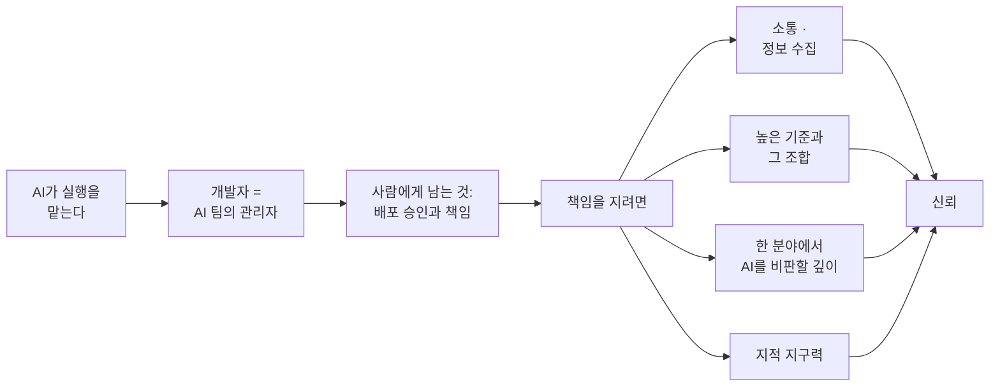
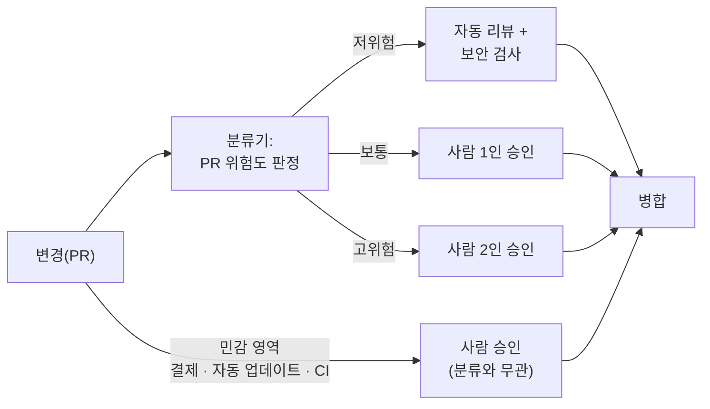
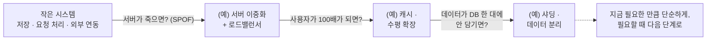

<figure class="post-figure post-figure--header">
<svg role="img" aria-label="왼쪽 책상 앞의 개발자가 오른쪽의 AI 에이전트 여섯에게 목표·맥락·기준을 지시하고, 에이전트들이 만든 실행 결과(PR)는 개발자 책상 위의 배포 승인 도장으로 돌아온다. 실행은 AI가, 승인과 책임은 사람이 맡는다" viewBox="0 0 640 320">
  <title>실행은 AI 에이전트 팀이, 승인과 책임은 사람이</title>
  <defs>
    <marker id="d2hdr-arrow" viewBox="0 0 10 10" refX="9" refY="5" markerWidth="7" markerHeight="7" orient="auto-start-reverse">
      <path d="M0 0 L10 5 L0 10 z" fill="currentColor"/>
    </marker>
  </defs>
  <g font-family="var(--font-body)">
    <!-- 개발자 -->
    <circle cx="130" cy="96" r="22" fill="none" stroke="currentColor" stroke-width="3"/>
    <rect x="122" y="90" width="5" height="5" fill="currentColor"/>
    <rect x="134" y="90" width="5" height="5" fill="currentColor"/>
    <rect x="100" y="124" width="60" height="52" rx="8" fill="currentColor" opacity="0.85"/>
    <path d="M158 134 L196 118" stroke="currentColor" stroke-width="6" stroke-linecap="round"/>
    <!-- 책상 + 배포 승인 도장 -->
    <rect x="60" y="176" width="220" height="12" fill="var(--border-color)"/>
    <rect x="72" y="188" width="10" height="60" fill="var(--border-color)"/>
    <rect x="258" y="188" width="10" height="60" fill="var(--border-color)"/>
    <rect x="186" y="168" width="60" height="8" fill="var(--bg-panel)" stroke="currentColor" stroke-width="1.5"/>
    <rect x="206" y="134" width="14" height="22" rx="3" fill="var(--accent-color)"/>
    <rect x="196" y="156" width="34" height="10" fill="var(--accent-color)"/>
    <!-- 지시 화살표 -->
    <path d="M178 82 L358 82" stroke="currentColor" stroke-width="2" fill="none" marker-end="url(#d2hdr-arrow)"/>
    <text x="268" y="70" font-size="13" text-anchor="middle" fill="currentColor">목표 · 맥락 · 기준</text>
    <!-- 결과물 화살표 -->
    <path d="M358 166 L256 166" stroke="var(--accent-color)" stroke-width="2" stroke-dasharray="6 4" fill="none" marker-end="url(#d2hdr-arrow)"/>
    <text x="300" y="154" font-size="13" text-anchor="middle" fill="var(--accent-color)">실행 결과(PR)</text>
    <!-- AI 에이전트 팀 3 x 2 -->
    <g fill="var(--gold)">
      <rect x="370" y="70" width="44" height="40" rx="4"/>
      <rect x="440" y="70" width="44" height="40" rx="4"/>
      <rect x="510" y="70" width="44" height="40" rx="4"/>
      <rect x="370" y="140" width="44" height="40" rx="4"/>
      <rect x="440" y="140" width="44" height="40" rx="4"/>
      <rect x="510" y="140" width="44" height="40" rx="4"/>
      <rect x="389" y="58" width="6" height="6"/><rect x="459" y="58" width="6" height="6"/><rect x="529" y="58" width="6" height="6"/>
      <rect x="389" y="128" width="6" height="6"/><rect x="459" y="128" width="6" height="6"/><rect x="529" y="128" width="6" height="6"/>
    </g>
    <g stroke="var(--gold)" stroke-width="2">
      <path d="M392 64 L392 70"/><path d="M462 64 L462 70"/><path d="M532 64 L532 70"/>
      <path d="M392 134 L392 140"/><path d="M462 134 L462 140"/><path d="M532 134 L532 140"/>
    </g>
    <g fill="var(--bg-panel)">
      <rect x="380" y="84" width="7" height="7"/><rect x="397" y="84" width="7" height="7"/>
      <rect x="450" y="84" width="7" height="7"/><rect x="467" y="84" width="7" height="7"/>
      <rect x="520" y="84" width="7" height="7"/><rect x="537" y="84" width="7" height="7"/>
      <rect x="380" y="154" width="7" height="7"/><rect x="397" y="154" width="7" height="7"/>
      <rect x="450" y="154" width="7" height="7"/><rect x="467" y="154" width="7" height="7"/>
      <rect x="520" y="154" width="7" height="7"/><rect x="537" y="154" width="7" height="7"/>
    </g>
    <!-- 라벨 -->
    <text x="462" y="216" font-size="16" font-weight="700" text-anchor="middle" fill="var(--gold)">AI 에이전트 팀 — 실행</text>
    <text x="462" y="238" font-size="13" text-anchor="middle" fill="var(--text-light)">실행의 대부분을 맡는다</text>
    <text x="170" y="274" font-size="15" font-weight="700" text-anchor="middle" fill="currentColor">개발자 = AI 팀의 관리자</text>
    <text x="170" y="297" font-size="14" font-weight="700" text-anchor="middle" fill="var(--accent-color)">배포 승인과 책임은 사람에게</text>
  </g>
</svg>
<figcaption>실행은 AI 에이전트 팀이 맡고, 운영 배포를 승인하고 책임지는 일은 사람에게 남는다.</figcaption>
</figure>

## 원문 정보

> - **제목**: AI 시대의 개발자를 꿈꾸는 학생 개발자에게
> - **출처**: NAVER D2 Hello world / 정상혁 (네이버 Tech Strategic Management) ([d2.naver.com](https://d2.naver.com))
> - **발행**: 2026-10-27 · 약 25~30분 분량(본문 분량 기준 추정)
> - **원문 링크**: <https://d2.naver.com/helloworld/1975819>

2018년 같은 저자가 쓴 [「백엔드 개발자를 꿈꾸는 학생개발자에게」](https://d2.naver.com/news/3435170)의 8년 만의 후속편이다. 2025년 말 설문으로 받은 학생들의 질문을 주제별로 묶어 답한 Q&A 형식이고, 저자 스스로 이 글을 "목적지가 명확한 안내서"가 아니라 "격변기의 스냅샷"으로 읽어 달라고 당부한다.

## 한 줄 요약 (TL;DR)

AI가 실행의 대부분을 맡으면서 모든 개발자는 "AI 팀의 관리자"가 되었고, 앞으로 '개발자'라는 이름에 남는 핵심은 **민감한 운영 환경에 코드 배포를 승인하고 그 결과를 책임지는 사람**이다. 그래서 공감·정보 수집, 보편보다 높은 기준과 그 기준들의 조합, 한 분야에서 AI를 비판할 수 있는 깊이, 그리고 불편한 학습을 견디는 지적 지구력이 더 중요해진다.

## 왜 이 글을 골랐나

이 위키의 Articles에는 "AI 시대에 엔지니어의 몫은 무엇인가"를 다룬 영어권 글이 이미 꽤 쌓여 있다. [Addy Osmani의 '취향과 판단'](/2026/08/04/taste-judgment-and-ai.html), [하용호의 '전문성 재설계'](/2026/06/22/ai-era-expertise-redesign.html), [Anthropic 내부 고용 데이터](/2026/10/22/employment-at-anthropic.html) 같은 글이다. 이 글은 그 논의를 **네이버페이 등 국내 대형 서비스와 연간 수십조 원 거래 시스템의 운영 경험**을 가진 시니어가, **학생과 취업 준비생**이라는 구체적인 독자에게 풀어낸 버전이라는 점이 다르다.

추상적인 전망보다 "N+1 쿼리를 두고 AI와 기준이 달랐던 일", "Kafka를 써 봤다는 사실보다 왜 필요한지를 아는가", "MyBatis를 썼는지 JPA를 썼는지도 모르는 지원자" 같은 현장 감각이 살아 있다. 그리고 마무리에서 부동소수점 오차가 일으킨 실제 사고를 꺼내며 "왜 여전히 깊이 알아야 하는가"에 정면으로 답한다. 주니어부터 시니어까지 다시 읽어 볼 만한 글이다.

### 한눈에 보기

글 전체의 흐름을 하나의 인과 사슬로 그리면 다음과 같다.



## 핵심 내용

원문은 크게 **[AI 시대와 개발자] → [취업과 진로] → [역량과 경력 발전] → 마치며**의 네 덩어리로 되어 있다. 아래는 그 흐름을 따라 요약한 것이다.

### 1. AI 시대에 개발자의 역할은 어떻게 달라졌나

- 저자는 1989년에 프로그래밍을 시작한 이래 '코딩'이라는 활동에 가장 큰 변화가 왔다고 본다. AI 코딩 도구는 코드를 추천하는 데서 그치지 않고 소스를 쓰고 OS 명령을 실행하는 "사람의 실질적인 대리"가 되었다.
- 역사적으로 기술이 발전할 때마다 지식 근로자의 일은 **이전 시대 관리자의 일**에 가까워졌다(원문은 CAD 도입 전 GM 기술자들의 사진을 예로 든다). 이제는 말단 작업자가 AI이고, **모든 개발자는 AI 팀의 관리자**다.
- 원문이 꼽는 "관리자의 일"을 '작업자 → AI 에이전트'로 바꿔 읽으면 다음과 같다. 목표·배경·가치·평가 기준 제시, 정보 탐색 비용 줄여 주기, 참조 정보의 위치 알려 주기, 장점과 과금 수준을 고려해 역할 분배하기, 컨텍스트가 넓어지거나 자주 전환되지 않게 하기, 빠른 피드백 사이클 만들기.
- 그 대가로 사람은 **관리 업무의 멀티태스킹**을 떠안는다. 에이전트마다 컨텍스트를 좁혀 줄수록 넓은 맥락을 머리에 올려 두고 빠르게 전환해야 하는 부담은 사람에게 돌아온다(원문의 비유로는 여러 메신저 창을 오가는 관리자, 혹은 유닛을 쉴 틈 없이 지휘하는 프로게이머).
- 그래서 **에이전트가 일하기 쉬운 환경**(정보 연결 체계, 권한, 부작용이 적고 피드백이 빠른 아키텍처·워크플로)이 생산성을 좌우한다. 예컨대 모듈 경계가 분명하면 에이전트는 수정 범위를 좁게 잡고, 흐리면 비슷한 코드를 여기저기 복제한다.
- 다음 단계로 AI가 리더·아키텍트 역할까지 맡으면 사람에게는 조직 수준의 투자와 리스크 감수 결정이 남는다. 저자는 이를 "모든 구성원이 한 번 더 승진하는 셈"이라고 표현한다. 종량제 과금이 늘면서 세션 하나, 프롬프트 하나의 부가가치까지 따지게 된다는 점도 덧붙인다.
- 관리 방식에 정답이 없듯, 코드를 아는 개발자는 상황에 따라 **마이크로매니징과 큰 단위 위임**을 오갈 수 있다(원문 표현으로는 "현미경과 망원경").

<figure class="post-figure">
<svg role="img" aria-label="관리자의 일 여섯 가지와 AI 에이전트 대상 실무 형태의 짝: 목표·배경·가치·평가 기준 제시는 프롬프트·스펙, 정보 탐색 비용 줄이기는 검색 도구, 참조 정보 위치 알려 주기는 AGENTS.md·CLAUDE.md, 장점·과금 수준을 고려한 역할 분배는 서브에이전트·모델 라우팅, 컨텍스트 확장·잦은 전환 막기는 컨텍스트 윈도 관리, 빠른 피드백 사이클은 테스트·린트·리뷰 루프. 그 대가로 넓은 맥락을 머리에 올리고 빠르게 전환하는 부담은 사람에게 돌아온다" viewBox="0 0 640 420">
  <title>관리자의 일을 AI 에이전트 대상으로 바꿔 읽기</title>
  <g font-family="var(--font-body)">
    <text x="155" y="30" font-size="15" font-weight="700" text-anchor="middle" fill="var(--primary-color)">관리자의 일 (작업자 → AI)</text>
    <text x="485" y="30" font-size="15" font-weight="700" text-anchor="middle" fill="var(--secondary-color)">AI 에이전트 대상 실무 형태</text>
    <g fill="var(--bg-panel)" stroke="var(--primary-color)" stroke-width="1.5">
      <rect x="20" y="48" width="270" height="38" rx="6"/>
      <rect x="20" y="102" width="270" height="38" rx="6"/>
      <rect x="20" y="156" width="270" height="38" rx="6"/>
      <rect x="20" y="210" width="270" height="38" rx="6"/>
      <rect x="20" y="264" width="270" height="38" rx="6"/>
      <rect x="20" y="318" width="270" height="38" rx="6"/>
    </g>
    <g fill="var(--bg-panel)" stroke="var(--secondary-color)" stroke-width="2">
      <rect x="350" y="48" width="270" height="38" rx="6"/>
      <rect x="350" y="102" width="270" height="38" rx="6"/>
      <rect x="350" y="156" width="270" height="38" rx="6"/>
      <rect x="350" y="210" width="270" height="38" rx="6"/>
      <rect x="350" y="264" width="270" height="38" rx="6"/>
      <rect x="350" y="318" width="270" height="38" rx="6"/>
    </g>
    <g stroke="currentColor" stroke-width="2">
      <path d="M298 67 L336 67"/><path d="M298 121 L336 121"/><path d="M298 175 L336 175"/>
      <path d="M298 229 L336 229"/><path d="M298 283 L336 283"/><path d="M298 337 L336 337"/>
    </g>
    <g fill="currentColor">
      <path d="M336 62 L344 67 L336 72 z"/><path d="M336 116 L344 121 L336 126 z"/><path d="M336 170 L344 175 L336 180 z"/>
      <path d="M336 224 L344 229 L336 234 z"/><path d="M336 278 L344 283 L336 288 z"/><path d="M336 332 L344 337 L336 342 z"/>
    </g>
    <g font-size="14" text-anchor="middle" fill="currentColor">
      <text x="155" y="72">목표·배경·가치·평가 기준 제시</text>
      <text x="155" y="126">정보 탐색 비용 줄여 주기</text>
      <text x="155" y="180">참조 정보의 위치 알려 주기</text>
      <text x="155" y="234">장점·과금 수준 고려한 역할 분배</text>
      <text x="155" y="288">컨텍스트 확장·잦은 전환 막기</text>
      <text x="155" y="342">빠른 피드백 사이클 만들기</text>
      <text x="485" y="72">프롬프트 · 스펙</text>
      <text x="485" y="126">검색 도구</text>
      <text x="485" y="180">AGENTS.md · CLAUDE.md</text>
      <text x="485" y="234">서브에이전트 · 모델 라우팅</text>
      <text x="485" y="288">컨텍스트 윈도 관리</text>
      <text x="485" y="342">테스트 · 린트 · 리뷰 루프</text>
    </g>
    <rect x="20" y="374" width="600" height="36" rx="6" fill="none" stroke="var(--accent-color)" stroke-width="2" stroke-dasharray="6 4"/>
    <text x="320" y="397" font-size="14" font-weight="700" text-anchor="middle" fill="var(--accent-color)">대가: 넓은 맥락을 머리에 올리고 빠르게 전환하는 부담은 사람에게</text>
  </g>
</svg>
<figcaption>원문의 "관리자의 일"을 에이전트 대상으로 바꿔 읽으면 컨텍스트 엔지니어링·하니스 설계의 체크리스트가 된다(오른쪽 열은 아래 '분석과 인사이트'의 해석).</figcaption>
</figure>

### 2. AI에게 맡길 부분과 사람이 할 부분

- 실행 능력만 보면 AI는 이미 대부분의 일을 할 수 있다. 오래가는 답은 "AI가 아무리 발전해도 못 하는 일"에서 찾아야 하고, 저자의 답은 **책임**이다. 소프트웨어를 사용자에게 내보내는 결정은 사람이 하고, 그 영향의 책임은 지시하고 최종 승인한 사람에게 돌아간다.
- 그래서 앞으로 '개발자'라는 명칭은 **민감한 시스템의 운영 환경에 배포를 승인하는 사람**이라는 의미가 가장 클 것이라고 본다. 그 권한은 문제를 알아보고 예방할 수 있다는 믿음을 주는 사람에게 주어지고, 그 믿음을 위해 코드 리뷰·테스트 자동화 같은 검증 장치가 더 중요해진다.
- "사람이 세세하게 코드를 보는 건 구시대적"이라는 업계 일부의 분위기에 저자는 동의하지 않는다. 책임이 큰 소프트웨어일수록 사람이 코드를 볼 가치가 커진다. 원문의 예로, 수억 원을 처리하는 배치 잡을 AI 코드가 완벽하다고 가정하고 배포하는 것은 "기댓값이 크게 마이너스인 도박"이다.
- 근거는 두 가지다. 하나는 **LLM의 확률적 불확정성**, 다른 하나는 **에이전트의 피드백 루프가 주로 개발 환경 안에서 돈다는 한계**다. 대형 시스템일수록 개발과 운영 환경의 트래픽·데이터 용량·실행 경로 다양성 차이가 크고, 운영 데이터로 실험할 수 있는 범위는 제한된다. 운영 장애를 겪어 본 개발자가 그 틈을 막는다.
- 보안은 따로 짚는다. AI는 공격자에게도 무기라서, 취약점 공개부터 실제 공격까지의 시간이 짧아지고 있다. 의존성 취약점 점검, 정적 분석, 보안 관점의 AI 리뷰처럼 **여러 겹의 검증**과 신규 취약점에 빠르게 대응하는 체계가 필요하다.
- 얼마나 세세하게 볼지는 시스템·모듈의 특성과 개발 단계에 따라 정해야 한다. 원문은 Anthropic의 Claude Code 팀 사례를 인용한다. 분류기로 PR 위험도를 세 단계로 나눠 저위험 변경은 자동 리뷰·보안 검사만으로 병합하고, 보통은 1인, 고위험은 2인이 승인한다. 결제·자동 업데이트·CI 워크플로 같은 민감 영역은 분류와 무관하게 사람이 승인하고, **에이전트의 승인은 사람의 승인으로 치지 않는다**.
- 저자는 여기서 한 걸음 더 나아가 **사람이 꼼꼼히 봐야 할 코드를 별도 모듈·저장소로 분리하는 설계 패턴**이 논의될 것으로 예상한다. 운영 조건을 테스트로 완벽히 재현할 수 있는 모듈은 철저한 테스트로 보증하고, 어디서 어떻게 호출될지 모르는 공통 모듈일수록 사람이 세세히 이해해야 한다는 구분이다.
- 사람의 역할을 정하는 결정도 사람의 일이며, 그 기준은 개인이 아니라 **조직 수준에서 합의**되어야 오래간다. 속도와 안정성의 충돌을 회피하려는 유혹을 경계하라고 한다.

원문이 인용한 Claude Code 팀의 위험도 기반 승인 흐름을 그리면 다음과 같다. 어느 경로든 에이전트의 승인은 사람의 승인으로 세지 않는다.



<figure class="post-figure">
<svg role="img" aria-label="큰 사각형은 운영 환경으로, 트래픽 규모·데이터 용량·실행 경로 다양성이 크다. 그 안의 작은 원은 개발 환경 피드백 루프로, 에이전트가 오류를 보고 고치는 루프는 이 원 안에서만 돈다. 원과 운영 현실 사이의 간극에 운영 장애를 겪어 본 개발자가 서서 틈을 막는다. 운영 데이터로 실험할 수 있는 범위는 제한적이다" viewBox="0 0 640 330">
  <title>개발 환경 피드백 루프와 운영 환경 현실 사이의 간극</title>
  <defs>
    <marker id="d2gap-arrow" viewBox="0 0 10 10" refX="9" refY="5" markerWidth="7" markerHeight="7" orient="auto-start-reverse">
      <path d="M0 0 L10 5 L0 10 z" fill="currentColor"/>
    </marker>
  </defs>
  <g font-family="var(--font-body)">
    <!-- 운영 환경 -->
    <rect x="20" y="40" width="600" height="240" rx="16" fill="var(--bg-sunken)" fill-opacity="0.45" stroke="var(--primary-color)" stroke-width="2.5"/>
    <text x="40" y="68" font-size="15" font-weight="700" fill="var(--primary-color)">운영 환경 — 위험이 터지는 곳</text>
    <!-- 개발 환경 루프 -->
    <circle cx="140" cy="170" r="70" fill="var(--bg-panel)" stroke="var(--secondary-color)" stroke-width="3"/>
    <path d="M140 88 A82 82 0 1 1 69 129" fill="none" stroke="var(--secondary-color)" stroke-width="2.5" marker-end="url(#d2gap-arrow)"/>
    <text x="140" y="158" font-size="15" font-weight="700" text-anchor="middle" fill="var(--secondary-color)">개발 환경</text>
    <text x="140" y="178" font-size="14" text-anchor="middle" fill="currentColor">피드백 루프</text>
    <text x="140" y="198" font-size="11" text-anchor="middle" fill="var(--text-light)">오류 보고 → 수정</text>
    <!-- 운영 현실 -->
    <g fill="var(--bg-panel)" stroke="var(--primary-color)" stroke-width="1.5">
      <rect x="470" y="80" width="130" height="32" rx="16"/>
      <rect x="470" y="128" width="130" height="32" rx="16"/>
      <rect x="470" y="176" width="130" height="32" rx="16"/>
    </g>
    <g font-size="13" text-anchor="middle" fill="currentColor">
      <text x="535" y="101">트래픽 규모</text>
      <text x="535" y="149">데이터 용량</text>
      <text x="535" y="197">실행 경로 다양성</text>
    </g>
    <!-- 경험 있는 개발자 -->
    <circle cx="350" cy="120" r="16" fill="none" stroke="currentColor" stroke-width="3"/>
    <rect x="330" y="142" width="40" height="44" rx="6" fill="currentColor" opacity="0.85"/>
    <path d="M378 146 L400 146 L400 166 Q400 180 389 186 Q378 180 378 166 z" fill="var(--accent-color)"/>
    <text x="350" y="212" font-size="14" font-weight="700" text-anchor="middle" fill="var(--accent-color)">운영 장애를 겪어 본 개발자</text>
    <!-- 간극 -->
    <path d="M238 254 L456 254" stroke="currentColor" stroke-width="2" stroke-dasharray="5 4" fill="none" marker-start="url(#d2gap-arrow)" marker-end="url(#d2gap-arrow)"/>
    <text x="347" y="244" font-size="13" text-anchor="middle" fill="currentColor">개발 ↔ 운영의 간극</text>
    <text x="320" y="310" font-size="13" text-anchor="middle" fill="var(--text-light)">운영 데이터로 실험할 수 있는 범위는 제한적이다</text>
  </g>
</svg>
<figcaption>에이전트의 자기 교정 루프는 개발 환경 안에서 돌고, 위험은 훨씬 넓은 운영 환경에서 터진다. 그 틈은 운영 경험이 메운다.</figcaption>
</figure>

### 3. AI 시대 개발자에게 필요한 역량

원문은 "방향을 지시하고 책임지는 사람"에게 필요한 역량을 두 갈래로 나눈다.

**사람이 더 잘하는 소통과 정보 수집**

- AI는 사람이 정한 방향을 **증폭**한다. 실행이 빨라질수록 사람 간의 소통과 결정이 병목이 되고, 방향이 어긋난 채 낭비되는 시간과 토큰도 늘었다. 그래서 스펙 문서·프로토타입·다이어그램·코드 중 **가장 빨리 피드백을 받을 수단을 고르는 판단**이 중요하다.
- 지식량과 처리 속도는 AI가 압도하므로 사람에게는 **공감력**이 더 귀해진다. 그런데 AI는 비판 없이 동조하기 쉬워서, 그런 대화에 익숙해지면 갈등을 조율하는 사회적 능력이 오히려 퇴화할 수 있다(원문은 한소원의 『지능 파산』이 소개하는 'social deskilling'을 근거로 든다).
- 요구사항은 사람들의 머릿속과 대화 속에 모호하게 흩어져 있다. 조직의 암묵적 전제, 이해관계자 간 온도 차, 사람을 만났을 때 떠오르는 영감처럼 AI와의 상호작용만으로는 끌어내기 어려운 것을 끌어내 **명확한 지시로 바꾸는 일**이 개발자의 핵심 역량이다.
- 동시에 LLM 학습 데이터에 없는 정보를 기록하고 연결해 에이전트가 알게 해야 한다. 다만 사람 머릿속의 모든 정보를 AI에 넘기는 일은 연산·전력 측면에서 가능하지도 효율적이지도 않다(원문은 뇌가 약 20W로 동작한다는 추정을 대비로 든다). 회의 녹음을 AI가 받아 적고 사람이 어조를 다듬어 올려 두는 식의 조화가 예시다.
- 2018년 글에서 강조했던 **용어의 범위**도 더 중요해졌다. 조직 특유의 용어는 AI가 잘못 해석하기 쉬우니 핵심 용어의 정의를 팀이 함께 맞추고 문서로 남겨야 한다.

**특정 분야의 높은 기준과 조합**

- 진입 장벽이 낮다고 해서 가치가 사라지지는 않는다. 글쓰기가 그 예다. 개발에서도 **"보편적인 수준보다 더 높은 기준"**을 AI와 동료에게 제시할 수 있느냐가 전문성을 가른다.
- 저자의 사례: AI는 목록 한 건마다 DB를 다시 조회하는 N+1 쿼리를 "운영에서 문제없는 수준"이라고 했지만, 배포될 환경을 아는 저자는 받아들이지 않았다. 그렇다고 처음부터 최고 기준으로 모든 코드를 만드는 에이전트가 좋은 것도 아니다. 그건 오버엔지니어링이자 토큰 낭비이므로 **기준은 맥락에 맞게 사람이 알려 줘야** 한다.
- 현장에서는 AI가 "이해관계에서 벗어난 객관적 존재"로 받아들여져 사람보다 권위를 갖기도 한다. AI보다 높은 기준을 주장하려면 **설득할 근거**까지 갖춰야 한다.
- 전문가의 기준조차 skill이나 지식 DB로 쉽게 AI에 이전된다. 그래서 마지막 차별점은 **여러 관점의 높은 기준을 목적에 맞게 조합·선택·결정하는 역량**이다. 원문의 예로, 캐시는 성능 관점에선 좋지만 정합성 관점에선 위험할 수 있다. 이 조합에 필요한 정보(암묵적 전제, 온도 차)를 끌어내는 사람이 결국 조합의 기준도 정한다.

### 4. 더 이상 불필요한 지식이 있나, 넓게 vs 깊게

- AI는 "실행되는 프로그램"을 만드는 데 필요한 지식의 하한을 더 낮춘다. 하지만 저자는 "실행에 필수가 아닌 지식 = 필요 없는 지식"으로 미리 선을 긋지 말라고 한다. 책임이 큰 코드를 승인하려면 **문제없는 프로그램인지 판단할 지식**이 필요하기 때문이다.
- 최상위 모델이면 원리를 몰라도 숙련자를 상당 부분 따라잡지만, 실무에서 늘 최상위 모델을 쓸 수 있다는 보장은 없다. AI 지출에 대한 ROI 압박, 금융·공공처럼 외부 모델을 못 쓰고 사내 소형 모델만 써야 하는 규제 환경, 호출 한도나 공급사 장애 같은 변수가 있다. **가용 모델 수준이 바뀌어도 기반 원리를 아는 사람은 안정적으로 코드를 관리**한다.
- 메타 인지와 지적 겸손을 강조한다. 원문이 인용한 연구(알토 대학교)에서는 AI와 함께 LSAT 논리 문제를 푼 참가자의 점수가 실제로 올랐지만 자기 평가는 그보다 더 높았고, AI를 잘 안다고 자평한 사람일수록 과신이 심했다. 저자는 스스로 이해해야 할 지식을 끈기 있게 파고드는 **지적 지구력**이 희소한 가치가 될 것이라고 본다.
- 학습은 검색하고 읽는 데서 끝나면 안 된다. 능동적으로 해석해 자기 지식 체계에 연결하고, 꺼내서 자기 언어로 말하거나 쓰는 **인출**까지 해야 응용 가능한 지식이 된다. 그 불편함은 감수해야 한다.
- '넓고 얇게 vs 좁고 깊게'의 이분법은 다시 생각해 보자고 한다. 지식은 판단의 수단이고, 세부 빈칸은 검색과 AI로 메울 수 있으니 머릿속에 있어야 할 것은 **지식의 연결 지도**다. 회의 중 즉시 대응하거나 AI를 쓸 수 없는 긴급 장애 때를 위한 "백업"이라는 의미도 있다.
- T자형 인재론에서 한 걸음 더 나아가 **깊은 축을 시간을 두고 늘려 가는 파이(π)형, 문어 다리형**이 유리하다고 본다. 기준끼리 충돌할 때 어느 쪽을 택할지는 양쪽을 깊이 아는 사람이 더 잘 판단하기 때문이다. 출발점은 **적어도 한 분야에서 AI의 결과물을 비판할 수 있는 깊이**다.

<figure class="post-figure">
<svg role="img" aria-label="지식 분포의 세 모양. I형은 한 분야만 깊은 세로 막대 하나. T형은 넓은 가로축 아래 깊은 세로축 하나. 파이형·문어 다리형은 넓은 가로축 아래로 깊이가 서로 다른 세로축 여러 개가 있고, 점선으로 그린 축은 시간을 두고 자라는 중이다. 출발점은 적어도 한 분야에서 AI 결과물을 비판할 수 있는 깊이다" viewBox="0 0 640 316">
  <title>I형, T형, 파이형·문어 다리형 지식 분포</title>
  <g font-family="var(--font-body)">
    <g fill="none" stroke="var(--border-color)" stroke-width="1.5">
      <rect x="15" y="16" width="190" height="262" rx="8"/>
      <rect x="220" y="16" width="190" height="262" rx="8"/>
      <rect x="425" y="16" width="190" height="262" rx="8"/>
    </g>
    <g font-size="16" font-weight="700" text-anchor="middle" fill="currentColor">
      <text x="110" y="46">I형</text>
      <text x="315" y="46">T형</text>
      <text x="520" y="46">π형 · 문어 다리형</text>
    </g>
    <!-- I -->
    <rect x="98" y="80" width="24" height="148" fill="var(--primary-color)"/>
    <!-- T -->
    <rect x="240" y="80" width="150" height="18" fill="var(--gold)"/>
    <rect x="303" y="98" width="24" height="130" fill="var(--primary-color)"/>
    <!-- π / 문어 다리 -->
    <rect x="445" y="80" width="150" height="18" fill="var(--gold)"/>
    <rect x="455" y="98" width="18" height="130" fill="var(--primary-color)"/>
    <rect x="490" y="98" width="18" height="95" fill="var(--primary-color)"/>
    <rect x="525" y="98" width="18" height="60" fill="var(--secondary-color)" fill-opacity="0.35" stroke="var(--secondary-color)" stroke-width="2" stroke-dasharray="4 3"/>
    <rect x="560" y="98" width="18" height="30" fill="var(--secondary-color)" fill-opacity="0.35" stroke="var(--secondary-color)" stroke-width="2" stroke-dasharray="4 3"/>
    <g font-size="12" text-anchor="middle" fill="var(--text-light)">
      <text x="110" y="258">한 분야만 깊게</text>
      <text x="315" y="258">넓은 가로축 + 깊은 축 하나</text>
      <text x="520" y="258">깊은 축을 차츰 늘려 감</text>
    </g>
    <text x="320" y="304" font-size="13" font-weight="700" text-anchor="middle" fill="var(--accent-color)">출발점: 적어도 한 분야에서 AI의 결과물을 비판할 수 있는 깊이</text>
  </g>
</svg>
<figcaption>가로는 넓이, 세로는 깊이. π형·문어 다리형은 각 분야를 필요한 깊이만큼, 점선처럼 시간을 두고 새 축을 키워 간다.</figcaption>
</figure>

### 5. 소프트웨어 개발의 미래 — 소스 코드는 사라질까

- 저자는 "큰 책임이 따르는 기능은 명확한 소스 코드로 확인해야 한다"는 자신의 믿음도 언제까지 유효할지 모르겠다고 솔직히 말한다. 한 세대 전의 "C나 어셈블리를 알아야 깊이 있는 개발자"라는 믿음처럼 **과거의 토템**이 될 수도 있다는 것이다.
- 그럼에도 "AI가 자연어 스펙에서 바로 바이너리를 만들면 소스 코드의 가치는 0으로 수렴한다"는 주장에는 두 가지 이유로 공감하기 어렵다고 한다.
  - **시간·비용**: LLM이 자연어를 해석해 코드로 바꾸는 과정은 느린 편인 컴파일보다도 느리다. 자연어 스펙은 구조 경계가 모호해 바뀐 부분만 골라 다시 해석하기 어렵다. 재생성 결과에 오류가 없다는 보장도 없고, 같은 스펙에서 다른 해석의 코드가 나올 수 있으며, 운영에 맞춰 최적화한 쿼리 같은 세부는 재현되지 않기 쉽다. 그 세부까지 문서로 남기면 스펙이 코드만큼 길어진다.
  - **표현의 명확성**: 미국 메인주 초과근무 법 조항의 '쉼표 하나' 소송(O'Connor v. Oakhurst Dairy, 2017)을 예로 든다. "packing for shipment or distribution"을 어떻게 끊어 읽느냐에 따라 유통만 하는 배송 기사가 면제 대상인지 아닌지가 갈렸다. 원문은 두 해석을 조건식으로 옮겨 괄호 위치만 다르다는 것을 보여 주고, Dijkstra가 형식 언어를 "자연어로는 피할 수 없는 논리적으로 성립하지 않는 진술을 걸러 내는 효과적인 도구"로 본 주장(EWD667)이 아직 유효하다고 말한다.
- 결론적으로 큰 의도·배경·논리 흐름은 자연어 문서로 보존할 가치가 있지만, 구현 세부까지 자연어에 의존하는 것은 좋은 도구를 두고 부적합한 수단을 쓰는 일이다. **소스 코드는 사람과 기계가 함께 이해하는 명확한 표현으로서 앞으로도 가치 있는 자산**이다.

원문은 쉼표 소송의 두 해석을 조건식 이미지로 보여 준다. 아래는 그 요지를 이 포스트에서 다시 적어 본 것이다(원문 이미지를 옮긴 것이 아니다).

```python
# 면제 업무 목록의 마지막 항목: "... packing for shipment or distribution"
# 포장은 하지 않고 유통(distribution)만 하는 배송 기사의 경우

packing, distribution = False, True

# 해석 A: 'distribution'을 독립된 면제 업무로 읽는다
exempt_a = packing or distribution      # True  -> 초과근무 수당 면제

# 해석 B: '(shipment or distribution)을 위한 packing' 하나의 업무로 읽는다
exempt_b = packing and distribution     # False -> 초과근무 수당 지급 대상
```

### 6. 백엔드 직군은 유지될까

- AI로 특정 기술 스택의 진입 장벽이 낮아졌고, 개발 직군이 아닌 사람도 프로그램을 만들어 배포한다. 특정 스택이나 레이어를 다룬다는 사실만으로는 차별화된 전문성으로 인정받기 어려워질 것이고, '백엔드/프런트엔드' 대신 **'프로덕트 개발자'**로 통합되는 흐름도 있다(원문은 The Pragmatic Engineer의 글을 인용). 그래서 이번 글의 제목에서 '백엔드'를 뺐다고 한다.
- 원래도 개발팀은 포지션이 고정된 야구팀보다 **빈자리를 메우는 축구·농구팀**에 가까웠다. 포지션을 나눈 이유(지식량 증가, 경력상 불이익 우려)는 AI로 학습 비용이 낮아지면서 둘 다 약해졌다. 다만 한 분야의 깊이는 여전히 필요하다.
- "풀스택이 되면 연봉이 오르나"라는 질문에는, 직무 이름이 바뀐다고 보상이 따라오지는 않으며 **조직 공동 목표에 대한 기여**가 클 때 보상이 오를 가능성이 크다고 답한다.

### 7. 취업과 진로

- **취업 한파**: 2018년 답변은 "할 일이 늘어나는 속도가 생산성 증가보다 빠르다"는 관찰에 기대고 있었다(어셈블리 대비 Java·C#이 같은 기능을 약 1/6 코드로 구현해도 개발자 수는 늘었다는 Capers Jones 데이터가 근거). 하지만 AI는 구현뿐 아니라 개발 사이클 전체에 참여하므로 과거 역사만으로는 판단하기 어렵다. 저자는 "지금의 취업 한파를 어떻게 봐야 할지 솔직히 모르겠다"고 인정하고, '개발자'보다 넓게 스스로의 역할을 정의하라고, **"나는 어떤 일을, 왜 하고 싶어 하는가"**를 반복해서 물으라고 권한다.
- **진로·회사 선택**: 시간 가는 줄 모르는 일, 견디기 힘든 것, 양보할 수 없는 가치를 먼저 알 것. 흥미가 자주 바뀌는 것은 단점만은 아니지만, 그 변화를 관통하는 자기만의 주제를 찾으라고 한다. 모든 가치를 동시에 최대로 채워 주는 직장은 없으니 지금의 우선순위로 고르라는 조언도 있다.
- **준비할 기술 스택**: 모든 신입에게 필수인 스택은 없다. 써 본 기술을 제대로 모르는 것(MyBatis인지 JPA인지도 모르는 경우)은 오히려 감점이고, 잠깐 썼더라도 어려웠던 상황과 원인, 해결 과정을 체계적으로 설명할 수 있으면 플러스다. Kafka·RabbitMQ 역시 "써 봤다"보다 **왜 필요하고 비동기 메시징으로 무엇을 얻고 무엇을 감수하는지**를 아는지가 중요하다. 신입 공고에 적힌 시니어급 조건은 대개 "그 문제를 풀 의지와 역량"을 보려는 것으로 읽으라고 한다.
- 원문은 리눅스 커널에 관심이 많던 인턴 지원자가 처음에는 Java 웹·AngularJS 업무를 맡았다가 몇 년 뒤 커널에 기여하고 DEVIEW에서 발표까지 한 일화를 들어, **실무 기술보다 문제를 풀어 가는 과정에서 발전 가능성이 드러난다**고 말한다.
- **언어**: 저자의 실무 환경에서는 Java·Kotlin 비중이 여전히 크고, 분야별로 Go·Python·JS/TS를 쓴다. 메모리 가격 급등으로 Rust나 Go처럼 메모리를 적게 쓰는 언어가 더 쓰일 것으로 예상한다. 학생 때는 한 언어를 깊게 파도 좋지만 실무에선 포트폴리오를 한 언어에 묶지 말고, 문제에 맞는 언어를 고르고 AI 에이전트로 코드를 관리하는 역량을 키우라고 한다.
- **AI 사용과 채용**: AI 활용은 이제 기본 소양이라 숨길 필요가 없다. 중요한 것은 결과물을 이해하고 비평할 수 있느냐다. "AI에게 이렇게 시켰고, 이 부분이 미심쩍어 이렇게 검증하고 고쳤다"고 설명할 수 있으면 긍정적인 신호다.
- **실무에 가까운 경험**: 공부 방법에 정답은 없지만 **피드백을 주는 동료**가 큰 도움이 된다. 부트캠프는 커리큘럼보다 동료와 멘토가 있는지로 고르라고 한다. 현장의 애자일은 팀마다 다르지만 "작게 쪼개고, 짧게 만들고, 피드백을 반영한다"는 흐름은 같고, 이는 AI 에이전트와 일하는 사이클과도 본질적으로 같다.

### 8. 역량과 경력 발전

- **함께 일하고 싶은 개발자**는 셋이다. 일을 투명하게 진행하는 사람(진행 상황과 판단 근거를 글로 남기면 그대로 에이전트의 컨텍스트가 된다), 빈자리를 메우는 사람, 지적 겸손을 갖춘 사람.
- **연차별 역량**은 "책임지는 범위를 넓혀 가는 힘"과 그 긴 과정을 버틸 정신적 에너지다. AI 덕분에 신입도 에이전트에게 맡긴 결과까지 책임지는 순간이 더 일찍 온다. 저자는 개발자 양성이 "관리자를 빠르게 키워 내는 사관학교"에 가까워질지도 모른다고 상상한다. 에너지원은 초창기부터 쌓인 **작은 성취감**이며, 완료 시점을 먼저 선언하고 지키기, 매일 작은 지식 기록·공유를 권한다.
- **로드맵**: 누구에게나 통하는 표준 로드맵은 없다. "나는 어떤 문제를 풀고 싶은가"를 먼저 정하면 공부할 것이 보이고, 한 주제를 파고드는 과정이 곧 나만의 로드맵이 된다. 좋은 포트폴리오도 스택 나열이 아니라 **관심 → 가설 → 어려움 → 해결 → 배움**이 이어진 이야기다. 희소성도 단순히 특이한 조합이 아니라 남들이 못 본 부가가치가 있는 조합에서 나온다.
- **아키텍처 공부**: 작은 시스템에도 저장·요청 처리·외부 연동 같은 구조적 결정이 있고 그것이 아키텍처다. 그다음 "서버가 죽으면?(SPOF)", "사용자가 100배가 되면?", "데이터가 DB 한 대에 안 담기면?" 같은 가정을 하나씩 얹어 진화를 상상하고 작게 실험해 보라고 한다. 트래픽 목표는 비즈니스 목표에서 출발해 여유분을 더하고 측정하며 고친다. 오버엔지니어링은 현장에서도 흔하니 **지금 필요한 만큼 단순하게 설계하고 필요할 때 다음 단계로 가는 태도**가 좋은 아키텍트의 자질이다.
- **책**: 기술서는 특정 목록 대신 두 종류를 권한다. 개발의 큰 그림(아키텍처·소프트웨어 엔지니어링)을 다룬 책과 현장 개발자의 경험담. 기술 외로는 장강명의 『살면서 한번은 벽돌책』('지적 지구력'이라는 표현의 출처)과 한소원의 『지능 파산』을 추천하며, 후자의 AI 리터러시 정의를 짧게 인용한다. "내가 스스로 생각하는 것이 가치 있다는 것을 아는 것"이라는 문장이다.

원문이 권하는 "가정을 하나씩 얹어 진화를 상상하는" 연습을 단계도로 옮기면 이렇다. 각 단계의 대응(이중화, 캐시, 샤딩)은 이해를 돕기 위한 흔한 예시이고, 답은 비즈니스 목표와 측정에서 출발해야 한다.



### 9. 마치며 — 0.01%의 위험과 신뢰

- 저자는 2018년 이후 연간 수십조 원 거래 시스템의 아키텍처 개편에 참여했고, 그 경험을 **"운영 환경의 중압감"**으로 요약한다. 장애가 뉴스에 나기도 했고, 고객 센터 상담원과 사용자에게 고통을 주었으며, 밤잠을 설쳤다고 고백한다.
- James Gosling의 2003년 인터뷰를 인용한다. 항공 소프트웨어 분야에는 시험 비행 사고 뒤 해당 부분을 설계한 엔지니어가 유가족에게 직접 설명하게 하는 정책이 있는 곳들이 있고, 그런 일을 겪으면 실패를 대하는 태도가 금세 달라진다는 이야기다.
- 1991년 걸프전 패트리어트 미사일 요격 실패(미군 28명 사망), 2011년 NEIS 버그(고등학생 약 2만 9천 명의 내신 석차 뒤바뀜)는 모두 **0.1 같은 소수를 2진수로 표현할 때 생긴 오차를 보정하지 못해** 일어났다(원문 각주 기준으로 패트리어트는 24비트 고정소수점, NEIS는 부동소수점 반올림 오차). 이 지식도 "실행되는 프로그램 작성에 필수가 아닌 지식"에 속한다. 하지만 그 한계를 모르면 AI에게 "이 금액 계산에 부동소수점 오차가 문제를 일으킬 여지는 없는가"라고 **물어볼 수조차 없다**.
- LLM이 99.99% 문제없는 코드를 만들어도 0.01%의 위험은 남고, 미안함·자책·후회는 AI가 아닌 사람의 마음에 남는다. 구현 기술 공부의 가성비는 떨어질지 모르지만, 재미있다면 따질 필요가 없다("인기 드라마 시리즈보다 더 나은 여가 선용").
- 마지막으로, AI로 얻은 큰 힘을 책임감 있게 다루는 사람에게는 **신뢰**라는 또 다른 힘이 생긴다. 사람들은 AI에게 좋은 답을 기대하지만, 틀렸을 때 끝까지 수습해 주리라 믿는 대상은 사람이다. AI의 "확률적 연결"이 기능을 압도해도 사람 사이의 "정서적 연결"은 대신할 수 없다는 것이 글의 결론이다.

원문이 말하는 "0.1의 2진수 표현 오차"는 다음처럼 바로 확인할 수 있다(이 포스트에서 덧붙인 예시).

```python
from decimal import Decimal

print(0.1 + 0.2 == 0.3)            # False — 0.1, 0.2는 2진 부동소수점으로 정확히 표현되지 않는다
print(Decimal(0.1))                # 0.1000000000000000055511151231257827021181583404541015625
print(Decimal("0.1") + Decimal("0.2") == Decimal("0.3"))  # True — 금액 계산은 10진 고정소수점으로
```

<figure class="post-figure">
<svg role="img" aria-label="거의 끝까지 채워진 막대는 LLM이 만든 99.99% 문제없는 코드이고, 끝의 아주 작은 조각이 0.01%의 위험이다. 그 조각을 확대하면 1991년 패트리어트 미사일 요격 실패(미군 28명 사망)와 2011년 NEIS 버그(약 2만 9천 명 내신 석차 뒤바뀜)가 있고, 공통 원인은 0.1 같은 소수의 2진수 표현 오차를 보정하지 못한 것이다. 왼쪽에는 '이 금액 계산에 부동소수점 오차가 문제를 일으킬 여지는 없는가?'라고 물어볼 줄 아는 사람이 서 있다" viewBox="0 0 640 345">
  <title>99.99%와 0.01% — 작은 위험을 알아보는 사람</title>
  <g font-family="var(--font-body)">
    <text x="295" y="50" font-size="13" text-anchor="middle" fill="var(--text-light)">LLM이 99.99% 문제없는 코드를 만들어도</text>
    <rect x="30" y="70" width="528" height="40" fill="var(--gold)"/>
    <rect x="558" y="70" width="8" height="40" fill="currentColor"/>
    <rect x="30" y="70" width="536" height="40" fill="none" stroke="currentColor" stroke-width="1.5"/>
    <text x="295" y="96" font-size="15" font-weight="700" text-anchor="middle" fill="var(--bg-panel)">AI가 만든 코드 — 99.99% 문제없음</text>
    <text x="563" y="58" font-size="13" font-weight="700" text-anchor="middle" fill="var(--accent-color)">0.01%</text>
    <!-- 확대선 -->
    <g stroke="var(--accent-color)" stroke-width="1.5" stroke-dasharray="4 3">
      <path d="M558 110 L330 150"/>
      <path d="M566 110 L620 150"/>
    </g>
    <!-- 확대 상자 -->
    <rect x="330" y="150" width="290" height="180" rx="8" fill="var(--bg-panel)" stroke="var(--accent-color)" stroke-width="2.5"/>
    <text x="475" y="176" font-size="15" font-weight="700" text-anchor="middle" fill="var(--accent-color)">확대: 0.01%의 위험</text>
    <g fill="var(--bg-sunken)" stroke="var(--primary-color)" stroke-width="1.5">
      <rect x="346" y="190" width="258" height="40" rx="5"/>
      <rect x="346" y="246" width="258" height="40" rx="5"/>
    </g>
    <g text-anchor="middle" fill="currentColor">
      <text x="475" y="207" font-size="13" font-weight="700">1991 패트리어트 요격 실패</text>
      <text x="475" y="223" font-size="11">미군 28명 사망</text>
      <text x="475" y="263" font-size="13" font-weight="700">2011 NEIS 버그</text>
      <text x="475" y="279" font-size="11">고등학생 약 2만 9천 명 내신 석차 뒤바뀜</text>
    </g>
    <text x="475" y="314" font-size="12" text-anchor="middle" fill="var(--text-light)">공통 원인: 0.1의 2진수 표현 오차를 보정하지 못함</text>
    <!-- 질문을 아는 사람 -->
    <path d="M30 150 L290 150 L290 200 L100 200 L90 210 L90 200 L30 200 z" fill="var(--bg-panel)" stroke="currentColor" stroke-width="1.5"/>
    <g font-size="12" text-anchor="middle" fill="currentColor">
      <text x="160" y="171">이 금액 계산에 부동소수점 오차가</text>
      <text x="160" y="189">문제를 일으킬 여지는 없는가?</text>
    </g>
    <circle cx="80" cy="234" r="13" fill="none" stroke="currentColor" stroke-width="3"/>
    <rect x="66" y="252" width="28" height="30" rx="5" fill="currentColor" opacity="0.85"/>
    <text x="110" y="270" font-size="13" font-weight="700" fill="var(--gold)">물어볼 질문을 아는 사람</text>
    <text x="30" y="314" font-size="12" fill="var(--text-light)">미안함·자책·후회는 사람의 마음에 남는다</text>
  </g>
</svg>
<figcaption>99.99%가 문제없어도 0.01%는 남는다. 그 조각의 한계를 아는 사람만이 AI에게 맞는 질문을 던질 수 있다.</figcaption>
</figure>

## 분석과 인사이트

여기부터는 원문 요약이 아니라 이 글을 읽은 내 생각이다.

### "관리자가 된 개발자"는 비유가 아니라 직무 기술서다

원문의 "작업자 → AI 에이전트" 치환 목록은 그대로 읽으면 **컨텍스트 엔지니어링·하니스 설계의 체크리스트**와 거의 같다. 목표와 평가 기준 제시는 프롬프트·스펙이고, 정보 탐색 비용 줄이기와 참조 위치 알려 주기는 `AGENTS.md`/`CLAUDE.md`와 검색 도구다. 역할 분배와 과금 수준 고려는 서브에이전트와 모델 라우팅, 컨텍스트 전환 최소화는 컨텍스트 윈도 관리, 피드백 사이클은 테스트·린트·리뷰 루프다. 이 위키에서 다룬 [의도 부채와 AGENTS.md](/2026/08/31/intent-debt-agents-md.html)나 [루프 엔지니어링](/2026/06/19/loop-engineering.html)이 모두 이 목록의 한 줄씩을 깊게 판 글이라고 볼 수 있다. 학생 대상 글에서 이 구조가 "관리자의 일"이라는 친숙한 언어로 번역되어 있다는 점이 이 글의 큰 장점이다.

다만 원문이 짧게 지나간 **사람 쪽 비용**은 더 강조할 만하다. 에이전트마다 컨텍스트를 좁혀 줄수록 사람의 컨텍스트 전환 부담이 커진다는 관찰은, [Anthropic 내부 고용 데이터](/2026/10/22/employment-at-anthropic.html)가 보여 준 "사람의 주의(attention)가 병목"이라는 결과와 정확히 맞물린다. 관리자가 된다는 것은 권한만 커지는 게 아니라 **주의를 쪼개 쓰는 피로**까지 떠안는다는 뜻이다.

### '책임'이라는 답은 오래가지만, 책임을 '질 수 있게' 만드는 장치가 핵심이다

"사람만이 책임을 질 수 있다"는 결론 자체는 [Addy Osmani가 말한 '이름을 거는 판단'](/2026/08/04/taste-judgment-and-ai.html)이나 [Narayanan·Kapoor의 decide-execute-deliver 샌드위치](/2026/06/19/ai-hasnt-replaced-engineers.html)와 같은 계열이라 새롭지는 않다. 이 글이 한 발 더 나간 지점은 책임을 **조직의 승인 구조**로 구체화했다는 데 있다. 위험도별 승인 단계, 민감 영역의 강제 사람 승인, "에이전트 승인은 사람 승인이 아니다", 그리고 사람이 봐야 할 코드를 모듈·저장소 단위로 분리하는 설계 패턴이라는 전망이 그것이다.

특히 마지막 전망은 실무적으로 의미가 크다. 지금까지 모듈 경계는 주로 결합도·변경 빈도·팀 구조([콘웨이 법칙](/2026/06/25/learning-software-architecture.html))로 나눴는데, 앞으로는 **"사람의 검토 강도"**가 새로운 분할 기준이 될 수 있다는 뜻이다. 테스트로 운영 조건을 재현할 수 있는 모듈과 그렇지 않은 공통 모듈을 나눈다는 원문의 기준은, 리뷰 비용을 어디에 집중할지에 대한 꽤 쓸 만한 휴리스틱이다. 같은 주제를 정면으로 다룬 [「아직도 코드를 읽으세요?」](/2026/09/18/do-you-still-read-the-code.html)의 Accelerator/Vibecoder 구분과 겹쳐 읽으면, 한 팀 안에서도 **모듈마다 모드가 달라야** 한다는 결론에 닿는다.

### "개발 환경 루프의 한계"가 이 글에서 가장 날카로운 논거다

AI 코딩 회의론은 보통 "LLM은 확률적이라 틀린다"에서 멈춘다. 그런데 모델이 좋아지면 그 논거는 약해진다. 이 글은 **에이전트의 자기 교정 루프가 돌아가는 곳(개발 환경)과 위험이 터지는 곳(운영 환경)이 다르다**는, 모델 성능과 독립적인 구조적 논거를 든다. 운영 데이터로 마음껏 실험할 수도 없으니, 그 간극은 운영 장애를 겪어 본 사람의 경험으로 메울 수밖에 없다. 이는 [인시던트를 AI가 처리할수록 엔지니어가 시스템과 멀어진다](/2026/09/08/ai-incidents-engineers-lose-touch.html)는 글과 함께 읽으면 섬뜩해진다. 운영 감각이 바로 그 간극을 메우는 자산인데, 자동화가 그 감각을 쌓을 기회를 줄이고 있기 때문이다.

### 동의하면서도 남는 이견 몇 가지

- **"소스 코드는 계속 가치 있다"는 주장의 근거 중 '속도·비용'은 시간이 지나면 약해질 수 있다.** LLM 추론 비용과 지연은 빠르게 떨어지고 있고, 증분 재생성 기법도 발전할 것이다. 반면 **'표현의 명확성'** 논거(쉼표 소송, Dijkstra)는 기술 발전과 무관하게 버틴다. 그래서 개인적으로는 두 번째 논거를 축으로 삼는 편이 더 오래간다고 본다. 저자 스스로도 "과거의 토템이 될지 모른다"고 열어 둔 만큼, 이 부분은 확신보다 가설로 읽는 게 맞다.
- **"모든 구성원이 한 번 더 승진한다"는 낙관과 취업 한파의 불확실성 사이에는 긴장이 있다.** 모두가 관리자가 되면 관리자는 몇 명이 필요한가라는 질문이 남는다. 원문은 이 지점에서 "솔직히 모르겠다"고 정직하게 멈추는데, 그 정직함이 오히려 이 글의 신뢰도를 높인다. [Anthropic 고용 데이터](/2026/10/22/employment-at-anthropic.html)에서 주니어 채용 비중이 급감한 사례를 함께 놓고 보면, 학생 독자에게 "관리자 사관학교"는 기회이면서 동시에 **입구가 좁아진다**는 뜻이기도 하다.
- **지적 지구력과 '불편한 학습'에 대한 강조는 [Nature의 탈숙련 기사](/2026/06/23/is-ai-ruining-our-skills.html), [Fowler의 '인지적 항복'](/2026/06/23/fowler-fragments-verification-cognitive-surrender.html)과 같은 방향이다.** 다만 원문이 인용한 알토 대학교 연구는 언론 기사(the SCIENCE plus)를 경유한 2차 인용이라, 실무에 근거로 쓰려면 원 논문을 직접 확인하는 편이 좋다.

### 국내 맥락이 주는 가치

영어권 글에서 잘 보이지 않는 대목도 있다. 금융·공공처럼 **외부 모델을 못 쓰고 사내 소형 모델만 써야 하는 규제 환경**, Java/Kotlin 중심의 국내 실무 스택, MyBatis vs JPA 같은 구체적 면접 장면이 그렇다. "최상위 모델이면 원리를 몰라도 된다"는 주장이 국내 상당수 현장에서는 **전제부터 성립하지 않는다**는 지적은, 한국에서 커리어를 시작하는 사람에게 특히 현실적인 조언이다.

## 적용 포인트

- **내 시스템의 "사람 검토 강도" 지도를 그려 본다.** 모듈별로 (a) 테스트로 운영 조건을 재현할 수 있는가, (b) 호출처를 다 아는가, (c) 돈·개인정보·배포 파이프라인을 건드리는가를 표시하고, 리뷰 강도를 차등화한다. 결제·CI 같은 민감 영역은 분류와 무관하게 사람 승인으로 고정한다.
- **에이전트 승인 ≠ 사람 승인을 규칙으로 명문화한다.** 에이전트가 리뷰어로 참여하더라도 지시한 사람이 리뷰어 한 명으로서 책임진다는 원칙을 팀 합의로 문서화한다.
- **"보편보다 높은 기준"을 에이전트에 주입할 형태로 적어 둔다.** N+1 금지 조건, 트래픽 규모, 금액 계산 규칙(부동소수점 금지 등) 같은 맥락 의존 기준을 `CLAUDE.md`/`AGENTS.md`나 skill로 남긴다. 단, 모든 코드에 최고 기준을 강제하면 오버엔지니어링이 되니 적용 범위를 함께 적는다.
- **팀 용어집을 만든다.** 조직 특유의 용어와 그 범위를 정의해 에이전트가 참조할 위치에 둔다. 2018년부터 강조된 조언이 AI 시대에 더 중요해졌다.
- **AI 결과물을 쓸 때마다 "무엇을 의심했고 어떻게 검증했는가"를 한 줄 남긴다.** 면접에서 그대로 쓸 수 있는 이야기가 되고, 과신을 막는 메타 인지 훈련도 된다.
- **학습은 '인출'까지 한다.** 읽고 끝내지 말고 자기 언어로 요약·설명해 보는 글을 남긴다. 이 위키의 도장깨기 방식이 바로 그 연습이다.
- **(학생·주니어) 한 분야에서 AI를 비판할 수 있는 깊이부터 만든다.** 쓴 기술마다 "왜 필요했고, 무엇을 얻고 무엇을 감수했는가"를 말할 수 있게 정리하고, 작은 서비스에 SPOF·100배 트래픽·DB 한계 가정을 하나씩 얹어 보는 아키텍처 연습을 해 본다.

## 마무리

이 글은 "AI 시대에 개발자는 무엇을 해야 하나"라는 흔한 질문에, 대규모 운영의 중압감을 겪어 본 사람의 무게로 답한다. 실행은 AI가 가져가도 승인과 책임은 사람에게 남고, 책임을 지려면 소통과 정보 수집, 맥락에 맞는 높은 기준과 그 조합, 한 분야에서 AI를 비판할 깊이, 불편한 학습을 견디는 지구력이 필요하다는 것이다. 학생에게 쓴 편지지만, 에이전트에게 일을 맡기기 시작한 모든 개발자가 "나는 무엇을 승인하고 있는가"를 다시 묻게 만드는 글이다.

### 더 읽어보기

- [원문 — AI 시대의 개발자를 꿈꾸는 학생 개발자에게 (NAVER D2)](https://d2.naver.com/helloworld/1975819)
- [전편 — 백엔드 개발자를 꿈꾸는 학생개발자에게 (NAVER D2, 2018)](https://d2.naver.com/news/3435170)
- [How the Claude Code team does code review](https://claude.dev/blog/solving-code-review-at-anthropic/) — 원문이 인용한 위험도 기반 PR 승인 사례
- [Dijkstra, On the foolishness of "natural language programming" (EWD667)](https://www.cs.utexas.edu/~EWD/transcriptions/EWD06xx/EWD667.html) — 자연어 스펙 논쟁의 고전
- [취향과 판단, 그리고 AI (Addy Osmani)](/2026/08/04/taste-judgment-and-ai.html) — "이름을 거는 일"로서의 판단, 책임론의 쌍둥이 글
- [AI를 가장 먼저 쓴 회사 안에서 일자리는 어떻게 바뀌었나](/2026/10/22/employment-at-anthropic.html) — 사람의 주의가 병목이 되고 주니어 채용이 줄어든 데이터
- [AI 시대, 나의 전문성을 재설계하는 법 (하용호)](/2026/06/22/ai-era-expertise-redesign.html) — "운영 책임자로서의 전문가"라는 같은 결론의 국내 발표
- [아직도 코드를 읽으세요?](/2026/09/18/do-you-still-read-the-code.html) — 사람이 코드를 얼마나 볼 것인가에 대한 두 갈래 모드
- [AI가 인시던트를 처리할수록 엔지니어는 시스템과 멀어진다](/2026/09/08/ai-incidents-engineers-lose-touch.html) — 운영 감각이라는 자산이 깎이는 구조
- [AI가 우리의 실력을 망치고 있는가 (Nature)](/2026/06/23/is-ai-ruining-our-skills.html) — 탈숙련과 메타 인지의 실증 연구
- [코딩이 공짜가 되면 무엇이 비싸지는가 (Fowler)](/2026/06/23/fowler-fragments-verification-cognitive-surrender.html) — 검증 비용과 인지적 항복
- [AI는 왜 소프트웨어 엔지니어를 대체하지 못했나](/2026/06/19/ai-hasnt-replaced-engineers.html) — decide-execute-deliver 프레임
- [AI 네이티브 채용의 철학 (Musinsa)](/2026/07/03/ai-native-hiring-philosophy.html) — "만들기"에서 "결정하기"로 옮겨간 채용 기준
- ['AI 스킬'은 2026년에 가치가 없다](/2026/10/27/ai-skills-are-worthless.html) — 요령보다 원리라는 같은 방향의 짧은 에세이
- [의도 부채와 AGENTS.md](/2026/08/31/intent-debt-agents-md.html) — 기준과 용어를 에이전트에 전달하는 방법
- [소프트웨어 아키텍처는 어떻게 배우나 (matklad)](/2026/06/25/learning-software-architecture.html) — 아키텍처는 실전에서 배운다는 같은 조언
- [Architecture-Essential 커리큘럼](/2026/06/19/architecture-essential-curriculum.html) — 원문이 권한 "아키텍처·소프트웨어 엔지니어링" 큰 그림 책들
