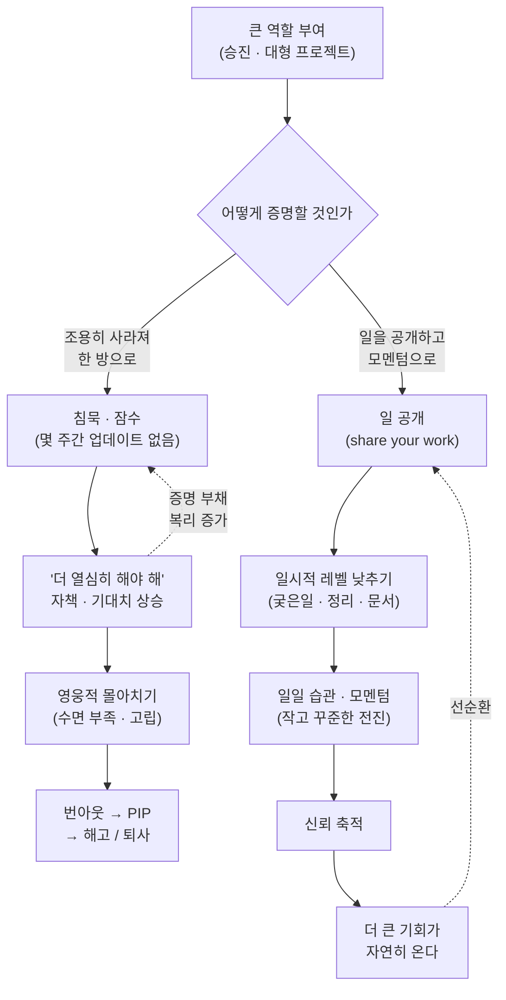

<figure class="post-figure post-figure--header">
<svg role="img" aria-label="두 엔지니어의 대비. 왼쪽에는 아래로 감기는 소용돌이가 있고, 그 가장자리에서 한 오크 엔지니어가 팔을 허우적거리며 빨려 들어간다. 소용돌이를 따라 잠수, 고립, 야근이라는 단어가 안쪽으로 이어지고, 중심에는 추락이 있다. 오른쪽에는 공유, 지원, 습관, 신뢰, 기회라고 적힌 돌계단이 한 단씩 위로 쌓여 있고, 다른 오크 엔지니어가 계단을 꾸준히 오르고 있으며 맨 위 계단에는 깃발이 꽂혀 있다. 아래에는 각각 '한 방의 증명'과 '꾸준한 모멘텀'이라는 이름표가 붙어 있다." viewBox="0 0 680 340" xmlns="http://www.w3.org/2000/svg">
  <title>죽음의 소용돌이 vs 돌계단 — '잠수 후 한 방의 증명'은 아래로 감기고, 매일의 작은 공유는 위로 쌓인다</title>

  <!-- ===== center divider ===== -->
  <line x1="344" y1="28" x2="344" y2="304" stroke="currentColor" stroke-width="1.5" stroke-dasharray="4 6" opacity="0.3"/>

  <!-- ===== LEFT: the death spiral ===== -->
  <!-- spiral coil, winding inward -->
  <path d="M 165 40
           C 255 40 290 110 290 165
           C 290 235 235 275 165 275
           C 105 275 60 235 60 175
           C 60 120 100 85 155 85
           C 205 85 235 120 235 165
           C 235 210 205 235 165 235
           C 130 235 105 212 105 178
           C 105 150 125 130 155 130
           C 180 130 198 148 198 170
           C 198 190 184 202 166 202
           C 152 202 140 192 140 178"
        fill="none" stroke="currentColor" stroke-width="2.5" stroke-linecap="round" opacity="0.55"/>
  <!-- inner pull arrowhead (toward the center) -->
  <polygon points="140,178 134,164 150,166" fill="var(--accent-color)" opacity="0.9"/>

  <!-- engineer being pulled in at the spiral mouth (tilted, arms flailing) -->
  <g transform="translate(212 46) rotate(28)">
    <circle cx="0" cy="0" r="9" fill="var(--orc-green)" fill-opacity="0.3" stroke="currentColor" stroke-width="2"/>
    <line x1="-4" y1="7" x2="-5" y2="12" stroke="currentColor" stroke-width="1.8" stroke-linecap="round"/>
    <line x1="4" y1="7" x2="5" y2="12" stroke="currentColor" stroke-width="1.8" stroke-linecap="round"/>
    <line x1="0" y1="9" x2="0" y2="30" stroke="currentColor" stroke-width="2.5" stroke-linecap="round"/>
    <!-- flailing arms -->
    <line x1="0" y1="14" x2="-16" y2="4" stroke="currentColor" stroke-width="2.2" stroke-linecap="round"/>
    <line x1="0" y1="16" x2="15" y2="6" stroke="currentColor" stroke-width="2.2" stroke-linecap="round"/>
    <!-- legs kicked out -->
    <line x1="0" y1="30" x2="-10" y2="44" stroke="currentColor" stroke-width="2.2" stroke-linecap="round"/>
    <line x1="0" y1="30" x2="11" y2="42" stroke="currentColor" stroke-width="2.2" stroke-linecap="round"/>
  </g>

  <!-- stage words riding the coils inward -->
  <g font-weight="700" fill="currentColor">
    <text x="72" y="66" font-size="13" opacity="0.75">잠수</text>
    <text x="296" y="212" font-size="13" opacity="0.7">고립</text>
    <text x="118" y="258" font-size="13" opacity="0.8">야근</text>
  </g>
  <text x="170" y="174" font-size="13" font-weight="700" fill="var(--accent-color)" text-anchor="middle">추락</text>

  <!-- left label -->
  <text x="175" y="330" font-size="14" font-weight="700" fill="var(--accent-color)" text-anchor="middle">"한 방의 증명"</text>

  <!-- ===== RIGHT: the daily stone staircase ===== -->
  <!-- ground -->
  <line x1="360" y1="300" x2="664" y2="300" stroke="currentColor" stroke-width="2" opacity="0.5"/>

  <!-- five stone steps -->
  <g stroke="currentColor" stroke-width="2" stroke-linejoin="round" fill="var(--orc-green)" fill-opacity="0.16">
    <rect x="372" y="272" width="56" height="28"/>
    <rect x="428" y="244" width="56" height="56"/>
    <rect x="484" y="216" width="56" height="84"/>
    <rect x="540" y="188" width="56" height="112"/>
    <rect x="596" y="160" width="56" height="140"/>
  </g>
  <!-- stone seams -->
  <g stroke="currentColor" stroke-width="1.2" opacity="0.3">
    <line x1="428" y1="272" x2="484" y2="272"/>
    <line x1="484" y1="244" x2="540" y2="244"/>
    <line x1="484" y1="272" x2="540" y2="272"/>
    <line x1="540" y1="216" x2="596" y2="216"/>
    <line x1="540" y1="260" x2="596" y2="260"/>
    <line x1="596" y1="192" x2="652" y2="192"/>
    <line x1="596" y1="236" x2="652" y2="236"/>
    <line x1="596" y1="274" x2="652" y2="274"/>
  </g>
  <!-- step labels: one small deposit a day -->
  <g font-size="12" font-weight="700" fill="currentColor" text-anchor="middle">
    <text x="400" y="291">공유</text>
    <text x="456" y="263">지원</text>
    <text x="512" y="293">습관</text>
    <text x="568" y="207">신뢰</text>
    <text x="624" y="179">기회</text>
  </g>

  <!-- engineer climbing steadily (standing on the third step) -->
  <g transform="translate(512 216)">
    <circle cx="0" cy="-40" r="9" fill="var(--orc-green)" fill-opacity="0.3" stroke="currentColor" stroke-width="2"/>
    <line x1="-4" y1="-33" x2="-5" y2="-28" stroke="currentColor" stroke-width="1.8" stroke-linecap="round"/>
    <line x1="4" y1="-33" x2="5" y2="-28" stroke="currentColor" stroke-width="1.8" stroke-linecap="round"/>
    <line x1="0" y1="-31" x2="0" y2="-12" stroke="currentColor" stroke-width="2.5" stroke-linecap="round"/>
    <!-- one arm reaching toward the next step, the other steadying -->
    <line x1="0" y1="-26" x2="17" y2="-36" stroke="currentColor" stroke-width="2.2" stroke-linecap="round"/>
    <line x1="0" y1="-24" x2="-11" y2="-14" stroke="currentColor" stroke-width="2.2" stroke-linecap="round"/>
    <!-- legs: mid-stride -->
    <line x1="0" y1="-12" x2="-8" y2="0" stroke="currentColor" stroke-width="2.2" stroke-linecap="round"/>
    <line x1="0" y1="-12" x2="12" y2="-4" stroke="currentColor" stroke-width="2.2" stroke-linecap="round"/>
  </g>

  <!-- flag on the top step -->
  <line x1="624" y1="160" x2="624" y2="112" stroke="currentColor" stroke-width="2.5" stroke-linecap="round"/>
  <polygon points="624,112 658,121 624,130" fill="var(--gold)" stroke="currentColor" stroke-width="1.5" stroke-linejoin="round"/>

  <!-- rising momentum arrow -->
  <line x1="382" y1="252" x2="620" y2="132" stroke="var(--secondary-color)" stroke-width="2" stroke-dasharray="6 5" stroke-linecap="round" opacity="0.8"/>
  <polygon points="632,126 616,126 623,140" fill="var(--secondary-color)" opacity="0.9"/>

  <!-- right label -->
  <text x="512" y="330" font-size="14" font-weight="700" fill="var(--secondary-color)" text-anchor="middle">"꾸준한 모멘텀"</text>
</svg>
<figcaption>왼쪽: 잠수 → 고립 → 야근을 거쳐 안으로 감기는 죽음의 소용돌이. 오른쪽: 공유·지원·습관·신뢰의 돌계단을 매일 한 단씩 오르는 모멘텀 — 기회는 맨 위가 아니라 계단 자체가 만든다.</figcaption>
</figure>

## 원문 정보

> - **제목**: the senior engineer death spiral
> - **출처**: Sunil Pai (<https://sunilpai.dev>)
> - **발행**: 2026-09-19 · 약 5~7분 분량
> - **원문 링크**: <https://sunilpai.dev/posts/the-senior-engineer-death-spiral/>

시니어로 올라선 직후가 오히려 커리어에서 가장 위험한 구간일 수 있다는, 짧지만 뼈아픈 에세이다. 기술 얘기가 아니라 일하는 방식과 심리에 관한 글이라 `Career-Life`에 담는다.

## 한 줄 요약 (TL;DR)

고성과 엔지니어는 승진이나 큰 프로젝트를 맡는 순간 "조용히 사라졌다가 거대한 결과물로 한 번에 증명하겠다"는 함정에 빠지기 쉽고, 이 패턴은 번아웃·PIP·퇴사로 끝난다. 해독제는 반대 방향에 있다 — 일을 공개하고, 잠시 레벨을 낮춰 팀을 돕고, 결과가 아닌 모멘텀에 집중해 신뢰를 쌓으면 큰 기회는 자연히 따라온다.

## 왜 이 글을 골랐나

이 글이 그리는 패턴은 특정 회사나 특정 사람의 이야기가 아니라, 실력 있는 엔지니어일수록 더 잘 빠지는 구조적 함정이다. "요즘 뭘 못 보여줬으니 더 열심히 해야 한다"는 자책은 성실한 사람의 언어처럼 들리지만, 실제로는 고립과 침묵을 정당화하는 소용돌이의 입구다. 특히 리모트 환경에서 일하는 사람, 최근 승진했거나 큰 프로젝트를 새로 맡은 사람에게는 자기 진단 체크리스트로 쓸 수 있는 글이다. 이 위키의 [팀이 성공해야 개인이 성공한다](/2026/07/06/team-success-individual-success.html)가 리더 관점에서 본 구조 설계라면, 이 글은 같은 문제를 개인(IC) 관점에서 뒤집어 본다.

글의 척추는 같은 출발점에서 갈라지는 두 갈래 흐름이다.

## 핵심 내용

### 죽음의 소용돌이 — 패턴의 해부

글의 출발점은 역설이다. 소용돌이에 빠지는 사람은 저성과자가 아니라 **고성과자**다. 승진하거나 중요한 프로젝트를 맡은 엔지니어가 "이번엔 제대로 보여주겠다"며 몇 주씩 업데이트 없이 사라지고, 그 공백을 나중에 영웅적인 몰아치기(heroic catch-up)로 메우려 한다.

이 침묵을 지탱하는 것은 심리적 합리화다. 원문은 그 내면의 목소리를 이렇게 옮긴다.

> "they're telling themselves, 'oh my god, I haven't really shipped anything in a while. what I need to do is work harder.'"

"한동안 뭘 못 냈으니 더 열심히 해야 한다"는 생각은 침묵을 더 길게 만들고, 나중에 내놓을 결과물의 기대치를 스스로 더 높인다. 그 대가는 수면 부족, 거른 끼니, 우울, 관계 손상으로 이어지고, 최악의 경우 번아웃 → PIP(performance improvement plan) → 해고 또는 자진 퇴사로 끝난다.

### 리모트 워크가 소용돌이를 증폭시킨다

원문은 이 패턴이 현대 근무 환경에서 특히 위험해졌다고 본다. 옆자리에서 일하며 자연스럽게 상태가 공유되던 시절과 달리, 리모트 환경에는 근접성이 만들어주던 어카운터빌리티가 없다.

> "you don't really have the same structure of working next to someone and being given Jira tasks, etc."

구조가 없으니 잠수는 아무도 눈치채지 못한 채 길어지고, 문제는 파국적인 시점에야 드러난다.

### 해독제 1 — 선의를 가정하고, 일을 공개하라

첫 번째 처방은 태도의 전환이다. 동료들이 선의로 움직인다고 가정하고(assume good faith), 내 작업의 가시성을 높게 유지하는 것. 원문은 이것이 자기 PR과는 다르다고 선을 긋는다 — "요란하게 굴 필요는 없다. 일을 공유하면 된다(you have to share your work)."

여기서 저자는 자기 증명 강박의 뿌리를 찌르는 문장을 남긴다.

> "they hired you for you. they didn't hire you for who you think you're going to be in six months."

회사는 6개월 뒤의 이상적인 나를 고용한 게 아니라 지금의 나를 고용했다. 지금의 나를 숨길 이유가 없다는 것이다.

### 해독제 2 — 전략적으로 레벨을 낮춰라

두 번째 처방은 직관에 반한다. 원하는 시니어 레벨을 연기(performing)하는 대신, 일시적으로 지원자 역할로 내려가라는 것 — 원문의 표현으로는 "grunt work, organizational stuff, write-ups"(궂은일, 조직 정리, 문서 작업)이다. 화려하지 않지만 매일 눈에 보이는 기여가 침묵의 공백을 메우고, 팀과의 접점을 회복시킨다.

### 해독제 3 — 결과가 아니라 모멘텀

세 번째 처방이 글의 축이다.

> "you want to move away from an outcome-based mindset to momentum-based."

거대한 결과물 하나로 승부하는 사고에서, 매일의 습관이 만드는 복리적 전진으로 옮겨가라는 것이다. 큰 프로젝트에 대한 저자의 정의가 이를 압축한다.

> "big projects are not done with big efforts. it's a big marathon, just slow, steady, incremental work."

### 신뢰가 기회를 연다

이 셋이 맞물리면 선순환이 시작된다. 꾸준한 신뢰성과 좋은 관계가 쌓이면, 매니저는 자연스럽게 더 큰 일을 맡긴다. 글의 결론은 소프트웨어 엔지니어의 정체성 자체를 재정의한다.

> "you are in the reputation-building business, and software is actually downstream of that."

우리는 평판을 쌓는 업에 종사하고 있으며, 소프트웨어는 그 하류(downstream)에 있다는 것이다.

## 분석과 인사이트

### "증명 부채"는 이자가 복리로 붙는다

이 글에서 가장 날카로운 관찰은 소용돌이의 연료가 게으름이 아니라 **성실함의 왜곡**이라는 점이다. "못 보여줬으니 더 크게 보여줘야 한다"는 심리는 일종의 증명 부채다 — 침묵이 길어질수록 갚아야 할 기대치가 커지고, 기대치가 커질수록 어중간한 중간 공유가 더 부끄러워져 침묵이 또 길어진다. 부채의 이자가 복리로 붙는 구조라서, 빠져나오는 유일한 방법은 "지금의 어중간한 상태"를 일찍, 싸게 공개하는 것뿐이다. 이는 소프트웨어 공학이 오래 말해온 원칙 — 작은 배치(small batch), 짧은 피드백 루프 — 의 심리 버전이기도 하다. 큰 배치가 코드에서 위험하듯, 큰 배치의 자기 증명은 커리어에서 위험하다.

### 리모트 시대의 가시성은 '성과 연기'가 아니라 인프라다

"일을 공유하라"는 조언은 자칫 사내 정치나 셀프 브랜딩으로 오독되기 쉽다. 하지만 저자가 말하는 가시성은 과시가 아니라 팀이 나를 도울 수 있게 만드는 인터페이스에 가깝다. 진행 상황이 보여야 매니저가 장애물을 치워줄 수 있고, 동료가 방향 오류를 일찍 잡아줄 수 있다. 잠수는 겸손이 아니라 팀의 도움 받을 권리를 스스로 차단하는 행위다. [엔지니어링 리더의 하루](/2026/08/18/engineering-leaders-day-to-day.html)에서 봤듯 매니저의 일 자체가 정보 수집과 공유의 사이클이라는 점을 생각하면, 정보를 끊는 IC는 매니저의 업무 자체를 불가능하게 만드는 셈이다.

### 동의하지만, '레벨 낮추기'에는 단서가 필요하다

"일시적으로 궂은일·정리·문서 작업으로 내려가라"는 처방에는 대체로 동의한다. 신뢰가 바닥난 상태에서 신뢰를 다시 쌓는 가장 빠른 통화는 작고 확실한 납품이기 때문이다. 다만 이것이 상시 전략이 되면 다른 함정 — 시니어가 잡무 처리자로 고착되는 — 으로 이어질 수 있다. 원문도 "temporarily"라고 못 박고 있지만, 실무에서는 이 기간에 출구 조건(신뢰가 회복됐다는 신호가 무엇인지)을 매니저와 명시적으로 합의해 두는 편이 안전하다고 본다. 그리고 시니어에서 그 이상으로 가는 진짜 전환은 결국 [문제를 정의하는 능력](/2026/07/31/problem-framing-principal-engineer.html)에서 오므로, 궂은일 기간에도 문제 정의 근육은 계속 쓰는 것이 좋다.

### "소프트웨어는 평판의 하류"라는 명제의 무게

마지막 인용은 냉소적으로 들릴 수 있지만, [노동시장에서 살아남기](/2026/06/22/surviving-in-the-job-market.html)가 말한 "시장의 벤더로서의 개발자"와 정확히 같은 결론에 도달한다. 벤더의 자산은 개별 납품물이 아니라 "이 사람에게 맡기면 된다"는 신뢰의 총량이고, 코드 품질은 그 신뢰를 만드는 여러 입력 중 하나일 뿐이다. 기술적 탁월함으로 커리어의 모든 문제를 돌파하려는 태도가 시니어 이후 구간에서 자주 벽에 부딪히는 이유가 여기에 있다.

## 적용 포인트

- **침묵 상한선을 정하라.** 이틀 이상 진행 상황을 아무에게도 공유하지 않았다면, 그것 자체를 경보로 취급한다. 완성도와 무관하게 "지금 여기까지, 다음은 이것"을 공유한다.
- **"더 열심히"가 떠오르면 "더 공개하라"로 치환하라.** "한동안 못 보여줬으니 더 열심히"라는 생각이 드는 순간이 소용돌이의 입구다. 처방은 노동량 증가가 아니라 가시성 증가다.
- **큰 프로젝트를 맡으면 데모/공유 주기부터 설계하라.** 산출물 계획보다 커뮤니케이션 계획(주간 업데이트, 중간 데모, 진행 로그)을 먼저 세운다.
- **신뢰 회복 구간에는 작고 확실한 납품을 택하라.** 문서화, 정리, 리뷰 같은 "지루하지만 매일 보이는" 기여로 접점을 복구한다 — 단, 기간과 출구 조건을 명시한다.
- **결과 목표를 모멘텀 목표로 번역하라.** "분기 내 시스템 X 완성" 대신 "매일 리뷰 가능한 단위 하나 머지"처럼, 매일 판정 가능한 습관으로 바꾼다.
- **6개월 뒤의 나를 연기하지 마라.** 지금의 나로 고용됐다는 사실을 받아들이면, 모르는 것을 묻고 어중간한 것을 공유하는 비용이 급격히 낮아진다.

## 마무리

이 글의 미덕은 번아웃을 의지나 체력의 문제가 아니라 일하는 구조의 문제로 다시 그려낸다는 데 있다. 잠수 후 영웅적 한 방은 실력이 부족해서가 아니라, "결과로 한 번에 증명하겠다"는 사고방식 자체가 만드는 예측 가능한 실패다. 해독제 — 일을 공개하고, 필요하면 잠시 내려가고, 결과 대신 모멘텀을 관리하는 것 — 는 화려하지 않지만, 시니어 이후의 커리어가 결국 평판이라는 복리 자산 위에 서 있다는 점을 받아들이면 가장 합리적인 전략이 된다. 큰 프로젝트는 큰 노력이 아니라 긴 마라톤으로 끝난다.

### 더 읽어보기

- [원문 — the senior engineer death spiral (Sunil Pai)](https://sunilpai.dev/posts/the-senior-engineer-death-spiral/)
- [팀이 성공해야 개인이 성공한다](/2026/07/06/team-success-individual-success.html) — 같은 문제(압박 vs 구조)를 리더 관점에서 본 짝글
- [노동시장이라는 게임에서 살아남기](/2026/06/22/surviving-in-the-job-market.html) — "평판의 하류에 소프트웨어가 있다"와 같은 결론에 도달하는 시장 관점
- [엔지니어링 리더의 하루는 무엇으로 채워지는가](/2026/08/18/engineering-leaders-day-to-day.html) — 가시성이 왜 매니저 업무의 전제 조건인지
- [모호한 의견에서 본질을 찾기: 문제 정의와 Principal Engineer의 사고 방식](/2026/07/31/problem-framing-principal-engineer.html) — '레벨 낮추기' 기간에도 놓지 말아야 할 근육
