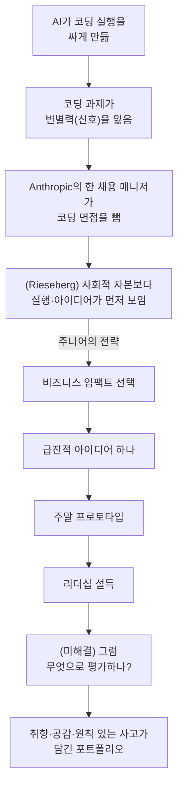

<figure class="post-figure post-figure--header">
<svg role="img" aria-label="위쪽에는 알고리즘 트리가 그려진 먼지 쌓인 화이트보드가 옆으로 밀려나 있고, 아래쪽에는 엔지니어가 직접 만든 동작하는 프로토타입 화면을 리더에게 들어 보이는 장면. 시험으로 증명에서 만든 것으로 증명으로 넘어가는 대비." viewBox="0 0 380 450" width="440" xmlns="http://www.w3.org/2000/svg">
<title>시험으로 증명에서 만든 것으로 증명으로</title>
<g transform="rotate(-7 150 100)" stroke="currentColor" fill="none" stroke-linecap="round">
<rect x="60" y="30" width="180" height="110" rx="4" stroke-width="2.5" fill="currentColor" fill-opacity="0.05"/>
<g stroke-opacity="0.5" stroke-width="2">
<line x1="150" y1="52" x2="115" y2="82"/><line x1="150" y1="52" x2="185" y2="82"/>
<line x1="115" y1="82" x2="97" y2="112"/><line x1="115" y1="82" x2="133" y2="112"/>
<line x1="185" y1="82" x2="203" y2="112"/>
<circle cx="150" cy="52" r="7"/><circle cx="115" cy="82" r="7"/><circle cx="185" cy="82" r="7"/>
<circle cx="97" cy="112" r="7"/><circle cx="133" cy="112" r="7"/><circle cx="203" cy="112" r="7"/>
</g>
<line x1="90" y1="140" x2="80" y2="175" stroke-width="2.5"/><line x1="210" y1="140" x2="220" y2="175" stroke-width="2.5"/>
<circle cx="80" cy="180" r="5" stroke-width="2"/><circle cx="220" cy="180" r="5" stroke-width="2"/>
<path d="M60,48 L78,30 M60,40 L70,30" stroke-opacity="0.35" stroke-width="1.5"/>
</g>
<g fill="currentColor" fill-opacity="0.3">
<circle cx="88" cy="58" r="2"/><circle cx="210" cy="44" r="1.8"/><circle cx="172" cy="128" r="2"/><circle cx="76" cy="122" r="1.6"/><circle cx="226" cy="96" r="1.8"/><circle cx="122" cy="40" r="1.5"/>
</g>
<g stroke="currentColor" stroke-opacity="0.4" stroke-width="2" stroke-linecap="round">
<line x1="262" y1="78" x2="300" y2="78"/><line x1="268" y1="96" x2="318" y2="96"/><line x1="262" y1="114" x2="300" y2="114"/>
</g>
<text x="190" y="216" text-anchor="middle" font-size="15" fill="currentColor" fill-opacity="0.75">시험으로 증명</text>
<line x1="190" y1="228" x2="190" y2="258" stroke="var(--accent-color)" stroke-width="3" stroke-linecap="round"/>
<polygon points="181,256 199,256 190,270" fill="var(--accent-color)"/>
<g stroke="currentColor" stroke-width="3" stroke-linecap="round" fill="none">
<circle cx="110" cy="312" r="13"/>
<line x1="110" y1="325" x2="110" y2="372"/>
<line x1="110" y1="372" x2="98" y2="404"/><line x1="110" y1="372" x2="122" y2="404"/>
<line x1="110" y1="338" x2="150" y2="334"/><line x1="110" y1="338" x2="148" y2="316"/>
</g>
<rect x="148" y="282" width="88" height="62" rx="4" fill="var(--accent-color)" fill-opacity="0.08" stroke="var(--accent-color)" stroke-width="3"/>
<line x1="148" y1="294" x2="236" y2="294" stroke="var(--accent-color)" stroke-width="2"/>
<g fill="var(--accent-color)"><circle cx="155" cy="288" r="2"/><circle cx="162" cy="288" r="2"/><circle cx="169" cy="288" r="2"/></g>
<g fill="currentColor" fill-opacity="0.45">
<rect x="158" y="318" width="8" height="18"/><rect x="170" y="310" width="8" height="26"/><rect x="182" y="304" width="8" height="32"/>
</g>
<path d="M202,320 l8,8 l16,-18" fill="none" stroke="var(--accent-color)" stroke-width="3" stroke-linecap="round" stroke-linejoin="round"/>
<line x1="284" y1="306" x2="242" y2="310" stroke="currentColor" stroke-opacity="0.45" stroke-width="2" stroke-dasharray="4 4"/>
<g stroke="currentColor" stroke-width="3" stroke-linecap="round" fill="none">
<circle cx="300" cy="306" r="15"/>
<line x1="300" y1="321" x2="300" y2="372"/>
<line x1="300" y1="372" x2="288" y2="404"/><line x1="300" y1="372" x2="312" y2="404"/>
<line x1="300" y1="336" x2="282" y2="362"/><line x1="300" y1="336" x2="318" y2="362"/>
</g>
<polygon points="300,250 304,262 316,262 306,269 310,281 300,274 290,281 294,269 284,262 296,262" fill="var(--gold)" stroke="currentColor" stroke-opacity="0.5" stroke-width="1"/>
<line x1="40" y1="408" x2="340" y2="408" stroke="currentColor" stroke-opacity="0.3" stroke-width="2"/>
<text x="190" y="438" text-anchor="middle" font-size="15" font-weight="700" fill="currentColor">만든 것으로 증명</text>
</svg>
<figcaption>코딩 과제라는 시험이 물러나고, 직접 만든 작은 프로토타입이 그 사람을 보여 주는 자리로 들어선다. Anthropic의 한 채용 매니저(Felix Rieseberg)의 결정을 계기로 한 글이다.</figcaption>
</figure>

## 원문 정보

> - **제목**: The Pulse: Anthropic kills the coding interview
> - **부제**: AI is rendering the Leetcode-style interview pointless and now Anthropic has deleted it from its interview loop. Also: details of incident.io’s AI spend, Microsoft’s exit offer to engineers, and more
> - **출처**: The Pragmatic Engineer · Gergely Orosz ([newsletter.pragmaticengineer.com](https://newsletter.pragmaticengineer.com))
> - **발행**: 2026-10-30 · 전문 약 4,500단어(페이지 메타데이터 기준)
> - **원문 링크**: <https://newsletter.pragmaticengineer.com/p/the-pulse-anthropic-kills-the-coding>
> - **함께 읽은 공개 1차 출처**: Felix Rieseberg, ["Hunger beats tenure: Advice for junior engineers"](https://felixrieseberg.com/hunger-beats-tenure-advice-for-junior-engineers/) (2026-10-27, 약 5분 분량)

> **유료 글이라 공개된 부분만 다룬다.** 이 호는 유료 구독자 전용(paid)이다. 이 포스트는 **누구나 볼 수 있는 부분만** 근거로 삼는다. 공개된 것은 시리즈 소개 문장, 다섯 꼭지의 목차와 꼭지별 한두 문장 요약, 1번 꼭지의 첫 문단(Felix Rieseberg의 블로그 글을 인용하겠다고 예고하는 데까지)이다.
>
> **읽지 못한 부분**: 1번 꼭지에서 Orosz가 인용한 대목과 그에 대한 해설·분석 전체, 2번(incident.io의 AI 비용과 ROI), 3번(Amazon의 SDE·SDM 기대치에 들어간 AI 사용), 4번(Microsoft의 퇴직 제안), 5번(보안 사고 지속)의 본문 전체. 이 꼭지들에 대해서는 **목차에 적힌 문장 이상을 쓰지 않는다.**
>
> Orosz가 인용한 Felix Rieseberg의 글은 공개 블로그라 원문을 직접 읽었다. 아래에서 Rieseberg를 인용한 부분은 **Rieseberg 글에서 가져온 것이고**, Orosz가 그 글의 어느 대목을 강조했는지는 페이월 뒤에 있어 알 수 없다.

주간 업계 동향 뉴스레터의 한 호지만, 표제 꼭지는 채용이라는 커리어의 관문이 AI 때문에 어떻게 달라지는지를 다룬다. 그래서 `Career-Life`에 담는다.

## 한 줄 요약 (TL;DR)

Anthropic의 한 채용 매니저(Felix Rieseberg)는 코딩 과제가 더는 좋은 엔지니어를 가려내지 못한다며 면접에서 이를 없앴다. The Pulse는 이 일을 "Anthropic이 코딩 면접을 죽였다(kills the coding interview)"는 표제로 다루고, 회사의 다른 팀과 다른 AI 네이티브 스타트업도 따를 수 있다고 내다본다. Rieseberg의 글은 같은 변화를 주니어, 더 정확히는 **사회적 자본이 없는 엔지니어**에게 온 기회로 해석한다. 실행이 싸졌으니 연차보다 갈망(hunger)이 이긴다는 것이다.

## 왜 이 글을 골랐나

이 위키에는 이미 "코딩 테스트가 commodity가 된 시대에 무엇을 평가할까"를 다룬 글이 여럿 있다. 무신사의 [AI 네이티브 채용 철학](/2026/07/03/ai-native-hiring-philosophy.html)과 Anthropic 내부 고용 데이터 보고서인 [How employment is changing at Anthropic](/2026/10/22/employment-at-anthropic.html)이 그렇다. 이 호는 거기에 **현장 매니저 한 사람의 실제 결정**을 더한다. 보고서의 통계나 채용 설계 철학이 아니라, 지난달(2026년 10월) 코딩 면접을 없앤 구체적인 행동이다.

또 하나 눈여겨볼 점이 있다. 업계 동향 뉴스레터가 이 일을 어떤 표제로 다루는지(*Anthropic kills…*)와 1차 출처가 실제로 무엇을 말하는지 사이에 **간극**이 있다. 유료 글을 공개분만으로 읽을 때는 이 간극을 직접 확인하는 습관이 특히 중요하다.

흐름을 한눈에 보면 다음과 같다.

## 핵심 내용

### The Pulse 이번 호의 목차 (공개분)

공개된 목차에 따르면 이번 호는 다섯 꼭지로 되어 있다. 아래는 목차에 적힌 요약을 옮긴 것이고, 각 꼭지의 본문은 페이월 뒤에 있다.

1. **Anthropic kills its coding interview**: 선두 프런티어 AI 기업의 **한 팀**이 DSA(자료구조·알고리즘) 면접에서 아무 신호도 얻지 못해 채용 과정에서 뺐다. 회사의 다른 팀과 다른 AI 네이티브 스타트업도 따를 수 있다.
2. **incident.io의 AI 지출과 ROI**: 회복탄력성(resiliency) 분야 스타트업 incident.io가 AI 지출을 개발자 1인당 월 $4,500(8월)에서 $1,600(현재)로 줄였다.
3. **Amazon, AI 사용을 SDE·SDM 기대치에 공식 반영**: AI 사용과 생산성 사이의 상관관계를 확인한 뒤 AI를 소프트웨어 엔지니어링의 중심에 두었다. SDE와 SDM은 고객과도 가까워야 한다.
4. **Microsoft, 엔지니어에게 새 퇴직 제안**: 직원 60,000명에게 연말까지 퇴사할 기회를 제안했다. Orosz는 조건이 그리 매력적이지 않아 수락자가 수만 명이 아니라 수천 명 수준일 것이라고 본다.
5. **보안 사고는 계속된다**: 지난주 이후에도 사고 보고가 이어지고 있고, 당분간 달라지지 않을 수 있다.

1번 꼭지의 공개된 첫 문단은 Claude Cowork와 Claude Desktop을 이끈 Anthropic의 채용 매니저가 소프트웨어 엔지니어 후보에게 코딩 문제를 더는 묻지 않는다고 밝혔다는 내용이다. 이어서 Felix Rieseberg의 블로그 글을 인용하는데, 페이월은 바로 그 인용 직전에서 시작된다.

### 1차 출처: Felix Rieseberg, "Hunger beats tenure"

여기서부터는 Orosz의 글이 아니라 **Rieseberg의 공개 블로그 글**을 정리한 것이다. Rieseberg는 블로그 소개에서 자신을 Anthropic의 EM(Engineering Manager)으로 소개한다. Claude.ai, Cowork, Claude Code Desktop의 엔지니어링을 이끌었고, Electron 공동 메인테이너이며, Notion·Stripe·Slack·Microsoft에서 일했다.

#### 코딩 면접을 내려놓다

- 2026년 10월(글에서는 "This month") 그는 채용 매니저로서 코딩 면접을 더는 진행하지 않기로 했다. 문제를 빠르게 정의하고 우아하게 푸는 능력은 그의 팀에서 성공할지를 알려 주는 "약하지만 유용한" 예측 변수였고, 실제 코드로 내는 작은 과제도 의미 있는 무언가를 보여 줬다.
- 그는 **이제는 그렇지 않다**고 말한다. 작은 React 과제를 내는 것은 어셈블리를 묻는 것만큼이나 의미가 없어졌다. 둘 다 Claude가 더 잘하기 때문이다. 그의 팀에서 가장 임팩트 있는 빌더들은 이런 테스트 점수와 상관없이 성공한다.
- AI가 주니어의 취업을 어렵게 만든다는 이야기는 많다. 하지만 그는 주니어가 AI와 일하는 모습을 지켜본 뒤 더 희망적인 시각을 갖게 됐다. 임팩트가 프레임워크·라이브러리 지식을 몇 년 쌓았느냐에 덜 묶이게 되었다는 것이다. 상대적으로 새로 온 엔지니어가 아마 코딩은 더 잘하고 경력도 긴 사람을 앞지르는 모습을 보며 그는 이렇게 정리한다. **"Hunger beats tenure."**
- 그는 "주니어"가 정확한 말이 아니라고 덧붙인다. 이 글은 **사회적 자본·지위·권력이 없는 엔지니어**를 위한 조언이다.

#### All vision, no voice: 신참의 강점과 핸디캡

<figure class="post-figure">
<svg role="img" aria-label="신참의 강점과 핸디캡을 위에서 아래로 쌓은 그림. 위: 강점은 보는 눈으로, 고참이 못 보게 된 마찰과 기회를 발견한다. 가운데: 핸디캡은 목소리가 없다는 것으로, 아이디어가 승인하거나 막는 소수와 먼저 쌓아야 할 사회적 지위에 막혀 위로 닿지 못한다. 아래: 실행이 싸졌으니 동작하는 프로토타입이 목소리를 대신한다." viewBox="0 0 380 500" width="440" xmlns="http://www.w3.org/2000/svg">
<title>신참의 강점(보는 눈)과 핸디캡(목소리 없음)</title>
<rect x="10" y="10" width="360" height="140" rx="8" fill="currentColor" fill-opacity="0.04" stroke="currentColor" stroke-width="1.5"/>
<text x="24" y="40" font-size="17" font-weight="700" fill="currentColor">강점: 보는 눈 (vision)</text>
<path d="M32,98 Q70,64 108,98 Q70,132 32,98 Z" fill="none" stroke="var(--accent-color)" stroke-width="3"/>
<circle cx="70" cy="98" r="11" fill="var(--accent-color)"/>
<text x="112" y="80" font-size="26" font-weight="700" fill="var(--gold)" stroke="currentColor" stroke-opacity="0.35" stroke-width="0.6">?</text>
<text x="146" y="92" font-size="15" fill="currentColor">고참이 못 보게 된</text>
<text x="146" y="116" font-size="15" fill="currentColor">마찰·기회를 발견</text>
<rect x="10" y="165" width="360" height="190" rx="8" fill="currentColor" fill-opacity="0.04" stroke="currentColor" stroke-width="1.5"/>
<text x="24" y="194" font-size="17" font-weight="700" fill="currentColor">핸디캡: 목소리 없음 (no voice)</text>
<rect x="24" y="208" width="332" height="30" rx="4" fill="currentColor" fill-opacity="0.08" stroke="currentColor" stroke-dasharray="5 4" stroke-width="1.5"/>
<text x="40" y="228" font-size="15" fill="currentColor">아이디어를 승인·차단하는 소수</text>
<rect x="24" y="246" width="332" height="30" rx="4" fill="currentColor" fill-opacity="0.08" stroke="currentColor" stroke-dasharray="5 4" stroke-width="1.5"/>
<text x="40" y="266" font-size="15" fill="currentColor">먼저 쌓아야 할 사회적 지위</text>
<line x1="60" y1="304" x2="60" y2="288" stroke="currentColor" stroke-width="2.5" stroke-linecap="round"/>
<path d="M52,286 L68,278 M52,278 L68,286" stroke="var(--accent-color)" stroke-width="3" stroke-linecap="round"/>
<circle cx="60" cy="320" r="13" fill="var(--gold)" fill-opacity="0.35" stroke="currentColor" stroke-width="2"/>
<rect x="54" y="334" width="12" height="8" rx="1" fill="none" stroke="currentColor" stroke-width="2"/>
<text x="90" y="326" font-size="15" fill="currentColor">아이디어가 위로 닿지 못함</text>
<line x1="190" y1="362" x2="190" y2="380" stroke="var(--accent-color)" stroke-width="3" stroke-linecap="round"/>
<polygon points="181,378 199,378 190,391" fill="var(--accent-color)"/>
<rect x="10" y="396" width="360" height="94" rx="8" fill="var(--accent-color)" fill-opacity="0.07" stroke="var(--accent-color)" stroke-width="2"/>
<text x="190" y="424" text-anchor="middle" font-size="17" font-weight="700" fill="currentColor">실행이 싸졌다</text>
<text x="190" y="452" text-anchor="middle" font-size="15" fill="currentColor">동작하는 프로토타입이</text>
<text x="190" y="475" text-anchor="middle" font-size="15" fill="currentColor">목소리를 대신한다</text>
</svg>
<figcaption>신참은 고참이 못 보게 된 것을 보지만, 그 생각을 위로 전할 지위가 없다. Rieseberg는 실행이 싸진 지금 동작하는 프로토타입이 그 간극을 메운다고 본다.</figcaption>
</figure>

- **강점은 신선한 눈이다.** Stripe 창업자 Patrick Collison은 신입들에게 이상해 보이는 것에 주목하라고 당부했다고 한다. 고참이 오래전에 못 보게 된 마찰과 기회를 신참이 발견한다는 기대에서다. Rieseberg는 조직이 "순진하고 무지한 사람의 유입"에 의존한다는 James March(1991)의 말과, 남들이 시도하지 않은 촬영을 시도할 자신감이 어디서 났느냐는 질문에 "무지, 순전한 무지"라고 답한 Orson Welles의 일화도 든다.
- **Notion 경험담.** 그는 Notion 면접에서 오프라인 모드 아키텍처 설계 문제를 받았는데, 이것이 "함정" 문제로 여겨지고 있었다. 오프라인 모드는 불가능하다고 여겨졌기 때문이다. 데이터 모델이 너무 복잡하다는 점은 사실이었다. 하지만 창업자가 반대할 것이라는 통념은 사실이 아니었다. 모두가 상식으로 여겨서 아무도 확인하지 않았던 것이다.
- **고참이 되는 순간.** 그는 입사 직후 팀마다 대시보드용 대형 TV를 놓으려다 조직의 벽에 막혀 포기했다. 1년 뒤 같은 아이디어를 들고 온 신입 Ji Pei에게 "이미 해 봤다"며 말렸지만, 그는 이미 요청을 넣은 상태였고 TV는 다음 날 도착했다. 그사이 Rieseberg 자신이 고참이 되어 있었다.
- **핸디캡은 아무도 당신 생각에 관심이 없다는 것이다.** 회사는 흔히 소수가 아이디어를 승인하거나 막는 구조로 짜여 있다. 실행이 비싼 세상에서는 조직이 내 아이디어에 "베팅"해 주기까지 사회적 지위를 쌓아야 했다. AI를 믿는 회사조차 주니어에게는 사업 목표를 야심 차게 좇기보다 맡은 일을 더 빨리 처리하기를 기대하곤 한다.
- 그리고 이렇게 이어진다. **"Execution isn't expensive anymore."**

#### 무엇을 할 것인가: 다섯 가지 조언

1. **백로그보다 비즈니스 임팩트를 고르라.** Patrick McKenzie(2011)의 "엔지니어는 프로그래밍하라고 고용된 게 아니라 비즈니스 가치를 만들라고 고용된 것"이라는 말을 인용한다. 회사(또는 부서)가 실제로 이루려는 것을 이해하고, 적절한 고도를 찾으라고 한다. 매니저의 매니저가 어떤 목표를 갖고 있는지가 좋은 기준이 된다.
2. **급진적인 아이디어를 고르라.** 성공한다면 그 목표를 이룰 가능성을 극적으로 높일 아이디어 몇 개를 떠올려라.
3. **주말에 만들어 보라.** PRD 작성, 동의 확보, 디자이너·PM 시간 확보 같은 절차를 동작하는 프로토타입으로 건너뛰는 소그룹과 1인 엔지니어를 그는 직접 봤다.
4. **좋은 아이디어 하나에 집중하라.** 주니어는 한 프로토타입에 아이디어를 몰아넣어, 좋은 아이디어 셋을 나쁜 아이디어 스물 사이에 묻어 버리곤 한다. 프로토타입의 목적은 리더십이 기회와 "이걸 끌고 갈 사람이 당신"이라는 사실을 빠르게 이해하도록 아이디어를 전달하는 것이다.
5. **신선한 관점에 기대라.** 사용자 대면 제품이라면 외부 사용자의 경험에 남다르게 공감할 수 있다. 그는 Slack과 Notion 동료들이 외부 사용자로서 그 제품을 쓰는 감각을 체화하기 어려워했다고 말한다. 인프라·툴링이라면 "왜 그게 불가능한지"를 배운 적이 없다는 것이 이점이다.

#### 미래는 밝다, 다만 평가법은 아직 모른다

- 그는 코딩 면접이 돌아오지 않을 것이라고 본다. 연차 기반 승진을 오래 싫어해 온 사람으로서 낙관적이라고도 말한다.
- 사례로, Anthropic에서는 사람들이 Claude Code를 CLI로 쓰는 데 너무 익숙해져서, 비교적 새로 온 엔지니어 두 명(Anthony Morris, Alice Zhao)이 나서고서야 한 주말 동안 동작하는 프로토타입이 나왔다고 한다(그는 "Claude Code의 좋은 그래픽 인터페이스가 아주 인기 있는 제품이라는 건 놀랍지 않을 것"이라는 말로 이 일화를 맺는다). 첫 공개 버전은 약 8일 뒤에 나왔다.
- 끝으로 그는 AI로 잘 만드는 사람을 어떻게 면접할지는 **아직 답을 찾지 못했다**고 인정한다. 지금은 이력서와 포트폴리오에서 **취향(taste), 공감(empathy), 원칙 있는 사고(principled thinking)**가 드러나는 작은 프로토타입을 찾고 있다고 한다.

## 분석과 인사이트

여기부터는 원문 요약이 아니라 **나의 해석**이다.

### 1. 표제와 1차 출처 사이의 간극

The Pulse의 부제는 "now Anthropic has deleted it from its interview loop"이고, 목차 요약은 "**a team** at the leading frontier AI company"라고 범위를 좁힌다. Rieseberg 본인은 "As a hiring manager at Anthropic, **I** stopped asking"이라고 쓴다. 공개분만 보면 이것은 **한 채용 매니저(와 그의 팀)의 결정**이지, Anthropic 전사 정책으로 확인된 것은 아니다. Orosz도 "회사의 나머지가 따를 수 있다(could follow)"고 썼으니 이 구분은 하고 있는 셈이다. 다만 표제만 보고 공유되는 업계 담론에서는 이 단서가 쉽게 사라진다.

비슷하게, 목차는 "DSA interviews"라고 부르지만 Rieseberg의 글에 나오는 예는 "small coding challenges in real code", "a little React challenge"다. 고전적인 LeetCode식 알고리즘 퍼즐보다 **실무형 소형 코딩 과제**까지 포함한 더 넓은 범주로 읽힌다. 내 생각에 이 차이는 작지 않다. "알고리즘 퍼즐은 무의미하다"는 오래된 비판이지만, "실제 코드로 내는 작은 과제도 무의미하다"는 훨씬 급진적인 주장이기 때문이다. Orosz가 페이월 뒤에서 이 구분을 어떻게 다뤘는지는 확인할 수 없다.

### 2. "신호가 사라졌다"는 말의 정확한 뜻

Rieseberg의 논리는 측정 이론에 가깝다. 코딩 과제는 원래부터 "약한" 예측 변수였는데, 모델이 그 과제를 사람보다 잘 풀게 되면서 **높은 성과자와 낮은 성과자를 가르는 변별력**이 사라졌다는 것이다. 과제가 너무 쉬워져서가 아니라, 과제가 측정하던 능력이 더는 **성과를 결정하는 병목이 아니게** 되었다는 것이 요지라고 나는 읽었다. 이는 [Anthropic 내부 고용 보고서](/2026/10/22/employment-at-anthropic.html)가 말한 "사람의 주의(attention)가 병목이 된다", "채용 기준이 자율성과 판단력으로 옮겨간다"는 관찰과 같은 방향이다.

### 3. 주니어 비관론에 대한 반론, 그 전제 조건

AI가 주니어 채용을 줄인다는 데이터(위 보고서의 주니어 기술직 채용 비중 감소 등)와 Rieseberg의 "Hunger beats tenure"는 얼핏 모순처럼 보인다. 내 해석으로는 둘은 **서로 다른 층위**를 말한다. 하나는 "주니어 자리 수"라는 시장의 총량이고, 다른 하나는 "일단 안에 들어온 신참이 낼 수 있는 임팩트의 상한"이다. Rieseberg가 굳이 "junior"를 "사회적 자본이 없는 엔지니어"로 고쳐 부른 것도 이 때문으로 보인다. 그의 낙관은 **실행 비용이 낮고, 프로토타입이 의사결정자에게 닿을 수 있는 조직**을 전제로 한다. 승인 게이트가 단단한 조직에서는 주말 프로토타입이 목소리가 되어 주지 못할 수 있다. 이것은 원문이 아니라 내 우려다.

### 4. 평가의 공백: "아직 모르겠다"는 정직함

가장 신뢰가 가는 대목은 마지막의 "아직 거기에 도달하지 못했다"는 고백이다. 코딩 면접을 없앤 뒤 무엇으로 대체할지 확정된 방법론은 없고, 지금은 포트폴리오의 작은 프로토타입에서 취향·공감·원칙을 읽어 내려는 시도가 있을 뿐이다. 무신사의 [3-Tier 평가 모델](/2026/07/03/ai-native-hiring-philosophy.html)이나 Cursor의 [고밀도 인재 채용 플레이북](/2026/08/18/high-talent-density-hiring-playbook.html)처럼 대안을 구조화하려는 시도와 나란히 보면, 업계 전체가 **"무엇을 볼 것인가"는 합의하는 중이지만 "어떻게 재현 가능하게 측정할 것인가"는 아직 비어 있는** 단계라고 나는 판단한다. 포트폴리오 중심 평가는 시간·여유가 있는 사람에게 유리하다는 공정성 문제도 따라온다. 이 역시 내 의견이다.

## 적용 포인트

- **1차 출처까지 따라가라.** "X사가 Y를 없앴다" 같은 표제를 보면 그것이 전사 정책인지 한 사람의 결정인지부터 확인한다. 이번 건은 공개 블로그 한 편으로 확인할 수 있었다.
- **포트폴리오를 "작고 하나에 집중한 프로토타입"으로 재구성하라.** Rieseberg가 이력서에서 찾는다고 밝힌 신호는 취향·공감·원칙 있는 사고가 드러나는 작은 결과물이다. 기능을 잔뜩 넣은 사이드 프로젝트보다 **아이디어 하나를 선명하게 전달하는 데모**가 낫다.
- **매니저의 매니저가 가진 목표를 알아내라.** 백로그 티켓 대신 그 목표에 닿는 급진적 아이디어 하나를 골라 주말 프로토타입으로 만들어 본다.
- **신참일 때 "이상한 것" 목록을 적어 두라.** 입사 초반에 눈에 걸린 마찰과 "왜 이게 불가능하다고 하지?" 싶은 통념을 기록한다. 1년 뒤의 나는 그것을 못 보게 된다.
- **면접관이라면 지금 쓰는 코딩 과제의 변별력을 점검하라.** 모델이 사람보다 잘 푸는 과제라면 그 점수가 실제 팀 성과와 상관이 있는지 되돌아보고, 판단·취향·문제 정의를 관찰할 수 있는 방식을 실험해 본다.
- **유료 원문이 궁금하다면 직접 구독해서 읽어라.** incident.io의 AI 비용 절감, Amazon의 기대치 개정, Microsoft의 퇴직 제안 같은 나머지 꼭지의 디테일은 이 포스트에서 다루지 않았다.

## 마무리

The Pulse의 표제는 "Anthropic이 코딩 면접을 죽였다"고 말하지만, 공개된 범위에서 확인할 수 있는 사실은 더 작고 더 구체적이다. Anthropic의 한 채용 매니저가 코딩 과제가 더는 좋은 빌더를 가려내지 못한다고 판단해 면접에서 뺐다는 것이다. 더 흥미로운 것은 그 결정의 뒷면이다. 실행이 싸지면 사회적 자본보다 아이디어와 갈망이 먼저 보이는 세계가 열린다. 그리고 그런 사람을 어떻게 알아볼지는 그 결정을 내린 사람조차 아직 모른다. 채용 담론이 "무엇을 버릴지"에서 "무엇으로 볼지"로 넘어가는 지금, 엔지니어 개인에게 남는 실천은 하나의 좋은 아이디어를 동작하는 형태로 보여 주는 일이다.

### 더 읽어보기

- [원문 — The Pulse: Anthropic kills the coding interview (The Pragmatic Engineer, 유료)](https://newsletter.pragmaticengineer.com/p/the-pulse-anthropic-kills-the-coding)
- [1차 출처 — Felix Rieseberg, "Hunger beats tenure: Advice for junior engineers"](https://felixrieseberg.com/hunger-beats-tenure-advice-for-junior-engineers/)
- [How employment is changing at Anthropic](/2026/10/22/employment-at-anthropic.html) — 같은 회사의 고용 데이터 보고서. 주니어 채용 비중과 판단력 중심 채용 기준의 거시 배경
- [AI 네이티브 채용의 철학 (Musinsa)](/2026/07/03/ai-native-hiring-philosophy.html) — 코딩 테스트가 commodity가 된 뒤의 대안 평가 모델
- [고밀도 인재 팀을 만드는 채용 플레이북 (Cursor · Adam Ward)](/2026/08/18/high-talent-density-hiring-playbook.html) — AI 네이티브 회사가 사람을 찾는 또 다른 방식
- [AI 시대의 개발자를 꿈꾸는 학생 개발자에게 (NAVER D2)](/2026/10/28/ai-era-student-developers-naver-d2.html) — 주니어·학생 관점의 역량과 진로 조언
- [코드가 공짜가 된 시대의 '취향(taste)'](/2026/06/19/ai-engineer-taste.html) — 코드가 commodity가 된 시대에 '취향'이 무엇인지. Rieseberg가 포트폴리오에서 찾는 taste와 맞닿는 개념
- [라이브 코딩 면접 회고](/2026/07/27/live-coding-interview-domain-modeling-api.html) — 지금도 코딩 면접을 치르는 신입의 현장 기록
- [노동시장이라는 게임에서 살아남기](/2026/06/22/surviving-in-the-job-market.html) — 노동시장을 게임으로 보고 자신을 '벤더'로 포지셔닝하는 법
