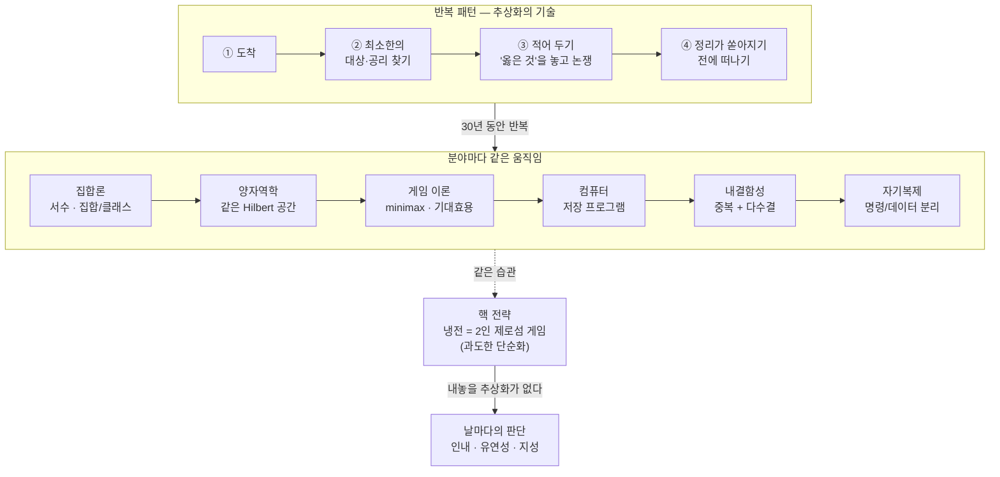
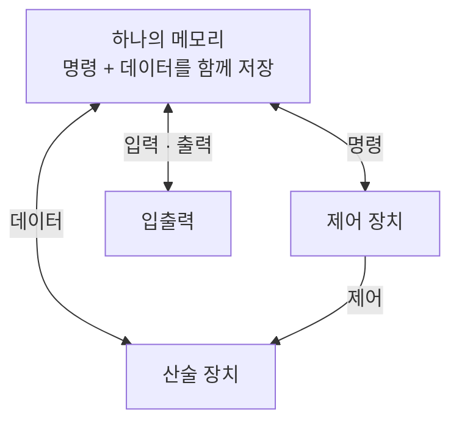

<figure class="post-figure post-figure--header">
<svg role="img" aria-labelledby="vn-h-title vn-h-desc" viewBox="0 0 720 350" xmlns="http://www.w3.org/2000/svg" xmlns:xlink="http://www.w3.org/1999/xlink">
  <title id="vn-h-title">하나의 열쇠, 여섯 개의 문</title>
  <desc id="vn-h-desc">아래쪽에 서 있는 한 사람이 '가장 작은 추상화'라는 금빛 열쇠 하나를 들어 올리고 있다. 열쇠에서 뻗어 나간 여섯 갈래 점선이 위쪽에 나란히 선 여섯 개의 문, 곧 집합론·양자역학·게임 이론·컴퓨터·내결함성·자기복제로 이어지고, 모든 문의 열쇠 구멍에는 같은 모양의 열쇠가 그려져 있다.</desc>
  <defs>
    <symbol id="vn-h-key" viewBox="-8 -8 40 16" overflow="visible">
      <circle cx="0" cy="0" r="6" fill="none" stroke="var(--gold)" stroke-width="2.5"/>
      <path d="M6 0 H28 M20 0 V6 M25 0 V5" fill="none" stroke="var(--gold)" stroke-width="2.5" stroke-linecap="round"/>
    </symbol>
    <marker id="vn-h-arrow" markerWidth="9" markerHeight="9" refX="7" refY="4" orient="auto" markerUnits="userSpaceOnUse">
      <path d="M0 0 L8 4 L0 8 Z" fill="var(--gold)"/>
    </marker>
  </defs>

  <!-- six doors -->
  <text x="85" y="30" text-anchor="middle" font-size="13" font-weight="700" fill="currentColor">집합론</text>
  <path d="M50 144 V79 A35 35 0 0 1 120 79 V144 Z" fill="var(--bg-light)" stroke="var(--border-color)" stroke-width="2"/>
  <path d="M58 144 V81 A27 27 0 0 1 112 81 V144" fill="none" stroke="var(--border-color)" stroke-width="1" opacity="0.6"/>
  <use href="#vn-h-key" xlink:href="#vn-h-key" x="67" y="98" width="40" height="16"/>
  <text x="85" y="162" text-anchor="middle" font-size="11" fill="var(--text-light)">서수 · 타입</text>
  <text x="195" y="30" text-anchor="middle" font-size="13" font-weight="700" fill="currentColor">양자역학</text>
  <path d="M160 144 V79 A35 35 0 0 1 230 79 V144 Z" fill="var(--bg-light)" stroke="var(--border-color)" stroke-width="2"/>
  <path d="M168 144 V81 A27 27 0 0 1 222 81 V144" fill="none" stroke="var(--border-color)" stroke-width="1" opacity="0.6"/>
  <use href="#vn-h-key" xlink:href="#vn-h-key" x="177" y="98" width="40" height="16"/>
  <text x="195" y="162" text-anchor="middle" font-size="11" fill="var(--text-light)">Hilbert 공간</text>
  <text x="305" y="30" text-anchor="middle" font-size="13" font-weight="700" fill="currentColor">게임 이론</text>
  <path d="M270 144 V79 A35 35 0 0 1 340 79 V144 Z" fill="var(--bg-light)" stroke="var(--border-color)" stroke-width="2"/>
  <path d="M278 144 V81 A27 27 0 0 1 332 81 V144" fill="none" stroke="var(--border-color)" stroke-width="1" opacity="0.6"/>
  <use href="#vn-h-key" xlink:href="#vn-h-key" x="287" y="98" width="40" height="16"/>
  <text x="305" y="162" text-anchor="middle" font-size="11" fill="var(--text-light)">minimax</text>
  <text x="415" y="30" text-anchor="middle" font-size="13" font-weight="700" fill="currentColor">컴퓨터</text>
  <path d="M380 144 V79 A35 35 0 0 1 450 79 V144 Z" fill="var(--bg-light)" stroke="var(--border-color)" stroke-width="2"/>
  <path d="M388 144 V81 A27 27 0 0 1 442 81 V144" fill="none" stroke="var(--border-color)" stroke-width="1" opacity="0.6"/>
  <use href="#vn-h-key" xlink:href="#vn-h-key" x="397" y="98" width="40" height="16"/>
  <text x="415" y="162" text-anchor="middle" font-size="11" fill="var(--text-light)">저장 프로그램</text>
  <text x="525" y="30" text-anchor="middle" font-size="13" font-weight="700" fill="currentColor">내결함성</text>
  <path d="M490 144 V79 A35 35 0 0 1 560 79 V144 Z" fill="var(--bg-light)" stroke="var(--border-color)" stroke-width="2"/>
  <path d="M498 144 V81 A27 27 0 0 1 552 81 V144" fill="none" stroke="var(--border-color)" stroke-width="1" opacity="0.6"/>
  <use href="#vn-h-key" xlink:href="#vn-h-key" x="507" y="98" width="40" height="16"/>
  <text x="525" y="162" text-anchor="middle" font-size="11" fill="var(--text-light)">다수결 투표</text>
  <text x="635" y="30" text-anchor="middle" font-size="13" font-weight="700" fill="currentColor">자기복제</text>
  <path d="M600 144 V79 A35 35 0 0 1 670 79 V144 Z" fill="var(--bg-light)" stroke="var(--border-color)" stroke-width="2"/>
  <path d="M608 144 V81 A27 27 0 0 1 662 81 V144" fill="none" stroke="var(--border-color)" stroke-width="1" opacity="0.6"/>
  <use href="#vn-h-key" xlink:href="#vn-h-key" x="617" y="98" width="40" height="16"/>
  <text x="635" y="162" text-anchor="middle" font-size="11" fill="var(--text-light)">명령/데이터</text>

  <!-- six paths from the one key -->
  <g fill="none" stroke="var(--gold)" stroke-width="2" stroke-dasharray="6 5">
    <path d="M358 226 C 358 196, 85 222, 85 176" marker-end="url(#vn-h-arrow)"/>
    <path d="M358 226 C 358 196, 195 222, 195 176" marker-end="url(#vn-h-arrow)"/>
    <path d="M358 226 C 358 196, 305 222, 305 176" marker-end="url(#vn-h-arrow)"/>
    <path d="M358 226 C 358 196, 415 222, 415 176" marker-end="url(#vn-h-arrow)"/>
    <path d="M358 226 C 358 196, 525 222, 525 176" marker-end="url(#vn-h-arrow)"/>
    <path d="M358 226 C 358 196, 635 222, 635 176" marker-end="url(#vn-h-arrow)"/>
  </g>

  <!-- generic figure raising the key (no likeness) -->
  <circle cx="326" cy="276" r="11" fill="var(--bg-panel)" stroke="currentColor" stroke-width="2"/>
  <path d="M326 287 V318 M326 296 L352 262 M326 296 L308 310 M326 318 L316 340 M326 318 L336 340" fill="none" stroke="currentColor" stroke-width="2" stroke-linecap="round"/>
  <g transform="translate(358 266) rotate(-90)">
    <use href="#vn-h-key" xlink:href="#vn-h-key" x="0" y="-8" width="40" height="16"/>
  </g>
  <text x="384" y="270" font-size="15" font-weight="700" fill="var(--accent-color)">가장 작은 추상화</text>
  <text x="384" y="290" font-size="11" fill="var(--text-light)">같은 방식으로 동작하는 가장 작은 것</text>
</svg>
<figcaption>하나의 열쇠, 여섯 개의 문 — 폰 노이만은 분야마다 '같은 방식으로 동작하는 가장 작은 것'을 찾아 문을 열었다.</figcaption>
</figure>

## 원문 정보

> - **제목**: The Man from the Future: Why Johnny Can't Stop Abstracting
> - **출처**: Murat Demirbas, *Metadata* 블로그 ([muratbuffalo.blogspot.com](https://muratbuffalo.blogspot.com/))
> - **발행**: 2026-10-26 · 약 15분 분량
> - **원문 링크**: <https://muratbuffalo.blogspot.com/2026/10/the-man-from-future-why-johnny-cant.html>

분산 시스템·형식 검증(TLA+) 쪽에서 오래 글을 써 온 Murat Demirbas가 Ananyo Bhattacharya의 전기 *The Man from the Future: The Visionary Life of John von Neumann*을 오디오북으로 듣고 쓴 **서평 겸 에세이**다. 이 포스트에서는 두 층을 나눠서 다룬다. 하나는 **책(Bhattacharya)이 전하는 사실과 해석**이고, 다른 하나는 **블로그 저자(Demirbas)가 덧붙인 관점**, 곧 "폰 노이만의 진짜 초능력은 추상화였다"는 해석이다. 엔지니어링 역사와 인물을 다루는 글이라 `Engineering-Culture`에 둔다.

## 한 줄 요약 (TL;DR)

폰 노이만은 분야를 옮겨 다니며 늘 같은 일을 했다. 모두가 안다고 생각하는 대상을 **같은 방식으로 동작하는 가장 작은 것**으로 바꿔 쓰고, 다들 제대로 된 문제를 놓고 논쟁할 수 있게 만든 뒤 떠났다. Demirbas는 이 "추상화의 기술"이 현대 컴퓨팅과 내결함성의 토대를 놓았지만, 냉전을 2인 제로섬 게임으로 단순화했을 때는 끔찍한 결론(선제 핵공격)으로 이어졌다고 본다. 말년의 폰 노이만이 기술의 위험 앞에서 내놓은 답은 추상화가 아니라 "날마다 내리는 지적인 판단"이었다.

## 왜 이 글을 골랐나

- **우리가 매일 쓰는 개념의 기원이 한 사람에게 몰려 있다.** 저장 프로그램 아키텍처, Monte Carlo, 의사난수, 다수결 투표 기반 내결함성, 셀룰러 오토마타가 모두 폰 노이만에게서 나왔다. Demirbas는 특히 1952년 강연 "신뢰할 수 없는 부품으로 신뢰할 수 있는 유기체를 합성하기"를 복제 상태 머신·쿼럼·Paxos의 뿌리로 짚는데, 분산 시스템을 공부하는 독자에게는 계보를 정리할 좋은 기회다.
- **"추상화"를 다루는 위키의 다른 글들과 이어진다.** [잘못된 추상화](/2026/06/22/the-wrong-abstraction.html)는 추상화의 비용을, [LLM이 가져온 새로운 추상화](/2026/07/06/llms-new-nature-of-abstraction.html)는 추상화의 방향을 다뤘다. 이 글은 추상화가 가장 잘 먹혔던 사례와, 모델이 너무 단순할 때 무슨 일이 생기는지를 한 인물의 생애로 보여 준다.
- **결말이 AI 시대의 논쟁과 겹친다.** 1955년 에세이 "Can We Survive Technology?"에서 폰 노이만은 위험한 기술을 금지하는 방식은 통하지 않는다고 주장했다. 오늘날의 AI 감속 논쟁과 나란히 읽을 만하다.

## 핵심 내용

### 한눈에 보기

Demirbas가 읽어 낸 폰 노이만의 반복 패턴과, 그 패턴이 통했던 분야·빗나간 지점을 한 장으로 정리하면 이렇다.

### 서문: 사고에 중독된 사람

글은 폰 노이만 장례식에서 Edward Teller가 한 추도사로 시작한다. "대부분의 사람에게 생각하는 일은 고통스러운 것 같다. 우리 중 몇은 생각에 중독되어 있다. … 조니는 생각을 즐겼다. 그가 그것 말고는 거의 아무것도 즐기지 않았다는 의심마저 든다."

Demirbas는 53년 생애(1903–1957) 동안 폰 노이만이 씨앗을 뿌린 분야를 늘어놓는다. 집합론과 수학 기초, 양자역학의 수학적 정식화, 작용소 대수(지금도 von Neumann algebra라 부른다), 에르고드 이론, 게임 이론, 기대효용 이론(현대 수리경제학의 기초), Monte Carlo 방법, 저장 프로그램 컴퓨터 아키텍처, 수치 일기예보, 내결함성 컴퓨팅, 자기복제 오토마타. 그리고 Watson과 Crick보다 4년 앞서 내놓은, 분자생물학의 논리 구조라 할 만한 아이디어까지 있다. 저자는 나가사키 원폭의 내폭 렌즈와 10년에 걸친 매파적 핵 전략도 "불행히도" 이 목록에 들어간다고 덧붙인다.

### 어린 시절: 저녁 식탁 세미나와 언어 교육

책이 전하는 일화들이다.

- 여섯 살에 여덟 자리 수 나눗셈을 암산하고 고대 그리스어로 대화했다. 나중에 라틴어, 프랑스어, 독일어, 영어, 이디시어를 더 익혔다. Herman Goldstine이 기억력을 시험하려고 『두 도시 이야기』를 외워 보라고 하자, 1장부터 시작해 15분 뒤에 그만하라는 말을 들어야 했다.
- 1900년 무렵 부다페스트에서는 Wigner, Teller, Szilard, Erdős, von Kármán, Pólya가 함께 나왔다. 로스앨러모스에서 이들이 서로 고등학교 동문인 걸 알게 되자 Szilard는 "헝가리는 화성인 착륙을 가리려는 위장"이라고 농담했다. 노벨상 수상자인 Wigner는 헝가리 현상을 설명해 달라는 질문에 "설명할 가치가 있는 현상은 하나뿐이고, 그건 존 폰 노이만"이라고 답했다. 저자는 이 집단이 생각만큼 신비롭지는 않다고 본다. 부다페스트는 유대인 가정을 진심으로 받아들이던 몇 안 되는 유럽 도시였고, 귀족이 하찮게 여기던 수학 같은 전문직으로 그들을 이끌었다. 그다음은 전국 수학 경시대회와 뛰어난 고등학교 교사들이 맡았다.

Demirbas가 교육 관점에서 눈여겨본 것은 다음 네 가지다.

1. **저녁 식탁.** 변호사였다가 은행가가 된 아버지 Miksa(Max)는 저녁 식사를 세미나처럼 운영했다. 아버지가 먼저 자기 하루를 이야기하고, 세 아들이 각자 읽은 것을 발표하고, 온 가족이 하이네의 시나 유럽의 반유대주의, 전능의 역설을 놓고 토론했다. 사업 고객을 데려오면 아이들은 그들에게 무엇에 투자받고 싶은지 마음껏 캐물을 수 있었다.
2. **언어.** Max는 좋은 시절이 끝날 수 있다고 아들들에게 분명히 말했고, 어디서든 어떤 언어로든 살아남게 하려 했다. 망명을 대비시킨 셈이다. 그 예상은 맞았다. 존이 열다섯 살 때 공산주의자들이 집권해 부유층을 겨냥했고, 몇 달 뒤 반혁명 세력은 협력했다는 구실로 유대인 수천 명을 학살했다. 가족은 적절한 때에 나라를 떠나서, 그리고 아마도 충분히 부유해서 살아남았다.
3. **정규 교육 없는 첫 10년.** 가정교사와 아버지의 거대한 서재가 학교를 대신했다. 그는 44권짜리 독일어 세계사를 외웠고, 나중에 파티에서 사람들을 놀래는 데 썼다.
4. **Szegő의 개인 지도.** 열한 살에 Fasori Gymnasium에 들어가자 수학 교사 László Rátz는 이 아이를 자기가 가르칠 수 없다고 판단하고 개인 교사를 붙였다. 그 교사가 훗날 Stanford 수학과 학과장이 되는 Gábor Szegő였고, 첫 수업 뒤 눈물을 흘렸다고 전해진다.

### 추상화라는 초능력 (Demirbas의 핵심 해석)

열일곱 살의 폰 노이만은 **서수(ordinal)를 새로 정의**했다. 각 수는 그보다 앞선 모든 수의 집합이다. 0은 공집합, 1은 {0}, 2는 {0, 1}, 이런 식으로 무한 서수까지 공집합과 중괄호만으로 쌓아 올린다. Demirbas는 이것을 "생성자 하나짜리 귀납적 데이터 타입"이라 부르며, 아주 컴퓨터 과학다운 정의라고 말한다.

박사 논문에서는 이 방향을 더 밀고 나갔다. 당시 집합론은 러셀의 역설(자기 자신을 원소로 갖지 않는 모든 집합의 집합) 같은 문제에 시달리고 있었다. 폰 노이만의 해법은 사실상 **집합을 위한 타입 시스템**이었다. 다른 집합의 원소가 될 수 있는 보통 집합과, 이야기할 수는 있지만 원소로는 쓸 수 없는 지나치게 큰 집합을 나눈다. 그러면 역설은 **타입 에러**가 된다.

<figure class="post-figure">
<svg role="img" aria-labelledby="vn-o-title vn-o-desc" viewBox="0 0 720 290" xmlns="http://www.w3.org/2000/svg">
  <title id="vn-o-title">공집합으로 쌓는 서수, 그리고 타입 에러가 된 러셀의 역설</title>
  <desc id="vn-o-desc">왼쪽: 0은 빈 상자, 1은 빈 상자 하나를 담은 상자, 2는 빈 상자와 1의 상자를 함께 담은 상자로, 각 수가 앞선 모든 수의 집합으로 중첩되어 쌓인다. 오른쪽: 다른 집합의 원소가 될 수 있는 '집합' 칸과 원소가 될 수 없는 지나치게 큰 '클래스' 칸이 나뉘어 있고, 자기 자신을 원소로 갖지 않는 모든 집합의 모임을 집합 칸에 원소로 넣으려는 화살표가 막혀 타입 에러로 튕겨 나간다.</desc>
  <defs>
    <marker id="vn-o-arrow" markerWidth="9" markerHeight="9" refX="7" refY="4" orient="auto" markerUnits="userSpaceOnUse">
      <path d="M0 0 L8 4 L0 8 Z" fill="var(--text-light)"/>
    </marker>
  </defs>

  <!-- LEFT: von Neumann ordinals as nested boxes -->
  <text x="195" y="30" text-anchor="middle" font-size="14" font-weight="700" fill="currentColor">서수: 각 수 = 앞선 모든 수의 집합</text>
  <text x="195" y="50" text-anchor="middle" font-size="11" fill="var(--text-light)">공집합과 중괄호만으로 — 생성자 하나짜리 귀납적 데이터 타입</text>

  <!-- 0 = {} -->
  <rect x="40" y="128" width="44" height="44" rx="5" fill="var(--bg-light)" stroke="var(--accent-color)" stroke-width="2"/>
  <!-- 1 = {0} -->
  <rect x="112" y="112" width="76" height="76" rx="7" fill="var(--bg-light)" stroke="var(--secondary-color)" stroke-width="2"/>
  <rect x="138" y="138" width="24" height="24" rx="4" fill="var(--bg-panel)" stroke="var(--accent-color)" stroke-width="2"/>
  <!-- 2 = {0, 1} -->
  <rect x="214" y="96" width="150" height="108" rx="9" fill="var(--bg-light)" stroke="var(--gold)" stroke-width="2.5"/>
  <rect x="230" y="138" width="24" height="24" rx="4" fill="var(--bg-panel)" stroke="var(--accent-color)" stroke-width="2"/>
  <rect x="270" y="112" width="76" height="76" rx="7" fill="var(--bg-panel)" stroke="var(--secondary-color)" stroke-width="2"/>
  <rect x="296" y="138" width="24" height="24" rx="4" fill="var(--bg-light)" stroke="var(--accent-color)" stroke-width="2"/>

  <g font-size="13" font-weight="700" text-anchor="middle" fill="currentColor">
    <text x="62" y="228">0 = { }</text>
    <text x="150" y="228">1 = {0}</text>
    <text x="289" y="228">2 = {0, 1}</text>
  </g>
  <text x="195" y="258" text-anchor="middle" font-size="11" fill="var(--text-light)">3 = {0, 1, 2} … 무한 서수까지 같은 규칙</text>

  <!-- divider -->
  <path d="M392 24 V266" stroke="var(--border-color)" stroke-width="1.5" stroke-dasharray="4 5"/>

  <!-- RIGHT: a type system for sets -->
  <text x="556" y="30" text-anchor="middle" font-size="14" font-weight="700" fill="currentColor">집합을 위한 타입 시스템</text>

  <rect x="412" y="62" width="140" height="132" rx="8" fill="var(--bg-light)" stroke="var(--secondary-color)" stroke-width="2"/>
  <text x="482" y="84" text-anchor="middle" font-size="13" font-weight="700" fill="var(--secondary-color)">집합</text>
  <text x="482" y="100" text-anchor="middle" font-size="10.5" fill="var(--text-light)">원소가 될 수 있음</text>
  <g fill="var(--bg-panel)" stroke="currentColor" stroke-width="1.5">
    <circle cx="446" cy="130" r="8"/>
    <circle cx="478" cy="148" r="8"/>
    <circle cx="512" cy="126" r="8"/>
    <circle cx="452" cy="170" r="8"/>
  </g>

  <rect x="572" y="62" width="132" height="132" rx="8" fill="var(--bg-light)" stroke="var(--accent-color)" stroke-width="2"/>
  <text x="638" y="84" text-anchor="middle" font-size="13" font-weight="700" fill="var(--accent-color)">클래스</text>
  <text x="638" y="100" text-anchor="middle" font-size="10.5" fill="var(--text-light)">원소가 될 수 없음</text>
  <circle cx="638" cy="148" r="30" fill="var(--bg-panel)" stroke="var(--accent-color)" stroke-width="2.5"/>
  <text x="638" y="145" text-anchor="middle" font-size="10.5" fill="currentColor">지나치게</text>
  <text x="638" y="159" text-anchor="middle" font-size="10.5" fill="currentColor">큰 모임</text>

  <!-- Russell's collection tries to become an element and is rejected -->
  <path d="M624 176 C 600 236, 540 236, 524 186" fill="none" stroke="var(--text-light)" stroke-width="2" stroke-dasharray="5 4" marker-end="url(#vn-o-arrow)"/>
  <g stroke="var(--accent-color)" stroke-width="3" stroke-linecap="round">
    <path d="M536 160 L552 176 M552 160 L536 176"/>
  </g>
  <rect x="470" y="226" width="172" height="26" rx="5" fill="var(--bg-panel)" stroke="var(--accent-color)" stroke-width="2"/>
  <text x="556" y="244" text-anchor="middle" font-size="12" font-weight="700" fill="var(--accent-color)">원소로 넣기 → 타입 에러</text>
  <text x="556" y="274" text-anchor="middle" font-size="10.5" fill="var(--text-light)">러셀의 역설: 자기 자신을 원소로 갖지 않는 모든 집합의 모임</text>
</svg>
<figcaption>서수는 공집합을 겹겹이 담아 쌓고(왼쪽), 집합/클래스 구분은 러셀의 역설을 타입 에러로 바꾼다(오른쪽).</figcaption>
</figure>

Demirbas는 두 경우 모두 같은 움직임이라고 본다. **모두가 안다고 생각하는 대상을 같은 방식으로 동작하는 가장 작은 것으로 바꾼다.** 그리고 폰 노이만이 이후 30년 동안 분야를 옮겨 다니며 같은 일을 했다고 말한다. 도착하고, 뒤엉킨 문제가 실제로 다루는 최소한의 대상과 공리를 찾고, 그것을 적어서 모두가 마침내 옳은 것을 놓고 논쟁할 수 있게 만들고, 정리들이 쏟아지기 전에 떠난다. Teller는 조니가 생각하기를 즐겼다고 했지만, Demirbas는 그 중독이 훨씬 특정한 것, 곧 **추상화의 기술**이었다고 본다. 그가 이전에 쓴 글 "Beyond Code: TLA+ and the Art of Abstraction"과 이어지는 관점이다.

이 관점으로 서문의 목록을 다시 보면 이렇다.

- 행렬역학과 파동역학은 서로 경쟁하는 이론처럼 보였지만, 폰 노이만은 둘이 **같은 Hilbert 공간 위의 두 좌표계**라는 것을 알아챘다.
- 경제학자들은 사람들 사이의 선호를 비교할 수 없다고 여겼지만, 그는 선택하는 사람이 지켜야 할 **최소한의 일관성 공리**가 무엇인지 묻고, 거기서 기수적 효용 척도를 오후 한나절 만에 끌어냈다.
- 자기복제에는 설계도의 무한 재귀가 필요해 보였지만, 그는 **"테이프를 명령으로 읽기"와 "테이프를 데이터로 복사하기"**를 분리했다.

### 양자역학을 엄밀하게 만들다

박사 학위를 21세에 마치고 22세에 Hilbert가 있던 Göttingen에 갔다. 한 살 위인 Heisenberg가 막 행렬역학을 내놓았고, 1년 뒤 Schrödinger가 빈에서 파동역학을 발표했다. 두 이론은 같은 답을 내면서도 실재에 대해서는 전혀 다른 그림을 그렸다. 폰 노이만은 먼저 둘이 같은 이론의 다른 형태임을 증명했고, 이어 『Mathematical Foundations of Quantum Mechanics』(1932)에서 Hilbert 공간 위에 이론 전체를 엄밀하게 세웠다. 학부에서 물리학을 전공한 Bhattacharya는 이것이 지금도 가장 빈틈없는 정식화라고 짚는다.

수학이 깔끔해지자 측정 문제가 더 잘 보이게 됐다. 파동함수는 어디서 붕괴하는가? 장치, 검출기, 망막, 아니면 의식 있는 관찰자? 폰 노이만은 입장을 정하지 않았지만, 선을 어디에 긋든 수학적으로 결과가 같다는 것을 증명했다. 그 선이 지금 von Neumann cut이라 불린다.

### 게임 이론과 경제학

- **Minimax 정리(1928).** 모든 2인 제로섬 게임에는 해가 있다. 한쪽이 이길 수 있는 전략이 있거나, 가위바위보처럼 무작위성을 섞은 혼합 전략이 있다. 증명한 뒤 그는 늘 그랬듯 흥미를 잃고 떠났다.
- **Morgenstern과의 공동 작업.** 경제학자 Oskar Morgenstern은 Demirbas의 표현을 빌리면 경제 모델링의 **liveness 버그**에 막혀 있었다. 경제에 개입하면 사람들이 행동을 바꾸고, 그러면 개입을 설계할 때 쓴 모델이 무효가 된다. 새 모델을 만들면 사람들은 또 적응한다. 무한 루프다. 두 사람은 약 18개월 만에 600쪽짜리 『Theory of Games and Economic Behavior』(1944)를 내며 분야를 세웠다. 폰 노이만에게는 이것이 취미였다. 같은 기간 그는 로스앨러모스에서 내폭 렌즈를 설계하고 최초의 프로그래밍 가능한 컴퓨터를 만들고 있었다.
- **지금도 곳곳에 남은 두 가지.** 첫째는 기대효용의 공리화다. Demirbas는 이것이 최근 자신이 정리한 Cal Newport와 Émile Torres의 대화 속 장기주의(longtermism) 논의와 "불편하게 연결된다"며 "기댓값 수학은 지독한 마약"이라고 쓴다. 둘째는 모델의 한계다. 그의 틀은 제로섬 게임과 연합(n명 중 어떤 연합이 안정적인가)에 맞춰져 있었지만, 세상의 많은 부분은 제로섬이 아니다. 그것을 연 것은 minimax를 일반화한 Nash의 비협조 균형이었는데, 폰 노이만은 Nash가 연구실에 찾아왔을 때 단번에 꿰뚫어 보이는 고정점 논증에 불과하다며 사실상 퇴짜를 놓았다. 그 중요성을 잘못 판단한 것이다.
- **책이 짚는 아이러니.** 냉전 매파이자 Dr. Strangelove의 모델로 알려진 폰 노이만은 사람들이 서로 대화하며 협력 연합을 이루는 이론을 만들었고, 사람을 대하기 어려워했던 Nash는 모두가 혼자 최적화하는 상황을 형식화했다. Demirbas는 "모든 모델은 틀렸지만 어떤 모델은 쓸모 있다"로 이 단락을 맺는다.

### 컴퓨터

1944년 Aberdeen의 기차 승강장에서 Herman Goldstine을 만나 ENIAC 이야기를 듣고 프로젝트에 합류했다. 1945년에는 「First Draft of a Report on the EDVAC」을 써서 **저장 프로그램 아키텍처**를 정리했다. 명령과 데이터를 함께 담는 하나의 메모리, 제어 장치, 산술 장치, 입출력으로 이루어진 구조이고, 80년이 지난 지금 데스크톱부터 스마트폰까지 거의 모든 컴퓨터가 이 구조를 따른다.

EDVAC 초안이 정리한 구조를 블록으로 그리면, 명령과 데이터를 함께 담는 메모리 하나가 중심에 놓인다.

- **오픈 소스의 선구자.** 그는 기술 세부를 공공 영역에 두어야 한다고 고집했고, 초안을 돌린 일 때문에 아키텍처는 특허를 낼 수 없게 됐다. IAS 머신 설계도 같은 식으로 공개되어 전 세계에서 복제됐고, MANIAC(Los Alamos), JOHNNIAC(RAND), ILLIAC(Illinois), SILLIAC(Sydney), WEIZAC(이스라엘) 같은 우스꽝스러운 이름의 기계들이 나왔다. Demirbas는 냉혹한 합리주의 매파로 그려지는 사람이 컴퓨팅 산업의 기초 설계를 일부러 공유지에 내놓은 것은 너그러운 행동이었다고 평한다.
- **Monte Carlo와 의사난수.** Ulam과 함께 Monte Carlo 방법을 고안했고, 거기 필요한 난수를 얻으려고 의사난수 생성까지 만들어야 했다.
- **첫 본격 응용.** IAS 기상학 프로젝트가 1950년에 최초의 컴퓨터 일기예보를 돌렸다. 수치 일기예보와, 더 나아가 기후 모델링도 폰 노이만에게서 시작됐다.

### 신뢰할 수 없는 부품으로 신뢰할 수 있는 유기체를

1952년 Caltech 강연 시리즈의 제목은 "Probabilistic Logics and the Synthesis of Reliable Organisms from Unreliable Components"였다. 당시 진공관은 끊임없이 고장 났고, 공학의 일반적인 대응은 더 좋은 진공관을 만드는 것이었다. 폰 노이만은 반드시 고장 나는 부품으로 **임의로 높은 신뢰성**을 가진 기계를 만들 수 있는지 물었다. 방법은 중복과 다수결 투표였고, 그는 중복이 실제로 얼마나 필요한지도 계산했다. Demirbas는 이것을 내결함성 컴퓨팅의 출발점 중 하나로 보고, **복제 상태 머신, 쿼럼, Paxos**가 여기서 나왔다고 말한다.

<figure class="post-figure">
<svg role="img" aria-labelledby="vn-f-title vn-f-desc" viewBox="0 0 720 280" xmlns="http://www.w3.org/2000/svg">
  <title id="vn-f-title">고장 나는 부품으로 신뢰할 수 있는 출력을 합성하기</title>
  <desc id="vn-f-desc">왼쪽: 고장 날 수 있는 같은 부품 세 개가 나란히 있고 그중 가운데 하나에 X 표시가 있다. 세 출력이 다수결 투표기로 모이고, 고장 난 하나가 틀린 값을 내도 다수결로 올바른 출력 하나가 나간다. 오른쪽: 1952년 진공관 시대의 이 아이디어에서 복제 상태 머신, 쿼럼, Paxos로 이어지는 계보가 위에서 아래로 화살표로 이어진다.</desc>
  <defs>
    <marker id="vn-f-arrow" markerWidth="9" markerHeight="9" refX="7" refY="4" orient="auto" markerUnits="userSpaceOnUse">
      <path d="M0 0 L8 4 L0 8 Z" fill="currentColor"/>
    </marker>
    <marker id="vn-f-gold" markerWidth="9" markerHeight="9" refX="7" refY="4" orient="auto" markerUnits="userSpaceOnUse">
      <path d="M0 0 L8 4 L0 8 Z" fill="var(--gold)"/>
    </marker>
  </defs>

  <text x="250" y="28" text-anchor="middle" font-size="14" font-weight="700" fill="currentColor">중복 + 다수결 → 임의로 높은 신뢰성</text>

  <!-- three unreliable components -->
  <g font-size="12" text-anchor="middle">
    <rect x="30" y="54" width="120" height="46" rx="6" fill="var(--bg-light)" stroke="var(--border-color)" stroke-width="2"/>
    <text x="90" y="74" font-weight="700" fill="currentColor">부품 A</text>
    <text x="90" y="90" font-size="10.5" fill="var(--text-light)">고장 날 수 있음</text>

    <rect x="30" y="122" width="120" height="46" rx="6" fill="var(--bg-light)" stroke="var(--accent-color)" stroke-width="2" stroke-dasharray="5 3"/>
    <text x="90" y="142" font-weight="700" fill="currentColor">부품 B</text>
    <text x="90" y="158" font-size="10.5" fill="var(--accent-color)">고장</text>

    <rect x="30" y="190" width="120" height="46" rx="6" fill="var(--bg-light)" stroke="var(--border-color)" stroke-width="2"/>
    <text x="90" y="210" font-weight="700" fill="currentColor">부품 C</text>
    <text x="90" y="226" font-size="10.5" fill="var(--text-light)">고장 날 수 있음</text>
  </g>
  <g stroke="var(--accent-color)" stroke-width="3" stroke-linecap="round">
    <path d="M128 128 L144 144 M144 128 L128 144"/>
  </g>

  <!-- outputs into the voter -->
  <g fill="none" stroke="currentColor" stroke-width="2">
    <path d="M150 77 C 200 77, 200 130, 244 136" marker-end="url(#vn-f-arrow)"/>
    <path d="M150 213 C 200 213, 200 160, 244 154" marker-end="url(#vn-f-arrow)"/>
  </g>
  <path d="M150 145 H244" fill="none" stroke="var(--accent-color)" stroke-width="2" stroke-dasharray="5 4" marker-end="url(#vn-f-arrow)"/>
  <g font-size="12" font-weight="700" text-anchor="middle">
    <text x="196" y="92" fill="currentColor">1</text>
    <text x="196" y="139" fill="var(--accent-color)">0</text>
    <text x="196" y="207" fill="currentColor">1</text>
  </g>

  <rect x="248" y="112" width="96" height="66" rx="8" fill="var(--bg-panel)" stroke="var(--gold)" stroke-width="2.5"/>
  <text x="296" y="140" text-anchor="middle" font-size="13" font-weight="700" fill="currentColor">다수결</text>
  <text x="296" y="158" text-anchor="middle" font-size="13" font-weight="700" fill="currentColor">투표기</text>

  <path d="M344 145 H390" fill="none" stroke="var(--secondary-color)" stroke-width="2.5" marker-end="url(#vn-f-arrow)"/>
  <rect x="394" y="120" width="90" height="50" rx="6" fill="var(--bg-light)" stroke="var(--secondary-color)" stroke-width="2"/>
  <text x="439" y="141" text-anchor="middle" font-size="12" font-weight="700" fill="var(--secondary-color)">올바른 출력</text>
  <text x="439" y="159" text-anchor="middle" font-size="13" font-weight="700" fill="currentColor">1</text>

  <text x="250" y="266" text-anchor="middle" font-size="11" fill="var(--text-light)">더 좋은 부품 대신, 고장을 전제로 두고 중복이 얼마나 필요한지 계산한다</text>

  <!-- divider -->
  <path d="M512 24 V262" stroke="var(--border-color)" stroke-width="1.5" stroke-dasharray="4 5"/>

  <!-- lineage (Demirbas) -->
  <text x="614" y="28" text-anchor="middle" font-size="13" font-weight="700" fill="currentColor">계보 (Demirbas)</text>
  <g font-size="12" font-weight="700" text-anchor="middle" fill="currentColor">
    <rect x="540" y="44" width="148" height="36" rx="6" fill="var(--bg-light)" stroke="var(--gold)" stroke-width="2"/>
    <text x="614" y="60">진공관 시대 (1952)</text>
    <text x="614" y="74" font-size="10" font-weight="400" fill="var(--text-light)">Caltech 강연</text>
    <rect x="540" y="104" width="148" height="32" rx="6" fill="var(--bg-light)" stroke="var(--border-color)" stroke-width="2"/>
    <text x="614" y="125">복제 상태 머신</text>
    <rect x="540" y="160" width="148" height="32" rx="6" fill="var(--bg-light)" stroke="var(--border-color)" stroke-width="2"/>
    <text x="614" y="181">쿼럼</text>
    <rect x="540" y="216" width="148" height="32" rx="6" fill="var(--bg-light)" stroke="var(--border-color)" stroke-width="2"/>
    <text x="614" y="237">Paxos</text>
  </g>
  <g fill="none" stroke="var(--gold)" stroke-width="2">
    <path d="M614 80 V100" marker-end="url(#vn-f-gold)"/>
    <path d="M614 136 V156" marker-end="url(#vn-f-gold)"/>
    <path d="M614 192 V212" marker-end="url(#vn-f-gold)"/>
  </g>
</svg>
<figcaption>부품을 더 좋게 만드는 대신 중복과 다수결로 신뢰성을 합성한다 — Demirbas는 이 발상을 복제 상태 머신·쿼럼·Paxos의 뿌리로 본다.</figcaption>
</figure>

### 자기복제 오토마타

1940년대 후반 폰 노이만은 기계가 자기 사본을 만들려면 무엇이 필요한지 묻기 시작했다. 순진하게 생각하면 무한 재귀에 빠진다. 기계에는 자기 설계도가 있어야 하고, 그 설계도에는 설계도의 설계도가 들어 있어야 하고, 그렇게 끝없이 내려간다. Ulam의 제안으로 이산 셀룰러 틀 위에서 다듬은 그의 해법은 **기술(description)의 역할을 나누는 것**이었다.

- 범용 생성기(universal constructor)와 그것을 기술하는 테이프가 있다.
- 생성기는 테이프를 **명령**으로 읽어 기술된 기계를 만든다.
- 그다음 테이프를 해석하지 않은 **데이터**로 복사해 자손에게 붙인다.

하나의 기술이 전혀 다른 두 방식으로 두 번 쓰인다. Demirbas는 이것이 EDVAC 3년 뒤에 다시 등장한 저장 프로그램 아이디어라고 짚는다. 같은 비트가 실행할 때는 명령이고 복사할 때는 데이터다.

<figure class="post-figure">
<svg role="img" aria-labelledby="vn-s-title vn-s-desc" viewBox="0 0 720 300" xmlns="http://www.w3.org/2000/svg">
  <title id="vn-s-title">하나의 기술(description), 두 가지 쓰임</title>
  <desc id="vn-s-desc">왼쪽에 범용 생성기와 그것을 기술하는 테이프가 있다. 위쪽 갈래(①)에서 생성기는 테이프를 명령으로 읽어 오른쪽의 자손 기계를 만들고, 아래쪽 갈래(②)에서는 테이프를 해석하지 않은 데이터로 그대로 복사해 자손에게 붙인다. 아래 띠에는 같은 비트가 실행할 때는 명령, 복사할 때는 데이터라는 점이 EDVAC 저장 프로그램 아이디어의 재등장이라고 적혀 있다.</desc>
  <defs>
    <marker id="vn-s-acc" markerWidth="9" markerHeight="9" refX="7" refY="4" orient="auto" markerUnits="userSpaceOnUse">
      <path d="M0 0 L8 4 L0 8 Z" fill="var(--accent-color)"/>
    </marker>
    <marker id="vn-s-sec" markerWidth="9" markerHeight="9" refX="7" refY="4" orient="auto" markerUnits="userSpaceOnUse">
      <path d="M0 0 L8 4 L0 8 Z" fill="var(--secondary-color)"/>
    </marker>
  </defs>

  <!-- parent: universal constructor + tape -->
  <text x="130" y="30" text-anchor="middle" font-size="13" font-weight="700" fill="currentColor">부모</text>
  <rect x="40" y="56" width="180" height="70" rx="8" fill="var(--bg-light)" stroke="var(--border-color)" stroke-width="2"/>
  <text x="130" y="86" text-anchor="middle" font-size="14" font-weight="700" fill="currentColor">범용 생성기</text>
  <text x="130" y="105" text-anchor="middle" font-size="10.5" fill="var(--text-light)">universal constructor</text>
  <path d="M130 126 V146" stroke="var(--border-color)" stroke-width="2"/>
  <g fill="var(--bg-panel)" stroke="var(--gold)" stroke-width="2">
    <rect x="40" y="146" width="30" height="26"/><rect x="70" y="146" width="30" height="26"/>
    <rect x="100" y="146" width="30" height="26"/><rect x="130" y="146" width="30" height="26"/>
    <rect x="160" y="146" width="30" height="26"/><rect x="190" y="146" width="30" height="26"/>
  </g>
  <text x="130" y="190" text-anchor="middle" font-size="11" fill="var(--text-light)">테이프 = 생성기의 기술</text>

  <!-- branch 1: read as instructions -> build offspring -->
  <path d="M220 90 C 300 70, 400 70, 476 88" fill="none" stroke="var(--accent-color)" stroke-width="2.5" marker-end="url(#vn-s-acc)"/>
  <text x="348" y="58" text-anchor="middle" font-size="12.5" font-weight="700" fill="var(--accent-color)">① 명령으로 읽기</text>
  <text x="348" y="100" text-anchor="middle" font-size="10.5" fill="var(--text-light)">기술된 기계를 만든다</text>

  <!-- branch 2: copy as uninterpreted data -> attach -->
  <path d="M220 159 C 300 178, 400 178, 476 161" fill="none" stroke="var(--secondary-color)" stroke-width="2.5" stroke-dasharray="7 4" marker-end="url(#vn-s-sec)"/>
  <text x="348" y="200" text-anchor="middle" font-size="12.5" font-weight="700" fill="var(--secondary-color)">② 데이터로 복사</text>
  <text x="348" y="150" text-anchor="middle" font-size="10.5" fill="var(--text-light)">해석하지 않고 그대로</text>

  <!-- offspring -->
  <text x="590" y="30" text-anchor="middle" font-size="13" font-weight="700" fill="currentColor">자손</text>
  <rect x="500" y="56" width="180" height="70" rx="8" fill="var(--bg-light)" stroke="var(--accent-color)" stroke-width="2"/>
  <text x="590" y="86" text-anchor="middle" font-size="14" font-weight="700" fill="currentColor">자손 기계</text>
  <text x="590" y="105" text-anchor="middle" font-size="10.5" fill="var(--text-light)">테이프가 기술한 기계</text>
  <path d="M590 126 V146" stroke="var(--border-color)" stroke-width="2"/>
  <g fill="var(--bg-panel)" stroke="var(--secondary-color)" stroke-width="2">
    <rect x="500" y="146" width="30" height="26"/><rect x="530" y="146" width="30" height="26"/>
    <rect x="560" y="146" width="30" height="26"/><rect x="590" y="146" width="30" height="26"/>
    <rect x="620" y="146" width="30" height="26"/><rect x="650" y="146" width="30" height="26"/>
  </g>
  <text x="590" y="190" text-anchor="middle" font-size="11" fill="var(--text-light)">복사해 붙인 테이프</text>

  <!-- bottom band: the stored-program idea again -->
  <rect x="40" y="222" width="640" height="62" rx="8" fill="var(--bg-light)" stroke="var(--gold)" stroke-width="2"/>
  <text x="360" y="247" text-anchor="middle" font-size="13" font-weight="700" fill="currentColor">같은 비트 — 실행하면 명령, 복사하면 데이터</text>
  <text x="360" y="270" text-anchor="middle" font-size="11" fill="var(--text-light)">EDVAC(1945) 3년 뒤 다시 등장한 저장 프로그램 아이디어 · 1948–49 발표, DNA 구조(1953)보다 앞서</text>
</svg>
<figcaption>같은 테이프를 ① 명령으로 읽어 자손을 만들고 ② 데이터로 복사해 붙인다 — 설계도의 무한 재귀를 끊는 역할 분리.</figcaption>
</figure>

그는 이 결과를 1948년과 1949년에 발표했고, Watson과 Crick의 DNA 구조는 1953년에 나왔다. Demirbas는 폰 노이만이 순수 논리만으로 생물학적 번식에 필요한 구조를 끌어냈다고 평한다. 저장된 기술이 있어야 하고, 그것이 서로 다른 두 방식으로 읽혀야 하며, 바로 그 분리가 열린 진화(open-ended evolution)를 가능하게 한다는 것이다. 이를 증명하려 만든 29-상태 셀룰러 오토마타는 최초의 셀룰러 오토마타이기도 했고, Conway의 Game of Life, Wolfram의 연구 프로그램, 인공 생명, 합성생물학의 기초가 그 형식 모델에서 나왔다. 『Theory of Self-Reproducing Automata』는 사후인 1966년에 출간됐다.

유작 『The Computer and the Brain』(1958)에서 그는 뇌가 형편없는 산술 정밀도와 엄청난 병렬성으로 일을 해낸다는 점을 관찰했다. 막 만들어 낸 기계와 정반대였다. 그는 신경계가 어떤 언어로 계산하든 그것은 우리가 아는 수학이 아니라고 주장했다. Demirbas는 "우리는 아직도 이 마지막 과제를 풀고 있다"고 덧붙인다.

### 인격: 냉혹함과 너그러움

- 파티와 시끄러운 음악과 빠른 차를 좋아했다. 붐비는 길에서는 난폭하게 몰다가 한적한 길에서는 지루해서 속도를 늦췄다. 거의 해마다 차를 부쉈는데 주로 캐딜락이었다. "아무도 탱크를 팔지 않았으니까." Princeton의 한 교차로는 사고가 하도 많아 Von Neumann Corner라는 이름이 붙었다. 사고 보고서 한 장에는 이렇게 적혀 있다. "길을 따라 가고 있었다. 오른쪽 나무들이 시속 60마일로 질서 정연하게 나를 지나쳐 갔다. 갑자기 그중 하나가 내 앞으로 걸어 나왔다. 쾅!"
- Princeton 연구실에서 독일 행진곡을 크게 틀어 이웃들의 항의를 받았는데, 그 이웃 중에 Einstein이 있었다.
- **냉혹함.** 비판자들은 그를 냉정하고 계산적이며 무자비하다고 했다. 전후에 고뇌한 맨해튼 프로젝트 동료들과 달리 그는 더 큰 수소폭탄을 밀어붙였고, 소련에 즉각 선제 핵공격을 하자고 했다. "왜 내일 폭격하지 않느냐고 하면 나는 왜 오늘은 안 되느냐고 하겠다. 오늘 다섯 시라고 하면 왜 한 시는 안 되느냐고 하겠다." 그것도 원자력위원회 위원으로 있으면서 기자들 앞에서 여러 번 말했다. Demirbas는 이것도 **추상화 습관**에서 나왔다고 본다. 냉전을 2인 제로섬 게임으로 모델링하고, 소련이 곧 폭탄을 갖게 되며 사용할 것이라고 가정하면 minimax는 선제공격을 가리킨다. 수학은 맞지만 모델이 지나치게 단순하다. 20년을 곁에서 일한 Ulam은 최대한 너그럽게 이렇게 말했다. "역사적 사건들에 대해 지나치게 배타적으로 합리적인 관점을 취하는 경향이 아마 있었다."
- **너그러움.** 역설적으로 그는 사람에게 놀라울 만큼 너그러웠다. 유망하다고 본 사람들을 위해서는 무슨 일이든 했고, Turing과 Mandelbrot가 그 덕을 봤다. Princeton이 원하지 않던 흑인 통계학자 David Blackwell을 멘토링하며 받아들일 때까지 밀어붙였다. 정치적 입장이 달랐던 Oppenheimer를 위해 자기 평판을 걸고 증언했다. Teller는 "폰 노이만은 세 살짜리 내 아들과 대등하게 대화했는데, 나머지 우리와 이야기할 때도 같은 원칙을 쓴 게 아닌가 싶었다"고 했다.
- **결말.** 무기 실험장에서 받은 방사선 때문이었을 것으로 보이는 암이 뼈에서 시작해 뇌로 번졌다. 50년 동안 어느 방에서든 가장 빠른 두뇌였던 사람이 그 능력이 사라지는 것을 지켜봐야 했다. Teller는 그가 누구보다 크게 고통받았다고 말했다. Demirbas는 서두의 추도사, 즉 "생각 말고는 즐긴 게 거의 없었다"는 말이 바로 이 가장 잔인한 결말을 위한 복선이었고 Teller도 그걸 알고 말했다고 쓴다. 평생 문화적 유대인 무신론자였던 그는 마지막에 세례를 청했는데, 딸은 이를 Pascal의 내기로 설명했다. 작은 확률로 훨씬 나은 사후 세계를 얻는 데 드는 비용이 사소하다는 계산이다. 끝까지 게임 이론가였던 셈이다.

### 우리는 기술에서 살아남을 수 있는가?

1955년 에세이 "Can We Survive Technology?"는 대부분 핵전쟁을 다루지만 지구 온난화도 언급한다. Ulam의 부고에 따르면 그는 그보다 몇 해 전 대화에서, 기술 진보가 다음을 예측할 수 없을 만큼 가속하는 지점을 가리켜 이미 **"특이점(singularity)"**이라는 말을 썼다.

위험한 기술을 금지하면 되느냐는 물음에 대한 그의 답은 원문 인용으로 전해진다. 요지는 이렇다. 특히 해로워 보이는 기술 하나를 억제하는 것은 "가짜 해법"이다. 기술의 각 부분과 그 밑의 과학은 너무 얽혀 있어서, 길게 보면 기술 진보 전체를 없애지 않는 한 억제가 되지 않는다. 금지가 통하려면 전 세계적이어야 하는데, 발명을 막는 것은 산업 시대의 정신 자체에 어긋나고 어차피 지켜지지도 않을 것이다.

그 대신 그가 내놓는 것은 다음과 같다(원문 인용 요약). 남은 안전장치는 날마다, 혹은 해마다 그때그때 내리는 기회주의적 조치, 곧 **작고 올바른 결정들의 긴 연속**뿐이다. 진보에는 치료법이 없다. 지금의 폭발적 진보를 자동으로 안전한 경로로 흘려보내려는 시도는 좌절로 끝날 수밖에 없다. 가능한 안전은 상대적이며, **날마다 지적인 판단을 내리는 데** 있다. 그리고 필요한 자질로 **"인내, 유연성, 지성"**을 꼽는다.

Demirbas의 결론은 이렇다. 추상화의 대가인 폰 노이만이 여기서는 내놓을 추상화가 없었다. 어쩌면 핵 전략에 minimax를 적용한 경험을 거치며, 가정이 불안하고 걸린 판돈이 문명일 때 형식 모델이 얼마나 쓸모 있는지 배웠을지도 모른다.

## 분석과 인사이트

이 단락부터는 원문 요약이 아니라 이 위키의 관점이다.

### 1. "가장 작은 등가물로 바꾸기"는 엔지니어의 핵심 기술이다

Demirbas가 정리한 패턴(최소한의 대상과 공리를 찾고, 적어서, 옳은 것을 놓고 논쟁하게 만들기)은 소프트웨어 설계와 형식 명세에서 하는 일과 같다. 서수를 "생성자 하나짜리 귀납 타입"으로, 러셀의 역설을 "타입 에러"로 읽는 번역은 비유 이상이다. 좋은 추상화는 문제를 푸는 것만큼이나 **논쟁의 대상을 바로잡는 일**이라는 점을 보여 준다. 설계 리뷰가 엇나가는 흔한 이유는 서로 다른 모델을 머릿속에 둔 채 이야기하기 때문인데, 폰 노이만의 "적어 두기"는 바로 이 문제를 해결한다.

### 2. 추상화의 실패는 모델이 너무 단순한 데서 온다

선제 핵공격 주장에 대한 Demirbas의 진단, "수학은 맞지만 모델이 너무 단순하다"는 이 글에서 가장 날카로운 부분이다. [잘못된 추상화](/2026/06/22/the-wrong-abstraction.html)가 코드 수준에서 경고한 것을 문명 수준으로 키운 사례이기도 하다. 추상화는 무엇을 버릴지 정하는 일이고, 버린 것(상대의 의도, 비제로섬 가능성, 대화로 생기는 협력)이 실제로 결정적이면 증명이 엄밀할수록 오히려 더 위험해진다. Nash 균형을 "사소하다"며 물리친 일화도 같은 맹점을 보여 준다. 자기가 쓰는 틀(제로섬·연합)에 들어맞지 않는 일반화를 낮게 평가한 것이다.

### 3. 분산 시스템의 계보로 읽기

"신뢰할 수 없는 부품으로 신뢰할 수 있는 시스템을"이라는 문제 설정은 [Designing Data-Intensive Applications](/2026/06/19/designing-data-intensive-applications.html)가 복제와 합의를 다루는 출발점과 같다. 부품을 더 좋게 만드는 대신 **고장을 전제로 두고 중복과 투표로 신뢰성을 합성한다.** 이 사고방식을 진공관 시대에 이미 정량적 질문("중복이 얼마나 필요한가")으로 세웠다는 점이 인상적이다. 다만 원문은 Paxos·쿼럼으로 이어진다는 계보를 한 문장으로 주장할 뿐 중간 과정은 설명하지 않는다. 그 사이를 채우는 것은 독자의 몫이다.

### 4. 명령/데이터 이중성은 지금도 유효한 통찰이다

EDVAC과 자기복제 오토마타를 같은 아이디어("같은 비트가 실행하면 명령, 복사하면 데이터")로 묶는 대목은 이 글에서 가장 우아한 연결이다. 오늘날 엔지니어에게도 익숙한 구분이다. 코드를 데이터로 다루는 메타프로그래밍과 직렬화, 그리고 반대로 데이터가 명령으로 해석될 때 생기는 인젝션 공격이 모두 이 경계 위에 있다. (마지막 연결은 원문이 아니라 이 위키가 덧붙인 것이다.)

### 5. 결말이 AI 논쟁에 주는 시사점

1955년 폰 노이만의 입장, 즉 "특정 기술의 금지는 가짜 해법이고, 남는 것은 날마다의 판단"은 [AI 2040: Plan A](/2026/07/18/ai-2040-plan-a.html) 같은 감속·통제 제안과 정면으로 부딪치는 관점이다. 동의할 지점과 이견이 있는 지점이 함께 있다.

- **동의할 지점.** 기술은 서로 얽혀 있어 하나만 떼어 억제하기 어렵다는 관찰, 그리고 "자동으로 안전한 경로는 없다"는 경고는 지금 봐도 설득력이 있다.
- **이견이 있는 지점.** 핵 비확산 체제처럼 국제 협약이 상당 부분 작동한 사례도 있다. "금지는 지켜지지 않는다"는 단언 역시, 그가 다른 곳에서 비판받은 단순화된 모델일 수 있다.

Demirbas가 마지막에 "추상화의 대가가 추상화를 내놓지 못했다"는 점을 짚은 것은, 판단이 필요한 영역과 형식화가 통하는 영역의 경계를 인정했다는 뜻으로 읽힌다. [취향과 판단, 그리고 AI](/2026/08/04/taste-judgment-and-ai.html)가 말하는 "이름을 거는 판단"과도 맞닿는다.

### 6. 교육에 대한 관찰은 조심해서 읽자

저녁 식탁 세미나, 다국어 교육, 맞춤형 개인 지도는 매력적인 교훈이지만, 원문도 인정하듯 부다페스트라는 사회적 조건(유대인 가정의 직업 진로, 전국 경시대회, 뛰어난 교사)과 아주 부유한 가정 환경이 함께 작용했다. "식탁에서 토론하는 습관"은 따라 할 수 있어도 결과까지 재현할 수 있다고 기대하기는 어렵다.

## 적용 포인트

- **문제를 "가장 작은 등가물"로 다시 써 보기.** 설계 논쟁이 엇갈릴 때, 이 시스템이 실제로 다루는 최소한의 대상과 불변식이 무엇인지 먼저 적어서 공유한다. 논쟁의 대상을 맞추는 것만으로 절반은 해결된다.
- **모델이 버린 것을 목록으로 남기기.** 추상화나 모델을 만들 때 "무엇을 단순화했는가"를 명시하고, 결론이 극단적일수록(예: "지금 당장 전부 갈아엎자") 그 가정을 먼저 의심한다.
- **고장을 전제로 설계하기.** 부품의 품질을 올리는 것과 별개로, 중복·투표·쿼럼으로 신뢰성을 합성할 수 있는지, 그리고 중복이 얼마나 필요한지를 정량적으로 묻는다.
- **명령/데이터 경계를 의식하기.** 데이터가 명령으로 해석될 수 있는 지점(템플릿, 쿼리, 프롬프트)을 찾아 경계를 분명히 한다.
- **형식화가 통하지 않는 영역을 인정하기.** 가정이 불안하고 판돈이 큰 결정에서는 하나의 모델로 답을 내기보다 "작고 올바른 결정을 반복하는" 운영 방식을 택한다.
- **원전으로 들어가 보기.** 관심이 생겼다면 Bhattacharya의 전기, EDVAC 초안, 1955년 에세이 "Can We Survive Technology?"를 직접 읽어 본다.

## 마무리

Demirbas의 글은 폰 노이만의 업적 목록을 늘어놓는 데서 그치지 않고, 그 목록 전체를 **"추상화를 멈추지 못하는 사람"**이라는 하나의 틀로 다시 읽는다. 같은 능력이 저장 프로그램 컴퓨터, 내결함성, 자기복제의 논리를 낳았고, 같은 능력이 지나치게 단순한 모델 위에서 선제 핵공격이라는 결론을 냈다. 그리고 생애 끝 무렵 그 능력의 주인은 기술의 미래 앞에서 공식 대신 "인내, 유연성, 지성"을 꺼냈다. 추상화를 업으로 삼는 엔지니어에게 이 글은 두 가지를 함께 남긴다. 추상화는 가장 강력한 도구라는 것, 그리고 그 도구가 어디까지 통하는지 아는 것 역시 판단의 몫이라는 것.

### 더 읽어보기

- [원문 — The Man from the Future: Why Johnny Can't Stop Abstracting (Murat Demirbas)](https://muratbuffalo.blogspot.com/2026/10/the-man-from-future-why-johnny-cant.html)
- [Ananyo Bhattacharya, *The Man from the Future* (W. W. Norton)](https://wwnorton.com/books/the-man-from-the-future) — 원문이 다루는 전기
- [Murat Demirbas — Beyond Code: TLA+ and the Art of Abstraction](https://muratbuffalo.blogspot.com/2023/09/beyond-code-tla-and-art-of-abstraction.html) — 원문이 "추상화의 기술"의 근거로 연결한 저자의 이전 글
- [잘못된 추상화: 중복보다 더 비싼 죄 (Sandi Metz)](/2026/06/22/the-wrong-abstraction.html) — 추상화가 빗나갈 때의 비용을 코드 수준에서
- [위로가 아니라 옆으로 — LLM이 가져온 새로운 추상화의 본질 (Martin Fowler)](/2026/07/06/llms-new-nature-of-abstraction.html) — 추상화의 방향에 대한 다른 관점
- [Designing Data-Intensive Applications](/2026/06/19/designing-data-intensive-applications.html) — 복제·합의 등 "고장을 전제로 한 신뢰성"의 현대판
- [AI 2040: Plan A](/2026/07/18/ai-2040-plan-a.html) — "기술 금지는 가짜 해법"이라는 폰 노이만의 입장과 대비되는 감속 시나리오
- [취향과 판단, 그리고 AI (Addy Osmani)](/2026/08/04/taste-judgment-and-ai.html) — 형식화가 끝나는 곳에서 남는 "판단"
- [C++의 이야기: 세상에서 가장 영향력 있는 언어의 40년](/2026/06/19/story-of-cpp.html) — 같은 `Engineering-Culture`의 컴퓨팅 역사 글
