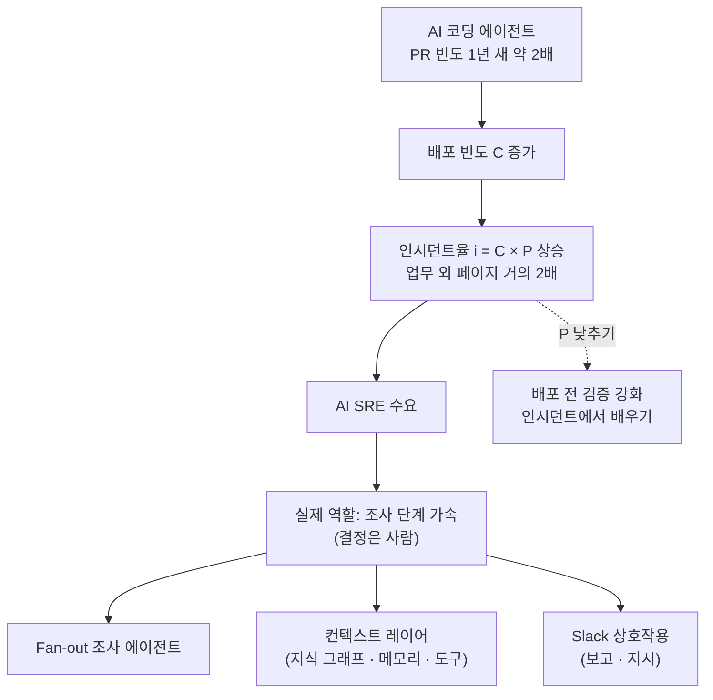
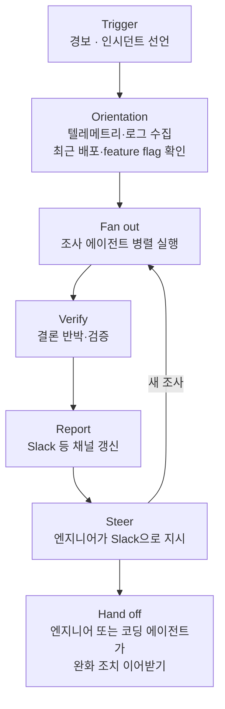

<figure class="post-figure post-figure--header">
<svg role="img" aria-labelledby="aisre-h-title aisre-h-desc" viewBox="0 0 720 340" xmlns="http://www.w3.org/2000/svg">
  <title id="aisre-h-title">한밤의 경보, 먼저 와 있는 조사 요약</title>
  <desc id="aisre-h-desc">한밤중 작전 막사에 경보가 울린다. 정찰병 네 명(서브에이전트)이 로그, 대시보드, 최근 배포, 런북에서 단서를 모아 지휘 테이블로 가져오고, 테이블 위에는 조사 요약 두루마리가 이미 놓여 있다. 오른쪽의 당직 전사가 그 요약을 받아 들지만, 도끼를 드는 결정은 여전히 사람의 몫이다.</desc>
  <defs>
    <marker id="aisre-h-arrow" markerWidth="9" markerHeight="9" refX="7" refY="4" orient="auto">
      <path d="M0 0 L8 4 L0 8 Z" fill="var(--gold)"/>
    </marker>
  </defs>

  <!-- night: crescent moon -->
  <circle cx="676" cy="42" r="18" fill="var(--gold)"/>
  <circle cx="684" cy="36" r="16" fill="var(--bg-panel)"/>

  <!-- ground -->
  <line x1="16" y1="300" x2="704" y2="300" stroke="var(--border-color)" stroke-width="3"/>

  <!-- alarm horn (top-left) -->
  <g stroke="var(--accent-color)" stroke-width="3" fill="none" stroke-linecap="round">
    <path d="M40 58 L70 46 L70 82 L40 70 Z" fill="var(--bg-light)"/>
    <path d="M80 50 Q90 64 80 78"/>
    <path d="M90 42 Q106 64 90 86"/>
  </g>
  <text x="56" y="108" text-anchor="middle" font-size="14" font-weight="700" fill="var(--accent-color)">경보!</text>
  <text x="56" y="126" text-anchor="middle" font-size="11" fill="var(--text-light)">업무 시간 외 페이지</text>

  <!-- scouts (subagents) -->
  <g fill="var(--bg-light)" stroke="var(--secondary-color)" stroke-width="2.5">
    <circle cx="200" cy="56" r="9"/><rect x="192" y="68" width="16" height="22" rx="3"/>
    <circle cx="360" cy="40" r="9"/><rect x="352" y="52" width="16" height="22" rx="3"/>
    <circle cx="520" cy="56" r="9"/><rect x="512" y="68" width="16" height="22" rx="3"/>
    <circle cx="120" cy="196" r="9"/><rect x="112" y="208" width="16" height="22" rx="3"/>
  </g>
  <g font-size="12" font-weight="700" fill="currentColor" text-anchor="middle">
    <text x="200" y="108">로그</text>
    <text x="400" y="62" text-anchor="start">대시보드</text>
    <text x="520" y="108">최근 배포</text>
    <text x="120" y="248">런북</text>
  </g>
  <text x="360" y="22" text-anchor="middle" font-size="11" fill="var(--text-light)">서브에이전트가 흩어져 단서를 모은다 (fan out)</text>

  <!-- clues converge on the war table -->
  <g fill="none" stroke="var(--gold)" stroke-width="2" stroke-dasharray="6 5" marker-end="url(#aisre-h-arrow)">
    <path d="M206 116 L300 168"/>
    <path d="M360 80 L360 160"/>
    <path d="M514 116 L420 168"/>
    <path d="M136 220 L244 226"/>
  </g>

  <!-- war table with the report already on it -->
  <rect x="250" y="210" width="220" height="30" rx="4" fill="var(--bg-light)" stroke="var(--border-color)" stroke-width="2.5"/>
  <g stroke="var(--border-color)" stroke-width="4">
    <line x1="272" y1="240" x2="272" y2="298"/>
    <line x1="448" y1="240" x2="448" y2="298"/>
  </g>
  <rect x="290" y="170" width="140" height="36" rx="4" fill="var(--bg-panel)" stroke="var(--gold)" stroke-width="2.5"/>
  <text x="360" y="193" text-anchor="middle" font-size="13" font-weight="700" fill="currentColor">조사 요약</text>
  <text x="360" y="262" text-anchor="middle" font-size="11" fill="var(--text-light)">지휘 테이블</text>

  <!-- hand-off to the on-call warrior -->
  <path d="M432 186 C 500 170, 540 170, 578 178" fill="none" stroke="var(--gold)" stroke-width="2.5" marker-end="url(#aisre-h-arrow)"/>
  <text x="506" y="160" text-anchor="middle" font-size="11" fill="var(--text-light)">약 5분 뒤, 이미 정리돼 있다</text>

  <!-- on-call warrior (generic figure) -->
  <g stroke="currentColor" stroke-width="3" fill="var(--bg-light)" stroke-linecap="round" stroke-linejoin="round">
    <circle cx="616" cy="170" r="15"/>
    <path d="M600 188 L632 188 L638 250 L594 250 Z"/>
    <line x1="604" y1="250" x2="600" y2="298"/>
    <line x1="628" y1="250" x2="632" y2="298"/>
    <line x1="600" y1="200" x2="584" y2="180"/>
    <line x1="632" y1="200" x2="652" y2="172"/>
  </g>
  <!-- the axe: the decision stays human -->
  <line x1="652" y1="172" x2="664" y2="110" stroke="currentColor" stroke-width="4" stroke-linecap="round"/>
  <path d="M662 112 L690 102 L686 132 Z" fill="var(--accent-color)" stroke="currentColor" stroke-width="2" stroke-linejoin="round"/>
  <text x="616" y="322" text-anchor="middle" font-size="12" font-weight="700" fill="var(--accent-color)">결정은 사람의 몫</text>
  <text x="360" y="322" text-anchor="middle" font-size="12" fill="currentColor">AI SRE = 조사 단계 가속</text>
</svg>
<figcaption>한밤의 경보에 서브에이전트들이 먼저 단서를 모아 요약해 두지만, 무기를 드는 결정은 당직자가 내린다.</figcaption>
</figure>

## 원문 정보

> - **제목**: AI SRE: what is it, how could it change on-call – and does it work?
> - **출처**: The Pragmatic Engineer — Gergely Orosz, Jessica Salmon ([newsletter.pragmaticengineer.com](https://newsletter.pragmaticengineer.com/))
> - **발행**: 2026-10-27 · 전체 약 7,700단어 분량의 딥다이브 (유료 구독자 전용)
> - **원문 링크**: <https://newsletter.pragmaticengineer.com/p/ai-sre>

**이 포스트는 원문의 공개 구간만을 근거로 한다.** 원문은 유료 구독자 전용 글이며, 비구독자에게 보이는 부분은 서론·목차와 1~3장(전체의 대략 절반)이다. 공개 구간은 **"4. Making agents accurate" 장의 첫 문장**("AI SRE 도구는 confabulation에 취약하고 자주 바뀌는 모델 위에 지어져도 대부분의 경우 옳아야 한다")에서 끊긴다. 목차에 제목과 한 줄 소개만 나온 4~7장(정확도, 속도·비용, 자율 에이전트까지 남은 거리, 온콜 엔지니어에게 바뀌는 것)은 본문을 읽지 못했으므로, 이 포스트에서는 목차가 밝힌 문장 이상은 다루지 않는다.

업계 현장 취재에 가까운 글이라 `Engineering-Culture`에 담는다. 같은 주제를 다른 각도에서 본 위키 글로 [AI가 인시던트를 처리할수록 엔지니어는 시스템과 멀어진다](/2026/09/08/ai-incidents-engineers-lose-touch.html)와 [LLM이 써 줄 인시던트 리포트의 미래가 두렵다](/2026/06/19/llm-written-incident-report-future.html)가 있다.

## 한 줄 요약 (TL;DR)

AI 에이전트 덕분에 배포가 늘면서 인시던트와 페이지도 늘었고, 그래서 "AI SRE"가 뜨고 있다. 하지만 지금 AI SRE가 실제로 하는 일은 무대 데모처럼 혼자 고치는 것이 아니라 **조사 단계를 빠르게 해 주는 것**이다. 여러 에이전트로 조사를 펼치고(fan out), 지식 그래프와 메모리로 맥락을 공급하고, Slack에서 사람의 지시를 받는다. 결정은 여전히 사람이 내린다.

## 왜 이 글을 골랐나

"AI가 장애를 알아서 고친다"는 이야기는 많아도, 실제로 그 시스템을 짓는 회사들이 **어떤 구조를 시도했다가 버렸는지**까지 말해 주는 글은 드물다. 이 글은 벤더 세 곳(Rootly, incident.io, ResolveAI)을 직접 인터뷰하고, Monzo·OpenAI·Stripe·Google의 사내 사례를 함께 놓고 비교한다. 그래서 운영하는 사람에게도, 에이전트를 만드는 사람에게도 쓸모가 있다.

위키에는 이미 이 주제의 "걱정" 쪽 글이 두 편 있다. 하나는 자동화가 사람의 숙련을 깎아 먹는다는 글이고, 다른 하나는 리포트를 LLM이 쓰면 사고 과정이 사라진다는 글이다. 이 글은 그 걱정의 대상이 **지금 실제로 어떻게 생겼는지**를 보여 준다. 다만 저자가 incident.io 투자자라고 스스로 밝혔다는 점은 기억해 두자(그 외의 벤더와는 관계가 없고 언급 대가도 받지 않았다고 적었다).

원문 1~3장의 흐름을 한 장으로 보면 이렇다.



## 핵심 내용

### 서론: 무대 데모와 현실 사이

글은 2025년 5월 Microsoft BUILD 이야기로 시작한다. 무대에서 "Azure SRE Agent"가 경보를 받고 근본 원인을 찾아 수정까지 배포했고, 그동안 당직 개발자는 한 번도 깨지 않았다. 저자는 이 데모가 "인위적"으로 느껴졌다고 쓴다. 사람의 감독 없이 AI가 프로덕션 결정을 내리게 둘 팀이 있을 거라고는 상상하기 어려웠고, 실제로 그 뒤 한동안 "SRE agent"라는 말은 들리지 않았다.

그런데 최근 상황이 달라졌다. OpenAI는 Sevbot이라는 AI SRE 봇을 만들었고, ING 은행의 한 엔지니어는 사내 AI SRE를 만들고 있다고 했으며, 콘퍼런스마다 AI SRE 벤더 부스가 늘었다. 저자는 이 흐름을 확인하려고 Rootly, incident.io, ResolveAI를 직접 취재했다.

### 1. 왜 AI SRE가 "핫"한가 — 신뢰성 산수

원문이 내세우는 주된 원인은 **배포가 많이 늘었다는 것**이다. 원문에 따르면 거의 모든 테크 기업에서 AI 에이전트 덕분에 1년 사이 PR 빈도가 두 배가 됐다. 저자는 이를 간단한 식으로 정리한다.

```text
i = C × P
  i : 인시던트율
  C : 단위 시간당 변경(배포) 수
  P : 변경 하나가 장애를 일으킬 확률
```

C가 낮고 P도 낮으면 시스템은 안정적이다. 그런데 AI 에이전트로 C가 두 배 이상 뛰었고 앞으로도 오를 전망이라 인시던트율도 함께 오른다. Rootly 데이터로는 페이지 수가 1년 전보다 늘었고, **업무 시간 외 페이지는 거의 두 배**가 됐다.

P를 낮추는 방법은 크게 두 가지다.

- **배포 전 검증 강화**: 테스트와 검증 루프를 늘린다.
- **인시던트에서 배우기**: 시스템을 더 회복력 있게 만든다.

저자는 AI SRE 벤더가 이 중 두 번째, 곧 인시던트에서 배우고 그 결과를 실행하는 쪽에 유리한 위치에 있다고 본다.

### 2. "AI SRE"란 무엇인가

**아무도 이 이름을 좋아하지 않는다.** 저자도, 인터뷰한 벤더들도 마찬가지다. "autonomous reliability agents"나 "automated incident investigation agents"처럼 더 정확한 이름도 나왔지만 자리 잡지 못했다. 이 이름이 어색한 이유는 SRE가 온콜 경보 대응보다 훨씬 많은 일을 하기 때문이다. SRE는 시스템 전체의 신뢰성을 다루고, 그 일의 상당 부분은 장애 **전과 후**에 일어난다. 원문은 다른 대안이 없어 "AI SRE"라는 말을 쓰되, 그 대상을 "AI로 강화된 온콜·인시던트 처리 도구"로 한정한다.

**실제로 하는 일은 조사 단계다.** 경보가 울리고 엔지니어가 조사를 시작하는 시점부터가 AI SRE의 영역이다. AI 이전에는 이런 일을 사람이 했다.

- **Alert details**: 경보가 무슨 뜻인지 파악한다.
- **Dashboards**: 영향 범위와 조사 시작점을 확인한다.
- **Runbooks**: 흔한 문제라면 런북 절차를 따른다.
- **Logs/observability**: Datadog, Sentry, Honeycomb 같은 도구에서 로그를 뒤진다.

데이터 접근 권한만 충분하면 AI가 이 일들을 꽤 잘한다. 그래서 사내에서 AI SRE를 만든다면 조사 단계부터 시작하는 게 당연하다는 것이 원문의 입장이다. 핵심 결정은 엔지니어가 내리고, 도구는 맥락을 더 빨리 가져다줄 뿐이다.

incident.io의 에이전트 오케스트레이터는 당직 엔지니어가 탭 여덟 개를 띄워 놓고 이것저것 확인하는 모습을 그대로 흉내 낸다.

- **Orchestration**: 메인 에이전트가 조사를 시작하기로 결정한다.
- **Subagents**: 조사 작업을 서브에이전트들에게 나눠 주고 진행 상황을 보고받는다.
- **Heuristics**: 추측성으로 여러 갈래를 찔러 본 뒤 휴리스틱으로 어디를 더 팔지 정한다.

경보 후 5분쯤 지나 당직 엔지니어가 인시던트 채널에 들어왔을 때 AI가 정리한 조사 요약이 이미 있으면 "삽질(shovel work)"을 건너뛸 수 있다. 원문은 여기서 큰 가치를 본다.

**신뢰의 문제가 사내 구축을 부른다.** 에이전트가 제 역할을 하려면 텔레메트리, 관측성 데이터, 로그, 심지어 버전 관리 시스템까지 넓게 접근해야 한다. 원문은 Sam Newman의 『Building Resilient Distributed Systems』를 인용한다. 텔레메트리를 볼 수 없으면 분석할 수 없고, 저장소를 볼 수 없으면 원인이 된 최근 커밋을 찾을 수 없으니, 그만큼 벤더를 깊이 믿어야 한다는 내용이다. 회사가 클수록 민감한 데이터 접근을 허락하기 어렵고, 이것이 중견 이상 기업이 직접 만드는 큰 이유다. 벤더가 zero data retention(ZDR)을 제공해도 침해 위험은 남는다. 또 ZDR 벤더는 데이터로 학습할 수 있는 사내 도구보다 개선 속도에서 불리할 수 있다.

그런데도 저자들의 판단은 **벤더가 결국 사내 도구보다 유능해질 것**이라는 쪽이다. 스타트업은 이 문제에 회사의 성패를 걸고 온종일 매달리지만, 큰 회사에서 AI SRE는 엔지니어들이 처음에 신났다가 금세 다른 일로 옮겨 가는 사이드 프로젝트가 되기 쉽다는 것이다.

**완화(mitigate)에서 멈출까, 수정(remediate)까지 갈까.** AI 이전에는 SRE 팀이 근본 원인을 고치는 PR을 올리는 일이 드물었다. 남이 만든 시스템에 대한 맥락도 전문성도 없었기 때문이다. AI는 맥락을 넘겨받을 수 있고 코드도 쓸 줄 안다. 세 벤더의 접근은 이렇게 갈린다.

| 벤더 | 사후 코드 수정 접근 |
| --- | --- |
| incident.io | 고객이 이미 쓰는 **코딩 에이전트에 인시던트 맥락을 넘긴다.** 자율 PR 생성 기능을 만들어 시연까지 했지만, 공동창업자 Chris Evans에 따르면 고객들이 자기 코딩 환경을 선호해 맥락 전달에 집중한다. |
| ResolveAI | **하이브리드.** 간단한 PR은 직접 쓰고, 큰 변경은 고객의 코딩 에이전트에 넘긴다. |
| Rootly | **자율 머지를 목표로 한다.** 한 에이전트가 PR 초안을 쓰고 다른 에이전트가 머지해도 안전한지 판단해 안전하면 자동 머지하고, 위험하면 당직자를 깨운다. 다만 현재는 모든 PR이 사람의 승인을 거친다. |

### 3. 조사 에이전트 만들기

**세 벤더 모두 조사 에이전트를 최소 한 번은 다시 만들었다.** 겉보기와 달리 온콜에 AI를 붙이는 일은 단순하지 않다. ResolveAI는 2년 동안 아키텍처를 세 번 바꿨다.

<figure class="post-figure">
<svg role="img" aria-labelledby="aisre-r-title aisre-r-desc" viewBox="0 0 720 380" xmlns="http://www.w3.org/2000/svg">
  <title id="aisre-r-title">ResolveAI 조사 에이전트 아키텍처의 3세대</title>
  <desc id="aisre-r-desc">세 칸으로 나뉜 그림. 2024년 스크립트 워크플로는 경보 분류, 로그·메트릭 수집, 인사이트 추출, 가설 순위의 고정 파이프라인으로 흔한 인시던트엔 통하지만 각본 밖 장애엔 약하다. 2025년 단일 에이전트와 지식 그래프는 정확도가 올랐지만 context rot, 자기확증, 메모리 부재 문제가 생겼다. 2026년 멀티 에이전트는 Investigator, 구조적으로 독립된 Verifier, Communicator로 역할을 나눠 가장 믿을 만하고 회복력이 좋다.</desc>
  <defs>
    <marker id="aisre-r-arrow" markerWidth="9" markerHeight="9" refX="7" refY="4" orient="auto">
      <path d="M0 0 L8 4 L0 8 Z" fill="currentColor"/>
    </marker>
    <marker id="aisre-r-gold" markerWidth="10" markerHeight="10" refX="7" refY="4" orient="auto">
      <path d="M0 0 L8 4 L0 8 Z" fill="var(--gold)"/>
    </marker>
  </defs>

  <!-- column frames -->
  <g fill="var(--bg-light)" stroke="var(--border-color)" stroke-width="2">
    <rect x="16" y="16" width="208" height="348" rx="8"/>
    <rect x="256" y="16" width="208" height="348" rx="8"/>
    <rect x="496" y="16" width="208" height="348" rx="8"/>
  </g>
  <!-- era arrows between columns -->
  <g stroke="var(--gold)" stroke-width="3" marker-end="url(#aisre-r-gold)">
    <line x1="226" y1="190" x2="250" y2="190"/>
    <line x1="466" y1="190" x2="490" y2="190"/>
  </g>

  <!-- headers -->
  <g text-anchor="middle">
    <text x="120" y="42" font-size="16" font-weight="700" fill="var(--accent-color)">2024</text>
    <text x="120" y="62" font-size="12" font-weight="700" fill="currentColor">스크립트 워크플로</text>
    <text x="360" y="42" font-size="16" font-weight="700" fill="var(--accent-color)">2025</text>
    <text x="360" y="62" font-size="12" font-weight="700" fill="currentColor">단일 에이전트 + 지식 그래프</text>
    <text x="600" y="42" font-size="16" font-weight="700" fill="var(--accent-color)">2026</text>
    <text x="600" y="62" font-size="12" font-weight="700" fill="currentColor">멀티 에이전트</text>
  </g>

  <!-- col 1: fixed prompt pipeline -->
  <g fill="var(--bg-panel)" stroke="currentColor" stroke-width="1.5">
    <rect x="40" y="82" width="160" height="32" rx="4"/>
    <rect x="40" y="134" width="160" height="32" rx="4"/>
    <rect x="40" y="186" width="160" height="32" rx="4"/>
    <rect x="40" y="238" width="160" height="32" rx="4"/>
  </g>
  <g stroke="currentColor" stroke-width="1.5" marker-end="url(#aisre-r-arrow)">
    <line x1="120" y1="114" x2="120" y2="130"/>
    <line x1="120" y1="166" x2="120" y2="182"/>
    <line x1="120" y1="218" x2="120" y2="234"/>
  </g>
  <g font-size="12" fill="currentColor" text-anchor="middle">
    <text x="120" y="103">경보 분류</text>
    <text x="120" y="155">로그·메트릭 수집</text>
    <text x="120" y="207">인사이트 추출</text>
    <text x="120" y="259">가설 순위 매기기</text>
  </g>
  <g font-size="11" text-anchor="middle">
    <text x="120" y="310" fill="var(--text-light)">흔한 인시던트엔 잘 통함</text>
    <text x="120" y="332" font-weight="700" fill="var(--accent-color)">각본 밖 장애엔 약함</text>
  </g>

  <!-- col 2: one agent reading a knowledge graph -->
  <rect x="280" y="82" width="160" height="34" rx="4" fill="var(--bg-panel)" stroke="var(--secondary-color)" stroke-width="2.5"/>
  <text x="360" y="104" text-anchor="middle" font-size="12" font-weight="700" fill="currentColor">메인 에이전트 1개</text>
  <line x1="360" y1="116" x2="360" y2="140" stroke="currentColor" stroke-width="1.5" marker-end="url(#aisre-r-arrow)"/>
  <rect x="276" y="144" width="168" height="132" rx="6" fill="var(--bg-panel)" stroke="var(--border-color)" stroke-width="1.5" stroke-dasharray="5 4"/>
  <g stroke="var(--text-light)" stroke-width="1.5">
    <line x1="314" y1="182" x2="406" y2="182"/>
    <line x1="314" y1="182" x2="314" y2="240"/>
    <line x1="406" y1="182" x2="406" y2="240"/>
    <line x1="314" y1="240" x2="406" y2="240"/>
    <line x1="314" y1="182" x2="406" y2="240"/>
  </g>
  <g fill="var(--gold)">
    <circle cx="314" cy="182" r="6"/><circle cx="406" cy="182" r="6"/>
    <circle cx="314" cy="240" r="6"/><circle cx="406" cy="240" r="6"/>
  </g>
  <g font-size="11" fill="currentColor" text-anchor="middle">
    <text x="314" y="168">서비스</text>
    <text x="406" y="168">의존성</text>
    <text x="314" y="262">런북</text>
    <text x="406" y="262">배포</text>
  </g>
  <g font-size="11" text-anchor="middle">
    <text x="360" y="296" fill="var(--text-light)">정확도는 올랐지만</text>
    <text x="360" y="316" font-weight="700" fill="var(--accent-color)">context rot · 자기확증</text>
    <text x="360" y="336" font-weight="700" fill="var(--accent-color)">메모리 부재</text>
  </g>

  <!-- col 3: three roles, verifier structurally separated -->
  <g fill="var(--bg-panel)" stroke="var(--secondary-color)" stroke-width="2.5">
    <rect x="520" y="82" width="160" height="40" rx="4"/>
    <rect x="520" y="172" width="160" height="40" rx="4"/>
    <rect x="520" y="234" width="160" height="40" rx="4"/>
  </g>
  <g text-anchor="middle" fill="currentColor">
    <text x="600" y="99" font-size="12" font-weight="700">Investigator</text>
    <text x="600" y="115" font-size="11">가설을 하나씩 추적</text>
    <text x="600" y="189" font-size="12" font-weight="700">Verifier</text>
    <text x="600" y="205" font-size="11">조사자의 결론을 반박</text>
    <text x="600" y="251" font-size="12" font-weight="700">Communicator</text>
    <text x="600" y="267" font-size="11">이해관계자에게 진행 공유</text>
  </g>
  <!-- structural wall between investigator and verifier -->
  <g stroke="var(--gold)" stroke-width="2.5">
    <line x1="512" y1="142" x2="688" y2="142"/>
    <line x1="512" y1="148" x2="688" y2="148"/>
  </g>
  <text x="688" y="162" text-anchor="end" font-size="10" fill="var(--text-light)">구조적 독립</text>
  <line x1="560" y1="122" x2="560" y2="168" stroke="currentColor" stroke-width="1.5" stroke-dasharray="4 3" marker-end="url(#aisre-r-arrow)"/>
  <text x="532" y="162" text-anchor="middle" font-size="10" fill="var(--text-light)">결론</text>
  <g font-size="11" text-anchor="middle">
    <text x="600" y="310" fill="var(--text-light)">팀의 평가:</text>
    <text x="600" y="330" font-weight="700" fill="currentColor">가장 믿을 만하고 회복력 좋음</text>
  </g>
</svg>
<figcaption>ResolveAI는 2년 동안 아키텍처를 세 번 바꿨다. 고정 파이프라인에서 단일 에이전트로, 다시 검증자를 떼어 낸 멀티 에이전트로.</figcaption>
</figure>

1. **스크립트 워크플로 (2024)**: 모델이 도구 호출을 안정적으로 연쇄하지 못하던 시기다. "경보 분류 → 로그·메트릭 수집 → 인사이트 추출 → 가설 순위 매기기" 순서의 프롬프트 파이프라인을 만들었다. 흔한 인시던트에는 잘 통했지만 각본에 맞지 않는 인시던트에는 약했다.
2. **단일 에이전트 + 지식 그래프 (2025)**: 도구 호출이 믿을 만해지자, 메인 에이전트 하나가 서비스·의존성·런북·배포 그래프를 보고 다음 행동을 정하게 했다. 정확도는 올랐지만 새 문제가 생겼다.
   - **Context rot**: 여러 서비스에 걸친 긴 인시던트에서 컨텍스트가 포화돼 이미 가진 데이터를 다시 요청하거나 자기 결론과 모순되는 말을 했다. 원문은 이를 Dex Horthy가 말한 "dumb zone"과 연결한다.
   - **Self-confirmation**: 자기가 세운 가설을 자기가 채점하게 하자 거의 항상 첫 의심을 확정해 버렸다.
   - **메모리 부재**: 지난 조사에서 얻은 교훈이 다음 조사로 이어지지 않았다.
3. **멀티 에이전트 시스템 (2026)**: 역할을 셋으로 나눴다.
   - **Investigator**: 가설을 하나씩 쫓는다.
   - **Verifier**: 조사자의 결론을 반박한다. 자기확증을 막으려고 조사자와 **구조적으로 독립**시켰다.
   - **Communicator**: 이해관계자에게 진행 상황을 알린다.

Resolve 팀은 세 번째 구조가 가장 믿을 만하고 회복력도 좋다고 말했다.

### 전형적인 조사 흐름

세 스타트업의 조사 흐름은 큰 틀에서 비슷하다.



1. **Trigger**: 경보가 울리거나 엔지니어가 인시던트를 선언한다.
2. **Orientation**: 텔레메트리와 로그를 끌어오고, 배포나 feature flag처럼 최근에 바뀐 것을 찾는다.
3. **Fan out**: 조사 에이전트 여러 개를 병렬로 띄운다.
4. **Verify**: 조사 에이전트의 결론을 반박하고 검증한다.
5. **Report**: Slack 등 커뮤니케이션 채널을 갱신한다.
6. **Steer**: 엔지니어가 주로 Slack으로 지시를 내리고, 그 지시가 새 fan out 조사를 낳는다.
7. **Hand off**: 엔지니어나 코딩 에이전트가 코드 수정, 재시작 같은 제안된 완화 조치를 이어받는다.

단계마다 구현 선택지가 갈린다. 경보를 고정된 버킷("사람 필요", "업무 시간까지 대기 가능", "노이즈")으로 나눌지, 사람을 깨우기 전에 원인 가설부터 세울지가 한 예다. 지연 시간이 늘어나도 영향도를 측정할지, 가설 단위로 fan out할지, 오래 도는 에이전트를 기다릴지 아니면 도구 호출 깊이나 비용에 상한을 둘지도 고민거리다. 결국 **지연·정확도·비용 사이의 트레이드오프**를 정하는 문제다.

### 컨텍스트 레이어: 지식 그래프 · 메모리 · 도구

세 도구 모두 프로덕션 시스템의 연결 구조와 의존성, 과거 장애 원인을 담은 "컨텍스트 레이어"를 만든다.

- **Rootly — Atlas**: 지식 그래프 + 메모리 + AI 커넥터
- **incident.io — Nexus**: 카탈로그 + 코드 + 텔레메트리 + 과거 인시던트
- **Resolve — HiveMind**: 컨텍스트 + 조사 스킬 + 메모리 + 액션

<figure class="post-figure">
<svg role="img" aria-labelledby="aisre-c-title aisre-c-desc" viewBox="0 0 720 360" xmlns="http://www.w3.org/2000/svg">
  <title id="aisre-c-title">컨텍스트 레이어의 세 요소</title>
  <desc id="aisre-c-desc">가운데 조사 에이전트를 세 패널이 둘러싼다. 왼쪽 지식 그래프는 서비스, 데이터 저장소, 클라우드 리소스, 배포, 런북, 과거 인시던트를 잇는다. 오른쪽 위 메모리에는 쓸모가 증명돼 승격된 Activated 노트와 반박돼 격리된 Quarantined 노트가 있다. 오른쪽 아래 도구는 MCP, 커넥터, 플러그인, AI 스킬이다.</desc>

  <!-- panels -->
  <g fill="var(--bg-light)" stroke="var(--border-color)" stroke-width="2">
    <rect x="16" y="16" width="236" height="328" rx="8"/>
    <rect x="468" y="16" width="236" height="192" rx="8"/>
    <rect x="468" y="224" width="236" height="120" rx="8"/>
  </g>

  <!-- connectors to the agent -->
  <g stroke="var(--gold)" stroke-width="3" stroke-linecap="round">
    <line x1="252" y1="180" x2="290" y2="180"/>
    <line x1="430" y1="166" x2="468" y2="120"/>
    <line x1="430" y1="194" x2="468" y2="280"/>
  </g>

  <!-- the investigation agent -->
  <rect x="290" y="150" width="140" height="60" rx="8" fill="var(--bg-panel)" stroke="var(--secondary-color)" stroke-width="3"/>
  <text x="360" y="177" text-anchor="middle" font-size="14" font-weight="700" fill="currentColor">조사 에이전트</text>
  <text x="360" y="196" text-anchor="middle" font-size="11" fill="var(--text-light)">맥락을 공급받는다</text>

  <!-- knowledge graph -->
  <text x="134" y="44" text-anchor="middle" font-size="14" font-weight="700" fill="var(--accent-color)">지식 그래프</text>
  <g stroke="var(--text-light)" stroke-width="1.5">
    <line x1="80" y1="88" x2="188" y2="88"/>
    <line x1="80" y1="88" x2="80" y2="168"/>
    <line x1="188" y1="88" x2="188" y2="168"/>
    <line x1="80" y1="168" x2="188" y2="168"/>
    <line x1="80" y1="168" x2="80" y2="248"/>
    <line x1="188" y1="168" x2="188" y2="248"/>
    <line x1="80" y1="248" x2="188" y2="248"/>
  </g>
  <g fill="var(--bg-panel)" stroke="currentColor" stroke-width="1.5">
    <rect x="30" y="74" width="100" height="28" rx="14"/>
    <rect x="138" y="74" width="100" height="28" rx="14"/>
    <rect x="30" y="154" width="100" height="28" rx="14"/>
    <rect x="138" y="154" width="100" height="28" rx="14"/>
    <rect x="30" y="234" width="100" height="28" rx="14"/>
    <rect x="138" y="234" width="100" height="28" rx="14"/>
  </g>
  <g font-size="11" fill="currentColor" text-anchor="middle">
    <text x="80" y="92">서비스</text>
    <text x="188" y="92">데이터 저장소</text>
    <text x="80" y="172">클라우드 리소스</text>
    <text x="188" y="172">배포</text>
    <text x="80" y="252">런북</text>
    <text x="188" y="252">과거 인시던트</text>
  </g>
  <text x="134" y="300" text-anchor="middle" font-size="11" fill="var(--text-light)">벤더 전유물이 아니다</text>
  <text x="134" y="320" text-anchor="middle" font-size="11" fill="var(--text-light)">(예: Uber의 Context Graph)</text>

  <!-- memory -->
  <text x="586" y="44" text-anchor="middle" font-size="14" font-weight="700" fill="var(--accent-color)">메모리</text>
  <text x="586" y="66" text-anchor="middle" font-size="10" fill="var(--text-light)">"payments 지연 → 대개 connection pool"</text>
  <rect x="484" y="80" width="204" height="52" rx="4" fill="var(--bg-panel)" stroke="var(--gold)" stroke-width="2.5"/>
  <text x="586" y="101" text-anchor="middle" font-size="12" font-weight="700" fill="currentColor">Activated 노트</text>
  <text x="586" y="120" text-anchor="middle" font-size="11" fill="currentColor">쓸모 증명·수동 활성화 → 승격</text>
  <rect x="484" y="142" width="204" height="52" rx="4" fill="var(--bg-panel)" stroke="var(--text-light)" stroke-width="2" stroke-dasharray="6 4"/>
  <text x="586" y="163" text-anchor="middle" font-size="12" font-weight="700" fill="var(--text-light)">Quarantined 노트</text>
  <text x="586" y="182" text-anchor="middle" font-size="11" fill="var(--text-light)">반박됨 → 격리, 더는 쓰지 않음</text>

  <!-- tools -->
  <text x="586" y="252" text-anchor="middle" font-size="14" font-weight="700" fill="var(--accent-color)">도구</text>
  <g fill="var(--bg-panel)" stroke="currentColor" stroke-width="1.5">
    <rect x="484" y="266" width="96" height="28" rx="4"/>
    <rect x="592" y="266" width="96" height="28" rx="4"/>
    <rect x="484" y="302" width="96" height="28" rx="4"/>
    <rect x="592" y="302" width="96" height="28" rx="4"/>
  </g>
  <g font-size="11" fill="currentColor" text-anchor="middle">
    <text x="532" y="284">MCP</text>
    <text x="640" y="284">커넥터</text>
    <text x="532" y="320">플러그인</text>
    <text x="640" y="320">AI 스킬</text>
  </g>
</svg>
<figcaption>Atlas · Nexus · HiveMind는 이름만 다를 뿐, 지식 그래프 · 메모리 · 도구가 조사 에이전트에 맥락을 대는 같은 뼈대다.</figcaption>
</figure>

원문은 이를 **지식 그래프 · 메모리 · 도구**의 세 요소로 일반화한다.

**지식 그래프**는 서비스, 데이터 저장소, 클라우드 리소스, 배포, 런북, 과거 인시던트 등을 잇는 그래프다. 벤더만의 전유물이 아니어서 AI 도구를 만드는 팀이라면 어디서든 지을 수 있다. 원문은 Uber가 사내 AI 시스템 대부분에서 쓰는 지식 그래프인 Context Graph를 예로 든다.

**메모리**는 과거 조사에서 얻은 정보를 저장하는 층이다. 원문의 예시는 이렇다. "payments에서 지연이 튀면 원인은 대개 connection pool이다." "이 경보는 특정 서비스 배포 후 첫 한 시간 동안은 보통 노이즈다." Rootly는 메모리 노트를 두 상태로 관리한다.

- **Activated 노트**: 인시던트에서 실제로 쓸모를 증명했거나 누군가 수동으로 활성화한 노트는 더 중요한 메모리로 올라간다.
- **Quarantined 노트**: 반박된 노트는 격리해서 더는 쓰지 않는다. 시스템은 계속 바뀌므로, 낡은 정보를 에이전트에 먹이지 않으려는 장치다.

**고객 데이터를 모을 것인가.** 세 곳 중 Rootly만 고객이 원하면(opt-in) 데이터를 공유 풀에 넣게 해 준다. 공동창업자 JJ Tang은 "AI SRE를 위한 Stack Overflow"를 짓겠다는 생각이다. 민감 정보를 지운 A사의 회고가 B사의 장애 해결을 앞당길 수 있다는 논리이고, 그는 "나쁜 Redis 설정 때문에 난 장애는 영업 비밀이 아니다"라고 말한다. Rootly는 고객이 공유 범위를 세밀하게 정하고 공유한 기록을 조회·삭제할 수 있다고 하지만, 민감 정보 제거(scrubbing) 코드는 아직 공개하지 않았다(공개할 계획이라고 한다). 저자들은 지식 베이스의 이점은 유망하되 기여는 신중해야 하며, 기밀은 반드시 먼저 지워야 한다고 본다.

**도구**는 조사 중 데이터 소스에 연결하는 커넥터, 플러그인, AI 스킬이다. 세 벤더 모두 MCP 인터페이스와 Claude Code/Codex 플러그인을 제공한다.

### Slack 채널 속의 에이전트

AI SRE는 주로 Slack에서 개발자와 대화한다. 세 곳 모두 Teams도 지원하고 Rootly는 GChat까지 지원하지만, 스타트업 대부분은 Slack을 쓴다. 저자는 Slack이 대부분의 테크 기업에서 사람과 에이전트가 소통하는 기본 창구가 돼 가고 있다는 점을 흥미롭게 본다. 이때 풀어야 할 과제는 두 가지다.

- **업데이트의 길이**: incident.io가 실험해 보니, 너무 짧으면 근거가 부족해 개발자가 에이전트를 믿지 않았고 너무 길면 짜증을 유발했다.
- **언제 말할 것인가**: Rootly는 에이전트가 대체로 조용히 있다가 다음 네 경우에만 입을 열게 설계했다.
  - 채널의 질문에 아무도 답하지 않을 때
  - 이해관계자가 맥락 없이 채널에 들어왔을 때
  - 누군가 근거 없이 "mitigated"를 선언할 때
  - 롤백 계획 없이 위험한 조치가 예고될 때

### 사내 팀은 어떻게 짓나

중견 이상 기업은 사내에서 직접 많이 만든다. 내부 맥락을 벤더보다 훨씬 자유롭게 노출할 수 있다는 점이 가장 큰 이점이다. 저자는 결과물의 능력과 구조가 벤더 제품과 꽤 비슷해진다고 본다.

| 회사 | 사내 AI SRE (원문 기술 범위) |
| --- | --- |
| Monzo | 범용 사내 엔지니어링 에이전트 **Agent Chip**(Project Chip)의 일부. Slack·Linear·GitHub 등에서 호출되고, 인시던트가 나면 "Incident Mode"로 여러 시스템의 맥락을 모아 원인 후보를 제시하며 수정안 초안도 쓸 수 있다. |
| OpenAI | **Sevbot**. 세부 정보를 수집하고 가능한 완화책을 찾지만 **스스로 실행하지는 않는다.** Slack에서 질문에 답하고, 지시를 받으면 완화책을 적용한다. |
| Stripe | 장애마다 도는 사내 조사 에이전트. 필요한 신호를 모으는 간단한 실행은 평균 3분, 깊은 조사는 평균 14분 걸린다. |
| Google | SRE가 Gemini CLI 안에서 **ProdAgent**를 쓴다. `get_incident_details`, `causal_analysis`, `timeseries_correlation`, `log_analysis` 같은 기능이 있고, 코드는 생성하지 않으며 MCP로 노출된 도구(예: `borg_task_restart`) 사용을 제안할 뿐이다. 정책 강제와 감사 추적을 갖췄고, 덜 다듬어진 대신 프로덕션을 망칠 위험을 최소화하도록 "스크립트는 많이, LLM은 적게" 설계됐다. |

### 공개 구간 이후 (목차로만 확인한 부분)

여기서 공개 구간이 끝난다. 4장은 첫 문장까지만 보이고, 4~7장의 본문은 유료 구독자 전용이다. 아래는 **원문 목차에 적힌 소개 문장을 옮긴 것**일 뿐이며, 그 이상의 내용은 이 포스트에서 다루지 않는다.

- **4. Making agents accurate**: 적대적 에이전트와 여러 모델을 섞어 가설을 검증하고, eval과 backtesting을 돌린다. 다만 AI SRE의 "정확도"는 측정이 까다롭고 회사마다, 심지어 팀마다 다르다.
- **5. Making agents fast & affordable**: 모두가 빠르고 싸고 정확한 것을 원하지만 트레이드오프가 있다. model routing, 군살 없는 프롬프트, 캐시 적중률 추적이 수단으로 언급된다.
- **6. How long until autonomous agents?**: 무대에서 시연하는 완전 자율 에이전트는 아직 현실이 아니다. 대신 페이지 트리아지와 중요하지 않은 페이지 묵음 처리는 흔해지고 있다. 이 영역은 2년 전 Meta가 AI로 시스템을 운영하던 방식에서 크게 달라지지 않았다고 한다.
- **7. What's changing for on-call engineers?**: AI 관련 장애라는 새 범주가 생기고 있다. 페이지는 결국 줄겠지만 사람에게까지 오는 인시던트는 어려운 것들일 것이다. 탈숙련(deskilling) 위험이 있으니 Uptime Labs 같은 인시던트 대응 시뮬레이션으로 온콜을 훈련하는 것이 현명할 수 있다.

## 분석과 인사이트

> 아래 분석은 **공개된 1~3장**만 읽고 쓴 것이다. 정확도 측정, 비용 최적화, 자율화 전망, 온콜 엔지니어의 변화에 대한 원문의 본격적인 논증(4~7장)은 읽지 못했다. 그러니 이 부분에 대해서는 원문이 어떤 근거로 어떤 결론을 냈는지 판단하지 않는다.

### "AI SRE"의 실체는 자율 운영이 아니라 조사 가속이다

공개 구간에서 가장 쓸모 있는 것은 이름과 실체를 떼어 놓은 정리다. 무대 데모가 약속한 것은 "사람 없이 고친다"였다. 그런데 취재된 사례들이 실제로 하는 일은 하나같이 사람이 결정하기 전까지의 **조사 시간을 줄이는 것**이다. OpenAI의 Sevbot은 완화책을 스스로 실행하지 않는다. Google의 ProdAgent는 코드를 만들지 않고 도구 사용을 제안만 한다. 가장 공격적인 Rootly도 지금은 모든 PR에 사람의 승인을 받는다. 업계가 자율화보다 **책임 경계**를 먼저 그었다는 뜻이다. 그 경계를 어디에 그었는지 나란히 비교할 수 있다는 점이 이 글의 실무적 가치다.

### 신뢰성 산수는 단순하지만 핵심을 찌른다

`i = C × P`는 엄밀한 모델이 아니라 직관을 정리한 식이다. 그래도 논점이 분명해진다. AI 코딩 에이전트가 C를 키웠는데 P가 그대로라면 인시던트는 당연히 늘어난다. 그러면 대응은 둘 중 하나다. P를 줄이거나(검증, 회복력), 늘어난 i를 감당할 수 있게 조사 비용을 줄이는 것이다(AI SRE). 여기서 봐 둘 점은 AI SRE가 i를 줄이는 게 아니라 **i 한 건당 비용을 줄이는 도구**라는 것이다. 근본적으로 P를 낮추는 일은 여전히 배포 전 검증과 사후 학습의 몫이다. 원문이 벤더의 강점을 "인시던트에서 배우기" 쪽에 둔 것도 같은 맥락이다.

### ResolveAI의 실패 목록은 모든 에이전트 개발자의 체크리스트다

2025년 단일 에이전트 구조의 세 가지 실패는 SRE에만 해당하는 문제가 아니다. **context rot, self-confirmation, 메모리 부재**는 긴 작업을 하는 거의 모든 에이전트가 겪는다. 특히 "자기 가설을 자기가 채점하면 첫 의심을 확정해 버린다"는 관찰과, 그 해법으로 Verifier를 **구조적으로 독립**시켰다는 설계는 코드 리뷰 에이전트나 분석 에이전트에도 그대로 옮겨 쓸 수 있다. 이 위키의 [신뢰할 수 있는 Agentic AI 시스템 만들기](/2026/06/19/reliable-agentic-ai-systems.html)에서 다룬 컨텍스트·하니스 엔지니어링이 실제 장애 대응 현장에서 어떤 모습인지 보여 주는 사례이기도 하다.

### 컨텍스트 레이어는 결국 "시간과 함께 자라는 지식 그래프"다

Atlas, Nexus, HiveMind는 이름만 다를 뿐 지식 그래프, 메모리, 도구라는 같은 뼈대를 가진다. 특히 Rootly의 activated/quarantined 노트는 메모리에 **유효성의 수명**을 주는 장치다. 이 위키의 [Agentic Knowledge Graph](/2026/07/21/kg-agentic-knowledge-graph.html)에서 다룬 temporal KG의 사실 무효화 개념과 정확히 겹친다. "시스템은 계속 바뀌므로 낡은 기억을 격리한다"는 문제의식은 운영 도메인에서 특히 절실하다. 어제의 정답(예: "이 경보는 배포 후 한 시간은 노이즈")이 오늘의 장애를 가릴 수 있기 때문이다.

### 동의와 유보

- **동의**: "Slack이 사람과 에이전트의 기본 인터페이스가 된다"는 관찰과, Rootly의 "언제 말할 것인가" 규칙은 무척 실무적이다. 에이전트를 팀 채널에 넣어 본 사람이라면 시끄러운 봇이 얼마나 빨리 음소거되는지 안다. 네 가지 발언 조건(답 없는 질문, 맥락 없는 합류자, 근거 없는 "mitigated", 롤백 계획 없는 위험 조치)은 좋은 인시던트 커맨더의 습관을 그대로 옮긴 것처럼 보인다.
- **유보**: 벤더가 사내 도구보다 유능해질 것이라는 판단은 그럴듯하지만, 저자가 incident.io 투자자라는 점을 감안해서 읽어야 한다(저자 스스로 밝혔다). 사내 구축의 핵심 동기인 데이터 신뢰 문제에 대해 공개 구간은 문제를 제기할 뿐 벤더 쪽의 해법을 충분히 제시하지 않는다. Rootly가 scrubbing 코드를 아직 공개하지 않았다는 점이 좋은 예다.
- **연결되는 걱정**: 사람에게까지 올라오는 인시던트가 점점 어려운 것들만 남는다는 문제는 목차에만 나온다. 이 문제는 위키의 [AI가 인시던트를 처리할수록 엔지니어는 시스템과 멀어진다](/2026/09/08/ai-incidents-engineers-lose-touch.html)가 정면으로 다룬 "자동화의 아이러니"와 같은 축이다. 원문 7장이 이를 어떻게 논증하는지는 공개 구간만으로는 알 수 없다.

## 적용 포인트

- **조사 단계부터 자동화하라.** 사내 AI SRE를 시작한다면 원문의 말대로 경보 해석, 대시보드, 런북, 로그를 모아 요약하는 일부터 맡긴다. 결정과 실행은 사람에게 남겨 둔다.
- **우리 팀의 `C`와 업무 외 페이지를 재 보라.** 지난 1년간 PR·배포 빈도와 업무 시간 외 페이지 수를 같이 놓고 보면 AI 코딩 도입이 온콜 부담에 미친 영향이 숫자로 드러난다.
- **검증자를 구조적으로 분리하라.** 에이전트가 가설을 세운다면, 그 가설을 채점하는 역할은 다른 컨텍스트를 가진 별도 에이전트(또는 사람)에게 준다.
- **메모리에 수명을 줘라.** 런북이나 "이 경보는 보통 노이즈" 같은 운영 지식을 에이전트에게 준다면, 실제로 쓸모가 증명된 것만 승격하고 반박된 것은 격리하는 규칙을 둔다.
- **봇의 발언 조건을 명시하라.** 인시던트 채널의 봇이 언제 말하고 언제 조용히 있을지 규칙으로 정해 둔다. 너무 짧은 업데이트는 신뢰를 잃고 너무 긴 업데이트는 무시당한다.
- **데이터 접근 범위를 먼저 설계하라.** 벤더를 쓰든 직접 만들든, 텔레메트리, 저장소, 프로덕션 데이터 중 무엇을 어느 권한으로 줄지 정하는 것이 도구 선택보다 먼저다.

## 마무리

공개 구간만 읽어도 이 글의 메시지는 분명하다. AI SRE는 아직 밤새 혼자 온콜을 서는 존재가 아니다. 지금은 당직자가 채널에 들어왔을 때 이미 조사가 절반쯤 끝나 있게 만드는 도구다. 그 도구를 만든 팀들은 스크립트에서 단일 에이전트로, 다시 멀티 에이전트로 옮겨 가며 context rot와 자기확증, 기억 상실을 하나씩 다뤘다. 그 과정에서 지식 그래프, 메모리, 도구로 된 컨텍스트 레이어로 수렴했다. 정확도와 비용, 자율화의 미래, 그리고 어려운 인시던트만 떠안게 될 엔지니어의 이야기는 유료 구간에 있다. 이 포스트는 그 앞에서 멈춘다.

### 더 읽어보기

- [원문 — AI SRE: what is it, how could it change on-call – and does it work? (The Pragmatic Engineer)](https://newsletter.pragmaticengineer.com/p/ai-sre) — 4~7장은 유료 구독자 전용
- [AI가 인시던트를 처리할수록 엔지니어는 시스템과 멀어진다 (Sylvain Kalache)](/2026/09/08/ai-incidents-engineers-lose-touch.html) — 원문 7장 목차가 예고한 탈숙련 위험을 정면으로 다룬 글
- [LLM이 써 줄 인시던트 리포트의 미래가 두렵다 (Lorin Hochstein)](/2026/06/19/llm-written-incident-report-future.html) — 인시던트의 "사후" 단계에서 AI가 맡을 몫에 대한 반대편 시각
- [신뢰할 수 있는 Agentic AI 시스템 만들기](/2026/06/19/reliable-agentic-ai-systems.html) — 컨텍스트·하니스 엔지니어링으로 보는 에이전트 신뢰성
- [Agentic Knowledge Graph: 그래프를 도구이자 기억으로](/2026/07/21/kg-agentic-knowledge-graph.html) — 컨텍스트 레이어의 지식 그래프·메모리를 설계 관점에서
