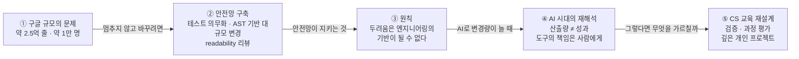

<figure class="post-figure post-figure--header">
<svg role="img" aria-label="창마다 사람이 들어차 있는 거대한 성채가 코드베이스(약 2억 5천만 줄, 약 1만 명이 편집)를 나타낸다. 성채 아래 기초석 한 줄 가운데 한 칸에서 옛 기초석(옛 API)이 빠져나가고, 오른쪽의 작은 부대(약 12명 팀)가 새 기초석(새 API)을 밀어 넣는다. 입주자가 있는 건물의 기초를 교체하는 은유." viewBox="0 0 700 320" xmlns="http://www.w3.org/2000/svg">
  <title>입주자가 있는 건물의 기초 교체 — 사람이 가득한 성채의 기초석을 작은 부대가 한 칸씩 갈아 끼운다</title>
  <defs>
    <marker id="swg-h-old" markerWidth="9" markerHeight="9" refX="7" refY="3" orient="auto">
      <path d="M0 0 L7 3 L0 6 z" fill="currentColor"/>
    </marker>
    <marker id="swg-h-new" markerWidth="9" markerHeight="9" refX="7" refY="3" orient="auto">
      <path d="M0 0 L7 3 L0 6 z" fill="var(--accent-color)"/>
    </marker>
  </defs>

  <!-- 왼쪽 라벨: 코드베이스 규모 -->
  <text x="110" y="104" text-anchor="middle" font-size="14" font-weight="700" fill="currentColor">코드베이스</text>
  <text x="110" y="126" text-anchor="middle" font-size="12" fill="currentColor" opacity="0.85">약 2억 5천만 줄</text>
  <text x="110" y="146" text-anchor="middle" font-size="12" fill="currentColor" opacity="0.85">약 1만 명이 편집 중</text>
  <line x1="168" y1="124" x2="214" y2="124" stroke="currentColor" stroke-width="1.2" stroke-dasharray="3 3" opacity="0.5"/>

  <!-- 깃발 -->
  <line x1="350" y1="48" x2="350" y2="12" stroke="currentColor" stroke-width="2"/>
  <path d="M351 13 L384 20 L351 28 z" fill="var(--secondary-color)"/>

  <!-- 성채 흉벽 -->
  <rect x="220" y="46" width="18" height="14" fill="var(--bg-light)" stroke="currentColor" stroke-width="1.6"/>
  <rect x="266" y="46" width="18" height="14" fill="var(--bg-light)" stroke="currentColor" stroke-width="1.6"/>
  <rect x="312" y="46" width="18" height="14" fill="var(--bg-light)" stroke="currentColor" stroke-width="1.6"/>
  <rect x="370" y="46" width="18" height="14" fill="var(--bg-light)" stroke="currentColor" stroke-width="1.6"/>
  <rect x="416" y="46" width="18" height="14" fill="var(--bg-light)" stroke="currentColor" stroke-width="1.6"/>
  <rect x="462" y="46" width="18" height="14" fill="var(--bg-light)" stroke="currentColor" stroke-width="1.6"/>

  <!-- 성채 본체 -->
  <rect x="220" y="60" width="260" height="170" fill="var(--bg-light)" stroke="currentColor" stroke-width="2"/>

  <!-- 창문 4층 × 5열 (사람이 들어찬 건물) -->
  <g fill="none" stroke="currentColor" stroke-width="1.3">
    <rect x="244" y="76" width="28" height="22"/><rect x="290" y="76" width="28" height="22"/><rect x="336" y="76" width="28" height="22"/><rect x="382" y="76" width="28" height="22"/><rect x="428" y="76" width="28" height="22"/>
    <rect x="244" y="112" width="28" height="22"/><rect x="290" y="112" width="28" height="22"/><rect x="336" y="112" width="28" height="22"/><rect x="382" y="112" width="28" height="22"/><rect x="428" y="112" width="28" height="22"/>
    <rect x="244" y="148" width="28" height="22"/><rect x="290" y="148" width="28" height="22"/><rect x="336" y="148" width="28" height="22"/><rect x="382" y="148" width="28" height="22"/><rect x="428" y="148" width="28" height="22"/>
    <rect x="244" y="184" width="28" height="22"/><rect x="290" y="184" width="28" height="22"/><rect x="336" y="184" width="28" height="22"/><rect x="382" y="184" width="28" height="22"/><rect x="428" y="184" width="28" height="22"/>
  </g>
  <g fill="currentColor" opacity="0.7">
    <circle cx="258" cy="86" r="4"/><circle cx="304" cy="86" r="4"/><circle cx="396" cy="86" r="4"/><circle cx="442" cy="86" r="4"/>
    <circle cx="258" cy="122" r="4"/><circle cx="350" cy="122" r="4"/><circle cx="396" cy="122" r="4"/>
    <circle cx="304" cy="158" r="4"/><circle cx="350" cy="158" r="4"/><circle cx="442" cy="158" r="4"/>
    <circle cx="258" cy="194" r="4"/><circle cx="304" cy="194" r="4"/><circle cx="396" cy="194" r="4"/><circle cx="442" cy="194" r="4"/>
  </g>
  <g fill="currentColor" opacity="0.7">
    <rect x="252" y="91" width="12" height="7" rx="3"/><rect x="298" y="91" width="12" height="7" rx="3"/><rect x="390" y="91" width="12" height="7" rx="3"/><rect x="436" y="91" width="12" height="7" rx="3"/>
    <rect x="252" y="127" width="12" height="7" rx="3"/><rect x="344" y="127" width="12" height="7" rx="3"/><rect x="390" y="127" width="12" height="7" rx="3"/>
    <rect x="298" y="163" width="12" height="7" rx="3"/><rect x="344" y="163" width="12" height="7" rx="3"/><rect x="436" y="163" width="12" height="7" rx="3"/>
    <rect x="252" y="199" width="12" height="7" rx="3"/><rect x="298" y="199" width="12" height="7" rx="3"/><rect x="390" y="199" width="12" height="7" rx="3"/><rect x="436" y="199" width="12" height="7" rx="3"/>
  </g>

  <!-- 기초석 한 줄 (가운데 한 칸 교체 중) -->
  <g stroke="currentColor" stroke-width="1.6">
    <rect x="210" y="230" width="40" height="32" fill="var(--bg-light)"/>
    <rect x="250" y="230" width="40" height="32" fill="var(--bg-light)"/>
    <rect x="290" y="230" width="40" height="32" fill="var(--bg-light)"/>
    <rect x="330" y="230" width="40" height="32" fill="var(--accent-color)" opacity="0.9"/>
    <rect x="370" y="230" width="40" height="32" fill="var(--bg-light)"/>
    <rect x="410" y="230" width="40" height="32" fill="var(--bg-light)"/>
    <rect x="450" y="230" width="40" height="32" fill="var(--bg-light)"/>
  </g>
  <rect x="326" y="226" width="48" height="40" fill="none" stroke="var(--gold)" stroke-width="2" stroke-dasharray="4 3"/>

  <!-- 지면 -->
  <line x1="20" y1="262" x2="680" y2="262" stroke="currentColor" stroke-width="1.4" opacity="0.45"/>

  <!-- 빠져나가는 옛 기초석 -->
  <rect x="110" y="230" width="40" height="32" fill="none" stroke="currentColor" stroke-width="1.6" stroke-dasharray="4 3" opacity="0.6"/>
  <path d="M342 266 Q 250 300 156 266" fill="none" stroke="currentColor" stroke-width="1.6" stroke-dasharray="5 4" opacity="0.7" marker-end="url(#swg-h-old)"/>
  <text x="130" y="302" text-anchor="middle" font-size="12" fill="currentColor" opacity="0.85">옛 기초석 · 옛 API</text>

  <!-- 들어오는 새 기초석 -->
  <rect x="560" y="230" width="40" height="32" fill="var(--accent-color)" stroke="currentColor" stroke-width="1.6" opacity="0.9"/>
  <path d="M556 266 Q 460 300 364 266" fill="none" stroke="var(--accent-color)" stroke-width="2" marker-end="url(#swg-h-new)"/>
  <text x="580" y="302" text-anchor="middle" font-size="12" font-weight="700" fill="currentColor">새 기초석 · 새 API</text>

  <!-- 작은 부대 (약 12명 팀) -->
  <text x="642" y="200" text-anchor="middle" font-size="12" font-weight="700" fill="var(--secondary-color)">약 12명 팀</text>
  <g fill="currentColor">
    <circle cx="616" cy="220" r="6"/><rect x="611" y="227" width="10" height="20" rx="2"/>
    <circle cx="640" cy="220" r="6"/><rect x="635" y="227" width="10" height="20" rx="2"/>
    <circle cx="664" cy="220" r="6"/><rect x="659" y="227" width="10" height="20" rx="2"/>
  </g>
  <g stroke="currentColor" stroke-width="2.4" stroke-linecap="round">
    <line x1="612" y1="233" x2="601" y2="240"/>
    <line x1="636" y1="233" x2="622" y2="236"/>
    <line x1="660" y1="233" x2="646" y2="236"/>
    <line x1="613" y1="247" x2="609" y2="261"/><line x1="619" y1="247" x2="623" y2="261"/>
    <line x1="637" y1="247" x2="633" y2="261"/><line x1="643" y1="247" x2="647" y2="261"/>
    <line x1="661" y1="247" x2="657" y2="261"/><line x1="667" y1="247" x2="671" y2="261"/>
  </g>
</svg>
<figcaption>입주자가 있는 건물의 기초 교체 — 1만 명이 일하는 코드베이스를 멈추지 않고, 작은 팀이 기초석을 한 칸씩 갈아 끼운다.</figcaption>
</figure>

## 원문 정보

> - **제목**: Software engineering at Google & CS education with Titus Winters
> - **출처**: The Pragmatic Engineer 팟캐스트 / Gergely Orosz ([newsletter.pragmaticengineer.com](https://newsletter.pragmaticengineer.com/))
> - **발행**: 2026-10-29 · 에피소드 약 1시간 40분 (1:40:11)
> - **원문 링크**: <https://newsletter.pragmaticengineer.com/p/software-engineering-at-google-and>
> - **이 글의 근거 범위**: 에피소드 페이지에서 **공개적으로 접근 가능한 부분만** 사용했다 — 에피소드 소개, 게스트 소개, 쇼노트, 진행자가 정리한 12개 핵심 요점, 타임스탬프 목차, 참고 자료 목록. 페이지에 "Transcript" 항목은 있으나 본문을 확인할 수 없었으므로, **전체 대화의 세부 발언은 이 글에 담지 않았다.**

구글에서 10년 넘게 언어·코드 품질 인프라를 다뤄 온 엔지니어가 "큰 조직에서 코드를 안전하게 바꾸는 법"과 "그걸 대학은 왜 안 가르치는가"를 한 에피소드에서 이어 말한다는 점에서, 엔지니어링 문화 서가(`Engineering-Culture`)에 담는다.

## 한 줄 요약 (TL;DR)

거대한 코드베이스를 지속 가능하게 만드는 건 영웅적 개인이 아니라 **변경을 두렵지 않게 만드는 안전망**(테스트, 자동화된 대규모 변경 도구, readability 같은 교육 제도)이며, AI 시대에 바뀌어야 할 것은 "코드를 더 빨리 찍어내는 법"이 아니라 **검증·책임·과정**을 중심에 둔 일하는 방식과 CS 교육이라는 메시지다.

에피소드의 흐름을 한 장으로 보면 다음과 같다.

## 왜 이 글을 골랐나

이 위키는 [Testing-Refactoring Essential](/2026/06/19/testing-refactoring-essential-curriculum.html) 커리큘럼으로 테스트·리팩터링의 고전을 정리했고, Articles 서가에서는 [코드 리뷰는 스킬이다](/2026/08/12/reviewing-code-is-a-skill.html), [AI가 인시던트를 처리할수록 엔지니어는 시스템과 멀어진다](/2026/09/08/ai-incidents-engineers-lose-touch.html) 같은 글로 "AI가 코드를 쓰는 시대에 무엇이 비싸지는가"를 계속 추적해 왔다. Titus Winters는 그 두 줄기가 만나는 지점에 서 있는 사람이다.

- 책 *Software Engineering at Google*(Titus Winters, Tom Manshreck, Hyrum Wright)의 **주저자(lead author)**다.
- 구글의 readability 프로그램을 이끌고 C++ 기반 라이브러리 **Abseil**을 만들었다.
- 현재 Adobe의 Senior Principal Scientist로 개발자 경험·생산성을 담당한다.
- 2023년 ACM/IEEE/AAAI CS 커리큘럼(CS2023) 운영위원회에 참여한 **유일한 현업 엔지니어**였다.

즉 "산업 현장에서 대규모 변경을 실제로 해 본 사람"이면서 "대학 커리큘럼을 정하는 테이블에 앉아 본 사람"이 AI 이후의 엔지니어링을 말한다는 점이 이 에피소드의 희소성이다. 학생·주니어 관점에서 같은 질문을 다룬 [NAVER D2의 학생 개발자 글](/2026/10/28/ai-era-student-developers-naver-d2.html)과 함께 읽으면 좋다.

## 핵심 내용

아래는 에피소드 페이지의 쇼노트와 진행자가 정리한 핵심 요점(12개)을 주제별로 재구성한 것이다. 수치와 사례는 공개 요약에 적힌 내용을 옮기려 했으며, 대화 속 세부 맥락은 확인하지 못했다. 원문에 없는 해석은 "분석과 인사이트"에 따로 모았다.

### 에피소드 구성 (타임스탬프로 본 흐름)

공개된 목차는 크게 세 덩어리로 읽힌다.

| 구간 | 주제 |
| --- | --- |
| 07:01 – 39:07 | 구글 입사와 자리 찾기, 테스트 의무화, 신입이 실수를 두려워하는 이유, Abseil, 대규모 C++ 리팩터링, AI를 활용한 재작성 |
| 39:07 – 1:11:17 | 책 *Software Engineering at Google*, readability 리뷰, 팀이 여전히 중요한 이유, 심리적 안전감, 레이오프와 문화, 개발자 생산성 측정 |
| 1:11:17 – 1:40:11 | CS 교육 재고, 신입이 배워야 할 것, Titus가 그리는 이상적 SW 엔지니어링 커리큘럼, 업계 진입 조언, 책 추천 |

### 1. 2010년의 대규모 C++ 리팩터링 — "입주자가 있는 건물의 기초 교체"

2010년, 구글 입사 몇 달 뒤 Winters는 오래된 C++ 코드(일부는 초창기 구글러들이 쓴 것)를 정리할 자원자를 모으는 사내 메일에 응해 약 **12명** 규모의 팀에 합류했다. 당시 구글의 코드는 **약 2억 5천만 줄**, 편집하는 엔지니어는 약 **1만 명**이었다. Winters는 그 정리 작업을 이렇게 회상한다.

> "우리는 엠파이어 스테이트 빌딩의 기초를 갈아 끼우고 있었다. 건물을 닫거나 교통을 막는 건 허용되지 않았다. 아, 그리고 지하실에서 핵폐기물도 발견했다." — Titus Winters (진행자의 요약에 인용된 발언, 번역)

LLM이 없던 시절이라, 팀은 **고급 언어 파싱 기법(AST)**으로 이 리팩터링을 해냈다.

1. **Parse** — 소스를 AST로 파싱(MapReduce로 대규모 병렬 실행)
2. **Match** — 바꿔야 할 호출 패턴을 AST 수준에서 매칭
3. **Generate** — 수정 편집을 자동 생성
4. **Coexist** — 옛 API와 새 API를 한동안 공존시킴
5. **Shard** — 새 API가 준비되면 편집을 디렉터리별로 나눠 배치(batch) 단위로 내보냄
6. **Block** — 아무도 옛 패턴을 다시 코드에 복사해 넣지 못하게 막음
7. **Delete** — 마지막으로 옛 API를 삭제

요약은 **clang-format** 도구가 "Titus와 팀이 이 리팩터링에 필요했기 때문에" 존재한다고 적는다. (왜 필요했는지는 요약에 나오지 않는다 — 아래 분석에서 추측을 덧붙였다.)

<figure class="post-figure">
<svg role="img" aria-label="대규모 변경 7단계 파이프라인. 위쪽에 Parse(파싱), Match(매칭), Generate(편집 생성), Coexist(공존), Shard(디렉터리별 배치 배포), Block(신규 차단), Delete(삭제)가 한 줄로 이어진다. 앞의 세 단계는 '어떻게 고칠까', 뒤의 네 단계는 '멈추지 않고 옮겨 가기'로 묶인다. 아래 시간축에서 옛 API 막대는 처음부터 이어지다 Block 이후 신규 사용이 차단된 점선이 되고 Delete에서 사라진다. 새 API 막대는 Coexist부터 시작해 끝까지 이어지며, Coexist부터 Delete까지는 두 API가 나란히 존재하는 공존 구간이다." viewBox="0 0 680 274" xmlns="http://www.w3.org/2000/svg">
  <title>대규모 변경 7단계 — 옛 API와 새 API가 공존하다가 Block·Delete로 옛 쪽이 사라지는 시간축</title>
  <defs>
    <marker id="swg-p-arrow" markerWidth="8" markerHeight="8" refX="6" refY="3" orient="auto">
      <path d="M0 0 L6 3 L0 6 z" fill="currentColor"/>
    </marker>
    <marker id="swg-p-new" markerWidth="9" markerHeight="9" refX="6" refY="3" orient="auto">
      <path d="M0 0 L6 3 L0 6 z" fill="var(--accent-color)"/>
    </marker>
  </defs>

  <!-- 단계 묶음 괄호 -->
  <path d="M20 32 V24 H284 V32" fill="none" stroke="currentColor" stroke-width="1.3" opacity="0.6"/>
  <text x="152" y="17" text-anchor="middle" font-size="11" fill="currentColor" opacity="0.85">어떻게 고칠까 — AST 기반 도구</text>
  <path d="M296 32 V24 H652 V32" fill="none" stroke="var(--secondary-color)" stroke-width="1.6"/>
  <text x="474" y="17" text-anchor="middle" font-size="11" font-weight="700" fill="var(--secondary-color)">멈추지 않고 옮겨 가기 — 변경 관리</text>

  <!-- 7단계 박스 -->
  <g stroke="currentColor" stroke-width="1.5" fill="var(--bg-light)">
    <rect x="20" y="40" width="80" height="52" rx="4"/>
    <rect x="112" y="40" width="80" height="52" rx="4"/>
    <rect x="204" y="40" width="80" height="52" rx="4"/>
    <rect x="296" y="40" width="80" height="52" rx="4" stroke="var(--gold)" stroke-width="2.2"/>
    <rect x="388" y="40" width="80" height="52" rx="4"/>
    <rect x="480" y="40" width="80" height="52" rx="4"/>
    <rect x="572" y="40" width="80" height="52" rx="4"/>
  </g>
  <g font-size="12" font-weight="700" fill="currentColor" text-anchor="middle">
    <text x="60" y="62">1 Parse</text>
    <text x="152" y="62">2 Match</text>
    <text x="244" y="62">3 Generate</text>
    <text x="336" y="62">4 Coexist</text>
    <text x="428" y="62">5 Shard</text>
    <text x="520" y="62">6 Block</text>
    <text x="612" y="62">7 Delete</text>
  </g>
  <g font-size="11" fill="currentColor" text-anchor="middle" opacity="0.85">
    <text x="60" y="80">AST 파싱</text>
    <text x="152" y="80">패턴 매칭</text>
    <text x="244" y="80">편집 생성</text>
    <text x="336" y="80">옛·새 공존</text>
    <text x="428" y="80">디렉터리별 배치</text>
    <text x="520" y="80">신규 사용 차단</text>
    <text x="612" y="80">옛 API 삭제</text>
  </g>
  <g stroke="currentColor" stroke-width="1.4" marker-end="url(#swg-p-arrow)">
    <line x1="100" y1="66" x2="110" y2="66"/>
    <line x1="192" y1="66" x2="202" y2="66"/>
    <line x1="284" y1="66" x2="294" y2="66"/>
    <line x1="376" y1="66" x2="386" y2="66"/>
    <line x1="468" y1="66" x2="478" y2="66"/>
    <line x1="560" y1="66" x2="570" y2="66"/>
  </g>

  <!-- 공존 구간 -->
  <rect x="296" y="110" width="316" height="118" fill="var(--gold)" fill-opacity="0.12" stroke="var(--gold)" stroke-width="1.4" stroke-dasharray="5 4"/>
  <text x="454" y="128" text-anchor="middle" font-size="11" font-weight="700" fill="currentColor">공존 구간 — 옛·새 API가 나란히</text>

  <!-- Block / Delete 안내선 -->
  <line x1="520" y1="92" x2="520" y2="228" stroke="currentColor" stroke-width="1" stroke-dasharray="3 3" opacity="0.4"/>
  <line x1="612" y1="92" x2="612" y2="228" stroke="currentColor" stroke-width="1" stroke-dasharray="3 3" opacity="0.4"/>

  <!-- 옛 API 레인 -->
  <text x="20" y="153" font-size="12" font-weight="700" fill="currentColor">옛 API</text>
  <rect x="20" y="160" width="500" height="14" fill="currentColor" opacity="0.45"/>
  <rect x="520" y="160" width="92" height="14" fill="none" stroke="currentColor" stroke-width="1.4" stroke-dasharray="4 3" opacity="0.7"/>
  <text x="566" y="153" text-anchor="middle" font-size="10" fill="currentColor" opacity="0.85">신규 사용 차단</text>
  <g stroke="var(--secondary-color)" stroke-width="2.6" stroke-linecap="round">
    <line x1="604" y1="159" x2="620" y2="175"/>
    <line x1="620" y1="159" x2="604" y2="175"/>
  </g>
  <text x="626" y="172" font-size="11" font-weight="700" fill="var(--secondary-color)">삭제</text>

  <!-- 새 API 레인 -->
  <text x="288" y="208" text-anchor="end" font-size="12" font-weight="700" fill="currentColor">새 API</text>
  <line x1="296" y1="203" x2="652" y2="203" stroke="var(--accent-color)" stroke-width="14" marker-end="url(#swg-p-new)"/>

  <!-- 시간축 -->
  <line x1="20" y1="248" x2="652" y2="248" stroke="currentColor" stroke-width="1.3" opacity="0.6" marker-end="url(#swg-p-arrow)"/>
  <text x="656" y="268" text-anchor="end" font-size="11" fill="currentColor" opacity="0.8">시간 →</text>
</svg>
<figcaption>대규모 변경 7단계 — 새 API가 들어온 뒤에도 옛 API는 한동안 공존하고, 신규 사용을 막은 다음에야 삭제된다.</figcaption>
</figure>

### 2. 테스트 의무화 — 분기 릴리스에서 벗어나기

2007년 무렵, 구글의 간판 제품인 검색(Search)은 더 이상 **월 단위**로 배포하지 못하고 기껏해야 **분기에 한 번** 프로덕션에 내보낼 수 있는 상태가 되었다. 그런데 구글에서는 거의 모든 변경이 — Gmail 변경 같은 것조차 — Search의 코드를 건드렸다. 그래서 구글은 조직 전체 차원에서 **모든 변경에 테스트를 동반하도록 의무화**했고, 시간이 지나며 Search는 예전의 높은 배포 주기를 되찾았다는 것이 요약의 설명이다.

### 3. Readability 프로그램 — 리뷰를 교육 제도로

구글에서 변경은 두 종류의 승인을 받는다. 코드 **소유자(owner)** 리뷰, 그리고 해당 언어에 대한 인증을 받은 전문가의 **readability** 리뷰다. 출발점은 구글의 첫 엔지니어 Craig Silverstein이 신입마다 첫 변경을 직접 함께 봐 주던 관행이었고, Java 팀들이 이를 숙련 리뷰어가 라운드로빈으로 모든 변경을 리뷰하는 멘토링으로 발전시켰으며, 곧 모든 언어에 대한 공식 readability 프로그램이 되었다. Winters가 구글을 떠난 시점(에피소드 기준 석 달 전)에는 **어느 때든 1만 명 이상**이 readability 과정에 등록되어 있었다고 한다. 진행자는 이를 "테크 업계 역사상 가장 큰 교육 프로그램이었을지도 모른다"고 평한다.

### 4. 원칙 — 두려움은 엔지니어링의 기반이 될 수 없다

요약은 Winters의 원칙을 이렇게 정리한다. 엔지니어가 **가치 있는 변경을 하기를 두려워하는** 코드베이스는 지속 불가능하다. 테스트 같은 안전망이 있어야 변경이 가능해진다. 목차의 "신입이 실수를 두려워하는 이유", "심리적 안전감" 구간이 이 원칙과 이어지는 것으로 보이지만, 그 구간의 구체적 발언은 공개 범위에서 확인할 수 없었다.

### 5. AI와 생산성 — 산출량, 장애, 출시 기능

Winters는 다른 회사들로부터 다음과 같은 이야기를 듣는다고 한다.

- 코드 **산출량은 1년 전 대비 크게 증가**
- **장애(outage)는 약 30% 증가**
- **출시된 기능 수는 제자리**

진행자(Gergely Orosz)는 이를 "제자리걸음"에 가깝다고 정리하며, 이 각도에서 보면 AI에 긍정적이지 않고 **장애만 놓고 보면 마이너스일 수도 있다**고 덧붙인다. 이 "마이너스일 수도" 해석은 진행자의 정리다.

반면 Winters 자신은 **AI가 순(net) 생산성 향상이라고 낙관**하며, 사람들이 **엉뚱한 것에 신경 쓰고 있다**고 본다. 그가 보는 AI의 진짜 가치는 같은 일을 더 빠르게 반복하는 데 있지 않고, **예전엔 생각조차 못 했던 일 — 너무 야심 차서 예전엔 말이 안 되던 프로젝트**를 하는 데 있다. 쇼노트가 "전통적 생산성 지표가 AI의 가장 큰 이점 일부를 놓치는 이유"를 에피소드 주제로 꼽는 것도 이 맥락이다.

> 주의: "장애 약 30% 증가"는 Winters가 **다른 회사들에게서 전해 들은 이야기**로 요약에 소개된 것이며, 공개 범위에서 출처·측정 방법은 확인되지 않는다.

### 6. 도구에 대한 우화 — "Andrew's axe"

"Andrew's axe(앤드루의 도끼)를 기억하라"는 Winters가 **주니어 엔지니어에게 주는 조언**으로 소개된다. 앤드루가 도끼로 나무를 베었다. 아니면 앤드루의 도끼가 나무를 벤 걸까? Winters의 답은 **나무를 벤 것은 앤드루이고, 도끼는 그의 의지를 실행하는 도구일 뿐**이라는 것이다. AI도 마찬가지로 내가 쓰는 도구이며, 이 도구를 **의인화하면 그런 사고방식에서 벗어나게 된다**고 그는 말한다. 참고 자료에 "컴퓨터는 결코 책임을 질 수 없다"는 1979년 IBM 교육 슬라이드(Simon Willison 경유)가 걸려 있는 것도 같은 맥락으로 읽힌다(이 연결은 나의 해석).

### 7. CS 교육 — 2000년에 멈춘 커리큘럼

Winters는 ACM/IEEE 커리큘럼이 **2000년 무렵 이후 거의 바뀌지 않은 반면 산업은 멀리 나아갔다**고 본다. 진행자의 요약은 "미국 학부 CS 커리큘럼(의 대부분)을 불태워라"라는 제목을 달았다. 특히 신입에게 훨씬 중요한 **테스트와 검증(verification)이 커리큘럼에 사실상 빠져 있다**고 지적한다. 의미 있는 변화가 없다면 CS 전공 등록이 줄고, 실무 개발 역량에 집중하는 **소프트웨어 엔지니어링 프로그램**이 학생들에게 매력적이 될 것이라는 게 그의 전망이다.

요약의 소제목은 **"AI로 가장 고전하는 건 '중위권' 학생들"**이다. CS 교수들이 Winters에게 전한 관찰에 따르면 학생들은 세 그룹으로 나뉜다.

| 그룹 | 관찰된 모습 |
| --- | --- |
| 최상위권 | 어느 때보다 뛰어나다. 인내심 있고 박식한 **튜터로서의 AI**를 최대한 활용 |
| 중위권 (가장 고전) | "최상위권 아래는 모두 **무너졌다**" — B 학점 미만 학생들은 **코드를 아예 이해하지 못하는** 경향 |
| 하위권 | 중위권을 **예전보다 쉽게 따라잡는다** — 다만 주로 AI로 **저품질 산출물(slop)을 만들어 내는** 방식으로 |

진행자도 모교 특강에서 교수들에게 비슷한 이야기 — 학점상 "중간" 학생들의 이해도가 예전 학년들보다 실망스러울 만큼 낮다는 — 를 들었다고 덧붙인다.

이에 대한 그의 처방은 **코드보다 학생의 프롬프트와 테스트를 채점하는 것**이다. 산출물만이 아니라, 학생이 소프트웨어를 만들고 검증하는 데 들인 **사고 과정**에 초점을 두자는 제안이다.

<figure class="post-figure">
<svg role="img" aria-label="왼쪽은 교수들이 전하는 AI 시대 학생의 세 그룹이다. 최상위권은 AI를 튜터로 최대한 활용해 어느 때보다 뛰어나며 위쪽 화살표로 표시된다. 중위권은 강조 테두리로 표시된 '가장 고전하는 그룹'으로, 무너졌다는 평가와 함께 B 학점 미만은 코드를 아예 이해하지 못한다는 설명과 아래쪽 화살표가 붙는다. 하위권은 저품질 산출물로 중위권을 쉽게 따라잡는다는 설명과 짧은 오른쪽 위 화살표로 표시된다. 오른쪽은 Winters의 처방으로, 평가 대상을 결과 코드만이 아니라 과정 — 프롬프트, 테스트, 사고 과정 — 까지 넓히는 화살표다." viewBox="0 0 680 236" xmlns="http://www.w3.org/2000/svg">
  <title>AI로 가장 고전하는 건 중위권 — 그리고 결과 코드만이 아니라 과정도 평가하자는 처방</title>
  <defs>
    <marker id="swg-e-arrow" markerWidth="8" markerHeight="8" refX="6" refY="3" orient="auto">
      <path d="M0 0 L6 3 L0 6 z" fill="currentColor"/>
    </marker>
    <marker id="swg-e-acc" markerWidth="9" markerHeight="9" refX="6" refY="3" orient="auto">
      <path d="M0 0 L6 3 L0 6 z" fill="var(--accent-color)"/>
    </marker>
    <marker id="swg-e-down" markerWidth="9" markerHeight="9" refX="6" refY="3" orient="auto">
      <path d="M0 0 L6 3 L0 6 z" fill="var(--secondary-color)"/>
    </marker>
  </defs>

  <!-- 왼쪽: 3분화 -->
  <text x="175" y="18" text-anchor="middle" font-size="12" font-weight="700" fill="currentColor">AI 시대 학생의 세 그룹 (교수들의 관찰)</text>
  <g stroke="currentColor" stroke-width="1.4" fill="var(--bg-light)">
    <rect x="20" y="30" width="310" height="54" rx="4"/>
    <rect x="20" y="158" width="310" height="54" rx="4"/>
  </g>
  <!-- 중위권 = 가장 고전하는 그룹 (강조 테두리) -->
  <rect x="20" y="94" width="310" height="54" rx="4" fill="var(--bg-light)" stroke="var(--secondary-color)" stroke-width="2.6"/>
  <rect x="30" y="43" width="64" height="28" rx="3" fill="var(--accent-color)" fill-opacity="0.25" stroke="var(--accent-color)" stroke-width="1.4"/>
  <rect x="30" y="107" width="64" height="28" rx="3" fill="var(--secondary-color)" fill-opacity="0.2" stroke="var(--secondary-color)" stroke-width="1.6"/>
  <rect x="30" y="171" width="64" height="28" rx="3" fill="none" stroke="currentColor" stroke-width="1.2" stroke-dasharray="4 3" opacity="0.75"/>
  <g font-size="12" font-weight="700" fill="currentColor" text-anchor="middle">
    <text x="62" y="62">최상위권</text>
    <text x="62" y="126">중위권</text>
    <text x="62" y="190">하위권</text>
  </g>
  <g font-size="11" fill="currentColor">
    <text x="104" y="54">어느 때보다 뛰어남</text>
    <text x="104" y="72" opacity="0.85">AI를 튜터로 최대한 활용</text>
    <text x="104" y="118" font-weight="700" fill="var(--secondary-color)">가장 고전 — "무너졌다"</text>
    <text x="104" y="136" opacity="0.85">B 미만은 코드를 아예 이해 못함</text>
    <text x="104" y="182">저품질 산출물로</text>
    <text x="104" y="200" opacity="0.85">중위권을 쉽게 따라잡음</text>
  </g>
  <!-- 추세 아이콘: 최상위 ↑, 중위 ↓, 하위 짧은 ↗ -->
  <line x1="312" y1="72" x2="312" y2="44" stroke="var(--accent-color)" stroke-width="2.2" marker-end="url(#swg-e-acc)"/>
  <line x1="312" y1="102" x2="312" y2="134" stroke="var(--secondary-color)" stroke-width="2.6" marker-end="url(#swg-e-down)"/>
  <line x1="304" y1="194" x2="314" y2="184" stroke="currentColor" stroke-width="2" opacity="0.75" marker-end="url(#swg-e-arrow)"/>

  <!-- 연결 화살표 -->
  <line x1="342" y1="121" x2="396" y2="121" stroke="currentColor" stroke-width="1.6" opacity="0.55" marker-end="url(#swg-e-arrow)"/>

  <!-- 오른쪽: 평가 대상 이동 -->
  <text x="530" y="18" text-anchor="middle" font-size="12" font-weight="700" fill="var(--secondary-color)">처방: 결과 코드만이 아니라 과정도</text>
  <rect x="410" y="32" width="240" height="46" rx="4" fill="none" stroke="currentColor" stroke-width="1.4" stroke-dasharray="5 4" opacity="0.55"/>
  <text x="530" y="60" text-anchor="middle" font-size="12" fill="currentColor" opacity="0.7">지금까지: 결과 코드 중심</text>

  <line x1="530" y1="84" x2="530" y2="128" stroke="var(--accent-color)" stroke-width="3" marker-end="url(#swg-e-acc)"/>
  <text x="542" y="111" font-size="11" fill="currentColor" opacity="0.85">평가 대상을 넓힌다</text>

  <rect x="410" y="138" width="240" height="78" rx="4" fill="var(--bg-light)" stroke="var(--accent-color)" stroke-width="2.4"/>
  <text x="530" y="162" text-anchor="middle" font-size="13" font-weight="700" fill="currentColor">과정도 함께 평가</text>
  <g stroke="currentColor" stroke-width="1.2" fill="none">
    <rect x="420" y="176" width="68" height="26" rx="13"/>
    <rect x="496" y="176" width="68" height="26" rx="13"/>
    <rect x="572" y="176" width="68" height="26" rx="13"/>
  </g>
  <g font-size="11" fill="currentColor" text-anchor="middle">
    <text x="454" y="193">프롬프트</text>
    <text x="530" y="193">테스트</text>
    <text x="606" y="193">사고 과정</text>
  </g>
</svg>
<figcaption>AI로 가장 고전하는 건 중위권이다 — 최상위권은 AI를 튜터로 삼아 더 나아지고, 하위권은 저품질 산출물로 중위권을 쉽게 따라잡는다. 그래서 Winters는 결과 코드만이 아니라 프롬프트·테스트·사고 과정을 채점하자고 제안한다.</figcaption>
</figure>

### 8. 신입에게 — 군중을 따르지 말 것

대화 끝무렵 진행자가 "2학년 학생들에게 무슨 말을 해 주겠느냐"고 물은 구간은 **팟캐스트 본편에서 편집되어 빠졌고**, 쇼노트에만 실렸다. 요약에 실린 Winters의 답을 우리말로 옮기면 대략 이렇다.

- 인생에서 거둔 성공의 대부분은 **남들이 다 하는 일을 하지 않은 데서** 왔다. 지금 뜨는 주제만 듣고 모두가 좇는 반짝이는 것을 똑같이 좇으면 눈에 띄기가 정말 어렵다.
- 그러니 모두의 이력서에 있을 법한 것이 아니라 **내가 정말 좋아하는 것**을 찾아 그걸 많이 하라. **열정 프로젝트를 찾아 깊이 파고들라.**
- 예컨대 "컴퓨팅과 AI, 바이브 코딩 같은 새 기법을 어떻게 쓸까", "내게 중요한 이 문제를 어떻게 풀까", "게임이나 예술로 나를 어떻게 표현할까" 같은 것. **나다운 일을 할수록 더 눈에 띄고, 더 많이 할수록 더 많이 배운다.**

### 참고 자료로 본 대화의 지형

쇼노트의 참고 자료 목록은 대화가 어떤 지적 지형 위에서 이루어졌는지 보여 준다.

- **책**: *Software Engineering at Google*(무료 온라인판: abseil.io/resources/swe-book), *The Mythical Man-Month*, Cat Hicks의 *The Psychology of Software Teams*, *Platform Engineering at Google*, Google SRE 책들
- **도구/프로젝트**: Abseil, Clang/ClangFormat, OpenRewrite, BrontoSource
- **연구/업계**: DORA, 구글 SRE의 blameless postmortem 문화, CS2023 커리큘럼, ACM Queue의 "Develop, Deploy, Operate" 모델, CACM의 "Computing Education When Writing Code Is No Longer the Challenge", McKinsey의 개발자 생산성 측정 글, University of Waterloo의 co-op 교육

## 분석과 인사이트

여기서부터는 공개 요약을 바탕으로 한 **나의 해석**이다.

### "대규모 변경"은 기술이 아니라 프로세스 설계였다

7단계 파이프라인에서 진짜 핵심은 Parse·Match·Generate가 아니라 **Coexist → Shard → Block → Delete**라고 본다. 앞의 세 단계는 "어떻게 고칠까"의 문제고, 뒤의 네 단계는 "1만 명이 일하는 와중에 어떻게 멈추지 않고 옮겨 갈까"의 문제다. 옛 API와 새 API를 공존시키고, 디렉터리별 배치로 쪼개 내보내고, 역류를 막은 다음에야 삭제한다. (디렉터리별로 쪼개면 각 배치가 해당 코드의 owner 리뷰를 받기 좋은 크기가 되었으리라는 건 요약에 없는 **나의 추측**이다 — 구글의 owner + readability 승인 구조를 감안한 해석일 뿐이다.) 같은 맥락에서 clang-format이 이 리팩터링에 필요했던 이유도, 기계가 생성한 대량의 편집을 사람이 일일이 포매팅할 수 없었기 때문이 아닐까 짐작한다(역시 요약에는 이유가 나오지 않는다). 이 흐름은 데이터베이스의 expand–contract 마이그레이션이나 Strangler Fig 패턴과 같은 구조다.

이 관점은 AI 코딩 에이전트 시대에 오히려 더 중요해진다. 목차에 "AI for rewrites" 구간이 있는 것도 우연이 아닐 것이다. LLM이 Generate 단계를 AST 기반 도구보다 유연하게 대체할 수는 있어도, **Coexist·Shard·Block·Delete라는 변경 관리의 뼈대는 그대로 남는다.** 에이전트에게 "전체를 한 번에 고쳐 줘"라고 맡기는 대신, 이 뼈대 위에서 Generate만 맡기는 것이 안전한 사용법이라는 시사점을 얻는다.

### 테스트는 품질 도구가 아니라 "속도 도구"다

2007년 Search 사례에서 내가 읽는 교훈은 흔히 듣는 "테스트를 쓰면 품질이 좋아진다"가 아니다. Search가 **월 단위에서 분기 단위로 느려졌고**, 거의 모든 변경이 Search 코드를 건드리는 구조였기에 테스트를 **회사 전체에** 의무화하자 **배포 주기가 회복되었다**는 것이다. 테스트는 변경 비용을 낮추는 인프라이며, 이는 "두려움은 엔지니어링의 기반이 될 수 없다"는 원칙과 정확히 같은 말이다. [TDD by Example](/2026/06/19/tdd-by-example.html)에서 Kent Beck이 TDD를 "두려움을 관리하는 방법"으로 소개한 것과도 겹친다.

### AI 생산성 논쟁에 대한 정직한 회계

"산출량 ↑, 장애 ~30% ↑, 출시 기능 →"라는 세 숫자의 조합은 전해 들은 이야기라는 한계가 있지만, 질문의 형태 자체가 유용하다. **산출량(output)과 성과(outcome)를 분리해서 보라**는 것이다. 코드 줄 수나 PR 수가 늘었다는 지표는 장애 증가라는 비용과 기능 출시라는 성과 옆에 놓여야 의미가 생긴다. 이는 [코딩이 공짜가 되면 무엇이 비싸지는가](/2026/06/23/fowler-fragments-verification-cognitive-surrender.html)에서 Martin Fowler가 말한 "검증이 병목이 된다"는 진단, 그리고 [AI가 인시던트를 처리할수록 엔지니어는 시스템과 멀어진다](/2026/09/08/ai-incidents-engineers-lose-touch.html)의 문제의식과 같은 방향을 가리킨다.

흥미로운 건 이 숫자들을 보고 "마이너스일 수도"라고 읽은 쪽은 진행자이고, Winters 자신은 **AI가 순 생산성 향상이라고 낙관**한다는 점이다. 그의 논리는 사람들이 **엉뚱한 것을 재고 있다**는 것이다. "같은 일을 더 빨리"라는 축에서 보면 제자리걸음처럼 보이지만, AI의 진짜 가치는 **예전엔 말이 안 되던 야심 찬 프로젝트**를 하는 데 있다. 이를테면 2010년에 12명이 붙어야 했던 수준의 마이그레이션 같은 것(이 예시는 나의 연결이다). 전통적 생산성 지표가 이걸 놓치는 이유도 여기 있다고 나는 읽는다. 존재하지 않던 프로젝트는 "속도 향상"으로 측정되지 않는다. 다만 장애 증가라는 비용은 그 낙관과 별개로 관리해야 할 숙제로 남는다.

### Readability는 "리뷰를 교육으로 쓰는" 조직 설계

readability가 1만 명 규모의 교육 프로그램이 되었다는 사실은 코드 리뷰를 **게이트가 아니라 지식 전파 채널**로 설계할 수 있음을 보여 준다. AI가 코드를 많이 쓸수록 사람이 하는 일은 리뷰와 판단으로 옮겨 가는데, 그렇다면 [코드 리뷰는 스킬이다](/2026/08/12/reviewing-code-is-a-skill.html)에서 다룬 리뷰 역량을 조직이 **체계적으로 길러 내는 제도**가 필요하다. readability는 그 선례다.

### 교육 처방에 대한 동의와 유보

"결과 코드만이 아니라 과정(프롬프트·테스트·사고)을 평가하라"는 처방에는 강하게 동의한다. 다만 프롬프트를 채점하는 순간 그것도 최적화 대상이 되어 "채점용 프롬프트"가 생길 위험이 있다. 테스트를 채점 대상으로 삼는 쪽이 더 견고해 보인다. 테스트는 "무엇이 맞는가"를 학생이 스스로 정의했는지를 드러내기 때문이다. 이는 테스트와 검증이 **커리큘럼에 사실상 빠져 있다**는 Winters의 진단과도 맞물린다.

학생 관찰에서 가장 눈에 띄는 건 "격차가 벌어진다"는 단순한 그림이 아니라 **중간이 무너진다**는 그림이라는 점이다. 최상위권은 AI라는 튜터 덕에 더 나아지고, 하위권은 저품질 산출물로 중위권을 쉽게 따라잡는다. 그 결과 산출물만 보면 중위권과 하위권이 구별되지 않고, B 학점 아래 학생들이 코드를 아예 이해하지 못하는 상태가 겉으로 드러나지 않는다 — 이것이 결과 코드만으로는 평가가 성립하지 않는 이유라고 나는 읽는다. 같은 도구를 들고도 누군가는 배우고 누군가는 이해 없이 산출물만 낸다는 점에서, "Andrew's axe"의 메시지 — **나무를 벤 건 도끼가 아니라 앤드루다** — 가 교육 현장에서 가장 구체적인 의미를 갖는다.

### 공개 범위의 한계

이 글은 쇼노트·요약 기반이므로 다음은 확인하지 못했다. "팀이 여전히 중요한 이유", "레이오프와 문화", "Titus의 이상적 커리큘럼"의 구체적 구성, "AI for rewrites" 구간의 내용, "심리적 안전감" 구간의 구체적 발언. 이 구간들은 에피소드를 직접 들어야 한다.

## 적용 포인트

- **대규모 변경은 7단계로 쪼개라.** API 교체나 라이브러리 마이그레이션을 계획할 때 "공존 → 디렉터리별 배치 배포 → 신규 사용 차단 → 삭제"를 명시적 마일스톤으로 둔다. AI 에이전트에게는 Generate 단계만 맡기고, 나머지 뼈대는 사람이 설계한다.
- **포매팅·린트는 도구로 결정해 리뷰에서 제거하라.** clang-format이 대규모 리팩터링의 필요에서 태어났듯, AI가 생성하는 코드가 늘수록 자동 포매터는 선택이 아니라 전제다.
- **팀의 "두려움 지표"를 점검하라.** "이 모듈은 아무도 안 건드린다"는 말이 나오는 곳이 있다면, 그곳이 테스트 안전망이 가장 먼저 필요한 곳이다.
- **AI 도입 효과를 세 숫자로 보라.** 산출량(PR·코드량)만이 아니라 장애/롤백 수, 실제 출시된 기능·성과를 같은 대시보드에 둔다.
- **AI로 "빨리"보다 "가능하게"를 찾아라.** 백로그에서 "너무 커서 미뤄 둔 일"(마이그레이션, 레거시 정리)을 AI 활용 후보 1순위로 검토한다.
- **리뷰를 교육 채널로 설계하라.** 언어·도메인별 리뷰어 인증이나 멘토링 리뷰처럼, 리뷰가 지식을 전파하도록 구조를 만든다.
- **주니어 평가·온보딩에서 과정을 보라.** 결과 코드 대신 그 사람이 쓴 테스트와 판단 근거를 대화의 중심에 둔다.
- **AI를 의인화하지 마라.** "AI가 그렇게 짰다"가 아니라 "내가 그 도구로 이렇게 짰다"고 말하는 습관이 책임의 소재를 지킨다.

## 마무리

Titus Winters의 이야기를 관통하는 단어는 **변경**이다. 2억 5천만 줄을 멈추지 않고 바꾸는 법, 엔지니어가 변경을 두려워하지 않게 만드는 법, 그리고 AI로 변경의 양이 폭증할 때 그 변경을 검증하고 책임지는 법. 구글이 테스트 의무화와 readability로 답했던 질문을, 이제 AI 시대의 조직과 대학이 다시 받아 들고 있다. 공개된 요약만으로도 이 에피소드는 "코드를 쓰는 일"에서 "변경을 안전하게 만드는 일"로 엔지니어링의 무게중심이 옮겨 가고 있다는 신호를 분명하게 보낸다. 세부는 원 에피소드에서 확인하길 권한다.

### 더 읽어보기

- [원문 — Software engineering at Google & CS education with Titus Winters (The Pragmatic Engineer)](https://newsletter.pragmaticengineer.com/p/software-engineering-at-google-and)
- [Software Engineering at Google — 무료 온라인판](https://abseil.io/resources/swe-book) — 에피소드에서 다룬 책
- [코드 리뷰는 스킬이다](/2026/08/12/reviewing-code-is-a-skill.html) — readability가 제도화한 "리뷰 역량"의 개인 차원
- [코딩이 공짜가 되면 무엇이 비싸지는가 — Martin Fowler의 Fragments](/2026/06/23/fowler-fragments-verification-cognitive-surrender.html) — 검증이 병목이 되는 시대
- [AI가 인시던트를 처리할수록 엔지니어는 시스템과 멀어진다](/2026/09/08/ai-incidents-engineers-lose-touch.html) — AI와 장애의 관계
- [AI 시대의 개발자를 꿈꾸는 학생 개발자에게 (NAVER D2)](/2026/10/28/ai-era-student-developers-naver-d2.html) — CS 교육·신입 관점의 짝 글
- [구글의 IBM화(IBM-ification)](/2026/06/23/ibm-ification-of-google.html) — 구글을 다른 각도(비즈니스·조직)에서 본 글
- [C++의 이야기 — CultRepo 다큐멘터리 정리](/2026/06/19/story-of-cpp.html) — Abseil·ClangFormat이 놓인 C++ 생태계의 역사
- [Testing-Refactoring Essential Curriculum](/2026/06/19/testing-refactoring-essential-curriculum.html) · [TDD by Example](/2026/06/19/tdd-by-example.html) — 테스트를 "두려움 관리"로 보는 고전적 근거
