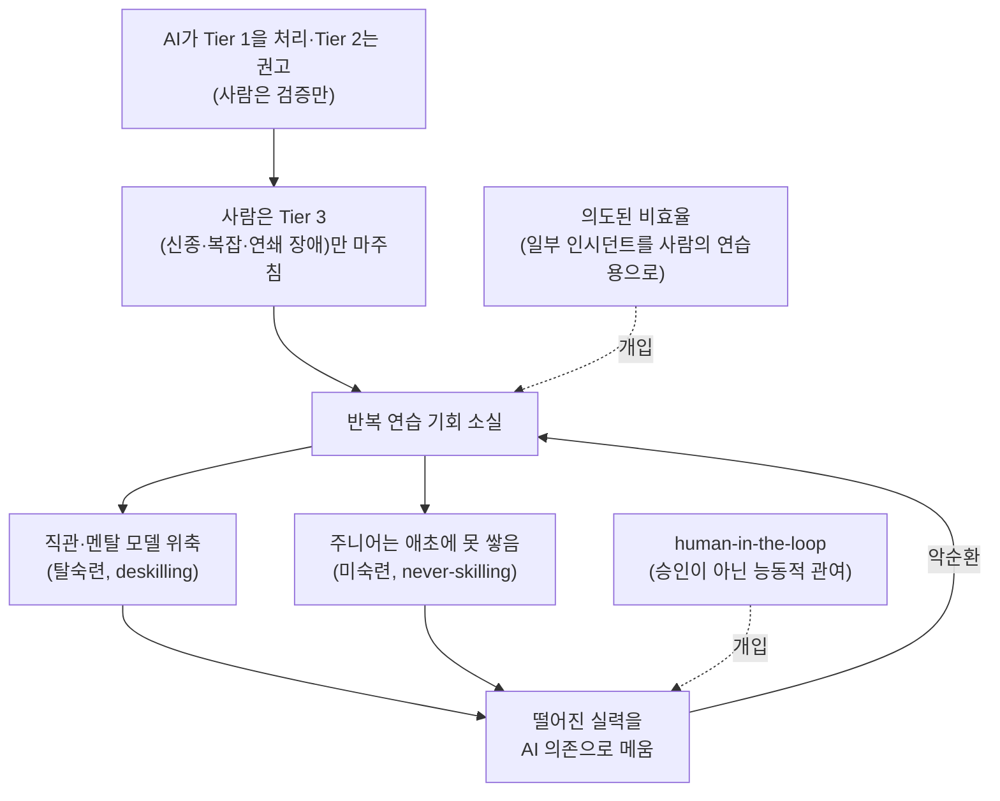

<figure class="post-figure post-figure--header">
<svg role="img" aria-label="성벽 위 자동 포탑이 몰려오는 작은 적들(95%)을 막아 내는 동안, 그 옆의 수비대 전사는 녹슨 도끼를 세워 둔 채 졸고 있다. 지평선 너머에서는 처음 보는 거대한 적(5%)이 다가온다." viewBox="0 0 700 320" width="540">
  <title>AI 포탑이 95%를 막는 동안, 녹슨 도끼의 전사와 다가오는 5%</title>
  <!-- ground -->
  <rect x="0" y="280" width="700" height="40" fill="var(--bg-sunken)"/>
  <path d="M0 280 H700" stroke="currentColor" stroke-width="2" stroke-dasharray="10 6" opacity="0.6"/>
  <!-- wall -->
  <rect x="40" y="170" width="220" height="110" fill="var(--bg-panel)" stroke="currentColor" stroke-width="3"/>
  <g stroke="currentColor" stroke-width="1.5" opacity="0.45">
    <path d="M40 200 H260 M40 230 H260 M40 258 H260"/>
    <path d="M90 170 V200 M150 170 V200 M210 170 V200 M65 200 V230 M125 200 V230 M185 200 V230 M240 200 V230 M95 230 V258 M160 230 V258 M220 230 V258"/>
  </g>
  <rect x="40" y="148" width="24" height="22" fill="var(--bg-panel)" stroke="currentColor" stroke-width="3"/>
  <rect x="168" y="148" width="24" height="22" fill="var(--bg-panel)" stroke="currentColor" stroke-width="3"/>
  <!-- AI turret -->
  <rect x="200" y="122" width="50" height="48" fill="var(--steel)" stroke="currentColor" stroke-width="3"/>
  <rect x="212" y="134" width="12" height="8" fill="var(--gold-bright)"/>
  <rect x="250" y="134" width="40" height="12" fill="currentColor"/>
  <!-- shots -->
  <path d="M296 140 H340" stroke="var(--accent-color)" stroke-width="3" stroke-dasharray="8 6"/>
  <rect x="344" y="136" width="9" height="9" fill="var(--accent-color)"/>
  <!-- small foes (the 95%) -->
  <g fill="currentColor">
    <rect x="352" y="260" width="20" height="20" opacity="0.7"/>
    <rect x="384" y="262" width="18" height="18" opacity="0.55"/>
    <rect x="414" y="260" width="20" height="20" opacity="0.7"/>
    <rect x="446" y="263" width="17" height="17" opacity="0.55"/>
    <rect x="476" y="260" width="20" height="20" opacity="0.7"/>
    <rect x="506" y="263" width="17" height="17" opacity="0.55"/>
    <rect x="318" y="268" width="22" height="10" opacity="0.35"/>
  </g>
  <g fill="var(--bg-panel)">
    <rect x="356" y="265" width="4" height="4"/><rect x="364" y="265" width="4" height="4"/>
    <rect x="418" y="265" width="4" height="4"/><rect x="426" y="265" width="4" height="4"/>
    <rect x="480" y="265" width="4" height="4"/><rect x="488" y="265" width="4" height="4"/>
  </g>
  <g fill="var(--gold-bright)">
    <rect x="344" y="252" width="6" height="6"/><rect x="336" y="244" width="5" height="5"/><rect x="352" y="244" width="5" height="5"/>
  </g>
  <!-- dozing guard -->
  <rect x="112" y="140" width="30" height="30" fill="var(--orc-green)" stroke="currentColor" stroke-width="2"/>
  <rect x="122" y="126" width="22" height="18" fill="var(--orc-green)" stroke="currentColor" stroke-width="2"/>
  <rect x="124" y="118" width="8" height="8" fill="currentColor"/>
  <path d="M130 134 H138" stroke="currentColor" stroke-width="2"/>
  <rect x="132" y="140" width="3" height="5" fill="var(--bone)"/>
  <text x="152" y="112" font-family="var(--font-body)" font-size="28" font-weight="700" fill="currentColor" opacity="0.7">z Z</text>
  <!-- rusty axe leaning on merlon -->
  <path d="M72 170 L84 110" stroke="currentColor" stroke-width="4" stroke-linecap="square"/>
  <path d="M84 110 L104 100 L108 128 L82 126 Z" fill="var(--steel)" stroke="currentColor" stroke-width="2" stroke-dasharray="4 3"/>
  <g fill="var(--gold)">
    <rect x="90" y="108" width="5" height="5"/><rect x="99" y="116" width="4" height="4"/><rect x="88" y="119" width="4" height="4"/>
  </g>
  <rect x="101" y="105" width="4" height="4" fill="var(--accent-color)"/>
  <!-- the unseen giant (the 5%) -->
  <g fill="currentColor" opacity="0.35">
    <rect x="562" y="140" width="108" height="140"/>
    <rect x="582" y="96" width="68" height="48"/>
    <rect x="540" y="160" width="22" height="70"/>
    <rect x="670" y="160" width="22" height="70"/>
    <path d="M582 96 L586 76 L598 96 Z M650 96 L646 76 L634 96 Z"/>
  </g>
  <rect x="598" y="112" width="10" height="8" fill="var(--accent-color)"/>
  <rect x="624" y="112" width="10" height="8" fill="var(--accent-color)"/>
  <!-- labels -->
  <text x="245" y="62" text-anchor="middle" font-family="var(--font-body)" font-size="28" font-weight="700" fill="currentColor">AI 포탑 · 95%</text>
  <text x="600" y="58" text-anchor="middle" font-family="var(--font-body)" font-size="28" font-weight="700" fill="var(--accent-color)">처음 보는 5%</text>
</svg>
<figcaption>자동화가 익숙한 95%를 막아 줄수록, 정작 처음 보는 5%를 맞을 도끼는 녹슨다.</figcaption>
</figure>

## 원문 정보

> - **제목**: AI Isn't Replacing SREs. It's Deskilling Them.
> - **부제**: When AI handles 95% of your incident response, do you get worse at handling the 5% that actually matters?
> - **출처**: Elizabeth / SigNoz 뉴스레터 *Observability Real Talk* ([newsletter.signoz.io](https://newsletter.signoz.io/))
> - **발행**: 2026-02-28 · 약 7–8분 분량(본문 약 1,600단어 기준 추정)
> - **원문 링크**: <https://newsletter.signoz.io/p/ai-isnt-replacing-sres-its-deskilling>

이 글은 오픈소스 관측성(observability) 플랫폼을 만드는 **SigNoz의 회사 뉴스레터**에 실렸다. 즉 **벤더의 관점**이며, 글 말미에는 SigNoz가 AI 기능을 어떻게 만들고 있는지에 대한 제품 이야기가 붙어 있다. 저자는 이 글이 SigNoz 창업자의 LinkedIn 포스트에서 영감을 받았다고 밝힌다. AI 시대의 엔지니어링 문화, 특히 운영·온콜 문화가 어떻게 바뀌는지를 다루는 글로 `Engineering-Culture`에 담는다.

## 한 줄 요약 (TL;DR)

AI가 SRE를 대체하느냐보다 더 현실적인 질문은 "AI가 인시던트 대응의 95%를 맡을 때, 정작 중요한 5%를 다룰 실력이 조용히 무너지지 않는가"이며, 저자는 1983년의 'Ironies of Automation'과 의료·항공의 사례를 근거로 탈숙련(deskilling)과 미숙련(never-skilling)을 경고하고 '의도된 비효율'과 '능동적 human-in-the-loop'를 처방으로 제시한다.

글 전체의 흐름을 하나로 그리면 다음과 같다.

## 왜 이 글을 골랐나

이 위키는 최근 [AI SRE가 실제로 온콜을 어떻게 바꾸고 있는지](/2026/10/28/ai-sre-on-call.html)를 다룬 글을 정리했다. 그 글이 "AI SRE는 무엇을 하고, 어떻게 만들어지는가"라는 **도구의 관점**이었다면, 이 글은 같은 흐름을 **사람의 관점**에서 본다. 조사 에이전트가 잘 작동할수록 사람은 무엇을 잃는가.

SRE에 한정된 이야기도 아니다. 저자 스스로 "이 모든 논의는 SRE를 훨씬 넘어 소프트웨어 엔지니어링 전체에 적용된다"고 말한다. 코드를 쓰고, PR을 리뷰하고, 디버깅을 AI에 맡기는 모든 개발자가 같은 질문 앞에 서 있다. 앞서 정리한 Sylvain Kalache의 [AI가 인시던트를 처리할수록 엔지니어는 시스템과 멀어진다](/2026/09/08/ai-incidents-engineers-lose-touch.html)와 같은 문제의식을 공유하면서, 이 글은 '미숙련(never-skilling)'이라는 개념과 벤더의 시선을 더한다. 짧고 가벼운 톤의 뉴스레터지만, 40년 넘은 인간공학 연구를 오늘의 AI 도구에 정확히 겹쳐 놓는다는 점에서 읽을 가치가 있다.

## 핵심 내용

### 두 개의 예언, 그리고 더 현실적인 질문

저자는 기술계에 떠도는 두 가지 예언으로 시작한다. 하나는 AI가 코드를 점점 더 많이 쓰게 되면서 남는 사람은 시스템을 살려 두는 사람, 즉 **SRE가 모든 소프트웨어 엔지니어링의 미래**라는 주장(원문은 Swizec Teller의 글을 링크한다)이다. 다른 하나는 **AI가 SRE를 포함한 모든 기술 직군을 집어삼킨다**는 주장이다. 저자는 둘 다 "2027년의 화요일이 어떤 모습일지 알고 싶은 SRE에게는 별 쓸모가 없다"고 정리한다.

대신 이미 벌어지고 있는 일을 바탕으로 질문을 다시 세운다. **AI가 인시던트 대응의 95%를 처리할 때, 정말 중요한 5%를 다루는 실력은 나빠지지 않는가?** 쟁점은 "AI가 SRE를 대체하느냐"가 아니라 "AI가 SRE를 조용히 덜 유능하게 만들고 있는지, 그리고 다음 신종 장애가 터지기 전에 누가 그걸 알아차리기는 할지"다.

### 자동화의 아이러니 (Ironies of Automation, 1983)

논의의 뼈대는 인지심리학자 **Lisanne Bainbridge**가 1983년에 발표한 논문 *Ironies of Automation*이다. 저자는 이 논문이 인간공학(human factors) 분야에서 가장 많이 인용되는 논문 중 하나라고 소개한다.

원문은 Bainbridge가 공장과 산업 시스템이 블루칼라 작업자의 일을 자동화했을 때 무슨 일이 벌어지는지 연구했다고 소개한다. 원문이 정리하는 결론은 역설적이다.

- 프로세스를 자동화할수록, 자동화가 실패하는 **드문 순간에 사람 운영자의 역할은 더 결정적**이 된다.
- 그런데 연습할 기회는 줄어들고, 바로 그 개입 상황에서 **점점 더 서툴러진다**.
- 사람을 루프에서 빼려고 설계된 자동화가 결국 사람에게 **최악의 일**을 남긴다. 오랜 시간의 수동적(passive) 감시 사이사이에 드물게, 판돈이 큰 위기가 끼어들고, 사람은 그 위기에 점점 더 준비되지 않은 상태가 된다.

저자는 이를 AI 혁명에 겹쳐 놓는다. 산업 자동화가 일상적인 **육체** 노동을 가져가자 남은 작업자들은 근육 기억을 잃어버린 예외 상황을 떠맡았다. AI는 지식 노동자에게서 일상적인 **인지** 노동, 곧 패턴 매칭, 트리아지, 알려진 이슈 해결을 가져가고, 사람에게는 드물고 복잡하고 모호한 문제만 남긴다. 저자의 표현으로는 "깊은 전문성이 필요한 바로 그 문제들, 그리고 연습을 멈추면 위축되는 바로 그 전문성"이다.

<figure class="post-figure">
<svg role="img" aria-label="자동화의 아이러니 개념도. 가로축은 자동화 수준이다. 실선 ①(사람 개입의 중요도)은 오른쪽으로 갈수록 올라가고, 점선 ②(사람의 연습량·개입 숙련도)는 내려가며 가운데에서 X자로 엇갈린다. 교차 지점 오른쪽, 두 곡선 사이 영역이 '준비되지 않은 위기'로 표시되어 있다. 수치가 없는 정성적 그림이다." viewBox="0 0 400 340" width="460">
  <title>자동화의 아이러니: 중요도는 오르고 숙련도는 내려간다</title>
  <!-- axes -->
  <path d="M50 40 V290 H375" fill="none" stroke="currentColor" stroke-width="2.5"/>
  <polygon points="375,284 387,290 375,296" fill="currentColor"/>
  <!-- crisis region -->
  <path d="M210 170 C265 122.5 320 75 360 70 L360 270 C320 265 265 217.5 210 170 Z" fill="var(--accent-color)" fill-opacity="0.14" stroke="var(--accent-color)" stroke-width="1" stroke-dasharray="3 4"/>
  <!-- curve 1: importance (solid) -->
  <path d="M60 270 C140 260 280 80 360 70" fill="none" stroke="var(--accent-color)" stroke-width="4"/>
  <!-- curve 2: practice (dashed) -->
  <path d="M60 70 C140 80 280 260 360 270" fill="none" stroke="currentColor" stroke-width="4" stroke-dasharray="10 7"/>
  <circle cx="210" cy="170" r="5" fill="currentColor"/>
  <!-- labels -->
  <text x="64" y="56" font-family="var(--font-body)" font-size="16" font-weight="700" fill="currentColor">② 연습량·숙련도</text>
  <text x="372" y="50" text-anchor="end" font-family="var(--font-body)" font-size="16" font-weight="700" fill="var(--accent-color)">① 개입의 중요도</text>
  <text x="305" y="162" text-anchor="middle" font-family="var(--font-body)" font-size="16" font-weight="700" fill="currentColor">준비되지 않은</text>
  <text x="305" y="184" text-anchor="middle" font-family="var(--font-body)" font-size="16" font-weight="700" fill="currentColor">위기</text>
  <text x="212" y="322" text-anchor="middle" font-family="var(--font-body)" font-size="16" fill="currentColor">자동화 수준 →</text>
</svg>
<figcaption>자동화가 늘수록 드문 실패 순간의 사람 역할은 결정적이 되지만, 그 순간에 대비할 연습은 줄어든다 (정성적 개념도).</figcaption>
</figure>

### SRE에서 AI가 이미 하고 있는 일, 곧 할 일

저자는 현재 SRE 업무에서 AI 자동화·보조가 어디까지 왔는지를 정리한다.

**이미 상당히 자동화된 것**

- 알림 노이즈 감소와 지능적 그루핑
- 알려진 이슈에 대한 런북 실행
- 로그 패턴 탐지와 이상 징후 플래깅
- 과거 인시던트 데이터 기반의 기초적인 원인 추정
- 잘 알려진 장애 유형의 자동 복구(크래시된 pod 재시작, 과부하 서비스 스케일업 등)

**다음 목표로 거론되는 것**

- metrics·logs·traces를 가로지르는 다중 신호 상관 분석
- 부분적으로만 이해된 장애에 대한 자율적 원인 분석
- 사용자가 영향을 받기 전의 예측적 인시던트 탐지
- AI 기반 변경 위험 평가와 자동 롤백

원문은 이를 **PagerDuty가 제시하는 계층 모델**로 묶는다(원문에 출처 링크는 없다).

| 계층 | 성격 | 처리 방식 |
| --- | --- | --- |
| Tier 1 | 알려진 이슈, 알려진 해결책 | 완전 자동화 |
| Tier 2 | 부분적으로 이해된 문제 | AI가 권고, 사람이 검증 |
| Tier 3 | 신종·복잡·연쇄 장애 | 사람이 주도, AI는 맥락 제공 |

여기서 저자가 짚는 함정이 글의 핵심이다. 사람 SRE가 **Tier 3에만** 관여하게 되면, 그 신종 장애를 다룰 **직관은 어디서 쌓는가?** 직관은 보통 수년간의 실전 인시던트 대응, 반복으로 다져진 패턴 인식, 그리고 저자의 말을 빌리면 "새벽에 괴롭게 일어나 시스템을 쓰러뜨린 버그를 고치면서만 생기는" 시스템에 대한 몸에 밴 이해에서 나온다. Tier 1·2가 바로 그 연습장이었다.

<figure class="post-figure">
<svg role="img" aria-label="인시던트 계층 피라미드. 맨 아래 넓은 Tier 1(완전 자동화)과 가운데 Tier 2(AI 권고, 사람 검증)는 점선 테두리로 AI 쪽에 넘어간 영역으로 표시된다. 꼭대기 Tier 3만 진하게 칠해져 사람이 주도하고 AI는 맥락을 제공한다. 피라미드 왼쪽에는 Tier 1에서 Tier 3으로 이어지던 '직관이 자라던 길' 화살표가 있고, 중간에 X 표시로 끊겨 있다. 아래에는 'Tier 1·2가 AI 쪽으로 넘어가면 직관을 쌓던 연습장도 함께 사라진다'고 적혀 있다." viewBox="0 0 400 380" width="460">
  <title>Tier 1·2는 Tier 3을 위한 연습장이었다</title>
  <!-- Tier 1 -->
  <path d="M87 210 H313 L373 300 H27 Z" fill="var(--gold-soft)" stroke="currentColor" stroke-width="2.5" stroke-dasharray="8 5"/>
  <!-- Tier 2 -->
  <path d="M140 130 H260 L313 210 H87 Z" fill="var(--gold-soft)" stroke="currentColor" stroke-width="2.5" stroke-dasharray="8 5"/>
  <!-- Tier 3 -->
  <path d="M200 40 L260 130 H140 Z" fill="var(--accent-color)" stroke="currentColor" stroke-width="2.5"/>
  <text x="200" y="118" text-anchor="middle" font-family="var(--font-body)" font-size="16" font-weight="700" fill="var(--bg-panel)">Tier 3</text>
  <text x="200" y="162" text-anchor="middle" font-family="var(--font-body)" font-size="16" font-weight="700" fill="currentColor">Tier 2</text>
  <text x="200" y="190" text-anchor="middle" font-family="var(--font-body)" font-size="16" fill="currentColor">AI 권고 · 사람 검증</text>
  <text x="200" y="246" text-anchor="middle" font-family="var(--font-body)" font-size="16" font-weight="700" fill="currentColor">Tier 1</text>
  <text x="200" y="276" text-anchor="middle" font-family="var(--font-body)" font-size="16" fill="currentColor">완전 자동화</text>
  <!-- right note for Tier 3 -->
  <text x="272" y="80" font-family="var(--font-body)" font-size="16" font-weight="700" fill="var(--accent-color)">사람이 주도</text>
  <text x="272" y="102" font-family="var(--font-body)" font-size="16" fill="currentColor">AI는 맥락 제공</text>
  <!-- the path intuition used to grow along (now cut) -->
  <path d="M62 285 H16 V150 Q16 88 150 88" fill="none" stroke="var(--secondary-color)" stroke-width="3.5" stroke-dasharray="9 6"/>
  <polygon points="148,81 162,88 148,95" fill="var(--secondary-color)"/>
  <text x="22" y="70" font-family="var(--font-body)" font-size="16" font-weight="700" fill="var(--secondary-color)">직관이 자라던 길</text>
  <path d="M6 190 L26 210 M26 190 L6 210" stroke="var(--accent-color)" stroke-width="4"/>
  <!-- bottom note -->
  <text x="200" y="334" text-anchor="middle" font-family="var(--font-body)" font-size="16" fill="currentColor">Tier 1·2가 AI 쪽으로 넘어가면</text>
  <text x="200" y="358" text-anchor="middle" font-family="var(--font-body)" font-size="16" font-weight="700" fill="currentColor">직관을 쌓던 연습장도 함께 사라진다</text>
</svg>
<figcaption>PagerDuty의 계층 모델을 뒤집어 읽기 — 점선 영역은 AI가 처리하거나 권고하는 Tier 1·2 — 사람이 Tier 3에만 관여하게 되면 연습장이 사라진다.</figcaption>
</figure>

### 탈숙련의 위기 — 다른 분야의 증거

저자는 여러 분야에서 나오는 AI 유발 탈숙련 연구가 일관되고 우려스러운 그림을 보여 준다며 두 사례를 든다.

- **의료**: 최근 연구(원문은 *The Lancet Gastroenterology & Hepatology* 게재 논문을 링크한다)에서, 용종 탐지에 AI 보조를 쓴 내시경 전문의들이 일정 기간 AI를 사용한 뒤 **AI 없이 했을 때의 탐지율이 28%에서 22%로 떨어졌다**. 저자는 이론을 잊어서가 아니라 기술을 **쓰지 않아서** 나빠진 것이라고 해석한다.
- **항공**: 자동조종에 크게 의존하는 장거리 조종사들이 상황 인식과 수동 비행 능력에서 측정 가능한 저하를 겪는다는 연구가 있고(원문은 Flight Safety Foundation 측 자료를 링크한다), 문제가 심각해져 **FAA가 이제 더 많은 수동 비행 시간을 의무화**한다고 원문은 적는다.

저자는 여기에 자기 고백을 덧붙인다. 지난 1년 사이 AI는 가끔 꺼내 쓰는 도구에서 **항상 가장 먼저 손이 가는 것**이 되었고, 이제는 가능한 한 많이 떠넘기고 피할 수 없을 때만 스스로 생각하게 되었다는 것이다. 그런 순간이 뇌가 받는 유일한 운동이 되어 가고, "녹이 느껴진다"고 쓴다.

### 느끼지 못한다는 것이 가장 위험하다

저자가 끌어내는 패턴은 이렇다. 시스템에 더 많이 맡길수록 스스로 다루는 능력은 떨어진다. 그리고 **정말 위험한 부분은 그것이 일어나는 걸 느끼지 못한다는 점**이다. 저하는 **과잉 생산성**으로 가려진다. 저자는 인지 연구를 인용해, AI 도구가 일을 쉽게 느끼게 하고 겉으로 보이는 성과를 높이기 때문에 사용자가 자기 실력의 실제 상태를 정확히 판단하지 못하는 경우가 많다고 말한다. 유능하다고 느끼고, 대시보드는 초록색이다. 그러다 어느 수요일, AI가 본 적 없는 패턴의 신종 인시던트가 터지고 나서야 근육이 위축됐음을 깨닫는다.

SRE에게는 이것이 구체적인 모습으로 나타난다.

| 예전에 사람이 하던 일 | AI가 대신하면서 멈추는 것 |
| --- | --- |
| 원시 로그 스트림 읽기 | AI가 요약해 주니 읽지 않는다 |
| 인시던트 중 가설 세우기 | AI가 원인을 제안하니 가설을 세우지 않는다 |
| 시스템 아키텍처의 멘탈 모델 구축 | AI가 의존성을 그려 주니 모델을 만들지 않는다 |

저자는 이 하나하나가 **개별적으로는 생산성 향상처럼 보이지만, 합쳐지면** 아무도 예상하지 못한 방식으로 일이 틀어질 때 SRE를 유능하게 만드는 바로 그 전문성을 속에서부터 비워 낸다고 말한다.

### 미숙련(never-skilling)과 깨진 훈련 파이프라인

탈숙련보다 더 우려스러운 개념으로 저자는 연구자들이 부르기 시작했다는 **never-skilling**을 소개한다.

- **Deskilling(탈숙련)**: 한때 있던 능력을 잃는 것.
- **Never-skilling(미숙련)**: 그 능력을 애초에 갖춰 본 적이 없는 것.

AI가 인시던트 대응 워크플로 대부분을 처리하는 환경에서 SRE 일을 시작하는 주니어에게는, 실전 연습을 통해 기초적인 직관과 근육을 쌓을 기회 자체가 사라지고 있다. 저자는 "훈련 파이프라인 자체가 망가졌고, 스스로 치유되지도 않는다"고 쓴다.

여기에 악순환이 겹친다. SRE가 실력이 떨어지는 걸 깨닫고 이를 메우려 AI에 더 기대면, 실력은 더 떨어지고, 빠져나오기 어려운 고리가 만들어진다.

### 그럼 무엇을 할 수 있나

저자는 AI 도구를 거부하자는 게 아니라고 분명히 한다. 오히려 그 어느 때보다 강하게 도입·통합하고 있으며, 그게 유일한 앞길이라고 말한다. 그 전제 위에서 두 가지 접근을 제안한다.

1. **의도된 비효율(Deliberate inefficiency)**: 자동조종이 충분히 유능해도 FAA가 수동 비행 시간을 의무화하듯, SRE 팀도 AI가 처리할 수 있는 인시던트 중 일부를 **사람의 연습 기회로 지정**할 수 있다. 가장 빠른 해결을 포기하는 비용이 들 수 있지만, 실력을 신선하게 유지하는 장기 투자로 볼 수 있다는 것이다.
2. **human-on-the-side가 아니라 human-in-the-loop로 설계하기**: 사람이 AI의 권고를 **승인**하는 시스템과, 사람이 AI와 함께 문제에 **능동적으로 관여**하는 시스템은 의미 있게 다르다. 전자는 Bainbridge가 보여 준 대로 경계심 저하(vigilance decay)로 이어지는 감독자 역할에 사람을 묶어 두고, 후자는 사람을 인지적으로 계속 관여하게 만든다.

<figure class="post-figure">
<svg role="img" aria-label="두 가지 설계 비교. 위 패널 human-on-the-side: AI가 진단과 결론까지 내고 사람은 승인 버튼만 누른다, 결과는 경계심 저하. 아래 패널 human-in-the-loop: 사람이 가설을 세우고 AI가 데이터와 맥락을 대며 화살표로 서로 주고받는다, 결과는 인지적 관여 유지." viewBox="0 0 400 520" width="460">
  <title>human-on-the-side 대 human-in-the-loop</title>
  <!-- panel A -->
  <rect x="8" y="8" width="384" height="240" rx="6" fill="none" stroke="currentColor" stroke-width="2" stroke-dasharray="8 6" opacity="0.7"/>
  <text x="200" y="40" text-anchor="middle" font-family="var(--font-mono)" font-size="18" font-weight="700" fill="currentColor">human-on-the-side</text>
  <text x="200" y="66" text-anchor="middle" font-family="var(--font-body)" font-size="16" fill="currentColor" opacity="0.85">사람은 AI의 권고를 승인만 한다</text>
  <rect x="28" y="88" width="180" height="84" rx="4" fill="var(--gold-soft)" stroke="currentColor" stroke-width="2"/>
  <text x="118" y="120" text-anchor="middle" font-family="var(--font-body)" font-size="17" font-weight="700" fill="currentColor">AI</text>
  <text x="118" y="152" text-anchor="middle" font-family="var(--font-body)" font-size="16" fill="currentColor">진단·결론까지</text>
  <path d="M210 130 H238" stroke="currentColor" stroke-width="3"/>
  <polygon points="236,123 250,130 236,137" fill="currentColor"/>
  <rect x="254" y="88" width="118" height="84" rx="4" fill="none" stroke="currentColor" stroke-width="2"/>
  <text x="313" y="120" text-anchor="middle" font-family="var(--font-body)" font-size="17" font-weight="700" fill="currentColor">사람</text>
  <rect x="280" y="134" width="66" height="28" rx="4" fill="var(--bg-sunken)" stroke="currentColor" stroke-width="1.5"/>
  <text x="313" y="154" text-anchor="middle" font-family="var(--font-body)" font-size="16" fill="currentColor">승인</text>
  <text x="200" y="214" text-anchor="middle" font-family="var(--font-body)" font-size="16" font-weight="700" fill="var(--accent-color)">→ 경계심 저하</text>
  <text x="200" y="236" text-anchor="middle" font-family="var(--font-mono)" font-size="16" fill="currentColor" opacity="0.8">(vigilance decay)</text>
  <!-- panel B -->
  <rect x="8" y="272" width="384" height="240" rx="6" fill="none" stroke="currentColor" stroke-width="2.5"/>
  <text x="200" y="304" text-anchor="middle" font-family="var(--font-mono)" font-size="18" font-weight="700" fill="currentColor">human-in-the-loop</text>
  <text x="200" y="330" text-anchor="middle" font-family="var(--font-body)" font-size="16" fill="currentColor" opacity="0.85">사람이 AI와 함께 문제를 좁혀 간다</text>
  <rect x="28" y="364" width="140" height="84" rx="4" fill="none" stroke="currentColor" stroke-width="2"/>
  <text x="98" y="396" text-anchor="middle" font-family="var(--font-body)" font-size="17" font-weight="700" fill="currentColor">사람</text>
  <text x="98" y="428" text-anchor="middle" font-family="var(--font-body)" font-size="16" fill="currentColor">가설을 세움</text>
  <rect x="232" y="364" width="140" height="84" rx="4" fill="var(--gold-soft)" stroke="currentColor" stroke-width="2"/>
  <text x="302" y="396" text-anchor="middle" font-family="var(--font-body)" font-size="17" font-weight="700" fill="currentColor">AI</text>
  <text x="302" y="428" text-anchor="middle" font-family="var(--font-body)" font-size="16" fill="currentColor">데이터·맥락</text>
  <path d="M170 380 Q200 356 222 376" fill="none" stroke="var(--secondary-color)" stroke-width="3"/>
  <polygon points="216,370 230,382 214,384" fill="var(--secondary-color)"/>
  <path d="M230 432 Q200 456 178 436" fill="none" stroke="var(--secondary-color)" stroke-width="3"/>
  <polygon points="184,442 170,430 186,428" fill="var(--secondary-color)"/>
  <text x="200" y="490" text-anchor="middle" font-family="var(--font-body)" font-size="16" font-weight="700" fill="var(--secondary-color)">→ 인지적 관여 유지</text>
</svg>
<figcaption>같은 AI라도 사람을 '승인자'로 두느냐 '참여자'로 두느냐에 따라, 남는 것은 경계심 저하이거나 계속되는 인지적 관여다.</figcaption>
</figure>

### 더 큰 그림, 그리고 SigNoz의 입장

저자는 자동화의 아이러니, 탈숙련, 미숙련 문제가 SRE를 훨씬 넘어 소프트웨어 엔지니어링 전체에 적용된다고 정리한다. AI가 더 많은 코드를 쓰고, 더 많은 PR을 리뷰하고, 더 많은 디버깅을 맡을수록 같은 질문이 따라온다.

SRE를 콕 집어 이야기한 이유는 그것이 SigNoz가 사는 세계이기 때문이라고 밝힌다. 이어지는 부분은 회사의 제품 방향이다.

- 사람이 확실히 통제권을 쥔 상태에서 LLM의 힘을 쓰게 돕는 **AI 어시스턴트**로 시작하고, 이후 **신뢰가 쌓이는 만큼만** 명확한 가드레일 안에서 자율성을 넓혀 가겠다고 한다.
- 관측성 플랫폼으로서 metrics·traces·logs **데이터 자체를 쥐고 있다**는 점을 강점으로 든다. 대부분의 AI SRE 제품은 API로 관측성 도구와 연동해 제한적인 "간접적(second-hand)" 시야만 갖지만, 자신들은 데이터 계층을 소유하므로 더 깊고 맥락을 이해하는 AI를 만들 수 있다는 주장이다.
- 목표는 SRE를 대체하는 AI가 아니라 **SRE를 강화(supercharge)하는 AI**이며, 특히 프로덕션 인프라에 영향을 주는 결정에서는 사람이 계속 필수적일 것이라고 믿는다고 말한다.

마지막 문장은 이렇다. SRE의 미래는 사람이 날카롭고, 관여하고, **정말 중요한 5%에 대비된 상태**로 남도록 의도적으로 설계된 AI와 함께하는 사람이다.

## 분석과 인사이트

여기서부터는 원문 요약이 아니라 이 글에 대한 내 해석이다.

### 1. 이 글의 진짜 기여는 "Tier 모델의 뒷면"을 보여 준 것이다

Tier 1/2/3 모델 자체는 새롭지 않다. 벤더 발표나 [AI SRE를 다룬 글](/2026/10/28/ai-sre-on-call.html)에서도 비슷한 분업이 조사 시간을 줄이고 결정은 사람이 한다는 **장점**으로 그려진다. 이 글이 날카로운 건 같은 표를 뒤집어 읽는다는 점이다. Tier 1·2는 단순히 귀찮은 잡일이 아니라 **Tier 3을 감당할 직관을 기르는 훈련장**이었다. 잡일을 없애면 훈련장도 함께 없어진다. 효율의 언어로는 보이지 않던 비용을 학습의 언어로 드러낸 셈이다.

### 2. "느끼지 못한다"는 지적이 가장 실무적이다

탈숙련이 무서운 이유는 지표에 안 잡힌다는 데 있다. MTTR이 줄고, 알림이 줄고, 대시보드가 초록색이면 팀은 잘하고 있다고 판단한다. 그런데 그 지표들은 **AI가 잘 아는 95%**에서 측정된 것이다. 5%에 대한 대비 상태를 재는 지표는 대부분의 팀에 없다. 이 위키에서 정리한 Martin Fowler의 [인지적 항복(cognitive surrender)](/2026/06/23/fowler-fragments-verification-cognitive-surrender.html) 논의와 정확히 같은 구조다. 출력이 그럴듯하고 일이 쉬워질수록, 판단을 넘겨줬다는 사실 자체가 보이지 않게 된다.

### 3. 처방은 옳지만 아직 원칙 수준이다

"의도된 비효율"과 "human-in-the-loop"는 방향으로는 설득력 있다. 다만 원문은 **어떻게**에 대해서는 거의 말하지 않는다. 어떤 인시던트를 연습용으로 지정할지, 그 비용을 누가 어떻게 정당화할지, "능동적 관여"를 UI나 워크플로에서 어떻게 강제할지는 독자에게 남겨진다. 항공에서 수동 비행 의무화 같은 장치가 가능한 건 규제와 훈련 체계라는 외부 강제가 있기 때문인데, 소프트웨어 운영에는 그런 외부 강제 장치가 없다. 결국 팀 리더가 명시적으로 예산(시간)을 배정하지 않으면 "의도된 비효율"은 가장 먼저 잘려 나갈 항목이 되기 쉽다.

### 4. 벤더 글이라는 점은 감안해서 읽어야 한다

글의 앞 4분의 3은 산업 일반의 문제 제기이고, 마지막 부분은 SigNoz의 제품 포지셔닝이다. "데이터 계층을 소유하므로 더 깊은 AI를 만들 수 있다"는 주장은 이 글의 탈숙련 논지와 직접 연결되지 않는 **경쟁 우위 주장**이고, 원문에서 근거가 제시되지는 않는다. 또 흥미로운 긴장도 있다. "더 맥락을 이해하는 AI"는 더 많은 일을 더 잘 맡게 되므로, 논리적으로는 탈숙련 압력을 **더 키울** 수 있다. "사람을 날카롭게 유지하도록 의도적으로 설계한다"는 약속이 실제 제품에서 어떤 형태로 구현되는지가 진짜 검증 지점이다.

### 5. 근거는 다른 분야에서 빌려 온 것이다

원문이 드는 정량 근거(내시경 탐지율 28%→22%)와 항공 사례는 **의료·항공** 분야의 것이고, SRE 분야에서 탈숙련을 직접 측정한 데이터는 제시되지 않는다. 메커니즘이 비슷하다는 유추는 충분히 그럴듯하지만, SRE에서도 같은 크기로 일어난다는 것은 아직 가설이다. 이 글은 증명이라기보다 **경보**로 읽는 게 맞다. 그리고 경보로서는 충분히 시끄럽다.

### 6. 운영을 넘어 코딩 에이전트 시대의 개발자에게도 그대로 적용된다

저자가 SRE에서 꼽은 세 가지, 즉 로그를 안 읽고, 가설을 안 세우고, 멘탈 모델을 안 만드는 것은 개발 쪽에서는 각각 코드를 안 읽고, 설계를 안 고민하고, 시스템 구조를 머리에 안 담는 것으로 바로 옮겨진다. [LLM이 써 줄 인시던트 리포트](/2026/06/19/llm-written-incident-report-future.html)를 다룬 Lorin Hochstein의 글이 "쓰기가 곧 사고"라고 말했던 것처럼, 귀찮은 과정 중 일부는 결과물을 만드는 수단이면서 **이해를 만드는 수단**이기도 했다. 이 둘을 구분하지 않고 통째로 위임하면 never-skilling은 SRE 주니어만의 문제가 아니게 된다.

## 적용 포인트

- **"연습용 인시던트"를 명시적으로 지정한다.** AI가 처리할 수 있는 Tier 1·2 인시던트 중 일부를 주기적으로 사람이(특히 주니어가) 처음부터 직접 조사하게 하고, 그 시간을 온콜 예산에 공식적으로 반영한다.
- **AI의 결론보다 먼저 가설을 적는다.** 인시던트 채널에서 AI 요약을 보기 전에 담당자가 자기 가설 한두 줄을 먼저 남기는 습관을 들이면, 승인자가 아니라 참여자로 남을 수 있다.
- **원시 데이터를 읽는 시간을 일부러 남긴다.** AI 요약이 맞았는지 원시 로그·트레이스로 가끔 검증해 보는 것은 검증이면서 동시에 근육 운동이다.
- **주니어 온보딩에서 AI 보조를 단계적으로 켠다.** 처음부터 AI가 모든 걸 정리해 주는 환경에 놓으면 never-skilling이 기본값이 된다. 게임데이·카오스 실험·과거 인시던트 재현 같은 오프라인 훈련으로 Tier 3을 감당할 직관을 기른다.
- **팀 지표에 "대비 상태"를 추가해 본다.** MTTR 같은 결과 지표 외에, 사람이 직접 주도한 조사 비율이나 훈련 빈도처럼 5%에 대한 대비를 보여 주는 지표를 고민한다.
- **도구를 고를 때 "사람을 어떻게 관여시키는가"를 평가 항목에 넣는다.** 결론만 내미는 도구인지, 근거와 데이터를 함께 보여 줘서 사람이 추론에 참여하게 하는 도구인지를 본다.

## 마무리

이 글은 짧은 벤더 뉴스레터지만 던지는 질문은 크다. AI가 일을 잘할수록 사람은 드물고 어려운 일만 떠안는데, 그 일을 감당할 실력은 바로 AI가 가져간 평범한 일들 속에서 길러졌다. 1983년 Bainbridge가 공장에서 본 아이러니가 온콜 채널에서 반복되고 있다는 저자의 진단은 설득력 있고, 처방은 아직 원칙 수준이며, 마지막 제품 이야기는 감안해서 읽어야 한다. 그래도 "대시보드가 초록색일 때 우리는 무엇을 잃고 있는가"라는 질문 하나만으로도 팀 회고에 올려 볼 만하다.

### 더 읽어보기

- [원문 — AI Isn't Replacing SREs. It's Deskilling Them. (SigNoz Newsletter)](https://newsletter.signoz.io/p/ai-isnt-replacing-sres-its-deskilling)
- [Lisanne Bainbridge, *Ironies of Automation* (1983) — Semantic Scholar](https://www.semanticscholar.org/paper/Ironies-of-automation-Bainbridge/0713bb9d9b138e4e0a15406006de9b0cddf68e28) — 원문이 기대는 고전 논문
- [AI가 인시던트를 처리할수록 엔지니어는 시스템과 멀어진다 (Sylvain Kalache)](/2026/09/08/ai-incidents-engineers-lose-touch.html) — 같은 '자동화의 아이러니'를 다룬 다른 글, 항공 시뮬레이터 훈련에서 해법을 찾는다
- [AI SRE는 정말 온콜을 서고 있나 — 조사 에이전트의 구조와 현장](/2026/10/28/ai-sre-on-call.html) — 같은 흐름을 도구·아키텍처 쪽에서 본 글
- [코딩이 공짜가 되면 무엇이 비싸지는가 — Martin Fowler의 Fragments](/2026/06/23/fowler-fragments-verification-cognitive-surrender.html) — '인지적 항복'과 탈숙련의 같은 구조
- [LLM이 써 줄 인시던트 리포트의 미래가 두렵다 (Lorin Hochstein)](/2026/06/19/llm-written-incident-report-future.html) — 인시던트 이후의 사고 과정을 AI에 맡길 때 잃는 것
