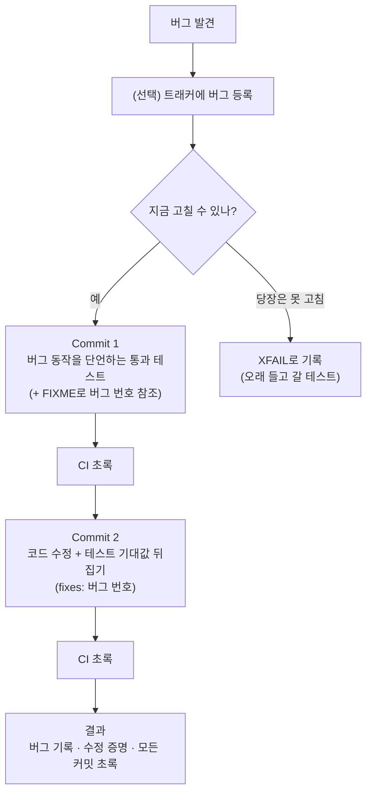

<figure class="post-figure post-figure--header">
<svg role="img" aria-label="두 개의 커밋. Commit 1은 add(2, 2) == 5 를 단언하는 통과 테스트로 버그를 기록하고, Commit 2는 코드를 고치며 기대값을 5에서 4로 뒤집는다. 두 커밋 모두 아래 CI 레일에서 통과 표시를 받는다." viewBox="0 0 400 300" width="420" xmlns="http://www.w3.org/2000/svg">
<title id="kluever-hdr-title">Kluever Maneuver — 두 커밋으로 나눈 버그 수정</title>
<defs>
<marker id="kluever-hdr-arrow" viewBox="0 0 10 10" refX="8" refY="5" markerWidth="6" markerHeight="6" orient="auto-start-reverse"><path d="M0,0 L10,5 L0,10 z" fill="currentColor"/></marker>
</defs>
<rect x="14" y="20" width="174" height="186" rx="6" fill="var(--bg-sunken)" stroke="currentColor" stroke-width="2"/>
<text x="101" y="48" text-anchor="middle" font-size="17" font-weight="700" fill="currentColor">Commit 1</text>
<rect x="30" y="64" width="142" height="80" rx="4" fill="var(--bg-panel)" stroke="var(--orc-green)" stroke-width="2.5"/>
<text x="101" y="96" text-anchor="middle" font-size="16" font-family="D2Coding, SF Mono, Menlo, Consolas, monospace" fill="currentColor">add(2, 2)</text>
<text x="101" y="126" text-anchor="middle" font-size="18" font-weight="700" font-family="D2Coding, SF Mono, Menlo, Consolas, monospace" fill="var(--crimson)">== 5</text>
<text x="101" y="184" text-anchor="middle" font-size="16" fill="currentColor">버그 기록</text>
<line x1="190" y1="104" x2="208" y2="104" stroke="currentColor" stroke-width="2.5" marker-end="url(#kluever-hdr-arrow)"/>
<rect x="212" y="20" width="174" height="186" rx="6" fill="var(--bg-sunken)" stroke="currentColor" stroke-width="2"/>
<text x="299" y="48" text-anchor="middle" font-size="17" font-weight="700" fill="currentColor">Commit 2</text>
<rect x="228" y="64" width="142" height="80" rx="4" fill="var(--bg-panel)" stroke="var(--orc-green)" stroke-width="2.5"/>
<text x="299" y="96" text-anchor="middle" font-size="16" font-family="D2Coding, SF Mono, Menlo, Consolas, monospace" fill="currentColor">add(2, 2)</text>
<text x="247" y="126" font-size="18" font-weight="700" font-family="D2Coding, SF Mono, Menlo, Consolas, monospace" fill="currentColor">==</text>
<text x="276" y="126" font-size="18" font-family="D2Coding, SF Mono, Menlo, Consolas, monospace" fill="var(--crimson)" opacity="0.75">5</text>
<line x1="273" y1="120" x2="290" y2="112" stroke="var(--crimson)" stroke-width="2"/>
<text x="296" y="126" font-size="18" fill="currentColor">→</text>
<text x="322" y="126" font-size="18" font-weight="700" font-family="D2Coding, SF Mono, Menlo, Consolas, monospace" fill="var(--orc-green)">4</text>
<text x="299" y="184" text-anchor="middle" font-size="16" fill="currentColor">수정 + 뒤집기</text>
<text x="16" y="256" font-size="16" font-weight="700" fill="currentColor">CI</text>
<line x1="44" y1="250" x2="386" y2="250" stroke="currentColor" stroke-width="2.5"/>
<line x1="101" y1="208" x2="101" y2="234" stroke="currentColor" stroke-width="2" stroke-dasharray="4 4"/>
<line x1="299" y1="208" x2="299" y2="234" stroke="currentColor" stroke-width="2" stroke-dasharray="4 4"/>
<circle cx="101" cy="250" r="15" fill="var(--orc-green)" stroke="currentColor" stroke-width="2"/>
<path d="M93,250 L99,256 L110,243" fill="none" stroke="var(--bg-panel)" stroke-width="3.5" stroke-linecap="round" stroke-linejoin="round"/>
<circle cx="299" cy="250" r="15" fill="var(--orc-green)" stroke="currentColor" stroke-width="2"/>
<path d="M291,250 L297,256 L308,243" fill="none" stroke="var(--bg-panel)" stroke-width="3.5" stroke-linecap="round" stroke-linejoin="round"/>
<text x="200" y="290" text-anchor="middle" font-size="16" fill="currentColor">모든 커밋에서 CI 통과</text>
</svg>
<figcaption>첫 커밋은 버그가 내놓는 실제 값(== 5)을 단언하는 '끔찍한 테스트'로 버그를 기록하고, 두 번째 커밋은 코드를 고치며 그 기대값을 4로 뒤집는다. 두 커밋 모두 CI는 초록이다.</figcaption>
</figure>

## 원문 정보

> - **제목**: The Kluever Maneuver
> - **출처**: Jordi, *The Scribbler of the Rueful Countenance* ([jordi.inversethought.com](https://jordi.inversethought.com/))
> - **발행**: 2026-10-31 · 약 4분 분량 (원문에 분량 표기 없음, 본문 길이로 추정)
> - **원문 링크**: <https://jordi.inversethought.com/blog/the-kluever-maneuver/>

엔지니어링 습관 하나를 동료에게서 배워 이름까지 붙여 전하는 짧은 블로그 글이다. 기법 자체는 작지만 "테스트가 정말 버그를 잡았는가"라는 질문에 대한 팀 문화 차원의 답이라서 `Engineering-Culture`에 담는다.

## 한 줄 요약 (TL;DR)

버그를 고칠 때는 **커밋을 두 개로 나눠라.** 첫 커밋에는 *현재의 버그 동작을 그대로 단언하는, 그래서 통과하는* 테스트를 넣고, 두 번째 커밋에서 버그를 고치면서 그 테스트의 기대값을 올바른 값으로 뒤집는다. 그러면 버그의 모양이 기록되고, 수정이 실제로 효과가 있었음이 증명되며, CI는 모든 커밋에서 초록으로 유지된다.



## 왜 이 글을 골랐나

버그 수정 PR에 "회귀 테스트 추가"를 곁들이는 건 이미 흔한 관행이다. 그런데 그 테스트가 **수정 전 코드에서도 통과했을지** 확인하는 경우는 생각보다 드물다(내 경험상). 원문은 바로 이 맹점, 즉 "테스트가 있다는 사실이 주는 거짓 확신"을 겨냥한다.

이 위키의 [TDD By Example](/2026/06/19/tdd-by-example.html)이 다루는 Red-Green 사이클은 "실패하는 테스트를 먼저 본다"로 이 문제를 푼다. Kluever Maneuver는 같은 목표를 **커밋 히스토리라는 영구 기록**에 남기면서도 CI를 깨지 않는 변주라는 점에서 흥미롭다. 짧은 글이지만 코드 리뷰와 git 히스토리 관리에 바로 가져다 쓸 수 있다.

## 핵심 내용

### 기법: 버그 수정은 두 커밋으로

원문의 정의는 두 줄이다.

1. 버그 동작을 예시하는 **통과하는 테스트**를 작성한다.
2. 버그를 고치고, **방금 쓴 테스트도 함께 고친다.**

원문의 첫 예시는 의도적으로 단순하다. `add(a, b)`가 `a + b + 1`을 반환하는 버그가 있으면, 첫 커밋에서는 `add(2, 2) == 5`를 단언하는 테스트를 넣는다. 지금 코드에서는 이 테스트가 통과한다. 두 번째 커밋에서 `+ 1`을 지우고 테스트를 `== 4`로 바꾼다. 아래는 원문 diff의 흐름을 그대로 따른 것이다.

```diff
# Commit 1 — 버그를 그대로 기록하는 (통과하는) 테스트
+def test_add(a, b):
+   assert add(2, 2) == 5

# Commit 2 — 버그 수정 + 테스트 뒤집기
 def add(a, b):
-   return a + b + 1
+   return a + b
 def test_add(a, b):
-   assert add(2, 2) == 5
+   assert add(2, 2) == 4
```

### 왜 이렇게 하나: 세 가지 이유

원문이 꼽는 이유는 셋이다.

- 버그가 **현재 정확히 어떻게 동작하는지** 분명히 보여준다.
- 버그 수정이 **실제로 버그를 고쳤다는 증거**가 된다.
- **모든 커밋에서 CI가 통과**한다.

비교 대상은 "버그 수정과 테스트 추가를 한 커밋에 하는" 전통적인 방식이다. 원문의 지적은 이렇다. 추가한 테스트가 사실 수정 전에도 이미 통과하고 있었고, 수정이라고 한 것이 실제로는 효과가 없었다면 어떻게 되는가? 그 테스트는 수정이 통했다는 **거짓 확신**만 준다.

### 덜 뻔한 예시: 나이 계산의 off-by-one

원문은 미성년자 접근을 막는 코드로 이 함정을 구체적으로 보여준다. `age_in_years`는 `today.year - birthday.year`로 **연도만** 빼고, `can_access`는 그 값이 18 이상인지 본다. 원문의 표현대로라면 2026년 10월에 2008년 12월생은 아직 18세가 아니다.

<figure class="post-figure">
<svg role="img" aria-label="위아래 비교. 위: 한 커밋짜리 잘못된 수정. 18 &lt;= 를 18 &lt; 로 바꾸고 2007-01-01생을 2026-01-01에 확인하는 테스트는 수정 전에도 후에도 통과해 아무것도 증명하지 못한다. 아래: Kluever Maneuver. 2008-12-31생을 2026-01-01에 확인하며, Commit 1은 접근 허용을 단언해 통과하고(버그 기록), Commit 2는 나이 계산을 relativedelta로 고치고 테스트를 assert not 으로 뒤집어 통과한다(수정 효과 증명)." viewBox="0 0 380 540" width="440" xmlns="http://www.w3.org/2000/svg">
<title>거짓 수정은 왜 통과하는가 — 한 커밋 수정과 Kluever Maneuver 비교</title>
<defs>
<marker id="kluever-age-arrow" viewBox="0 0 10 10" refX="8" refY="5" markerWidth="6" markerHeight="6" orient="auto-start-reverse"><path d="M0,0 L10,5 L0,10 z" fill="currentColor"/></marker>
</defs>
<rect x="8" y="8" width="364" height="210" rx="6" fill="var(--bg-sunken)" stroke="var(--crimson)" stroke-width="2" stroke-dasharray="7 5"/>
<text x="24" y="38" font-size="17" font-weight="700" fill="currentColor">① 잘못된 수정 (한 커밋)</text>
<text x="24" y="68" font-size="15" fill="currentColor">수정</text>
<text x="70" y="68" font-size="15" font-family="D2Coding, SF Mono, Menlo, Consolas, monospace" fill="currentColor">18 &lt;=  →  18 &lt;</text>
<text x="24" y="94" font-size="15" fill="currentColor">생일</text>
<text x="70" y="94" font-size="15" font-family="D2Coding, SF Mono, Menlo, Consolas, monospace" fill="currentColor">2007-01-01</text>
<text x="24" y="118" font-size="15" fill="currentColor">오늘</text>
<text x="70" y="118" font-size="15" font-family="D2Coding, SF Mono, Menlo, Consolas, monospace" fill="currentColor">2026-01-01</text>
<rect x="24" y="134" width="150" height="34" rx="4" fill="var(--bg-panel)" stroke="currentColor" stroke-width="1.5"/>
<text x="99" y="157" text-anchor="middle" font-size="15" fill="currentColor">수정 전 ✓</text>
<rect x="206" y="134" width="150" height="34" rx="4" fill="var(--bg-panel)" stroke="currentColor" stroke-width="1.5"/>
<text x="281" y="157" text-anchor="middle" font-size="15" fill="currentColor">수정 후 ✓</text>
<text x="190" y="157" text-anchor="middle" font-size="15" fill="currentColor">=</text>
<text x="24" y="200" font-size="16" font-weight="700" fill="var(--crimson)">→ 아무것도 증명 못 함</text>
<rect x="8" y="236" width="364" height="296" rx="6" fill="var(--bg-sunken)" stroke="var(--orc-green)" stroke-width="2.5"/>
<text x="24" y="266" font-size="17" font-weight="700" fill="currentColor">② Kluever Maneuver (두 커밋)</text>
<text x="24" y="294" font-size="15" fill="currentColor">생일</text>
<text x="70" y="294" font-size="15" font-family="D2Coding, SF Mono, Menlo, Consolas, monospace" fill="currentColor">2008-12-31</text>
<text x="24" y="318" font-size="15" fill="currentColor">오늘</text>
<text x="70" y="318" font-size="15" font-family="D2Coding, SF Mono, Menlo, Consolas, monospace" fill="currentColor">2026-01-01</text>
<rect x="24" y="332" width="332" height="58" rx="4" fill="var(--bg-panel)" stroke="currentColor" stroke-width="1.5"/>
<text x="38" y="356" font-size="15" font-weight="700" fill="currentColor">Commit 1 · '접근 허용' 단언 ✓</text>
<text x="38" y="378" font-size="15" fill="currentColor">버그를 그대로 기록</text>
<line x1="190" y1="392" x2="190" y2="404" stroke="currentColor" stroke-width="2" marker-end="url(#kluever-age-arrow)"/>
<rect x="24" y="408" width="332" height="80" rx="4" fill="var(--bg-panel)" stroke="currentColor" stroke-width="1.5"/>
<text x="38" y="432" font-size="15" font-weight="700" fill="currentColor">Commit 2 · 나이 계산 수정</text>
<text x="38" y="454" font-size="15" fill="currentColor"><tspan font-family="D2Coding, SF Mono, Menlo, Consolas, monospace">relativedelta</tspan>로 교체</text>
<text x="38" y="476" font-size="15" fill="currentColor">테스트를 <tspan font-family="D2Coding, SF Mono, Menlo, Consolas, monospace">assert not</tspan>으로 뒤집기 ✓</text>
<text x="24" y="514" font-size="16" font-weight="700" fill="var(--orc-green)">→ 수정 효과 증명</text>
</svg>
<figcaption>위: 엉뚱한 곳(can_access)을 고친 한 커밋 수정은 테스트가 수정 전후 모두 통과해 아무것도 검증하지 못한다. 아래: 버그를 드러내는 입력을 먼저 찾아 '접근 허용'으로 기록한 뒤, 나이 계산을 고치며 '접근 불가'로 뒤집는다.</figcaption>
</figure>

원문 속 가상의 개발자는 이것을 "그냥 off-by-one"이라고 판단하고 `18 <=`를 `18 <`로 바꾼다. 테스트로는 2007년 1월 1일생이 2026년 1월 1일에 접근 가능한지를 확인한다. 원문은 여기서 두 가지를 짚는다.

- 진짜 문제는 `can_access`가 아니라 **나이 계산**에 있다. 그러니 이 수정은 버그 수정이 아니다.
- 제안된 테스트는 **수정 전에도 후에도 통과한다.** 아무것도 검증하지 못하는 테스트다.

Kluever Maneuver를 따랐다면 이 실수는 드러났을 것이라는 게 원문의 주장이다. 첫 커밋에서는 2008년 12월 31일생이 2026년 1월 1일에 접근 가능하다고 단언하는 테스트를 넣는다. 원문 표현대로 "wrongly check"하는, 즉 틀린 사실을 단언하는 테스트이고, 현재 코드에서는 통과한다. 두 번째 커밋에서 나이 계산을 `dateutil`의 `relativedelta(today, birthday).years`로 바꾸고, 같은 테스트를 `assert not ...`으로 뒤집는다. 버그를 재현하는 입력을 먼저 찾아 고정해야 하므로 엉뚱한 곳을 고치기 어려워진다(원문은 이유를 따로 설명하지 않으며, 이 해석은 내 것이다).

### XFAIL을 쓰면 되지 않나?

원문은 이 질문에 두 갈래로 답한다.

- 우선 모든 테스트 프레임워크에 XFAIL에 해당하는 기능이 있지는 않다. 원문은 Java를 예로 든다.
- 그리고 "통과하는 긍정 테스트"와 "실패가 예상되는 긍정 테스트"는 논리적으로 완전히 같지 않다. `@pytest.mark.xfail`을 붙인 `add(2, 2) == 4`는 **지금 결과가 4가 아니라는 것**만 알려줄 뿐, 실제로 무엇인지는 알려주지 않는다. 버그의 성격에 따라 `2 + 2`가 `5`라는 사실을 아는 편이 고치는 방법을 이해하는 데 더 도움이 될 수 있다는 것이 원문의 설명이다.

다만 원문은 균형을 잡는다. 일반적으로 XFAIL도 **대체로 동등**하며, 버그를 **당장 고칠 수 없고 기록만 해 둘 상황**이라면 그 테스트를 오래 끌고 다닐 테니 XFAIL이 더 낫다고 말한다.

### 버그 트래커와 연결하기

원문은 트래커에 버그를 등록하는 것도 좋다고 덧붙인다. 첫 커밋("add a test showing the bug")에서 테스트 옆에 `FIXME: bug #1729`로 버그를 참조하고, 두 번째 커밋 메시지("remove off-by-one error")에 `fixes: #1729`를 적은 뒤 FIXME 줄을 지운다. 그러면 테스트, 코드, 이슈가 커밋 두 개로 묶인다.

### 이름의 유래

원문에 따르면 이 기법을 가르쳐 준 사람은 저자의 동료 **Kurt Kluever**다. 그래서 저자는 이 기법을 떠올릴 때마다 그를 생각한다고 한다. 정작 Kluever 본인은 보통 이를 **"terrible tests"**라고 부른다고 한다. 원문에 적힌 대로 "Jordi, can you please write a terrible test for this?" 같은 요청을 받으면, 저자는 틀렸다고 알고 있는 것을 단언하는 테스트를 쓰러 간다.

## 분석과 인사이트

> 아래는 원문 요약이 아니라 이 글을 읽은 **내 해석과 의견**이다.

### 1. "Red를 본다"를 히스토리에 박제하는 방법

TDD의 Red 단계는 "이 테스트가 실패하는 걸 내 눈으로 봤다"는 개인의 경험이다. 커밋에도 CI 로그에도 남지 않는다. Kluever Maneuver는 이 경험을 **리뷰어가 diff로 검증할 수 있는 형태**로 바꾼다. 두 번째 커밋의 테스트 diff에서 `== 5`가 `== 4`로 바뀌는 것을 보면, 리뷰어는 "이 수정이 관측 가능한 동작을 바꿨다"는 사실을 코드를 돌려 보지 않고도 알 수 있다. 내가 보기에 이 기법의 진짜 가치는 개인 규율보다 **리뷰 가능성(reviewability)**에 있다. [코드 리뷰는 스킬이다](/2026/08/12/reviewing-code-is-a-skill.html)가 강조한 "리뷰어의 버그 잡는 실력"을 거들어 줄 구체적 장치 하나라고 생각한다.

### 2. "모든 커밋이 초록"이라는 조건의 무게

원문은 이유 중 하나로 CI 통과를 짧게 언급하고 넘어가지만, 실무에서는 이게 꽤 중요하다고 본다. 실패하는 테스트를 별도 커밋으로 먼저 올리는 방식은 main에 빨간 커밋을 남기고, 이는 `git bisect` 같은 히스토리 탐색을 방해한다. (`git bisect` 연결은 원문에 없는 내 추론이다.) Kluever Maneuver는 "버그를 먼저 기록한다"와 "히스토리를 깨지 않는다"를 동시에 만족시킨다.

### 3. XFAIL 비교에 덧붙이고 싶은 점

원문의 논점, 즉 "XFAIL은 *아니다*만 말하고 *무엇인지*는 말하지 않는다"에 동의한다. 여기에 내 경험상의 보충을 하나 더하자면, pytest의 `xfail`은 기본값(`strict=False`)에서 테스트가 예상과 달리 통과해도(XPASS) 스위트를 실패시키지 않는다. "어느새 고쳐졌는데 아무도 모르는" 상태가 생길 수 있다는 뜻이다. 장기 보관용으로 XFAIL을 쓴다면 `strict=True`를 고려할 만하다. 이 부분은 원문의 주장이 아니라 내 보충이다.

### 4. 한계와 주의점

- **"터무니없는 테스트"가 남을 위험.** 첫 커밋만 머지되고 두 번째 커밋이 미뤄지면, 잘못된 동작을 *보호하는* 테스트가 코드베이스에 남는다. 원문이 FIXME와 버그 번호를 붙이라고 하는 이유가 여기 있다고 본다. 두 커밋을 **같은 PR**로 묶는 게 안전하다.
- **squash merge와 충돌.** PR을 squash로 머지하는 팀이라면 두 커밋의 구분이 사라진다. 리뷰 시점의 증거로는 남지만, 히스토리에 남기려면 rebase/merge 전략을 맞춰야 한다. (팀 운영에 대한 내 의견이다.)
- **원문 예시 코드의 사소한 흠.** 원문 예시는 설명용 스케치라 그대로 실행되지는 않는다. 예를 들어 `def test_add(a, b):`처럼 테스트 함수에 인자가 있고(pytest라면 픽스처로 해석된다), 나이 예시 두 번째 커밋에서는 `can_access` 대신 `test_can_access`를 호출하며, `FIXME:` 줄에 주석 기호가 없다. 기법의 논지와는 무관하니, 가져다 쓸 때만 다듬으면 된다.

### 5. 문화로서의 "terrible test"

나는 이름의 유래가 오히려 이 글의 핵심이라고 생각한다. "끔찍한 테스트 써 줄래?"라는 요청이 팀 안에서 통한다는 건, **버그를 먼저 정확히 기술하는 일**이 공유된 어휘가 됐다는 뜻이다. 좋은 관행은 문서보다 이런 짧은 이름과 동료 간 요청으로 퍼진다. [구글의 소프트웨어 엔지니어링 — Titus Winters 인터뷰](/2026/10/30/software-engineering-at-google-titus-winters.html)에서 다룬 "변경을 두렵지 않게 만드는 안전망으로서의 테스트"라는 관점과 이어 보면, 커밋 히스토리에 버그의 모양과 수정의 증거를 남기는 이 기법은 미래의 유지보수자를 위한 작은 투자이기도 하다.

## 적용 포인트

- **버그 수정 PR은 커밋 두 개로.** (1) 현재 버그 동작을 단언하는 통과 테스트, (2) 코드 수정 + 테스트 기대값 뒤집기.
- **첫 테스트는 "아니다"가 아니라 "이것이다"로.** `!= 4`가 아니라 `== 5`처럼 버그가 내놓는 실제 값을 단언해 버그의 모양을 기록한다.
- **재현 입력부터 찾기.** 첫 커밋을 쓰려면 버그를 실제로 드러내는 입력이 필요하다. 이 과정에서 "엉뚱한 곳을 고치는" 실수를 걸러낸다.
- **리뷰어 체크리스트에 한 줄 추가.** "두 번째 커밋에서 테스트 기대값이 바뀌었는가?" 바뀌지 않았다면 그 테스트는 수정을 증명하지 못한다.
- **트래커와 묶기.** 첫 커밋에 `FIXME: bug #N`, 두 번째 커밋 메시지에 `fixes: #N`.
- **당장 못 고치면 XFAIL.** 기록만 하고 오래 들고 갈 버그는 XFAIL로 표시한다. pytest라면 `strict=True`도 검토한다(내 제안).
- **두 커밋은 같은 PR로, 머지 전략도 확인.** squash 머지라면 커밋 분리의 이점은 리뷰 단계에서만 남는다는 걸 염두에 둔다.

## 마무리

"The Kluever Maneuver"는 몇 분이면 읽는 글이지만 질문은 날카롭다. 당신이 추가한 회귀 테스트는 수정 전에 정말 실패했는가? 원문의 답은 테스트를 먼저 *틀리게* 쓰는 것이다. 버그를 있는 그대로 기록하는 통과 테스트를 커밋하고, 수정과 함께 그 테스트를 뒤집는다. 그러면 버그의 모양, 수정의 효과, 초록 CI가 모두 히스토리에 남는다. Red-Green의 정신을 리뷰 가능한 형태로 옮긴 작은 습관이고, 동료의 한마디("terrible test 써 줄래?")로 전해졌다는 점도 엔지니어링 문화가 어떻게 퍼지는지 잘 보여준다.

### 더 읽어보기

- [원문 — The Kluever Maneuver (Jordi)](https://jordi.inversethought.com/blog/the-kluever-maneuver/)
- [TDD By Example: 테스트가 이끄는 설계 (Red-Green-Refactor)](/2026/06/19/tdd-by-example.html) — "실패를 먼저 본다"는 Red 단계의 원형
- [TDD, 7년 후: 회고와 현대적 관점](/2026/06/19/tdd-seven-years-after.html) — 테스트 우선 관행을 현실에서 어떻게 조정하는가
- [Refactoring: 동작을 지키며 설계를 개선하는 규율](/2026/06/19/refactoring-improving-design.html) — 작은 단계와 매 단계 초록 유지라는 공통 규율
- [코드 리뷰는 스킬이다](/2026/08/12/reviewing-code-is-a-skill.html) — 리뷰어가 버그를 잡는 능력은 배울 수 있는 스킬이라는 관점
- [구글의 소프트웨어 엔지니어링과 CS 교육 — Titus Winters 인터뷰](/2026/10/30/software-engineering-at-google-titus-winters.html) — 테스트 의무화와 "변경을 두렵지 않게 만드는 안전망"
