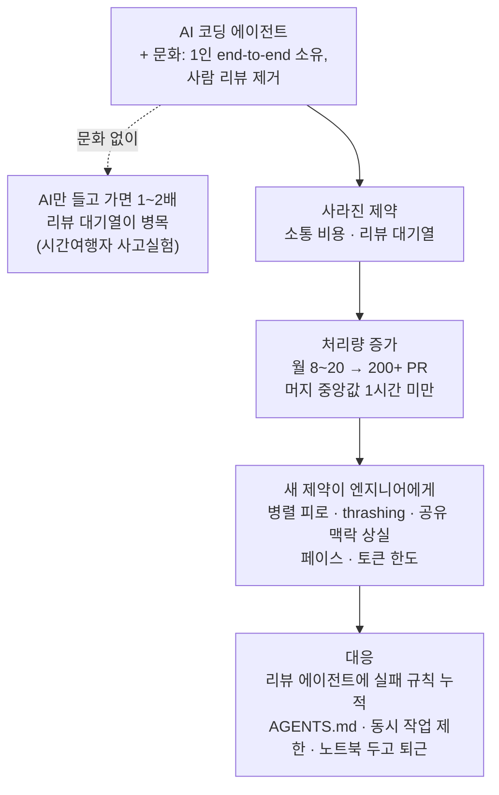

<figure class="post-figure post-figure--header">
<svg role="img" aria-label="두 시대: 사람 리뷰 대기열에서 에이전트 스레드 지휘로. 위 칸은 AI 이전. 엔지니어가 만든 PR 네 장이 승인 대기 줄에 서 있고, 그 앞을 막은 문 너머에 사람 리뷰어 두 명이 있다. 아래 칸은 AI 이후. 엔지니어 한 사람이 점선으로 에이전트 네 개를 동시에 지휘하고, 각 에이전트가 PR을 이어서 내보내 오른쪽 main 줄기로 바로 머지된다." viewBox="0 0 360 444" width="440" xmlns="http://www.w3.org/2000/svg">
  <title id="swe-h-title">두 시대: 사람 리뷰 대기열에서 에이전트 스레드 지휘로</title>
  <desc id="swe-h-desc">위 칸은 AI 이전. 엔지니어가 만든 PR 네 장이 승인 대기 줄에 서 있고, 그 앞을 막은 문 너머에 사람 리뷰어 두 명이 있다. 아래 칸은 AI 이후. 엔지니어 한 사람이 점선으로 에이전트 네 개를 동시에 지휘하고, 각 에이전트가 PR을 이어서 내보내 오른쪽 main 줄기로 바로 머지된다.</desc>
  <defs>
    <marker id="swe-h-arrow" markerWidth="10" markerHeight="10" refX="8" refY="5" orient="auto">
      <path d="M0 0 L10 5 L0 10 Z" fill="var(--accent-color)"/>
    </marker>
    <g id="swe-h-pr">
      <rect x="0" y="0" width="22" height="28" rx="2" fill="var(--bg-light)" stroke="currentColor" stroke-width="1.5"/>
      <path d="M5 9 H17 M5 15 H17 M5 21 H13" stroke="currentColor" stroke-width="1.5" opacity="0.55"/>
    </g>
    <g id="swe-h-person">
      <circle cx="0" cy="-14" r="8" fill="var(--bg-light)" stroke="currentColor" stroke-width="2"/>
      <path d="M-12 14 Q-12 -2 0 -2 Q12 -2 12 14 Z" fill="var(--bg-light)" stroke="currentColor" stroke-width="2"/>
    </g>
    <g id="swe-h-agent">
      <path d="M0 -12 V-17" stroke="var(--secondary-color)" stroke-width="2"/>
      <circle cx="0" cy="-19" r="2.5" fill="var(--secondary-color)"/>
      <rect x="-14" y="-12" width="28" height="24" rx="4" fill="var(--bg-panel)" stroke="var(--secondary-color)" stroke-width="2"/>
      <rect x="-8" y="-5" width="5" height="5" fill="var(--secondary-color)"/>
      <rect x="3" y="-5" width="5" height="5" fill="var(--secondary-color)"/>
      <path d="M-6 6 H6" stroke="var(--secondary-color)" stroke-width="2"/>
    </g>
  </defs>
  <!-- TOP: pre-AI review queue -->
  <rect x="8" y="8" width="344" height="196" rx="8" fill="none" stroke="var(--border-color)" stroke-width="2" stroke-dasharray="6 5"/>
  <text x="24" y="36" font-size="16" font-weight="700" fill="currentColor">AI 이전<tspan dx="8" font-weight="400" fill="var(--text-light)">· 리뷰 대기열</tspan></text>
  <use href="#swe-h-person" x="40" y="128"/>
  <path d="M58 126 H80" stroke="currentColor" stroke-width="2" marker-end="url(#swe-h-arrow)"/>
  <g opacity="0.75">
    <use href="#swe-h-pr" x="88" y="110"/>
    <use href="#swe-h-pr" x="116" y="110"/>
    <use href="#swe-h-pr" x="144" y="110"/>
    <use href="#swe-h-pr" x="172" y="110"/>
  </g>
  <path d="M136 68 H156 L146 80 L156 92 H136 L146 80 Z" fill="none" stroke="var(--gold)" stroke-width="2"/>
  <path d="M212 92 V160" stroke="var(--accent-color)" stroke-width="4"/>
  <path d="M206 92 H218 M206 160 H218" stroke="var(--accent-color)" stroke-width="3"/>
  <use href="#swe-h-person" x="256" y="128"/>
  <use href="#swe-h-person" x="306" y="128"/>
  <text x="141" y="168" text-anchor="middle" font-size="15" fill="var(--text-light)">승인 대기</text>
  <text x="281" y="168" text-anchor="middle" font-size="15" fill="var(--text-light)">리뷰어</text>
  <!-- BOTTOM: AI-native, one engineer conducting agents -->
  <rect x="8" y="216" width="344" height="220" rx="8" fill="none" stroke="currentColor" stroke-width="2"/>
  <text x="24" y="242" font-size="16" font-weight="700" fill="currentColor">AI 이후<tspan dx="8" font-weight="400" fill="var(--text-light)">· 에이전트 지휘</tspan></text>
  <text x="318" y="262" text-anchor="middle" font-size="15" fill="var(--text-light)">머지</text>
  <g stroke="currentColor" stroke-width="1.5" stroke-dasharray="4 4" fill="none">
    <path d="M60 336 L134 284"/>
    <path d="M62 340 L134 328"/>
    <path d="M62 346 L134 372"/>
    <path d="M60 350 L134 416"/>
  </g>
  <use href="#swe-h-person" x="48" y="346"/>
  <path d="M318 272 V428" stroke="var(--accent-color)" stroke-width="3"/>
  <g>
    <use href="#swe-h-agent" x="152" y="284"/>
    <use href="#swe-h-pr" x="178" y="270"/>
    <use href="#swe-h-pr" x="204" y="270"/>
    <use href="#swe-h-pr" x="230" y="270"/>
    <path d="M258 284 H306" stroke="var(--accent-color)" stroke-width="2" marker-end="url(#swe-h-arrow)"/>
    <use href="#swe-h-agent" x="152" y="328"/>
    <use href="#swe-h-pr" x="178" y="314"/>
    <use href="#swe-h-pr" x="204" y="314"/>
    <use href="#swe-h-pr" x="230" y="314"/>
    <path d="M258 328 H306" stroke="var(--accent-color)" stroke-width="2" marker-end="url(#swe-h-arrow)"/>
    <use href="#swe-h-agent" x="152" y="372"/>
    <use href="#swe-h-pr" x="178" y="358"/>
    <use href="#swe-h-pr" x="204" y="358"/>
    <use href="#swe-h-pr" x="230" y="358"/>
    <path d="M258 372 H306" stroke="var(--accent-color)" stroke-width="2" marker-end="url(#swe-h-arrow)"/>
    <use href="#swe-h-agent" x="152" y="416"/>
    <use href="#swe-h-pr" x="178" y="402"/>
    <use href="#swe-h-pr" x="204" y="402"/>
    <use href="#swe-h-pr" x="230" y="402"/>
    <path d="M258 416 H306" stroke="var(--accent-color)" stroke-width="2" marker-end="url(#swe-h-arrow)"/>
  </g>
  <g fill="var(--accent-color)">
    <circle cx="318" cy="284" r="5"/><circle cx="318" cy="328" r="5"/><circle cx="318" cy="372" r="5"/><circle cx="318" cy="416" r="5"/>
  </g>
</svg>
<figcaption>AI 이전에는 PR이 사람 리뷰어 앞에 줄을 섰고, AI 이후에는 한 사람이 여러 에이전트 스레드를 동시에 돌려 PR을 바로 머지한다.</figcaption>
</figure>

## 원문 정보

> - **제목**: How software engineering is changing: a tale of two eras
> - **출처**: The Pragmatic Engineer (Gergely Orosz 발행, [newsletter.pragmaticengineer.com](https://newsletter.pragmaticengineer.com/)) — 에세이 본문 저자는 Neil Kakkar, 서문과 "Takeaways"는 Gergely Orosz
> - **발행**: 2026-11-03 · 분량 표기 없음(Substack 메타데이터 기준 본문 약 5,900단어)
> - **원문 링크**: <https://newsletter.pragmaticengineer.com/p/how-software-engineering-is-changing>

> **출처 공개 범위 안내**: 이 글은 유료 독자 전용이 아닌 전체 공개 글이다(Substack 페이지의 공개 대상 설정이 "everyone"). 따라서 서문, 에세이 본문 4개 장 전체, Gergely의 "Takeaways"까지 모두 공개된 텍스트로 읽고 정리했다. 다만 본문에 들어 있는 차트·표·스크린샷 이미지(월별 PR 수, 처리량·PR 크기 통계, 작업 영역 히트맵 등)는 **캡션만** 확인했고 이미지 속 수치는 옮기지 않았다. 아래의 숫자는 모두 본문 텍스트에 나온 것이다.

The Pragmatic Engineer가 2026년 9월 창간 5주년을 맞아 연 에세이 챌린지(상금 $10,000)의 우승작이다. 125편이 응모했다. 한 엔지니어가 자기 PR 데이터로 'AI 이전과 이후'를 대조한 기록이라 Engineering-Culture에 담는다.

## 한 줄 요약 (TL;DR)

2025년까지 월 8~20개 PR을 머지하던 엔지니어(직전 직장은 pre-AI 스타트업 PostHog)가 AI-native 스타트업 Tano에서는 월 200개 이상을 머지한다. 이 차이는 AI만이 아니라 **사람 코드 리뷰를 없애고 한 사람이 처음부터 끝까지 맡는 문화**가 함께 만든 것이다. 대신 병목은 사라지지 않고 **엔지니어 자신에게로 옮겨 왔다**(병렬 작업 피로, 반응형 thrashing, 공유 맥락 상실, 페이스 조절, 토큰 한도). Gergely는 "반복 속도 자체는 사업 성공의 증거가 아니다"라는 단서를 붙인다.

## 왜 이 글을 골랐나

AI 이전과 이후로 소프트웨어를 만드는 방식이 무엇이 바뀌었는지를 **한 사람의 실측 데이터**로 짚은 글이다. "AI를 도입하면 빨라진다"가 아니라 "어떤 제약이 사라지고 어떤 제약이 새로 생기는가"를 보여 주므로, 팀의 **AI Native 개발 방식**을 설계하는 리드가 무엇을 걷어 내고 어떤 안전장치를 새로 깔아야 하는지 따져 볼 재료가 된다.

글 전체의 흐름을 한 장으로 보면 다음과 같다.

## 핵심 내용

### 서문 — 에세이 챌린지와 저자

Gergely에 따르면 2026년 9월 뉴스레터 5주년에 "테크 업계 일터와 프로젝트에서 무엇이 바뀌었나"를 주제로 에세이 챌린지를 열었고 125편이 들어왔다. 우승자 Neil Kakkar는 런던에서 일하는 9년 차 개발자로 Google 인턴, Bloomberg, PostHog, Tano를 거쳤다. Gergely는 Neil이 자기 산출 변화를 보여 주려고 모은 **데이터의 양**을 높이 평가한다. 오픈소스인 PostHog에서 일한 덕에 과거 데이터를 모으기 쉬웠을 것이라는 언급도 있다.

세 직장의 규모 차이가 이 글의 비교 축이다.

| 회사 | 재직 | 규모(본문 기준) | 성격 |
| --- | --- | --- | --- |
| Bloomberg | 3년 | 약 20,000명, 정해진 프로세스 | 대형 핀테크 사기업 |
| PostHog | 4년 | 입사 때 약 10명 → 현재 200명 | 빠른 pre-AI 스타트업 |
| Tano | 약 8개월(2026년 입사) | 첫 엔지니어 → 현재 총 10명 안팎 | AI 에이전트 등장 이후 창업한 AI-native 스타트업 |

Neil은 처음부터 단서를 단다. PostHog 수치는 pre-AI 시절 것이고, 지금의 PostHog는 "AI-pilled" 상태라 산출이 크게 늘고 있다. 이 글에서는 PostHog를 뛰어난 엔지니어링의 **'pre-AI 기준선'**으로 쓴다는 것이다.

### 1. 두 시대의 배포량

- Tano에서는 PostHog보다 PR을 **11배**, PostHog에서는 Bloomberg보다 **2.4배** 더 냈다. (Gergely의 서문 요약은 "월 8~20개 → 200개 이상, 약 10배"라고 적는다.)
- Bloomberg와 PostHog에서는 모든 코드가 동료 리뷰를 거쳐야 했고, 시니어가 된 뒤에는 리뷰에 시간을 많이 썼다.
- Neil 스스로 "PR은 쉽게 조작될 수 있는 지표"라고 인정하면서, 숫자를 부풀리려 하지 않았으니 실제 일의 양을 정직하게 보여 준다고 말한다. 그 근거로 두 회사에서 한 일을 나열한다. PostHog에서는 45개월 동안 수집 파이프라인, ClickHouse 위의 퍼널·리텐션 쿼리 최적화(10억 건 이상 이벤트 규모), 실험(experimentation) 제품을 바닥부터 구축했고, Feature Success 팀을 이끌며 surveys와 early access features를 만들었다. Tano에서는 비슷한 폭의 일을 **8개월**에 했다. 어필리에이트 플랫폼, 콘텐츠 모니터링 효율화, 에이전트 아키텍처 전체를 영속 메모리·더 나은 도구·관측성을 갖춘 새 시스템으로 옮기는 마이그레이션 등이다.

**지금 일하는 방식**도 구체적으로 적는다.

- PostHog 시절(2024년 말까지) AI는 탭 자동완성 수준이었다.
- Tano에서는 CLI 대신 **Claude Code Desktop**을 쓴다. 통합 브라우저를 Claude에게 맡길 수 있어서 자기 브라우저를 빼앗기지 않는다는 점을 좋아한다.
- 동시에 **3~5개** 일을 돌린다. 계획을 먼저 함께 훑은 다음 대부분은 에이전트가 PR을 만들고 코멘트까지 처리할 때까지 둔다. 결과는 **모든 PR마다 Claude가 생성하도록 지시해 둔 HTML 요약 아티팩트**로 확인한다.
- 기능 하나를 끝까지 만드는 에이전트 실행은 리뷰·검증·스크린샷까지 포함해 보통 **1~2시간**이 걸린다.
- 클라우드 에이전트는 아직 쓰지 않는다. 기본 제공 Claude 클라우드 에이전트로는 로컬처럼 돌리기에 제약이 크다고 보며, 자체 클라우드 에이전트를 만드는 건 (아직은) 큰 회사에나 맞는 투자라고 본다.

### 2. 사라진 옛 제약

Neil은 AI만으로는 11배가 나오지 않는다고 말한다. 그가 드는 사고실험이 있다. 2026년의 AI를 몰래 들고 리뷰가 의무인 pre-AI PostHog로 간 시간여행자는 **기껏해야 1~2배** 빨라질 것이다. 병목이 '작성'에서 'PR 승인'으로 옮겨 가고, 내 PR이 빨리 나올수록 리뷰 대기열만 길어지기 때문이다.

**소통 비용.** Tano 엔지니어는 최대한 독립적으로 일한다. 제품 전체에 영향을 주는 큰 아키텍처 결정만 함께 논의하고, 나머지는 신뢰를 바탕으로 각자 판단한다. 불확실하거나 위험이 있으면 본인이 알리고 트레이드오프를 따진다. PostHog에서 surveys V1은 엔지니어 2명과 디자이너 1명이 한 달에 걸쳐 만들었다. 지금 같은 기능을 만든다면 디자인·프론트엔드·백엔드를 **한 사람이 처음부터 끝까지 맡는 편이 훨씬 효율적**이고, Claude Code로 그게 가능하다는 것이 Neil의 판단이다. 단, 모르는 것을 모르는 상황(unknown unknowns)은 여전히 함께 이야기할 가치가 있다고 덧붙인다.

**코드 리뷰.** Tano에서 코드 리뷰는 코드베이스에 익숙해진 뒤로는 **선택 사항**이다. 거기까지 걸리는 시간은 사람마다 다르다. Neil은 3주 만에 자신이 생겼고 경험에 따라 8주까지 걸린다. Neil이 Claude Code GitHub Actions로 만든 **리뷰 에이전트**가 CI에서 모든 PR에 돌고, 위험한 변경에는 필요할 때 실행하는 더 깊은 에이전트도 있다. 대부분의 PR은 이 자동 리뷰가 유일한 리뷰다.

물론 사고도 난다. Neil이 직접 든 두 사례는 다음과 같다.

- **통화 최소 단위 버그**: 에이전트가 최소 단위를 float으로 파싱하고 100을 곱했다. 모든 통화의 최소 단위가 1/100인 것은 아니다(바레인 디나르는 1디나르 = 1,000 fulūs). 이미 통화 계산 유틸리티가 있었으니 사람 리뷰어였다면 그걸 쓰지 않은 점을 잡았을 것이라고 인정한다. 배포 직후 리포트 숫자가 맞지 않는 걸 보고 **1시간 안에** 고쳤다.
- **블로킹 마이그레이션**: Postgres의 posts 테이블(약 25GB, 600만 행)에 partial index를 추가하는 마이그레이션이 쓰기를 막아 수집 파이프라인이 새 게시물을 저장하지 못했고, 타임아웃 탓에 새 배포도 실패했다. 이후 이런 마이그레이션은 모두 [concurrently](https://www.postgresql.org/docs/current/sql-createindex.html)로 실행한다. 그리고 **새로 발견한 실패 방식은 리뷰 에이전트에 추가한다.** 지금 리뷰 에이전트는 가장 큰 테이블 목록을 알고 있고, 그 테이블에 대한 블로킹 마이그레이션을 허용하지 않는다.

<figure class="post-figure">
<svg role="img" aria-label="실패를 리뷰 에이전트의 규칙으로 바꾸는 루프. 네 단계가 위에서 아래로 이어진다. 1 사고 발생: 블로킹 마이그레이션이 쓰기를 막아 수집이 멈추고 배포가 실패. 2 재발 방지 조치: 이후 이런 마이그레이션은 concurrently로 실행. 3 리뷰 에이전트에 규칙 추가: 가장 큰 테이블 목록과 블로킹 마이그레이션 금지. 4 다음 PR부터 CI의 리뷰 에이전트가 모든 PR을 검사해 차단. 오른쪽의 점선 화살표가 맨 아래에서 맨 위로 돌아가며, 새 실패 방식이 나올 때마다 반복됨을 나타낸다." viewBox="0 0 360 464" width="440" xmlns="http://www.w3.org/2000/svg">
  <title id="swe-l-title">실패를 리뷰 에이전트의 규칙으로 바꾸는 루프</title>
  <desc id="swe-l-desc">네 단계가 위에서 아래로 이어진다. 1 사고 발생: 블로킹 마이그레이션이 쓰기를 막아 수집이 멈추고 배포가 실패. 2 재발 방지 조치: 이후 이런 마이그레이션은 concurrently로 실행. 3 리뷰 에이전트에 규칙 추가: 가장 큰 테이블 목록과 블로킹 마이그레이션 금지. 4 다음 PR부터 CI의 리뷰 에이전트가 모든 PR을 검사해 차단. 오른쪽의 점선 화살표가 맨 아래에서 맨 위로 돌아가며, 새 실패 방식이 나올 때마다 반복됨을 나타낸다.</desc>
  <defs>
    <marker id="swe-l-arrow" markerWidth="10" markerHeight="10" refX="8" refY="5" orient="auto">
      <path d="M0 0 L10 5 L0 10 Z" fill="var(--accent-color)"/>
    </marker>
  </defs>
  <text x="160" y="26" text-anchor="middle" font-size="16" font-weight="700" fill="currentColor">실패 → 리뷰 규칙 루프</text>
  <!-- 1 incident (dashed) -->
  <rect x="16" y="42" width="288" height="84" rx="6" fill="var(--bg-light)" stroke="var(--accent-color)" stroke-width="2" stroke-dasharray="6 4"/>
  <text x="30" y="66" font-size="16" font-weight="700" fill="var(--accent-color)">① 사고 발생</text>
  <text x="30" y="89" font-size="15" fill="currentColor">블로킹 마이그레이션이 쓰기 차단</text>
  <text x="30" y="110" font-size="15" fill="var(--text-light)">→ 수집 중단, 배포 실패</text>
  <path d="M160 128 V148" stroke="currentColor" stroke-width="2.5" marker-end="url(#swe-l-arrow)"/>
  <!-- 2 prevention -->
  <rect x="16" y="152" width="288" height="66" rx="6" fill="var(--bg-light)" stroke="currentColor" stroke-width="1.5"/>
  <text x="30" y="176" font-size="16" font-weight="700" fill="currentColor">② 재발 방지 조치</text>
  <text x="30" y="200" font-size="15" fill="var(--text-light)">이후 마이그레이션은 concurrently</text>
  <path d="M160 220 V240" stroke="currentColor" stroke-width="2.5" marker-end="url(#swe-l-arrow)"/>
  <!-- 3 add rule (emphasised) -->
  <rect x="16" y="244" width="288" height="88" rx="6" fill="var(--bg-light)" stroke="var(--secondary-color)" stroke-width="3.5"/>
  <text x="30" y="268" font-size="16" font-weight="700" fill="var(--secondary-color)">③ 리뷰 에이전트에 규칙 추가</text>
  <text x="30" y="292" font-size="15" fill="currentColor">가장 큰 테이블 목록 +</text>
  <text x="30" y="314" font-size="15" fill="currentColor">블로킹 마이그레이션 금지</text>
  <path d="M160 334 V354" stroke="currentColor" stroke-width="2.5" marker-end="url(#swe-l-arrow)"/>
  <!-- 4 auto block -->
  <rect x="16" y="358" width="288" height="88" rx="6" fill="var(--bg-light)" stroke="currentColor" stroke-width="1.5"/>
  <text x="30" y="382" font-size="16" font-weight="700" fill="currentColor">④ 다음 PR부터 자동 차단</text>
  <text x="30" y="406" font-size="15" fill="var(--text-light)">CI의 리뷰 에이전트가</text>
  <text x="30" y="428" font-size="15" fill="var(--text-light)">모든 PR을 검사</text>
  <!-- return path -->
  <path d="M304 402 H326 V84 H314" fill="none" stroke="var(--accent-color)" stroke-width="2" stroke-dasharray="5 4" marker-end="url(#swe-l-arrow)"/>
  <text transform="translate(347 243) rotate(-90)" text-anchor="middle" font-size="15" fill="var(--accent-color)">새 실패 방식마다 반복</text>
</svg>
<figcaption>Tano는 사고 뒤 재발 방지 조치를 정하고, 새로 발견한 실패 방식을 리뷰 에이전트의 규칙으로 누적한다(블로킹 마이그레이션 사례).</figcaption>
</figure>

결과 지표도 텍스트로 제시된다. Tano의 **revert 비율은 PostHog의 6분의 1**이다. Neil은 그 이유로 대부분 되돌리지 않고 forward fix를 하기 때문이라는 점을 먼저 들고, 모델이 좋아지면서 자동 리뷰와 에이전트가 버그를 덜 만드는 점도 꼽는다. 머지를 기다릴 사람이 없으니 **머지까지 걸리는 시간의 중앙값은 1시간 미만**이다. 속도·리뷰 통계 차트는 PostHog(2021년 5월~2025년 1월)와 Tano(2026년 1~9월) 기간을 대상으로 한다.

**무엇을 만들지 'context-maxxing'.** 회사가 작아질수록 엔지니어와 PM의 역할이 합쳐진다. Bloomberg는 팀마다 전담 PM이 있었고, PostHog는 PM 한 명이 여러 팀을 맡았으며, Tano에는 PM이 없다. 매주 월요일 로드맵 세션에서 각자 문제를 가져오고, CEO·CTO가 이탈 위험이나 영업 성사에 필요한 기능 같은 맥락을 준다. 일은 엔지니어별로 나눈다. Neil의 말로는 "한 달 걸리던 일이 이제 자주 일주일에 끝난다."

**빠르게 움직이고 부숴라.** PostHog의 person-on-events 마이그레이션(200억 건 이상 이벤트 테이블에서 조인을 없애는 작업)은 1년이 걸렸고 코드는 전부 손으로 고쳤다. 다시 하기 어려운 일이라 미래까지 대비해 신중하게 했다. Tano는 자유 형식 체크리스트 기반 에이전트를, 과업마다 제한된 도구 세트를 가진 워크플로로 바꾸는 마이그레이션과 그 후속 마이그레이션을 **몇 주 만에** 끝냈다. 두 번째 마이그레이션에서 가드레일을 빠뜨려 크리에이터에게 **같은 작업 대가가 두 번 지급**되기도 했지만, 새 아키텍처로 더 빨리 확장하기 위해 기꺼이 감수한 트레이드오프였다고 말한다. 핵심 문장은 이것이다.

> "Our product architecture went from a mostly irreversible decision to a reversible one"

되돌릴 수 있게 되니 처음부터 모든 세부를 맞출 필요가 없고, 운영 환경에서 정보를 얻어 빠르게 고치는 쪽으로 최적화할 수 있다는 것이다.

### 3. 새로 생긴 제약

Neil은 이 장을 이렇게 연다.

> "The bottlenecks aren't gone, they just move on to me."

- **병렬로 만들기**: 거의 항상 여러 프로젝트를 동시에 한다. 동시에 하는 일의 수를 제한해도 AI 에이전트 이전보다 정신적으로 훨씬 소모된다. 월별 작업 영역 히트맵에서 Tano 쪽 칸이 훨씬 꽉 차 있다.
- **Thrashing**: 고치기가 쉬워지자 일이 반응형이 됐다. 새 이슈가 들어오면 사람이 거의 관여하지 않아도 한 시간이면 끝난다는 걸 알기 때문에 바로 Claude 세션을 띄운다. CS의 thrashing(작업 수행보다 작업 전환에 시간을 더 쓰는 상태)처럼, 스프린트 목표 대신 그날그날의 버그에 끌려다닌다. 처방도 CS와 같다. 동시성을 제한하고 우선순위가 가장 높은 것부터 끝낸다.
- **공유 맥락 상실**: 사람 리뷰가 사라지면서 Neil도 경력자 동료의 코드를 거의 읽지 않게 됐다. PostHog에서는 모든 PR 피드를 읽으며 동료가 무엇을 하는지 파악했다(회사가 20명에서 ~100명이 되면서 하루 PR이 15개에서 30개로 늘어 결국 불가능해졌지만). Tano도 하루 약 30개를 머지한다. 사일로가 생기고 **버스 팩터**가 1로 떨어진다. Neil이 내놓는 해법은 AI다. 제품 영역마다 [AGENTS.md](https://agents.md)에 맥락을 잘 적어 두면 누구든 AI와 함께 배우며 바로 기여할 수 있다는 것이다. 'PR 리뷰 수 / 머지 수' 비율 차트에서 Tano의 값은 거의 0이다.
- **페이스 조절**: PostHog에서는 오전에 코드를 쓰고 오전 10시~오후 3시에 PR을 열어 승인을 기다리는 리듬이었다. Tano에서는 PR이 하루 종일 흩어져 올라온다. 입사 초에는 오전에 일을 몰아넣고 여러 흐름을 동시에 돌리다 오후 3시면 바닥났다. 이제는 중요한 일부터 하고, 열 가지를 동시에 하지 않고, 지친 저녁에는 중요한 변경을 하지 않는다.
- **일하는 습관**: 저녁마다 노트북을 회사에 두고 에이전트를 로컬에서 계속 돌린다. 오전 9~11시에 여는 PR 비중이 Tano에서는 18%, PostHog에서는 9%였다. 노트북을 두고 퇴근하는 것은 '선을 긋는' 가드레일이기도 하다. "AI가 저기서 기다리는데 나는 자고 있나?" 하는 압박을 Neil은 이렇게 재정의했다. *"there's more to life than just building."*
- **디자인**: 초기 스타트업들이 디자인을 가볍게 보는 경향이 보인다고 한다. AI 디자인은 서로 비슷하고, 튀려고 쓰는 neo-brutalism조차 AI가 만들면 비슷해진다. Tano도 그렇게 됐고 지금 브랜드를 다시 고민하고 있다.
- **AI 한도**: Tano에 '무한' AI 예산은 없다. 모두 Claude Max 20x 플랜 하나씩이다. API 요금으로 따지면 Neil의 사용량은 **월 $8,000 이상**이다. AI를 로그를 보고 고치는 자율 팀원처럼 돌릴 때 한도에 더 자주 걸리는데, 한도가 오히려 가장 중요한 일에 집중하게 만든다. 그러면서도 토큰 제한이 없다면 어디까지 갈 수 있을지 실험해 보고 싶다고 말한다.

<figure class="post-figure">
<svg role="img" aria-label="병목의 이동: 사람 사이에서 엔지니어 한 사람에게로. 위 칸은 AI 이전의 병목 네 가지로, 모두 취소선이 그어져 있고 무엇이 해소했는지가 적혀 있다. 코드 작성은 AI 에이전트가, 사람 리뷰 대기열은 리뷰 에이전트가, 팀 간 소통 비용은 1인 end-to-end 소유가, PM·로드맵 대기는 엔지니어의 PM 역할 흡수가 해소했다. 가운데 화살표는 병목이 엔지니어에게로 옮겨 갔음을 뜻한다. 아래 칸은 AI 이후 새로 생긴 병목 다섯 가지: 병렬 작업 피로, 반응형 thrashing, 공유 맥락 상실, 페이스 조절, 토큰 한도." viewBox="0 0 360 620" width="440" xmlns="http://www.w3.org/2000/svg">
  <title id="swe-s-title">병목의 이동: 사람 사이에서 엔지니어 한 사람에게로</title>
  <desc id="swe-s-desc">위 칸은 AI 이전의 병목 네 가지로, 모두 취소선이 그어져 있고 무엇이 해소했는지가 적혀 있다. 코드 작성은 AI 에이전트가, 사람 리뷰 대기열은 리뷰 에이전트가, 팀 간 소통 비용은 1인 end-to-end 소유가, PM·로드맵 대기는 엔지니어의 PM 역할 흡수가 해소했다. 가운데 화살표는 병목이 엔지니어에게로 옮겨 갔음을 뜻한다. 아래 칸은 AI 이후 새로 생긴 병목 다섯 가지: 병렬 작업 피로, 반응형 thrashing, 공유 맥락 상실, 페이스 조절, 토큰 한도.</desc>
  <defs>
    <marker id="swe-s-arrow" markerWidth="10" markerHeight="10" refX="8" refY="5" orient="auto">
      <path d="M0 0 L10 5 L0 10 Z" fill="var(--accent-color)"/>
    </marker>
  </defs>
  <!-- TOP: pre-AI (dissolved) -->
  <rect x="8" y="8" width="344" height="246" rx="8" fill="none" stroke="var(--border-color)" stroke-width="2" stroke-dasharray="6 5"/>
  <text x="24" y="36" font-size="16" font-weight="700" fill="currentColor">AI 이전 (Bloomberg·PostHog)</text>
  <text x="24" y="58" font-size="15" fill="var(--text-light)">병목: 사람과 사람 사이</text>
  <g font-size="15">
    <rect x="26" y="77" width="12" height="12" fill="none" stroke="currentColor" stroke-width="1.5"/>
    <text x="48" y="88" fill="currentColor" text-decoration="line-through">코드 작성</text>
    <text x="48" y="108" fill="var(--text-light)">↳ AI 에이전트가 해소</text>
    <rect x="26" y="123" width="12" height="12" fill="none" stroke="currentColor" stroke-width="1.5"/>
    <text x="48" y="134" fill="currentColor" text-decoration="line-through">사람 리뷰 대기열</text>
    <text x="48" y="154" fill="var(--text-light)">↳ 리뷰 에이전트로 대체</text>
    <rect x="26" y="169" width="12" height="12" fill="none" stroke="currentColor" stroke-width="1.5"/>
    <text x="48" y="180" fill="currentColor" text-decoration="line-through">팀 간 소통 비용</text>
    <text x="48" y="200" fill="var(--text-light)">↳ 1인 end-to-end 소유</text>
    <rect x="26" y="215" width="12" height="12" fill="none" stroke="currentColor" stroke-width="1.5"/>
    <text x="48" y="226" fill="currentColor" text-decoration="line-through">PM·로드맵 대기</text>
    <text x="48" y="246" fill="var(--text-light)">↳ 엔지니어가 PM 역할 흡수</text>
  </g>
  <!-- MIDDLE: shift arrow -->
  <path d="M60 262 V306" stroke="var(--accent-color)" stroke-width="4" marker-end="url(#swe-s-arrow)"/>
  <text x="84" y="282" font-size="16" font-weight="700" fill="var(--accent-color)">병목은 사라지지 않고</text>
  <text x="84" y="303" font-size="16" font-weight="700" fill="var(--accent-color)">엔지니어에게로 이동</text>
  <!-- BOTTOM: AI-native (new) -->
  <rect x="8" y="318" width="344" height="294" rx="8" fill="none" stroke="var(--accent-color)" stroke-width="2.5"/>
  <text x="24" y="346" font-size="16" font-weight="700" fill="currentColor">AI 이후 (Tano)</text>
  <text x="24" y="368" font-size="15" fill="var(--text-light)">병목: 엔지니어 한 사람</text>
  <g font-size="15">
    <rect x="26" y="387" width="12" height="12" fill="var(--accent-color)"/>
    <text x="48" y="398" font-weight="700" fill="currentColor">병렬 작업 피로</text>
    <text x="48" y="418" fill="var(--text-light)">여러 흐름을 동시에 돌리는 소모</text>
    <rect x="26" y="433" width="12" height="12" fill="var(--accent-color)"/>
    <text x="48" y="444" font-weight="700" fill="currentColor">반응형 thrashing</text>
    <text x="48" y="464" fill="var(--text-light)">그날그날 버그에 끌려다님</text>
    <rect x="26" y="479" width="12" height="12" fill="var(--accent-color)"/>
    <text x="48" y="490" font-weight="700" fill="currentColor">공유 맥락 상실</text>
    <text x="48" y="510" fill="var(--text-light)">사일로, 버스 팩터 1</text>
    <rect x="26" y="525" width="12" height="12" fill="var(--accent-color)"/>
    <text x="48" y="536" font-weight="700" fill="currentColor">페이스 조절</text>
    <text x="48" y="556" fill="var(--text-light)">오후 3시면 바닥나던 체력</text>
    <rect x="26" y="571" width="12" height="12" fill="var(--accent-color)"/>
    <text x="48" y="582" font-weight="700" fill="currentColor">토큰 한도</text>
    <text x="48" y="602" fill="var(--text-light)">1인당 Claude Max 20x 플랜 하나</text>
  </g>
</svg>
<figcaption>병목의 이동: 리뷰·소통·PM 대기는 AI와 조직 설계로 걷혔고, 그 자리에 병렬 작업 피로·thrashing·공유 맥락 상실·페이스·토큰 한도가 엔지니어 한 사람의 새 병목으로 들어섰다.</figcaption>
</figure>

### 4. AI는 소프트웨어 엔지니어링을 어떻게 바꾸고 있나

- **AI는 속도 승수다.** PostHog는 제품 분석 시장에 10년 늦게 들어왔지만 빠른 실행으로 따라잡았다. 지금은 AI를 쓰는 스타트업이 쓰지 않는 스타트업을 앞지른다.
- **회사 전체가 함께하지 않으면 효과가 제한된다.** Neil의 표현을 그대로 옮기면 *"It's clear that AI is necessary, but it's not sufficient."* 리뷰가 의무인 조직에서는 리뷰 대기열이 끝없이 늘어난다.
- **일하는 방식을 실험하게 두는 조직이 낫다.** 노트북을 두고 퇴근해 에이전트를 밤새 돌리는 것을 막지 않는 것이 그 예다.
- **새 제약이 생기면 알아보고 걷어 내는 조직이 낫다.** 예로 Anthropic을 든다. 코드 리뷰를 자동화하자 [CI가 제약](https://claude.com/resources/articles/agentic-coding-is-straining-ci-heres-how-we-scaled-test-impact-analysis-at-anthropic)이 됐고, CI를 풀자 소스 컨트롤이 따라오지 못해 [소스 컨트롤을 재설계](https://www.anthropic.com/research/redesigning-source-control)했다는 것이다. 대부분의 스타트업이 거기까지 가지는 않겠지만, AI를 제한하거나 아니면 받아들이고 새 제약이 어디서 생기는지 찾아 자동화로 푸는 것 중 하나라는 원칙은 같다고 말한다.
- 결론으로 Neil은 실험하고, 틀릴 수 있음을 받아들이고, 겸손하고 호기심 있는 문화를 꼽는다. 그리고 문화가 모든 AI 시대 스타트업 성공의 **필요충분조건**("a necessary – and sufficient – condition")이라고 믿는다고 쓴다.

### Takeaways — Gergely의 코멘트

- Neil의 10배 증가에는 **두 힘이 섞여 있다.** ① 2026년 1월 이후 업계 전반이 AI 코딩 에이전트를 더 많이 도입했고, 업계 평균 PR 산출은 약 **2배** 늘었다([PR 빈도와 AI 비용 딥다이브](https://newsletter.pragmaticengineer.com/p/whats-the-roi-of-software-engineers)에서 다룬 내용). ② Neil은 빠른 pre-AI 스타트업에서 너무 빨리 움직여도 위험에 처할 것이 없는 더 젊은 AI-native 스타트업으로 옮겼다.
- 단서도 붙인다. *"iteration speed is pretty meaningless by itself, without looking at things like finding product-market-fit, generating revenue, or having healthy unit economics."*
- AI-native 스타트업의 이점은 **일시적일 수 있다.** pre-AI 스타트업도 결국 따라잡겠지만, 잘 돌아가는 사업이 있으면 프로세스와 도구를 바꾸는 데 더 신중해야 한다. *"The last thing you want to do is to break your business by being careless!"*
- Neil이 AI 사용의 압박과 가드레일을 이야기한 점을 높이 산다. 2026년 3월 Steve Yegge와 나눈 ["Dracula-effect"](https://newsletter.pragmaticengineer.com/p/from-ides-to-ai-agents-with-steve) 대화, 즉 AI 에이전트가 엔지니어의 에너지를 빨아들이는 것처럼 보인다는 이야기와 연결한다.

## 분석과 인사이트

여기부터는 원문 요약이 아니라 내 해석이다.

### 1. 이 글의 진짜 주어는 'AI'가 아니라 '제약의 재배치'다

제목은 "AI가 바꾼 것"처럼 읽히지만 본문의 논리 구조는 **제약 이론**에 가깝다. 시간여행자 사고실험(AI만 들고 가면 1~2배)이 핵심이다. 처리량을 결정하는 건 가장 좁은 병목이고, AI가 '작성' 병목을 풀면 다음 병목(리뷰, 소통, PM 대기)이 드러난다. Tano가 한 일은 그 병목을 **조직 설계로** 지운 것이다(1인 end-to-end 소유, 사람 리뷰 제거, PM 역할 흡수). 그래서 "11배"는 AI 도구의 성능 수치가 아니라 **도구 + 조직 구조 + 위험 허용도**의 곱이다. Gergely가 업계 평균 2배라는 숫자를 바로 옆에 둔 것은 이 해석을 뒷받침한다. 도구만으로는 2배 근처에 머문다는 것이 나의 추론이다(원문이 직접 이렇게 분해하지는 않는다).

### 2. 사람 리뷰를 없앤 자리에 무엇이 들어갔는지 보아야 한다

"코드 리뷰 없음"만 떼어 내면 무모해 보이지만, Neil의 서술에는 대체 장치가 여럿 있다. 사람 리뷰 면제까지의 온보딩 기간(3~8주), CI의 리뷰 에이전트와 고위험 변경용 심층 에이전트, 기존 유틸리티와 대형 테이블 목록 같은 조직 지식을 리뷰 프롬프트에 누적하는 습관, 그리고 빠른 forward fix다. 즉 리뷰가 사라진 게 아니라 **사람의 경험이 리뷰 에이전트의 규칙으로 컴파일되는 구조**로 바뀌었다. 이건 [AI 네이티브 SDLC 플레이북](/2026/10/14/ai-native-sdlc-playbook.html)이 말하는 "실행 가능한 통제"와 같은 방향이다.

다만 두 사고 사례 모두 **도메인 지식(통화 최소 단위)과 운영 지식(대형 테이블 마이그레이션)**에서 났다는 점은 눈여겨볼 만하다. 리뷰 에이전트는 이미 겪은 실패는 막지만, 처음 겪는 실패는 사고가 나야 배운다. Tano는 사고 비용이 작은 단계(이중 지급도 감수할 만했다고 본 시점)라 이 방식이 성립한다. Gergely가 "잘 돌아가는 사업이 있으면 신중해야 한다"고 한 단서가 정확히 이 지점을 겨눈다고 본다.

### 3. 공유 맥락 상실은 생산성 지표에 안 잡히는 부채다

PR 수, 머지 시간, revert 비율은 모두 좋아졌다. 하지만 Neil이 스스로 꼽은 비용(사일로, 버스 팩터 1, 동료가 뭘 하는지 모름)은 이 지표들에 드러나지 않는다. 그가 내놓은 해법(AGENTS.md에 맥락 기록)은 "맥락을 **사람 대신 AI가 읽을 수 있게** 남긴다"는 쪽이다. 새로 들어온 사람이 AI와 함께 빠르게 기여하는 데는 도움이 되겠지만, 동료끼리 서로 무엇을 하는지 아는 **팀 차원의 공유 맥락**까지 되살리지는 못한다. 리뷰가 하던 일 중 '버그 잡기'는 에이전트가 가져갈 수 있어도, '서로의 일을 알게 되는' 부수 효과는 따로 설계해야 한다는 것이 내 결론이다. [Titus Winters 인터뷰](/2026/10/30/software-engineering-at-google-titus-winters.html)에서 다룬 Google식 리뷰 문화나 [코드 리뷰는 스킬이다](/2026/08/12/reviewing-code-is-a-skill.html)가 말하는 리뷰의 학습 기능과 나란히 놓고 보면 그 공백이 더 분명해진다.

### 4. "AI는 필요조건, 문화는 필요충분조건"이라는 주장은 강하다

Neil은 AI에 대해서는 "필요하지만 충분하지 않다"고 신중하게 말하면서, 문화에 대해서는 "필요충분조건"이라고 단언한다. 그 근거는 10명 규모 회사 하나의 8개월 경험이다. Gergely의 단서(반복 속도는 PMF·매출·단위 경제성 없이 의미가 없다)를 붙이면, 문화는 **속도의 충분조건**일 수는 있어도 **사업 성공의 충분조건**이라고 하기는 어렵다. 이 글을 팀에 가져갈 때는 Neil의 결론보다 **그가 보여 준 메커니즘**(병목을 찾고, 지우고, 다음 병목을 찾는 루프)을 가져가는 편이 안전하다.

### 5. 피로는 개인의 문제가 아니라 설계 변수다

이 글에서 가장 정직한 부분은 3장이다. 오후 3시면 바닥나는 체력, "AI가 기다리는데 나는 자고 있나"라는 압박, 버그를 바로 고치고 싶은 충동이 그렇다. 처리량이 늘수록 **사람의 주의력이 마지막 병목**이 된다. Neil이 찾은 답(동시 작업 수 제한, 노트북 두고 퇴근, 지친 저녁엔 중요한 변경 금지)은 결국 **WIP 제한과 작업 시간 제한**이다. 칸반과 지속 가능한 페이스라는 오래된 원칙이 AI 시대에 개인 단위로 다시 등장한 셈이다. [SRE 탈숙련 글](/2026/10/31/ai-deskilling-sres.html)이 경고한 '의도된 비효율'과도 맞닿는다.

## 적용 포인트

- **병목 지도부터 그린다.** AI 도입 전에 "에이전트가 PR을 10배 내면 어디에 쌓일까?"를 묻는다. 리뷰 대기열, CI, 배포, PM 결정, 맥락 공유 중 어디인지 먼저 표시한다.
- **사람 리뷰를 줄인다면 대체물을 먼저 깐다.** 사람 리뷰 면제까지의 온보딩 기간, CI 리뷰 에이전트, 고위험 변경용 심층 리뷰, 그리고 **사고를 리뷰 에이전트 규칙으로 바꾸는 루프**(대형 테이블 블로킹 마이그레이션 금지 같은)를 함께 설계한다.
- **도메인 불변식은 문서가 아니라 리뷰 규칙으로 둔다.** "통화 계산은 반드시 기존 유틸리티로", "최소 단위는 통화별로 다르다"처럼 에이전트가 틀리기 쉬운 지식을 리뷰 프롬프트에 명시한다.
- **PR마다 사람이 읽기 좋은 요약을 생성하게 한다.** Neil처럼 에이전트가 PR마다 HTML(또는 Markdown) 요약을 만들도록 지시하면, 3~5개 흐름을 오가며 확인하는 비용이 줄어든다.
- **공유 맥락을 따로 설계한다.** 리뷰가 하던 '서로의 일을 아는' 기능을 대신할 장치(주간 데모, 제품 영역별 AGENTS.md, 변경 요약 다이제스트)를 둔다.
- **개인 WIP 한도와 퇴근 규칙을 팀 규범으로 만든다.** 동시 에이전트 작업 수 상한, 지친 시간대에는 위험한 머지 금지, 업무 종료 시각을 개인 의지가 아니라 팀 합의로 둔다.
- **지표는 속도와 결과를 함께 본다.** PR 수·머지 시간과 함께 revert/forward-fix 비율, 사고 건수, 그리고 Gergely의 말대로 사업 지표를 나란히 놓는다.

## 마무리

Neil Kakkar의 에세이는 "AI 덕분에 11배 빨라졌다"는 자랑이 아니라, **병목이 코드에서 사람으로 옮겨 가는 과정**을 자기 데이터로 기록한 글이다. 사람 리뷰와 소통 비용을 걷어 낸 대가로 피로, thrashing, 공유 맥락 상실이 생겼고, 그는 그것을 리뷰 에이전트 규칙과 AGENTS.md, 노트북을 두고 퇴근하는 습관으로 메우고 있다. AI Native 개발 방식을 설계하는 입장에서 이 글이 주는 교훈은 도구 선택보다 **제약을 찾아 지우고, 지운 자리에 생긴 새 제약까지 설계하는 일**이 리드의 몫이라는 점이다. 그리고 Gergely의 말처럼, 그 속도가 사업의 성공을 보장하지는 않는다는 단서도 함께 기억해야 한다.

### 더 읽어보기

- [원문 — How software engineering is changing: a tale of two eras (The Pragmatic Engineer)](https://newsletter.pragmaticengineer.com/p/how-software-engineering-is-changing)
- [Neil Kakkar 개인 사이트](https://neilkakkar.com/) — 에세이 저자의 블로그
- [Anthropic — agentic coding이 CI에 주는 부담과 test impact analysis 확장](https://claude.com/resources/articles/agentic-coding-is-straining-ci-heres-how-we-scaled-test-impact-analysis-at-anthropic) — 원문 4장이 인용한 1차 자료(이 포스트에서는 내용을 따로 정리하지 않음)
- [Anthropic — Redesigning source control](https://www.anthropic.com/research/redesigning-source-control) — 원문 4장이 인용한 1차 자료(이 포스트에서는 내용을 따로 정리하지 않음)
- [AI 네이티브 SDLC 플레이북](/2026/10/14/ai-native-sdlc-playbook.html) — 코드 생성 이후의 병목(계획·검증·배포)을 조직 차원에서 다시 설계하는 운영 모델
- [바이브 코딩과 에이전틱 엔지니어링이 가까워지고 있다 (Simon Willison)](/2026/06/25/vibe-coding-and-agentic-engineering.html) — 모든 줄을 리뷰하지 않게 될 때 신뢰의 근거가 어디로 옮겨 가는지
- [아직도 코드를 읽으세요?](/2026/09/18/do-you-still-read-the-code.html) — 리뷰를 포기한 쪽(Vibecoder)과 이해를 유지하는 쪽(Accelerator)의 갈림길
- [짧은 목줄(Short Leash) 방법](/2026/07/06/short-leash-ai-coding.html) — Tano와 정반대로 모든 diff를 직접 검토하는 접근
- [코드 리뷰는 스킬이다](/2026/08/12/reviewing-code-is-a-skill.html) — 사람 리뷰가 가진 학습·맥락 공유 기능
- [구글의 소프트웨어 엔지니어링 — Titus Winters 인터뷰](/2026/10/30/software-engineering-at-google-titus-winters.html) — 같은 The Pragmatic Engineer의 대규모 조직 리뷰·테스트 문화
- [AI는 SRE를 탈숙련시킨다](/2026/10/31/ai-deskilling-sres.html) — 자동화가 사람의 역량과 주의력에 남기는 비용
