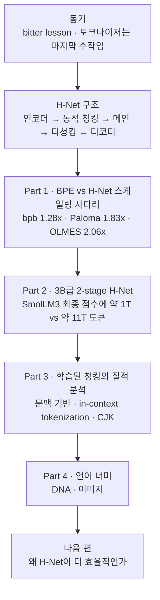

<figure class="post-figure post-figure--header">
<svg role="img" aria-labelledby="ttb-h-title ttb-h-desc" viewBox="0 0 720 320" xmlns="http://www.w3.org/2000/svg">
  <title id="ttb-h-title">자르는 칼을 모델이 쥔다</title>
  <desc id="ttb-h-desc">왼쪽에는 코퍼스로 미리 잘라 둔, 크기가 똑같은 BPE 토큰 블록 더미가 쌓여 있다. 오른쪽 H-Net 틀 안에서는 바이트 알갱이의 흐름이 칼날이 달린 동적 청킹 관문을 지나며 크기가 제각각인 청크로 뭉쳐지고, 그 청크가 메인 네트워크로 들어간다.</desc>
  <defs><marker id="ttb-h-arrow" markerWidth="9" markerHeight="9" refX="7" refY="4" orient="auto"><path d="M0 0 L8 4 L0 8 Z" fill="var(--secondary-color)"/></marker></defs>
  <rect x="20" y="40" width="200" height="240" rx="8" fill="var(--bg-light)" stroke="var(--border-color)" stroke-width="2"/>
  <text x="120" y="66" text-anchor="middle" font-size="13" font-weight="700" fill="var(--accent-color)">BPE — 미리 잘라 둔 토큰</text>
  <text x="120" y="84" text-anchor="middle" font-size="11" fill="var(--text-light)">코퍼스로 한 번 만든 고정 경계</text>
  <g fill="var(--bg-panel)" stroke="currentColor" stroke-width="1.5">
    <rect x="38" y="226" width="36" height="26" rx="2"/>
    <rect x="82" y="226" width="36" height="26" rx="2"/>
    <rect x="126" y="226" width="36" height="26" rx="2"/>
    <rect x="170" y="226" width="36" height="26" rx="2"/>
    <rect x="38" y="196" width="36" height="26" rx="2"/>
    <rect x="82" y="196" width="36" height="26" rx="2"/>
    <rect x="126" y="196" width="36" height="26" rx="2"/>
    <rect x="170" y="196" width="36" height="26" rx="2"/>
    <rect x="60" y="166" width="36" height="26" rx="2"/>
    <rect x="104" y="166" width="36" height="26" rx="2"/>
    <rect x="148" y="166" width="36" height="26" rx="2"/>
    <rect x="82" y="136" width="36" height="26" rx="2"/>
    <rect x="126" y="136" width="36" height="26" rx="2"/>
  </g>
  <text x="120" y="272" text-anchor="middle" font-size="11" fill="var(--text-light)">모델이 커져도 경계는 그대로</text>
  <text x="235" y="166" text-anchor="middle" font-size="12" font-weight="700" fill="var(--text-light)">vs</text>
  <rect x="250" y="24" width="450" height="272" rx="10" fill="var(--bg-light)" stroke="var(--secondary-color)" stroke-width="2"/>
  <text x="475" y="50" text-anchor="middle" font-size="13" font-weight="700" fill="var(--accent-color)">H-Net — 청킹이 모델 안에서 학습된다</text>
  <text x="475" y="78" text-anchor="middle" font-size="15" font-weight="700" fill="currentColor">자르는 칼을 모델이 쥔다</text>
  <g fill="var(--text-light)">
    <rect x="268" y="156" width="9" height="9" rx="1"/>
    <rect x="281" y="159" width="9" height="9" rx="1"/>
    <rect x="294" y="162" width="9" height="9" rx="1"/>
    <rect x="307" y="156" width="9" height="9" rx="1"/>
    <rect x="320" y="159" width="9" height="9" rx="1"/>
    <rect x="333" y="162" width="9" height="9" rx="1"/>
    <rect x="346" y="156" width="9" height="9" rx="1"/>
    <rect x="359" y="159" width="9" height="9" rx="1"/>
    <rect x="372" y="162" width="9" height="9" rx="1"/>
    <rect x="385" y="156" width="9" height="9" rx="1"/>
    <rect x="398" y="159" width="9" height="9" rx="1"/>
    <rect x="411" y="162" width="9" height="9" rx="1"/>
  </g>
  <text x="345" y="196" text-anchor="middle" font-size="11" fill="var(--text-light)">바이트 알갱이</text>
  <path d="M424 164 H444" fill="none" stroke="var(--secondary-color)" stroke-width="2" marker-end="url(#ttb-h-arrow)"/>
  <rect x="446" y="100" width="52" height="12" rx="2" fill="var(--gold)"/>
  <rect x="452" y="112" width="8" height="108" fill="var(--gold)"/>
  <rect x="484" y="112" width="8" height="108" fill="var(--gold)"/>
  <path d="M466 116 H478 V168 L472 182 L466 168 Z" fill="var(--bg-panel)" stroke="var(--gold)" stroke-width="2"/>
  <text x="472" y="240" text-anchor="middle" font-size="12" font-weight="700" fill="currentColor">동적 청킹 관문</text>
  <text x="472" y="256" text-anchor="middle" font-size="11" fill="var(--text-light)">경계 확률 p</text>
  <g fill="var(--bg-panel)" stroke="var(--secondary-color)" stroke-width="2">
    <rect x="506" y="150" width="20" height="24" rx="4"/>
    <rect x="532" y="150" width="48" height="24" rx="4"/>
    <rect x="586" y="150" width="14" height="24" rx="4"/>
    <rect x="606" y="150" width="36" height="24" rx="4"/>
    <rect x="648" y="150" width="42" height="24" rx="4"/>
  </g>
  <text x="598" y="140" text-anchor="middle" font-size="11" fill="var(--text-light)">크기가 제각각인 청크</text>
  <path d="M598 178 V216" fill="none" stroke="var(--secondary-color)" stroke-width="2" marker-end="url(#ttb-h-arrow)"/>
  <rect x="528" y="222" width="140" height="28" rx="4" fill="var(--bg-panel)" stroke="var(--accent-color)" stroke-width="2"/>
  <text x="598" y="241" text-anchor="middle" font-size="12" font-weight="700" fill="currentColor">메인 네트워크</text>
</svg>
<figcaption>미리 잘라 둔 고정 크기 BPE 토큰 대신, H-Net은 바이트를 모델 안에서 데이터에 따라 크고 작은 청크로 묶는다.</figcaption>
</figure>

## 원문 정보

> - **제목**: From Tokens to Bytes I: Scaling Hierarchical Networks
> - **출처**: Cartesia Research ([cartesia.ai](https://www.cartesia.ai/blog))
> - **발행**: 2026-10-28 · 분량 표기 없음 (그림·표가 많은 장문의 연구 블로그)
> - **원문 링크**: <https://www.cartesia.ai/blog/from-tokens-to-bytes-part-1>

언어 모델 파이프라인에서 거의 유일하게 "학습되지 않는" 단계인 토크나이저를 걷어내려는 연구 시리즈의 1편이다. 이 위키의 [CS336 1강 — 토크나이제이션](/2026/06/26/cs336-lecture-1-overview-and-tokenization.html)에서 BPE를 밑바닥부터 만들어 본 뒤, 그 BPE를 *대체*하려는 쪽의 주장을 읽어 보기 위해 담는다.

## 한 줄 요약 (TL;DR)

H-Net은 바이트를 입력으로 받아 **모델 내부에서 데이터에 따라 동적으로 청크를 나누고(dynamic chunking)** 그 청크 위에서 메인 네트워크를 돌리는 계층형 아키텍처이며, Cartesia는 동일한 Transformer 백본·동일 FLOPs 조건에서 BPE 모델 대비 검증 손실 기준 1.28배, 다운스트림 평가 기준 약 2배(코드 OOD는 중앙값 3.10배)의 연산 효율을, 3B급에서는 SmolLM3-3B의 최종 점수에 약 1/10 토큰으로 도달했다고 보고한다.

## 왜 이 글을 골랐나

토크나이저는 LLM 스택에서 가장 "손으로 만든" 부품이다. 학습 코퍼스로 오프라인에 한 번 만들어지고, 이후 모델이 아무리 커져도 그 경계는 바뀌지 않는다. [CS336 1강](/2026/06/26/cs336-lecture-1-overview-and-tokenization.html)은 바이트 기반 모델이 이상적이지만 시퀀스가 너무 길어져 비효율적이라 BPE가 현실적인 타협이라고 정리했다. 이 글은 바로 그 타협을 정면으로 다시 묻는다. "바이트를 그대로 쓰되, 길이 문제는 모델이 스스로 압축해서 해결하면 되지 않나?"

더 흥미로운 점은 이 글이 아이디어 소개가 아니라 **스케일링 법칙**으로 말한다는 것이다. 원문 스스로 "이전 H-Net 연구에는 계산 최적(compute-optimal) 스케일링 법칙이 없었다"고 밝히고, 이번 글에서 BPE 사다리와 H-Net 사다리를 나란히 세워 비교한다. [CS336 9강 — 스케일링 법칙](/2026/06/26/cs336-lecture-9-scaling-laws-1.html)에서 배운 "작게 실험해 크게 예측하기"가 아키텍처 비교에 실제로 어떻게 쓰이는지 보여 주는 좋은 사례이기도 하다.

## 핵심 내용

### 동기: 지능은 원시 데이터에서 배우는 것

원문은 "intelligence is about learning from raw data"라는 문장으로 출발한다. 언어 모델은 대체로 bitter lesson(사람이 설계한 구조보다 일반적 방법 + 스케일이 이긴다)을 받아들였지만, **수작업으로 만든 토크나이저**가 여전히 end-to-end 학습을 가로막는 마지막 전처리 단계로 남아 있다는 진단이다. 그래서 저자들은 "we believe that developing byte-level language models is foundational for AI progress"라고 입장을 밝힌다. 바이트 수준 모델은 그 자체로 "일반적인 학습"이 가능한지를 시험하는 무대라는 것이다.

### Hierarchical Networks (H-Nets)

H-Net의 정의는 한 문장으로 요약된다. "H-Nets compress data through a recursive, data-dependent dynamic chunking process." 청킹이 오프라인 전처리가 아니라 **모델 안에서 학습되는 단계**라는 점이 BPE와의 결정적 차이다.

원문의 그림 1이 보여 주는 구조는 다섯 단계다.

1. **인코더(encoder)** 가 입력 바이트를 읽는다.
2. **학습된 청킹(chunking)** 단계가 이를 더 적은 수의 청크로 압축한다.
3. **메인 네트워크(main network)** 가 청크 위에서 동작한다 — 여기서 청크가 토큰 역할을 한다.
4. **디청킹(dechunking)** 으로 청크를 다시 입력 해상도로 펼쳐 잔차(residual)에 더한다.
5. **디코더(decoder)** 가 합쳐진 표현을 처리해 다음 바이트를 예측한다.

인코더·디코더를 "outer network", 메인을 "inner network"라 부르며, 메인 네트워크 자체를 또 하나의 H-Net으로 바꾸면 청킹이 **재귀적으로 중첩**된다(1-stage, 2-stage …). 압축률은 강한 보조 손실(auxiliary loss)로 목표치에 맞춘다고 하며, 라우터가 내는 경계 확률 p가 그림 툴팁에 언급되지만 라우팅·스무딩·보조 손실의 정확한 수식은 이 글에서 다루지 않는다.

또 하나의 변화는 **원래의 H-Net(이 글에서는 LH-Net이라 부름)과의 차이**다. LH-Net은 "다음 청크의 시작을 본 뒤에야 경계를 긋는" lookahead 방식이었는데, 이 방식은 문맥을 더 주지만 다음 바이트 예측과 다단계 계층을 해친다고 한다. 새 H-Net은 lookahead 없이도 더 의미 있는 stage-0 청크를 만든다고 하며(예: "wondered"를 "wonder" + "ed"로), 새 아키텍처는 아직 공개되지 않았다고 밝힌다.

<figure class="post-figure">
<svg role="img" aria-labelledby="ttb-a-title ttb-a-desc" viewBox="0 0 720 430" xmlns="http://www.w3.org/2000/svg">
  <title id="ttb-a-title">H-Net 1-stage 구조와 2-stage 중첩</title>
  <desc id="ttb-a-desc">왼쪽: 열여섯 개의 입력 바이트가 인코더를 지나고, 라우터의 경계 확률로 고른 다섯 개의 경계 바이트만 남아 압축된다. 다섯 개의 청크가 메인 네트워크에서 짧은 시퀀스로 처리된 뒤, 디청킹으로 각 청크가 자기 구간의 바이트 수만큼 다시 펼쳐지고, 인코더 출력에서 온 잔차 연결과 더해져 디코더를 거쳐 다음 바이트를 예측한다. 오른쪽: stage 0 인코더·디코더 안에 stage 1 인코더·디코더가, 그 안에 메인 네트워크가 들어가는 2-stage 재귀 중첩.</desc>
  <defs><marker id="ttb-a-arrow" markerWidth="9" markerHeight="9" refX="7" refY="4" orient="auto"><path d="M0 0 L8 4 L0 8 Z" fill="var(--secondary-color)"/></marker></defs>
  <text x="40" y="24" font-size="11" fill="var(--text-light)">입력 바이트 (긴 시퀀스)</text>
  <g fill="var(--bg-panel)" stroke="currentColor" stroke-width="1.5">
    <rect x="50" y="32" width="18" height="18" rx="2"/>
    <rect x="75" y="32" width="18" height="18" rx="2"/>
    <rect x="100" y="32" width="18" height="18" rx="2"/>
    <rect x="125" y="32" width="18" height="18" rx="2"/>
    <rect x="150" y="32" width="18" height="18" rx="2"/>
    <rect x="175" y="32" width="18" height="18" rx="2"/>
    <rect x="200" y="32" width="18" height="18" rx="2"/>
    <rect x="225" y="32" width="18" height="18" rx="2"/>
    <rect x="250" y="32" width="18" height="18" rx="2"/>
    <rect x="275" y="32" width="18" height="18" rx="2"/>
    <rect x="300" y="32" width="18" height="18" rx="2"/>
    <rect x="325" y="32" width="18" height="18" rx="2"/>
    <rect x="350" y="32" width="18" height="18" rx="2"/>
    <rect x="375" y="32" width="18" height="18" rx="2"/>
    <rect x="400" y="32" width="18" height="18" rx="2"/>
    <rect x="425" y="32" width="18" height="18" rx="2"/>
  </g>
  <path d="M246 54 V72" fill="none" stroke="var(--secondary-color)" stroke-width="2" marker-end="url(#ttb-a-arrow)"/>
  <rect x="40" y="78" width="412" height="26" rx="4" fill="var(--bg-panel)" stroke="currentColor" stroke-width="1.5"/>
  <text x="246" y="95" text-anchor="middle" font-size="12" font-weight="700" fill="currentColor">인코더 — outer network</text>
  <path d="M246 108 V122" fill="none" stroke="var(--secondary-color)" stroke-width="2" marker-end="url(#ttb-a-arrow)"/>
  <rect x="50" y="128" width="18" height="18" rx="2" fill="var(--gold)" stroke="var(--gold)" stroke-width="1.5"/>
  <rect x="75" y="128" width="18" height="18" rx="2" fill="none" stroke="var(--text-light)" stroke-width="1.2" stroke-dasharray="3 2"/>
  <rect x="100" y="128" width="18" height="18" rx="2" fill="none" stroke="var(--text-light)" stroke-width="1.2" stroke-dasharray="3 2"/>
  <rect x="125" y="128" width="18" height="18" rx="2" fill="var(--gold)" stroke="var(--gold)" stroke-width="1.5"/>
  <rect x="150" y="128" width="18" height="18" rx="2" fill="none" stroke="var(--text-light)" stroke-width="1.2" stroke-dasharray="3 2"/>
  <rect x="175" y="128" width="18" height="18" rx="2" fill="none" stroke="var(--text-light)" stroke-width="1.2" stroke-dasharray="3 2"/>
  <rect x="200" y="128" width="18" height="18" rx="2" fill="none" stroke="var(--text-light)" stroke-width="1.2" stroke-dasharray="3 2"/>
  <rect x="225" y="128" width="18" height="18" rx="2" fill="var(--gold)" stroke="var(--gold)" stroke-width="1.5"/>
  <rect x="250" y="128" width="18" height="18" rx="2" fill="none" stroke="var(--text-light)" stroke-width="1.2" stroke-dasharray="3 2"/>
  <rect x="275" y="128" width="18" height="18" rx="2" fill="none" stroke="var(--text-light)" stroke-width="1.2" stroke-dasharray="3 2"/>
  <rect x="300" y="128" width="18" height="18" rx="2" fill="var(--gold)" stroke="var(--gold)" stroke-width="1.5"/>
  <rect x="325" y="128" width="18" height="18" rx="2" fill="none" stroke="var(--text-light)" stroke-width="1.2" stroke-dasharray="3 2"/>
  <rect x="350" y="128" width="18" height="18" rx="2" fill="none" stroke="var(--text-light)" stroke-width="1.2" stroke-dasharray="3 2"/>
  <rect x="375" y="128" width="18" height="18" rx="2" fill="var(--gold)" stroke="var(--gold)" stroke-width="1.5"/>
  <rect x="400" y="128" width="18" height="18" rx="2" fill="none" stroke="var(--text-light)" stroke-width="1.2" stroke-dasharray="3 2"/>
  <rect x="425" y="128" width="18" height="18" rx="2" fill="none" stroke="var(--text-light)" stroke-width="1.2" stroke-dasharray="3 2"/>
  <text x="256" y="120" font-size="10" fill="var(--text-light)">라우터의 경계 확률 p로 경계 바이트 선택</text>
  <g fill="none" stroke="var(--text-light)" stroke-width="1.2">
    <path d="M59 146 L166 180"/>
    <path d="M134 146 L206 180"/>
    <path d="M234 146 L246 180"/>
    <path d="M309 146 L286 180"/>
    <path d="M384 146 L326 180"/>
  </g>
  <rect x="136" y="172" width="220" height="66" rx="6" fill="var(--bg-panel)" stroke="var(--accent-color)" stroke-width="2"/>
  <rect x="157" y="180" width="18" height="18" rx="2" fill="var(--gold)"/>
  <rect x="197" y="180" width="18" height="18" rx="2" fill="var(--gold)"/>
  <rect x="237" y="180" width="18" height="18" rx="2" fill="var(--gold)"/>
  <rect x="277" y="180" width="18" height="18" rx="2" fill="var(--gold)"/>
  <rect x="317" y="180" width="18" height="18" rx="2" fill="var(--gold)"/>
  <text x="246" y="228" text-anchor="middle" font-size="12" font-weight="700" fill="currentColor">메인 네트워크 — 짧은 시퀀스</text>
  <text x="366" y="194" font-size="11" fill="var(--text-light)">청크 = 토큰 역할</text>
  <g fill="none" stroke="var(--secondary-color)" stroke-width="1.2">
    <path d="M166 238 L84 262"/>
    <path d="M206 238 L171.5 262"/>
    <path d="M246 238 L259 262"/>
    <path d="M286 238 L334 262"/>
    <path d="M326 238 L409 262"/>
  </g>
  <rect x="47" y="262" width="74" height="26" rx="4" fill="none" stroke="var(--secondary-color)" stroke-width="2"/>
  <rect x="50" y="266" width="18" height="18" rx="2" fill="var(--gold)" opacity="1"/>
  <rect x="75" y="266" width="18" height="18" rx="2" fill="var(--gold)" opacity="0.45"/>
  <rect x="100" y="266" width="18" height="18" rx="2" fill="var(--gold)" opacity="0.45"/>
  <rect x="122" y="262" width="99" height="26" rx="4" fill="none" stroke="var(--secondary-color)" stroke-width="2"/>
  <rect x="125" y="266" width="18" height="18" rx="2" fill="var(--gold)" opacity="1"/>
  <rect x="150" y="266" width="18" height="18" rx="2" fill="var(--gold)" opacity="0.45"/>
  <rect x="175" y="266" width="18" height="18" rx="2" fill="var(--gold)" opacity="0.45"/>
  <rect x="200" y="266" width="18" height="18" rx="2" fill="var(--gold)" opacity="0.45"/>
  <rect x="222" y="262" width="74" height="26" rx="4" fill="none" stroke="var(--secondary-color)" stroke-width="2"/>
  <rect x="225" y="266" width="18" height="18" rx="2" fill="var(--gold)" opacity="1"/>
  <rect x="250" y="266" width="18" height="18" rx="2" fill="var(--gold)" opacity="0.45"/>
  <rect x="275" y="266" width="18" height="18" rx="2" fill="var(--gold)" opacity="0.45"/>
  <rect x="297" y="262" width="74" height="26" rx="4" fill="none" stroke="var(--secondary-color)" stroke-width="2"/>
  <rect x="300" y="266" width="18" height="18" rx="2" fill="var(--gold)" opacity="1"/>
  <rect x="325" y="266" width="18" height="18" rx="2" fill="var(--gold)" opacity="0.45"/>
  <rect x="350" y="266" width="18" height="18" rx="2" fill="var(--gold)" opacity="0.45"/>
  <rect x="372" y="262" width="74" height="26" rx="4" fill="none" stroke="var(--secondary-color)" stroke-width="2"/>
  <rect x="375" y="266" width="18" height="18" rx="2" fill="var(--gold)" opacity="1"/>
  <rect x="400" y="266" width="18" height="18" rx="2" fill="var(--gold)" opacity="0.45"/>
  <rect x="425" y="266" width="18" height="18" rx="2" fill="var(--gold)" opacity="0.45"/>
  <text x="256" y="303" font-size="10" fill="var(--text-light)">디청킹: 원 해상도로 펼침</text>
  <path d="M246 292 V306" fill="none" stroke="var(--secondary-color)" stroke-width="2" marker-end="url(#ttb-a-arrow)"/>
  <path d="M40 91 H22 V320 H232" fill="none" stroke="var(--secondary-color)" stroke-width="2" stroke-dasharray="6 4" marker-end="url(#ttb-a-arrow)"/>
  <text x="30" y="312" font-size="11" fill="var(--text-light)">잔차(residual) 연결</text>
  <circle cx="246" cy="320" r="11" fill="var(--bg-panel)" stroke="currentColor" stroke-width="1.5"/>
  <path d="M240 320 H252 M246 314 V326" stroke="currentColor" stroke-width="2"/>
  <path d="M246 332 V346" fill="none" stroke="var(--secondary-color)" stroke-width="2" marker-end="url(#ttb-a-arrow)"/>
  <rect x="40" y="352" width="412" height="26" rx="4" fill="var(--bg-panel)" stroke="currentColor" stroke-width="1.5"/>
  <text x="246" y="369" text-anchor="middle" font-size="12" font-weight="700" fill="currentColor">디코더 — outer network</text>
  <path d="M246 382 V396" fill="none" stroke="var(--secondary-color)" stroke-width="2" marker-end="url(#ttb-a-arrow)"/>
  <rect x="237" y="402" width="18" height="18" rx="2" fill="var(--accent-color)"/>
  <text x="264" y="416" font-size="12" font-weight="700" fill="currentColor">다음 바이트 예측</text>
  <text x="598" y="30" text-anchor="middle" font-size="12" font-weight="700" fill="var(--accent-color)">2-stage: 메인 자리에 또 H-Net</text>
  <rect x="500" y="44" width="196" height="252" rx="8" fill="var(--bg-light)" stroke="currentColor" stroke-width="1.5"/>
  <text x="598" y="64" text-anchor="middle" font-size="11" fill="currentColor">stage 0 인코더 / 디코더</text>
  <rect x="518" y="76" width="160" height="186" rx="6" fill="var(--bg-panel)" stroke="var(--secondary-color)" stroke-width="2" stroke-dasharray="6 4"/>
  <text x="598" y="96" text-anchor="middle" font-size="11" fill="currentColor">stage 1 인코더 / 디코더</text>
  <rect x="542" y="110" width="112" height="120" rx="6" fill="var(--bg-panel)" stroke="var(--accent-color)" stroke-width="2"/>
  <text x="598" y="166" text-anchor="middle" font-size="12" font-weight="700" fill="currentColor">메인</text>
  <text x="598" y="184" text-anchor="middle" font-size="12" font-weight="700" fill="currentColor">네트워크</text>
  <text x="598" y="284" text-anchor="middle" font-size="11" fill="var(--text-light)">1-stage, 2-stage … 재귀 중첩</text>
</svg>
<figcaption>H-Net 1-stage: 인코더 → 경계 확률로 청크 선택(압축) → 메인 네트워크 → 디청킹 + 잔차 → 디코더. 메인 자리에 H-Net을 다시 넣으면 2-stage가 된다.</figcaption>
</figure>

### Part 1: BPE와 H-Net의 스케일링 사다리

공정한 비교를 위해 설계가 꽤 꼼꼼하다.

- **BPE 사다리**: L08~L28 여섯 단계, 총 221M~2.62B 파라미터. 히든 차원은 128의 배수(aspect ratio 약 75), 헤드 수 = 층 수, 헤드 차원 128, SwiGLU(중간 크기 3.6D), Muon 옵티마이저 + WSD 학습률 스케줄. 토크나이저는 Llama-3와 같은 128k 어휘 크기의 BPE.
- **베이스라인 강화**: 학습 코퍼스로 직접 만든(in-corpus) BPE를 써서 Llama-3 토크나이저 대비 약 1.1배 이득을 얻었고, 평균 토큰 길이가 4.45 → 4.57바이트로 늘었다. 즉 비교 대상 BPE를 일부러 약하게 두지 않았다.
- **H-Net 매칭**: Transformer 백본은 **완전히 동일**하게 두고, 바깥 네트워크를 BPE 쪽의 토크나이저·임베딩·프로젝션과 파라미터·FLOPs로 맞춘다. 압축률은 BPE와 같은 4.57바이트/청크. 배치 크기와 학습률은 그대로 옮겨 쓴다.
- **지표**: 토크나이저가 달라도 비교 가능한 **bits-per-byte(bpb)**.
- **연산 배수(compute multiplier)**: 두 사다리에 compute-to-loss 멱법칙을 각각 맞춘 뒤, BPE와 같은 손실에 도달하는 데 H-Net이 몇 배 적은 연산을 쓰는지 잰다.
- **데이터 혼합(바이트 기준)**: 영어 70%, 코드 20%, 수학 5%, 다국어 5%.

결과는 다음과 같다.

| 평가 | H-Net 연산 효율 배수 |
| --- | --- |
| 검증 bpb | 1.28x (같은 손실에 약 22% 적은 연산) |
| Paloma 평균 | 1.83x |
| OLMES 평균 | 2.06x |
| 코드, 학습 분포 내 15개 언어 | 중앙값 2.04x (Markdown 1.49x ~ Go 2.40x) |
| 코드, 분포 밖 10개 언어 | 중앙값 3.10x (Haskell 2.19x ~ Prolog 5.37x) |

원문은 코드에서의 이득이 H-Net이 연산을 더 써서 얻은 것이 아니라는 점도 따로 확인한다.

<figure class="post-figure">
<svg role="img" aria-labelledby="ttb-s-title ttb-s-desc" viewBox="0 0 720 330" xmlns="http://www.w3.org/2000/svg">
  <title id="ttb-s-title">연산 배수 읽는 법과 평가별 배수</title>
  <desc id="ttb-s-desc">왼쪽은 개략도다. 로그 연산 대 로그 검증 bpb 평면에 BPE 사다리와 H-Net 사다리의 두 멱법칙 직선이 나란히 내려가고, H-Net 직선이 왼쪽에 있다. 같은 손실 수평선에서 두 직선 사이의 수평 거리가 연산 배수다. 오른쪽 막대는 원문 보고값으로 검증 bpb 1.28배, Paloma 평균 1.83배, OLMES 평균 2.06배, 코드 분포 내 중앙값 2.04배, 코드 분포 밖 중앙값 3.10배다.</desc>
  <defs><marker id="ttb-s-arrow" markerWidth="9" markerHeight="9" refX="7" refY="4" orient="auto"><path d="M0 0 L8 4 L0 8 Z" fill="var(--accent-color)"/></marker><marker id="ttb-s-arrow-s" markerWidth="9" markerHeight="9" refX="1" refY="4" orient="auto"><path d="M8 0 L0 4 L8 8 Z" fill="var(--accent-color)"/></marker></defs>
  <text x="220" y="26" text-anchor="middle" font-size="12" font-weight="700" fill="var(--accent-color)">연산 배수 읽는 법 (개략도)</text>
  <path d="M60 40 V270 H392" fill="none" stroke="currentColor" stroke-width="1.5"/>
  <text x="226" y="292" text-anchor="middle" font-size="11" fill="var(--text-light)">연산 FLOPs (로그 축) →</text>
  <text x="44" y="155" text-anchor="middle" font-size="11" fill="var(--text-light)" transform="rotate(-90 44 155)">검증 bpb (로그 축) →</text>
  <path d="M110 85.6 L385 238.3" stroke="currentColor" stroke-width="2"/>
  <path d="M64 90.6 L330 238.3" stroke="var(--secondary-color)" stroke-width="2.5"/>
  <circle cx="125" cy="93.9" r="3.5" fill="var(--bg-panel)" stroke="currentColor" stroke-width="1.5"/>
  <circle cx="175" cy="121.7" r="3.5" fill="var(--bg-panel)" stroke="currentColor" stroke-width="1.5"/>
  <circle cx="225" cy="149.4" r="3.5" fill="var(--bg-panel)" stroke="currentColor" stroke-width="1.5"/>
  <circle cx="275" cy="177.2" r="3.5" fill="var(--bg-panel)" stroke="currentColor" stroke-width="1.5"/>
  <circle cx="325" cy="205" r="3.5" fill="var(--bg-panel)" stroke="currentColor" stroke-width="1.5"/>
  <circle cx="375" cy="232.8" r="3.5" fill="var(--bg-panel)" stroke="currentColor" stroke-width="1.5"/>
  <circle cx="70" cy="93.9" r="3.5" fill="var(--secondary-color)"/>
  <circle cx="120" cy="121.7" r="3.5" fill="var(--secondary-color)"/>
  <circle cx="170" cy="149.4" r="3.5" fill="var(--secondary-color)"/>
  <circle cx="220" cy="177.2" r="3.5" fill="var(--secondary-color)"/>
  <circle cx="270" cy="205" r="3.5" fill="var(--secondary-color)"/>
  <circle cx="320" cy="232.8" r="3.5" fill="var(--secondary-color)"/>
  <path d="M60 177.2 H392" stroke="var(--text-light)" stroke-width="1.2" stroke-dasharray="5 4"/>
  <text x="388" y="170" text-anchor="end" font-size="10" fill="var(--text-light)">같은 손실</text>
  <path d="M226 177.2 H269" stroke="var(--accent-color)" stroke-width="2" marker-start="url(#ttb-s-arrow-s)" marker-end="url(#ttb-s-arrow)"/>
  <path d="M200 228 L240 186" stroke="var(--accent-color)" stroke-width="1.2"/>
  <text x="180" y="242" text-anchor="middle" font-size="12" font-weight="700" fill="var(--accent-color)">수평 거리 = 연산 배수</text>
  <path d="M262 56 H286" stroke="currentColor" stroke-width="2"/>
  <text x="292" y="60" font-size="11" fill="currentColor">BPE 사다리</text>
  <path d="M262 76 H286" stroke="var(--secondary-color)" stroke-width="2.5"/>
  <text x="292" y="80" font-size="11" fill="currentColor">H-Net 사다리</text>
  <text x="226" y="316" text-anchor="middle" font-size="10" fill="var(--text-light)">점은 사다리 단계를 나타낸 개념도 — 실제 측정점이 아니다</text>
  <text x="590" y="26" text-anchor="middle" font-size="12" font-weight="700" fill="var(--accent-color)">평가별 H-Net 연산 효율 배수</text>
  <text x="530" y="67" text-anchor="end" font-size="11" fill="currentColor">검증 bpb</text>
  <rect x="538" y="52" width="57.6" height="22" rx="3" fill="var(--bg-light)" stroke="var(--secondary-color)" stroke-width="2"/>
  <text x="601.6" y="67" font-size="11" font-weight="700" fill="currentColor">1.28x</text>
  <text x="530" y="109" text-anchor="end" font-size="11" fill="currentColor">Paloma 평균</text>
  <rect x="538" y="94" width="82.35" height="22" rx="3" fill="var(--bg-light)" stroke="var(--secondary-color)" stroke-width="2"/>
  <text x="626.35" y="109" font-size="11" font-weight="700" fill="currentColor">1.83x</text>
  <text x="530" y="151" text-anchor="end" font-size="11" fill="currentColor">OLMES 평균</text>
  <rect x="538" y="136" width="92.7" height="22" rx="3" fill="var(--bg-light)" stroke="var(--secondary-color)" stroke-width="2"/>
  <text x="636.7" y="151" font-size="11" font-weight="700" fill="currentColor">2.06x</text>
  <text x="530" y="193" text-anchor="end" font-size="11" fill="currentColor">코드 분포 내 중앙값</text>
  <rect x="538" y="178" width="91.8" height="22" rx="3" fill="var(--bg-light)" stroke="var(--secondary-color)" stroke-width="2"/>
  <text x="635.8" y="193" font-size="11" font-weight="700" fill="currentColor">2.04x</text>
  <text x="530" y="235" text-anchor="end" font-size="11" fill="currentColor">코드 분포 밖 중앙값</text>
  <rect x="538" y="220" width="139.5" height="22" rx="3" fill="var(--bg-light)" stroke="var(--gold)" stroke-width="2"/>
  <text x="683.5" y="235" font-size="11" font-weight="700" fill="currentColor">3.10x</text>
  <path d="M583 44 V262" stroke="var(--text-light)" stroke-width="1.2" stroke-dasharray="4 3"/>
  <text x="583" y="278" text-anchor="middle" font-size="10" fill="var(--text-light)">1x = 동등</text>
  <text x="590" y="300" text-anchor="middle" font-size="10" fill="var(--text-light)">원문 Part 1 보고값 · 분포에서 멀수록 배수가 커진다</text>
</svg>
<figcaption>왼쪽: 두 사다리에 맞춘 멱법칙 직선 사이의 수평 거리가 연산 배수다(개략도). 오른쪽: 원문이 보고한 평가별 배수.</figcaption>
</figure>

### Part 2: 더 큰 H-Net 학습 — SmolLM3-3B와의 비교

다음은 공개된 레시피가 있는 SmolLM3-3B를 기준으로 한 2-stage H-Net 학습이다.

- **구조**: 가장 바깥 stage 0은 Mamba-2 층(인코더 4, 디코더 4), 다음 stage는 sliding-window attention 블록 + Mamba-2 4층씩을 추가, 메인 네트워크는 모든 층이 전역 어텐션인 40층 Transformer. 두 바깥 단계의 목표 압축률은 대략 4배와 2배.
- **규모·연산 매칭**: H-Net 3.67B vs SmolLM3 3.08B 파라미터. **바이트당 FLOPs를 2% 이내로 맞췄고**, 메인 네트워크는 약 7.6바이트당 한 위치를 본다. 바깥 단계가 전체 FLOPs의 약 43%를 차지한다.
- **데이터·학습**: SmolLM3의 stage-1 혼합만 재현(바이트 기준 영어 웹 76.5 / 다국어 10.9 / 코드 10.3 / 수학 2.2). AdamW(β 0.9, 0.95), weight decay 0.1, gradient clipping 1.0, peak LR 2e-4, WSD 스케줄(워밍업 5B 토큰 상당, 마지막 15% 쿨다운). H-Net 전용 튜닝은 하지 않았다고 한다.
- **결과**: H-Net은 약 **1T 토큰**에서 SmolLM3의 **최종** 평균 점수(약 11T 토큰 학습)에 도달했다. 원문은 이를 "10배 이상의 연산·데이터 효율"로 표현한다.

### Part 3: 학습된 청킹의 질적 분석

수치 다음으로 원문이 공들인 부분은 "모델이 실제로 무엇을 덩어리로 묶는가"다.

- **학습 동역학**: H-Net 초록 텍스트를 예로, 71,856 스텝 시점에 208개 청크·청크당 평균 약 8.4바이트로 묶인다.
- **패턴이 아니라 문맥 기반**: 같은 문자열도 문맥에 따라 다르게 묶인다. 원문은 코드에서 H-Net이 BPE보다 더 많이 압축한다고 보고한다.
- **문맥 내 토크나이제이션(in-context tokenization)**: 처음 보는 단어는 처음엔 잘게 쪼개다가 문맥 안에서 반복되면 크게 묶는다. 반복되는 서식은 큰 청크가 되고, LURD·WHYV·FYB 같은 반복 모티프나 2526·3987·3526 같은 숫자 모티프도 하나로 묶인다. 추론 시점에 "토크나이저가 학습되는" 셈이다.
- **CJK**: LH-Net은 한중일 문자를 잘못 분할하지만 새 H-Net은 올바르게 분할한다고 한다. 한국어 사용자에게는 특히 눈에 띄는 대목이다.

<figure class="post-figure">
<svg role="img" aria-labelledby="ttb-c-title ttb-c-desc" viewBox="0 0 720 300" xmlns="http://www.w3.org/2000/svg">
  <title id="ttb-c-title">문맥 내 토크나이제이션: 같은 낯선 단어의 첫 등장과 반복 등장</title>
  <desc id="ttb-c-desc">설명용 예시 단어 Vexorian. 고정 BPE는 문서 앞쪽과 뒤쪽에서 똑같이 Vex, or, ian 세 조각으로 자른다. H-Net은 문서 앞쪽 첫 등장에서는 한 바이트씩 잘게 쪼개지만, 문서를 읽어 나가며 같은 단어가 반복 등장하면 뒤쪽에서는 하나의 큰 청크로 묶는다.</desc>
  <defs><marker id="ttb-c-arrow" markerWidth="9" markerHeight="9" refX="7" refY="4" orient="auto"><path d="M0 0 L8 4 L0 8 Z" fill="var(--secondary-color)"/></marker></defs>
  <text x="230" y="40" text-anchor="middle" font-size="12" font-weight="700" fill="currentColor">문서 앞쪽 — 첫 등장</text>
  <text x="540" y="40" text-anchor="middle" font-size="12" font-weight="700" fill="currentColor">문서 뒤쪽 — 반복 등장</text>
  <text x="24" y="108" font-size="12" font-weight="700" fill="var(--accent-color)">고정 BPE</text>
  <text x="24" y="218" font-size="12" font-weight="700" fill="var(--accent-color)">H-Net</text>
  <rect x="154" y="90" width="54" height="26" rx="4" fill="var(--bg-panel)" stroke="currentColor" stroke-width="1.5"/>
  <text x="163" y="108" text-anchor="middle" font-size="13" font-family="ui-monospace, SFMono-Regular, Menlo, monospace" fill="currentColor">V</text>
  <text x="181" y="108" text-anchor="middle" font-size="13" font-family="ui-monospace, SFMono-Regular, Menlo, monospace" fill="currentColor">e</text>
  <text x="199" y="108" text-anchor="middle" font-size="13" font-family="ui-monospace, SFMono-Regular, Menlo, monospace" fill="currentColor">x</text>
  <rect x="212" y="90" width="36" height="26" rx="4" fill="var(--bg-panel)" stroke="currentColor" stroke-width="1.5"/>
  <text x="221" y="108" text-anchor="middle" font-size="13" font-family="ui-monospace, SFMono-Regular, Menlo, monospace" fill="currentColor">o</text>
  <text x="239" y="108" text-anchor="middle" font-size="13" font-family="ui-monospace, SFMono-Regular, Menlo, monospace" fill="currentColor">r</text>
  <rect x="252" y="90" width="54" height="26" rx="4" fill="var(--bg-panel)" stroke="currentColor" stroke-width="1.5"/>
  <text x="261" y="108" text-anchor="middle" font-size="13" font-family="ui-monospace, SFMono-Regular, Menlo, monospace" fill="currentColor">i</text>
  <text x="279" y="108" text-anchor="middle" font-size="13" font-family="ui-monospace, SFMono-Regular, Menlo, monospace" fill="currentColor">a</text>
  <text x="297" y="108" text-anchor="middle" font-size="13" font-family="ui-monospace, SFMono-Regular, Menlo, monospace" fill="currentColor">n</text>
  <rect x="464" y="90" width="54" height="26" rx="4" fill="var(--bg-panel)" stroke="currentColor" stroke-width="1.5"/>
  <text x="473" y="108" text-anchor="middle" font-size="13" font-family="ui-monospace, SFMono-Regular, Menlo, monospace" fill="currentColor">V</text>
  <text x="491" y="108" text-anchor="middle" font-size="13" font-family="ui-monospace, SFMono-Regular, Menlo, monospace" fill="currentColor">e</text>
  <text x="509" y="108" text-anchor="middle" font-size="13" font-family="ui-monospace, SFMono-Regular, Menlo, monospace" fill="currentColor">x</text>
  <rect x="522" y="90" width="36" height="26" rx="4" fill="var(--bg-panel)" stroke="currentColor" stroke-width="1.5"/>
  <text x="531" y="108" text-anchor="middle" font-size="13" font-family="ui-monospace, SFMono-Regular, Menlo, monospace" fill="currentColor">o</text>
  <text x="549" y="108" text-anchor="middle" font-size="13" font-family="ui-monospace, SFMono-Regular, Menlo, monospace" fill="currentColor">r</text>
  <rect x="562" y="90" width="54" height="26" rx="4" fill="var(--bg-panel)" stroke="currentColor" stroke-width="1.5"/>
  <text x="571" y="108" text-anchor="middle" font-size="13" font-family="ui-monospace, SFMono-Regular, Menlo, monospace" fill="currentColor">i</text>
  <text x="589" y="108" text-anchor="middle" font-size="13" font-family="ui-monospace, SFMono-Regular, Menlo, monospace" fill="currentColor">a</text>
  <text x="607" y="108" text-anchor="middle" font-size="13" font-family="ui-monospace, SFMono-Regular, Menlo, monospace" fill="currentColor">n</text>
  <text x="385" y="109" text-anchor="middle" font-size="16" font-weight="700" fill="var(--text-light)">=</text>
  <text x="385" y="140" text-anchor="middle" font-size="11" fill="var(--text-light)">문서의 처음과 끝에서 똑같이 잘린다</text>
  <path d="M24 160 H696" stroke="var(--border-color)" stroke-width="1.2" stroke-dasharray="5 4"/>
  <rect x="144" y="200" width="18" height="26" rx="4" fill="var(--bg-panel)" stroke="var(--text-light)" stroke-width="1.2"/>
  <text x="153" y="218" text-anchor="middle" font-size="13" font-family="ui-monospace, SFMono-Regular, Menlo, monospace" fill="currentColor">V</text>
  <rect x="166" y="200" width="18" height="26" rx="4" fill="var(--bg-panel)" stroke="var(--text-light)" stroke-width="1.2"/>
  <text x="175" y="218" text-anchor="middle" font-size="13" font-family="ui-monospace, SFMono-Regular, Menlo, monospace" fill="currentColor">e</text>
  <rect x="188" y="200" width="18" height="26" rx="4" fill="var(--bg-panel)" stroke="var(--text-light)" stroke-width="1.2"/>
  <text x="197" y="218" text-anchor="middle" font-size="13" font-family="ui-monospace, SFMono-Regular, Menlo, monospace" fill="currentColor">x</text>
  <rect x="210" y="200" width="18" height="26" rx="4" fill="var(--bg-panel)" stroke="var(--text-light)" stroke-width="1.2"/>
  <text x="219" y="218" text-anchor="middle" font-size="13" font-family="ui-monospace, SFMono-Regular, Menlo, monospace" fill="currentColor">o</text>
  <rect x="232" y="200" width="18" height="26" rx="4" fill="var(--bg-panel)" stroke="var(--text-light)" stroke-width="1.2"/>
  <text x="241" y="218" text-anchor="middle" font-size="13" font-family="ui-monospace, SFMono-Regular, Menlo, monospace" fill="currentColor">r</text>
  <rect x="254" y="200" width="18" height="26" rx="4" fill="var(--bg-panel)" stroke="var(--text-light)" stroke-width="1.2"/>
  <text x="263" y="218" text-anchor="middle" font-size="13" font-family="ui-monospace, SFMono-Regular, Menlo, monospace" fill="currentColor">i</text>
  <rect x="276" y="200" width="18" height="26" rx="4" fill="var(--bg-panel)" stroke="var(--text-light)" stroke-width="1.2"/>
  <text x="285" y="218" text-anchor="middle" font-size="13" font-family="ui-monospace, SFMono-Regular, Menlo, monospace" fill="currentColor">a</text>
  <rect x="298" y="200" width="18" height="26" rx="4" fill="var(--bg-panel)" stroke="var(--text-light)" stroke-width="1.2"/>
  <text x="307" y="218" text-anchor="middle" font-size="13" font-family="ui-monospace, SFMono-Regular, Menlo, monospace" fill="currentColor">n</text>
  <rect x="468" y="200" width="144" height="26" rx="4" fill="var(--bg-light)" stroke="var(--gold)" stroke-width="2.5"/>
  <text x="477" y="218" text-anchor="middle" font-size="13" font-family="ui-monospace, SFMono-Regular, Menlo, monospace" fill="currentColor">V</text>
  <text x="495" y="218" text-anchor="middle" font-size="13" font-family="ui-monospace, SFMono-Regular, Menlo, monospace" fill="currentColor">e</text>
  <text x="513" y="218" text-anchor="middle" font-size="13" font-family="ui-monospace, SFMono-Regular, Menlo, monospace" fill="currentColor">x</text>
  <text x="531" y="218" text-anchor="middle" font-size="13" font-family="ui-monospace, SFMono-Regular, Menlo, monospace" fill="currentColor">o</text>
  <text x="549" y="218" text-anchor="middle" font-size="13" font-family="ui-monospace, SFMono-Regular, Menlo, monospace" fill="currentColor">r</text>
  <text x="567" y="218" text-anchor="middle" font-size="13" font-family="ui-monospace, SFMono-Regular, Menlo, monospace" fill="currentColor">i</text>
  <text x="585" y="218" text-anchor="middle" font-size="13" font-family="ui-monospace, SFMono-Regular, Menlo, monospace" fill="currentColor">a</text>
  <text x="603" y="218" text-anchor="middle" font-size="13" font-family="ui-monospace, SFMono-Regular, Menlo, monospace" fill="currentColor">n</text>
  <path d="M328 213 H452" fill="none" stroke="var(--secondary-color)" stroke-width="2" marker-end="url(#ttb-c-arrow)"/>
  <text x="390" y="204" text-anchor="middle" font-size="11" fill="var(--text-light)">읽어 나가며</text>
  <text x="230" y="250" text-anchor="middle" font-size="11" fill="var(--text-light)">처음 보면 잘게 쪼갠다</text>
  <text x="540" y="250" text-anchor="middle" font-size="11" fill="var(--text-light)">문맥 안에서 반복되면 크게 묶는다</text>
  <text x="360" y="284" text-anchor="middle" font-size="10" fill="var(--text-light)">Vexorian은 설명용 예시 단어 — 실제 분할 경계는 모델과 문맥에 따라 다르다</text>
</svg>
<figcaption>추론 시점에 "토크나이저가 학습되는" 셈: 고정 BPE는 앞뒤가 똑같이 잘리지만, H-Net은 반복되는 단어를 점점 크게 묶는다.</figcaption>
</figure>

### Part 4: 토큰에서 원자로 — 언어 너머의 H-Net

- **DNA**: 원핵생물 게놈 약 274B 뉴클레오타이드로 학습, 목표 압축 6배. 연산 효율 배수는 검증 5.95x, gtdb_valid_small 5.83x, gtdb_test 7.06x. 코돈, 엑손/인트론, tRNA 단위, 반복 서열 같은 **생물학적으로 정렬된 청크**가 학습 후반에 나타난다고 한다.
- **이미지**: 픽셀 공간 flow-matching 베이스라인 JiT의 백본을 다차원(2D) H-Net으로 교체했다. 모델이 어디를 얼마나 압축할지 학습하며 공간·적분 시간·샘플에 걸쳐 연산을 재배분한다. 비슷한 이웃 패치를 합치는 token merging과 달리 지역적 묶음을 강제하지 않아, 전경 물체에 가려 떨어져 있는 배경 영역들을 하나의 청크로 묶기도 한다. 다만 이 부분은 **정성적 결과만** 제시되고 정량 수치는 없다.

### 다음 편 예고

후속 편(From Tokens to Bytes II)은 "왜 H-Net이 언어 모델링에서 더 효율적인가"를 다룬다고 예고한다. loss-to-loss 스케일링 법칙, 이득이 원시 바이트의 end-to-end 학습에서 온다는 증거, 분포 밖 전이, end-to-end 학습이 얼마나 도움이 되는지, 그리고 pretokenization 없는 BPE와의 비교가 포함될 예정이다.

## 분석과 인사이트

여기부터는 원문 요약이 아닌 내 해석이다.

### 1. "토크나이저 = 고정된 압축기"라는 가정을 깨는 것이 본질

BPE는 결국 **코퍼스 통계로 한 번 학습된 고정 압축기**다. 그 압축기는 모델의 손실을 전혀 모른 채 만들어진다. H-Net의 핵심은 압축을 손실 함수의 일부로 끌어들여, "어디를 묶으면 다음 예측이 쉬워지는가"를 모델이 직접 정하게 한 것이다. Part 3의 in-context tokenization이 이 차이를 가장 극적으로 보여 준다. BPE는 문서의 처음과 끝에서 같은 단어를 똑같이 자르지만, H-Net은 문서를 읽으면서 어휘를 늘려 간다. 이는 아키텍처 트릭이라기보다 "표현의 단위도 학습 대상"이라는 원리의 문제이고, 이 글을 `ML-Theory`에 둔 이유이기도 하다.

### 2. 효율 이득이 분포 밖에서 커진다는 패턴이 가장 의미 있다

검증 bpb 1.28x → Paloma·OLMES 약 1.8–2.1x → 코드 분포 밖(OOD) 중앙값 3.10x(Prolog 5.37x)로, **학습 분포에서 멀수록 이득이 커진다.** 고정 토크나이저는 학습 코퍼스에 흔한 패턴에 어휘를 몰아주므로 희귀 언어·도메인에서 비효율적으로 잘릴 수밖에 없다. 반면 바이트에서 동적으로 묶는 모델은 그 비용을 덜 진다. 한국어처럼 BPE 어휘에서 상대적으로 불리한 언어, 사내 DSL이나 로그처럼 공개 코퍼스에 드문 형식에서 같은 효과가 나타날지는 실무자에게 가장 궁금한 지점이다(원문은 한국어 수치를 따로 주지 않는다).

### 3. 수치를 읽을 때의 주의점

- **헤드라인 배수가 섹션마다 다르다.** 도입부는 "최대 3~5배", Part 1의 검증 손실은 1.28배, Paloma·OLMES 평가는 약 1.8–2.1배다. 어떤 배수를 인용하는지에 따라 인상이 크게 달라지므로, 가장 보수적인 수치(1.28x)와 평가 종류를 함께 보는 것이 안전하다.
- **SmolLM3 비교의 조건.** H-Net은 SmolLM3의 stage-1 혼합만으로 짧은 horizon을 학습했고, 비교 대상은 3단계·약 11T 토큰을 거친 SmolLM3의 최종 점수다. 바이트당 FLOPs는 맞췄지만 파라미터는 H-Net이 약 19% 더 크고(3.67B vs 3.08B), 아키텍처도 Mamba-2·sliding-window attention이 섞인 하이브리드다. "10배"가 토크나이저 제거만의 효과인지, 아키텍처 전체의 효과인지는 이 글만으로 분리되지 않는다. 원문도 이 질문을 후속 편으로 넘긴다.
- **재현성.** 새 H-Net 아키텍처는 아직 공개되지 않았고, 라우팅·보조 손실의 수식도 이 글에는 없다. 지금은 Cartesia의 보고로 읽어야 한다.

### 4. 비용 구조의 이동

H-Net은 토크나이저의 비용을 없애는 대신 **바깥 네트워크의 비용**을 들인다(3B급에서 전체 FLOPs의 약 43%). 바이트 수준에서 도는 층이 많아지면 학습 효율과 별개로 추론 시 지연·메모리 특성이 달라진다. 바깥 단계에 Mamba-2를 쓴 선택은 긴 바이트 시퀀스에 대한 선형 비용을 노린 것으로 보이며, [CS336 10강 — 추론](/2026/06/26/cs336-lecture-10-inference.html)에서 정리한 SSM·하이브리드 흐름과 맞닿아 있다. 서빙 관점의 숫자는 아직 없다.

### 5. 언어 너머가 진짜 동기일 수 있다

DNA와 이미지 실험은 이 연구의 방향을 드러낸다. 텍스트에는 BPE라는 "꽤 괜찮은" 해법이 있지만, DNA·오디오·픽셀처럼 토큰화가 어색하거나 연속적인 데이터에는 그런 해법이 마땅치 않다. 음성 모델을 만드는 Cartesia가 이 문제에 투자하는 이유가 짐작되는 대목이다. 언어에서의 이득은 "일반 아키텍처"라는 더 큰 주장의 증거로 제시된 것에 가깝다.

## 적용 포인트

- **토크나이저를 "주어진 것"으로 두지 말자.** 희귀 언어·도메인 데이터로 모델을 다룬다면, 최소한 토큰당 평균 바이트 수와 단어당 토큰 수를 측정해 토크나이저가 얼마나 손해를 보는지 수치로 확인한다. 원문처럼 in-corpus BPE만으로도 약 1.1배 이득이 났다는 점을 기억하자.
- **아키텍처 비교는 bpb와 연산 배수로.** 토크나이저가 다른 모델을 per-token loss나 perplexity로 비교하면 왜곡된다. bits-per-byte + 동일 FLOPs/byte 매칭 + 스케일링 사다리라는 이 글의 비교 방법론은 그대로 빌려 쓸 만하다.
- **헤드라인 배수는 조건과 함께 인용하자.** "10배"를 전할 때는 비교 대상(SmolLM3 최종 점수), 학습 데이터 범위(stage-1 혼합), 파라미터 차이를 함께 적는다.
- **분포 밖 평가를 따로 떼어 보자.** 새 아키텍처의 이득은 분포 내 검증 손실보다 OOD에서 크게 드러날 수 있다. 평가 셋을 ID/OOD로 나눠 보는 습관을 들인다.
- **후속 편을 기다릴 질문 목록을 적어 두자.** 이득의 출처(end-to-end vs 아키텍처), pretokenization 없는 BPE와의 비교, 추론 비용 — 2편에서 답이 나오는지 확인한다.

## 마무리

"From Tokens to Bytes I"은 토크나이저 없는 바이트 수준 언어 모델이 더 이상 비효율적인 이상론이 아니라는 것을 **스케일링 사다리**로 주장하는 글이다. 동일 백본·동일 FLOPs 조건에서 검증 손실 1.28배, 다운스트림 약 2배, 분포 밖 코드에서 3배 이상의 효율, 그리고 문맥에 따라 어휘를 늘려 가는 학습된 청킹은 "표현의 단위도 학습해야 한다"는 메시지를 설득력 있게 보여 준다. 다만 헤드라인 수치는 조건마다 크게 다르고, 이득의 출처와 추론 비용은 아직 열린 질문이다. BPE를 직접 구현해 본 독자라면, 그 BPE가 왜 대체될 수도 있는지를 가장 구체적인 숫자로 보여 주는 글로 읽어 볼 만하다.

### 더 읽어보기

- [원문 — From Tokens to Bytes I: Scaling Hierarchical Networks (Cartesia Research)](https://www.cartesia.ai/blog/from-tokens-to-bytes-part-1)
- [CS336 1강 — 개요와 토크나이제이션: BPE를 밑바닥부터](/2026/06/26/cs336-lecture-1-overview-and-tokenization.html) — H-Net이 대체하려는 BPE와 바이트 기반 방식의 한계, bitter lesson의 해석
- [CS336 3강 — 아키텍처와 하이퍼파라미터](/2026/06/26/cs336-lecture-3-architectures-hyperparameters.html) — H-Net 메인 네트워크로 쓰인 현대 Transformer의 표준 설계(SwiGLU, 헤드 차원 등)
- [CS336 9강 — 스케일링 법칙 1](/2026/06/26/cs336-lecture-9-scaling-laws-1.html) — compute-to-loss 멱법칙과 스케일링 사다리로 아키텍처를 비교하는 방법
- [CS336 11강 — 스케일링 법칙 2: 실전 레시피와 muP](/2026/06/26/cs336-lecture-11-scaling-laws-2.html) — WSD 스케줄과 하이퍼파라미터 전이
- [CS336 10강 — 추론](/2026/06/26/cs336-lecture-10-inference.html) — SSM(Mamba)·하이브리드 구조와 추론 비용
- [CS336 12강 — 평가](/2026/06/26/cs336-lecture-12-evaluation.html) — 지표 선택에 따라 결론이 달라지는 이유
- [딥러닝의 원리를 '유효 이론'으로 풀다](/2026/06/25/principles-of-deep-learning-theory.html) — 같은 ML-Theory 카테고리의 이론적 관점
