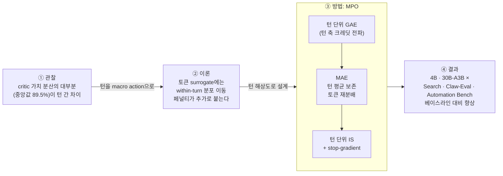

<figure class="post-figure post-figure--header">
<svg role="img" aria-label="오크 전사가 다섯 개의 큰 돌계단(턴 1부터 턴 5)을 오른다. 계단과 계단 사이의 높이차, 즉 턴 간 가치 변화는 크고, 각 계단 윗면에 깔린 작은 자갈(토큰)은 거의 평평하다. 보상 깃발 R(τ)은 맨 꼭대기 계단에만 꽂혀 있다." viewBox="0 0 680 300" xmlns="http://www.w3.org/2000/svg" font-family="var(--font-body)">
  <title>턴은 큰 계단, 토큰은 그 위의 자갈 — 보상은 정상에만</title>
  <defs>
    <marker id="mpo-h-arrow" markerWidth="9" markerHeight="9" refX="4" refY="4" orient="auto">
      <path d="M0 0 L8 4 L0 8 z" fill="var(--secondary-color)"/>
    </marker>
  </defs>

  <!-- ground -->
  <line x1="20" y1="270" x2="660" y2="270" stroke="currentColor" stroke-width="2" opacity="0.5"/>

  <!-- five stone steps = five turns -->
  <rect x="40"  y="230" width="112" height="40"  fill="var(--bg-light)" stroke="currentColor" stroke-width="2"/>
  <rect x="152" y="190" width="112" height="80"  fill="var(--bg-light)" stroke="currentColor" stroke-width="2"/>
  <rect x="264" y="150" width="112" height="120" fill="var(--bg-light)" stroke="currentColor" stroke-width="2"/>
  <rect x="376" y="110" width="112" height="160" fill="var(--bg-light)" stroke="currentColor" stroke-width="2"/>
  <rect x="488" y="70"  width="112" height="200" fill="var(--bg-light)" stroke="currentColor" stroke-width="2"/>
  <!-- stone seams -->
  <g stroke="currentColor" stroke-width="1" opacity="0.25">
    <line x1="152" y1="230" x2="264" y2="230"/><line x1="264" y1="190" x2="376" y2="190"/><line x1="264" y1="230" x2="376" y2="230"/>
    <line x1="376" y1="150" x2="488" y2="150"/><line x1="376" y1="190" x2="488" y2="190"/><line x1="376" y1="230" x2="488" y2="230"/>
    <line x1="488" y1="110" x2="600" y2="110"/><line x1="488" y1="150" x2="600" y2="150"/><line x1="488" y1="190" x2="600" y2="190"/><line x1="488" y1="230" x2="600" y2="230"/>
  </g>

  <!-- turn labels -->
  <g font-size="12" font-weight="700" fill="currentColor" text-anchor="middle" opacity="0.75">
    <text x="96" y="256">턴 1</text><text x="208" y="256">턴 2</text><text x="320" y="256">턴 3</text><text x="432" y="256">턴 4</text><text x="544" y="256">턴 5</text>
  </g>

  <!-- pebbles (tokens): nearly flat on each step top -->
  <g fill="var(--gold)" stroke="currentColor" stroke-width="0.6">
    <circle cx="52"  cy="226" r="2.6"/><circle cx="64"  cy="225" r="2.6"/><circle cx="76"  cy="226" r="2.6"/><circle cx="88"  cy="225" r="2.6"/><circle cx="100" cy="226" r="2.6"/><circle cx="112" cy="225" r="2.6"/><circle cx="124" cy="226" r="2.6"/><circle cx="136" cy="225" r="2.6"/>
    <circle cx="240" cy="186" r="2.6"/><circle cx="252" cy="185" r="2.6"/>
    <circle cx="276" cy="146" r="2.6"/><circle cx="288" cy="145" r="2.6"/><circle cx="300" cy="146" r="2.6"/><circle cx="312" cy="145" r="2.6"/><circle cx="324" cy="146" r="2.6"/><circle cx="336" cy="145" r="2.6"/><circle cx="348" cy="146" r="2.6"/><circle cx="360" cy="145" r="2.6"/>
    <circle cx="388" cy="106" r="2.6"/><circle cx="400" cy="105" r="2.6"/><circle cx="412" cy="106" r="2.6"/><circle cx="424" cy="105" r="2.6"/><circle cx="436" cy="106" r="2.6"/><circle cx="448" cy="105" r="2.6"/><circle cx="460" cy="106" r="2.6"/><circle cx="472" cy="105" r="2.6"/>
    <circle cx="500" cy="66" r="2.6"/><circle cx="512" cy="65" r="2.6"/><circle cx="524" cy="66" r="2.6"/><circle cx="536" cy="65" r="2.6"/>
  </g>

  <!-- riser arrows: big value jumps between turns -->
  <line x1="370" y1="148" x2="370" y2="116" stroke="var(--secondary-color)" stroke-width="2" marker-end="url(#mpo-h-arrow)"/>
  <line x1="482" y1="108" x2="482" y2="76" stroke="var(--secondary-color)" stroke-width="2" marker-end="url(#mpo-h-arrow)"/>
  <text x="290" y="104" font-size="12" font-weight="700" fill="var(--secondary-color)" text-anchor="middle">턴 사이: 가치가 크게 뛴다</text>
  <line x1="330" y1="110" x2="364" y2="130" stroke="var(--secondary-color)" stroke-width="1" stroke-dasharray="3 3"/>

  <text x="96" y="196" font-size="12" fill="currentColor" text-anchor="middle">토큰 = 자갈</text>
  <text x="96" y="212" font-size="11" fill="currentColor" text-anchor="middle" opacity="0.75">턴 안에선 거의 평평</text>

  <!-- warrior (pixel orc) on step 2 -->
  <g>
    <rect x="186" y="150" width="16" height="14" fill="var(--accent-color)"/>
    <rect x="190" y="146" width="8"  height="5"  fill="currentColor"/>
    <rect x="189" y="155" width="3"  height="3"  fill="currentColor"/>
    <rect x="196" y="155" width="3"  height="3"  fill="currentColor"/>
    <rect x="183" y="164" width="22" height="14" fill="currentColor" opacity="0.85"/>
    <rect x="185" y="178" width="6"  height="12" fill="currentColor" opacity="0.85"/>
    <rect x="197" y="178" width="6"  height="12" fill="currentColor" opacity="0.85"/>
    <rect x="205" y="160" width="3"  height="24" fill="currentColor"/>
    <rect x="207" y="156" width="10" height="10" fill="var(--secondary-color)"/>
  </g>

  <!-- reward flag only at the summit -->
  <line x1="580" y1="70" x2="580" y2="18" stroke="currentColor" stroke-width="2.5"/>
  <path d="M582 20 L626 30 L582 40 z" fill="var(--accent-color)" stroke="currentColor" stroke-width="1"/>
  <text x="604" y="60" font-size="13" font-weight="700" fill="var(--gold)" stroke="currentColor" stroke-width="0.3" text-anchor="middle">R(τ)</text>
  <text x="560" y="14" font-size="11" fill="currentColor" text-anchor="end" opacity="0.8">보상은 정상에만 (terminal)</text>
</svg>
<figcaption>장기 과제는 '턴'이라는 큰 계단을 오르는 일이다 — 가치는 계단 사이에서 뛰고, 계단 위 토큰들은 거의 평평하며, 보상은 마지막에만 주어진다</figcaption>
</figure>

## 원문 정보

> - **제목**: Multiscale Policy Optimization for Long-Horizon LLM Agents
> - **저자**: Tao Ren, Hui Yang, Jia Deng, Tingyang Chen, Qiyao Wang, Shuo Tang, Ziyang Zeng, Yuhua Jiang, Guanghao Li, Huatong Song, Yining Li, Yifan Luo, Kunbao Ding, Feng Chang, Chuan Hao, Ran Tao, Bryan Dai, Jiafeng Liang, Jinyang Jiang (IQuest / IQuestLab, Hugging Face 페이지 표기 기준)
> - **출처**: arXiv preprint `2610.35013` [cs.AI] ([arxiv.org](https://arxiv.org/abs/2610.35013)) · Hugging Face Papers ([huggingface.co](https://huggingface.co/papers/2610.35013))
> - **발행**: 2026-10-26 (arXiv v1) · 학회/저널 게재 정보 없음(프리프린트) · 본문 7장 + 부록 A–D 구성
> - **원문 링크**: <https://huggingface.co/papers/2610.35013>

에이전트를 RL로 학습시킬 때 "보상을 어느 단위로 나눠 줄 것인가"라는 오래된 질문을, critic 가치의 분산 구조라는 경험적 관찰과 TRPO식 정책 개선 경계로 다시 묻는 논문이라 ML-Theory에 담는다.

## 한 줄 요약 (TL;DR)

멀티턴 LLM 에이전트에서 critic 가치는 토큰 안이 아니라 **턴과 턴 사이**에서 주로 변한다. 그러니 크레딧 전파와 정책 업데이트(importance ratio)는 **턴 단위**로 하고, 토큰에게는 턴 평균을 보존하는 범위에서만 국소적으로 크레딧을 **재분배**하자 — 이것이 MPO이고, 4B·30B-A3B 모델의 Search·Claw-Eval·Automation Bench에서 GRPO·GSPO·PPO·VAPO·SAO보다 높은 점수를 보고한다.

### 한눈에 보기



## 왜 이 글을 골랐나

LLM RL의 표준 도구는 크게 둘로 갈린다. **PPO 계열**(PPO, VAPO 등)은 critic을 두고 **토큰마다** GAE로 advantage를 계산한다. **GRPO 계열**(GRPO, GSPO)은 critic 없이 **시퀀스 전체**에 하나의 advantage를 뿌린다. 한쪽은 너무 잘게, 다른 쪽은 너무 크게 자른다. 그런데 에이전트는 "도구 호출 한 번 = assistant 턴 하나"라는 **중간 단위**로 세상과 상호작용한다.

이 위키의 [CS336 17강 — 정책 경사와 GRPO 직접 구현](/2026/06/26/cs336-lecture-17-alignment-rl-grpo.html)과 [16강 — RLVR와 추론 모델](/2026/06/26/cs336-lecture-16-alignment-rlvr.html)에서 단일 응답 RL의 기본기를 다뤘다면, 이 논문은 그 다음 질문 — **긴 상호작용 궤적에서 "시간 축"을 어떻게 나눌 것인가** — 에 답한다. 추론 모델 학습 로드맵을 다룬 [추론 모델을 밑바닥부터](/2026/10/27/building-reasoning-models-from-the-ground-up.html)의 RLVR/GRPO 파트를 에이전트로 확장한 문제의식이기도 하다.

## 핵심 내용

### 1. 관찰: critic 가치는 턴 사이에서 움직인다

저자들은 search 에이전트 학습 run 하나에서 8개 체크포인트 배치, **2,048개 궤적 · 16,323개 턴**의 critic 값을 측정했다. 결과는 다음과 같다(원문 수치).

- 궤적 내부의 (토큰 가중) critic 가치 분산 중 **턴 평균 간 차이가 차지하는 비율의 중앙값이 89.5%**.
- **93.8%의 궤적**에서 턴 간 분산이 턴 내 분산보다 크다.

즉 critic이 보기에 "상황이 좋아졌다/나빠졌다"는 판단은 대부분 **턴 경계**에서 일어난다. 한 턴 안의 토큰들은 거의 같은 가치 수준에 놓인다. 이것이 "턴을 macro action으로 보고 최적화하되, 토큰 간 크레딧은 세밀하게 나눌 여지를 남기자"는 설계의 출발점이다.

<figure class="post-figure">
<svg role="img" aria-label="개념도. 왼쪽: 한 궤적에서 토큰 위치에 따른 critic 가치가 계단 함수처럼 생겼다. 턴 경계(T1|T2|T3|T4)마다 값이 크게 오르거나 내리고, 턴 내부에서는 작은 잔물결만 있다. 오른쪽: 궤적 내 critic 가치 분산 중 턴 평균 간 차이가 차지하는 비율의 중앙값 89.5퍼센트를 막대로 표시하고, 93.8퍼센트의 궤적에서 턴 간 분산이 턴 내 분산보다 크다고 적었다." viewBox="0 0 640 290" xmlns="http://www.w3.org/2000/svg" font-family="var(--font-body)">
  <title>critic 가치는 턴 경계에서 뛴다 (개념도) + 원문 수치</title>
  <!-- LEFT: schematic step function -->
  <text x="40" y="22" font-size="12" font-weight="700" fill="currentColor">한 궤적의 critic 가치 V (개념도 — 실제 값 아님)</text>
  <line x1="50" y1="40" x2="50" y2="240" stroke="currentColor" stroke-width="1.6"/>
  <line x1="50" y1="240" x2="410" y2="240" stroke="currentColor" stroke-width="1.6"/>
  <text x="230" y="262" font-size="11" fill="currentColor" text-anchor="middle" opacity="0.8">토큰 위치 →</text>
  <text x="38" y="140" font-size="11" fill="currentColor" text-anchor="middle" opacity="0.8" transform="rotate(-90 38 140)">critic 가치 V</text>
  <!-- turn boundaries -->
  <g stroke="currentColor" stroke-width="1" stroke-dasharray="3 4" opacity="0.4">
    <line x1="140" y1="45" x2="140" y2="240"/><line x1="230" y1="45" x2="230" y2="240"/><line x1="300" y1="45" x2="300" y2="240"/>
  </g>
  <g font-size="11" font-weight="700" fill="currentColor" text-anchor="middle" opacity="0.7">
    <text x="95" y="56">T1</text><text x="185" y="56">T2</text><text x="265" y="56">T3</text><text x="355" y="56">T4</text>
  </g>
  <!-- within-turn ripples -->
  <g fill="none" stroke="var(--accent-color)" stroke-width="2.4" stroke-linejoin="round">
    <polyline points="55,200 70,197 85,202 100,198 115,201 130,199 140,200"/>
    <polyline points="140,150 155,147 170,152 185,148 200,151 215,149 230,150"/>
    <polyline points="230,172 245,169 260,174 275,170 290,173 300,171"/>
    <polyline points="300,92 315,89 330,94 345,90 360,93 375,91 400,92"/>
  </g>
  <!-- jumps at turn boundaries -->
  <g stroke="currentColor" stroke-width="2.4" stroke-dasharray="4 3">
    <line x1="140" y1="200" x2="140" y2="150"/><line x1="230" y1="150" x2="230" y2="172"/><line x1="300" y1="171" x2="300" y2="92"/>
  </g>
  <text x="300" y="80" font-size="11" fill="currentColor" font-weight="700" text-anchor="middle">턴 경계: 큰 점프 (점선)</text>
  <text x="95" y="225" font-size="11" fill="currentColor" text-anchor="middle" opacity="0.8">턴 안: 잔물결</text>

  <!-- RIGHT: reported numbers -->
  <text x="530" y="22" font-size="12" font-weight="700" fill="currentColor" text-anchor="middle">원문 측정 (search run)</text>
  <text x="530" y="40" font-size="10" fill="currentColor" text-anchor="middle" opacity="0.75">2,048개 궤적 · 16,323개 턴</text>
  <rect x="490" y="60" width="80" height="180" fill="var(--bg-light)" stroke="currentColor" stroke-width="1.6"/>
  <rect x="490" y="78.9" width="80" height="161.1" fill="var(--accent-color)" opacity="0.85"/>
  <text x="482" y="164" font-size="15" font-weight="700" fill="currentColor" text-anchor="end">89.5%</text>
  <text x="482" y="180" font-size="10" fill="currentColor" text-anchor="end">턴 간 몫 →</text>
  <text x="576" y="73" font-size="10" fill="currentColor" opacity="0.8">← 턴 내</text>
  <text x="530" y="258" font-size="10" fill="currentColor" text-anchor="middle">궤적 내 가치 분산 중</text>
  <text x="530" y="271" font-size="10" fill="currentColor" text-anchor="middle">턴 평균 간 차이의 비율 (중앙값)</text>
  <text x="530" y="286" font-size="10" fill="var(--secondary-color)" font-weight="700" text-anchor="middle">93.8% 궤적에서 턴 간 &gt; 턴 내</text>
</svg>
<figcaption>왼쪽은 개념도, 오른쪽은 원문 수치 — critic이 보는 "상황 변화"는 대부분 턴 경계에서 일어난다</figcaption>
</figure>

### 2. 설정: 턴을 macro decision으로

- 각 assistant 턴은 하나의 **macro action**이고, 그 안의 토큰은 한 글자씩 생성되는 **micro action**이다.
- 보상은 **terminal reward** 하나이며 마지막 토큰에 놓인다. 할인율은 `γ = 1`.
- 토큰 TD residual: `δ_{t,i} = r_{t,i} + V_{t,i+1} − V_{t,i}` (턴의 끝에서는 경계 값으로 다음 턴의 첫 토큰 값 `V_{t+1,1}`을 쓴다).

### 3. 이론: 턴 단위 surrogate vs 토큰 단위 surrogate

4장은 TRPO식 TV-distance 분석으로 두 surrogate를 비교한다.

- **Theorem 1**: 턴 단위 정책 개선의 하한(경계)을 준다.
- **Theorem 2**: (exact advantage, 같은 KL 제약 하에서) 토큰 단위 surrogate를 쓰면 여기에 **턴 내부의 분포 이동(within-turn distribution shift) 페널티**가 추가로 붙는다는 것을 보인다(4.2절 "Additional Cost of Token Surrogates").

저자들은 Theorem 1의 조건이 개선을 보장하는 **충분조건일 뿐 필요조건은 아니라고** 명시하고(부록 A.2), 고정된 턴 horizon을 가정한다. Theorem 2의 메커니즘을 원문 설명대로 풀면 이렇다. 턴 ratio(토큰 ratio의 곱)는 **턴 전체의 출력 분포**를 보정한다. 반면 토큰 ratio 하나는 **옛 정책이 만든 prefix에서의 다음 토큰 분포**만 보정한다. 턴(macro) surrogate는 정확한 토큰 advantage들을 **새 정책의 prefix 분포** 위에서 평균하는데, 토큰 surrogate는 이를 **옛 정책의 prefix 분포** 위에서 평균하게 된다. 이 턴 내부 prefix 분포의 어긋남이 바로 추가 페널티 항이다. 즉 이 정리는 advantage가 정확하다고 가정한 상태에서 surrogate의 **분포 보정 방식** 차이를 다루는 것이며, PPO의 clipping은 정리의 일부가 아니다.

### 4. 방법: Multiscale Policy Optimization

MPO는 세 부품으로 이루어진다(5장).

**(a) 턴 단위 크레딧 전파 — 턴 축의 GAE.** 한 턴의 토큰 residual을 모두 더하면 중간 값들이 telescoping으로 상쇄되어 턴 residual이 된다.

```text
δ_t^turn = 1{t=T}·R(τ) + V_{t+1,1} − V_{t,1}
A_t^turn = δ_t^turn + λ · A_{t+1}^turn
```

GAE를 토큰이 아니라 **턴 축**에서 돌리는 셈이다. 수백~수천 토큰짜리 턴이 이어지는 궤적에서도 λ-감쇠가 "턴 수"만큼만 일어난다.

**(b) 턴 내부 크레딧 할당 — MAE (Multiscale Advantage Estimation).** 턴 경계에서 잘리는 국소 trace를 만들고,

```text
A_{t,i}^intra = Σ_{j≥i} λ_intra^{j−i} · δ_{t,j}     (턴 경계에서 절단)
A_{t,i}^MAE   = A_t^turn + β · (A_{t,i}^intra − mean_i(A_{t,i}^intra))
```

턴 평균을 빼 주기 때문에 **각 턴의 평균 advantage는 정확히 `A_t^turn`으로 보존**된다. 원문은 이것을 "턴 평균을 `A_t^turn`으로 고정하는 least-squares projection의 해"로 설명한다. `β = 0`이면 턴 advantage를 그 턴의 모든 토큰에 그대로 뿌리는(turn broadcasting) 방식으로 돌아간다. critic 자체는 VAPO의 decoupled GAE를 따라 `λ_critic = 1`로 terminal return에 직접 회귀한다.

<figure class="post-figure">
<svg role="img" aria-label="MAE 구조도(개념도). 두 패널에 세 개의 턴이 있고 각 턴은 다섯 토큰 막대로 이루어진다. 왼쪽 β가 0보다 큰 MAE에서는 토큰 막대가 턴 평균 점선 A_t^turn 위아래로 조금씩 다르지만 편차의 합이 0이라 턴 평균은 그대로다. 오른쪽 β가 0인 턴 broadcasting에서는 같은 턴의 모든 토큰이 정확히 A_t^turn 높이로 같다. 두 번째 턴은 음의 advantage이며, 음수 막대는 속을 비운 테두리 막대로 그렸다." viewBox="0 0 640 300" xmlns="http://www.w3.org/2000/svg" font-family="var(--font-body)">
  <title>MAE: 턴 평균은 보존하고 토큰에만 ± 편차를 얹는다</title>
  <text x="165" y="24" font-size="13" font-weight="700" fill="currentColor" text-anchor="middle">β &gt; 0 — MAE (기준 β = 1.0)</text>
  <text x="485" y="24" font-size="13" font-weight="700" fill="currentColor" text-anchor="middle">β = 0 — 턴 broadcasting</text>
  <line x1="320" y1="40" x2="320" y2="250" stroke="currentColor" stroke-width="1" opacity="0.3"/>
  <!-- zero lines -->
  <line x1="28" y1="170" x2="300" y2="170" stroke="currentColor" stroke-width="1.4" opacity="0.6"/>
  <line x1="348" y1="170" x2="620" y2="170" stroke="currentColor" stroke-width="1.4" opacity="0.6"/>
  <text x="26" y="174" font-size="10" fill="currentColor" text-anchor="end" opacity="0.7">0</text>

  <!-- LEFT panel: MAE -->
  <rect x="40" y="122" width="11" height="48" fill="var(--accent-color)" opacity="0.85"/>
  <rect x="55" y="134" width="11" height="36" fill="var(--accent-color)" opacity="0.85"/>
  <rect x="70" y="124" width="11" height="46" fill="var(--accent-color)" opacity="0.85"/>
  <rect x="85" y="136" width="11" height="34" fill="var(--accent-color)" opacity="0.85"/>
  <rect x="100" y="134" width="11" height="36" fill="var(--accent-color)" opacity="0.85"/>
  <line x1="36" y1="130" x2="115" y2="130" stroke="currentColor" stroke-width="1.6" stroke-dasharray="5 3"/>
  <text x="75" y="112" text-anchor="middle" font-size="11" fill="currentColor">A₁^turn</text>
  <rect x="126" y="170" width="11" height="17" fill="none" stroke="currentColor" stroke-width="1.4"/>
  <rect x="141" y="170" width="11" height="29" fill="none" stroke="currentColor" stroke-width="1.4"/>
  <rect x="156" y="170" width="11" height="19" fill="none" stroke="currentColor" stroke-width="1.4"/>
  <rect x="171" y="170" width="11" height="31" fill="none" stroke="currentColor" stroke-width="1.4"/>
  <rect x="186" y="170" width="11" height="29" fill="none" stroke="currentColor" stroke-width="1.4"/>
  <line x1="122" y1="195" x2="201" y2="195" stroke="currentColor" stroke-width="1.6" stroke-dasharray="5 3"/>
  <text x="161" y="217" text-anchor="middle" font-size="11" fill="currentColor">A₂^turn</text>
  <rect x="212" y="102" width="11" height="68" fill="var(--accent-color)" opacity="0.85"/>
  <rect x="227" y="114" width="11" height="56" fill="var(--accent-color)" opacity="0.85"/>
  <rect x="242" y="104" width="11" height="66" fill="var(--accent-color)" opacity="0.85"/>
  <rect x="257" y="116" width="11" height="54" fill="var(--accent-color)" opacity="0.85"/>
  <rect x="272" y="114" width="11" height="56" fill="var(--accent-color)" opacity="0.85"/>
  <line x1="208" y1="110" x2="287" y2="110" stroke="currentColor" stroke-width="1.6" stroke-dasharray="5 3"/>
  <text x="247" y="92" text-anchor="middle" font-size="11" fill="currentColor">A₃^turn</text>

  <!-- RIGHT panel: broadcasting -->
  <rect x="360" y="130" width="11" height="40" fill="var(--accent-color)" opacity="0.85"/>
  <rect x="375" y="130" width="11" height="40" fill="var(--accent-color)" opacity="0.85"/>
  <rect x="390" y="130" width="11" height="40" fill="var(--accent-color)" opacity="0.85"/>
  <rect x="405" y="130" width="11" height="40" fill="var(--accent-color)" opacity="0.85"/>
  <rect x="420" y="130" width="11" height="40" fill="var(--accent-color)" opacity="0.85"/>
  <line x1="356" y1="130" x2="435" y2="130" stroke="currentColor" stroke-width="1.6" stroke-dasharray="5 3"/>
  <text x="395" y="120" text-anchor="middle" font-size="11" fill="currentColor">A₁^turn</text>
  <rect x="446" y="170" width="11" height="25" fill="none" stroke="currentColor" stroke-width="1.4"/>
  <rect x="461" y="170" width="11" height="25" fill="none" stroke="currentColor" stroke-width="1.4"/>
  <rect x="476" y="170" width="11" height="25" fill="none" stroke="currentColor" stroke-width="1.4"/>
  <rect x="491" y="170" width="11" height="25" fill="none" stroke="currentColor" stroke-width="1.4"/>
  <rect x="506" y="170" width="11" height="25" fill="none" stroke="currentColor" stroke-width="1.4"/>
  <line x1="442" y1="195" x2="521" y2="195" stroke="currentColor" stroke-width="1.6" stroke-dasharray="5 3"/>
  <text x="481" y="213" text-anchor="middle" font-size="11" fill="currentColor">A₂^turn</text>
  <rect x="532" y="110" width="11" height="60" fill="var(--accent-color)" opacity="0.85"/>
  <rect x="547" y="110" width="11" height="60" fill="var(--accent-color)" opacity="0.85"/>
  <rect x="562" y="110" width="11" height="60" fill="var(--accent-color)" opacity="0.85"/>
  <rect x="577" y="110" width="11" height="60" fill="var(--accent-color)" opacity="0.85"/>
  <rect x="592" y="110" width="11" height="60" fill="var(--accent-color)" opacity="0.85"/>
  <line x1="528" y1="110" x2="607" y2="110" stroke="currentColor" stroke-width="1.6" stroke-dasharray="5 3"/>
  <text x="567" y="100" text-anchor="middle" font-size="11" fill="currentColor">A₃^turn</text>

  <!-- explanations -->
  <text x="165" y="244" font-size="11" fill="currentColor" text-anchor="middle">토큰 막대 = A^turn + β·(A^intra − 턴 평균)</text>
  <text x="165" y="262" font-size="11" fill="var(--secondary-color)" font-weight="700" text-anchor="middle">± 편차의 합 = 0 → 점선(턴 평균)은 그대로</text>
  <text x="485" y="244" font-size="11" fill="currentColor" text-anchor="middle">같은 턴의 모든 토큰 = A^turn</text>
  <text x="485" y="262" font-size="11" fill="currentColor" text-anchor="middle" opacity="0.8">편차가 사라진 평평한 broadcasting</text>
  <text x="320" y="290" font-size="10" fill="currentColor" text-anchor="middle" opacity="0.7">개념도 — 막대 높이는 예시 값 · 속 빈 막대 = 음의 advantage · 점선 = 턴 평균 A_t^turn</text>
</svg>
<figcaption>MAE는 턴 평균(점선)을 고정한 채 토큰에만 ± 편차를 나눠 준다 — β = 0이면 편차가 사라져 턴 broadcasting으로 돌아간다</figcaption>
</figure>

**(c) 턴 단위 importance sampling.** 토큰 ratio `ρ_{t,i} = π_θ(a_{t,i}|h_{t,i}) / π_old(a_{t,i}|h_{t,i})`를 턴 안에서 곱해 턴 ratio `ρ_t = Π_i ρ_{t,i}`를 만든다. 핵심은 stop-gradient 트릭이다.

```text
ρ̃_{t,i} = ρ_{t,i} · sg[ Π_{j≠i} ρ_{t,j} ]
```

- **forward 값**은 턴 ratio `ρ_t`와 같다 → clipping이 **턴 전체의 정책 이동**을 기준으로 걸린다.
- **gradient**는 `ρ_t · ∇log π(a_{t,i}|h_{t,i})`가 된다 → 각 토큰은 **자기 MAE advantage**를 그대로 유지한다.

목적함수는 PPO식 clipped surrogate `min(ρ̃·A, clip(ρ̃, 1−ε, 1+ε)·A)`를 배치 내 유효 assistant 토큰에 대해 평균한 것이고, advantage는 배치 단위로 한 번 정규화한다.

### 5. 실험 설정

- **모델**: Qwen3-4B-Thinking, Qwen3-30B-A3B-Instruct.
- **과제**: Search(300 step), Claw-Eval(300 step), Automation Bench(200 step). Search 평가는 BrowseComp-Plus, GAIA, HLE(WebThinker text-only subset).
- **베이스라인**: Base, GRPO, GSPO, PPO, VAPO, SAO, 그리고 "MPO w/ token IS"(MAE는 쓰되 ratio는 토큰 단위).
- **프로토콜**: run마다 best 체크포인트를 5회 평가한 평균. Search pass@1/pass@3은 과제당 32 rollout으로 추정. Claw-Eval은 3회 시도의 pass@3과 pass³, Automation Bench는 pass@1.

### 6. 주요 결과

원문 Table 1에서 Search 세 벤치마크의 pass@1만 옮기면 다음과 같다(높을수록 좋음). Base와 GRPO 행은 생략했다 — 어느 열에서도 최강 베이스라인이 아니어서 아래 향상폭 계산에 영향을 주지 않는다.

| 모델 | 방법 | BrowseComp-Plus | GAIA | HLE |
| --- | --- | --- | --- | --- |
| 4B | GSPO | 38.56 | 34.34 | 9.26 |
| 4B | PPO | 40.85 | 31.71 | 7.22 |
| 4B | VAPO | 43.23 | 33.91 | 7.54 |
| 4B | SAO | 43.75 | 35.62 | 8.19 |
| 4B | MPO w/ token IS | 45.72 | 36.35 | 8.89 |
| 4B | **MPO** | **48.08** | **39.47** | **9.92** |
| 30B-A3B | GSPO | 40.22 | 35.25 | 8.61 |
| 30B-A3B | PPO | 45.20 | 35.70 | 8.31 |
| 30B-A3B | VAPO | 46.73 | 38.33 | 9.25 |
| 30B-A3B | SAO | 45.36 | 39.62 | 9.91 |
| 30B-A3B | MPO w/ token IS | 48.27 | 41.23 | 9.45 |
| 30B-A3B | **MPO** | **50.32** | **43.42** | **10.03** |

- 원문에 따르면 MPO는 **두 스케일 모두에서 9개 지표 전부** 최고점이다. Claw-Eval pass@3은 4B에서 66.91(SAO 64.52), 30B에서 73.22(SAO 72.72), Automation Bench pass@1은 4B 13.33(SAO 12.06), 30B 15.00(SAO 14.20)이다.
- 열마다 가장 강한 비-MPO 베이스라인 대비 pass@1 향상폭은 4B에서 BrowseComp-Plus/GAIA/HLE 각각 4.33/3.85/0.66점(기준: SAO/SAO/GSPO), 30B에서 3.59/3.80/0.12점(기준: VAPO/SAO/SAO)이다. **HLE에서의 향상은 작다.**
- **턴 IS의 효과**: ratio만 토큰 단위로 바꾸면(MPO w/ token IS) 4B Search pass@1이 2.36/3.12/1.03점, 30B에서 2.05/2.19/0.58점 떨어진다.
- **학습 동역학**: MPO는 학습 후반 critic explained variance가 PPO보다 높다. 다만 저자들 스스로 explained variance는 return 분산과 각 정책의 rollout에 의존하므로 critic 정확도 향상의 **인과적 증거가 아니라고** 단서를 단다.
- **Test-time scaling (4B, pass@32)**: 75.90/69.90/34.00으로 GRPO·PPO 중 강한 쪽보다 3.61/5.82/5.80점 높다. MPO의 엔트로피가 더 낮은데도 pass@k가 높으므로, 엔트로피만으로 collapse를 판단할 수 없다고 지적한다.

### 7. Ablation (4B Search, 설정당 1 run)

기준 설정은 `(λ, λ_intra, β) = (0.80, 0.95, 1.00)`.

- **β (Table 3)**: BrowseComp-Plus pass@1 기준 β=0.0 → 41.80, 0.5 → 44.13, **1.0 → 48.08**, 1.5 → 46.23, 2.0 → 45.14. 턴 내부 할당을 없앤 β=0(턴 GAE + 턴 IS, 토큰 재분배 없음)도 PPO(40.85)를 Search 6개 지표 모두에서 넘지만, pass@1 차이는 BrowseComp-Plus/GAIA/HLE 각각 **0.95/2.49/0.66점**으로 작다. 반면 β=0 → 1.0으로 가면 pass@1이 **6.28/5.27/2.04점** 오르고, 원문은 국소 할당을 없애면 성능이 "substantially" 떨어진다고 쓴다. β를 1.0보다 더 키우면 평균이 보존되는데도 점수가 다시 떨어진다.
- **λ**: 0.80이 sweet spot이고, 0.60이나 0.85 모두 낮아진다.
- **λ_intra**: 시험한 값(0.90, 0.95, 1.00) 중 0.95가 가장 좋다.

<figure class="post-figure">
<svg role="img" aria-label="β ablation 그래프. 가로축 β 0, 0.5, 1.0, 1.5, 2.0, 세로축 4B Search BrowseComp-Plus pass@1. 값은 41.80, 44.13, 48.08, 46.23, 45.14로 β 1.0에서 정점을 찍고 내려간다. PPO 기준선 40.85가 수평 점선으로 그려져 있고, β 0도 그 위에 있지만 차이는 0.95점으로 작다." viewBox="0 0 640 300" xmlns="http://www.w3.org/2000/svg" font-family="var(--font-body)">
  <title>β ablation — BrowseComp-Plus pass@1 (4B Search, 원문 Table 3)</title>
  <text x="330" y="20" font-size="12" font-weight="700" fill="currentColor" text-anchor="middle">BrowseComp-Plus pass@1 vs β (4B Search · 설정당 1 run)</text>
  <!-- grid + y ticks: 40..50, 20px per point, y(v) = 240 - (v-40)*20 -->
  <g stroke="currentColor" stroke-width="1" opacity="0.15">
    <line x1="70" y1="200" x2="590" y2="200"/><line x1="70" y1="160" x2="590" y2="160"/><line x1="70" y1="120" x2="590" y2="120"/><line x1="70" y1="80" x2="590" y2="80"/><line x1="70" y1="40" x2="590" y2="40"/>
  </g>
  <g font-size="10" fill="currentColor" text-anchor="end" opacity="0.8">
    <text x="64" y="244">40</text><text x="64" y="204">42</text><text x="64" y="164">44</text><text x="64" y="124">46</text><text x="64" y="84">48</text><text x="64" y="44">50</text>
  </g>
  <line x1="70" y1="36" x2="70" y2="240" stroke="currentColor" stroke-width="1.6"/>
  <line x1="70" y1="240" x2="590" y2="240" stroke="currentColor" stroke-width="1.6"/>
  <g font-size="11" fill="currentColor" text-anchor="middle">
    <text x="100" y="258">0</text><text x="215" y="258">0.5</text><text x="330" y="258">1.0</text><text x="445" y="258">1.5</text><text x="560" y="258">2.0</text>
  </g>
  <text x="330" y="280" font-size="11" fill="currentColor" text-anchor="middle" opacity="0.8">β (턴 내부 재분배 강도)</text>

  <!-- PPO baseline 40.85 -->
  <line x1="70" y1="223" x2="590" y2="223" stroke="currentColor" stroke-width="1.6" stroke-dasharray="6 4" opacity="0.8"/>
  <text x="586" y="217" font-size="11" fill="currentColor" font-weight="700" text-anchor="end">PPO 40.85 (점선)</text>

  <!-- MPO curve -->
  <polyline points="100,204 215,157.4 330,78.4 445,115.4 560,137.2" fill="none" stroke="var(--accent-color)" stroke-width="2.6" stroke-linejoin="round"/>
  <g fill="var(--accent-color)" stroke="currentColor" stroke-width="1">
    <circle cx="100" cy="204" r="4.5"/><circle cx="215" cy="157.4" r="4.5"/><circle cx="330" cy="78.4" r="6"/><circle cx="445" cy="115.4" r="4.5"/><circle cx="560" cy="137.2" r="4.5"/>
  </g>
  <g font-size="11" fill="currentColor" text-anchor="middle" font-weight="700">
    <text x="100" y="192">41.80</text><text x="215" y="145">44.13</text><text x="330" y="64">48.08</text><text x="445" y="103">46.23</text><text x="560" y="125">45.14</text>
  </g>

  <!-- annotations -->
  <text x="150" y="208" font-size="10" fill="currentColor" opacity="0.85">β=0: PPO보다 근소하게 위 (+0.95)</text>
  <text x="346" y="52" font-size="10" fill="var(--gold)" stroke="currentColor" stroke-width="0.25" font-weight="700">정점 — 기준 설정 β = 1.0</text>
  <text x="470" y="160" font-size="10" fill="currentColor" opacity="0.85">β↑: 평균은 보존돼도 점수 하락</text>
</svg>
<figcaption>원문 Table 3의 다섯 점 — β = 0은 PPO를 근소하게(0.95점) 넘을 뿐이고, 큰 향상은 β = 1.0의 토큰 재분배에서 나온다</figcaption>
</figure>

### 8. 결론

저자들은 **상호작용 수준(interaction-level)의 크레딧과 생성 수준(generation-level)의 크레딧은 서로 다른 horizon으로 다뤄야 한다**고 결론짓는다.

## 분석과 인사이트

여기부터는 원문 요약이 아니라 내 해석이다.

**1) "적절한 시간 해상도"를 데이터로 고른 것이 핵심이다.** 이 논문에서 가장 좋은 부분은 알고리즘보다 89.5%라는 관찰이다. "토큰이냐 시퀀스냐"를 취향으로 고르지 않고, critic이 실제로 어디서 가치를 바꾸는지 측정한 뒤 그 해상도에 맞췄다. 계층적 RL의 options/macro action 관점이 LLM 에이전트에서 자연스럽게 다시 등장하는 모습이기도 하다. "도구 호출 한 번"이 에이전트의 진짜 의사결정 단위라는 직관에 수치를 붙인 셈이다.

**2) MAE의 β는 "평균 보존 국소 보정"의 세기다.** β=0은 critic 기반 턴 GAE advantage를 턴의 모든 토큰에 그대로 뿌리는 방식이다(critic 없이 시퀀스 전체에 하나의 advantage를 주는 GRPO와는 다르다). β를 키운다고 PPO식 토큰 GAE로 돌아가는 것도 아니다 — intra trace는 턴 경계에서 잘리고, 턴 평균은 언제나 `A_t^turn`으로 고정된다. 그래서 β는 두 알고리즘 사이의 보간 계수라기보다, 턴 간 크레딧 신호를 건드리지 않은 채 턴 안에서 토큰별 편차를 얼마나 세게 얹을지 정하는 **국소 보정 강도**로 읽는 것이 정확하다. 그리고 β ablation의 숫자는 이 국소 보정이 핵심임을 보여 준다. β=0만으로도 PPO를 넘긴 하지만 그 폭은 pass@1 기준 0.95/2.49/0.66점으로 작고, β=0 → 1.0의 향상(6.28/5.27/2.04점)이 훨씬 크다. 즉 **향상의 대부분은 β≈1의 평균 보존 턴 내부 토큰 재분배에서 오고**, 턴 GAE만으로 얻는 몫은 작은 편이다. (설정당 1 run이라는 단서는 그대로 남는다.)

**3) stop-gradient 트릭은 실무적으로 가장 가져다 쓰기 쉬운 부분이다.** forward에서는 턴 ratio로 clip 여부를 판단하고 backward에서는 토큰별 advantage를 살리는 구성은, 기존 PPO 구현에서 ratio 계산 몇 줄만 바꾸면 된다. 시퀀스 단위 ratio를 쓰는 GSPO와 문제의식이 닮았지만, 단위를 "시퀀스 전체"가 아니라 "턴"으로 잡았다는 점이 다르다. 다만 수백~수천 토큰짜리 턴에서 토큰 ratio를 곱하면 값이 쉽게 폭주하거나 0에 가까워질 수 있는데, 원문은 이 수치 안정성 문제(예: log-space 계산, 길이 정규화 여부)를 다루지 않는다. Hugging Face 페이지 댓글에서도 긴 턴의 ratio 폭주를 막으려 clipping을 과제마다 다시 튜닝해야 한다면 그것은 배포 비용이며, 40토큰짜리 호출과 6,000토큰짜리 읽기처럼 턴 길이가 크게 다를 때 턴 ratio의 분산을 따로 검증해야 한다는 우려가 제기됐다.

**4) 결과는 인상적이지만 통계적 신뢰도에는 단서가 필요하다.** 원문에서 확인되는 한계를 정리하면 다음과 같다.

- 각 방법·각 ablation 설정이 **단일 run**이다(HF 페이지 댓글에서도 분산을 알 수 없다는 지적이 있다). BrowseComp-Plus·GAIA처럼 4점 안팎의 차이는 의미 있어 보이지만, HLE의 0.12~0.66점 차이는 seed 노이즈 안에 있을 가능성을 배제할 수 없다.
- critic 분산 관찰이 **search 에이전트 run 하나**에서 나왔다. 턴이 짧고 많은 automation 과제에서도 같은 구조가 유지되는지는 별도 확인이 필요하다.
- ablation은 **4B Search에서만** 했다. λ=0.80, β=1.0이라는 sweet spot이 다른 과제·스케일로 옮겨 가는지는 알 수 없다.
- 이론은 고정 턴 horizon과 충분조건 경계에 기대므로, "왜 턴 IS가 실제로 더 좋은가"에 대한 완결된 설명이라기보다는 **방향을 정당화하는 근거**로 읽는 것이 맞다.

**5) 에이전트 엔지니어에게 주는 함의.** 하니스를 설계하는 쪽에서는 "턴"의 경계를 어떻게 긋느냐(도구 호출 단위인지, 사고+호출 묶음인지)가 단지 UX나 로깅 문제가 아니라 **학습 신호의 단위**가 된다는 점이 흥미롭다. [Codex의 agent loop](/2026/06/25/codex-agent-loop.html)처럼 턴 구조가 명확한 하니스는 이런 턴 단위 RL과 자연스럽게 맞물린다.

## 적용 포인트

- **멀티턴 에이전트를 RL로 학습시킨다면 먼저 critic 가치의 턴 간/턴 내 분산 비율을 측정해 보자.** 내 과제에서도 턴 간 분산이 지배적이라면 MPO식 턴 단위 설계가 유력한 후보다.
- **β=0(턴 GAE + 턴 broadcasting)은 출발점일 뿐, 목표가 아니다.** 원문의 β=0 설정도 턴 단위 IS를 함께 썼고, 그래도 PPO 대비 향상은 작았다(BrowseComp-Plus pass@1 0.95점). 단계적으로 도입하더라도 "턴 축 GAE + 턴 IS"로 파이프라인을 검증한 뒤 **β≈1의 MAE 재분배까지 넣어야** 원문이 보고한 주된 향상을 기대할 수 있다.
- **ratio를 턴 단위로 묶되 gradient는 토큰별로 유지하는 stop-gradient 구성**을 시도해 보자. 원문에서 토큰 IS 대비 pass@1 0.6~3.1점 차이를 만든 부품이다.
- **엔트로피 하락만 보고 collapse로 판단하지 말자.** pass@k 같은 탐색 지표를 함께 본다.
- **비교 실험에서는 seed를 여러 개 돌려 분산을 보고하자.** 이 논문의 가장 큰 약점이 단일 run이라는 점을 반면교사로 삼는다.
- 하니스 설계 시 **턴 경계를 명시적으로 기록**해 두면, 나중에 턴 단위 크레딧 할당·평가로 확장하기 쉽다.

## 마무리

MPO는 "에이전트 RL에서 시간 축을 어떤 해상도로 자를 것인가"라는 질문에 **턴으로 전파하고, 턴으로 업데이트하고, 토큰에는 평균을 지키며 나눠 준다**는 깔끔한 답을 내놓는다. 89.5%라는 관찰에서 출발해 GAE·importance sampling·이론적 경계까지 같은 해상도로 일관되게 맞춘 설계가 설득력 있다. 다만 단일 run과 단일 과제 ablation이라는 한계 때문에, 수치 자체보다는 **"크레딧의 단위를 데이터로 고른다"는 방법론**과 **턴 IS stop-gradient 트릭**을 가져가는 것이 이 논문을 읽는 가장 실용적인 방법이라고 본다.

### 더 읽어보기

- [원문 — Multiscale Policy Optimization for Long-Horizon LLM Agents (Hugging Face Papers)](https://huggingface.co/papers/2610.35013)
- [원문 — arXiv:2610.35013](https://arxiv.org/abs/2610.35013)
- [CS336 17강 — 정책 경사와 GRPO 직접 구현](/2026/06/26/cs336-lecture-17-alignment-rl-grpo.html) — GRPO의 시퀀스 단위 advantage를 직접 구현해 보는 기초. MPO가 어디서 갈라지는지 비교하기 좋다
- [CS336 16강 — RLVR와 추론 모델](/2026/06/26/cs336-lecture-16-alignment-rlvr.html) — terminal reward 기반 RL의 배경
- [CS336 15강 — SFT와 RLHF](/2026/06/26/cs336-lecture-15-alignment-sft-rlhf.html) — PPO 기반 RLHF의 출발점
- [추론 모델을 밑바닥부터 (Sebastian Raschka)](/2026/10/27/building-reasoning-models-from-the-ground-up.html) — RLVR/GRPO 실습 로드맵, 단일 응답 RL에서 에이전트 RL로 넘어가기 전 단계
- [Codex의 agent loop를 펼쳐 보기](/2026/06/25/codex-agent-loop.html) — "턴"이 실제 하니스에서 어떻게 구성되는지
- [The Principles of Deep Learning Theory](/2026/06/25/principles-of-deep-learning-theory.html) — 같은 ML-Theory 카테고리의 이론 글
