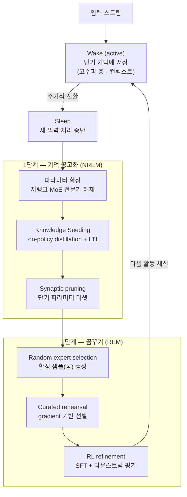

<figure class="post-figure post-figure--header">
<svg role="img" aria-label="도트 톤 헤더 삽화: 초승달이 뜬 밤, 모닥불 옆에 오크 전사가 누워 잠들어 있다. 머리 위 꿈 구름 안에서 낮에 주워 담은 쪽지들(단기 기억)이 화살표를 따라 돌판(장기 기억)으로 옮겨 새겨진다." viewBox="0 0 640 300" width="500" preserveAspectRatio="xMidYMid meet" shape-rendering="crispEdges" style="font-family:var(--font-body)">
  <title>깨어 있음 → 잠 → 각인: 단기 기억의 쪽지가 장기 기억의 돌판에 새겨진다</title>
  <!-- night sky: crescent moon + stars -->
  <circle cx="62" cy="58" r="24" fill="var(--gold)"/>
  <circle cx="74" cy="50" r="22" fill="var(--bg-panel)"/>
  <rect x="130" y="34" width="5" height="5" fill="var(--gold)"/>
  <rect x="190" y="74" width="4" height="4" fill="var(--gold)"/>
  <rect x="34" y="128" width="4" height="4" fill="var(--gold)"/>
  <rect x="236" y="26" width="5" height="5" fill="var(--gold)"/>
  <!-- ground + platform blocks -->
  <rect x="0" y="256" width="640" height="6" fill="currentColor" opacity="0.2"/>
  <rect x="0" y="262" width="640" height="38" fill="var(--bg-sunken)"/>
  <rect x="40" y="270" width="48" height="10" fill="currentColor" opacity="0.12"/>
  <rect x="200" y="276" width="64" height="10" fill="currentColor" opacity="0.12"/>
  <rect x="440" y="270" width="56" height="10" fill="currentColor" opacity="0.12"/>
  <!-- sleeping orc (lying on its side, head to the right) -->
  <rect x="70" y="226" width="130" height="30" fill="var(--secondary-color)"/>
  <rect x="70" y="226" width="130" height="6" fill="currentColor" opacity="0.25"/>
  <rect x="96" y="232" width="8" height="24" fill="var(--steel)"/>
  <rect x="150" y="232" width="8" height="24" fill="var(--steel)"/>
  <rect x="200" y="212" width="40" height="40" fill="var(--orc-green)"/>
  <rect x="236" y="204" width="14" height="14" fill="currentColor"/>
  <rect x="210" y="226" width="12" height="4" fill="currentColor"/>
  <rect x="226" y="236" width="6" height="10" fill="var(--bg-panel)"/>
  <rect x="204" y="242" width="32" height="4" fill="var(--accent-color)"/>
  <!-- axe laid down -->
  <rect x="48" y="246" width="70" height="6" fill="var(--steel)"/>
  <rect x="34" y="234" width="18" height="26" fill="var(--steel)"/>
  <!-- Z z -->
  <text x="226" y="192" font-size="26" font-weight="700" fill="currentColor" opacity="0.7">Z</text>
  <text x="250" y="170" font-size="26" font-weight="700" fill="currentColor" opacity="0.5">z</text>
  <!-- campfire -->
  <rect x="282" y="248" width="56" height="8" fill="var(--steel)"/>
  <rect x="292" y="240" width="36" height="8" fill="var(--steel)" opacity="0.8"/>
  <rect x="300" y="216" width="20" height="24" fill="var(--accent-color)"/>
  <rect x="306" y="204" width="8" height="12" fill="var(--accent-color)"/>
  <rect x="304" y="226" width="12" height="14" fill="var(--gold)"/>
  <!-- thought bubbles from head to cloud -->
  <rect x="262" y="186" width="10" height="10" fill="var(--bg-light)" stroke="currentColor" stroke-width="2"/>
  <rect x="282" y="166" width="14" height="14" fill="var(--bg-light)" stroke="currentColor" stroke-width="2"/>
  <!-- dream cloud (blocky) -->
  <path d="M310 60 H350 V40 H430 V24 H530 V40 H590 V60 H620 V150 H590 V172 H350 V150 H310 Z" fill="var(--bg-light)" stroke="currentColor" stroke-width="3" stroke-dasharray="8 5" opacity="0.95"/>
  <!-- short-term notes (left in cloud) -->
  <rect x="338" y="74" width="30" height="22" fill="var(--bg-panel)" stroke="var(--accent-color)" stroke-width="3"/>
  <rect x="372" y="64" width="30" height="22" fill="var(--bg-panel)" stroke="var(--accent-color)" stroke-width="3"/>
  <rect x="356" y="100" width="30" height="22" fill="var(--bg-panel)" stroke="var(--accent-color)" stroke-width="3"/>
  <rect x="344" y="82" width="16" height="3" fill="currentColor" opacity="0.5"/>
  <rect x="378" y="72" width="16" height="3" fill="currentColor" opacity="0.5"/>
  <rect x="362" y="108" width="16" height="3" fill="currentColor" opacity="0.5"/>
  <text x="350" y="160" font-size="26" font-weight="700" fill="var(--accent-color)">단기</text>
  <!-- arrow: notes to tablet -->
  <rect x="412" y="90" width="56" height="8" fill="currentColor"/>
  <path d="M468 80 L486 94 L468 108 Z" fill="currentColor"/>
  <!-- stone tablet (long-term) -->
  <rect x="500" y="50" width="78" height="80" fill="var(--steel)"/>
  <rect x="500" y="50" width="78" height="6" fill="currentColor" opacity="0.3"/>
  <rect x="512" y="68" width="54" height="5" fill="var(--bg-panel)" opacity="0.85"/>
  <rect x="512" y="82" width="44" height="5" fill="var(--bg-panel)" opacity="0.85"/>
  <rect x="512" y="96" width="54" height="5" fill="var(--bg-panel)" opacity="0.85"/>
  <rect x="512" y="110" width="34" height="5" fill="var(--gold)"/>
  <text x="512" y="160" font-size="26" font-weight="700" fill="currentColor">장기</text>
</svg>
<figcaption>깨어 있는 동안 쌓은 단기 기억의 쪽지를, 잠든 사이 꿈속에서 장기 기억의 돌판에 옮겨 새긴다 — Sleep 프레임워크의 주기</figcaption>
</figure>

## 원문 정보

> - **제목**: The sleep framework: A new way for LLMs to retain knowledge in continual learning
> - **출처**: Google Research 공식 블로그 — Ali Behrouz, Vahab Mirrokni (Google Research) ([research.google](https://research.google/blog/))
> - **발행**: 2026-10-27 · 약 7분 분량(본문 길이 기준 추정)
> - **원문 링크**: <https://research.google/blog/the-sleep-framework-a-new-way-for-llms-to-retain-knowledge-in-continual-learning/>
> - **기반 논문**: Behrouz, Hashemi, Javanmard, Mirrokni, "Language Models Need Sleep: Learning to Self-Modify and Consolidate Memories" ([arXiv:2606.03979](https://arxiv.org/abs/2606.03979))

이 글은 논문 자체가 아니라 **Google Research가 자사 연구를 소개하는 공식 블로그 글**이다. 연구진 본인이 쓴 "요약판"이므로 핵심 아이디어는 명확하지만, 수치와 비교는 저자 측 주장이라는 점을 감안해 읽는다. 배포 후 멈춰 버리는 LLM을 어떻게 "계속 배우게" 할 것인가라는 학습 동역학의 근본 문제를 다루기에 `ML-Theory`에 담는다.

## 한 줄 요약 (TL;DR)

LLM이 **깨어 있는(wake) 동안**에는 단기 기억(컨텍스트 등)에 정보를 쌓고, 주기적인 **수면(sleep) 단계**에서 그 단기 기억을 새로 확장한 장기 파라미터로 증류(공고화)한 뒤 스스로 만든 합성 데이터로 **꿈꾸며 자기 개선**하게 하면, 파국적 망각 없이 새 지식을 계속 흡수하고 추론까지 개선할 수 있다는 주장이다.

한눈에 보면, Sleep 프레임워크는 깨어 있음과 잠을 번갈아 도는 하나의 주기다.

## 왜 이 글을 골랐나

지금의 LLM은 "학습"과 "추론"이 칼같이 분리되어 있다. 배포된 순간 지식 컷오프가 고정되고, 그 이후의 경험은 컨텍스트 창 안에서만 잠깐 살아 있다가 세션이 끝나면 사라진다. 에이전트 메모리를 다룬 [메모리 세금(Memory Tax)](/2026/10/29/memory-tax-agent-memory-net-value.html) 글이 외부 메모리(RAG·메모리 레이어)로 이 문제를 우회하는 비용을 따졌다면, 이 글은 정반대 방향 — **경험을 아예 파라미터 안으로 옮기는** 길을 제시한다.

또 하나의 이유는 저자다. Ali Behrouz는 Titans, Nested Learning(Hope 아키텍처)으로 이어지는 "모델 내부의 다중 시간척도 메모리" 연구 라인을 이끌어 왔고, 이번 Sleep 프레임워크는 그 라인 위에서 "그럼 단기 기억을 언제, 어떻게 장기 기억으로 넘길 것인가"에 답하는 작업이다. 신경과학 비유를 공학적 절차로 바꾸는 방식 자체가 흥미로운 사례다.

## 핵심 내용

### 문제 설정: 정적인 LLM과 두 가지 실패 모드

원문은 현재 LLM이 사전학습과 In-Context Learning(ICL)으로 뛰어난 성능을 내지만, 배포 후에는 **고정된 지식 컷오프에 묶인 정적인 존재**라고 진단한다. 이를 풀려는 두 가지 직관적 해법은 각각 한계가 있다.

- **계속 파라미터를 업데이트한다** → 새 과제를 배울수록 이전 과제 성능이 무너지는 **파국적 망각(catastrophic forgetting)** 이 일어난다.
- **ICL에만 의존한다** → 지식이 컨텍스트 창에 갇힌다. 세션이 끝나면 습득한 단기 정보가 잊힌다.

이에 대한 답으로, 휴식 중 기억을 안정화하는 인간 뇌에서 영감을 얻어 **주기적 생명주기(continuous periodic lifecycle)** 를 가진 LLM — 즉 활동과 오프라인 기억 공고화를 번갈아 하는 모델을 제안한다. 원문은 이를 통해 새 사실을 지속적으로 습득하고, **최대 10M 토큰의 장문맥 지식을 유지**하며, 복잡한 추론을 개선할 수 있다고 주장한다.

### Wake vs. Sleep: 학습과 추론 경계의 재정의

원문은 연속 학습 관점에서 "학습 vs 추론"의 엄격한 구분은 인위적이라고 본다. Sleep 패러다임에서 LLM은 두 상태를 오간다.

- **Active(wake) 단계**: 입력을 받아 처리·상호작용하고, 임시 정보를 빠른 단기 메모리 구성요소에 저장한다.
- **Sleep 단계**: 새 입력 처리를 멈추고 내부 연산을 기억 공고화와 자기 개선으로 돌린다.

여기서 원문이 분명히 선을 긋는 부분이 있다. "수면", "꿈", "자기 개선"은 신경과학에서 빌린 용어일 뿐, 프레임워크는 **고정된 모델 아키텍처와 사람이 정의한 학습 규칙 안에서** 동작한다. 오프라인 수면 단계에서 모델은 **미리 할당해 둔 Mixture-of-Experts(MoE) 메모리 블록을 해제(unlock)** 하고, **스스로 생성한 연습 예제**로 가중치를 업데이트한다. 즉 배포된 모델에 붙는 "자동화된 사후학습(post-training) 사이클"이다.

### 1단계 — 기억 공고화 (Memory Consolidation)

인간의 NREM 서파 수면이 추상화·증류를 통해 불안정한 기억을 장기 구조로 굳힌다는 데서 착안했다. 기술적으로는 세 가지 장치로 구성된다.

<figure class="post-figure">
<svg role="img" aria-label="기억 공고화 3컷, 위에서 아래로 쌓인 세 패널. ① 확장: 위쪽 고주파 층(단기)에 기억 조각이 쌓여 있고, 아래쪽 저주파 층(장기)에는 기존 칸 세 개 옆에 점선으로 된 빈 새 전문가 칸이 해제된다. ② Knowledge Seeding: 고주파 층의 조각들이 화살표를 따라 새 전문가 칸으로 옮겨지고 기존 칸은 그대로다. ③ Synaptic pruning: 고주파 층은 비워지고, 새 전문가 칸은 새 지식으로 채워져 있다." viewBox="0 0 400 640" width="440" preserveAspectRatio="xMidYMid meet" style="font-family:var(--font-body)">
  <title>기억 공고화: 확장 → Knowledge Seeding → Synaptic pruning</title>
  <defs>
    <marker id="slp-arr" viewBox="0 0 10 10" refX="8" refY="5" markerWidth="7" markerHeight="7" orient="auto-start-reverse">
      <path d="M0 0 L10 5 L0 10 Z" fill="var(--accent-color)"/>
    </marker>
  </defs>
  <!-- Panel 1: expansion -->
  <rect x="8" y="6" width="384" height="198" fill="var(--bg-light)" stroke="currentColor" stroke-opacity="0.3" stroke-width="2"/>
  <text x="22" y="34" font-size="17" font-weight="700" fill="currentColor">① 확장: 새 전문가 칸 해제</text>
  <text x="22" y="62" font-size="16" fill="currentColor" opacity="0.8">고주파 층 · 단기</text>
  <rect x="22" y="70" width="356" height="36" fill="var(--bg-panel)" stroke="currentColor" stroke-opacity="0.5" stroke-width="2"/>
  <rect x="36" y="81" width="14" height="14" fill="var(--accent-color)"/>
  <rect x="58" y="81" width="14" height="14" fill="var(--accent-color)"/>
  <rect x="80" y="81" width="14" height="14" fill="var(--accent-color)"/>
  <rect x="102" y="81" width="14" height="14" fill="var(--accent-color)"/>
  <text x="22" y="134" font-size="16" fill="currentColor" opacity="0.8">저주파 층 · 장기</text>
  <rect x="22" y="144" width="76" height="44" fill="var(--steel)" opacity="0.35"/>
  <rect x="104" y="144" width="76" height="44" fill="var(--steel)" opacity="0.35"/>
  <rect x="186" y="144" width="76" height="44" fill="var(--steel)" opacity="0.35"/>
  <text x="60" y="172" font-size="16" text-anchor="middle" fill="currentColor">기존</text>
  <text x="142" y="172" font-size="16" text-anchor="middle" fill="currentColor">기존</text>
  <text x="224" y="172" font-size="16" text-anchor="middle" fill="currentColor">기존</text>
  <rect x="270" y="144" width="108" height="44" fill="none" stroke="var(--accent-color)" stroke-width="2.5" stroke-dasharray="6 4"/>
  <text x="324" y="172" font-size="16" text-anchor="middle" fill="var(--accent-color)" font-weight="700">새 전문가</text>
  <!-- Panel 2: knowledge seeding -->
  <rect x="8" y="218" width="384" height="198" fill="var(--bg-light)" stroke="currentColor" stroke-opacity="0.3" stroke-width="2"/>
  <text x="22" y="246" font-size="17" font-weight="700" fill="currentColor">② Knowledge Seeding · 상향 증류</text>
  <text x="22" y="274" font-size="16" fill="currentColor" opacity="0.8">고주파 층 · 단기</text>
  <rect x="22" y="282" width="356" height="36" fill="var(--bg-panel)" stroke="currentColor" stroke-opacity="0.5" stroke-width="2"/>
  <rect x="36" y="293" width="14" height="14" fill="var(--accent-color)" opacity="0.45"/>
  <rect x="58" y="293" width="14" height="14" fill="var(--accent-color)" opacity="0.45"/>
  <rect x="80" y="293" width="14" height="14" fill="var(--accent-color)" opacity="0.45"/>
  <rect x="102" y="293" width="14" height="14" fill="var(--accent-color)" opacity="0.45"/>
  <path d="M124 300 H300 V352" fill="none" stroke="var(--accent-color)" stroke-width="3" marker-end="url(#slp-arr)"/>
  <rect x="22" y="356" width="76" height="44" fill="var(--steel)" opacity="0.35"/>
  <rect x="104" y="356" width="76" height="44" fill="var(--steel)" opacity="0.35"/>
  <rect x="186" y="356" width="76" height="44" fill="var(--steel)" opacity="0.35"/>
  <text x="60" y="384" font-size="16" text-anchor="middle" fill="currentColor">기존</text>
  <text x="142" y="384" font-size="16" text-anchor="middle" fill="currentColor">기존</text>
  <text x="224" y="384" font-size="16" text-anchor="middle" fill="currentColor">기존</text>
  <rect x="270" y="356" width="108" height="44" fill="none" stroke="var(--accent-color)" stroke-width="2.5" stroke-dasharray="6 4"/>
  <rect x="312" y="371" width="14" height="14" fill="var(--accent-color)"/>
  <rect x="334" y="371" width="14" height="14" fill="var(--accent-color)"/>
  <text x="142" y="338" font-size="16" text-anchor="middle" fill="currentColor" opacity="0.8">기존 칸은 그대로</text>
  <!-- Panel 3: synaptic pruning -->
  <rect x="8" y="430" width="384" height="198" fill="var(--bg-light)" stroke="currentColor" stroke-opacity="0.3" stroke-width="2"/>
  <text x="22" y="458" font-size="17" font-weight="700" fill="currentColor">③ Synaptic pruning · 단기 리셋</text>
  <text x="22" y="486" font-size="16" fill="currentColor" opacity="0.8">고주파 층 · 단기</text>
  <rect x="22" y="494" width="356" height="36" fill="none" stroke="currentColor" stroke-opacity="0.5" stroke-width="2" stroke-dasharray="6 4"/>
  <text x="200" y="518" font-size="16" text-anchor="middle" fill="currentColor" opacity="0.7">비워짐 → 다음 세션 용량</text>
  <text x="22" y="558" font-size="16" fill="currentColor" opacity="0.8">저주파 층 · 장기</text>
  <rect x="22" y="568" width="76" height="44" fill="var(--steel)" opacity="0.35"/>
  <rect x="104" y="568" width="76" height="44" fill="var(--steel)" opacity="0.35"/>
  <rect x="186" y="568" width="76" height="44" fill="var(--steel)" opacity="0.35"/>
  <text x="60" y="596" font-size="16" text-anchor="middle" fill="currentColor">기존</text>
  <text x="142" y="596" font-size="16" text-anchor="middle" fill="currentColor">기존</text>
  <text x="224" y="596" font-size="16" text-anchor="middle" fill="currentColor">기존</text>
  <rect x="270" y="568" width="108" height="44" fill="var(--accent-color)" opacity="0.18" stroke="var(--accent-color)" stroke-width="2.5"/>
  <text x="324" y="596" font-size="16" text-anchor="middle" fill="currentColor" font-weight="700">새 지식</text>
</svg>
<figcaption>공고화의 세 장치 — 새 저랭크 전문가 칸을 열고, 단기 기억을 그 칸으로 증류한 뒤, 단기 층을 비운다. 기존 칸(이전 지식)은 끝까지 건드리지 않는다.</figcaption>
</figure>

1. **파라미터 확장 & 연속체 메모리 계층(continuum memory hierarchy)**: 망각을 막기 위해 수면 중에 모델 용량을 동적으로 늘린다. MoE와 [Hope 아키텍처](https://arxiv.org/abs/2512.24695)를 사용해, 새로 해제한 **저랭크(low-rank) 전문가**를 안정적인 **저주파(lower-frequency) 메모리 블록**에 통합한다. 새 지식은 새 칸에 쓰고, 기존 파라미터는 건드리지 않는다는 발상이다.
2. **Knowledge Seeding(상향 증류, upward distillation)**: 고주파 층(예: in-context memory)에 있던 불안정한 단기 기억을 새로 확장된 장기 파라미터로 옮긴다. 이는 Generalized Knowledge Distillation(GKD)과 RL 기반 모방 학습을 결합해 이뤄진다.
   - **On-policy distillation**: 확장된 학생 모델이 *자신이 샘플링한 시퀀스* 위에서 교사 분포가 주는 토큰 단위 피드백을 학습한다.
   - **Learning to Imitate(LTI)**: 교사가 생성한 텍스트의 접두(prefix)를 이어 쓸 때, 의미적 유사도와 절대적 유사도(Levenshtein 거리)를 기준으로 보상을 받는다.
3. **Synaptic pruning**: 저주파 모듈로의 공고화가 끝나면 고주파 임시 파라미터를 **리셋**해, 다음 활동 세션을 위한 용량을 비운다.

논문 초록의 표현을 빌리면, Knowledge Seeding은 "더 작은 자기(smaller-self)의 기억을 더 큰 네트워크로 증류해 용량을 늘리면서 지식을 보존"하는 과정이다. 보통의 증류가 큰 모델 → 작은 모델로 내려가는 것과 반대 방향이라 "상향"이라 부른다.

### 2단계 — 꿈꾸기를 통한 자기 개선 (Dreaming)

REM 수면 중 뇌가 시나리오를 시뮬레이션하고 새로운 신경 경로를 탐색한다는 데서 착안한 자율 자기 개선 루프다.

- **Random expert selection**: 합성 데이터를 만들 때 MoE 라우터가 일부러 **평소와 다른 전문가**를 무작위로 활성화한다. 서로 동떨어진 지식 영역을 섞어 잠재 패턴을 드러내게 하려는 의도다.
- **Curated rehearsal**: 모델이 합성 학습 샘플("꿈")을 생성하고, **gradient 기반 데이터 선별**로 전체 능력 향상 잠재력이 가장 큰 샘플을 우선한다.
- **RL refinement**: 상위 평가된 꿈 샘플로 SFT를 수행하고, 그 생성이 다운스트림 과제 성능을 실제로 개선하는지 평가한다.

### 이론적 기반: 왜 '새것 대신 옛것을 잃는' 교환이 아닌가

원문은 실험 결과와 별개로, 두 단계가 단순히 새 지식과 기존 능력을 맞바꾸지 않는 이유를 이론으로 설명한다.

- **공고화 = 구조화된 저랭크 압축 문제.** 모델에게 단기 흔적의 모든 디테일을 복사하라는 것이 아니라, (a) 모델 자신의 on-policy 행동과 (b) 학습 목표가 보상하는 의미적 특성을 가장 잘 보존하는 **소수의 방향(direction)** 을 찾게 하는 것이다.
- 두 신호의 역할이 상보적이다. **On-policy distillation**은 공고화를 추론 시 모델이 실제로 생성할 궤적에 맞춰, 교사 생성 분포로만 학습할 때 생기는 불일치를 줄인다. **의미적 보상**은 "무엇을 남길 가치가 있는가"를 바꿔, 토큰 확률을 맞추는 것보다 의미와 과제 관련 행동을 보존하는 방향을 우선한다. **파라미터 확장**은 이렇게 고른 기억을 기존 공고화 지식을 덮어쓰지 않고 쓸 공간을 제공한다.
- **꿈꾸기 = 학습의 기하(geometry) 개선.** 다양한 전문가 주입은 합성 생성 중 탐색되는 gradient 방향의 집합을 넓혀, 평소 wake 데이터만으로는 얻지 못하는 더 풍부한 업데이트에 모델을 노출시킨다. 원문은 랜덤 전문가 활성화와 보상 기반 샘플 선택을 학습의 기하를 개선하는 장치로 함께 든다. gradient 기반 필터링은 가장 유용한 학습 신호를 지닌 경험을 강조하면서 gradient 공간의 구조는 보존한다.
- 결과적으로 학습이 **소수 방향에 지배되지 않고, gradient의 조건수(conditioning)가 좋아져** 더 안정적으로 진전할 수 있다는 것이 원문의 해석이다. 원문은 "꿈꾸기는 단순한 자기 생성 데이터 증강이 아니라, 모델이 스스로를 개선하는 업데이트를 다양화·선택·공고화하는 의도적 과정"이라고 정리한다.

<figure class="post-figure">
<svg role="img" aria-label="gradient 방향의 기하 비교, 위아래 두 패널. 위: wake 데이터만 쓰면 화살표 몇 개가 한 방향으로 쏠려 좁고 길쭉한 타원을 이룬다(소수 방향에 지배, 조건수 나쁨). 아래: 꿈꾸기에서 랜덤 전문가로 방향이 고르게 퍼지고, gradient 필터가 유용한 신호를 지닌 방향(실선)을 강화하고 나머지(점선)는 약하게 반영해 둥글게 균형 잡힌 분포가 된다(조건수 좋음)." viewBox="0 0 400 510" width="440" preserveAspectRatio="xMidYMid meet" style="font-family:var(--font-body)">
  <title>gradient 방향의 기하: wake 데이터만 vs 꿈꾸기</title>
  <defs>
    <marker id="slp-g1" viewBox="0 0 10 10" refX="8" refY="5" markerWidth="6" markerHeight="6" orient="auto">
      <path d="M0 0 L10 5 L0 10 Z" fill="currentColor"/>
    </marker>
    <marker id="slp-g2" viewBox="0 0 10 10" refX="8" refY="5" markerWidth="6" markerHeight="6" orient="auto">
      <path d="M0 0 L10 5 L0 10 Z" fill="var(--secondary-color)"/>
    </marker>
  </defs>
  <!-- Panel A: wake only -->
  <rect x="8" y="6" width="384" height="200" fill="var(--bg-light)" stroke="currentColor" stroke-opacity="0.3" stroke-width="2"/>
  <text x="22" y="34" font-size="17" font-weight="700" fill="currentColor">Wake 데이터만</text>
  <text x="22" y="58" font-size="16" fill="currentColor" opacity="0.8">소수 방향에 쏠림 · 조건수 나쁨</text>
  <g transform="translate(200 135) rotate(-15)">
    <ellipse cx="0" cy="0" rx="160" ry="30" fill="none" stroke="currentColor" stroke-width="2" stroke-dasharray="6 4" opacity="0.6"/>
    <line x1="0" y1="0" x2="140" y2="0" stroke="currentColor" stroke-width="3" marker-end="url(#slp-g1)"/>
    <line x1="0" y1="0" x2="128" y2="-14" stroke="currentColor" stroke-width="3" marker-end="url(#slp-g1)"/>
    <line x1="0" y1="0" x2="124" y2="14" stroke="currentColor" stroke-width="3" marker-end="url(#slp-g1)"/>
    <line x1="0" y1="0" x2="-110" y2="6" stroke="currentColor" stroke-width="3" marker-end="url(#slp-g1)"/>
  </g>
  <circle cx="200" cy="135" r="5" fill="currentColor"/>
  <!-- Panel B: dreaming -->
  <rect x="8" y="220" width="384" height="282" fill="var(--bg-light)" stroke="currentColor" stroke-opacity="0.3" stroke-width="2"/>
  <text x="22" y="248" font-size="17" font-weight="700" fill="currentColor">꿈꾸기: 랜덤 전문가 + gradient 필터</text>
  <text x="22" y="272" font-size="16" fill="currentColor" opacity="0.8">방향이 고르게 퍼짐 · 조건수 좋음</text>
  <circle cx="200" cy="372" r="84" fill="none" stroke="var(--secondary-color)" stroke-width="2" stroke-dasharray="6 4" opacity="0.7"/>
  <!-- kept directions (solid) -->
  <line x1="200" y1="372" x2="276" y2="372" stroke="var(--secondary-color)" stroke-width="3" marker-end="url(#slp-g2)"/>
  <line x1="200" y1="372" x2="254" y2="318" stroke="var(--secondary-color)" stroke-width="3" marker-end="url(#slp-g2)"/>
  <line x1="200" y1="372" x2="200" y2="296" stroke="var(--secondary-color)" stroke-width="3" marker-end="url(#slp-g2)"/>
  <line x1="200" y1="372" x2="146" y2="318" stroke="var(--secondary-color)" stroke-width="3" marker-end="url(#slp-g2)"/>
  <line x1="200" y1="372" x2="124" y2="372" stroke="var(--secondary-color)" stroke-width="3" marker-end="url(#slp-g2)"/>
  <line x1="200" y1="372" x2="146" y2="426" stroke="var(--secondary-color)" stroke-width="3" marker-end="url(#slp-g2)"/>
  <line x1="200" y1="372" x2="200" y2="448" stroke="var(--secondary-color)" stroke-width="3" marker-end="url(#slp-g2)"/>
  <line x1="200" y1="372" x2="254" y2="426" stroke="var(--secondary-color)" stroke-width="3" marker-end="url(#slp-g2)"/>
  <!-- filtered-out directions (dashed, faded) -->
  <line x1="200" y1="372" x2="265" y2="345" stroke="currentColor" stroke-width="2.5" stroke-dasharray="4 4" opacity="0.55"/>
  <line x1="200" y1="372" x2="173" y2="307" stroke="currentColor" stroke-width="2.5" stroke-dasharray="4 4" opacity="0.55"/>
  <line x1="200" y1="372" x2="135" y2="399" stroke="currentColor" stroke-width="2.5" stroke-dasharray="4 4" opacity="0.55"/>
  <circle cx="200" cy="372" r="5" fill="currentColor"/>
  <text x="22" y="490" font-size="16" fill="currentColor" opacity="0.8">실선: 강조된 방향 · 점선: 약한 방향</text>
</svg>
<figcaption>꿈꾸기의 이론적 해석 — 다양한 전문가 주입이 gradient 방향을 넓히고, gradient 기반 필터가 유용한 신호를 강조해 학습이 소수 방향에 지배되지 않는다(원문 해석의 개념도, 수치 아님).</figcaption>
</figure>

### 실험 결과 (원문 보고 기준)

원문은 Class-Incremental Learning, 연속 번역, 10M 토큰까지의 장문맥 스케일링, 사실 지식 통합, 수학 추론을 축으로 ICL·SFT 등 베이스라인과 비교한 결과를 제시한다. 본문에 수치나 결론이 서술된 항목은 다음과 같다.

| 평가 축 | 벤치마크 | 원문이 보고한 결과 | 비교 대상 |
| --- | --- | --- | --- |
| 연속 번역 | 학습되지 않은 언어(Manchu, Kalamang) 다단계 평가 | 성능 하락이 **거의 0** | ICL, Cartridges, SFT는 순차 학습 중 심한 파국적 망각 |
| 장문맥 이해 | BABILong | **10M 토큰까지 거의 완벽한 스케일링** | GPT-4, Titans보다 우수 |
| 사실 지식 통합 | SQuAD 단일 과제 / 연속 사전학습(CPT) | **48.9%** / **46.2%** | 베이스 모델, SFT, SEAL보다 우수 |
| 수학 추론 | AIME 24 / AIME 25 / HMMT 25 | **79.2% / 69.0% / 46.1%** (Sleep 적용 베이스 모델) | SFT, GRPO, OPSD보다 우수 |

Class-Incremental Learning 결과는 원문 본문에 수치 없이 막대 차트로만 제시되어 있어, 이 글에서는 "Sleep 방식이 다른 접근보다 우수했다는 차트가 있다"는 수준까지만 옮긴다. 수학 추론의 경우 원문은 "sleep-enhanced base-model"이라고만 쓰고 **어떤 베이스 모델인지는 블로그 본문에서 밝히지 않는다.**

## 분석과 인사이트

여기부터는 원문 요약이 아니라 내 관점이다.

### 1. 신경과학 비유를 '운영 주기'로 번역한 것이 핵심

"LLM이 잠을 잔다"는 표현은 마케팅처럼 들리지만, 실제 기여는 **학습을 언제 하는가에 대한 스케줄링 설계**에 있다. 온라인으로 매 순간 파라미터를 건드리면 망각이 생기고, 영원히 안 건드리면 컨텍스트에 갇힌다. Sleep 프레임워크는 그 사이에 "쌓아 두었다가 오프라인에서 한꺼번에, 새 칸에 옮겨 적는다"는 **배치형 공고화 주기**를 끼워 넣는다. 원문 스스로 "고정된 아키텍처와 사람이 정의한 규칙 안의 자동화된 사후학습 사이클"이라고 선을 그은 점이 오히려 신뢰를 높인다.

### 2. 망각 방지의 실체는 '용량 확장 + 쓰기 위치 분리'

이론 부분을 걷어내고 보면, 망각을 막는 1차 장치는 꽤 고전적이다. **새 지식은 새로 해제한 저랭크 전문가에 쓰고, 기존 파라미터는 건드리지 않는다.** 이는 연속 학습 문헌의 파라미터 고립(parameter isolation)·확장 계열 아이디어와 같은 뿌리다. 새로운 점은 (a) 그 확장을 MoE 전문가 단위로 미리 할당해 두고 "해제"하는 방식과, (b) 무엇을 옮겨 적을지를 on-policy 증류와 의미적 보상으로 고른다는 것이다. MoE 구조가 왜 "연산은 그대로, 파라미터만 키우기"에 유리한지는 [CS336 4강 — Mixture of Experts](/2026/06/26/cs336-lecture-4-mixture-of-experts.html)에서 정리한 내용과 정확히 맞물린다.

여기서 자연스럽게 떠오르는 질문이 있다. **수면을 반복할수록 전문가가 계속 늘어나면, 미리 할당된 블록은 언젠가 바닥나지 않나?** 블로그는 이 장기 용량 관리(전문가 병합·정리 정책 등)에 대해 말하지 않는다. 실서비스 관점에서는 가장 궁금한 부분이다.

### 3. on-policy 증류의 위치 선정이 영리하다

교사 분포로만 학습하면 학생이 실제로 생성할 궤적과 학습 분포가 어긋나는 노출 편향(exposure bias)이 생긴다. 원문이 on-policy distillation을 "추론 시 실제 궤적에 공고화를 맞춘다"고 설명하는 부분은, RL 기반 사후학습이 SFT보다 일반화가 낫다는 최근 흐름과 같은 맥락이다. 수학 추론에서 GRPO와 OPSD를 비교 대상으로 둔 것도 그 흐름 위에서 "공고화 + 모방 학습"이 더 낫다는 주장을 하려는 설계로 읽힌다. 정책 경사와 GRPO의 기본 원리는 [CS336 17강 — 정책 경사와 GRPO](/2026/06/26/cs336-lecture-17-alignment-rl-grpo.html)에서 다뤘다.

### 4. '꿈'의 이론적 주장은 흥미롭지만 블로그만으로는 검증 불가

랜덤 전문가 활성화가 gradient 방향을 넓히고 조건수를 개선한다는 해석은 매력적이다. 다만 블로그는 **어떤 정리(theorem)가 어떤 가정 아래 성립하는지**를 보여주지 않는다. "최적화 지형이 더 균형 잡힌다"는 서술은 결론의 요약일 뿐이므로, 이 부분은 논문 본문을 직접 확인하기 전까지 "저자의 해석"으로 받아들이는 것이 맞다.

### 5. 결과표를 읽을 때의 주의점

- 장문맥 비교 대상이 **GPT-4**라는 점은 다소 오래된 기준선이다. 10M 토큰 BABILong에서 파라미터 메모리로 압축하는 방식이 최신 장문맥 모델이나 RAG 대비 어떤지는 블로그만으로 알 수 없다.
- 수학 추론 수치는 베이스 모델이 명시되지 않아 다른 보고치와 직접 비교하기 어렵다.
- **비용**에 대한 언급이 없다. 수면 단계마다 증류 + 합성 데이터 생성 + gradient 기반 선별 + RL 평가가 돌아가므로, 공고화 한 번의 연산 비용이 얼마인지가 실용성을 가를 것이다.

종합하면, 이 글은 "배포 후에도 배우는 모델"이라는 오래된 목표에 대해 **공학적으로 실행 가능한 하나의 운영 주기**를 제시했다는 데 의의가 있고, 수치는 저자 측 보고라는 전제에서 방향성 신호로 읽는 것이 적절하다.

## 적용 포인트

- **"학습 vs 추론"을 시간축으로 다시 나눠 보기**: 지금 운영 중인 LLM 시스템에서 "실시간(wake)에 쌓이는 것"과 "주기적으로 오프라인에서 반영할 것"을 구분해 보자. 파인튜닝까지 가지 않더라도, 에이전트 메모리의 요약·정리 배치 작업을 "수면 주기"로 설계하는 발상은 바로 쓸 수 있다.
- **새 지식은 새 칸에**: 도메인 적응 파인튜닝을 할 때 전체 가중치를 덮어쓰기보다 LoRA 같은 저랭크 어댑터를 분리해 쌓는 방식이 망각 측면에서 유리하다는 직관을 이 연구가 다시 확인해 준다.
- **증류는 on-policy로**: 교사 모델 출력으로 SFT 데이터를 만드는 파이프라인이라면, 학생 자신의 샘플 위에서 교사 피드백을 받는 on-policy 증류(예: TRL의 GKD trainer)를 검토할 만하다.
- **합성 데이터는 '많이'보다 '골라서'**: 합성 데이터를 쓴다면 생성량보다 선별 기준(gradient 기반 영향도 등)을 먼저 설계하라는 메시지로 읽는다.
- **연속 학습 평가에는 순차 다단계 테스트를**: 새 과제 성능만이 아니라 이전 과제 성능이 단계마다 얼마나 떨어지는지(원문의 연속 번역 평가처럼)를 함께 측정해야 망각을 볼 수 있다.

## 마무리

Google Research의 Sleep 프레임워크는 LLM의 "정적인 지식 컷오프"와 "파국적 망각" 사이의 딜레마를, 깨어 있는 동안 단기 기억에 쌓고 잠자는 동안 확장된 장기 파라미터로 옮겨 적은 뒤 스스로 만든 꿈으로 연습하는 **주기적 생명주기**로 풀려 한다. 저랭크 MoE 확장, 상향 증류(Knowledge Seeding), 시냅스 가지치기, 랜덤 전문가 기반 꿈꾸기라는 구성은 각각 익숙한 기법이지만, 이를 "언제 배우는가"라는 하나의 운영 리듬으로 묶은 점이 새롭다. 블로그 수준에서는 장기 용량 관리와 비용, 이론의 엄밀한 조건이 비어 있으므로, 실무 판단은 [arXiv 논문](https://arxiv.org/abs/2606.03979)을 함께 보고 내리는 것을 권한다.

### 더 읽어보기

- [원문 — The sleep framework: A new way for LLMs to retain knowledge in continual learning (Google Research Blog)](https://research.google/blog/the-sleep-framework-a-new-way-for-llms-to-retain-knowledge-in-continual-learning/)
- [논문 — Language Models Need Sleep: Learning to Self-Modify and Consolidate Memories (arXiv:2606.03979)](https://arxiv.org/abs/2606.03979)
- [Nested Learning: The Illusion of Deep Learning Architectures (Hope 아키텍처, arXiv:2512.24695)](https://arxiv.org/abs/2512.24695)
- [메모리 세금(Memory Tax): 에이전트 메모리는 정말 RAG보다 나은가](/2026/10/29/memory-tax-agent-memory-net-value.html) — 외부 메모리로 기억 문제를 우회하는 쪽의 비용 분석, 이 글과 대비해 읽기 좋다
- [CS336 4강 — Mixture of Experts: 연산은 그대로, 파라미터만 키우기](/2026/06/26/cs336-lecture-4-mixture-of-experts.html) — Sleep의 파라미터 확장이 기대는 MoE 구조의 기초
- [CS336 17강 — 정렬 (3): 정책 경사와 GRPO 직접 구현](/2026/06/26/cs336-lecture-17-alignment-rl-grpo.html) — 수학 추론 비교 기준선인 GRPO의 원리
