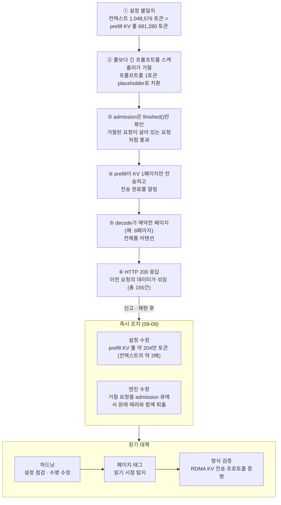

<figure class="post-figure post-figure--header">
<svg role="img" aria-label="GPU의 공유 KV 페이지 풀에 P0부터 P7까지 여덟 칸이 놓여 있다. 맨 앞 P0 한 칸만 내 요청의 색으로 채워져 있고, P1부터 P7에는 이전 요청을 보낸 다른 사용자들의 흐릿한 글자가 지워지지 않은 채 남아 있다. 위에서 decode의 어텐션 시선이 여덟 칸 전체를 부채꼴로 훑고, 아래에는 그 결과로 다른 고객의 데이터가 섞인 HTTP 200 응답이 나온다." viewBox="0 0 640 320">
  <title>남의 페이지까지 읽어 버린 decode 어텐션</title>

  <!-- decode attention gaze: an eye sweeping the whole reserved row -->
  <polygon points="320,58 60,120 584,120" fill="var(--gold)" fill-opacity="0.14"/>
  <g fill="none" stroke="var(--gold)" stroke-width="1.5" stroke-dasharray="5 4">
    <line x1="320" y1="58" x2="60" y2="120"/>
    <line x1="320" y1="58" x2="584" y2="120"/>
  </g>
  <ellipse cx="320" cy="48" rx="22" ry="11" fill="var(--bg-panel)" stroke="var(--gold)" stroke-width="2.5"/>
  <circle cx="320" cy="48" r="5.5" fill="var(--gold)"/>
  <text x="352" y="34" font-family="var(--font-body)" font-size="13" font-weight="700" fill="currentColor">decode 어텐션</text>
  <text x="352" y="52" font-family="var(--font-body)" font-size="11" fill="currentColor" opacity="0.75">예약한 페이지를 전부 읽는다</text>

  <!-- shared KV page pool -->
  <rect x="34" y="106" width="572" height="146" fill="none" stroke="var(--border-color)" stroke-width="2" stroke-dasharray="6 4"/>
  <rect x="60" y="120" width="58" height="76" fill="var(--accent-color)" fill-opacity="0.18" stroke="var(--accent-color)" stroke-width="2.5"/>
  <text x="89" y="140" text-anchor="middle" font-family="var(--font-body)" font-size="12" font-weight="700" fill="var(--accent-color)">P0</text>
  <text x="89" y="164" text-anchor="middle" font-family="var(--font-body)" font-size="12" font-weight="700" fill="var(--accent-color)">내 요청</text>
  <rect x="69" y="174" width="40" height="5" fill="var(--accent-color)" opacity="0.7"/>
  <rect x="69" y="184" width="28" height="5" fill="var(--accent-color)" opacity="0.7"/>
  <rect x="126" y="120" width="58" height="76" fill="var(--bg-light)" stroke="currentColor" stroke-opacity="0.45" stroke-width="1.5"/>
  <text x="155" y="140" text-anchor="middle" font-family="var(--font-body)" font-size="12" font-weight="700" fill="currentColor" opacity="0.7">P1</text>
  <text x="155" y="160" text-anchor="middle" font-family="var(--font-body)" font-size="10" fill="currentColor" opacity="0.4">사용자 A</text>
  <rect x="135" y="168" width="40" height="4" fill="currentColor" opacity="0.22"/>
  <rect x="135" y="177" width="30" height="4" fill="currentColor" opacity="0.22"/>
  <rect x="135" y="186" width="36" height="4" fill="currentColor" opacity="0.22"/>
  <rect x="192" y="120" width="58" height="76" fill="var(--bg-light)" stroke="currentColor" stroke-opacity="0.45" stroke-width="1.5"/>
  <text x="221" y="140" text-anchor="middle" font-family="var(--font-body)" font-size="12" font-weight="700" fill="currentColor" opacity="0.7">P2</text>
  <text x="221" y="160" text-anchor="middle" font-family="var(--font-body)" font-size="10" fill="currentColor" opacity="0.4">사용자 B</text>
  <rect x="201" y="168" width="34" height="4" fill="currentColor" opacity="0.22"/>
  <rect x="201" y="177" width="42" height="4" fill="currentColor" opacity="0.22"/>
  <rect x="201" y="186" width="26" height="4" fill="currentColor" opacity="0.22"/>
  <rect x="258" y="120" width="58" height="76" fill="var(--bg-light)" stroke="currentColor" stroke-opacity="0.45" stroke-width="1.5"/>
  <text x="287" y="140" text-anchor="middle" font-family="var(--font-body)" font-size="12" font-weight="700" fill="currentColor" opacity="0.7">P3</text>
  <text x="287" y="160" text-anchor="middle" font-family="var(--font-body)" font-size="10" fill="currentColor" opacity="0.4">사용자 C</text>
  <rect x="267" y="168" width="42" height="4" fill="currentColor" opacity="0.22"/>
  <rect x="267" y="177" width="28" height="4" fill="currentColor" opacity="0.22"/>
  <rect x="267" y="186" width="38" height="4" fill="currentColor" opacity="0.22"/>
  <rect x="324" y="120" width="58" height="76" fill="var(--bg-light)" stroke="currentColor" stroke-opacity="0.45" stroke-width="1.5"/>
  <text x="353" y="140" text-anchor="middle" font-family="var(--font-body)" font-size="12" font-weight="700" fill="currentColor" opacity="0.7">P4</text>
  <text x="353" y="160" text-anchor="middle" font-family="var(--font-body)" font-size="10" fill="currentColor" opacity="0.4">사용자 A</text>
  <rect x="333" y="168" width="30" height="4" fill="currentColor" opacity="0.22"/>
  <rect x="333" y="177" width="40" height="4" fill="currentColor" opacity="0.22"/>
  <rect x="333" y="186" width="34" height="4" fill="currentColor" opacity="0.22"/>
  <rect x="390" y="120" width="58" height="76" fill="var(--bg-light)" stroke="currentColor" stroke-opacity="0.45" stroke-width="1.5"/>
  <text x="419" y="140" text-anchor="middle" font-family="var(--font-body)" font-size="12" font-weight="700" fill="currentColor" opacity="0.7">P5</text>
  <text x="419" y="160" text-anchor="middle" font-family="var(--font-body)" font-size="10" fill="currentColor" opacity="0.4">사용자 D</text>
  <rect x="399" y="168" width="38" height="4" fill="currentColor" opacity="0.22"/>
  <rect x="399" y="177" width="26" height="4" fill="currentColor" opacity="0.22"/>
  <rect x="399" y="186" width="42" height="4" fill="currentColor" opacity="0.22"/>
  <rect x="456" y="120" width="58" height="76" fill="var(--bg-light)" stroke="currentColor" stroke-opacity="0.45" stroke-width="1.5"/>
  <text x="485" y="140" text-anchor="middle" font-family="var(--font-body)" font-size="12" font-weight="700" fill="currentColor" opacity="0.7">P6</text>
  <text x="485" y="160" text-anchor="middle" font-family="var(--font-body)" font-size="10" fill="currentColor" opacity="0.4">사용자 B</text>
  <rect x="465" y="168" width="28" height="4" fill="currentColor" opacity="0.22"/>
  <rect x="465" y="177" width="40" height="4" fill="currentColor" opacity="0.22"/>
  <rect x="465" y="186" width="32" height="4" fill="currentColor" opacity="0.22"/>
  <rect x="522" y="120" width="58" height="76" fill="var(--bg-light)" stroke="currentColor" stroke-opacity="0.45" stroke-width="1.5"/>
  <text x="551" y="140" text-anchor="middle" font-family="var(--font-body)" font-size="12" font-weight="700" fill="currentColor" opacity="0.7">P7</text>
  <text x="551" y="160" text-anchor="middle" font-family="var(--font-body)" font-size="10" fill="currentColor" opacity="0.4">사용자 E</text>
  <rect x="531" y="168" width="40" height="4" fill="currentColor" opacity="0.22"/>
  <rect x="531" y="177" width="34" height="4" fill="currentColor" opacity="0.22"/>
  <rect x="531" y="186" width="24" height="4" fill="currentColor" opacity="0.22"/>

  <!-- braces: what was really written vs. what is left over -->
  <g fill="none" stroke-width="1.5">
    <path d="M60 204 v6 h58 v-6" stroke="var(--accent-color)"/>
    <path d="M126 204 v6 h458 v-6" stroke="currentColor" stroke-opacity="0.55"/>
  </g>
  <text x="89" y="226" text-anchor="middle" font-family="var(--font-body)" font-size="11" font-weight="700" fill="var(--accent-color)">이번 요청이 쓴 칸</text>
  <text x="355" y="226" text-anchor="middle" font-family="var(--font-body)" font-size="11" fill="currentColor" opacity="0.8">이전 요청들이 남긴 다른 사용자의 데이터</text>
  <text x="46" y="244" font-family="var(--font-body)" font-size="10.5" fill="currentColor" opacity="0.65">GPU 공유 KV 페이지 풀 · 페이지는 요청 사이에 0으로 지워지지 않는다</text>

  <!-- the result: a quiet success -->
  <path d="M320 254 v14" stroke="currentColor" stroke-opacity="0.6" stroke-width="2"/>
  <path d="M314 264 l6 8 l6 -8" fill="none" stroke="currentColor" stroke-opacity="0.6" stroke-width="2"/>
  <rect x="150" y="276" width="340" height="34" rx="17" fill="var(--bg-light)" stroke="var(--accent-color)" stroke-width="2"/>
  <text x="320" y="298" text-anchor="middle" font-family="var(--font-body)" font-size="13" font-weight="700" fill="var(--accent-color)">HTTP 200 — 그럴듯한 답 속에 남의 데이터</text>
</svg>
<figcaption>성능을 위해 지우지 않고 재사용하는 KV 페이지 위에서, decode가 이 요청이 쓰지 않은 칸까지 읽었다 — 에러 없이 성공한 것처럼 보이는 데이터 노출.</figcaption>
</figure>

## 원문 정보

> - **제목**: Cross-request KV cache exposure in the GLM-5.3 Workers AI model, and our remediation with SGLang
> - **출처**: Kevin Flansburg, Michelle Chen / Cloudflare Blog ([blog.cloudflare.com](https://blog.cloudflare.com/))
> - **발행**: 2026-10-26 · 약 16분 분량
> - **원문 링크**: <https://blog.cloudflare.com/kv-cache-exposure-remediation/>

LLM 추론 서버의 성능 최적화(공유 KV 캐시 페이지 풀)가 그대로 **테넌트 격리 실패**로 이어진 실제 사고 보고서입니다. 공격이 아니라 메모리 소유권 추적 실패로 데이터가 섞인 사례라 Security 카테고리에 담습니다.

## 한 줄 요약 (TL;DR)

GLM-5.3을 "1,048,576 토큰 컨텍스트 / 681,280 토큰 KV 풀"이라는 불일치 설정으로 띄운 상태에서, SGLang의 disaggregated 모드는 풀에 안 들어가는 요청을 거절했다고 표시만 해 두고 그대로 decode로 넘겼고, decode는 **이 요청이 쓰지 않은 이전 요청들의 KV 페이지를 읽어** 다른 고객의 데이터가 섞인 응답(HTTP 200)을 돌려주었습니다. Cloudflare는 설정과 엔진을 함께 고치고, SGLang 업스트림과 함께 이 버그가 속한 "KV 캐시 메모리 안전성" 버그 계열 전반을 하드닝하는 중입니다.

## 왜 이 글을 골랐나

LLM 서빙을 공부할 때 KV 캐시는 보통 **성능** 주제로만 등장합니다 — [CS336 10강](/2026/06/26/cs336-lecture-10-inference.html)에서 다룬 PagedAttention이나 prefill/decode 분리가 그렇습니다. 이 보고서는 같은 구조를 **보안** 관점에서 다시 보게 만듭니다. 페이지를 0으로 지우지 않고 재사용하는 것은 성능상 합리적이지만, 그 순간 "이 페이지의 주인이 누구인가"를 추적하는 책임이 엔진에 생기고, 그 추적이 한 번 어긋나면 멀티테넌트 서비스에서 다른 사람의 프롬프트가 내 응답에 나옵니다.

또 사고 보고서로서의 완성도도 높습니다. 영향 범위를 숫자로 밝히고(155건), 자기 쪽 실수("우리가 강제하지 않은 점검")를 명시하며, 업스트림 PR 단위로 무엇이 고쳐졌는지와 다른 운영자를 위한 권고까지 담았습니다. 앞서 정리한 [npm 공급망 공격](/2026/07/07/npm-debug-chalk-supply-chain-compromise.html)이 외부 공격자의 사고였다면, 이 글은 **내부 결함으로 인한 데이터 노출**을 어떻게 다루는지의 좋은 참고서입니다.

한눈에 보기 — 설정 불일치에서 노출된 응답까지의 인과 사슬과, 그 뒤에 이어진 두 겹의 즉시 조치·장기 대책입니다.

## 핵심 내용

### 무슨 일이 있었나: 범위와 영향

- **2026-09-08**, 보안 연구자 Gadi Evron(Knostic)이 Cloudflare HackerOne 프로그램으로 신고했습니다. 매우 긴 프롬프트를 `@cf/zai-org/glm-5.3`에 보내면 가끔 다른 사용자 세션의 텍스트가 돌아온다는 내용입니다.
- 노출은 모델 출시일인 **2026-08-27**부터 존재했고, Cloudflare는 다음 날 아침 재현한 뒤 **인시던트 선언 후 40분 안에** 모델을 내렸으며, 설정 수정과 패치된 엔진을 배포해 **9월 9일 같은 날** 복구했습니다.
- 8월 27일부터 9월 9일 사이 **총 155건의 응답**이 영향을 받았고, 모두 **681,280 토큰보다 긴 프롬프트**에 대한 응답이었습니다. 같은 모델에 직전에 들어온 다른 고객 요청의 데이터가 섞였습니다.
- 자사·연구자 테스트를 제외하면 해당 요청들은 타이밍과 양에서 평범한 롱 컨텍스트 사용과 일치하며, **의도적 악용의 증거는 없었다**고 밝힙니다.
- Workers AI의 **다른 모델은 영향이 없음**을 확인했습니다. 다른 disaggregated 배포는 prefill·decode 모두 KV 풀이 컨텍스트 길이보다 커서 거절 경로에 도달할 수 없었기 때문입니다.
- 이 글은 SGLang 측 게시물과 함께 낸 **조율된 공개(coordinated disclosure)** 입니다.

### 배경: GLM 5.3을 어떻게 서빙하나

Workers AI는 SGLang을 **disaggregated 구성**으로 돌립니다. prefill GPU 풀이 프롬프트를 처리해 KV 캐시를 만들고, 이를 Mooncake를 통한 RDMA로 decode GPU 풀에 넘기면 decode가 응답을 생성합니다.

원문이 강조하는 전제 세 가지가 사고를 이해하는 열쇠입니다.

1. **KV 캐시는 고정 크기 페이지의 공유 풀**입니다. 요청은 admission 시 페이지를 할당받고 끝나면 반납합니다.
2. **페이지는 요청 사이에 0으로 지워지지 않습니다.** 다음 요청이 덮어쓸 뿐입니다. 추론 엔진에서 흔하고 최고 성능에 필요한 방식이지만, 그만큼 엔진이 페이지 소유권을 추적해야 합니다. 이 소유권은 노드 내부(KV offload와 토큰 생성이 서로 다른 수명으로 접근)뿐 아니라, 동시에 가변 참조를 쥔 **원격 prefill 노드와도 사실상 공유**됩니다.
3. **풀 크기는 설정값이 아닙니다.** SGLang은 시작 시 모델 가중치를 올리고 남은 GPU 메모리로 풀 크기를 정합니다. 반면 모델이 광고하는 컨텍스트 길이는 별개의 설정값입니다. 둘이 일치하도록 강제하는 것은 아무것도 없고, 확인은 운영자 몫입니다.

### 문제 1: 설정 불일치

GLM 5.3 prefill 노드의 풀은 681,280 토큰, 컨텍스트 길이는 1,048,576 토큰이었습니다. 풀 크기는 시작 로그와 메트릭으로 노출되고 있었고, Cloudflare는 **출시 전에 이 불일치를 알고 있었습니다.** 그러나 롱 컨텍스트 벤치마크에서 성공 HTTP 코드와 에러 프레임 없는 스트리밍 응답을 보고, 엔진이 이 차이를 알아서 처리하거나 처리 못 하면 에러를 낼 것이라 가정했습니다.

원문은 이를 테스트의 결정적 공백으로 인정합니다. **응답 코드와 성능만 검증했고, 모델 출력의 내용·일관성은 검증하지 않았다**는 것입니다. 이제는 disaggregated 배포 변경이 나가기 전에 실행 중인 엔진에서 KV 풀 크기를 컨텍스트 길이와 직접 비교합니다.

### 문제 2: SGLang의 거절 경로 버그

<figure class="post-figure">
<svg role="img" aria-label="풀보다 긴 프롬프트가 거절 경로를 타면 1토큰 placeholder로 바뀐다. 단일 노드에서는 배치가 끝나고 클라이언트가 에러를 받는다. disaggregated 모드에서는 거절 정보가 to_finish에 저장되어 finished()가 False이므로 admission을 통과해 계속 진행된다. 그 결과 decode가 예약한 P0부터 P7까지 8페이지 중 prefill이 보낸 것은 P0 한 페이지뿐이고, P1부터 P7에는 이전 요청의 잔여 데이터가 있는데, decode 어텐션은 8페이지 전부를 읽는다." viewBox="0 0 640 400">
  <title>거절이 보이지 않은 handoff: 8페이지 예약, 1페이지 전송</title>

  <!-- entry: the reject path -->
  <rect x="160" y="12" width="320" height="50" fill="var(--bg-light)" stroke="var(--primary-color)" stroke-width="2"/>
  <text x="320" y="33" text-anchor="middle" font-family="var(--font-body)" font-size="13" font-weight="700" fill="var(--primary-color)">풀보다 긴 프롬프트 → 거절 경로</text>
  <text x="320" y="52" text-anchor="middle" font-family="var(--font-body)" font-size="11" fill="currentColor" opacity="0.8">Req.set_finish_with_abort · 프롬프트를 1토큰 placeholder로</text>
  <g fill="none" stroke="currentColor" stroke-opacity="0.6" stroke-width="2">
    <path d="M260 62 L165 88"/><path d="M380 62 L475 88"/>
  </g>

  <!-- branch A: single node -->
  <text x="165" y="100" text-anchor="middle" font-family="var(--font-body)" font-size="13" font-weight="700" fill="currentColor">단일 노드</text>
  <rect x="40" y="108" width="250" height="40" fill="var(--bg-light)" stroke="currentColor" stroke-opacity="0.5" stroke-width="1.5"/>
  <text x="165" y="133" text-anchor="middle" font-family="var(--font-body)" font-size="12" fill="currentColor">placeholder 실행 → 배치 종료</text>
  <path d="M165 148 v16" stroke="currentColor" stroke-opacity="0.6" stroke-width="2"/>
  <rect x="40" y="166" width="250" height="36" fill="var(--bg-panel)" stroke="var(--secondary-color)" stroke-width="2.5"/>
  <text x="165" y="189" text-anchor="middle" font-family="var(--font-body)" font-size="12" font-weight="700" fill="var(--secondary-color)">클라이언트는 에러를 받는다 (정상)</text>

  <!-- branch B: disaggregated -->
  <text x="475" y="100" text-anchor="middle" font-family="var(--font-body)" font-size="13" font-weight="700" fill="currentColor">disaggregated 모드</text>
  <rect x="350" y="108" width="250" height="40" fill="var(--bg-light)" stroke="currentColor" stroke-opacity="0.5" stroke-width="1.5"/>
  <text x="475" y="125" text-anchor="middle" font-family="var(--font-body)" font-size="11.5" fill="currentColor">거절 정보는 to_finish에 저장</text>
  <text x="475" y="141" text-anchor="middle" font-family="var(--font-body)" font-size="11.5" fill="currentColor">finished()는 여전히 False</text>
  <path d="M475 148 v16" stroke="currentColor" stroke-opacity="0.6" stroke-width="2"/>
  <rect x="350" y="166" width="250" height="36" fill="var(--bg-panel)" stroke="var(--accent-color)" stroke-width="2.5"/>
  <text x="475" y="189" text-anchor="middle" font-family="var(--font-body)" font-size="12" font-weight="700" fill="var(--accent-color)">admission 통과 → 계속 진행</text>
  <path d="M475 202 v14" stroke="var(--accent-color)" stroke-width="2"/>
  <path d="M469 211 l6 8 l6 -8" fill="none" stroke="var(--accent-color)" stroke-width="2"/>

  <!-- decode side: reserved 8 vs transferred 1 -->
  <rect x="30" y="222" width="580" height="170" fill="none" stroke="var(--border-color)" stroke-width="2" stroke-dasharray="6 4"/>
  <text x="44" y="240" font-family="var(--font-body)" font-size="11.5" font-weight="700" fill="currentColor">decode 측 — 예약: P0~P7 (예: 8페이지) · prefill이 전송: P0 1페이지</text>
  <rect x="52" y="258" width="60" height="52" fill="var(--accent-color)" fill-opacity="0.18" stroke="var(--accent-color)" stroke-width="2.5"/>
  <text x="82" y="280" text-anchor="middle" font-family="var(--font-body)" font-size="12" font-weight="700" fill="var(--accent-color)">P0</text>
  <text x="82" y="298" text-anchor="middle" font-family="var(--font-body)" font-size="10" fill="var(--accent-color)">이번 요청</text>
  <rect x="120" y="258" width="60" height="52" fill="var(--bg-light)" stroke="currentColor" stroke-opacity="0.45" stroke-width="1.5"/>
  <text x="150" y="280" text-anchor="middle" font-family="var(--font-body)" font-size="12" font-weight="700" fill="currentColor" opacity="0.7">P1</text>
  <text x="150" y="298" text-anchor="middle" font-family="var(--font-body)" font-size="10" fill="currentColor" opacity="0.45">잔여 데이터</text>
  <rect x="188" y="258" width="60" height="52" fill="var(--bg-light)" stroke="currentColor" stroke-opacity="0.45" stroke-width="1.5"/>
  <text x="218" y="280" text-anchor="middle" font-family="var(--font-body)" font-size="12" font-weight="700" fill="currentColor" opacity="0.7">P2</text>
  <text x="218" y="298" text-anchor="middle" font-family="var(--font-body)" font-size="10" fill="currentColor" opacity="0.45">잔여 데이터</text>
  <rect x="256" y="258" width="60" height="52" fill="var(--bg-light)" stroke="currentColor" stroke-opacity="0.45" stroke-width="1.5"/>
  <text x="286" y="280" text-anchor="middle" font-family="var(--font-body)" font-size="12" font-weight="700" fill="currentColor" opacity="0.7">P3</text>
  <text x="286" y="298" text-anchor="middle" font-family="var(--font-body)" font-size="10" fill="currentColor" opacity="0.45">잔여 데이터</text>
  <rect x="324" y="258" width="60" height="52" fill="var(--bg-light)" stroke="currentColor" stroke-opacity="0.45" stroke-width="1.5"/>
  <text x="354" y="280" text-anchor="middle" font-family="var(--font-body)" font-size="12" font-weight="700" fill="currentColor" opacity="0.7">P4</text>
  <text x="354" y="298" text-anchor="middle" font-family="var(--font-body)" font-size="10" fill="currentColor" opacity="0.45">잔여 데이터</text>
  <rect x="392" y="258" width="60" height="52" fill="var(--bg-light)" stroke="currentColor" stroke-opacity="0.45" stroke-width="1.5"/>
  <text x="422" y="280" text-anchor="middle" font-family="var(--font-body)" font-size="12" font-weight="700" fill="currentColor" opacity="0.7">P5</text>
  <text x="422" y="298" text-anchor="middle" font-family="var(--font-body)" font-size="10" fill="currentColor" opacity="0.45">잔여 데이터</text>
  <rect x="460" y="258" width="60" height="52" fill="var(--bg-light)" stroke="currentColor" stroke-opacity="0.45" stroke-width="1.5"/>
  <text x="490" y="280" text-anchor="middle" font-family="var(--font-body)" font-size="12" font-weight="700" fill="currentColor" opacity="0.7">P6</text>
  <text x="490" y="298" text-anchor="middle" font-family="var(--font-body)" font-size="10" fill="currentColor" opacity="0.45">잔여 데이터</text>
  <rect x="528" y="258" width="60" height="52" fill="var(--bg-light)" stroke="currentColor" stroke-opacity="0.45" stroke-width="1.5"/>
  <text x="558" y="280" text-anchor="middle" font-family="var(--font-body)" font-size="12" font-weight="700" fill="currentColor" opacity="0.7">P7</text>
  <text x="558" y="298" text-anchor="middle" font-family="var(--font-body)" font-size="10" fill="currentColor" opacity="0.45">잔여 데이터</text>
  <g fill="none" stroke-width="1.5">
    <path d="M52 316 v6 h60 v-6" stroke="var(--accent-color)"/>
    <path d="M120 316 v6 h468 v-6" stroke="currentColor" stroke-opacity="0.55"/>
  </g>
  <text x="82" y="338" text-anchor="middle" font-family="var(--font-body)" font-size="10.5" font-weight="700" fill="var(--accent-color)">전송된 1페이지</text>
  <text x="354" y="338" text-anchor="middle" font-family="var(--font-body)" font-size="10.5" fill="currentColor" opacity="0.85">이전 요청이 남긴 다른 사용자의 프롬프트·부분 생성 결과</text>

  <!-- attention reads all eight -->
  <path d="M52 356 H582" stroke="var(--gold)" stroke-width="3"/>
  <path d="M576 349 l10 7 l-10 7" fill="none" stroke="var(--gold)" stroke-width="3" stroke-linejoin="round"/>
  <text x="320" y="380" text-anchor="middle" font-family="var(--font-body)" font-size="12" font-weight="700" fill="currentColor">decode 어텐션이 예약한 8페이지를 전부 읽는다 → HTTP 200</text>
</svg>
<figcaption>같은 거절 경로가 단일 노드에선 에러로 끝나지만, disaggregated 모드에선 finished()만 보는 검사에 걸리지 않아 남의 페이지를 읽는 응답이 된다.</figcaption>
</figure>

풀보다 긴 프롬프트가 오면 스케줄러는 거절 경로(`Req.set_finish_with_abort`)를 탑니다. 클라이언트에 돌려줄 에러를 기록하고, 실제 메모리를 할당하지 않고 배치를 흘려보낼 수 있게 **프롬프트를 1토큰 placeholder로 바꿉니다.** 단일 노드에서는 이게 정상 동작했습니다. placeholder가 돌고 배치가 끝나면 클라이언트는 에러를 받습니다.

disaggregated 모드에서는 prefill과 decode 양쪽 admission 큐가 요청이 **거절됐는지가 아니라 끝났는지(`finished()`)** 만 확인했습니다. 거절 정보는 `finished_reason`이 아니라 `to_finish`에 저장되어 `finished()`가 여전히 False였고, 거절된 요청은 살아 있는 요청처럼 보였습니다. 원문이 그림과 함께 설명하는 단계는 다음과 같습니다.

1. **Bootstrap**: 라우터가 decode에 프롬프트 길이(예: 8페이지)를 알리고, decode가 KV 페이지 8개를 예약합니다.
2. **Prefill admission**: `finished()`가 False이므로 거절된 요청이 입장합니다.
3. **Prefill forward**: 이미 1토큰 placeholder로 바뀐 프롬프트에 대해 사소한 forward pass를 돌립니다.
4. **KV 전송**: prefill이 KV 1페이지만 보내고 전송 완료를 알립니다.
5. **Decode admission**: 같은 `finished()` 검사로 handoff를 수락합니다.
6. **Decode attention**: 생성이 시작되면 어텐션이 예약된 8페이지를 전부 읽습니다. 이번 요청이 쓴 것은 P0뿐이고, P1~P7에는 이전 요청이 남긴 **다른 사용자의 프롬프트와 부분 생성 결과**가 있습니다.
7. **응답**: 클라이언트는 HTTP 400 대신 **HTTP 200**을 받습니다. `prompt_tokens`는 긴 프롬프트와 일치하고 답은 그럴듯했으며, 8페이지 prefill로는 나올 수 없을 만큼 빨리 도착했고, 다른 사용자의 KV 페이지 내용을 담고 있었습니다.

임계값을 넘는 모든 요청이 이렇게 동작했습니다. 이 버그는 2026-07-06에 다른 사용자가 SGLang [issue #30233](https://github.com/sgl-project/sglang/issues/30233)으로 이미 보고한 상태였고, Cloudflare는 조사 중에 이를 발견했습니다. Cloudflare는 v0.5.10 무렵부터 이런 유형의 이슈를 SGLang에 제기해 왔고, 이번 사고가 이미 진행 중이던 협업을 앞당겼다고 말합니다. 패치는 SGLang v0.5.20에 들어갔고 v0.5.21, v0.5.22에 후속 수정이 이어졌으며, 원문은 모든 운영자에게 **v0.5.22 이상**으로의 업데이트를 강하게 권합니다.

### 즉시 조치: 두 겹의 수정

- **설정 수정 — 풀이 전체 컨텍스트를 담게**: GLM 5.3 설정을 GLM 5.2 설정에 맞춰 GPU 메모리를 확보했고, prefill KV 풀은 약 204만 토큰, 즉 컨텍스트 길이의 약 2배가 되었습니다. 컨텍스트 창에 맞는 프롬프트는 항상 풀에도 맞으므로 정상 요청이 거절 경로에 닿지 않습니다. 이것만으로도 버그가 발현되지 않습니다.
- **엔진 수정 — 거절 경로 자체를 안전하게**: 풀 크기에만 기대는 것은 취약합니다. 양자화, tensor parallelism, CUDA graph 크기, 향후 모델 버전이 바뀌면 풀 크기가 놓치기 쉬운 방식으로 변하고, 스케줄러가 요청을 거절하는 다른 상황도 있을 수 있기 때문입니다. 그래서 거절이 대기 중인 요청을 bootstrap·할당·KV 전송 이전에 disaggregation admission 큐에서 **원래 에러와 함께 퇴출**하도록 패치했습니다. 이는 업스트림 [#38704](https://github.com/sgl-project/sglang/pull/38704)로 제안되었고, 여기에는 decode가 전송된 토큰 수와 예약한 토큰 수의 일치를 검증하는 내용도 포함되었습니다. 같은 수정은 관련 실패 경로를 위해 9월 6일 [#36988](https://github.com/sgl-project/sglang/pull/36988)로 SGLang main에 이미 병합돼 있었지만 아직 릴리스 전이었습니다. 메인테이너는 Cloudflare의 접근을 따라 이 요청들을 더 일찍 거절하는 [#38935](https://github.com/sgl-project/sglang/pull/38935)도 병합했습니다.

두 변경은 연구자의 재현 스크립트와 자체 canary-marker 테스트로 검증한 뒤 모델을 복구했습니다.

### 타임라인 (UTC)

| 시점 | 내용 |
| --- | --- |
| 2026-08-27 | prefill KV 풀이 컨텍스트 창보다 작은 상태로 GLM 5.3 출시. 노출은 출시 시점부터 존재 |
| 09-08 23:11 | HackerOne으로 신고 접수 |
| 09-09 08:00 | 신고 검증 시작 |
| 09-09 13:22 | 보안 인시던트 선언. Product Security가 서로 다른 두 계정으로 25분 안에 유출 재현 |
| 09-09 14:00 | 범위 확인 후 GLM 5.3을 private로 전환(요청은 HTTP 400), 상태 페이지 갱신 |
| 09-09 14:35 | 근본 원인을 "prefill 풀 < 컨텍스트 길이"로 식별. 더 큰 풀의 canary prefill 노드는 영향 없음 확인 |
| 09-09 14:52 | 모든 prefill 노드를 수정된 설정으로 롤아웃 |
| 09-09 19:04 | 수정 설정 + Cloudflare 작성 엔진 패치로 전체 재구축, 연구자 재현 스크립트로 검증 |
| 09-09 19:40 | 모델 공개 복구 |
| 09-10 23:30 | SGLang 메인테이너(RadixArk CTO와 코어 엔지니어)와 업스트림 수정 합의 회의 |
| 09-11 ~ 09-19 | 전체 프로덕션 SGLang 배포에 추가 하드닝 적용 |
| 09-16 ~ 10-12 | 업스트림에 admission 수정, 전송별 checksum, abort-ACK 보존, deferred KV release 기본 활성화 병합 |
| 10-02 / 10-19 | SGLang v0.5.21 / v0.5.22 릴리스 |
| 10-26 | 연구자·RadixArk와 조율된 공개 |

### 이 버그가 속한 계열: KV 캐시 메모리 안전성

원문은 이번 버그를 Cloudflare가 수개월째 다뤄 온 **KV 캐시 메모리 안전성 버그 계열**의 하나로 봅니다. 공통점은 "다른 무언가가 아직 권리를 가진 페이지가 해제·재사용·읽히는 것"이고, 원인은 두 가지입니다.

- **단일 노드 안의 페이지 수명**: decode 노드에서는 토큰 생성, 호스트 메모리 offload, KV 전송 수신자, abort·에러 경로가 같은 페이지를 동시에 쥘 수 있습니다. 하나가 해제하는 동안 다른 쪽이 쓰고 있으면 새 요청이 그 페이지를 받습니다. decode offload 수정([#24226](https://github.com/sgl-project/sglang/pull/24226), [#30899](https://github.com/sgl-project/sglang/pull/30899))과 grammar 에러 시 이중 해제 수정([#30937](https://github.com/sgl-project/sglang/pull/30937))이 이 유형입니다.
- **노드 간 경쟁(race)**: prefill이 RDMA로 KV를 쓰는 도중 요청이 abort되면 이미 보낸 쓰기는 회수할 수 없습니다. decode가 그 페이지를 바로 해제하면 다른 요청에 배정되고, 늦게 도착한 쓰기가 그 요청의 KV 캐시에 떨어집니다. Cloudflare는 수정 제안([#31357](https://github.com/sgl-project/sglang/pull/31357), #38961)과 재현 스크립트([#32564](https://github.com/sgl-project/sglang/pull/32564))로 기여했습니다.

두 경우 모두 결과는 에러 없이 손상된 출력, 또는 한 사용자의 데이터가 다른 사용자의 응답에 나타나는 것입니다. 이번 버그는 타이밍 우연이 아니라 **거절된 요청이 매번 handoff를 통과**했다는 점에서 달랐지만, "decode가 이 요청이 쓰지 않은 페이지를 읽는다"는 결과는 같았습니다. 그리고 기존 수정 중 어느 것도 "prefill은 거절했는데 decode는 그걸 몰랐다"는 이번 실패를 덮지 못했습니다.

사고 이후 Cloudflare가 적용한 하드닝은 다음과 같습니다.

- deferred release를 prefill의 원본 페이지까지 확장하고 abort뿐 아니라 모든 실패 유형에 적용 (#38961로 제안, 이후 #40645·#41402·#41404가 대체)
- SGLang 커뮤니티의 bounded Mooncake 전송 배치(#32758) 배포 — 한 번의 전송 호출이 release timeout보다 오래 가지 않게
- 로드 밸런서 변경 — 클라이언트 연결 종료가 전송 도중 요청을 abort하지 않도록, prefill 연결은 prefill 종료까지, decode 연결은 첫 토큰까지 유지한 뒤 닫음
- 모든 disaggregated 배포 변경에 점검 추가 — KV 풀 대 컨텍스트 길이, 양쪽 역할의 deferred release, release timeout 안의 전송 배치 한도, 필수 패치 적용 여부

### SGLang 팀과의 협업

사고 다음 날인 9월 10일 RadixArk의 SGLang 메인테이너와 만나, RadixArk가 보고된 race condition을 조사하고, 무결성 검사 아이디어를 업스트림에 넣고, 이 버그 계열의 재현 테스트를 만들기로 합의했습니다. 원문은 SGLang main에 들어간 PR을 Incident / Race / Lifetime / Observability로 분류한 표로 정리하며, 하나를 제외하고 모두 v0.5.22에 포함되어 있다고 말합니다. 대표적인 것만 추리면 다음과 같습니다.

| 분류 | PR | 릴리스 | 내용 |
| --- | --- | --- | --- |
| Incident | #36988 | v0.5.20 | abort된 prefill 요청을 결과가 decode에 닿기 전에 퇴출 — 이번 노출을 막음 |
| Incident | #38935 | v0.5.21 | 이런 요청을 bootstrap·할당·전송 이전 admission에서 거절 (Cloudflare 초안 #38704 접근) |
| Race | #39461, #41612 | v0.5.21, v0.5.22 | 클라이언트 연결 종료나 prefill 실패 시 sgl-router가 요청의 양쪽 절반을 모두 취소 |
| Race | #37454, #41023 | v0.5.20, v0.5.21 | 지원 백엔드에서만 deferred KV release 활성화, 이후 기본값으로 |
| Race | #43719 | v0.5.22 | 실패한 Mooncake 전송이 쓰기를 drain된 것으로 보고하지 않게 |
| Race | #37077 | v0.5.22 | abort 메시지를 요청별로 태깅해 재사용된 ID가 오래된 확인을 소비하지 못하게, MORI 지원 추가 |
| Lifetime | #30899 | v0.5.21 | decode가 진행 중인 호스트 offload를 기다린 뒤 페이지 해제 (Cloudflare 작성) |
| Observability | #39500 | v0.5.21 | `--disaggregation-enable-kv-checksum` — decode가 생성 전 전송된 KV의 checksum 검증 |
| Observability | #41128 | v0.5.22 | deferred release 메트릭(횟수, 지속 시간, drain 확인/timeout 종료 여부) |

진행 중인 후속 작업으로는 checksum 정리(#39729, 병합·릴리스 대기), 해제 시 KV 페이지를 0으로 지우는 초안 제안(#46435), KV checksum 검증을 prefill→decode handoff에서 모든 decode 스텝으로 확장, KV Canary와 KV Checksum의 모델·기능 지원 확대가 있습니다.

### 다른 운영자를 위한 권고

disaggregated prefill/decode 모드로 SGLang을 운영한다면 원문은 다음을 권합니다.

1. **KV 풀을 측정해 컨텍스트 길이와 비교** — 모든 prefill·decode 노드에서, 엔진 시작 로그로, 가중치·양자화·병렬화·memory fraction을 바꿀 때마다. 풀이 작으면 컨텍스트 길이를 낮추고, 프록시가 한도를 지켜 주리라 기대하지도, 엔진이 안 맞는 요청을 거절하리라 가정하지도 말 것. 원문은 "이것이 우리가 강제하지 않은 점검"이라고 적습니다.
2. **#36988과 #38935가 포함된 빌드(v0.5.22 이상)로 업그레이드** — 1번 점검이 틀린 날을 위한 엔진 쪽 안전망.
3. **양쪽 역할에서 deferred KV release 사용**(#41023 이후 기본값), Mooncake 전송 배치에 상한 설정.
4. **지원되는 곳에서 손상 탐지 켜기** — `--disaggregation-enable-kv-checksum`, `--kv-canary`는 아직 모든 아키텍처를 덮지 않으므로 로그로 실제 검증 여부를 확인. GLM 5.3, GLM 5.3 Flash, DeepSeek V4 등으로 확대 작업 중.
5. **프록시가 불필요한 abort를 만들지 않게** — 로드 밸런서가 첫 토큰까지 요청을 진행시켜 노드 간 조정이 필요한 abort를 피할 것.

### 장기 대책: 구조에 의한 무결성, 그리고 수학적 증명

<figure class="post-figure">
<svg role="img" aria-label="방어의 세 겹을 오른쪽으로 갈수록 높아지는 계단으로 그린 그림. 첫째 칸은 지금까지의 설정 점검과 수명 수정으로, 오용 경로를 줄이지만 불가능하게 만들지는 못한다. 둘째 칸은 페이지 태그로, 재할당 때 바뀌는 태그와 요청이 기대하는 태그를 decode 읽기 직전에 대조해 읽기 시점에 탐지한다. 프로토타입은 신뢰성 문제로 비활성화되었고 #39500 전송별 checksum이 첫걸음이다. 셋째 칸은 RDMA 기반 KV 전송 프로토콜의 형식 검증으로 오용이 불가능함을 증명하는 계획 단계이며 증명기의 빈틈은 남는다." viewBox="0 0 640 290">
  <title>방어의 세 겹: 줄이기 → 탐지하기 → 증명하기</title>

  <text x="30" y="30" font-family="var(--font-body)" font-size="12" font-weight="700" fill="currentColor" opacity="0.85">오른쪽으로 갈수록 보장이 강해진다</text>
  <path d="M30 42 H380" stroke="var(--gold)" stroke-width="2.5"/>
  <path d="M372 36 l9 6 l-9 6" fill="none" stroke="var(--gold)" stroke-width="2.5" stroke-linejoin="round"/>

  <!-- step 1 -->
  <rect x="30" y="160" width="186" height="114" fill="var(--bg-light)" stroke="currentColor" stroke-opacity="0.55" stroke-width="2"/>
  <text x="123" y="184" text-anchor="middle" font-family="var(--font-body)" font-size="12" font-weight="700" fill="currentColor">① 설정 점검 · 수명 수정</text>
  <text x="123" y="206" text-anchor="middle" font-family="var(--font-body)" font-size="11.5" fill="currentColor">오용 경로를 줄인다</text>
  <text x="123" y="223" text-anchor="middle" font-family="var(--font-body)" font-size="11" fill="currentColor" opacity="0.75">불가능하게 만들지는 못한다</text>
  <text x="123" y="260" text-anchor="middle" font-family="var(--font-body)" font-size="10.5" fill="currentColor" opacity="0.7">지금까지의 수정·하드닝</text>

  <!-- step 2 -->
  <rect x="227" y="110" width="186" height="164" fill="var(--bg-light)" stroke="var(--secondary-color)" stroke-width="2.5"/>
  <text x="320" y="134" text-anchor="middle" font-family="var(--font-body)" font-size="13" font-weight="700" fill="var(--secondary-color)">② 페이지 태그</text>
  <text x="320" y="157" text-anchor="middle" font-family="var(--font-body)" font-size="11" fill="currentColor">재할당 때 바뀌는 태그 ↔</text>
  <text x="320" y="173" text-anchor="middle" font-family="var(--font-body)" font-size="11" fill="currentColor">요청이 기대하는 태그를</text>
  <text x="320" y="189" text-anchor="middle" font-family="var(--font-body)" font-size="11" fill="currentColor">decode 읽기 직전에 대조</text>
  <text x="320" y="209" text-anchor="middle" font-family="var(--font-body)" font-size="11.5" font-weight="700" fill="var(--secondary-color)">→ 읽기 시점 탐지</text>
  <text x="320" y="230" text-anchor="middle" font-family="var(--font-body)" font-size="10.5" fill="currentColor" opacity="0.7">프로토타입은 신뢰성 문제로</text>
  <text x="320" y="245" text-anchor="middle" font-family="var(--font-body)" font-size="10.5" fill="currentColor" opacity="0.7">비활성화</text>
  <text x="320" y="264" text-anchor="middle" font-family="var(--font-body)" font-size="10.5" fill="currentColor" opacity="0.7">첫걸음: #39500 전송별 checksum</text>

  <!-- step 3 -->
  <rect x="424" y="60" width="186" height="214" fill="var(--bg-light)" stroke="var(--primary-color)" stroke-width="3"/>
  <text x="517" y="84" text-anchor="middle" font-family="var(--font-body)" font-size="13" font-weight="700" fill="var(--primary-color)">③ 형식 검증</text>
  <text x="517" y="108" text-anchor="middle" font-family="var(--font-body)" font-size="11" fill="currentColor">RDMA 기반 KV 캐시</text>
  <text x="517" y="124" text-anchor="middle" font-family="var(--font-body)" font-size="11" fill="currentColor">전송 프로토콜을 모델링하고</text>
  <text x="517" y="140" text-anchor="middle" font-family="var(--font-body)" font-size="11" fill="currentColor">안전성을 증명</text>
  <text x="517" y="162" text-anchor="middle" font-family="var(--font-body)" font-size="11.5" font-weight="700" fill="var(--primary-color)">→ 불가능함을 증명</text>
  <text x="517" y="238" text-anchor="middle" font-family="var(--font-body)" font-size="10.5" fill="currentColor" opacity="0.7">계획 단계</text>
  <text x="517" y="260" text-anchor="middle" font-family="var(--font-body)" font-size="10.5" fill="currentColor" opacity="0.7">증명기가 못 보는 빈틈은 남는다</text>
</svg>
<figcaption>설정 점검·수명 수정은 오용 경로를 줄일 뿐이고, 페이지 태그는 읽는 순간 잡아내며, 형식 검증은 그 오용이 불가능함을 증명하려 한다.</figcaption>
</figure>

**구조에 의한 무결성(Integrity by construction).** 설정 점검과 수명 수정은 페이지가 오용되는 경로를 줄일 뿐 오용을 불가능하게 만들지는 못하며, 다음 버그는 지금까지 보지 못한 모양일 것이라고 원문은 말합니다. 지속적인 답은 엔진이 **읽는 시점에** 요청이 자기 소유가 아닌 페이지를 어텐션하려 한다는 것을 감지하고, 남의 데이터를 반환하는 대신 그 요청 하나를 실패시키는 것입니다. Cloudflare는 여름에 프로토타입을 만들었습니다. 모든 물리 KV 페이지가 재할당될 때 바뀌는 태그를 갖고, 각 요청은 기대하는 태그를 기록하며, decode가 캐시를 읽기 전에 매핑을 검사합니다. 테스트에서 처리량·꼬리 지연 비용은 1% 미만이었고 8월 중순 GLM 5.2에서 시험했지만, **신뢰성 문제로 곧 비활성화했습니다.** 특정 어텐션 백엔드와 모델 아키텍처에 묶여 있어 일반 해법도 될 수 없었습니다. 그래서 SGLang 팀과 모든 모델에서 동작하는 프로덕션 버전을 엔진에 넣는 작업을 하고 있고, #39500의 전송별 checksum이 첫걸음입니다. 페이지 태그는 전송 한참 뒤의 읽기까지 모든 읽기를 검사한다는 점에서 한 단계 더 나아갑니다.

**수학적 불가능성에 의한 무결성(Integrity by mathematical impossibility).** RDMA는 한 노드의 메모리에서 다른 노드로 데이터를 직접 복사하므로, 두 기계가 데이터의 위치·크기·완료 시점에 합의해야 하고 어긋나면 수신자가 잘못된 데이터를 읽습니다. 원문은 이번 버그를 **두 기계가 시스템 상태에 대해 서로 다른 관점을 가진 분산 시스템의 일관성 실패**로 규정합니다. Cloudflare는 Topaz(권한 DNS 서버의 충돌 없는 IP 선택)와 Meerkat의 QuePaxa 구현 모델링(일관성 버그 발견 후 수정)에서 형식 검증을 써 왔고, 이를 KV 캐시 전송 엔진으로 돌립니다. RDMA 기반 KV 캐시 전송 프로토콜의 모델링과 안전성 증명에서 시작해, Mooncake를 쓰는 프로덕션 SGLang의 분산 KV 캐시 시스템을 모델링하고 원하는 안전 속성과의 괴리를 추적·수정한다는 계획입니다. 증명기가 말해 주지 못하는 빈틈은 현실적으로 남겠지만, 나머지를 증명해 두면 그 빈틈을 더 면밀히 검토·감시할 수 있다고 말합니다.

## 분석과 인사이트

여기부터는 원문 요약이 아니라 제 해석입니다.

### "성공 응답"이 가장 위험한 실패 모드다

이 사고에서 가장 섬뜩한 대목은 7단계의 응답 설명입니다. HTTP 200, 프롬프트 토큰 수 일치, 그럴듯한 답변. 시스템의 모든 표면 신호가 "정상"을 가리켰습니다. 출시 전 테스트가 이 버그를 못 잡은 이유도 정확히 같습니다 — 응답 코드와 성능만 봤기 때문입니다. 크래시나 500 에러는 시끄럽게 실패하지만, 데이터 노출 버그는 **조용히 성공한 것처럼 보입니다.** LLM 서빙에서는 "출력이 그럴듯함"이 정확성의 증거가 되지 못한다는 점이 이 문제를 더 키웁니다. 모델은 남의 KV를 읽어도 유창하게 말합니다.

여기서 나오는 교훈은 테스트가 **의미적 검증**을 포함해야 한다는 것입니다. 원문이 언급한 canary-marker 테스트(알려진 표식을 심어 두고 그것이 엉뚱한 곳에 나타나는지 보는 방식)가 그 예입니다. 원문에 단서가 하나 더 있습니다. 응답이 "8페이지 prefill로는 나올 수 없을 만큼 빨랐다"는 점입니다. 프롬프트 길이 대비 TTFT가 비정상적으로 짧다는 것은 그 자체로 이상 징후 메트릭이 될 수 있겠다는 생각이 듭니다 — 다만 이건 원문의 주장이 아니라 제 추론입니다.

### 성능 최적화는 보안 경계를 옮긴다

페이지를 지우지 않는 공유 풀은 운영체제의 메모리 관리와 같은 문제를 GPU 위에서 다시 푸는 일입니다. OS는 프로세스에 페이지를 줄 때 0으로 채워 정보 유출을 막지만, 추론 엔진은 성능 때문에 그 비용을 내지 않습니다. 그러면 격리의 책임은 하드웨어나 OS가 아니라 **엔진의 소유권 추적 로직**으로 옮겨 갑니다. 원문이 이 버그 계열을 "메모리 안전성"이라고 부르는 것이 정확합니다. use-after-free, 이중 해제, 늦게 도착한 쓰기 — 시스템 프로그래밍의 고전적 버그들이 이제 GPU 메모리와 RDMA 위에서, 그리고 결과가 "다른 테넌트의 데이터"라는 형태로 재현됩니다. 진행 중인 "해제 시 0으로 지우기" 초안(#46435)은 이 트레이드오프를 정면으로 다시 묻는 시도로 읽힙니다.

[CS336 10강](/2026/06/26/cs336-lecture-10-inference.html)이나 [자기회귀 추론의 비용 구조](/2026/09/21/jev-autoregressive-inference-cost-structure.html)에서 prefill과 decode를 나누는 이유를 비용 비대칭으로 배웠다면, 이 글은 그 분리의 대가를 보여 줍니다. prefill/decode를 서로 다른 GPU 풀로 쪼개는 순간 한 요청의 상태가 두 노드에 걸치고, 하나의 "거절" 사실이 두 노드에 일관되게 전파되어야 하는 **분산 합의 문제**가 생깁니다. 원문 결론부가 이를 분산 시스템의 일관성 실패로 규정하고 형식 검증을 꺼내 드는 흐름이 자연스러운 이유입니다. [DDIA](/2026/06/19/designing-data-intensive-applications.html)에서 다루는 분산 시스템의 함정이 LLM 인프라 한가운데 그대로 있습니다.

### 상태 표현의 작은 불일치가 사고가 된다

기술적 근본 원인을 한 줄로 줄이면 "거절 정보를 `to_finish`에 넣었는데 admission은 `finished()`만 봤다"입니다. 단일 노드 경로에서는 문제없던 설계가 disaggregated 경로에서는 **"거절됨"과 "진행 중"을 구분할 수 없는** 상태 모델이 되었습니다. 두 상태를 표현하는 필드가 둘인데 검사하는 쪽은 하나만 봤던 셈입니다. 이런 버그는 코드 리뷰에서 보이기 어렵고, 새 실행 모드(여기서는 disaggregation)가 추가될 때 기존 불변식이 조용히 깨지며 생깁니다. Cloudflare의 엔진 수정이 "거절 요청을 admission 큐에서 원래 에러와 함께 퇴출"하는 것, 그리고 decode가 전송 토큰 수와 예약 토큰 수를 대조하게 한 것은 각각 **상태를 일찍 확정하기**와 **경계에서 불변식 재검증하기**라는 일반 원칙의 구현으로 볼 수 있습니다.

### 심층 방어의 교과서적 배치

즉시 조치가 "설정을 고치면 충분한데도 엔진까지 고쳤다"는 점이 좋습니다. 원문의 논리는 명확합니다. 풀 크기는 양자화·병렬화·CUDA graph·모델 버전에 따라 놓치기 쉬운 방식으로 변하므로 설정은 언젠가 다시 틀린다는 것이고, 권고 2번의 표현대로 엔진 수정은 "점검이 틀린 날을 위한 안전망"입니다. 그 위에 checksum·canary(탐지), 페이지 태그(읽기 시점 차단), 형식 검증(설계 단계 증명)을 쌓는 계획은 예방 → 탐지 → 차단 → 증명으로 보장이 강해지는 사다리입니다. 동시에 원문은 페이지 태그 프로토타입을 **신뢰성 문제로 꺼 두었다**는 것과 증명기에 빈틈이 남을 것이라는 점을 숨기지 않습니다. 장기 대책이 아직 약속 단계라는 점은 독자가 구분해서 읽어야 할 부분입니다.

### 이견이라기보다 남는 질문

- 출시 전에 불일치를 **알고 있었다**는 고백은 정직하지만, 동시에 "알려진 설정 위험을 누가 승인했는가"라는 프로세스 질문을 남깁니다. 원문은 배포 점검을 추가했다고만 말하고 의사결정 과정 자체의 변화는 다루지 않습니다.
- 버그는 출시 전인 7월 6일에 이미 SGLang 이슈(#30233)로 보고되어 있었고, Cloudflare는 조사 중에야 이를 발견했습니다. 의존하는 오픈소스 엔진의 이슈 트래커를 보안 관점에서 모니터링하는 체계가 필요하다는 교훈이 읽히지만, 원문이 이 점을 직접 교훈으로 정리하지는 않습니다.
- 영향받은 155건 응답의 당사자 고객에 대한 통지 방식은 원문에 나오지 않습니다.

## 적용 포인트

- **LLM을 자체 서빙한다면**: 엔진이 시작 시 출력하는 KV 풀 크기를 광고하는 컨텍스트 길이와 자동 비교하는 배포 게이트를 두세요. 가중치·양자화·병렬화·memory fraction 변경마다 다시 돌립니다.
- **SGLang disaggregated 모드 운영자라면**: v0.5.22 이상으로 올리거나 #36988·#38935를 백포트하고, deferred KV release와 Mooncake 전송 배치 상한, 지원되는 모델에서 KV checksum·canary를 켠 뒤 로그로 실제 검증 여부를 확인하세요.
- **롱 컨텍스트 테스트를 응답 코드로 끝내지 마세요**: 서로 다른 계정·세션에 canary 문자열을 심고, 그것이 다른 세션 출력에 나타나는지 보는 교차 테넌트 테스트를 회귀 스위트에 넣습니다.
- **"거절"과 "완료"를 구분하는 상태 모델을 점검하세요**: 새 실행 모드(분산, 비동기, 스트리밍)를 추가할 때, 기존 경로가 상태를 어떤 필드로 표현하고 새 경로의 검사가 그 필드를 모두 보는지 확인합니다.
- **경계에서 불변식을 재검증하세요**: 노드 간 handoff에서는 "보낸 양 = 예약한 양" 같은 단순한 대조가 큰 사고를 막습니다.
- **로드 밸런서·프록시의 abort 정책을 검토하세요**: 클라이언트 연결 종료가 노드 간 조정이 필요한 abort를 유발하지 않도록 첫 토큰까지는 요청을 진행시키는 설정을 고려합니다.
- **사고 보고서를 쓸 때**: 영향 범위의 정량화, 자기 쪽 실수의 명시, 업스트림 수정의 추적 가능한 목록, 타 운영자 권고를 포함한 이 글의 구성을 템플릿으로 삼을 만합니다.

## 마무리

이 사고는 공격자 없이 일어난 데이터 노출입니다. 성능을 위해 지우지 않는 공유 KV 페이지, prefill과 decode를 가르는 분산 구성, "거절됨"을 "진행 중"으로 오인한 상태 검사, 그리고 응답 코드만 본 테스트. 하나하나는 사소하지만 겹치자 155건의 응답에 다른 고객의 데이터가 섞였습니다. Cloudflare의 대응은 설정과 엔진을 함께 고치는 심층 방어, 업스트림과의 버그 계열 단위 수정, 읽기 시점 무결성 검사와 형식 검증이라는 장기 방향까지 이어지며, LLM 인프라가 이제 운영체제와 분산 데이터베이스 수준의 메모리 안전성·일관성 규율을 요구한다는 것을 보여 줍니다. 원문의 표현대로 다음 버그는 아직 보지 못한 모양일 것이고, 그래서 "이번 버그를 막는 것"보다 "이런 종류의 버그가 불가능한 구조"를 향한다는 방향이 이 보고서에서 가장 오래 남는 부분입니다.

### 더 읽어보기

- [원문 — Cross-request KV cache exposure in the GLM-5.3 Workers AI model, and our remediation with SGLang](https://blog.cloudflare.com/kv-cache-exposure-remediation/)
- [SGLang issue #30233](https://github.com/sgl-project/sglang/issues/30233) — 사고 전에 다른 사용자가 보고했던 원 버그
- [Cloudflare — High-performance LLMs](https://blog.cloudflare.com/high-performance-llms/) · [Smaller, faster, safer models](https://blog.cloudflare.com/smaller-faster-safer-models/) — 원문이 참조하는 Workers AI disaggregated 서빙 아키텍처 글
- [CS336 10강 — 추론(Inference): KV 캐시와 메모리 한계의 게임](/2026/06/26/cs336-lecture-10-inference.html) — KV 캐시, prefill/decode, PagedAttention의 성능 측면 기초
- [자기회귀 추론의 비용 구조 — prefill vs generation](/2026/09/21/jev-autoregressive-inference-cost-structure.html) — prefill과 decode를 분리하는 비용상의 이유
- [Designing Data-Intensive Applications](/2026/06/19/designing-data-intensive-applications.html) — 이번 사고를 "분산 시스템 일관성 실패"로 읽기 위한 배경
- [npm을 흔든 공급망 공격](/2026/07/07/npm-debug-chalk-supply-chain-compromise.html) — 외부 공격자 사고와 대비되는 또 하나의 보안 사고 분석
