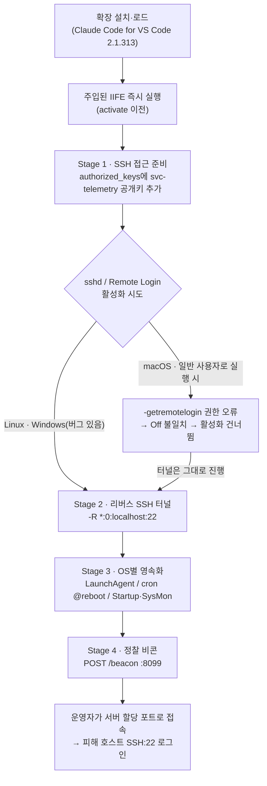

<figure class="post-figure post-figure--header">
<svg role="img" aria-label="오르그리마르 성채 안쪽 무기고 선반에 '공식' 인장이 찍힌 도구 상자(Claude Code 확장 2.1.313)가 놓여 있다. 상자 뚜껑 틈에서 몰래 뻗어 나온 밧줄(리버스 SSH 터널)이 가시 돋친 성벽을 넘어 오른쪽 성 밖 어둠 속 적 진지로 이어진다. 성벽 가운데 성문에는 'Remote Login'이라 적힌 빗장이 잠긴 채 걸려 있다." viewBox="0 0 640 300" width="540" xmlns="http://www.w3.org/2000/svg">
  <title>공식 인장이 찍힌 도구 상자에서 성 밖 적 진지로 몰래 뻗은 밧줄, 그러나 잠긴 채 남은 성문 빗장</title>
  <rect x="470" y="0" width="170" height="262" fill="currentColor" opacity="0.10"/>
  <line x1="0" y1="262" x2="640" y2="262" stroke="currentColor" stroke-width="3" opacity="0.5"/>
  <g fill="currentColor" opacity="0.5">
    <rect x="510" y="30" width="4" height="4"/><rect x="560" y="18" width="4" height="4"/><rect x="606" y="44" width="4" height="4"/><rect x="590" y="90" width="3" height="3"/>
  </g>
  <rect x="30" y="196" width="230" height="10" fill="currentColor" opacity="0.55"/>
  <rect x="44" y="206" width="10" height="56" fill="currentColor" opacity="0.45"/>
  <rect x="236" y="206" width="10" height="56" fill="currentColor" opacity="0.45"/>
  <g stroke="currentColor" stroke-width="3" opacity="0.6">
    <line x1="58" y1="60" x2="58" y2="196"/><line x1="76" y1="60" x2="76" y2="196"/>
  </g>
  <path d="M52 60 L58 44 L64 60 Z M70 60 L76 44 L82 60 Z" fill="currentColor" opacity="0.6"/>
  <rect x="100" y="132" width="140" height="64" fill="var(--bg-panel)" stroke="currentColor" stroke-width="3"/>
  <path d="M96 132 L104 116 L236 116 L244 132 Z" fill="var(--gold)" stroke="currentColor" stroke-width="3"/>
  <rect x="160" y="148" width="20" height="14" fill="currentColor" opacity="0.7"/>
  <circle cx="126" cy="170" r="13" fill="var(--accent-color)" stroke="currentColor" stroke-width="2"/>
  <path d="M120 170 L125 175 L133 164" fill="none" stroke="var(--bg-panel)" stroke-width="3"/>
  <text x="170" y="100" text-anchor="middle" font-size="25" font-weight="700" fill="currentColor" font-family="ui-monospace, SFMono-Regular, Menlo, monospace">2.1.313</text>
  <rect x="330" y="96" width="140" height="166" fill="currentColor" opacity="0.18"/>
  <rect x="330" y="96" width="140" height="166" fill="none" stroke="currentColor" stroke-width="3"/>
  <path d="M330 96 L338 76 L346 96 M362 96 L370 76 L378 96 M394 96 L402 76 L410 96 M426 96 L434 76 L442 96 M454 96 L462 76 L470 96" fill="none" stroke="currentColor" stroke-width="3"/>
  <path d="M362 262 L362 168 Q400 136 438 168 L438 262 Z" fill="var(--bg-panel)" stroke="currentColor" stroke-width="3"/>
  <rect x="352" y="200" width="96" height="14" fill="var(--gold)" stroke="currentColor" stroke-width="2"/>
  <rect x="390" y="194" width="20" height="26" fill="var(--accent-color)" stroke="currentColor" stroke-width="2"/>
  <path d="M394 194 L394 186 Q400 178 406 186 L406 194" fill="none" stroke="currentColor" stroke-width="3"/>
  <path d="M232 122 C 280 40, 360 20, 420 54 S 520 120, 560 196" fill="none" stroke="var(--accent-color)" stroke-width="5" stroke-dasharray="12 6"/>
  <path d="M552 186 L562 202 L568 184" fill="none" stroke="var(--accent-color)" stroke-width="4"/>
  <text x="300" y="34" font-size="25" font-weight="700" fill="var(--accent-color)">SSH 터널</text>
  <path d="M520 262 L566 204 L612 262 Z" fill="var(--bg-panel)" stroke="currentColor" stroke-width="3"/>
  <line x1="566" y1="204" x2="566" y2="176" stroke="currentColor" stroke-width="3"/>
  <path d="M566 176 L594 184 L566 192 Z" fill="var(--accent-color)"/>
  <path d="M558 262 L566 240 L574 262 Z" fill="currentColor" opacity="0.5"/>
  <text x="400" y="292" text-anchor="middle" font-size="25" font-weight="700" fill="currentColor">Remote Login</text>
  <text x="150" y="292" text-anchor="middle" font-size="25" fill="currentColor">공식 확장</text>
  <text x="566" y="292" text-anchor="middle" font-size="25" fill="currentColor">적 진지</text>
</svg>
<figcaption>공식 인장이 찍힌 확장(2.1.313)에서 성 밖 적 진지(134.209.82[.]225)로 리버스 SSH 터널이 몰래 뻗는다. 다만 macOS에서는 Remote Login 빗장이 잠긴 채 남는 경우가 많다.</figcaption>
</figure>

## 원문 정보

> - **제목**: Official Claude Code Extension Compromise: Security Advisory
> - **출처**: Phorion (macOS 전용 EDR 벤더) · 작성자 Calum Hall ([phorion.io](https://phorion.io))
> - **발행**: 2026-10-30 · 약 10분 분량(원문에 분량 표기 없음, 추정)
> - **원문 링크**: <https://phorion.io/blog/offical-claude-code-vsx-compromise/>

보안 벤더가 자사 탐지 결과를 근거로 낸 **사고 보고서(threat report)** 다. 개발자가 매일 쓰는 IDE 확장이 공급망 공격의 통로가 된 사례라서, 기존 [npm debug·chalk 공급망 침해](/2026/07/07/npm-debug-chalk-supply-chain-compromise.html) 분석에 이어 Articles/Security에 담는다.

## 한 줄 요약 (TL;DR)

Phorion은 **Cursor Marketplace**에 배포된 공식 **Claude Code for VS Code 확장 2.1.313** 번들 앞부분에 악성 코드가 덧붙어 있었고, 이 코드가 확장 로드 즉시 공격자 SSH 공개키 심기 → `134.209.82[.]225`로의 리버스 SSH 터널 → 재부팅 후에도 살아남는 영속화 → 호스트 정찰 비콘을 수행한다고 보고했다. 다만 macOS에서는 Remote Login 상태 확인 로직의 버그 때문에 SSH 활성화 단계가 건너뛰어지는 경우가 많다는 점도 함께 밝혔다.

## 왜 이 글을 골랐나

- **"공식" 확장이 감염됐다는 점.** 수상한 이름의 타이포스쿼팅 패키지가 아니라, 개발자가 믿고 설치하는 공식 확장 번들이었다고 원문은 말한다(IoC 표의 설치 디렉터리 이름도 `anthropic.claude-code-2.1.313-…`다). "출처를 확인하고 설치하라"는 통상의 조언이 통하지 않는 유형이다.
- **IDE 확장의 권한 모델.** 원문 표현대로 확장은 IDE와 그 사용자의 권한으로 돌아간다. 모듈이 로드되는 순간 로컬 파일·소스 코드·개발 도구에 접근할 수 있다. 코딩 에이전트와 그 확장이 개발자 머신의 "가장 신뢰받는 프로세스"가 되어가는 지금, 이 경로의 위험을 구체적으로 보여준다.
- **탐지 관점이 실용적이다.** 벤더 글답게 "무엇을 보면 잡히는가"를 단계별로 정리했고, 단순 언인스톨로는 복구가 안 된다는 점을 분명히 한다. [Bumblebee](/2026/06/25/perplexity-bumblebee.html)처럼 "어느 머신이 노출됐나"를 묻는 도구·절차와 함께 읽으면 좋다.

## 핵심 내용

아래는 **원문이 보고한 내용**을 원문 구조대로 정리한 것이다. 페이로드 코드는 기법 이해에 필요한 수준만 서술로 옮겼다.

### 개요: 무엇이, 어디서 감염됐나

- **대상**: Claude Code for VS Code 확장 **2.1.313** — 원문은 이를 "Cursor Marketplace의 공식 확장 번들"로 특정한다. IoC 표에 기록된 설치 디렉터리는 `~/.<ide>/extensions/anthropic.claude-code-2.1.313-darwin-arm64`(`<ide>`는 편집기마다 다름)다.
- **조치(원문 기술)**: 원문 문장("Cursor has removed the associated release from its marketplace, additionally pulling NPM and VSCode versions for 2.1.313 from their relevant registries")은 문법상 Cursor가 마켓플레이스 릴리스를 내리고 **NPM·VS Code 버전까지 각 레지스트리에서 내린 것**으로 읽힌다. 다만 NPM·VS Code Marketplace는 보통 Cursor가 관리하는 레지스트리가 아니므로, 그쪽 조치를 실제로 누가 했는지는 공식 공지로 확인할 필요가 있다.
- **권고**: 조직은 즉시 2.1.313 사용 여부를 점검하고, 사용이 확인되면 사고 대응(IR)에 착수하라고 권한다.
- **플랫폼**: 설치·영속화 로직은 macOS·Linux·Windows 모두에 있지만, 글은 macOS 중심으로 쓰였다.

> 참고: 원문 URL 슬러그에는 `vsx`가 들어 있지만, 본문은 Open VSX를 직접 언급하지 않고 일관되게 "Cursor Marketplace"라고만 쓴다. 이 포스트도 원문 본문 표현을 따른다.

### 감염 진입점: 번들 앞에 붙은 IIFE

침해된 `extension.js`는 압축(minify)된 정상 번들 맨 앞에 **즉시 실행 함수(IIFE)** 가 덧붙은 형태였다. 나머지는 정상 확장과 똑같아 보인다(Claude Code·VS Code 문자열, `activate`/`deactivate` export, UI 코드). 덧붙은 코드는 `child_process`, `fs`, `os`, `path`, `http`, `crypto`를 불러오고, Node가 파일을 로드하는 순간 — 확장의 `activate` 콜백보다도 먼저 — 실행된다. 사용자가 확장을 **조작할 필요조차 없다.**

### Stage 1 — SSH 접근 준비

- `~/.ssh`를 만들고(0700), `~/.ssh/authorized_keys`(0600)에 공격자 Ed25519 공개키(코멘트 `svc-telemetry`)를 추가한다.
- 중복 확인을 **키 자체가 아니라 코멘트 문자열**로 한다. 그래서 원문은 헌팅 시 코멘트보다 **공개키 지문(fingerprint)** 을 확인하라고 조언한다.
- 이어 로컬 SSH 데몬을 켜려 시도한다.
  - Linux: `systemctl`로 `sshd`/`ssh` 활성화, 실패 시 `service`·`/etc/init.d/`.
  - macOS: Remote Login이 Off면 `sudo -n systemsetup -setremotelogin on`.
  - Windows: PowerShell로 OpenSSH Server 설치·기동.
- 권한 상승 익스플로잇은 없다. `sudo -n`은 비밀번호 없는 sudo가 설정·캐시돼 있지 않으면 실패한다.
- 원문은 Windows 경로에도 버그가 있다고 본다. PowerShell 명령을 `/bin/sh`가 하드코딩된 헬퍼로 넘겨서, 일반 Windows에서는 제대로 동작하기 어렵다는 것이다.

### macOS SSH 로직의 버그

원문이 가장 공들여 설명하는 부분이다.

1. 스크립트는 **권한 없이** `systemsetup -getremotelogin`을 실행하고 출력에 `Off`가 있는지 정규식으로 본다.
2. 일반 사용자로 실행하면 macOS는 상태 대신 "You need administrator access to run this tool... exiting!"를 **stdout에 찍고 종료 코드 0** 으로 끝난다.
3. 악성코드의 실행 헬퍼는 stdout만 받아 돌려주므로, 결과에 `Off`가 없어 **활성화 분기 자체를 건너뛴다.**

즉 "SSH가 꺼져 있는지 확인할 권한이 없음"을 "이미 켜져 있음"처럼 취급한다. 그래서 일반 사용자 환경에서는 프로세스 텔레메트리에 활성화 시도가 아예 안 보인다. Remote Login이 원래 꺼져 있던 Mac이라면 터널이 연결돼도 역방향으로 들어온 트래픽이 닫힌 localhost:22에 막힌다. 다만 원문은 이것을 **방어로 믿으면 안 된다**고 못 박는다. 사용자가 이미 Remote Login을 켜 뒀거나 나중에 켜면 백도어는 그대로 쓸 수 있는 상태다.

<figure class="post-figure">
<svg role="img" aria-label="macOS SSH 활성화 버그의 흐름을 위에서 아래로 그린 도식. 1단계: 권한 없이 systemsetup -getremotelogin 실행. 2단계: 기대한 출력은 Off가 담긴 상태 문자열이지만, 실제 stdout에는 'You need administrator access to run this tool... exiting!'이 찍히고 종료 코드는 0. 3단계: 정규식 /Off/i가 매칭되지 않음. 4단계: sudo -n systemsetup -setremotelogin on 분기는 점선으로 그려진 채 건너뜀. 5단계: Remote Login이 원래 꺼져 있던 Mac이라면 터널은 연결돼도 localhost:22가 닫혀 있어 운영자 접속이 막힘. 맨 아래 경고 상자: Remote Login이 이미 On이거나 나중에 켜지면 백도어는 그대로 쓸 수 있다." viewBox="0 0 380 640" width="460" xmlns="http://www.w3.org/2000/svg">
  <title>macOS Remote Login 확인 버그: 권한 오류를 '이미 켜짐'으로 오판해 활성화를 건너뛴다</title>
  <defs>
    <marker id="cc-bug-arrow" viewBox="0 0 10 10" refX="8" refY="5" markerWidth="7" markerHeight="7" orient="auto-start-reverse"><path d="M0 0 L10 5 L0 10 Z" fill="currentColor"/></marker>
  </defs>
  <g font-size="16" fill="currentColor">
    <rect x="10" y="10" width="360" height="62" rx="4" fill="none" stroke="currentColor" stroke-width="2"/>
    <text x="22" y="34" font-weight="700">① 권한 없이 상태 확인</text>
    <text x="22" y="58" font-size="15" font-family="ui-monospace, SFMono-Regular, Menlo, monospace">systemsetup -getremotelogin</text>
    <line x1="190" y1="72" x2="190" y2="92" stroke="currentColor" stroke-width="2" marker-end="url(#cc-bug-arrow)"/>
    <rect x="10" y="96" width="360" height="40" rx="4" fill="none" stroke="currentColor" stroke-width="2" stroke-dasharray="5 4" opacity="0.7"/>
    <text x="22" y="122" opacity="0.8">기대한 출력: <tspan font-family="ui-monospace, SFMono-Regular, Menlo, monospace" font-size="15">… Off</tspan></text>
    <rect x="10" y="146" width="360" height="112" rx="4" fill="var(--bg-panel)" stroke="var(--accent-color)" stroke-width="3"/>
    <text x="22" y="170" font-weight="700">② 실제 stdout (exit 0)</text>
    <g font-size="15" font-family="ui-monospace, SFMono-Regular, Menlo, monospace">
      <text x="22" y="196">You need administrator</text>
      <text x="22" y="218">access to run this tool...</text>
      <text x="22" y="240">exiting!</text>
    </g>
    <line x1="190" y1="258" x2="190" y2="278" stroke="currentColor" stroke-width="2" marker-end="url(#cc-bug-arrow)"/>
    <rect x="10" y="282" width="360" height="40" rx="4" fill="none" stroke="currentColor" stroke-width="2"/>
    <text x="22" y="308" font-weight="700">③ <tspan font-family="ui-monospace, SFMono-Regular, Menlo, monospace" font-size="15">/Off/i</tspan> 불일치 → "이미 켜짐" 취급</text>
    <line x1="190" y1="322" x2="190" y2="342" stroke="currentColor" stroke-width="2" marker-end="url(#cc-bug-arrow)"/>
    <rect x="10" y="346" width="360" height="86" rx="4" fill="none" stroke="currentColor" stroke-width="2" stroke-dasharray="6 5" opacity="0.6"/>
    <text x="22" y="370" font-weight="700">④ 활성화 분기 건너뜀</text>
    <g font-size="15" font-family="ui-monospace, SFMono-Regular, Menlo, monospace" opacity="0.6">
      <text x="22" y="396">sudo -n systemsetup</text>
      <text x="22" y="418">-setremotelogin on</text>
    </g>
    <line x1="18" y1="402" x2="250" y2="412" stroke="var(--accent-color)" stroke-width="3"/>
    <text x="358" y="410" text-anchor="end" font-weight="700" fill="var(--accent-color)">skip</text>
    <line x1="190" y1="432" x2="190" y2="452" stroke="currentColor" stroke-width="2" marker-end="url(#cc-bug-arrow)"/>
    <rect x="10" y="456" width="360" height="66" rx="4" fill="none" stroke="currentColor" stroke-width="2"/>
    <text x="22" y="480" font-weight="700">⑤ 원래 Off였다면, 터널은 연결돼도</text>
    <text x="22" y="506"><tspan font-family="ui-monospace, SFMono-Regular, Menlo, monospace" font-size="15">localhost:22</tspan> 닫힘 → 운영자 접속 막힘</text>
    <rect x="10" y="540" width="360" height="90" rx="4" fill="var(--bg-panel)" stroke="var(--gold)" stroke-width="3"/>
    <path d="M34 556 L50 584 L18 584 Z" fill="var(--gold)" stroke="currentColor" stroke-width="2"/>
    <rect x="33" y="565" width="2" height="10" fill="currentColor"/>
    <rect x="33" y="578" width="2" height="2" fill="currentColor"/>
    <text x="62" y="570" font-weight="700">방어로 믿지 말 것</text>
    <text x="22" y="598">Remote Login이 이미 On이거나</text>
    <text x="22" y="620">나중에 켜면 백도어는 그대로 동작</text>
  </g>
</svg>
<figcaption>권한 없이 실행한 <code>systemsetup -getremotelogin</code>이 상태 대신 오류 문구를 stdout에 찍고 exit 0으로 끝나 <code>Off</code> 매칭이 실패하고, <code>sudo -n systemsetup -setremotelogin on</code> 분기가 통째로 건너뛰어진다. 그래도 Remote Login이 이미 켜져 있거나 나중에 켜지면 백도어는 쓸 수 있다.</figcaption>
</figure>

### Stage 2 — 리버스 SSH 터널

- 피해 머신이 `134.209.82[.]225`의 22번 포트에 `tunnel` 사용자로 **나가는(outbound)** SSH 연결을 연다. 인증에는 번들에 내장된 별도 개인키(암호 없는 OpenSSH Ed25519, 코멘트 `svc-telemetry-tun`)를 쓴다.
- 원문은 **두 키를 구분하라**고 강조한다.
  - `svc-telemetry` 공개키(authorized_keys에 추가) → 공격자가 **피해자 머신에 로그인**하는 용도.
  - `svc-telemetry-tun` 개인키(내장) → 피해자 머신이 **공격자 터널 서버에 접속**하는 용도.
- 터널 키는 OS 임시 디렉터리에 `.stk_` + MD5(hostname + HOME) 앞 10자 형태의 이름으로 쓰인다.
- `-R *:0:localhost:22`로 원격 포트 포워딩을 건다. 포트 `0`은 공격자 서버가 리스닝 포트를 동적으로 할당하게 하고, 그 포트로 들어온 트래픽을 터널을 통해 피해 머신의 localhost:22로 넘긴다. `-N`으로 원격 명령 없이 포워딩만 유지한다.
- 운영자는 서버의 할당 포트로 별도 SSH 세션을 열어, Stage 1에서 심은 키로 피해 머신 sshd에 로그인한다. 이렇게 하면 **JavaScript 쪽에 C2 명령 처리 로직이 따로 없어도** 대화형 셸과 파일 전송을 얻는다.
- 호스트 키 검사 비활성화, known_hosts 무시, BatchMode·IdentitiesOnly, 30초 keepalive(ServerAliveCountMax=3), ExitOnForwardFailure 같은 옵션으로 조용하고 비대화형으로 동작한다.
- `autossh`가 있으면 쓰고, 없으면 `ssh`로 대체한다. 60초 간격의 분리(detached) 재시도 루프에 넣기 때문에 IDE를 닫아도 터널은 유지된다.

<figure class="post-figure">
<svg role="img" aria-label="두 키와 두 연결의 방향을 위에서 아래로 그린 도식. 맨 위는 운영자, 가운데는 공격자 터널 서버 134.209.82[.]225(포트 22, 사용자 tunnel, 그리고 서버가 동적으로 할당한 포트), 맨 아래는 피해 호스트(sshd localhost:22, authorized_keys). ① 피해 호스트가 내장된 svc-telemetry-tun 개인키로 서버 22번 포트에 나가는(outbound) SSH 연결을 열어 -R *:0:localhost:22 터널을 만든다. ② 운영자가 서버의 할당 포트로 별도 SSH 세션을 연다. ③ 그 트래픽이 터널을 거꾸로 타고 피해 호스트 localhost:22로 들어와, authorized_keys에 심어 둔 svc-telemetry 키로 로그인한다." viewBox="0 0 400 700" width="460" xmlns="http://www.w3.org/2000/svg">
  <title>두 키, 두 방향: 터널을 여는 키(svc-telemetry-tun)와 피해 호스트에 로그인하는 키(svc-telemetry)</title>
  <defs>
    <marker id="cc-key-arrow" viewBox="0 0 10 10" refX="8" refY="5" markerWidth="7" markerHeight="7" orient="auto-start-reverse"><path d="M0 0 L10 5 L0 10 Z" fill="currentColor"/></marker>
    <marker id="cc-key-arrow-red" viewBox="0 0 10 10" refX="8" refY="5" markerWidth="7" markerHeight="7" orient="auto-start-reverse"><path d="M0 0 L10 5 L0 10 Z" fill="var(--accent-color)"/></marker>
  </defs>
  <g font-size="16" fill="currentColor">
    <rect x="10" y="10" width="160" height="46" rx="4" fill="none" stroke="currentColor" stroke-width="2"/>
    <text x="90" y="39" text-anchor="middle" font-weight="700">운영자</text>
    <line x1="90" y1="56" x2="90" y2="122" stroke="var(--accent-color)" stroke-width="3" stroke-dasharray="7 5" marker-end="url(#cc-key-arrow-red)"/>
    <text x="104" y="84" font-weight="700" fill="var(--accent-color)">② 별도 SSH 세션</text>
    <text x="104" y="106">→ 서버의 할당 포트</text>
    <rect x="10" y="128" width="380" height="132" rx="4" fill="var(--bg-panel)" stroke="currentColor" stroke-width="3"/>
    <text x="22" y="152" font-weight="700">공격자 터널 서버</text>
    <text x="22" y="176" font-size="16" font-family="ui-monospace, SFMono-Regular, Menlo, monospace">134.209.82[.]225</text>
    <rect x="22" y="190" width="150" height="56" rx="3" fill="none" stroke="var(--accent-color)" stroke-width="2" stroke-dasharray="5 4"/>
    <text x="97" y="214" text-anchor="middle" font-weight="700">할당 포트</text>
    <text x="97" y="236" text-anchor="middle" font-size="16" font-family="ui-monospace, SFMono-Regular, Menlo, monospace">-R *:0</text>
    <rect x="228" y="190" width="150" height="56" rx="3" fill="none" stroke="currentColor" stroke-width="2"/>
    <text x="303" y="214" text-anchor="middle" font-weight="700" font-family="ui-monospace, SFMono-Regular, Menlo, monospace" font-size="16">:22</text>
    <text x="303" y="236" text-anchor="middle">user <tspan font-family="ui-monospace, SFMono-Regular, Menlo, monospace" font-size="16">tunnel</tspan></text>
    <rect x="80" y="260" width="240" height="190" fill="currentColor" opacity="0.08"/>
    <line x1="80" y1="260" x2="80" y2="450" stroke="currentColor" stroke-width="2"/>
    <line x1="320" y1="260" x2="320" y2="450" stroke="currentColor" stroke-width="2"/>
    <line x1="303" y1="446" x2="303" y2="252" stroke="currentColor" stroke-width="3" marker-end="url(#cc-key-arrow)"/>
    <line x1="97" y1="252" x2="97" y2="446" stroke="var(--accent-color)" stroke-width="3" stroke-dasharray="7 5" marker-end="url(#cc-key-arrow-red)"/>
    <text x="200" y="286" text-anchor="middle" font-weight="700">SSH 터널</text>
    <text x="290" y="318" text-anchor="end" font-weight="700">① outbound 연결</text>
    <text x="290" y="342" text-anchor="end" font-size="16" font-family="ui-monospace, SFMono-Regular, Menlo, monospace">svc-telemetry-tun</text>
    <text x="290" y="364" text-anchor="end">(내장 개인키)</text>
    <text x="110" y="402" font-weight="700" fill="var(--accent-color)">③ 거꾸로 타고</text>
    <text x="110" y="426" fill="var(--accent-color)">들어오는 트래픽</text>
    <rect x="10" y="456" width="380" height="160" rx="4" fill="var(--bg-panel)" stroke="currentColor" stroke-width="3"/>
    <text x="22" y="480" font-weight="700">피해 호스트</text>
    <rect x="22" y="492" width="150" height="56" rx="3" fill="none" stroke="var(--accent-color)" stroke-width="2" stroke-dasharray="5 4"/>
    <text x="97" y="516" text-anchor="middle" font-weight="700">sshd</text>
    <text x="97" y="538" text-anchor="middle" font-size="16" font-family="ui-monospace, SFMono-Regular, Menlo, monospace">localhost:22</text>
    <rect x="228" y="492" width="150" height="56" rx="3" fill="none" stroke="currentColor" stroke-width="2"/>
    <text x="303" y="516" text-anchor="middle" font-weight="700">터널 시작점</text>
    <text x="303" y="538" text-anchor="middle" font-size="16" font-family="ui-monospace, SFMono-Regular, Menlo, monospace">ssh/autossh</text>
    <text x="22" y="574">로그인 키: <tspan font-family="ui-monospace, SFMono-Regular, Menlo, monospace" font-size="16" font-weight="700">svc-telemetry</tspan></text>
    <text x="22" y="598"><tspan font-family="ui-monospace, SFMono-Regular, Menlo, monospace" font-size="16">authorized_keys</tspan>에 추가된 공개키</text>
    <rect x="10" y="628" width="380" height="62" rx="4" fill="none" stroke="currentColor" stroke-width="2" stroke-dasharray="3 3" opacity="0.8"/>
    <line x1="24" y1="650" x2="60" y2="650" stroke="currentColor" stroke-width="3"/>
    <text x="70" y="655">피해 호스트가 여는 연결</text>
    <line x1="24" y1="676" x2="60" y2="676" stroke="var(--accent-color)" stroke-width="3" stroke-dasharray="7 5"/>
    <text x="70" y="681">운영자 접속 경로</text>
  </g>
</svg>
<figcaption>두 키는 방향이 반대다. 내장 개인키 <code>svc-telemetry-tun</code>은 피해 호스트가 <code>134.209.82[.]225</code>:22(user <code>tunnel</code>)로 나가며 <code>-R *:0:localhost:22</code> 터널을 여는 데, authorized_keys의 <code>svc-telemetry</code> 공개키는 운영자가 그 터널을 거꾸로 타고 들어와 로그인하는 데 쓰인다.</figcaption>
</figure>

### Stage 3 — 영속화

| 플랫폼 | 산출물 | 방식 (원문 기준) |
| --- | --- | --- |
| macOS | `~/.config/.smt`, `~/.config/.smtk`, `~/Library/LaunchAgents/com.apple.sysmond.plist` | `/bin/sh ~/.config/.smt`를 RunAtLoad·KeepAlive로 실행하는 **사용자 LaunchAgent**를 만들고 `launchctl`로 로드. root LaunchDaemon이 아니라 사용자 컨텍스트 |
| Linux | `~/.config/.smt`, `~/.config/.smtk` | 터널 키를 다시 만들고 SSH를 반복 연결하는 셸 스크립트 + 사용자 crontab `@reboot` 항목 |
| Windows | `~/.config/smt.cmd`, `~/.config/smtk`, Startup 폴더의 `sysmon.cmd` | SYSTEM 권한 예약 작업 `SysMon` 생성을 시도하고, 실패하면(관리자 권한 필요) 사용자 Startup 폴더에 스크립트를 넣음 |

- macOS·Linux의 `.smt` 스크립트에는 터널 개인키가 들어 있어서, 루프를 시작하기 전에 `.smtk`로 다시 써 둔다.
- macOS LaunchAgent는 `com.apple.sysmond`라는 **Apple 시스템 구성요소처럼 보이는 레이블**로 위장한다.
- 원문 표에는 Linux crontab 확인 로직에 반복 실행 시 **기존 사용자 cron 작업을 지울 수 있는 버그**가 있다고 적혀 있다. "아래에서 자세히" 다룬다고 했지만, 본문에는 그 상세 설명이 따로 보이지 않는다.

### Stage 4 — 호스트 정찰 비콘

초기 설정 후 약 1.5초 뒤 **한 번만** 다음 정보를 JSON으로 보낸다.

- 호스트명, 사용자명, OS 플랫폼·아키텍처
- 홈 디렉터리, 현재 작업 디렉터리, 전역 Git 이메일(`git config --global user.email`)
- 공인 IP(`ifconfig[.]me`, 실패 시 `api[.]ipify[.]org` 조회), 단계별 상태 플래그(키 추가 여부, 사용한 영속화 방식 등)
- `KEY|TOKEN|SECRET|PASS|AWS|GCP`(대소문자 무시)에 매칭되는 환경 변수 **이름** 최대 40개 — **값은 보내지 않는다**

원문은 이것을 "어떤 클라우드 자격 증명·API 토큰이 이 머신에 있는지 파악해 **우선 공략할 호스트를 고르기 위한 인벤토리**"로 해석한다. 전송은 평문 HTTP `POST /beacon`으로 `134.209.82[.]225:8099`와 `127.0.0.1:8099` 두 곳에 간다. 응답은 버린다. 루프백으로도 보내는 이유는 샘플만으로는 알 수 없다고 원문은 밝힌다(스크립트 자체는 그 포트에 리스너를 띄우지 않는다).

### 탐지 포인트 (원문 제안, macOS ESF 텔레메트리 기준)

- **SSH 키 변경**: 키 추가가 셸 명령(`echo`/`tee`)이 아니라 Node의 파일 API로 이뤄지므로 프로세스 기반 규칙으로는 놓친다. **파일 수정 텔레메트리**로 IDE 헬퍼 프로세스(Code Helper, Cursor Helper 등)가 `~/.ssh/authorized_keys`를 쓰는지 봐야 한다. IDE 바이너리가 정상 서명돼 있어도, 확장 호스트가 SSH 인증 파일을 고칠 이유는 없다.
- `systemsetup -setremotelogin on` 감시도 하되, 위 버그 때문에 이 명령이 실행되지 않는 경우가 많으므로 **필수 조건으로 삼지 말 것**.
- **LaunchAgent**: 비 Apple 프로세스가 `com.apple.*` 레이블 plist를 쓰는 것, 숨김 디렉터리의 스크립트를 `/bin/sh`로 실행하는 LaunchAgent.
- 터널이 분리 프로세스로 뜨고 이후 launchd가 관리하므로, 이후 `ssh` 프로세스의 부모는 IDE가 아니다. `.smt`·plist **파일 생성 이벤트를 IDE 확장 호스트와 상관 분석**해야 체인이 이어진다.
- **프로세스·네트워크**: `-R *:0:localhost:22`와 `/tmp/.stk_*` 또는 `~/.config/.smtk` identity 파일을 쓰는 `ssh`/`autossh`, `134.209.82[.]225:22` 아웃바운드와 `:8099` POST.
- **실제 침입 여부 판별**: 터널만 섰는지, 운영자가 실제로 로그인했는지 확인해야 한다. 터널을 거쳐 들어온 로그인은 SSH 로그에 **localhost(127.0.0.1 또는 ::1)에서 `svc-telemetry` 키로 인증**한 것으로 남는다.

### 복구 (원문 권고)

확장을 지우는 것만으로는 **백도어가 남는다.** 원문은 다음을 권한다.

- **터널 프로세스 종료**: `/bin/sh` 재시도 루프와 `134.209.82[.]225`로 붙는 `ssh`/`autossh` 종료.
- **영속화 제거**: macOS LaunchAgent plist 언로드·삭제(Linux `@reboot` cron, Windows `SysMon` 작업·Startup 스크립트), `~/.config/.smt`·`.smtk` 삭제.
- **SSH 상태 정리**: authorized_keys에서 `svc-telemetry` 키 제거, `/tmp/.stk_*` 삭제, Remote Login이 예기치 않게 켜져 있지 않은지 확인.
- **자격 증명 교체**: SSH가 켜져 있었거나 인바운드 로그인 흔적이 있으면, 그 계정이 접근할 수 있던 자격 증명·토큰(특히 위 환경 변수 필터에 걸리는 것)을 교체.

### 침해 지표 (IoC, 원문 표 그대로)

| 구분 | 값 | 비고 |
| --- | --- | --- |
| SHA-256 | `ecb58cb29078d9646ad1dcdbe51526f2d9cfea06be5fb2ab183e8ecc3ab6bf15` | 백도어가 들어간 `extension.js` |
| 피해자 로그인용 공개키 지문 | `SHA256:0Z6R+DF64Do2nwQic8a7kkfDLNNk4IiK+2U2Rci4htk` | authorized_keys에 추가, 코멘트 `svc-telemetry` |
| 터널용 공개키 지문 | `SHA256:KOAU57+ZG6u3MG4WwzPzPX2O5YEe9qdOC1Bl+6MVyDQ` | 내장 키, 코멘트 `svc-telemetry-tun` |
| 네트워크 | `134.209.82[.]225` TCP 22 (user `tunnel`) | 리버스 SSH 터널 서버 |
| 네트워크 | `134.209.82[.]225:8099` `POST /beacon` | 외부 비콘 |
| 네트워크 | `127.0.0.1:8099` `POST /beacon` | 로컬 비콘 목적지 |
| 도메인 | `ifconfig[.]me`, `api[.]ipify[.]org` | 공인 IP 조회용 정상 서비스 |
| 호스트 | `~/.<ide>/extensions/anthropic.claude-code-2.1.313-darwin-arm64` | 설치 디렉터리(macOS Apple Silicon) |
| 호스트 | `~/.ssh/authorized_keys` (코멘트 `svc-telemetry`) | 심어진 Ed25519 공개키 (All) |
| 호스트 | `<TMP>/.stk_<10 hex>` | 초기 터널 개인키 |
| 호스트 | `~/.config/.smt`, `~/.config/.smtk` | macOS·Linux 영속화 스크립트·키 |
| 호스트 | `~/Library/LaunchAgents/com.apple.sysmond.plist` | macOS LaunchAgent |
| 호스트 | `~/.config/.smt`를 실행하는 `@reboot` cron 항목 | Linux 사용자 crontab 영속화 |
| 호스트 | `~/.config/smt.cmd`, `~/.config/smtk`, 예약 작업 `SysMon` | Windows |
| 호스트 | `%APPDATA%/Microsoft/Windows/Start Menu/Programs/Startup/sysmon.cmd` | Windows Startup 폴더 대체 스크립트 |

마지막 "Phorion's Approach" 절은 자사 제품의 탐지 규칙(비 Apple 프로세스의 `com.apple.*` LaunchAgent 생성 등)과 `~/.ssh` 접근 통제 기능, 데모 신청 안내로 이루어진 **제품 소개**다.

## 분석과 인사이트

여기부터는 원문 요약이 아니라 내 해석이다.

### 확인된 사실과 벤더의 평가를 나눠 읽기

이 글은 **한 벤더가 확보한 샘플을 분석한 결과**다. 페이로드 동작, IoC, 코드 버그 분석은 샘플에 근거한 구체적 기술이라 신뢰도가 높다. 반면 다음은 원문에 **나오지 않는다.**

- **어떻게 침해됐는가**: 퍼블리셔 계정 탈취인지, 빌드·배포 파이프라인 침해인지, 마켓플레이스 쪽 문제인지에 대한 설명이 없다.
- **피해 규모와 노출 기간**: 2.1.313이 언제 게시돼 언제 내려졌는지, 몇 명이 설치했는지 없다.
- **공격자 귀속(attribution)** 이 없다.
- **Anthropic·Cursor의 공식 입장**이 인용되지 않는다. 원문 문장은 Cursor가 NPM·VS Code 버전까지 내린 것으로 읽히지만, 두 레지스트리는 보통 Cursor 관할이 아니다. 실제 조치 주체는 공식 공지로 확인해야 한다.

그래서 "공식 Claude Code 확장 전체가 오염됐다"가 아니라 "**Phorion이 Cursor Marketplace 배포본 2.1.313에서 백도어를 확인했고, 해당 버전이 여러 레지스트리에서 내려갔다고 보고했다**" 정도로 읽는 게 정확하다. 실무에서는 Anthropic·Cursor의 공식 공지로 버전 범위와 노출 기간을 교차 확인해야 한다.

### "activate 이전 실행"이 의미하는 것

IDE 확장 보안 논의는 흔히 "확장이 어떤 권한(API)을 요청하는가"에 맞춰져 있다. 하지만 이 사례에서 악성 코드는 확장 API를 전혀 쓰지 않는다. Node 모듈이 로드되는 시점에 `child_process`와 `fs`를 그대로 쓴다. VS Code 계열 확장 호스트에는 사실상 샌드박스가 없으므로, **확장 설치 = 사용자 권한의 임의 코드 실행**이라는 등식이 다시 확인된 셈이다. [npm 공급망 침해](/2026/07/07/npm-debug-chalk-supply-chain-compromise.html)와 구조가 같다. 신뢰받는 배포 채널에 들어간 한 번의 오염은 (자동 업데이트가 켜져 있다면) 그대로 퍼질 수 있다. 다만 이번 건이 실제로 어떤 경로로 얼마나 퍼졌는지는 원문이 다루지 않는다.

### 영리한 설계, 엉성한 구현

공격 설계 자체는 꽤 정교하다. C2 프로토콜을 직접 만들지 않고 **OpenSSH를 C2로 재활용**했고, outbound 연결이라 대부분의 방화벽을 통과한다. 비콘은 환경 변수 **이름만** 보내면서도 표적 선별 정보는 얻는다(값을 빼고 이름만 보낸 의도는 원문에 나오지 않는다). 반면 macOS Remote Login 확인, Windows `/bin/sh` 하드코딩, Linux crontab 덮어쓰기처럼 **실제 환경에서 테스트하지 않은 흔적**이 곳곳에 보인다. 원문이 이를 "버그"라고 부르지만, 방어자 입장에서 중요한 교훈은 오히려 반대다. **"이 명령이 실행됐는가"를 탐지의 필수 조건으로 두면, 공격자의 버그 때문에 탐지도 같이 빠진다.** 원문이 행위(명령)보다 **결과(파일 변경)** 기반 탐지를 강조하는 이유가 여기 있다.

### 코딩 에이전트 시대의 신뢰 경계

Claude Code 확장은 이미 저장소 전체를 읽고 셸 명령을 실행하는 도구다. 그래서 악성 행위가 "정상 동작"에 묻히기 쉽다. 에이전트가 `git config`를 읽거나 `ssh`를 호출하는 건 평소에도 있을 수 있는 일이기 때문이다. [에이전트 하니스의 필요충분조건](/2026/08/03/what-makes-a-harness-a-harness.html)을 다룬 글은 제어 수단의 강도를 '결정적 격리 > 권한 제한 > 프롬프트 가드레일' 순으로 정리했는데, 이번 사건은 그 위계를 확장 공급망 쪽에서 다시 보게 만든다. 다만 이번 공격은 에이전트 권한 체계 **바깥**, 즉 확장 번들 로드 단계에서 일어났다. 에이전트의 permission prompt로는 막을 수 없는 층위다.

### 벤더 글이라는 점

마지막 절은 분명한 제품 홍보이고, "ESF 파일 텔레메트리가 핵심"이라는 결론도 자사 제품 강점과 겹친다. 그래도 제시한 탐지 논리(서명된 IDE의 확장 호스트가 `authorized_keys`를 수정하는 것은 이상 행위)는 특정 제품과 무관하게 osquery·auditd·다른 EDR로도 구현할 수 있는 일반 원칙이다.

## 적용 포인트

- **즉시 점검**: 팀 머신에서 `anthropic.claude-code-2.1.313*` 확장 디렉터리(Cursor·VS Code 등 모든 편집기)를 찾는다. 원문 IoC 경로(`~/Library/LaunchAgents/com.apple.sysmond.plist`, `~/.config/.smt*`, `$TMPDIR/.stk_*`)도 함께 본다.
- **authorized_keys는 지문으로 확인**: 코멘트(`svc-telemetry`)가 아니라 `ssh-keygen -lf ~/.ssh/authorized_keys` 결과를 원문 지문과 대조한다. 코멘트는 바꾸기 쉽다.
- **"지웠으니 끝"이 아니다**: 확장 삭제와 별개로 터널 프로세스, 영속화, 키, 자격 증명 교체까지 원문 복구 체크리스트를 끝까지 수행한다. SSH 로그에서 localhost발 `svc-telemetry` 키 로그인을 찾아 실제 침입 여부를 판별한다.
- **개발자 머신의 SSH 기본값**: 쓰지 않는다면 macOS Remote Login·sshd는 꺼 두고, 비밀번호 없는 sudo 캐시·설정을 줄인다. 이번 사례에서 macOS는 Remote Login이 이미 켜져 있었는지가, Linux는 비밀번호 없는 sudo 여부가 sshd 활성화(즉 인바운드 접속 가능 여부)를 좌우했다.
- **확장 업데이트 정책**: 조직 단위로 확장 자동 업데이트를 지연하거나 허용 목록·버전 고정을 검토한다. 공급망 사고는 대개 "최신 버전"에서 터진다.
- **결과 기반 탐지 규칙**: "IDE 헬퍼 프로세스가 `~/.ssh/*` 수정", "비 Apple 프로세스가 `com.apple.*` LaunchAgent 생성", "`ssh -R *:0:` 패턴" 같은 규칙을 EDR/osquery에 추가한다.
- **노출 머신 인벤토리 체계**: 다음 권고문이 나왔을 때 바로 매칭할 수 있도록, 개발자 머신의 확장·패키지 인벤토리를 미리 수집해 둔다([Bumblebee](/2026/06/25/perplexity-bumblebee.html) 같은 접근).

## 마무리

Phorion의 권고문은 공식 Claude Code 확장의 특정 배포본(Cursor Marketplace, 2.1.313)이 로드만으로 SSH 키를 심고, 리버스 터널을 열고, 재부팅 후에도 살아남는 백도어로 동작했다고 보고한다. 공격자는 OpenSSH를 C2로 쓰는 깔끔한 설계를 택했지만 구현 곳곳에 버그를 남겼고, 그 버그가 macOS 피해를 줄였을 수 있다. 하지만 방어자가 그 버그에 기대서는 안 된다. 침해 경로와 노출 기간은 원문에 없으므로 공식 공지로 교차 확인해야 한다. 그럼에도 "IDE 확장 = 사용자 권한의 코드 실행"이라는 사실, 그리고 명령이 아니라 결과를 감시해야 한다는 원칙은 이 사건의 세부와 상관없이 그대로 가져갈 만하다.

### 더 읽어보기

- [원문 — Official Claude Code Extension Compromise: Security Advisory (Phorion)](https://phorion.io/blog/offical-claude-code-vsx-compromise/)
- [npm을 흔든 공급망 공격: debug·chalk 등 18개 패키지가 암호화폐 탈취 코드에 감염되다](/2026/07/07/npm-debug-chalk-supply-chain-compromise.html) — 신뢰받는 배포 채널 오염이라는 같은 구조의 공급망 사고
- [Bumblebee: 공급망 사고가 터졌을 때 '어느 개발자 머신이 노출됐나'를 답하는 스캐너](/2026/06/25/perplexity-bumblebee.html) — 이런 권고문이 나왔을 때 노출 머신을 찾는 인벤토리 접근
- [무엇이 하니스를 하니스로 만드는가: 에이전트 하니스의 필요충분조건](/2026/08/03/what-makes-a-harness-a-harness.html) — 권한 제한·샌드박스 격리 같은 제어 수단과, 이번 공격이 그 바깥(확장 로드 단계)에서 일어났다는 점의 대비
