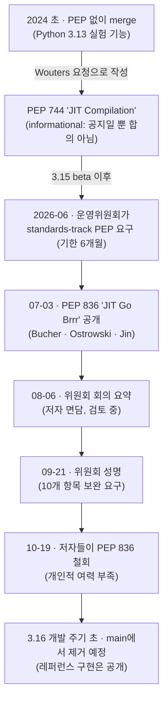

<figure class="post-figure post-figure--header">
<svg role="img" aria-label="CPython main이라는 본진 옆에 붙어 있던 'JIT (실험)' 공방이 철거 예정 팻말과 함께 해체되고 있다. 공방에서 나온 설계도, 즉 레퍼런스 구현만 오른쪽 공개 게시판에 걸려 다른 사람이 가져가 이어 만들 수 있게 남는다." viewBox="0 0 640 300" xmlns="http://www.w3.org/2000/svg" style="font-family:var(--font-body)">
  <title>실험은 main에서 물러나고, 설계도는 남는다</title>
  <defs>
    <marker id="jit-arrow" viewBox="0 0 10 10" refX="8" refY="5" markerWidth="7" markerHeight="7" orient="auto-start-reverse">
      <path d="M0,0 L10,5 L0,10 z" fill="var(--secondary-color)"/>
    </marker>
  </defs>
  <text x="320" y="32" text-anchor="middle" font-size="15" font-weight="700" fill="currentColor">실험은 main에서 물러나고, 설계도는 남는다</text>
  <!-- ground -->
  <line x1="24" y1="262" x2="616" y2="262" stroke="currentColor" stroke-width="2" opacity="0.5"/>
  <!-- LEFT: CPython main keep -->
  <g stroke="currentColor" stroke-width="2.5" fill="var(--bg-light)">
    <rect x="44" y="120" width="196" height="142"/>
    <rect x="44" y="104" width="24" height="16"/>
    <rect x="86" y="104" width="24" height="16"/>
    <rect x="128" y="104" width="24" height="16"/>
    <rect x="170" y="104" width="24" height="16"/>
    <rect x="212" y="104" width="28" height="16"/>
    <rect x="122" y="212" width="40" height="50" fill="var(--bg-sunken)"/>
  </g>
  <line x1="142" y1="104" x2="142" y2="62" stroke="currentColor" stroke-width="2"/>
  <rect x="142" y="62" width="34" height="20" fill="var(--secondary-color)" stroke="currentColor" stroke-width="1.5"/>
  <text x="142" y="156" text-anchor="middle" font-size="15" font-weight="700" fill="currentColor">CPython main</text>
  <text x="142" y="178" text-anchor="middle" font-size="12" fill="currentColor" opacity="0.8">인터프리터 본진</text>
  <!-- MIDDLE: the JIT annex being dismantled (dashed = coming down) -->
  <g fill="none" stroke="var(--accent-color)" stroke-width="2.5" stroke-dasharray="6 4">
    <rect x="240" y="168" width="108" height="94"/>
    <path d="M240,168 L294,138 L348,168"/>
  </g>
  <text x="294" y="208" text-anchor="middle" font-size="14" font-weight="700" fill="var(--accent-color)">JIT</text>
  <text x="294" y="226" text-anchor="middle" font-size="11" fill="currentColor" opacity="0.85">(실험 공방)</text>
  <!-- loose planks falling off -->
  <g fill="var(--bg-sunken)" stroke="currentColor" stroke-width="1.5">
    <rect x="356" y="214" width="26" height="8" transform="rotate(24 369 218)"/>
    <rect x="364" y="240" width="30" height="8" transform="rotate(-12 379 244)"/>
    <rect x="352" y="252" width="20" height="8"/>
  </g>
  <!-- demolition sign -->
  <line x1="300" y1="138" x2="300" y2="96" stroke="currentColor" stroke-width="2"/>
  <rect x="236" y="62" width="136" height="38" fill="var(--bg-panel)" stroke="var(--accent-color)" stroke-width="2"/>
  <text x="304" y="78" text-anchor="middle" font-size="12" font-weight="700" fill="var(--accent-color)">철거 예정</text>
  <text x="304" y="93" text-anchor="middle" font-size="10" fill="currentColor">3.16 개발 주기 초</text>
  <!-- arrow: only the blueprint leaves -->
  <line x1="352" y1="150" x2="446" y2="150" stroke="var(--secondary-color)" stroke-width="2.5" marker-end="url(#jit-arrow)"/>
  <text x="398" y="140" text-anchor="middle" font-size="11" fill="currentColor" opacity="0.85">설계도만 남긴다</text>
  <!-- RIGHT: public notice board with the pinned blueprint -->
  <g stroke="currentColor" stroke-width="2.5">
    <line x1="474" y1="236" x2="474" y2="262"/>
    <line x1="582" y1="236" x2="582" y2="262"/>
    <rect x="452" y="84" width="152" height="152" fill="var(--bg-light)"/>
  </g>
  <rect x="470" y="104" width="116" height="80" fill="var(--bg-panel)" stroke="var(--secondary-color)" stroke-width="2"/>
  <g stroke="var(--secondary-color)" stroke-width="1" opacity="0.6">
    <line x1="470" y1="124" x2="586" y2="124"/>
    <line x1="470" y1="144" x2="586" y2="144"/>
    <line x1="470" y1="164" x2="586" y2="164"/>
    <line x1="499" y1="104" x2="499" y2="184"/>
    <line x1="528" y1="104" x2="528" y2="184"/>
    <line x1="557" y1="104" x2="557" y2="184"/>
  </g>
  <rect x="490" y="128" width="40" height="24" fill="none" stroke="var(--secondary-color)" stroke-width="2"/>
  <path d="M530,140 L566,140 L566,170" fill="none" stroke="var(--secondary-color)" stroke-width="2"/>
  <circle cx="528" cy="104" r="4" fill="var(--accent-color)"/>
  <text x="528" y="206" text-anchor="middle" font-size="12" font-weight="700" fill="currentColor">레퍼런스 구현 공개</text>
  <text x="528" y="224" text-anchor="middle" font-size="10" fill="currentColor" opacity="0.8">철회된 PEP에서 링크</text>
  <text x="528" y="282" text-anchor="middle" font-size="11" fill="currentColor" opacity="0.8">관심 있는 사람이 이어 만들 수 있게</text>
</svg>
<figcaption>JIT는 main 브랜치에서 빠지지만, 레퍼런스 구현은 공개되어 다른 사람이 이어 만들 수 있게 남는다.</figcaption>
</figure>

## 원문 정보

> - **제목**: Python's experimental JIT to be removed
> - **출처**: Joe Brockmeier / LWN.net ([lwn.net](https://lwn.net/))
> - **발행**: 2026-10-26 · 약 8분 분량 (본문 길이 기준 추정치, 원문에는 표기 없음)
> - **원문 링크**: <https://lwn.net/Articles/1102102/>
> - **읽은 경로**: LWN 구독자가 만든 공유 링크(subscriber share link) <https://lwn.net/SubscriberLink/1102102/0c00e4d550f25f8c/> 로 읽었다. 정식 URL은 현재 구독자 전용이며(같은 제목 "Python's experimental JIT to be removed"로 확인), 페이지 안내에 따르면 2026-11-05에 무료 공개된다.

CPython 런타임의 핵심 성능 기능이 기술이 아니라 **프로세스와 거버넌스** 때문에 main 브랜치에서 빠지게 된 사례라서, 런타임·컴파일러 개발을 다루는 Systems-Programming 아래에 담는다.

## 한 줄 요약 (TL;DR)

2024년 Python 3.13에 실험 기능으로 들어온 CPython JIT는 정식 standards-track PEP 없이 진행되어 왔다. 운영위원회(steering council)가 6개월 안에 승인받는 PEP를 요구했고, 저자들이 PEP 836을 냈지만 위원회의 보완 요구를 감당할 여력이 없다며 2026-10-19에 철회했다. 그래서 JIT는 3.16 개발 주기 초반에 main에서 제거될 가능성이 높다.

## 왜 이 글을 골랐나

이 위키의 Python 시리즈는 [바이트코드](/2025/10/24/python-bytecode.html), [GIL과 free-threaded 빌드](/2025/10/22/python-gil.html), [프로파일링](/2025/10/26/python-profiling.html)처럼 CPython이 코드를 실행하는 방식을 아래층부터 다뤄 왔다. JIT는 그 위에 얹힐 다음 성능 계층으로 기대받았는데, 이 글은 그 계층이 **왜 지금 멈추는지**를 기술 바깥에서 설명한다.

엔지니어에게 남는 질문은 이것이다. "기능이 잘 돌아가는가"보다 앞에, "이 기능이 다른 사람의 작업과 사용자에게 어떤 약속을 하는가"를 문서로 증명해야 하는 순간이 온다. 큰 실험을 공유 코드베이스 안에서 어떻게 해야 하는지에 대한 교훈이 구체적인 사례로 담겨 있다.

**한눈에 보기 — PEP 없이 들어온 JIT가 main에서 빠지기까지**

## 핵심 내용

### 배경: PEP 없이 들어온 JIT

- CPython의 실험적 JIT는 **Brandt Bucher**가 2024년 초에 추가했다([PR #113465](https://github.com/python/cpython/pull/113465)). 대상은 **Python 3.13** 릴리스다.
- 원문은 이런 큰 기능이라면 보통 운영위원회가 **standards-track PEP**를 승인한 다음에 들어온다고 짚는다. Bucher는 core developer sprint에서 JIT를 발표했고([YouTube](https://www.youtube.com/watch?v=HxSHIpEQRjs)) merge하겠다고 알렸지만, PEP를 쓰거나 제출하지는 않았다.
- 운영위원이자 3.13 릴리스 매니저였던 **Thomas Wouters**가 요청하고 나서야 Bucher와 **Savannah Ostrowski**가 **PEP 744("JIT Compilation")**를 썼다. 이 PEP는 **informational PEP**였다. 커뮤니티에 정보를 알릴 뿐, 기능 추진에 대한 공식 합의를 뜻하지는 않는다.
- LWN은 2024년 4월에 PEP 744 논의를 다뤘고, 이어서 PyCon US 2024와 PyCon US 2025에서 Bucher가 한 JIT 발표도 다뤘다.

### PEP it up: 운영위원회의 요구

- JIT 작업은 PEP 744를 근거로 계속되다가, 올해(2026년) 6월 운영위원회가 **standards-track PEP**를 공식 요구했다.
- **Antoine Pitrou**가 왜 하필 지금이냐고 묻자 Wouters는 "단일한 촉발 사건은 없다"고 답했다. 위원회는 이 주제를 한동안 논의해 왔고, JIT가 다른 프로젝트와 부딪히지 않게 하려 했다고 설명했다. 그가 언급한 맥락은 이렇다.
  - JIT가 instrumentation, 디버깅, 프로파일링과 잘 어울리게 하려는 작업
  - 외부 JIT(예: CinderX), JIT에 가까운 것들(Numba, PyTorch의 compile), 그리고 tier 3 JIT에 대한 논의
- 위원회는 "3.15는 현 상태로 괜찮다"는 점을 분명히 하려고 **Python 3.15 beta 이후**까지 기다렸다가 요구를 꺼냈다.
- 요구한 내용은 JIT를 "지원되는, 실험이 아닌 CPython의 일부"로 만들 근거를 밝히는 PEP였다. 보장하는 것, 유지보수 약속, 재배포자(redistributor)에게 미치는 영향이 들어가야 했다. 기한은 **6개월**이고, 그 안에 PEP가 제출·승인되지 않으면 JIT 코드를 **main에서 제거**하게 된다.

### PEP 836: "JIT Go Brrr"

- Bucher, Ostrowski, **Ken Jin**이 **PEP 836("JIT Go Brrr: The Path to a Supported JIT Compiler for CPython")**을 써서 **7월 3일** Python 포럼에 올렸다.
- 반응은 우호적인 것과 비판적인 것이 섞였다. 반복해서 나온 지적은 **두 개의 PEP로 나눠야 한다**는 것이었다(Wouters, **Mark Shannon** 등). Shannon은 PEP가 JIT 수용의 **목표만** 다루고 구현 세부는 빼야 한다고 봤다. 추가 정보를 요구하는 의견도 많았다.
- Bucher는 분리 제안에 다소 반대했고, Ostrowski는 원래 구조를 옹호했다. 그의 말은 이렇다. "계획과 고민한 내용을 함께 보여 주지 못한 채 목표만 늘어놓는 건 불편하다. 내게 계획 없는 목표는 목표가 아니다."
- LWN이 [9월에 다시 다뤘을 때](https://lwn.net/Articles/1090385/)는 논의가 잦아들었고, 새 PEP 약속이나 위원회의 공식 입장은 없었다. 당시 위원회의 마지막 말은 **8월 6일 회의 요약**이었다. PEP 저자들을 만났고, PEP가 위원회의 질문에 답했는지 논의 중이라는 내용이었다.

### Experimentation in main: 위원회 성명

**9월 21일** Wouters가 운영위원회 성명을 올렸다. Ostrowski는 현재 운영위원이지만 PEP 공저자라서 참여하지 않았다. 원문이 전하는 요점은 다음과 같다.

- PEP는 위원회가 요청한 질문에 모두 답했다. 다만 "일부는 다른 것보다 덜 설득력 있게" 답했다.
- 위원회가 판단하려는 것은 JIT가 정식 지원 기능이 될 기준이 **아니었다**. JIT가 **main 브랜치에서 실험으로 계속 머물러도 되는가**였다. 위원회는 main에서 실험하면 통일된 설계가 없고, 실험이 동작과 API 표면을 바꿀 때마다 core developer, 패키지 메인테이너, 사용자가 불확실성을 떠안는다고 봤다.
- PEP는 지원 계획과 성능 기준이 충분히 구체적이지 않았고, 여러 영역에서 너무 모호하거나 낙관적이었다. 위원회는 "PEP에 명시하거나, 최소한 논의한 뒤 기각했다고 적어야 할" **10개 항목** 목록을 붙였다. 원문은 이 목록이 메모리 영향부터 보안까지 걸쳐 있다고만 말하고, 그중 일부를 소개한다.

원문에 구체적으로 나온 항목은 다음과 같다.

| 영역 | 위원회의 우려 (원문 기준) |
| --- | --- |
| 플랫폼 동등성 | 새 플랫폼에 쉽게 적용할 수 있는 설계여야 하고, 특정 플랫폼에 묶이거나 플랫폼별 지식이 있어야만 유지보수할 수 있으면 안 된다 |
| 사용자 영향 | JIT를 켰을 때 사용자가 보는 차이에 대해 PEP가 "지나치게 낙관적"이다. 사용자는 인터프리터 설계의 특이점에 기대는 경우가 많다. 그 차이를 버그로 볼지, 피할 수 없을 때는 어떻게 할지 밝혀야 한다 |
| 보안 | PEP에서 "충분히 다뤄지지 않은 영역"이다. Python security response team과 논의하고, 정식 지원 기준에 보안 리뷰를 넣어야 한다 |
| 호환성 검토 시점 | PEP 836은 상위 PyPI 패키지의 테스트 스위트를 돌리는 호환성 검토 마일스톤을 Python 3.17 첫 RC(2028년 8월 무렵 예상)에 맞췄다. 위원회는 이를 "너무, 너무 늦다"고 보고, 가능한 한 빨리 시작해 계속 이어지는 과정이어야 한다고 했다 |
| 설계 리뷰 범위 | JIT의 설계 결정이 CPython 개발·유지보수·지원을 결국 책임질 더 넓은 개발자 집단의 비판적 리뷰 없이 내려지고 있다 |

위원회의 결론은 PEP 836이 "요청한 질문에 대체로 답한다"는 것이었다. 빠진 부분은 없지만, PEP에 대해 판정을 내리기 전에 위 주제들을 더 논의해 커뮤니티의 지지와 합의를 가늠하고 싶다고 했다. Ken Jin은 며칠 뒤 상세한 피드백에 감사하며 제안을 반영하겠다고 답했다.

### Withdrawn: 철회

- **10월 19일** Ostrowski가 PEP 철회를 알렸다. 그는 Python 3.16과 3.17의 릴리스 매니저이기도 하다. 원문이 인용한 발표의 요지는 이렇다.
  - 운영위원회가 이 정도 범위의 제안에 높은 기준을 두는 것은 옳다. 하지만 저자들에게는 현재 버전을 끌고 갈 **개인적 여력(bandwidth)**이 없다.
  - PEP가 제시한 기술 방향(**free-threaded 지원**, **method-based frontend** 포함)은 여전히 믿고, CPython에서 JIT의 잠재력도 낙관한다.
  - **레퍼런스 구현**을 공개하고 철회된 PEP에서 링크해, 관심 있는 사람이 살펴보고 이어 만들 수 있게 하겠다.
- **Barry Scott**가 JIT 작업이 멈추느냐고 묻자 **Brett Cannon**은 main 저장소에서는 멈추고, 다른 곳에서 이어질지는 커뮤니티에 달렸다고 답했다.
- **Dunc Graham**은 위원회 기한 전에 대안 PEP를 낼 시간이 있을지 모른다고 했다. Cannon은 JIT를 실제로 이끌던 사람이 모두 그 PEP의 저자이거나 기여자였으니 그럴 가능성은 낮다고 봤다.
- 원문은 제거에 따른 문제를 일찍 다룰 수 있도록 JIT가 [Python 3.16 개발 주기](https://peps.python.org/pep-0826/) 초반에 main에서 꽤 빨리 빠질 것으로 전망한다. 원래 JIT를 이끈 사람들이 작업을 계속할지, 관심 있는 다른 이에게 남겨질지는 불분명하다. 기자는 PEP 저자들에게 이메일로 문의했지만 기사 시점까지 답을 받지 못했다고 밝힌다.

<figure class="post-figure">
<svg role="img" aria-label="역할 표. 행은 사람, 열은 운영위원회, PEP 836 저자, 릴리스 매니저, 이번 일에서 한 일이다. Savannah Ostrowski는 세 역할을 모두 맡았고(3.16·3.17 릴리스 매니저) 공저자라서 위원회 성명에는 참여하지 않았으며 10월 19일 철회를 알렸다. Thomas Wouters는 운영위원이자 3.13 릴리스 매니저였고 PEP 744를 요청하고 9월 21일 성명을 올렸다. Brandt Bucher는 PEP 저자로 JIT를 추가했다. Ken Jin은 PEP 저자로 위원회 피드백에 답했다. 아래에는 포럼 논의 참여자로 Mark Shannon, Antoine Pitrou, Brett Cannon이 원문에 언급된 일부로 표시되어 있다." viewBox="0 0 640 330" xmlns="http://www.w3.org/2000/svg" style="font-family:var(--font-body)">
  <title>누가 어떤 모자를 쓰고 있었나 — PEP 836을 둘러싼 역할 겹침</title>
  <!-- column headers -->
  <g font-size="12" font-weight="700" text-anchor="middle">
    <text x="232" y="34" fill="var(--secondary-color)">운영위원회</text>
    <text x="322" y="34" fill="var(--accent-color)">PEP 836 저자</text>
    <text x="412" y="34" fill="currentColor">릴리스 매니저</text>
    <text x="530" y="34" fill="currentColor">이번 일에서</text>
  </g>
  <line x1="24" y1="46" x2="616" y2="46" stroke="currentColor" stroke-width="1.5" opacity="0.6"/>
  <!-- row: Ostrowski (highlighted: all three hats) -->
  <rect x="24" y="52" width="592" height="52" fill="var(--gold)" fill-opacity="0.12" stroke="var(--gold)" stroke-width="2"/>
  <text x="36" y="76" font-size="13" font-weight="700" fill="currentColor">Savannah Ostrowski</text>
  <text x="36" y="93" font-size="10" fill="currentColor" opacity="0.8">세 역할을 모두 겸함</text>
  <circle cx="232" cy="78" r="8" fill="var(--secondary-color)"/>
  <circle cx="322" cy="78" r="8" fill="var(--accent-color)"/>
  <circle cx="412" cy="78" r="8" fill="currentColor"/>
  <text x="412" y="99" text-anchor="middle" font-size="9" fill="currentColor" opacity="0.8">3.16·3.17</text>
  <text x="530" y="74" text-anchor="middle" font-size="10" font-weight="700" fill="var(--accent-color)">공저자라 성명에는 불참</text>
  <text x="530" y="90" text-anchor="middle" font-size="10" fill="currentColor">10-19 철회 발표</text>
  <!-- row: Wouters -->
  <text x="36" y="132" font-size="13" font-weight="700" fill="currentColor">Thomas Wouters</text>
  <circle cx="232" cy="128" r="8" fill="var(--secondary-color)"/>
  <circle cx="322" cy="128" r="7" fill="none" stroke="currentColor" stroke-width="1" opacity="0.35"/>
  <circle cx="412" cy="128" r="8" fill="currentColor"/>
  <text x="412" y="149" text-anchor="middle" font-size="9" fill="currentColor" opacity="0.8">3.13(당시)</text>
  <text x="530" y="124" text-anchor="middle" font-size="10" fill="currentColor">PEP 744 요청</text>
  <text x="530" y="140" text-anchor="middle" font-size="10" fill="currentColor">09-21 성명 게시</text>
  <line x1="24" y1="158" x2="616" y2="158" stroke="currentColor" stroke-width="1" opacity="0.25"/>
  <!-- row: Bucher -->
  <text x="36" y="184" font-size="13" font-weight="700" fill="currentColor">Brandt Bucher</text>
  <circle cx="232" cy="180" r="7" fill="none" stroke="currentColor" stroke-width="1" opacity="0.35"/>
  <circle cx="322" cy="180" r="8" fill="var(--accent-color)"/>
  <circle cx="412" cy="180" r="7" fill="none" stroke="currentColor" stroke-width="1" opacity="0.35"/>
  <text x="530" y="184" text-anchor="middle" font-size="10" fill="currentColor">2024 JIT 추가 (PEP 없이)</text>
  <line x1="24" y1="200" x2="616" y2="200" stroke="currentColor" stroke-width="1" opacity="0.25"/>
  <!-- row: Ken Jin -->
  <text x="36" y="226" font-size="13" font-weight="700" fill="currentColor">Ken Jin</text>
  <circle cx="232" cy="222" r="7" fill="none" stroke="currentColor" stroke-width="1" opacity="0.35"/>
  <circle cx="322" cy="222" r="8" fill="var(--accent-color)"/>
  <circle cx="412" cy="222" r="7" fill="none" stroke="currentColor" stroke-width="1" opacity="0.35"/>
  <text x="530" y="226" text-anchor="middle" font-size="10" fill="currentColor">성명 피드백에 답변</text>
  <line x1="24" y1="242" x2="616" y2="242" stroke="currentColor" stroke-width="1.5" opacity="0.6"/>
  <!-- outside: forum participants (partial) -->
  <rect x="24" y="256" width="592" height="60" fill="var(--bg-light)" stroke="currentColor" stroke-width="1.5" stroke-dasharray="5 4"/>
  <text x="36" y="276" font-size="11" font-weight="700" fill="currentColor">포럼 논의 참여자 <tspan font-weight="400" opacity="0.8">(원문에 언급된 일부)</tspan></text>
  <text x="36" y="300" font-size="10" fill="currentColor">Mark Shannon · PEP 분리 제안</text>
  <text x="236" y="300" font-size="10" fill="currentColor">Antoine Pitrou · "왜 지금?"</text>
  <text x="426" y="300" font-size="10" fill="currentColor">Brett Cannon · main에선 멈춤</text>
</svg>
<figcaption>같은 사람이 여러 모자를 쓴다. Ostrowski는 운영위원·PEP 공저자·릴리스 매니저를 겸해 위원회 성명에서 빠졌다. 채운 점은 맡은 역할, 빈 원은 해당 없음.</figcaption>
</figure>

### LWN 독자 댓글에서 (기사 본문 아님)

아래는 기사 본문이 아니라 **LWN 독자 댓글**이다. 논점을 보충하는 데만 참고했다.

- 댓글 작성자 **acarno**는 PyPy와 무엇이 다르냐는 질문에, PyPy는 별도 구현이고 지원 버전도 제한적이라 CPython 자체에 JIT가 들어가는 것과는 다르다고 답했다. 그 근거로 PEP 836의 한 대목을 인용했다. 많은 사용자가 지원 버전, 확장 모듈 호환성, 임베딩, 배포 제약, 도구 지원 때문에 더 빠를 수 있는 대체 런타임도 쓰지 못한다는 내용이다.
- 댓글 작성자 **mathstuf**는 main에서 실험할 때 CMake가 쓰는 방식을 소개했다. 실험 기능을 켜려면 특정 UUID 값을 설정해야 하고, 동작이 바뀔 때마다 그 값을 바꿔서 Hyrum's Law(관찰 가능한 동작에는 누군가 반드시 의존하게 된다)를 피한다는 것이다.
- 댓글 작성자 **roc**는 Python JIT는 만들기 매우 어렵고 이득은 작아서, 대성공이었다면 절차 문제가 덜 중요했을 것이라고 봤다. 댓글 작성자 **jch**는 JavaScript·Ruby·Lua·Smalltalk처럼 똑같이 동적인 언어에도 좋은 JIT가 있다고 반박했다.

## 분석과 인사이트

여기서부터는 원문 요약이 아니라 내 해석이다.

### 1. 기술 실패가 아니라 "계약의 공백"이 문제였다

원문 어디에도 JIT가 기술적으로 실패했다는 판정은 없다. 위원회 성명도 PEP가 "질문에 대체로 답했다"고 인정한다. 문제는 JIT가 **무엇을 약속하는지**를 공식 문서로 남기지 않은 채 main 안에서 자라 왔다는 데 있었다. informational PEP는 "이런 걸 하고 있다"는 공지일 뿐, "이렇게 하기로 합의했다"는 계약이 아니다. 런타임처럼 수많은 사람이 기대는 코드베이스에서 그 차이는 결국 다른 팀의 불확실성으로 돌아온다. 위원회가 instrumentation, 디버깅, 프로파일링, 외부 JIT와의 관계를 굳이 언급한 것도 같은 이유로 읽힌다.

### 2. "main에서의 실험"은 공짜가 아니다

위원회가 다시 짠 질문, 즉 "JIT가 정식 기능이 될 자격이 있는가"가 아니라 "main에 실험으로 머물 수 있는가"라는 질문이 이 글의 핵심이다. 컴파일러나 런타임 계층의 변경은 기능 플래그 하나로 깔끔하게 격리되지 않는 경우가 많다. 실험 코드가 main에 있다는 것만으로 다른 기여자가 매번 그 코드와의 상호작용을 고려해야 하고, 그 비용은 실험의 주인이 아닌 사람들도 낸다. 댓글의 CMake UUID 방식은 사용자 쪽 의존을 막는 좋은 방법이지만, 그 댓글 스레드에서도 지적됐듯 코드베이스 내부에서 생기는 결합까지 막지는 못한다.

### 3. 호환성 검토는 졸업 시험이 아니라 상시 계기판이다

위원회가 가장 날카롭게 반응한 곳은 호환성 검토 시점이다. PEP는 상위 PyPI 패키지 테스트를 3.17 RC라는 **단일 마일스톤**에 두었고, 위원회는 이를 **지속적인 과정**으로 당기라고 했다. 실무에서도 익숙한 패턴이다. 호환성을 마지막에 한 번 확인하면 그때 드러나는 회귀가 이미 설계 깊숙이 박혀 있다. 성능 기능일수록 "더 빨라졌다"는 숫자보다 "무엇을 깨지 않았는가"를 일찍, 계속 보여 주는 것이 신뢰를 산다. 이 위키의 [측정 후 증설](/2026/07/18/measure-before-you-scale.html) 글이 말하는 "기준을 먼저 정의하라"와 같은 맥락이다. 성공 지표를 먼저 정하지 않으면 그 성과를 주장할 근거도 없다.

### 4. 병목은 결국 사람의 여력이었다

철회 사유는 "개인적 여력이 없다"는 한 문장이다. Cannon의 답변이 보여 주듯, JIT를 실제로 이끄는 사람이 PEP 저자 몇 명뿐이었다. 큰 실험이 소수의 핵심 기여자에게 기대면, 거버넌스 요구가 커지는 순간 진행할 사람이 없다. 동시에 같은 사람이 PEP 공저자이자 운영위원이자 릴리스 매니저인 구조(원문이 밝힌 Ostrowski의 역할)도 보인다. 이해충돌을 피하려고 성명에서 빠진 대목은 절차가 제대로 작동한 증거이면서, 커뮤니티의 인력 풀이 얼마나 얇은지도 보여 준다. "유지보수자는 사용자에게 의무가 없다"는 [Mitchell Hashimoto 인터뷰](/2026/07/18/mitchell-hashimoto-interview.html)의 자유론을 뒤집어 보면, 자발적 여력에 기대는 프로젝트가 공식 약속을 요구받을 때 생기는 긴장이 이 사례에서 그대로 드러난다.

### 5. 동의하기 어려운 지점

Ostrowski의 "계획 없는 목표는 목표가 아니다"에는 공감한다. 다만 목표와 구현을 한 문서에 묶으면 리뷰어는 구현 세부를 놓고 다투느라 정작 "무엇을 보장할 것인가"라는 합의에 도달하기 어려워진다. Shannon 등의 분리 제안은 결과적으로 PEP의 무게를 덜어 여력 문제를 완화할 수도 있었다고 본다. 물론 이건 사후 판단이고, 원문은 분리했다면 결과가 달랐을지에 대해 아무 말도 하지 않는다.

### 6. 무엇이 남는가

원문에 따르면 레퍼런스 구현은 공개되어 철회된 PEP에서 링크될 예정이고, 저자들은 free-threaded 지원과 method-based frontend라는 기술 방향을 여전히 믿는다. [free-threaded 빌드](/2025/10/22/python-gil.html)가 공식 지원 궤도에 오르는 흐름과 맞물리면, CPython의 다음 성능 계층이 언젠가 다른 형태로 돌아올 여지는 있다. 다만 원문 기준으로 그 시점과 주체는 정해진 것이 없다.

## 적용 포인트

- **큰 변경은 "알림"이 아니라 "합의"로 들인다.** 팀의 RFC나 ADR도 informational과 decision을 구분하자. "하고 있다"는 문서가 "하기로 했다"는 문서를 대신하면 나중에 정산 비용이 몰려온다.
- **실험을 공유 브랜치에 둘 때는 졸업 기준과 기한을 처음부터 적는다.** 성공 지표, 지원 범위, 유지보수 책임자, 그리고 실패하면 제거한다는 조건까지 포함한다.
- **호환성 검증은 마지막 관문이 아니라 CI에 상시로 둔다.** 주요 다운스트림(상위 사용 패키지나 내부 소비 서비스)의 테스트를 실험 기능을 켠 상태로 계속 돌린다.
- **사용자 가시 차이를 "버그인가, 사양인가"로 미리 분류하는 정책을 둔다.** 사용자는 문서가 아니라 관찰된 동작에 기댄다(Hyrum's Law).
- **보안 리뷰를 성능 기능의 졸업 조건에 넣는다.** JIT처럼 실행 중에 코드를 만드는 계층이라면 더 그렇다.
- **버스 팩터를 거버넌스 리스크로 본다.** 핵심 기여자 몇 명에게 기대는 실험이라면, 요구가 커질 때 누가 감당할지를 먼저 계획한다.

## 마무리

CPython의 실험적 JIT는 기술 경쟁에서 진 것이 아니다. 공유 런타임 안에서 실험을 계속할 자격을 증명하는 데 필요한 문서, 합의, 사람의 여력이 모자라 main에서 물러나게 됐다. LWN의 정리는 운영위원회와 저자들이 큰 충돌 없이 절차를 바로잡는 과정을 담담하게 보여 주고, 그 덕에 교훈이 더 분명하게 보인다. 빠른 코드보다 먼저 필요한 것은 그 코드가 다른 사람에게 무엇을 약속하는지에 대한 합의다. 레퍼런스 구현이 남는 만큼, 다음 시도는 그 합의부터 시작하게 될 것이다.

### 더 읽어보기

- [원문 — Python's experimental JIT to be removed (LWN.net, Joe Brockmeier)](https://lwn.net/Articles/1102102/) — 2026-11-05 무료 공개 전까지는 [구독자 공유 링크](https://lwn.net/SubscriberLink/1102102/0c00e4d550f25f8c/)로 읽을 수 있다
- [PEP 836 — JIT Go Brrr: The Path to a Supported JIT Compiler for CPython](https://peps.python.org/pep-0836/) — 철회된 PEP 본문
- [LWN의 이전 기사 (2026년 9월)](https://lwn.net/Articles/1090385/) — PEP 836 논의가 잦아들던 시점의 정리
- [Python Bytecode](/2025/10/24/python-bytecode.html) — JIT가 최적화하려던 아래층, CPython 바이트코드와 인터프리터 루프
- [Python GIL과 free-threaded Python](/2025/10/22/python-gil.html) — 철회 발표에서 언급된 free-threaded 지원의 배경
- [Python Profiling](/2025/10/26/python-profiling.html) — 위원회가 JIT와의 충돌을 우려한 프로파일링·instrumentation 계층
- [사용자가 10배 늘었다, 서버부터 사면 될까](/2026/07/18/measure-before-you-scale.html) — 성능 작업에서 성공 기준을 먼저 정의하는 일
- [Mitchell Hashimoto 인터뷰: 터미널, Zig, 그리고 오픈소스의 자유](/2026/07/18/mitchell-hashimoto-interview.html) — 오픈소스 유지보수자의 자유와 의무에 대한 다른 관점
