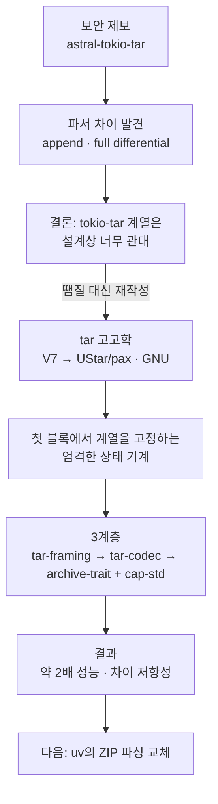
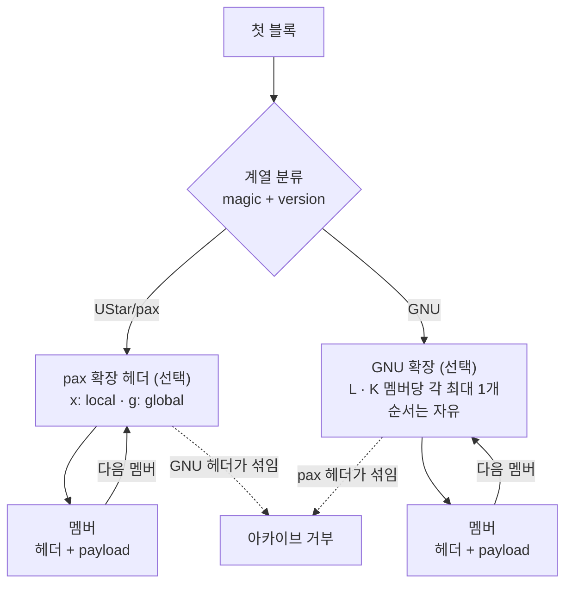

<figure class="post-figure post-figure--header">
<svg role="img" aria-label="같은 바이트, 다른 진실. 가운데에 512바이트 블록이 쌓인 tarball 하나가 있다. 왼쪽 화살표 '파서 A'를 따라가면 인덱스(PyPI 등)가 그 상자에서 innocent.py만 읽어 검사를 통과시킨다. 오른쪽 화살표 '파서 B'를 따라가면 설치 도구가 같은 상자를 풀어 evil.py를 얻는다. 아래에는 parser differential, 검사는 통과하고 공격은 성공한다는 문구가 있다." viewBox="0 0 680 270" xmlns="http://www.w3.org/2000/svg">
  <title>같은 tarball을 인덱스는 innocent.py로, 설치 도구는 evil.py로 읽는 parser differential</title>
  <defs>
    <marker id="tch-head" markerWidth="9" markerHeight="9" refX="7" refY="3" orient="auto">
      <path d="M0 0 L7 3 L0 6 z" fill="currentColor"/>
    </marker>
  </defs>
  <text x="340" y="34" text-anchor="middle" font-size="16" font-weight="700" fill="currentColor">같은 바이트, 다른 진실</text>
  <!-- center: one tarball made of 512-byte blocks -->
  <text x="340" y="70" text-anchor="middle" font-size="11" font-weight="700" fill="currentColor" opacity="0.75">같은 tarball</text>
  <rect x="290" y="78" width="100" height="24" fill="var(--bg-light)" stroke="currentColor" stroke-width="1.4"/>
  <rect x="290" y="102" width="100" height="24" fill="var(--bg-panel)" stroke="currentColor" stroke-width="1.4"/>
  <rect x="290" y="126" width="100" height="24" fill="var(--bg-panel)" stroke="currentColor" stroke-width="1.4"/>
  <rect x="290" y="150" width="100" height="24" fill="var(--bg-light)" stroke="currentColor" stroke-width="1.4"/>
  <rect x="290" y="174" width="100" height="24" fill="var(--bg-panel)" stroke="currentColor" stroke-width="1.4"/>
  <rect x="290" y="78" width="100" height="120" fill="none" stroke="currentColor" stroke-width="2.4"/>
  <text x="340" y="94" text-anchor="middle" font-size="9.5" fill="currentColor" opacity="0.8">헤더</text>
  <text x="340" y="118" text-anchor="middle" font-size="9.5" fill="currentColor" opacity="0.6">데이터</text>
  <text x="340" y="142" text-anchor="middle" font-size="9.5" fill="currentColor" opacity="0.6">데이터</text>
  <text x="340" y="166" text-anchor="middle" font-size="9.5" fill="currentColor" opacity="0.8">헤더</text>
  <text x="340" y="190" text-anchor="middle" font-size="9.5" fill="currentColor" opacity="0.6">데이터</text>
  <text x="340" y="218" text-anchor="middle" font-size="11" fill="currentColor" opacity="0.7">sdist.tar</text>
  <!-- arrows -->
  <text x="240" y="128" text-anchor="middle" font-size="11" font-weight="700" fill="currentColor" opacity="0.8">파서 A</text>
  <line x1="284" y1="138" x2="198" y2="138" stroke="currentColor" stroke-width="2" marker-end="url(#tch-head)"/>
  <text x="440" y="128" text-anchor="middle" font-size="11" font-weight="700" fill="currentColor" opacity="0.8">파서 B</text>
  <line x1="396" y1="138" x2="482" y2="138" stroke="currentColor" stroke-width="2" marker-end="url(#tch-head)"/>
  <!-- left: index sees innocent.py -->
  <text x="115" y="94" text-anchor="middle" font-size="12" font-weight="700" fill="currentColor">인덱스 (PyPI 등)</text>
  <rect x="40" y="104" width="150" height="68" fill="var(--bg-panel)" stroke="var(--secondary-color)" stroke-width="2.2"/>
  <path d="M56 123 h16 l8 8 v22 h-24 z" fill="var(--bg-light)" stroke="var(--secondary-color)" stroke-width="1.6"/>
  <path d="M72 123 v8 h8" fill="none" stroke="var(--secondary-color)" stroke-width="1.6"/>
  <text x="90" y="143" font-size="13" font-weight="700" fill="var(--secondary-color)">innocent.py</text>
  <text x="115" y="194" text-anchor="middle" font-size="11" fill="var(--secondary-color)" font-weight="700">검사 통과</text>
  <!-- right: installer sees evil.py -->
  <text x="565" y="94" text-anchor="middle" font-size="12" font-weight="700" fill="currentColor">설치 도구</text>
  <rect x="490" y="104" width="150" height="68" fill="var(--bg-panel)" stroke="var(--accent-color)" stroke-width="2.2"/>
  <path d="M506 123 h16 l8 8 v22 h-24 z" fill="var(--bg-light)" stroke="var(--accent-color)" stroke-width="1.6"/>
  <path d="M522 123 v8 h8" fill="none" stroke="var(--accent-color)" stroke-width="1.6"/>
  <text x="540" y="143" font-size="13" font-weight="700" fill="var(--accent-color)">evil.py</text>
  <text x="565" y="194" text-anchor="middle" font-size="11" fill="var(--accent-color)" font-weight="700">압축 해제 결과</text>
  <!-- footer -->
  <text x="340" y="252" text-anchor="middle" font-size="11.5" fill="currentColor" opacity="0.7">parser differential — 검사는 통과하고, 공격은 성공한다</text>
</svg>
<figcaption>같은 tarball을 인덱스와 설치 도구가 서로 다르게 읽으면, 검사한 것과 설치된 것이 달라진다(full differential).</figcaption>
</figure>

## 원문 정보

> - **제목**: tar-codec: a fast and secure tar parser for the Rust ecosystem
> - **출처**: William Woodruff, Astral 블로그 ([astral.sh](https://astral.sh/blog))
> - **발행**: 2026-10-27 · 약 20분 분량 (원문에 읽기 시간 표기가 없어 분량으로 추정)
> - **원문 링크**: <https://astral.sh/blog/tar-codec>

Python 패키지 관리자 uv를 만드는 Astral이 Rust로 새 tar 라이브러리를 직접 만들고 그 과정을 정리한 글이다. 오래된 바이너리 포맷 하나를 끝까지 파고든 기록이고, 파서 보안 설계를 공부하는 데 좋은 교과서라서 Systems-Programming에 담는다.

## 한 줄 요약 (TL;DR)

tar는 여러 계열로 갈라진 데다 명세가 빈틈투성이여서, 같은 압축 파일을 파서마다 **다르게** 읽게 만들 수 있다(parser differential). 그래서 Astral은 기존 `astral-tokio-tar`에 땜질하지 않고 tar 계열을 첫 블록에서 하나로 **고정**하는 엄격한 상태 기계 기반의 `tar-codec`을 새로 만들었다. uv 벤치마크에서 기존 구현보다 약 2배 빠르다는 결과도 함께 얻었다.

## 왜 이 글을 골랐나

공급망 보안 이야기는 대개 "악성 패키지가 올라왔다"에서 시작한다([npm debug·chalk 공급망 공격](/2026/07/07/npm-debug-chalk-supply-chain-compromise.html)처럼). 이 글은 한 층 더 내려간다. **패키지 자체는 레지스트리 검사를 통과했는데, 설치 도구가 압축을 푸는 순간 다른 파일이 나오는** 경우다. 레지스트리와 설치 도구가 같은 바이트를 서로 다르게 해석하면, 검사는 통과하고 공격은 성공한다.

시스템 프로그래밍 관점에서도 볼 거리가 많다. 512바이트 블록 레이아웃, octal·base-256 숫자 필드, 자기 길이를 담은 레코드 같은 저수준 디테일이 그대로 보안 문제가 되는 과정을 따라가 볼 수 있다. 위키의 [Rust Essential 시리즈](/2026/01/02/rust-essential-curriculum.html)에서 배운 trait, enum, `Result` 같은 도구를 실무 라이브러리가 어떻게 쓰는지 보여 주는 사례이기도 하다.

이 글의 흐름을 한 장으로 그리면 다음과 같다.



## 핵심 내용

### 배경: uv는 왜 tar를 다루나

Python 패키지는 크게 두 형태로 배포된다.

- **Built distribution (wheel)**: 구조화된 메타데이터와 정해진 레이아웃을 담은 사실상의 **ZIP** 파일이다. 원문은 "bdist = binary distribution"이라는 흔한 오해를 짚는다. 여기서 "built"는 build backend가 만들었다는 뜻일 뿐이고, 순수 Python wheel도 흔하다.
- **Source distribution (sdist)**: 릴리스 시점의 소스 트리를 묶은 사실상의 **tar** 파일이다. 설치할 때 임의 코드를 실행하므로 강력하지만 깨지기 쉽고 보안 위험도 있다.

그래서 설치 도구는 최소한 ZIP과 tar 두 포맷을 이해해야 한다. 이번 글의 주제는 tar다.

uv는 0.13부터 sdist 파싱에 `tar-codec`을 기본으로 쓴다. 원문 각주에 따르면 0.12부터 `--preview-features tar-codec` 플래그 뒤에서 쓸 수 있었고, 0.13에서는 `UV_LEGACY_TAR_BACKEND=1`로 끌 수 있다.

### 왜 새 tar 파서인가: "성능도 있지만, 주로 보안"

0.13 전까지 uv는 `astral-tokio-tar`를 썼다. 이 크레이트는 여러 번 포크된 끝에 나온 것이다. `edera-dev/tokio-tar`의 포크인데, 그것은 `vorot93/tokio-tar`의 포크이고, 그것은 `dignifiedquire/async-tar`의 포크이며, `async-tar`는 `composefs/tar-rs`를 async로 옮긴 것이다.

약 1년 전 `astral-tokio-tar`에 보안 제보가 여러 건 들어왔다. 압축·아카이브 처리 스택을 조사해 보니 문제가 더 나왔고, 상당수는 **파서가 완전히 어긋나는(desynchronization)** 차이였다. 똑같은 tarball을 uv, pip 같은 도구가 서로 다른 내용으로 읽게 만들 수 있었다. 원문은 이를 두 종류로 나눈다.

| 유형 | 인덱스(PyPI 등)가 보는 것 | 설치 도구가 보는 것 |
| --- | --- | --- |
| **Append differential** | `innocent.py` | `innocent.py`와 **추가 파일** `evil.py`, 또는 기존 파일에 덧붙은 내용 |
| **Full differential** | `innocent.py` | `evil.py`. 두 쪽의 파일 목록이 하나도 겹치지 않음 |

원문은 위협 모델도 솔직하게 밝힌다. sdist는 원래 빌드할 때 임의 코드를 실행한다고 가정하므로, Python 패키징 생태계는 tar 차이를 대체로 **작은 문제**로 본다. 공격자에게는 디스크에 쓰거나 코드를 실행할 더 직접적이고 공식적인 경로가 이미 있기 때문이다. 그래도 Astral은 이 결과가 불안해서 차이를 하나씩 제거하는 작업을 시작했다. 그러다 **tokio-tar 계열은 설계상 너무 관대하다**는 결론에 이르렀다. 기존 API 사용자(Astral 외부 포함)를 깨뜨리지 않으면서 제약을 덧대는 일은 처음부터 다시 만드는 것보다 더 번거롭고 실수하기 쉽다고 봤다. 성능 목표 역시 사실상 재작성에 해당하는 리팩터링 없이는 달성할 수 없다고 판단했다.

### (t)archaeology: tar는 포맷이 아니라 포맷 "가족"이다

실무에서 중요한 tar는 "세 가지 반"이다.

| 계열 | 특징 | 제약 |
| --- | --- | --- |
| **UNIX V7** | "원조" tar. 지금은 거의 쓰지 않지만 대부분 읽을 수는 있음(Python `tarfile` 포함) | 멤버당 약 8 GiB, 경로 100바이트 |
| **UStar** | V7에서 파생. POSIX 표준 | 크기 8 GiB 유지, 경로 255바이트(link name은 여전히 100바이트) |
| **pax** | UStar의 엄격한 상위 집합(원문 저자의 분류). 확장 헤더 도입 | 크기·경로·link name 무제한 |
| **GNU tar** | V7과 초기 UStar 초안에서 파생. 표준이 아니라 GNU tar 소스 코드가 사실상의 표준 | 크기·경로 (사실상) 무제한. 방식은 pax와 전혀 다름 |

(원문 각주: GNU에도 "old GNU"와 "new GNU"가 있는데, GNU tar는 1997년 1.12부터 new GNU를 쓰므로 차이는 무시해도 된다.)

tar는 TLV(type-length-value)처럼 "보통" 바이너리 포맷이 아니라 **블록 포맷**이다. 테이프 아카이브에서 출발했기 때문이다.

- 모든 블록은 헤더 블록을 포함해 **항상 512바이트**다. 파일 전체를 설명하는 헤더는 없다. 헤더 블록 하나가 바로 뒤에 오는 멤버의 메타데이터(크기, 경로 등)를 선언한다.
- N바이트 멤버는 `ceil(N / 512)`개 블록을 차지하고, 마지막 블록의 남는 공간은 패딩으로 채운다.
- 패딩은 관례상 NUL로 채우지만 **아무것이나 넣어도 된다**. 원문 표현을 빌리면 초기화되지 않은 메모리든 Bee Movie 대사든 상관없다. tar는 포맷의 "구멍"에 무엇이 들어가는지 신경 쓰지 않는다. 그래서 공격자는 예상 밖의 데이터를 숨길 공간을 넉넉히 얻는다.
- 공간 효율도 나쁘다. 513바이트 파일은 최소 1,536바이트를 쓰고, 1바이트 파일 1000개짜리 아카이브는 최소 1025 KiB가 필요하다(헤더와 내용 1 MiB, 끝의 zero block 1 KiB).

<figure class="post-figure">
<svg role="img" aria-label="tar 아카이브는 512바이트 블록의 연속이다. 왼쪽부터 멤버 A의 헤더, 데이터, 1바이트 데이터와 나머지가 패딩인 블록, 멤버 B의 헤더, 데이터 절반과 패딩인 블록, 생략 표시, 그리고 끝을 나타내는 zero block 두 개가 이어진다. 빗금 친 패딩 영역은 관례상 NUL이지만 무엇이든 들어갈 수 있는 포맷의 구멍으로 강조되어 있다. 멤버 A는 513바이트 파일이라 헤더 1개와 데이터 2블록, 최소 1,536바이트를 차지한다. 끝의 zero block 두 개는 1 KiB다." viewBox="0 0 680 290" xmlns="http://www.w3.org/2000/svg">
  <title>512바이트 블록 레이아웃과 패딩 구멍</title>
  <defs>
    <pattern id="tb-hatch" width="6" height="6" patternUnits="userSpaceOnUse" patternTransform="rotate(45)">
      <line x1="0" y1="0" x2="0" y2="6" stroke="var(--accent-color)" stroke-width="2"/>
    </pattern>
  </defs>
  <text x="340" y="26" text-anchor="middle" font-size="14" font-weight="700" fill="currentColor">tar 아카이브 = 512바이트 블록의 연속</text>
  <!-- padding callout -->
  <text x="310" y="58" text-anchor="middle" font-size="12" font-weight="700" fill="var(--accent-color)">패딩 = 포맷의 "구멍"</text>
  <text x="310" y="76" text-anchor="middle" font-size="10.5" fill="currentColor" opacity="0.8">관례상 NUL이지만 무엇이든 들어갈 수 있다 → 공격자가 숨길 공간</text>
  <line x1="250" y1="84" x2="226" y2="106" stroke="var(--accent-color)" stroke-width="1.6"/>
  <line x1="370" y1="84" x2="396" y2="106" stroke="var(--accent-color)" stroke-width="1.6"/>
  <!-- 512 B dimension over block 0 -->
  <line x1="28" y1="100" x2="102" y2="100" stroke="currentColor" stroke-width="1.2" opacity="0.7"/>
  <line x1="28" y1="95" x2="28" y2="105" stroke="currentColor" stroke-width="1.2" opacity="0.7"/>
  <line x1="102" y1="95" x2="102" y2="105" stroke="currentColor" stroke-width="1.2" opacity="0.7"/>
  <text x="65" y="93" text-anchor="middle" font-size="10" fill="currentColor" opacity="0.8">512 B</text>
  <!-- block 0: header A -->
  <rect x="28" y="110" width="74" height="56" fill="var(--bg-light)" stroke="currentColor" stroke-width="1.8"/>
  <text x="65" y="135" text-anchor="middle" font-size="11" font-weight="700" fill="currentColor">헤더</text>
  <text x="65" y="151" text-anchor="middle" font-size="9.5" fill="currentColor" opacity="0.7">멤버 A</text>
  <!-- block 1: data A -->
  <rect x="106" y="110" width="74" height="56" fill="var(--bg-panel)" stroke="currentColor" stroke-width="1.8"/>
  <text x="143" y="142" text-anchor="middle" font-size="11" fill="currentColor" opacity="0.85">데이터</text>
  <!-- block 2: 1 B data + padding -->
  <rect x="184" y="110" width="74" height="56" fill="var(--bg-panel)"/>
  <rect x="190" y="110" width="68" height="56" fill="url(#tb-hatch)" opacity="0.55"/>
  <rect x="184" y="110" width="6" height="56" fill="currentColor" opacity="0.55"/>
  <rect x="184" y="110" width="74" height="56" fill="none" stroke="currentColor" stroke-width="1.8"/>
  <text x="224" y="142" text-anchor="middle" font-size="11" font-weight="700" fill="var(--accent-color)">패딩</text>
  <!-- block 3: header B -->
  <rect x="262" y="110" width="74" height="56" fill="var(--bg-light)" stroke="currentColor" stroke-width="1.8"/>
  <text x="299" y="135" text-anchor="middle" font-size="11" font-weight="700" fill="currentColor">헤더</text>
  <text x="299" y="151" text-anchor="middle" font-size="9.5" fill="currentColor" opacity="0.7">멤버 B</text>
  <!-- block 4: data + padding -->
  <rect x="340" y="110" width="74" height="56" fill="var(--bg-panel)"/>
  <rect x="377" y="110" width="37" height="56" fill="url(#tb-hatch)" opacity="0.55"/>
  <rect x="340" y="110" width="74" height="56" fill="none" stroke="currentColor" stroke-width="1.8"/>
  <line x1="377" y1="110" x2="377" y2="166" stroke="currentColor" stroke-width="1" stroke-dasharray="3 3" opacity="0.6"/>
  <text x="358" y="142" text-anchor="middle" font-size="9.5" fill="currentColor" opacity="0.85">데이터</text>
  <!-- block 5: ellipsis -->
  <text x="455" y="144" text-anchor="middle" font-size="18" fill="currentColor" opacity="0.6">…</text>
  <!-- blocks 6-7: zero blocks -->
  <rect x="496" y="110" width="74" height="56" fill="var(--bg-sunken)" stroke="currentColor" stroke-width="1.8"/>
  <text x="533" y="142" text-anchor="middle" font-size="11" fill="currentColor" opacity="0.85">zero</text>
  <rect x="574" y="110" width="74" height="56" fill="var(--bg-sunken)" stroke="currentColor" stroke-width="1.8"/>
  <text x="611" y="142" text-anchor="middle" font-size="11" fill="currentColor" opacity="0.85">zero</text>
  <!-- brackets -->
  <path d="M28 178 v8 H258 v-8" fill="none" stroke="currentColor" stroke-width="1.4" opacity="0.75"/>
  <text x="143" y="206" text-anchor="middle" font-size="10.5" fill="currentColor">513 B 파일 = 헤더 1 + 데이터 2블록</text>
  <text x="143" y="222" text-anchor="middle" font-size="10.5" font-weight="700" fill="currentColor">→ 최소 1,536 B</text>
  <path d="M262 178 v8 H414 v-8" fill="none" stroke="currentColor" stroke-width="1.4" opacity="0.75"/>
  <text x="338" y="206" text-anchor="middle" font-size="10" fill="currentColor">N 바이트 → ceil(N / 512) 블록</text>
  <text x="338" y="222" text-anchor="middle" font-size="10" fill="currentColor" opacity="0.8">마지막 블록의 남는 곳 = 패딩</text>
  <path d="M496 178 v8 H648 v-8" fill="none" stroke="currentColor" stroke-width="1.4" opacity="0.75"/>
  <text x="572" y="206" text-anchor="middle" font-size="10.5" fill="currentColor">끝: zero block × 2</text>
  <text x="572" y="222" text-anchor="middle" font-size="10.5" fill="currentColor" opacity="0.8">(1 KiB)</text>
  <!-- footer -->
  <text x="340" y="264" text-anchor="middle" font-size="10.5" fill="currentColor" opacity="0.7">파일 전체를 설명하는 헤더는 없다 · 헤더 블록 하나가 바로 뒤 멤버의 크기·경로를 선언한다</text>
</svg>
<figcaption>모든 블록은 512바이트이고, 멤버의 마지막 블록에 남는 패딩은 tar가 내용을 따지지 않는 "구멍"이다.</figcaption>
</figure>

### V7 헤더의 세 가지 한계와 각 계열의 우회법

V7 헤더는 `name[100]`, `mode[8]`, `uid[8]`, `gid[8]`, `size[12]`, `mtime[12]`, `chksum[8]`, `linkflag`, `linkname[100]`, `pad[255]`로 된 C 구조체다. 숫자 필드는 모두 **octal 문자열**이다. 여기서 세 가지 한계가 나온다.

1. 멤버 이름과 link 이름은 100바이트를 넘을 수 없다.
2. 멤버 크기는 `0o77777777777`바이트, 즉 8 GiB에서 1바이트 모자란 값이 최대다.
3. 정의된 타입은 일반 파일과 링크뿐이다. 디렉터리 타입이 없다(V7은 경로에 암시된 디렉터리를 만들거나, 이름이 `/`로 끝나는 일반 파일을 디렉터리로 만든다).

**UStar**는 같은 512바이트 블록을 유지하면서 필드와 패딩 일부에 새 역할을 준다. `linkflag`는 `typeflag`가 되고(`'5'` = 디렉터리), `magic`(`"ustar\0"`), `version`(`"00"`), `uname`/`gname`, `devmajor`/`devminor`, `prefix[155]`가 추가된다. 이름 제한은 255바이트로 늘었지만 크기와 linkname 제한은 그대로다.

**pax**는 메타데이터를 블록 하나에 담는 설계를 버린다. typeflag `'x'`(local 확장 헤더)와 `'g'`(global 확장 헤더)를 추가하고, 그 "size"는 파일이 아니라 **확장 데이터 자체의 길이**를 뜻한다. 확장 데이터는 아래 형태의 레코드가 이어진 것이다.

```text
<length> <keyword>=<value>\n
예: 13 size=8000↵
```

`<length>`는 **자기 자신을 포함한** 레코드 전체 길이다. 원문은 이것이 보통의 TLV와 다르다고 지적한다. 우선순위는 **local > global > 멤버 자신의 UStar 헤더** 순이다. 원문 예시에서는 UStar 헤더에 `hannibal.txt`, 크기 0이 적혀 있다. 그런데 앞의 `x` 헤더가 이름과 크기를 덮어써서 실제로는 `hasdrubal.txt`가 10737418240바이트(8 GiB 초과)로 풀린다. `mtime`은 global `g` 헤더의 `mtime=100`을 따른다.

<figure class="post-figure">
<svg role="img" aria-label="pax 우선순위 표. 세 층이 위에서 아래로 놓여 있다. 1층 local 확장 헤더 x에는 path=hasdrubal.txt와 size=10737418240이 있고 mtime 칸은 비어 있다. 2층 global 확장 헤더 g에는 mtime=100만 있다. 3층 멤버 UStar 헤더에는 name=hannibal.txt와 size=0이 적혀 있지만 둘 다 위층 값에 덮여 취소선이 그어져 있다. 각 열에서 가장 위층의 값이 이겨 최종 유효값은 hasdrubal.txt, 10737418240바이트(8 GiB 초과), mtime 100이 된다. 빈 칸은 그 층에 레코드가 없어 아래층으로 내려간다는 뜻이고, 값이 빈 레코드는 Tombstoned, 즉 명시적 삭제다." viewBox="0 0 680 320" xmlns="http://www.w3.org/2000/svg">
  <title>pax 우선순위: local x > global g > 멤버 UStar 헤더</title>
  <defs>
    <marker id="pax-head" markerWidth="9" markerHeight="9" refX="7" refY="3" orient="auto">
      <path d="M0 0 L7 3 L0 6 z" fill="var(--accent-color)"/>
    </marker>
  </defs>
  <text x="340" y="26" text-anchor="middle" font-size="14" font-weight="700" fill="currentColor">pax 우선순위: local x &gt; global g &gt; 멤버 UStar 헤더</text>
  <!-- column heads -->
  <text x="290" y="58" text-anchor="middle" font-size="11" font-weight="700" fill="currentColor" opacity="0.75">path / name</text>
  <text x="445" y="58" text-anchor="middle" font-size="11" font-weight="700" fill="currentColor" opacity="0.75">size</text>
  <text x="590" y="58" text-anchor="middle" font-size="11" font-weight="700" fill="currentColor" opacity="0.75">mtime</text>
  <!-- row 1: local x -->
  <text x="30" y="94" font-size="11.5" font-weight="700" fill="currentColor">① local 확장 헤더 (x)</text>
  <rect x="215" y="70" width="150" height="38" fill="var(--bg-panel)" stroke="var(--accent-color)" stroke-width="2.2"/>
  <text x="290" y="94" text-anchor="middle" font-size="12" font-weight="700" fill="currentColor">hasdrubal.txt</text>
  <rect x="375" y="70" width="140" height="38" fill="var(--bg-panel)" stroke="var(--accent-color)" stroke-width="2.2"/>
  <text x="445" y="94" text-anchor="middle" font-size="12" font-weight="700" fill="currentColor">10737418240</text>
  <rect x="525" y="70" width="130" height="38" fill="none" stroke="currentColor" stroke-width="1.2" stroke-dasharray="4 4" opacity="0.5"/>
  <!-- row 2: global g -->
  <text x="30" y="142" font-size="11.5" font-weight="700" fill="currentColor">② global 확장 헤더 (g)</text>
  <rect x="215" y="118" width="150" height="38" fill="none" stroke="currentColor" stroke-width="1.2" stroke-dasharray="4 4" opacity="0.5"/>
  <rect x="375" y="118" width="140" height="38" fill="none" stroke="currentColor" stroke-width="1.2" stroke-dasharray="4 4" opacity="0.5"/>
  <rect x="525" y="118" width="130" height="38" fill="var(--bg-panel)" stroke="var(--accent-color)" stroke-width="2.2"/>
  <text x="590" y="142" text-anchor="middle" font-size="12" font-weight="700" fill="currentColor">100</text>
  <!-- row 3: member UStar header -->
  <text x="30" y="190" font-size="11.5" font-weight="700" fill="currentColor">③ 멤버 UStar 헤더</text>
  <rect x="215" y="166" width="150" height="38" fill="var(--bg-light)" stroke="currentColor" stroke-width="1.4" opacity="0.9"/>
  <text x="290" y="190" text-anchor="middle" font-size="12" fill="currentColor" opacity="0.55">hannibal.txt</text>
  <line x1="250" y1="186" x2="330" y2="186" stroke="currentColor" stroke-width="1.4" opacity="0.7"/>
  <rect x="375" y="166" width="140" height="38" fill="var(--bg-light)" stroke="currentColor" stroke-width="1.4" opacity="0.9"/>
  <text x="445" y="190" text-anchor="middle" font-size="12" fill="currentColor" opacity="0.55">0</text>
  <line x1="436" y1="186" x2="454" y2="186" stroke="currentColor" stroke-width="1.4" opacity="0.7"/>
  <rect x="525" y="166" width="130" height="38" fill="var(--bg-light)" stroke="currentColor" stroke-width="1.4" opacity="0.9"/>
  <text x="590" y="190" text-anchor="middle" font-size="12" fill="currentColor" opacity="0.45">…</text>
  <!-- down arrows -->
  <line x1="290" y1="210" x2="290" y2="232" stroke="var(--accent-color)" stroke-width="2" marker-end="url(#pax-head)"/>
  <line x1="445" y1="210" x2="445" y2="232" stroke="var(--accent-color)" stroke-width="2" marker-end="url(#pax-head)"/>
  <line x1="590" y1="210" x2="590" y2="232" stroke="var(--accent-color)" stroke-width="2" marker-end="url(#pax-head)"/>
  <!-- result row -->
  <text x="30" y="262" font-size="12" font-weight="700" fill="var(--accent-color)">최종 유효값</text>
  <rect x="215" y="238" width="150" height="44" fill="var(--bg-panel)" stroke="currentColor" stroke-width="2.4"/>
  <text x="290" y="258" text-anchor="middle" font-size="12" font-weight="700" fill="currentColor">hasdrubal.txt</text>
  <text x="290" y="274" text-anchor="middle" font-size="9.5" fill="currentColor" opacity="0.7">출처 ①</text>
  <rect x="375" y="238" width="140" height="44" fill="var(--bg-panel)" stroke="currentColor" stroke-width="2.4"/>
  <text x="445" y="258" text-anchor="middle" font-size="12" font-weight="700" fill="currentColor">10737418240</text>
  <text x="445" y="274" text-anchor="middle" font-size="9.5" fill="currentColor" opacity="0.7">출처 ① · 8 GiB 초과</text>
  <rect x="525" y="238" width="130" height="44" fill="var(--bg-panel)" stroke="currentColor" stroke-width="2.4"/>
  <text x="590" y="258" text-anchor="middle" font-size="12" font-weight="700" fill="currentColor">100</text>
  <text x="590" y="274" text-anchor="middle" font-size="9.5" fill="currentColor" opacity="0.7">출처 ②</text>
  <!-- legend -->
  <text x="340" y="302" text-anchor="middle" font-size="10" fill="currentColor" opacity="0.7">점선 칸 = 그 층에 레코드 없음 → 아래층으로 · 값이 빈 레코드(8 path=\n)는 Tombstoned, 명시적 삭제</text>
</svg>
<figcaption>각 필드는 가장 위층에 선언된 값을 따른다. 원문 예시에서 hannibal.txt(크기 0)는 hasdrubal.txt(10737418240바이트, mtime 100)로 풀린다.</figcaption>
</figure>

**GNU tar**는 전혀 다른 길을 간다.

- 기존 512바이트 헤더를 최대한 재사용한다. 숫자 필드 첫 바이트의 high bit가 켜져 있으면 나머지를 octal이 아니라 **binary(base-256)**로 읽는다. 바이트당 정보량이 3비트에서 8비트로 늘어서 `size[12]`의 실질 한계는 `2**80`(1 yobibyte)이 된다. `2**96`이 아닌 이유는 부호 비트용 `size[0]`과 NUL용 `size[11]`을 빼기 때문이다.
- 범용 확장 헤더 대신 **전용 typeflag**를 둔다. 그중 중요한 것이 `L`(다음 콘텐츠 블록들 = 파일 이름)과 `K`(다음 콘텐츠 블록들 = link 이름)로, pax의 `path`/`linkpath` 레코드 역할을 한다. global/local 개념은 없지만 확장을 **쌓을 수 있다**(`L → K → 멤버`, 순서 무관).
- `prefix[155]` 필드가 없고, 대신 `atime`, `ctime`, sparse 관련 필드 등이 들어간다.

### tar-codec: "상태 기계 터더킨"

V7만 다루면 상태 기계가 단순하지만, pax와 GNU 상태를 모두 넣으면 원문 표현대로 "괴물"이 된다(원문 도표에서는 오류 전이를 크게 단순화했고, 실제로는 어느 지점에서든 I/O·검증 실패가 `Failed`로 간다). 핵심 결정은 다음과 같다.

아래는 결정 1·2를 본문 기준으로 요약한 흐름이다(원문 도표가 아니며, 어느 지점에서든 `Failed`로 가는 I/O·검증 실패 전이는 생략했다).



1. **첫 블록에서 계열을 고정한다.** 첫 블록의 magic과 version으로 UStar/pax인지 GNU인지 정하고, 남은 파싱 전체를 그 계열로 묶는다. 많은 파서가 여러 계열의 상태를 섞어 처리하면서 결과가 제각각이 된다. 예를 들어 `L → x → foo.txt` 순서에서 GNU `L`은 다음 "파일" 멤버에 붙어야 하는데, 바로 다음 물리 멤버는 역시 다음 파일을 수정하려는 pax `x`다. 다른 파서들은 이런 상태에서 두 확장을 합치거나, 하나만 따르거나, `L`을 `x`에 적용하는 등 제각각으로 동작했다. 원문은 **그 하나하나가 악용 가능한 차이**라고 말한다. tar-codec은 헤더들이 계열에 대해 서로 다른 말을 하면 아카이브를 거부한다. 실제 인코더는 계열을 섞지 않으므로 호환성 위험도 크지 않다.
2. **GNU는 문서보다 엄격하게 다룬다.** GNU 문서는 `L`/`K`를 같은 종류 여러 개까지 아무 순서로 쌓도록 허용한다. tar-codec은 순서는 자유롭게 두되 멤버당 **각각 1개까지만** 허용한다.
3. **pax는 local/global을 엄격하게 모델링한다.** pax는 `x`와 `g`를 스트림 어디에나 둘 수 있고, 확장 헤더끼리 완전히 가리지 않고 **합성된다**. 그래서 각 레코드의 상태를 셋으로 나눠야 한다.
   - **Undeclared**: 스택 어디에도 해당 레코드가 없다. 멤버의 UStar 헤더 값을 쓴다.
   - **Active**: 유효한 값이 있다.
   - **Tombstoned**: 레코드는 있는데 값이 비어 있다(`8 path=\n`). pax는 이를 **명시적 삭제**로 규정한다. 그러면 "경로가 없는 파일"이 생긴다. 원문은 다른 구현들이 빈 경로로 풀려다 실패하거나 이전 파일 이름을 가져다 쓰는 등 제각각으로 동작한다고 지적한다. tar-codec은 이 규칙을 충실히 따르면서, 논리적으로는 일관되지만 말이 안 되는 상태(빈 경로, 모든 멤버의 `size` 같은 핵심 상태를 선언하려는 global 헤더 등)를 **거부**한다.

원문 각주에 따르면 tar-codec은 V7 형식을 **파싱하지 않는다**. 초기 검토에서 Python 패키징 생태계에 V7 파일이 사실상 없다는 것을 확인했기 때문이다. Python 자체의 `tarfile`도 V7을 만든 적이 없다. V7과 UStar의 차이는 작아서 필요하면 추가하기 어렵지 않다고 한다.

### 파싱에서 추출까지: 3계층 설계

| 계층 | 크레이트 | 역할 |
| --- | --- | --- |
| 1 | **`tar-framing`** | 블록 스트림을 프레임 스트림으로 바꾼다. **physical API**는 위의 상태 기계를 따라 블록을 하나씩 상태와 함께 내보낸다. **logical API**는 그 블록들을 조립된 멤버로 묶는다. 멤버 하나는 헤더(물리 헤더 + 프레이밍에 영향을 준 확장 상태), GNU `L`/`K` 같은 비프레이밍 확장 상태, 읽을 수 있는 payload로 구성된다 |
| 2 | **`tar-codec`** | `tar-framing`의 logical API를 받아 메모리나 디스크에 추출할 수 있는 형태로 만든다 |
| 3 | **`archive-trait`** | `Archive`/`ArchiveBuilder` trait으로 어떤 포맷이든 같은 읽기·생성 API를 제공한다. 파일시스템 추출은 **`cap-std`** 위에 만들어서, 추출 범위를 한 디렉터리에 "고정"하고 링크·경로 탈출(path traversal) 계열 실수를 원천적으로 막는다 |

`archive-trait`를 따로 둔 이유도 원문에 나온다. 아카이브 구현마다 자기만의 extract-to-disk 코드와 엣지 케이스가 있어서, 추출 단계가 또 하나의 차이 원천이 된다는 것이다. 원문은 추출 단계의 차이를 다루지 않지만 몇 가지 예를 든다. 대소문자만 다른 파일(macOS·Windows), 심볼릭 링크에 권한이 필요한 시스템(Windows), "이상하지만 유효한" 파일 이름(non-UTF-8, NUL이 든 UTF-8, 제어 문자) 등이다.

### 배운 것들

**차이에 강한 tar 파서는 생각보다 훨씬 어렵다.**

- 계열마다 상태 기계가 따로 있지만 문서나 레퍼런스 구현에 명확히 정리되어 있지 않다. 이 상태 기계들은 절대 섞이면 안 되는데, 실제 파서들은 섞는 경우가 많다.
- 계열마다 pathname, linkname, size의 우선순위 규칙이 따로 있고 단순하지 않다.
- 일부 상태는 **프레이밍 자체**에 영향을 준다. 따라서 pax를 제대로 처리하려면 `size` 같은 레코드를 미리 반영해야 하고, 512바이트 헤더 블록 단위로 추상화해서는 안 된다.

**엄격한 pax 준수에서 물러선 지점도 있다.** 다른 구현들의 실제 동작 때문이다.

- pax는 레코드 값이 UTF-8이어야 한다고 명시하지만, GNU tar와 star는 일부 vendor 레코드를 raw binary로 써 왔다.
- UStar/pax 명세상 `uname`/`gname`은 NUL 종료여야 하므로 최대 31바이트다. 그런데 CPython `tarfile`은 32바이트까지 채우고 33바이트부터 pax 레코드로 넘긴다(CPython#159322).
- `mode`, `uid`, `gid`, `mtime`을 전부 NUL로 두는 구현이 많다. 프레이밍에는 영향이 없으므로 tar-codec은 임의의 기본값을 넣지 않고 "missing"으로 기록한다.
- pax vendor 레코드(`VENDOR.keyword`, 예: `SCHILY.xattr.*`, `GNU.sparse.*`)는 의미가 정의되어 있지 않아 **기본으로 거부**하고, 건너뛰기/무시 옵션을 둔다.

**다른 구현에서 발견한 차이 유형.** 일부는 현재 보안 취약점으로 공개(disclosure)가 진행 중이라고 한다.

| 유형 | 내용 | 결과 |
| --- | --- | --- |
| pax/GNU 상태 혼동 | pax 확장의 상태를 다음 멤버가 아니라 GNU 확장에 적용하거나 그 반대로 적용 | 대개 완전한 어긋남 |
| pax 우선순위 오처리 | `size=1234`가 든 `g` 헤더를 받아들이고는 무시하거나, tombstone을 잘못 처리 | 대개 완전한 어긋남 |
| pax 레코드 파싱 오류 | `<length>`를 무시하고 `\n`으로 나눔. 그런데 `<value>`에는 `\n`이 그대로 들어갈 수 있음 | 대개 완전한 어긋남 |
| 느슨한 정수 파싱 | 언어 기본 "문자열→정수" API를 써서 아라비아 숫자가 아닌 숫자 형태, 앞뒤 공백 등을 다르게 처리 | 같은 `size` 필드를 서로 다른 정수로 읽어 어긋남 |

**성능은 어렵지 않았다.** 체크섬 생성과 pax 레코드 길이 prefix 계산에서 손쉽게 개선할 곳이 많았다. 할당을 재사용하고 작업을 배치·버퍼링해서 큰 이득을 봤다. 단, API의 내부 일관성이나 async 환경의 cancellation 정확성을 해치지 않는 범위에서만 그렇게 했다. uv 벤치마크 도표의 경과 시간은 **tar-codec 329.4 ms, astral-tokio-tar 702.8 ms**다(낮을수록 빠름). 본문의 "약 2배"와 맞는다.

**반대로 성능과 안전을 함께 갖춘 추출은 어렵다.** cap-std식 디렉터리 capability 추적은 파일시스템 작업에 측정 가능한 오버헤드를 더한다. `openat2(2)` 같은 `RESOLVE_BENEATH` 의미론이 없는 호스트에서는 경로의 디렉터리를 하나씩 열어야 해서 시스템 콜 수가 경로 깊이에 비례해 늘어난다. 그래서 특히 **macOS**에서 추출이 느려진다.

원문의 결론은 이렇다. 받아들일 때는 관대하기보다 **보수적**으로, 멤버 프레이밍 → 스트리밍 → 추출로 갈수록 **점점 더 조이는 계층**으로 정확성을 구조적으로 강제한다(correctness by construction). 다만 tar가 파편화되어 있고 명세가 부족하므로 차이가 전혀 없다거나 앞으로 발견되지 않는다고 말할 수는 없다. 그런 일이 생겼을 때 대응할 올바른 기본 도구를 갖췄다고 믿는다는 것이 원문의 입장이다.

### 앞으로

- tar-codec은 uv에 필요한 기능은 사실상 다 갖췄다. 앞으로는 더 넓은 오픈소스 커뮤니티의 요구(sparse 파일, vendor pax 레코드 제어 등)를 필요에 따라 지원할 예정이다.
- Harmen Stoppels의 초기 프로젝트 **tar-minefield**를 다른 구현들을 더 엄격하고 차이에 강한 해석 쪽으로 맞추는 테스트 도구로 기대한다.
- 범용 `archive-trait`를 만든 데서 짐작할 수 있듯 다음은 **uv의 ZIP 파싱 교체**다.

## 분석과 인사이트

아래는 원문 요약이 아니라 이 위키의 해석이다.

**1. "Postel의 법칙"을 뒤집는 것이 보안 파서의 기본이다.** "보낼 때는 엄격하게, 받을 때는 관대하게"라는 Postel의 법칙은 상호운용성에는 좋지만, 여러 파서가 같은 입력을 판정하는 환경에서는 공격 표면이 된다. 관대한 파서들은 각자 다르게 관대하고, 그 차이가 곧 차이 공격의 원재료다. tar-codec의 "계열이 섞이면 거부"와 "말이 안 되는 상태는 거부"는 이 원칙을 정면으로 뒤집은 것이다. 비용(호환성)이 거의 없다는 데이터, 즉 실제 인코더는 계열을 섞지 않는다는 관찰을 근거로 거부 범위를 정했다는 점이 특히 좋다.

**2. 진짜 위험은 "검증하는 쪽"과 "실행하는 쪽"이 다른 파서를 쓰는 구조다.** 원문은 sdist의 위협 모델을 과장하지 않는다. sdist는 원래 임의 코드를 실행하므로 tar 차이는 Python 생태계에서 작은 문제로 취급된다. 하지만 이 교훈은 tar보다 일반적이다. 레지스트리 스캐너, 코드 리뷰 도구, 보안 감사 도구가 보는 내용과 설치 도구가 푸는 내용이 다르면 **모든 정적 검사가 무력해진다**. 컨테이너 이미지 레이어, 펌웨어 업데이트, 문서 포맷처럼 "검사 후 실행"하는 파이프라인이라면 어디서든 같은 질문을 던져야 한다. 공급망 사고 대응 도구를 다룬 [Bumblebee](/2026/06/25/perplexity-bumblebee.html)가 "무엇이 설치됐나"를 묻는다면, 이 글은 그보다 앞서 "설치된 것이 검사한 것과 같은가"를 묻는다.

**3. 계층 분리 자체가 보안 장치다.** `tar-framing`(physical → logical) → `tar-codec` → `archive-trait`+`cap-std` 구조는 단순히 깔끔한 설계가 아니다. 층마다 **불변식을 하나씩 확정**해서 위층이 그 불변식을 다시 의심하지 않게 한다. "프레이밍에 영향을 주는 상태(`size`, `path`)는 logical 단계에서 이미 합쳐져 있다"는 보장이 있으면 추출 계층은 경로 안전에만 집중할 수 있다. Rust에서 이런 단계별 보장을 표현하는 기본 도구가 trait와 타입이다. `Archive`/`ArchiveBuilder`처럼 포맷 독립 인터페이스를 trait으로 뽑아내는 방식은 [Rust 제네릭, 트레이트, 라이프타임](/2026/01/08/rust-generics-traits-lifetimes.html)에서 다룬 trait bound의 실무판이다. 실패를 `Failed` 상태로 모아 거부하는 흐름은 [Rust 에러 처리](/2026/01/07/rust-error-handling-and-collections.html)의 `Result` 전파와 같은 맥락이다.

**4. 상태를 셋으로 나눈 것이 핵심이다.** pax 레코드의 Undeclared / Active / Tombstoned 구분은 `Option<T>` 하나로 표현하면 곧바로 버그가 되는 사례다. "없음"과 "명시적으로 지움"은 다르다. Rust라면 세 변형을 가진 enum으로 모델링해서 `match`가 모든 경우를 강제로 다루게 하는 것이 자연스럽다([Rust 구조체, 열거형, 패턴 매칭](/2026/01/06/rust-structs-enums-pattern-matching.html) 참고). 원문이 tar-codec의 내부 타입 정의를 공개하지는 않았으므로 이것은 일반적인 설계 해석이다.

**5. "성능은 쉬웠고 안전한 추출이 어려웠다"는 고백이 정직하다.** 보안 재작성 글은 흔히 "더 안전하고 더 빠르다"로 끝나지만, 이 글은 cap-std 오버헤드, 특히 `openat2`가 없는 macOS에서의 비용을 숨기지 않는다. 안전에는 시스템 콜이라는 실제 비용이 있고, 그 비용은 OS가 어떤 기본 기능(primitive)을 제공하느냐에 달려 있다. [측정하고 나서 확장하라](/2026/07/18/measure-before-you-scale.html)의 메시지처럼, 2배 향상이라는 결과도 벤치마크 수치(329.4 ms vs 702.8 ms)로 뒷받침된다. 다만 원문 도표는 "uv's benchmarks"라고만 밝히고 워크로드 구성은 자세히 설명하지 않는다. 다른 환경에서도 같은 배수가 나온다고 일반화하는 것은 조심해야 한다.

**이견이 있을 만한 부분.** V7을 아예 파싱하지 않는 결정은 uv라는 목적에는 합리적이지만, tar-codec을 "Rust 생태계용" 범용 라이브러리로 내세우는 이상 다른 도메인(오래된 백업, 임베디드 펌웨어)에서는 걸림돌이 될 수 있다. vendor 레코드 기본 거부도 `SCHILY.xattr.*`로 확장 속성을 보존하는 백업 용도에서는 불편할 것이다. 원문도 이 부분은 "필요에 따라" 지원하겠다고 열어 두었다.

## 적용 포인트

- **"같은 입력을 두 파서가 본다"면 차이를 먼저 의심하라.** 업로드 검증과 실제 처리에 서로 다른 라이브러리를 쓴다면, 그 둘이 같은 결과를 내는지를 테스트 항목으로 둔다.
- **호환성 데이터로 거부 범위를 정하라.** "실제 생산자는 이런 입력을 만들지 않는다"는 근거가 있으면 과감하게 거부한다(tar-codec의 계열 혼합 거부, V7 미지원).
- **"없음"과 "명시적 삭제"를 다른 상태로 모델링하라.** 설정 병합, PATCH API, 레이어드 config처럼 덮어쓰기 규칙이 있는 곳에서는 tri-state가 필요하다.
- **숫자 필드는 엄격한 전용 파서로 읽어라.** 언어 기본 정수 변환 함수는 공백, 부호, 비ASCII 숫자를 구현마다 다르게 받아들일 수 있다. 아래는 원문 코드가 아니라 위키가 만든 일반 예시다(tar-codec의 실제 구현이 아니며, tar 필드의 다양한 종단 규칙은 단순화했다).

```rust
/// 고정 길이 octal 필드를 엄격하게 파싱하는 예시 (tar-codec 코드 아님).
/// 허용: ASCII '0'..='7' 다음에 오는 NUL 패딩. 그 외(공백, '+', 비ASCII 숫자)는 거부.
fn parse_octal_strict(field: &[u8]) -> Option<u64> {
    let end = field.iter().position(|&b| b == 0).unwrap_or(field.len());
    let (digits, rest) = field.split_at(end);
    if digits.is_empty() || rest.iter().any(|&b| b != 0) {
        return None; // 빈 값, 또는 NUL 뒤에 숨은 데이터 → 거부
    }
    let mut value: u64 = 0;
    for &b in digits {
        if !(b'0'..=b'7').contains(&b) {
            return None;
        }
        value = value.checked_mul(8)?.checked_add(u64::from(b - b'0'))?;
    }
    Some(value)
}
```

- **추출은 디렉터리 capability에 고정하라.** 경로 문자열 검사(`..` 필터링)만으로는 링크와 대소문자 문제를 다 막을 수 없다. `cap-std`나 `openat2(RESOLVE_BENEATH)` 같은 OS 수준 장치를 우선 고려하고, macOS처럼 그런 장치가 없는 플랫폼의 비용은 미리 측정한다.
- **uv 사용자라면**: 0.13부터 tar-codec이 기본이다. 예전에는 풀리던 sdist가 거부된다면 아카이브 자체가 비정상(계열 혼합, vendor 레코드 등)일 가능성을 먼저 의심한다. 임시 우회 수단은 `UV_LEGACY_TAR_BACKEND=1`이다.

## 마무리

이 글이 tar를 오래 파고드는 이유는 결론을 정당화하기 위해서다. 명세가 갈라지고 빈틈이 많은 포맷에서는 "다들 대충 이렇게 읽는다"가 곧 공격 표면이 된다. Astral은 포크를 거듭한 관대한 구현에 제약을 덧대는 대신, 계열 고정 상태 기계, 3상태 레코드 모델, 층마다 조여지는 계층, capability 기반 추출로 tar를 처음부터 다시 정의했다. 약 2배 빠른 성능은 그 과정에서 함께 얻은 결과다. 파서를 만들거나 "검사 후 실행" 파이프라인을 운영하는 사람에게 이 글의 교훈은 하나로 모인다. **관대함은 상호운용성에는 도움이 되지만 보안에는 부채다.**

### 더 읽어보기

- [원문 — tar-codec: a fast and secure tar parser for the Rust ecosystem (Astral)](https://astral.sh/blog/tar-codec)
- [tar-codec 소스 (astral-sh/astral-codec)](https://github.com/astral-sh/astral-codec/tree/main/crates/tar-codec) — 원문이 링크한 저장소
- [Rust Essential Curriculum](/2026/01/02/rust-essential-curriculum.html) — tar-codec이 쓰는 Rust 기초를 순서대로
- [Rust 제네릭, 트레이트, 라이프타임](/2026/01/08/rust-generics-traits-lifetimes.html) — `archive-trait`처럼 포맷 독립 인터페이스를 trait으로 뽑는 원리
- [Rust 구조체, 열거형, 패턴 매칭](/2026/01/06/rust-structs-enums-pattern-matching.html) — Undeclared/Active/Tombstoned 같은 상태를 enum으로 모델링하기
- [Rust 에러 처리와 컬렉션](/2026/01/07/rust-error-handling-and-collections.html) — 거부(`Failed`)를 `Result`로 전파하는 기본기
- [Rust 디버깅과 프로파일링](/2026/01/10/rust-debugging-and-profiling.html) — 할당 재사용·배치 같은 최적화를 측정으로 확인하는 법
- [npm을 흔든 공급망 공격](/2026/07/07/npm-debug-chalk-supply-chain-compromise.html) — "악성 패키지" 층의 공급망 위협, 이 글은 그 아래 "파서" 층
- [Bumblebee: 공급망 사고 노출 스캐너](/2026/06/25/perplexity-bumblebee.html) — 사고 이후 대응 관점의 짝
- [측정하고 나서 확장하라](/2026/07/18/measure-before-you-scale.html) — 성능 주장은 측정으로 뒷받침해야 한다는 같은 결
