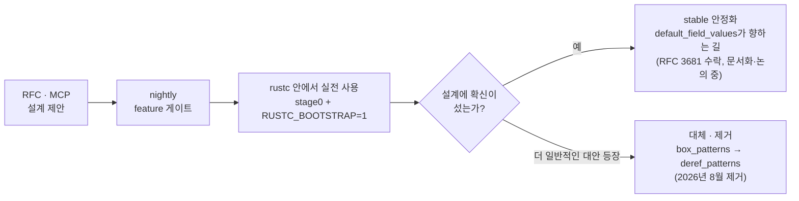

<figure class="post-figure post-figure--header">
<svg role="img" aria-label="stable Rust라는 신전의 지붕을 nightly 기능 기둥들이 떠받친다. 기둥에는 사용 crate 수 상위 기능인 deref_patterns(21), try_blocks(16), option_into_flat_iter(14), default_field_values(13), iter_intersperse(11), file_buffered(11)가 적혀 있고, 이 글이 다루는 deref_patterns와 default_field_values는 강조되어 있다. 기둥 아래 기단은 rustc — 83개 nightly 기능을 먼저 써 보는 실험장(stage0 + RUSTC_BOOTSTRAP=1)이다. 오른쪽 바닥에는 box_patterns 기둥이 쓰러져 있다 — 2026년 8월 제거되어 deref_patterns로 대체되었다." viewBox="0 0 680 350" xmlns="http://www.w3.org/2000/svg" shape-rendering="crispEdges">
  <!-- 지붕: stable Rust -->
  <polygon points="50,94 290,28 530,94" fill="var(--bg-light)" stroke="currentColor" stroke-width="2"/>
  <text x="290" y="80" font-size="19" font-weight="700" fill="currentColor" text-anchor="middle">stable Rust</text>
  <rect x="50" y="94" width="480" height="24" fill="var(--bg-sunken)" stroke="currentColor" stroke-width="2"/>
  <text x="290" y="110" font-size="10" fill="currentColor" text-anchor="middle">nightly 기능 83개가 떠받친다 — 사용 crate 수 상위 6개 표시, 나머지 77개는 생략</text>

  <!-- 기둥들 -->
  <g stroke="currentColor" stroke-width="2" fill="var(--bg-light)">
    <rect x="70" y="118" width="62" height="8"/>
    <rect x="146" y="118" width="62" height="8"/>
    <rect x="222" y="118" width="62" height="8"/>
    <rect x="298" y="118" width="62" height="8"/>
    <rect x="374" y="118" width="62" height="8"/>
    <rect x="450" y="118" width="62" height="8"/>
    <rect x="70" y="272" width="62" height="8"/>
    <rect x="146" y="272" width="62" height="8"/>
    <rect x="222" y="272" width="62" height="8"/>
    <rect x="298" y="272" width="62" height="8"/>
    <rect x="374" y="272" width="62" height="8"/>
    <rect x="450" y="272" width="62" height="8"/>
  </g>
  <!-- 기둥 몸통: 강조(이 글이 다루는 1위·4위)는 accent 테두리 -->
  <rect x="76" y="126" width="50" height="146" fill="var(--bg-panel)" stroke="var(--accent-color)" stroke-width="3"/>
  <rect x="152" y="126" width="50" height="146" fill="var(--bg-panel)" stroke="currentColor" stroke-width="2"/>
  <rect x="228" y="126" width="50" height="146" fill="var(--bg-panel)" stroke="currentColor" stroke-width="2"/>
  <rect x="304" y="126" width="50" height="146" fill="var(--bg-panel)" stroke="var(--accent-color)" stroke-width="3"/>
  <rect x="380" y="126" width="50" height="146" fill="var(--bg-panel)" stroke="currentColor" stroke-width="2"/>
  <rect x="456" y="126" width="50" height="146" fill="var(--bg-panel)" stroke="currentColor" stroke-width="2"/>

  <!-- 기둥 이름 (세로) -->
  <g font-size="9.5" font-family="monospace" text-anchor="middle">
    <text transform="translate(105,190) rotate(-90)" fill="var(--accent-color)" font-weight="700">deref_patterns</text>
    <text transform="translate(181,190) rotate(-90)" fill="currentColor">try_blocks</text>
    <text transform="translate(257,190) rotate(-90)" fill="currentColor">option_into_flat_iter</text>
    <text transform="translate(333,190) rotate(-90)" fill="var(--accent-color)" font-weight="700">default_field_values</text>
    <text transform="translate(409,190) rotate(-90)" fill="currentColor">iter_intersperse</text>
    <text transform="translate(485,190) rotate(-90)" fill="currentColor">file_buffered</text>
  </g>
  <!-- 사용 crate 수 -->
  <g font-size="11" font-weight="700" text-anchor="middle">
    <text x="101" y="265" fill="var(--accent-color)">21</text>
    <text x="177" y="265" fill="currentColor">16</text>
    <text x="253" y="265" fill="currentColor">14</text>
    <text x="329" y="265" fill="var(--accent-color)">13</text>
    <text x="405" y="265" fill="currentColor">11</text>
    <text x="481" y="265" fill="currentColor">11</text>
  </g>

  <!-- 기단: rustc -->
  <rect x="40" y="280" width="500" height="44" fill="var(--bg-sunken)" stroke="currentColor" stroke-width="2"/>
  <text x="290" y="299" font-size="12.5" font-weight="700" fill="currentColor" text-anchor="middle">rustc — 83개 nightly 기능을 먼저 써 보는 실험장</text>
  <text x="290" y="316" font-size="10" fill="var(--text-light)" text-anchor="middle">beta 컴파일러(stage0) + RUSTC_BOOTSTRAP=1 로 빌드</text>

  <!-- 범례 -->
  <rect x="556" y="132" width="14" height="14" fill="var(--bg-panel)" stroke="var(--accent-color)" stroke-width="3"/>
  <text x="578" y="144" font-size="10" fill="currentColor">이 글이 다루는</text>
  <text x="578" y="158" font-size="10" fill="currentColor">두 기능</text>
  <text x="556" y="184" font-size="10" fill="var(--text-light)">숫자 = 사용 crate 수</text>

  <!-- 쓰러진 기둥: box_patterns -->
  <text x="610" y="246" font-size="11" font-weight="700" fill="var(--accent-color)" text-anchor="middle">제거됨 (2026.8)</text>
  <polygon points="556,300 652,284 656,300 560,316" fill="var(--bg-light)" stroke="var(--text-light)" stroke-width="2" stroke-dasharray="5 3"/>
  <text transform="translate(606,304) rotate(-9.5)" font-size="9.5" font-family="monospace" fill="var(--text-light)" text-anchor="middle">box_patterns</text>
  <text x="606" y="268" font-size="9.5" fill="var(--text-light)" text-anchor="middle">→ deref_patterns가 대체</text>
  <line x1="548" y1="326" x2="664" y2="326" stroke="currentColor" stroke-width="2"/>
</svg>
<figcaption>stable Rust는 rustc가 먼저 시험해 보는 nightly 기능 기둥 위에 서 있다. 살아남지 못한 box_patterns 기둥은 deref_patterns에 밀려 쓰러졌다.</figcaption>
</figure>

## 원문 정보

> - **제목**: What stable Rust stands on
> - **출처**: Kivooeo, kivo's blog ([kivooeo.github.io](https://kivooeo.github.io/))
> - **발행**: 2026-10-29 · 약 7분 분량 (약 1,380단어)
> - **원문 링크**: <https://kivooeo.github.io/blog/what-stable-rust-stands-on/>

rustc 리뷰어로 활동하는 저자가 "우리가 쓰는 stable 컴파일러는 정작 unstable 기능으로 만들어진다"는 역설을 짧게 짚은 글이라, 언어·컴파일러 내부를 다루는 Systems-Programming 갈래에 담는다.

## 한 줄 요약 (TL;DR)

stable Rust를 컴파일하는 rustc는 **83개의 nightly 기능**을 켠 채 빌드된다. 그중 상위권인 `deref_patterns`와 `default_field_values`는 거대한 컴파일러 코드베이스에서 먼저 실전 검증을 거치는 중이며, 이런 과정에서 살아남지 못한 기능(`box_patterns`)은 실제로 제거되기도 한다.

## 왜 이 글을 골랐나

Rust를 처음 배울 때는 "stable만 써라, nightly는 실험용"이라는 조언을 듣는다. 이 위키의 [Rust-Essential 커리큘럼](/2026/01/02/rust-essential-curriculum.html)도 stable 언어를 기준으로 짜여 있다. 그런데 그 stable 언어를 만드는 도구가 정작 nightly 기능을 잔뜩 쓰고 있다면 무엇을 뜻할까?

이 글은 두 가지 면에서 읽을 가치가 있다.

1. **언어가 진화하는 방식**을 보여 준다. 기능이 RFC → nightly → 대규모 코드베이스에서의 사용 → stable(또는 폐기)로 가는 실제 경로가 rustc 안에서 드러난다.
2. 우리가 [구조체·열거형·패턴 매칭](/2026/01/06/rust-structs-enums-pattern-matching.html)과 [스마트 포인터](/2026/01/09/rust-smart-pointers-concurrency-and-projects.html)를 배우며 부딪히던 **불편함이 언어 차원에서 어떻게 해소되고 있는지** 미리 볼 수 있다.

아래는 이 글 전체를 관통하는 흐름, 곧 nightly 기능이 거치는 생애 주기다.



## 핵심 내용

### 83개 — rustc가 쓰는 nightly 기능의 수

저자는 커밋 `f45772e` 시점에서 컴파일러 각 crate의 `lib.rs`에 있는 `feature` 속성의 고유 이름을 모두 세었고, 그 결과가 **83개**였다. 흥미로운 대목은 저자 스스로 "이 중 약 90%는 없어도 컴파일러가 똑같이 동작할 것"이라고 본다는 점이다. 대부분은 필수 기능이 아니라 코드를 **더 단순하고 읽고 쓰기 좋게** 만드는 용도라는 것이다.

### stable 컴파일러가 nightly 기능을 쓰는 방법

rustc는 beta 컴파일러(`stage0`)로 빌드되며, 빌드 과정에서 `RUSTC_BOOTSTRAP` 환경 변수를 1로 설정해 stable/beta 툴체인에서도 `#![feature(...)]`를 허용한다. 저자는 **자기 프로젝트에서 이 변수를 쓰지 말라**고 분명히 경고한다. 그 순간 Rust가 주는 안정성 보장이 사라지기 때문이다.

### 사용 crate 수 기준 상위 기능

| 순위 | 기능 | 사용 crate 수 | 하는 일 |
| --- | --- | --- | --- |
| 1 | `deref_patterns` | 21 | `Box`, `String`, `Vec` 등을 관통해 패턴 매칭 |
| 2 | `try_blocks` | 16 | `try { ... }` 블록 |
| 3 | `option_into_flat_iter` | 14 | 이터러블을 담은 `Option`을 이터레이터로 |
| 4 | `default_field_values` | 13 | 구조체 정의 안에 필드 기본값 |
| 5 | `iter_intersperse`, `file_buffered`, `rustc_attrs` | 11 (공동) | (원문 후속 글에서 다룰 예정) |

이 글은 1위와 4위를 다루고, 나머지는 후속 글로 미룬다.

### `deref_patterns` — 포인터를 관통하는 패턴

**문제 상황.** `Vec<String>`으로 받은 CLI 인자를 슬라이스 패턴과 문자열 리터럴로 `match`하려 하면 stable에서는 두 번 막힌다. 먼저 슬라이스 패턴은 슬라이스나 배열에만 쓸 수 있다는 E0529, 이를 넘기면 `String` 원소가 `&str` 리터럴과 맞지 않는다는 E0308이 나온다. stable의 우회로는 `Vec<&str>`을 하나 더 만들어 매칭하는 것이다. ([String과 &str의 구분](/2026/01/07/rust-error-handling-and-collections.html)을 배운 사람이라면 익숙한 마찰이다.)

아래는 원문 예시의 취지를 바탕으로 재구성한 스케치다(원문 코드 그대로가 아니다).

```rust
#![feature(deref_patterns)]

fn dispatch(args: Vec<String>) {
    // stable: E0529(Vec에 슬라이스 패턴 불가) → E0308(String vs &str)
    // deref_patterns: Vec과 String을 관통해 그대로 매칭된다
    match &args { // 빌림으로 매칭: name은 &String
        ["help"] => println!("usage: ..."),
        ["run", name] => println!("running {name}"),
        _ => println!("unknown command"),
    }
}
```

**Box라는 장벽이 사라진다.** rustc는 enum 크기를 작게 유지하려고 데이터를 `Box`에 담는 경우가 많다. 예컨대 MIR의 대입 문장은 `Assign(Box<(Place, Rvalue)>)` 형태다. stable에서는 먼저 `Box`를 꺼내고 다시 안쪽을 매칭하는 두 단계가 필요하지만, `deref_patterns`가 있으면 하나의 패턴으로 상자 안까지 곧장 들어간다.

<figure class="post-figure">
<svg role="img" aria-label="Assign(Box&lt;(Place, Rvalue)&gt;)를 매칭하는 두 방식 비교. 위쪽 stable 방식은 두 단계다 — ① 바깥 match가 Assign에서 Box를 꺼내고, ② 꺼낸 값을 다시 match해 안쪽 (Place, Rvalue)에 닿는다. 아래쪽 deref_patterns 방식은 한 단계다 — 패턴 하나가 Box 벽을 관통해 안쪽 (Place, Rvalue)까지 곧장 매칭한다." viewBox="0 0 680 320" xmlns="http://www.w3.org/2000/svg">
  <defs>
    <marker id="wsr-arrow-ink" viewBox="0 0 10 10" refX="9" refY="5" markerWidth="7" markerHeight="7" orient="auto-start-reverse">
      <path d="M0,0 L10,5 L0,10 z" fill="currentColor"/>
    </marker>
    <marker id="wsr-arrow-accent" viewBox="0 0 10 10" refX="9" refY="5" markerWidth="7" markerHeight="7" orient="auto-start-reverse">
      <path d="M0,0 L10,5 L0,10 z" fill="var(--accent-color)"/>
    </marker>
  </defs>

  <!-- ===== 행 1: stable — 두 단계 ===== -->
  <text x="20" y="88" font-size="14" font-weight="700" fill="currentColor">stable</text>
  <text x="20" y="106" font-size="11" fill="currentColor">두 단계</text>
  <text x="20" y="122" font-size="9.5" fill="var(--text-light)">꺼낸 뒤 다시 매칭</text>

  <rect x="200" y="50" width="440" height="100" fill="var(--bg-light)" stroke="currentColor" stroke-width="2"/>
  <text x="206" y="68" font-size="10.5" font-family="monospace" fill="currentColor">Assign(…)</text>
  <rect x="262" y="76" width="362" height="64" fill="var(--bg-panel)" stroke="var(--accent-color)" stroke-width="3"/>
  <text x="270" y="92" font-size="10.5" font-family="monospace" fill="var(--accent-color)" font-weight="700">Box&lt;…&gt;</text>
  <rect x="380" y="90" width="230" height="40" fill="var(--bg-sunken)" stroke="currentColor" stroke-width="2"/>
  <text x="495" y="115" font-size="11.5" font-family="monospace" fill="currentColor" text-anchor="middle">(Place, Rvalue)</text>

  <line x1="150" y1="110" x2="258" y2="110" stroke="currentColor" stroke-width="2" marker-end="url(#wsr-arrow-ink)"/>
  <text x="172" y="103" font-size="11" font-weight="700" fill="currentColor">①</text>
  <line x1="300" y1="118" x2="376" y2="118" stroke="currentColor" stroke-width="2" marker-end="url(#wsr-arrow-ink)"/>
  <text x="330" y="111" font-size="11" font-weight="700" fill="currentColor">②</text>
  <text x="420" y="170" font-size="10" fill="var(--text-light)" text-anchor="middle">① 바깥 match로 Box를 꺼내고 → ② 꺼낸 값을 다시 match해 안쪽에 닿는다</text>

  <!-- 구분선 -->
  <line x1="20" y1="184" x2="660" y2="184" stroke="currentColor" stroke-width="1" stroke-dasharray="4 5" opacity="0.5"/>

  <!-- ===== 행 2: deref_patterns — 한 단계 ===== -->
  <text x="20" y="232" font-size="14" font-weight="700" fill="var(--accent-color)">deref_patterns</text>
  <text x="20" y="250" font-size="11" fill="currentColor">한 단계</text>
  <text x="20" y="266" font-size="9.5" fill="var(--text-light)">패턴이 Box를 관통</text>

  <rect x="200" y="196" width="440" height="100" fill="var(--bg-light)" stroke="currentColor" stroke-width="2"/>
  <text x="206" y="214" font-size="10.5" font-family="monospace" fill="currentColor">Assign(…)</text>
  <rect x="262" y="222" width="362" height="64" fill="var(--bg-panel)" stroke="var(--accent-color)" stroke-width="3" stroke-dasharray="8 5"/>
  <text x="270" y="238" font-size="10.5" font-family="monospace" fill="var(--accent-color)" font-weight="700">Box&lt;…&gt;</text>
  <rect x="380" y="236" width="230" height="40" fill="var(--bg-sunken)" stroke="currentColor" stroke-width="2"/>
  <text x="495" y="261" font-size="11.5" font-family="monospace" fill="currentColor" text-anchor="middle">(Place, Rvalue)</text>

  <line x1="150" y1="262" x2="376" y2="262" stroke="var(--accent-color)" stroke-width="3" marker-end="url(#wsr-arrow-accent)"/>
  <text x="420" y="314" font-size="10" fill="var(--text-light)" text-anchor="middle">패턴 하나가 Box 벽을 관통해 안쪽 (Place, Rvalue)까지 곧장 매칭한다</text>
</svg>
<figcaption>MIR 대입 문장 Assign(Box&lt;(Place, Rvalue)&gt;) 매칭 — stable은 Box를 꺼내는 단계가 따로 필요하지만, deref_patterns는 한 패턴으로 상자 안까지 들어간다.</figcaption>
</figure>

**`box` 패턴의 퇴장.** 예전에는 같은 문제를 `box_patterns` 기능(`box` 키워드 패턴)으로 풀었지만, 이 기능은 stable이 될 계획이 없었다. MCP를 거쳐 2026년 5월 [#156193](https://github.com/rust-lang/rust/pull/156193)을 시작으로 한 일련의 PR이 컴파일러에서 `box_patterns` 사용을 걷어 냈고, 8월 [#156749](https://github.com/rust-lang/rust/pull/156749)에서 기능 자체가 제거됐다. 저자는 이 PR의 담당 리뷰어였고 @fmease가 도왔다고 한다. 지금 남은 흔적은 "superseded by `deref_patterns`"라는 메모 한 줄뿐이다.

**모든 `Deref`가 되는 것은 아니다.** 이 패턴은 `unsafe` 마커 트레이트 `DerefPure`를 구현한 타입에서만 동작한다. 표준 라이브러리의 포인터 타입들은 이를 구현하지만, 사용자 정의 타입은 자동으로 얻지 못한다. 직접 만든 `Deref` 타입에 쓰려면 또 다른 nightly 기능인 `deref_pure_trait`가 필요하고, 없으면 E0277이 난다.

**왜 아직 stable이 아닌가.** 아직 RFC가 없고, `DerefPure` opt-in은 현 단계에서 안정화 계획이 없다. 추적 이슈는 [#87121](https://github.com/rust-lang/rust/issues/87121)이며, nightly에는 1.79부터 들어와 있다.

### `default_field_values` — 정의에 박아 넣는 기본값

**실제 사용처.** `rustc_parse`의 `Parser` 구조체는 필드 20개 중 16개에 기본값이 있고, 생성 코드는 끝에 `..`만 붙여 나머지를 채운다. 리졸버(resolver)는 96개 필드 중 57개가 기본값을 가진다. 저자의 표현을 빌리면 끝의 외로운 `..`는 "언급하지 않은 건 전부 기본값에서 가져와라"라는 뜻이다.

역시 문법을 보여 주기 위한 스케치다.

```rust
#![feature(default_field_values)]

struct Config {
    name: String,          // 필수: 기본값 없음
    retries: u32 = 3,      // 정의에 직접 적은 기본값
    verbose: bool = false,
}

fn main() {
    let c = Config { name: "job".into(), .. };   // 나머지는 기본값
    // let bad = Config { .. };  // 오류: 기본값 없는 필드는 명시해야 한다
}
```

**단순한 `Default` 설탕이 아니다.** 핵심은 **필수 필드는 여전히 필수**라는 점이다. 빠뜨리면 "fields that do not have a defaulted value must be provided explicitly" 오류가 난다. stable의 관용구 `..Default::default()`는 구조체 **전체**가 `Default`를 구현해야 하므로, 의미 있는 기본값이 없는 필드를 가진 `Parser` 같은 타입에는 쓸 수 없다. ([구조체 업데이트 문법](/2026/01/06/rust-structs-enums-pattern-matching.html)의 한계를 정확히 찌르는 지점이다.)

**`#[derive(Default)]`와의 관계.** derive된 구현은 선언된 기본값을 그대로 사용한다. 기본값 표현식은 `const` 문맥에서 쓸 수 있어야 하며, 트레이트 기반 기본값은 `const_trait_impl`과도 얽힌다.

**상태.** RFC 3681이 수락되었고 구현도 끝났다. 남은 일은 문서화와 스타일 가이드이며, `seed: u64 = rand()`처럼 const가 아닌 기본값을 허용할지에 대한 논의가 진행 중이다. 추적 이슈는 [#132162](https://github.com/rust-lang/rust/issues/132162), nightly에는 1.85부터 있다.

### 결론

stable Rust는 83개의 nightly 기능으로 빌드되는 컴파일러 위에 서 있다. 기능은 대개 큰 코드베이스에서 먼저 검증된 뒤에 stable로 가고, `box_patterns`처럼 더 나은 대안에 밀려 사라지는 것도 있다. 저자의 맺음말대로 "컴파일러 마법은 없고, rustc는 그저 먼저 써 볼 뿐"이다.

## 분석과 인사이트

여기부터는 원문 요약이 아니라 이 위키의 관점이다.

**1. 컴파일러는 언어의 가장 큰 도그푸딩 현장이다.** rustc는 수십 개 crate로 이뤄진 거대한 Rust 코드베이스이고, 그 자체가 새 기능의 인체공학을 시험하는 무대다. 21개 crate에서 쓰이는 `deref_patterns`는 "이 기능이 정말 필요한가"에 대한 정량적 증거이기도 하다. 다만 컴파일러 코드는 일반 애플리케이션과 결이 다르다(깊게 중첩된 enum, 박싱된 IR 노드, 필드가 수십 개인 상태 구조체). 그러니 "rustc에서 잘 쓰인다"가 곧 "모든 Rust 코드에 맞다"는 뜻은 아니라는 점도 함께 기억할 만하다.

**2. "90%는 없어도 된다"는 고백이 오히려 핵심이다.** nightly 기능의 대부분이 표현력 개선이라는 것은, Rust의 안정화 장벽이 기능의 *가능 여부*보다 *설계의 확신*에 있다는 뜻이다. `default_field_values`는 구현이 끝났는데도 "기본값이 const여야 하는가" 같은 의미론적 질문 때문에 문서화와 논의 단계에 머문다. 한 번 stable에 들어가면 되돌릴 수 없다는 Rust의 약속이 이 신중함의 이유다.

**3. 폐기도 진화의 일부다.** `box_patterns`의 제거는 nightly가 "언젠가 stable이 될 기능의 대기실"이 아니라 **실험실**이라는 사실을 보여 준다. 더 일반적인 `deref_patterns`가 특수 문법(`box` 키워드)을 흡수했다. 특수 사례를 일반 원리로 대체한다는 점에서 좋은 언어 설계의 전형이다.

**4. `DerefPure`가 `unsafe`인 이유를 생각해 볼 만하다.** 패턴 매칭은 같은 값을 여러 번 검사할 수 있으므로, 역참조가 매번 같은 결과를 돌려준다는(부수 효과 없는) 보장이 필요하다고 추론할 수 있다. 원문은 이 동기를 자세히 설명하지 않으므로 이는 해석이지만, 사용자 타입에 자동으로 열어 주지 않는 이유와 맞물린다. [트레이트와 제네릭](/2026/01/08/rust-generics-traits-lifetimes.html)에서 배운 마커 트레이트가 언어 의미론의 안전 장치로 쓰이는 사례다.

**5. `RUSTC_BOOTSTRAP` 경고는 실무 교훈이다.** stable 툴체인에서 nightly 기능을 "몰래" 켜는 것은 기술적으로 가능하지만, 그 대가로 업그레이드 때마다 깨질 수 있는 코드를 떠안는다. 컴파일러가 이 방식을 쓸 수 있는 건 자신이 그 기능과 함께 버전이 묶여 배포되기 때문이다. 일반 프로젝트에는 그런 전제가 없다.

## 적용 포인트

- **stable 우회로를 알아 두자.** `deref_patterns`가 오기 전까지 `Vec<String>` 매칭은 `let v: Vec<&str> = args.iter().map(String::as_str).collect();` 뒤에 `match v.as_slice()`로 푸는 것이 정석이다.
- **필수 필드가 섞인 구조체에 `..Default::default()`를 억지로 쓰지 말자.** 가짜 기본값을 만드는 대신 빌더나 생성자 함수를 두고, `default_field_values`가 안정화되면 옮겨 갈 지점으로 표시해 두자.
- **`RUSTC_BOOTSTRAP=1`은 쓰지 않는다.** nightly 기능이 꼭 필요하면 `rust-toolchain.toml`로 nightly를 명시적으로 고정하는 편이 정직하다.
- **관심 기능은 추적 이슈를 구독하자.** `deref_patterns`는 [#87121](https://github.com/rust-lang/rust/issues/87121), `default_field_values`는 [#132162](https://github.com/rust-lang/rust/issues/132162). 안정화 논의의 쟁점이 곧 그 기능의 함정 목록이다.
- **rustc 소스를 "미래의 Rust 관용구" 견본으로 읽어 보자.** `compiler/` 아래 crate의 `lib.rs`에 붙은 `#![feature]` 목록만 훑어도 언어가 어디로 가는지 보인다.

## 마무리

이 글은 짧지만, "stable"이라는 단어 뒤에 숨은 실험과 검증의 층을 드러낸다. stable Rust는 rustc라는 거대한 실험장에서 먼저 시험된 기능들 위에 서 있고, 그 실험의 결과로 어떤 기능은 다듬어져 올라오고 어떤 기능은 조용히 사라진다. Rust를 배우며 느꼈던 사소한 불편(박스를 벗기는 두 단계 매칭, `String`과 `&str`의 어긋남, 전부-아니면-전무인 `Default`)이 바로 이 과정에서 하나씩 해소되고 있다는 걸 알면, 언어의 다음 버전을 보는 눈이 조금 달라진다.

### 더 읽어보기

- [원문 — What stable Rust stands on (Kivooeo)](https://kivooeo.github.io/blog/what-stable-rust-stands-on/)
- [Rust-Essential 커리큘럼](/2026/01/02/rust-essential-curriculum.html) — 이 글의 기능들이 개선하려는 stable Rust의 학습 지도
- [Rust 구조체, 열거형, 패턴 매칭](/2026/01/06/rust-structs-enums-pattern-matching.html) — 구조체 업데이트 문법과 `match`의 기초, `default_field_values`·`deref_patterns`의 출발점
- [Rust 에러 처리와 컬렉션](/2026/01/07/rust-error-handling-and-collections.html) — `Vec`, `String`과 `&str`의 차이
- [Rust 제네릭, 트레이트, 라이프타임](/2026/01/08/rust-generics-traits-lifetimes.html) — `Deref`·마커 트레이트를 이해하는 바탕
- [Rust 스마트 포인터, 동시성, 그리고 프로젝트](/2026/01/09/rust-smart-pointers-concurrency-and-projects.html) — `Box<T>`와 `Deref`, 패턴이 관통하려는 바로 그 포인터
- [tar-codec: uv가 tar 파서를 처음부터 다시 쓴 이유](/2026/10/28/tar-codec-differential-resistant-tar-parser.html) — 같은 Systems-Programming 갈래의 Rust 실전 사례
- [CPython의 실험적 JIT가 퇴장한다](/2026/10/28/python-experimental-jit-removed.html) — 언어 런타임에서 실험 기능이 제거되는 또 다른 사례
