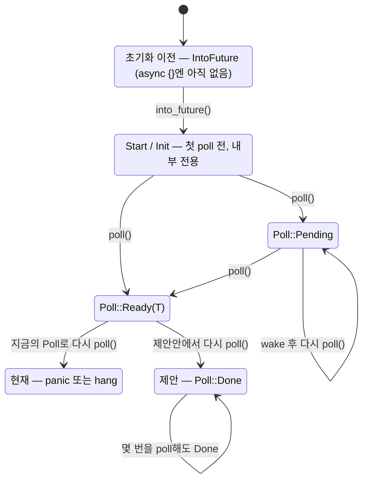

<figure class="post-figure post-figure--header">
<svg role="img" aria-label="이미 Poll::Ready(T)로 값 하나를 내놓은 future를 다시 poll하면 갈 수 있는 길을 그린 그림. 왼쪽 future 상자 위로 값 T가 한 번 빠져나갔고, 상자에서 나온 '다시 poll()' 화살표가 세 갈래로 나뉜다. 위쪽 갈래는 폭발 표시와 함께 panic(async 블록의 기본 동작), 아래쪽 갈래는 잠든 Pending 상자와 함께 hang(끝난 Fuse의 Pending은 깨우지 않음)으로 간다. 가운데 갈래는 점선으로 그린 빈 표지판 'Done ?'으로 이어지는데, Poll에는 이 상태를 나타낼 변형이 없다." viewBox="0 0 720 300" xmlns="http://www.w3.org/2000/svg">
  <title>값을 낸 future를 다시 poll하면 — panic, hang, 그리고 비어 있는 Done 자리</title>
  <defs>
    <marker id="mfs-h-arrow" viewBox="0 0 10 10" refX="8" refY="5" markerWidth="7" markerHeight="7" orient="auto-start-reverse">
      <path d="M0,0 L10,5 L0,10 z" fill="currentColor"/>
    </marker>
    <marker id="mfs-h-arrow-gold" viewBox="0 0 10 10" refX="8" refY="5" markerWidth="7" markerHeight="7" orient="auto-start-reverse">
      <path d="M0,0 L10,5 L0,10 z" fill="var(--gold)"/>
    </marker>
  </defs>

  <text x="360" y="26" text-anchor="middle" font-size="16" font-weight="700" fill="currentColor">값을 낸 future를 다시 poll하면?</text>

  <!-- ===== the future box + its single value ===== -->
  <text x="105" y="58" text-anchor="middle" font-size="11" fill="var(--text-light)">① Poll::Ready(T) — 값은 하나</text>
  <circle cx="105" cy="88" r="16" fill="var(--badge-fill)" stroke="var(--border-strong)" stroke-width="1.5"/>
  <text x="105" y="93" text-anchor="middle" font-size="14" font-weight="700" fill="var(--border-strong)" style="font-family:var(--font-mono)">T</text>
  <line x1="105" y1="124" x2="105" y2="108" stroke="var(--gold)" stroke-width="2" marker-end="url(#mfs-h-arrow-gold)"/>
  <rect x="40" y="128" width="130" height="80" rx="3" fill="var(--bg-light)" stroke="currentColor" stroke-width="2"/>
  <rect x="40" y="128" width="130" height="18" rx="3" fill="currentColor" opacity="0.12"/>
  <text x="105" y="141" text-anchor="middle" font-size="10" fill="currentColor" opacity="0.8" style="font-family:var(--font-mono)">future</text>
  <text x="105" y="174" text-anchor="middle" font-size="14" font-weight="700" fill="currentColor" style="font-family:var(--font-mono)">impl Future</text>
  <text x="105" y="194" text-anchor="middle" font-size="10" fill="var(--text-light)">이미 완료됨</text>

  <!-- ===== re-poll arrow + fork ===== -->
  <line x1="172" y1="168" x2="272" y2="168" stroke="currentColor" stroke-width="2.5"/>
  <text x="222" y="158" text-anchor="middle" font-size="11" font-weight="700" fill="currentColor">② 다시 poll()</text>
  <circle cx="276" cy="168" r="5" fill="currentColor"/>
  <line x1="280" y1="164" x2="396" y2="88" stroke="var(--accent-color)" stroke-width="2.2" marker-end="url(#mfs-h-arrow)"/>
  <line x1="281" y1="168" x2="396" y2="168" stroke="var(--gold)" stroke-width="2.2" stroke-dasharray="6 5" marker-end="url(#mfs-h-arrow-gold)"/>
  <line x1="280" y1="172" x2="396" y2="246" stroke="var(--text-light)" stroke-width="2.2" marker-end="url(#mfs-h-arrow)"/>

  <!-- ===== branch 1: panic (explosion) ===== -->
  <polygon points="470,82 452,87 461,103 445,94 440,112 435,94 419,103 428,87 410,82 428,77 419,61 435,70 440,52 445,70 461,61 452,77" fill="var(--accent-color)" stroke="currentColor" stroke-width="1.2"/>
  <circle cx="440" cy="82" r="6" fill="var(--bg-panel)"/>
  <text x="488" y="80" font-size="15" font-weight="700" fill="var(--accent-color)" style="font-family:var(--font-mono)">panic!</text>
  <text x="488" y="98" font-size="11" fill="var(--text-light)">모든 async 블록·async fn의 동작</text>

  <!-- ===== branch 2: the empty Done signpost ===== -->
  <line x1="440" y1="184" x2="440" y2="206" stroke="var(--gold)" stroke-width="2.5" stroke-dasharray="4 3"/>
  <rect x="404" y="152" width="72" height="32" rx="3" fill="none" stroke="var(--gold)" stroke-width="2" stroke-dasharray="6 4"/>
  <text x="440" y="173" text-anchor="middle" font-size="13" font-weight="700" fill="var(--gold)" style="font-family:var(--font-mono)">Done ?</text>
  <text x="488" y="164" font-size="13" font-weight="700" fill="var(--gold)">비어 있는 자리</text>
  <text x="488" y="182" font-size="11" fill="var(--text-light)">Poll에는 '끝났음' 변형이 없다</text>

  <!-- ===== branch 3: hang (Pending that never wakes) ===== -->
  <rect x="408" y="230" width="64" height="34" rx="3" fill="var(--bg-light)" stroke="var(--text-light)" stroke-width="2"/>
  <text x="440" y="252" text-anchor="middle" font-size="10.5" fill="currentColor" style="font-family:var(--font-mono)">Pending</text>
  <text x="470" y="226" font-size="11" font-weight="700" fill="var(--text-light)" style="font-family:var(--font-mono)">z</text>
  <text x="478" y="216" font-size="13" font-weight="700" fill="var(--text-light)" style="font-family:var(--font-mono)">z</text>
  <text x="488" y="250" font-size="15" font-weight="700" fill="currentColor" opacity="0.85">Fuse → hang</text>
  <text x="488" y="268" font-size="11" fill="var(--text-light)">끝난 Fuse의 Pending — 깨우지 않음</text>
</svg>
<figcaption>값 하나를 낸 future를 다시 두드리면 panic하거나 영원히 잠든다. 그 사이에 있어야 할 'Done' 자리는 비어 있다.</figcaption>
</figure>

## 원문 정보

> - **제목**: The Missing Future State
> - **출처**: Yosh Wuyts — *On computing* 블로그 ([blog.yoshuawuyts.com](https://blog.yoshuawuyts.com/))
> - **발행**: 2026-10-29 · 약 8분 분량(본문 길이 기준 추정, 원문에 표기 없음)
> - **원문 링크**: <https://blog.yoshuawuyts.com/the-future-trait-has-a-missing-state>

Rust async 설계를 오래 다뤄 온 Yosh Wuyts의 "The Future Trait Series" 네 번째 글이다. 언어 핵심 추상화 하나의 **상태 공간 설계**를 짚는 글이라 시스템 프로그래밍 아티클로 분류했다.

## 한 줄 요약 (TL;DR)

`Future::poll`이 돌려주는 `Poll`에는 `Ready`와 `Pending` 두 상태만 있어서 "이미 값을 냈고 더 낼 것이 없다(Done)"는 상태를 표현할 수 없다. 그래서 완료된 future를 다시 poll하면 panic하거나 멈추고, 생태계는 `MaybeDone`·`Fuse` 같은 우회책을 쓴다. `Poll`은 이제 고칠 수 없지만, 아직 unstable인 `CoroutineState`와 `gen`에서는 같은 실수를 되풀이하지 말자는 주장이다.

## 왜 이 글을 골랐나

enum 하나에 변형이 하나 빠졌을 때 그 영향이 어디까지 번지는지를 보여 주는 좋은 사례이기 때문이다. 이 글에서 빠진 `Done` 하나는 다음 세 군데에 흔적을 남긴다.

- **API 계약**: 완료 후 poll은 "무슨 일이 일어나도 모른다"는 문서상 계약
- **생태계 우회책**: `MaybeDone`, `FusedFuture`/`Fuse` 같은 보조 타입과 부기(bookkeeping) 코드
- **코드 생성**: 모든 `async` 블록에 들어가는 panic(unwinding) 경로와 그만큼 늘어나는 바이너리 크기

[Rust 구조체, 열거형, 패턴 매칭](/2026/01/06/rust-structs-enums-pattern-matching.html)에서 다룬 "열거형으로 상태를 모델링하고 `match`로 빠짐없이 처리한다"는 원칙이 표준 라이브러리 수준에서 어떻게 어긋났고, 그 대가가 무엇인지 볼 수 있다. 바로 전날 다룬 [stable Rust는 무엇을 딛고 서 있나](/2026/10/29/what-stable-rust-stands-on.html)와 함께 읽으면, 안정화(stable)된 API는 되돌리기 어렵다는 점이 더 분명해진다.

### 한눈에 보기 — future의 생애

글 전체가 다루는 future의 상태를 하나의 상태 기계로 그리면 다음과 같다. 현재 `Poll`에서는 `Ready(T)` 이후의 poll이 panic이나 hang으로 빠지고, 제안안에서는 `Done`으로 수렴한다.



## 핵심 내용

### Introduction — "값 하나"라는 약속과 그 이후

async Rust에서 `Future::poll`은 future를 진행시키고, 그 결과를 `Poll` enum으로 보고한다.

- `Poll::Pending`: 아직 값을 낼 준비가 안 됐다. 나중에 다시 poll해야 한다.
- `Poll::Ready(T)`: 값 `T`를 낼 준비가 됐다.

저자는 future라는 이름의 뜻을 짚는다. future는 *미래에* 값으로 결정된다. 이때 값은 **단수**다. 표준 라이브러리 문서가 이 보장을 분명히 적지는 않았고(적어야 한다고 본다) 생태계가 늘 지키지도 않지만(지켜야 한다고 본다), 의도는 분명하다. **한 future는 값 하나만 낸다.**

그렇다면 이미 `Ready`를 돌려준 future를 다시 poll하면 어떻게 될까? `Future` trait 문서는 이렇게 말한다.

> Once a future has completed (returned `Ready` from `poll`), calling its `poll` method again may panic, block forever, or cause other kinds of problems; the `Future` trait places no requirements on the effects of such a call.

즉 지원하지 않는 동작이고 future가 무엇을 해도 된다. 가장 흔한 동작은 `panic!`이며, **모든 `async` 블록과 `async fn`이 이렇게 동작한다**. 저자는 이게 아쉽다고 한다. `Ready` 이후에 다시 poll할 수 있다면 실제로 유용하고, 본인도 자주 그렇게 하고 싶었다는 것이다.

### MaybeDone — 슬롯 하나로 '끝남'을 기록하는 우회책

async 동시성 프리미티브를 직접 작성해 본 사람이라면 `MaybeDone`을 안다. future를 들고 있다가, 완료되면 그 출력(`Future::Output`)을 들고 있는 래퍼다. 원문 예제는 다음과 같다(Apache 2.0, 한국어 주석은 추가).

```rust
use pin_project::pin_project;
use std::future::Future;
use std::pin::Pin;
use std::task::{Context, Poll};

#[pin_project(project = DoneState)]
enum MaybeDone<F: Future> {
    Future(#[pin] F),
    Done(Option<F::Output>),
}

impl<F: Future> MaybeDone<F> {
    pub fn take(self: Pin<&mut Self>) -> Option<F::Output> {
        match self.project() {
            DoneState::Done(output) => output.take(),
            DoneState::Future(_) => None,
        }
    }
}

impl<F: Future> Future for MaybeDone<F> {
    type Output = ();

    fn poll(mut self: Pin<&mut Self>, cx: &mut Context<'_>) -> Poll<()> {
        match self.as_mut().project() {
            DoneState::Future(future) => match future.poll(cx) {
                Poll::Pending => Poll::Pending,
                Poll::Ready(output) => {
                    // 완료되면 자기 자신을 Done 슬롯으로 교체한다
                    self.set(Self::Done(Some(output)));
                    Poll::Ready(())
                }
            },
            // 이미 끝났으면 몇 번을 poll해도 Ready(())
            DoneState::Done(_) => Poll::Ready(()),
        }
    }
}
```

핵심 트릭은 두 가지다.

1. future의 출력 타입을 `()`로 바꾸고, 실제 값은 별도 메서드 `take`로 꺼내게 한다.
2. 그 결과 완료 후에 poll하면 계속 `Poll::Ready(())`를 돌려주고, 값을 한 번 꺼낸 뒤의 `take`는 계속 `None`을 돌려준다.

그래서 호출자가 **`Poll::Ready(())` + `None`** 조합을 보면 "이 future는 끝났고 다시 값을 내지 않는다"는 것을 알 수 있다. 원래 의도는 future나 그 출력을 담는 슬롯일 뿐이었지만, 부수 효과로 *완료 이후 상태*를 전달할 수 있게 됐다.

<figure class="post-figure">
<svg role="img" aria-label="MaybeDone의 세 단계 상태 전이. 1단계 MaybeDone::Future(F)에서는 poll()이 Poll::Pending을, take()가 None을 돌려준다. 내부 future가 Poll::Ready(output)를 내면 self.set으로 2단계 MaybeDone::Done(Some(output))이 되고, 이때부터 poll()은 Poll::Ready(())를, take()는 Some(output)을 돌려준다. take()로 값을 꺼내면 3단계 MaybeDone::Done(None)이 되어 poll()은 계속 Poll::Ready(()), take()는 계속 None을 돌려준다. 3단계의 Ready(()) + None 조합이 '끝났고 다시 값을 내지 않는다'는 신호다." viewBox="0 0 720 270" xmlns="http://www.w3.org/2000/svg">
  <title>MaybeDone 슬롯의 상태 전이 — Future(F) → Done(Some(output)) → Done(None)</title>
  <defs>
    <marker id="mfs-md-arrow" viewBox="0 0 10 10" refX="8" refY="5" markerWidth="7" markerHeight="7" orient="auto-start-reverse">
      <path d="M0,0 L10,5 L0,10 z" fill="var(--secondary-color)"/>
    </marker>
  </defs>

  <!-- transition labels (above the gaps) -->
  <text x="245" y="30" text-anchor="middle" font-size="11" font-weight="700" fill="var(--secondary-color)">poll(): 내부 future가 Ready(output)</text>
  <text x="245" y="46" text-anchor="middle" font-size="10" fill="var(--text-light)" style="font-family:var(--font-mono)">self.set(Self::Done(Some(output)))</text>
  <text x="475" y="30" text-anchor="middle" font-size="11" font-weight="700" fill="var(--secondary-color)">take(): 값을 꺼냄</text>
  <text x="475" y="46" text-anchor="middle" font-size="10" fill="var(--text-light)" style="font-family:var(--font-mono)">output.take()</text>

  <!-- ===== card 1: Future(F) ===== -->
  <rect x="20" y="62" width="190" height="140" rx="3" fill="var(--bg-light)" stroke="currentColor" stroke-width="2"/>
  <text x="34" y="84" font-size="10" font-weight="700" fill="var(--text-light)">① 기다리는 중</text>
  <text x="115" y="108" text-anchor="middle" font-size="12" font-weight="700" fill="currentColor" style="font-family:var(--font-mono)">Future(F)</text>
  <line x1="30" y1="122" x2="200" y2="122" stroke="currentColor" stroke-width="1" opacity="0.3"/>
  <text x="34" y="150" font-size="11" fill="currentColor" style="font-family:var(--font-mono)">poll() → Pending</text>
  <text x="34" y="180" font-size="11" fill="currentColor" style="font-family:var(--font-mono)">take() → None</text>

  <line x1="212" y1="132" x2="276" y2="132" stroke="var(--secondary-color)" stroke-width="2.2" marker-end="url(#mfs-md-arrow)"/>

  <!-- ===== card 2: Done(Some(output)) ===== -->
  <rect x="280" y="62" width="190" height="140" rx="3" fill="var(--bg-light)" stroke="currentColor" stroke-width="2"/>
  <text x="294" y="84" font-size="10" font-weight="700" fill="var(--text-light)">② 값을 들고 있음</text>
  <text x="375" y="108" text-anchor="middle" font-size="12" font-weight="700" fill="currentColor" style="font-family:var(--font-mono)">Done(Some(output))</text>
  <line x1="290" y1="122" x2="460" y2="122" stroke="currentColor" stroke-width="1" opacity="0.3"/>
  <text x="294" y="150" font-size="11" fill="currentColor" style="font-family:var(--font-mono)">poll() → Ready(())</text>
  <text x="294" y="180" font-size="11" fill="currentColor" style="font-family:var(--font-mono)">take() → Some(output)</text>

  <line x1="472" y1="132" x2="506" y2="132" stroke="var(--secondary-color)" stroke-width="2.2" marker-end="url(#mfs-md-arrow)"/>

  <!-- ===== card 3: Done(None) ===== -->
  <rect x="510" y="62" width="190" height="140" rx="3" fill="var(--bg-panel)" stroke="var(--gold)" stroke-width="2.5"/>
  <text x="524" y="84" font-size="10" font-weight="700" fill="var(--gold)">③ 끝남 (값을 꺼낸 뒤)</text>
  <text x="605" y="108" text-anchor="middle" font-size="12" font-weight="700" fill="currentColor" style="font-family:var(--font-mono)">Done(None)</text>
  <line x1="520" y1="122" x2="690" y2="122" stroke="currentColor" stroke-width="1" opacity="0.3"/>
  <text x="524" y="150" font-size="11" fill="currentColor" style="font-family:var(--font-mono)">poll() → Ready(())</text>
  <text x="524" y="180" font-size="11" fill="currentColor" style="font-family:var(--font-mono)">take() → None</text>
  <text x="680" y="150" text-anchor="end" font-size="10" fill="var(--gold)">계속</text>
  <text x="680" y="180" text-anchor="end" font-size="10" fill="var(--gold)">계속</text>

  <!-- bottom takeaway -->
  <rect x="150" y="222" width="420" height="32" rx="3" fill="var(--gold)" opacity="0.14"/>
  <text x="360" y="243" text-anchor="middle" font-size="12" font-weight="700" fill="currentColor">③의 Ready(()) + None 조합 = "끝났고, 다시 값을 내지 않는다"</text>
</svg>
<figcaption>MaybeDone은 출력을 ()로 바꾸고 값은 take()로 꺼내게 해서, 부수 효과로 '완료 이후' 상태를 호출자에게 전달한다.</figcaption>
</figure>

### Fixing Poll — `Pending`을 '끝남'으로 쓰는 것은 계약 위반

`futures` 크레이트에는 완료 상태를 추적하는 API가 더 있다. `FusedFuture` trait은 `is_terminated` 메서드를 제공하고, `Fuse` 어댑터는 내부 future가 `Ready`를 낸 뒤 **계속 `Poll::Pending`을 돌려준다**. 문제는 이것이 `Pending`의 정의와 맞지 않는다는 점이다.

> When a function returns `Pending`, the function must also ensure that the current task is scheduled to be awoken when progress can be made.

`Pending`은 "진행할 수 있게 되면 깨워 주겠다"는 약속이다. `Fuse`를 표준 라이브러리로 가져오려면 `Pending`의 의미를 "대기 중"과 "끝남" 둘 다로 재정의해야 한다. 그러면 `is_terminated`를 먼저 확인하지 않은 호출자는 **영원히 멈춘다**. 저자는 다른 우회책도 가능하겠지만, 올바른 해법은 `Done`을 `Poll` 자체의 상태로 만드는 것이라고 본다.

```rust
pub enum Poll<T> {
    Ready(T),
    Pending,
    Done,    // ← new
}
```

안타깝게도 이 변경은 불가능하다. `Poll`에 `#[non_exhaustive]`가 붙어 있지 않아서, 변형을 추가하면 `Poll`을 빠짐없이 `match`하는 기존 코드가 모두 깨진다. 저자는 이 변경이 가능했다면 얻었을 이점을 이렇게 정리한다.

- **책임의 이동**: "완료 후 poll"을 어떻게 처리할지 정하는 쪽이 **피호출자(callee)에서 호출자(caller)로** 넘어간다. 호출자는 여전히 panic을 고를 수도 있지만, `Done`을 위로 전달할 수도 있고, `join` 같은 동시성 연산에서 `MaybeDone` 없이 어떤 future가 끝났는지 추적할 수도 있다.
- **async 효과와 panic 효과의 분리**: 컴파일러는 `.await`가 `Ready` 이후에 다시 poll하지 않는다는 것을 보장할 수 있으므로 `Done`을 처리할 필요가 없다. 그러면 async 함수와 블록이 모든 경로에 unwinding 지원을 넣을 필요가 없어지고, 코드 생성 크기가 줄어든다. **임베디드 타깃**에 특히 이롭다.
- **no-panic 도구와의 궁합**: crates.io의 `no_panic` 크레이트나, 앞으로 생길 수 있는 함수·블록 단위 no-panic 표기와 잘 맞는다.

### Fixing CoroutineState — 아직 고칠 수 있는 곳

`CoroutineState`도 `Poll`과 똑같이 최종 `Done` 상태를 표현하지 못한다. 차이는 `Coroutine` trait과 `CoroutineState` enum이 **아직 stable이 아니어서** 기존 코드를 깨지 않고 고칠 수 있다는 점이다. `Coroutine`은 컴파일러의 디슈가링(desugaring)에 내부적으로 쓰이므로 쉽지는 않겠지만, 적어도 async에서 한 실수를 이터레이션 쪽에서 되풀이하지는 않을 수 있다.

현재 정의는 다음과 같다.

```rust
pub enum CoroutineState<Y, R> {
    Yielded(Y),
    Complete(R),
}
```

문서는 `Complete`에 대해 "Once a coroutine has returned `Complete` it is considered a programmer error to call `resume` again."이라고 한다. `Coroutine::resume`은 `Iterator::next`, `Future::poll`처럼 진행을 구동하는 메서드인데, future와 마찬가지로 "끝남"을 표현할 수 없다.

이터레이터는 상황이 조금 다르다. 원문 각주에 따르면 `Iterator::next`가 `None`을 돌려줬다고 해서 이후에도 계속 `None`이 나온다는 보장은 없다. 그래도 `None`을 반복해서 돌려주는 것은 정상적이고 예상되는 동작이라, `None`으로 "Done"을 표현할 수 있다. `FusedIterator`가 바로 이 방식이다. 반면 코루틴에는 그런 수단이 없어서 `FusedCoroutine` 같은 일반적인 trait을 정의할 수 없다. `Complete(Option<R>)`처럼 감쌀 수도 있지만, 저자는 그것도 문제를 피해 가는 것일 뿐이라고 본다. 문제가 무엇인지, 어떻게 풀지 이미 알고 있으니 제대로 풀자는 것이다.

```rust
pub enum CoroutineState<Y, R> {
    Yielded(Y),
    Complete(R),
    Done,         // ← new
}
```

이렇게 하면 `Complete`와 `Done`이 서로 다른 뜻이라 이름이 헷갈린다. 그래서 저자는 `ControlFlow`(`Break`/`Continue`)처럼 **변형 이름을 그 변형이 나타내는 연산 이름으로** 바꾸자고 제안한다.

```rust
pub enum CoroutineState<Y, R> {
    Yield(Y),   // ← renamed
    Return(R),  // ← renamed
    Done,
}
```

### Even more states — 바깥에 드러나지 않는 상태들

지금까지 다룬 `Ready`, `Pending`, `Done`은 **외부로 전달되는** 세 상태다. 저자는 여기에 더해 다음 상태들도 짚는다.

- **Start/Init (내부 상태)**: 처음 poll되기 전 future가 있는 상태다. 외부로 yield되지 않으므로 내부 전용이다.
- **초기화 이전 상태**: `.await`는 poll하기 전에 `IntoFuture::into_future`를 호출한다. `for..in`이 `Iterator::next` 전에 `IntoIterator::into_iter`를 호출하는 것과 같다. 저자는 이 상태를 뭐라고 불러야 할지 모르겠다고 하면서, 그 목적을 "지역 변수를 만들지 않고 입력만 붙잡아 두는 것"으로 설명한다. 그런데 `async {}`는 `impl IntoFuture`가 아니라 `impl Future`를 반환한다. 저자는 시리즈의 이전 글 "The Gen Auto-Trait Problem"에서 이것을 바꾸면 더 정밀한 bound를 만들 수 있고 `Send`/`Sync` 관련 문제 여럿이 풀린다고 설명했다. `async {}`의 디슈가링을 바꾸기는 어렵지만, 아직 unstable인 `gen {}`은 훨씬 쉽게 바꿀 수 있다.
- **Snoozed (있어서는 안 되는 상태)**: Jack O'Connor의 "Never Snooze a Future"에서 나온 개념이다. 진행할 준비가 됐는데 poll되지 않는 future는 "snoozed" 상태다. 저자는 이것이 wg-async의 "Barbara Battles Buffered Streams"(bbbs) 시나리오를 **활성(liveness) 속성**으로 옮긴 것이라고 본다. future는 자연스럽게 트리를 이루고, 어떤 자식 future의 waker가 불렸는데 부모만 poll되고 그 자식은 poll되지 않으면 snoozed 상태가 된다. 그래서 모든 future에 재귀적으로 적용할 규칙이 나온다.

> "When a future is polled, it must also poll all child futures that have had their waker called."

모든 future가 이 규칙을 지키면 어떤 future도 snoozed 상태가 되지 않는다.

<figure class="post-figure">
<svg role="img" aria-label="future 트리에서 snooze를 좌우로 대비한 그림. 두 쪽 모두 부모 future가 poll()을 받고, 그 아래에 자식 future A, B, C가 있으며 B의 waker가 호출되었다(wake 표시). 왼쪽(규칙 위반)에서는 부모가 A와 C만 poll하고 B로 가는 선은 끊겨 있어, 진행할 준비가 된 B가 poll되지 않는 snoozed 상태가 된다. 오른쪽(규칙 준수)에서는 부모가 waker가 호출된 B를 반드시 poll하므로 어떤 자식도 snoozed 상태가 되지 않는다." viewBox="0 0 720 300" xmlns="http://www.w3.org/2000/svg">
  <title>future 트리의 snooze — wake된 자식을 건너뛰는 경우와 규칙대로 poll하는 경우</title>
  <defs>
    <marker id="mfs-sz-arrow" viewBox="0 0 10 10" refX="8" refY="5" markerWidth="7" markerHeight="7" orient="auto-start-reverse">
      <path d="M0,0 L10,5 L0,10 z" fill="currentColor"/>
    </marker>
    <marker id="mfs-sz-arrow-ok" viewBox="0 0 10 10" refX="8" refY="5" markerWidth="7" markerHeight="7" orient="auto-start-reverse">
      <path d="M0,0 L10,5 L0,10 z" fill="var(--secondary-color)"/>
    </marker>
  </defs>

  <line x1="360" y1="14" x2="360" y2="290" stroke="currentColor" stroke-width="1" stroke-dasharray="4 4" opacity="0.35"/>

  <!-- ================= LEFT: rule violated ================= -->
  <text x="180" y="26" text-anchor="middle" font-size="13" font-weight="700" fill="var(--accent-color)">규칙 위반 — B가 snoozed</text>
  <line x1="180" y1="38" x2="180" y2="62" stroke="currentColor" stroke-width="2" marker-end="url(#mfs-sz-arrow)"/>
  <text x="188" y="54" font-size="10" fill="var(--text-light)" style="font-family:var(--font-mono)">poll()</text>
  <rect x="120" y="66" width="120" height="36" rx="3" fill="var(--bg-light)" stroke="currentColor" stroke-width="2"/>
  <text x="180" y="89" text-anchor="middle" font-size="12" font-weight="700" fill="currentColor">부모 future</text>

  <!-- edges -->
  <line x1="150" y1="102" x2="96" y2="174" stroke="currentColor" stroke-width="2" marker-end="url(#mfs-sz-arrow)"/>
  <line x1="210" y1="102" x2="264" y2="174" stroke="currentColor" stroke-width="2" marker-end="url(#mfs-sz-arrow)"/>
  <line x1="180" y1="102" x2="180" y2="174" stroke="var(--accent-color)" stroke-width="2" stroke-dasharray="5 5" opacity="0.7"/>
  <!-- the cut: an X on the skipped edge -->
  <line x1="171" y1="129" x2="189" y2="147" stroke="var(--accent-color)" stroke-width="3"/>
  <line x1="189" y1="129" x2="171" y2="147" stroke="var(--accent-color)" stroke-width="3"/>
  <text x="80" y="140" text-anchor="middle" font-size="10" fill="var(--text-light)" style="font-family:var(--font-mono)">poll</text>
  <text x="280" y="140" text-anchor="middle" font-size="10" fill="var(--text-light)" style="font-family:var(--font-mono)">poll</text>

  <!-- children -->
  <rect x="62" y="178" width="56" height="36" rx="3" fill="var(--bg-light)" stroke="currentColor" stroke-width="2"/>
  <text x="90" y="201" text-anchor="middle" font-size="13" font-weight="700" fill="currentColor">A</text>
  <rect x="152" y="178" width="56" height="36" rx="3" fill="var(--bg-panel)" stroke="var(--accent-color)" stroke-width="2.5"/>
  <text x="180" y="201" text-anchor="middle" font-size="13" font-weight="700" fill="currentColor">B</text>
  <rect x="242" y="178" width="56" height="36" rx="3" fill="var(--bg-light)" stroke="currentColor" stroke-width="2"/>
  <text x="270" y="201" text-anchor="middle" font-size="13" font-weight="700" fill="currentColor">C</text>
  <!-- wake badge on B -->
  <rect x="196" y="164" width="40" height="18" rx="9" fill="var(--badge-fill)" stroke="var(--border-strong)" stroke-width="1"/>
  <text x="216" y="177" text-anchor="middle" font-size="10" font-weight="700" fill="var(--border-strong)">wake</text>

  <text x="180" y="244" text-anchor="middle" font-size="11.5" font-weight="700" fill="var(--accent-color)">B: 진행할 준비가 됐는데 poll되지 않음</text>
  <text x="180" y="264" text-anchor="middle" font-size="10.5" fill="var(--text-light)">bbbs 시나리오를 활성(liveness) 속성으로 옮긴 것</text>

  <!-- ================= RIGHT: rule followed ================= -->
  <text x="540" y="26" text-anchor="middle" font-size="13" font-weight="700" fill="var(--secondary-color)">규칙 준수 — wake된 B까지 poll</text>
  <line x1="540" y1="38" x2="540" y2="62" stroke="currentColor" stroke-width="2" marker-end="url(#mfs-sz-arrow)"/>
  <text x="548" y="54" font-size="10" fill="var(--text-light)" style="font-family:var(--font-mono)">poll()</text>
  <rect x="480" y="66" width="120" height="36" rx="3" fill="var(--bg-light)" stroke="currentColor" stroke-width="2"/>
  <text x="540" y="89" text-anchor="middle" font-size="12" font-weight="700" fill="currentColor">부모 future</text>

  <!-- edges: A/C optional (faint), B mandatory (bold) -->
  <line x1="510" y1="102" x2="456" y2="174" stroke="currentColor" stroke-width="1.5" stroke-dasharray="3 4" opacity="0.45"/>
  <line x1="570" y1="102" x2="624" y2="174" stroke="currentColor" stroke-width="1.5" stroke-dasharray="3 4" opacity="0.45"/>
  <line x1="540" y1="102" x2="540" y2="174" stroke="var(--secondary-color)" stroke-width="3" marker-end="url(#mfs-sz-arrow-ok)"/>
  <text x="550" y="142" font-size="10.5" font-weight="700" fill="var(--secondary-color)" style="font-family:var(--font-mono)">poll</text>

  <!-- children -->
  <rect x="422" y="178" width="56" height="36" rx="3" fill="var(--bg-light)" stroke="currentColor" stroke-width="2" opacity="0.8"/>
  <text x="450" y="201" text-anchor="middle" font-size="13" font-weight="700" fill="currentColor">A</text>
  <rect x="512" y="178" width="56" height="36" rx="3" fill="var(--bg-panel)" stroke="var(--secondary-color)" stroke-width="2.5"/>
  <text x="540" y="201" text-anchor="middle" font-size="13" font-weight="700" fill="currentColor">B</text>
  <rect x="602" y="178" width="56" height="36" rx="3" fill="var(--bg-light)" stroke="currentColor" stroke-width="2" opacity="0.8"/>
  <text x="630" y="201" text-anchor="middle" font-size="13" font-weight="700" fill="currentColor">C</text>
  <!-- wake badge on B -->
  <rect x="556" y="164" width="40" height="18" rx="9" fill="var(--badge-fill)" stroke="var(--border-strong)" stroke-width="1"/>
  <text x="576" y="177" text-anchor="middle" font-size="10" font-weight="700" fill="var(--border-strong)">wake</text>

  <text x="540" y="244" text-anchor="middle" font-size="11.5" font-weight="700" fill="var(--secondary-color)">waker가 호출된 자식은 반드시 poll</text>
  <text x="540" y="264" text-anchor="middle" font-size="10.5" fill="var(--text-light)">모든 future가 재귀적으로 지키면 snoozed는 없다</text>
</svg>
<figcaption>부모가 poll될 때 waker가 울린 자식을 건너뛰면 그 자식은 snoozed 상태가 된다. 규칙대로 wake된 자식까지 poll하면 트리 전체에서 snooze가 사라진다.</figcaption>
</figure>

### Conclusion

- future가 완료를 알릴 수 없다는 것은 실제 문제이고, 좋은 우회책이 없다. `MaybeDone` 같은 타입은 사용하는 쪽에서 이 한계를 피해 가지만, 그 대가로 중복된 부기 코드가 생긴다.
- 거의 모든 async 동시성 연산은 future의 완료 상태를 추적해야 한다. 그런데 `async {}` 블록은 완료 후 다시 poll하면 panic하는 future로 디슈가링되고, 이는 코드 크기가 중요한 **임베디드와 웹** 환경에서 문제가 된다.
- 기존 `Future::poll`을 deprecate하지 않고는 `Future` trait을 고칠 수 없다. 저자는 시리즈 네 번째 글인 지금도 그럴 만큼 근거가 쌓였다고 보지는 않는다. 대신 **`Coroutine` trait과 `gen` 키워드에서 같은 실수를 되풀이하지 말자**는 것이 결론이다.

## 분석과 인사이트

여기부터는 원문 요약이 아니라 나의 해석이다.

**1. "정의되지 않음"은 비용을 피호출자 전체에 떠넘긴다.** 원문에서 가장 인상적인 부분은 `Done` 하나가 빠지면서 생긴 결과가 **코드 크기**로 나타난다는 지적이다. 계약이 "완료 후 poll은 아무 일이나 일어나도 된다"로 열려 있으니, 컴파일러가 만드는 모든 `async` 상태 기계는 방어적으로 panic 경로를 넣어야 한다. 호출자 한 곳에서 처리하면 될 일을 모든 피호출자가 나눠서 부담하는 셈이다. API 설계에서 "UB는 아니지만 미정의인 동작"을 남기면 그 대가는 보통 구현 쪽 모든 곳에서 조금씩 치르게 된다.

**2. 센티넬 값을 재활용하면 의미가 겹친다.** `Fuse`가 `Pending`을 "끝남"으로 재활용하는 것은 전형적인 센티넬 남용이다. `Pending`에는 "깨워 주겠다"는 약속이 묶여 있으므로, 깨우지 않을 `Pending`은 곧 hang이다. 반면 `Iterator`의 `None`은 원래부터 "더 없음"을 뜻하므로 반복해서 돌려줘도 의미가 겹치지 않는다. 같은 "fused" 개념이 이터레이터에서는 자연스럽고 future에서는 억지스러운 이유가 여기 있다. enum을 설계할 때는 각 변형이 어떤 **의무**를 함께 지는지 따져 보고, 의무가 다른 상태는 별도 변형으로 두는 편이 맞다.

**3. `#[non_exhaustive]`를 쓸지는 사실상 미래에 대한 판단이다.** `Poll`에 `#[non_exhaustive]`가 없어서 변형을 추가할 수 없다는 대목은 라이브러리 작성자에게 바로 와닿는다. 공개 enum이 프로토콜 상태를 표현하고, 그 상태 공간을 아직 완전히 알지 못한다면 처음부터 `#[non_exhaustive]`를 붙여 둘 이유가 충분하다. 반대로 붙이면 사용자 쪽 `match`에 와일드카드 팔이 강제되니, 정말 닫힌 집합인지 판단하는 것이 핵심이다.

**4. 이견이라기보다 남는 질문.** `Poll`에 `Done`이 생기면 호출자가 처리해야 할 경우가 하나 늘어난다. 저자는 `.await`처럼 컴파일러가 보장하는 경로에서는 `Done`을 처리할 필요가 없다고 했지만, 손으로 작성한 combinator나 executor는 모두 `Done` 팔을 다뤄야 한다. "unwinding 경로 제거"라는 이득과 "모든 수동 poll 지점에 처리 분기 추가"라는 비용이 실제로 어떻게 균형을 이루는지는 원문에 정량적인 근거가 없다. 코드 크기가 얼마나 줄어드는지 수치도 제시되지 않았다. 방향은 설득력 있지만, 이 부분은 측정이 필요한 주장으로 읽는 게 맞다.

**5. 다른 언어와 비교하면.** (원문에 없는 내 비교다.) Python 제너레이터는 소진된 뒤에도 `next()`를 호출하면 계속 `StopIteration`을 던진다. `FusedIterator`처럼 끝난 상태가 안정적이다. 반면 이미 await한 코루틴 객체를 다시 await하면 `RuntimeError`가 난다. Rust `async` 블록의 panic과 같은 태도다. 언어마다 "한 번만 결정되는 값"을 다시 요청받았을 때 어떻게 할지 정책이 다르다. Rust의 차이는 그 정책이 **코드 크기와 no-panic 보장**이라는 시스템 수준의 비용으로 바로 이어진다는 점이다. [asyncio 이벤트 루프 최적화](/2025/11/10/asyncio-eventloop-optimization.html)에서 본 Python의 런타임 중심 모델과 비교하면, Rust는 상태 기계를 컴파일 타임에 펼치기 때문에 상태 하나를 빼먹은 대가가 바이너리 크기에 그대로 나타난다.

## 적용 포인트

- **완료된 future를 다시 poll하지 마라.** `select!`·`join` 같은 루프를 직접 작성할 때 끝난 future를 다시 poll하지 않도록 `MaybeDone`/`Fuse` 또는 명시적인 `Option<F>` 슬롯으로 상태를 관리한다.
- **`Fuse`를 쓸 때는 `is_terminated`를 먼저 확인한다.** 끝난 `Fuse`가 돌려주는 `Pending`은 아무도 깨우지 않는다. 확인하지 않으면 hang으로 이어진다.
- **공개 상태 enum에는 `#[non_exhaustive]`를 검토한다.** 프로토콜이나 상태 기계를 나타내는 enum이고 상태 공간이 바뀔 수 있다면, 1.0 전에 결정한다.
- **변형마다 짊어지는 의무를 문서화한다.** "이 값을 돌려주면 호출자는 무엇을 기대해도 되는가"를 변형 단위로 적어 두면 센티넬을 재활용하려는 유혹을 막을 수 있다.
- **변형 이름은 연산 기준으로 짓는다.** `Yield`/`Return`/`Done`, `Break`/`Continue`처럼 상태가 아니라 그 상태를 만든 연산을 이름으로 쓰면 비슷한 의미의 변형끼리 혼동이 줄어든다.
- **future 트리를 직접 다룬다면 snooze 규칙을 지킨다.** 부모가 poll될 때 waker가 울린 자식은 반드시 poll한다. 버퍼링된 스트림을 처리할 때 특히 주의한다.
- **임베디드·Wasm 타깃이라면 async 코드의 panic 경로를 의식한다.** 코드 크기를 측정할 때 async 상태 기계에 들어가는 unwinding 비용도 확인 대상에 넣는다.

## 마무리

「The Missing Future State」는 enum 변형 하나가 빠진 일이 문서 계약, 생태계 우회책, 컴파일러 코드 생성까지 번진 과정을 차분하게 추적한다. 결론은 현실적이다. stable인 `Poll`은 deprecate 없이는 고칠 수 없으니, 아직 열려 있는 `Coroutine`과 `gen`에서 `Done`을 처음부터 일급 상태로 넣자는 것이다. 상태 기계를 설계하는 사람이라면 "값을 다 낸 다음에는 어떤 상태인가?"를 처음부터 물어야 한다는 것이 이 글의 교훈이다.

### 더 읽어보기

- [원문 — The Missing Future State (Yosh Wuyts)](https://blog.yoshuawuyts.com/the-future-trait-has-a-missing-state)
- [시리즈 이전 글 — The Pin Trait Problem](https://blog.yoshuawuyts.com/why-pin) — 같은 Future Trait Series의 첫 글
- [시리즈 이전 글 — The Gen Auto-Trait Problem](https://blog.yoshuawuyts.com/gen-auto-trait-problem) — `IntoFuture`와 `Send`/`Sync` bound 논의
- [시리즈 이전 글 — The Waker Allocation Problem](https://blog.yoshuawuyts.com/the-waker-allocation-problem)
- [Never Snooze a Future (Jack O'Connor)](https://jacko.io/snooze.html) — "Snoozed" 상태의 원전
- [Rust 구조체, 열거형, 패턴 매칭](/2026/01/06/rust-structs-enums-pattern-matching.html) — enum으로 상태를 모델링하고 `match`로 빠짐없이 처리하는 기본기
- [Rust 제네릭, 트레이트, 라이프타임](/2026/01/08/rust-generics-traits-lifetimes.html) — `Future`·`IntoFuture` 같은 trait과 연관 타입을 읽기 위한 배경
- [Rust 스마트 포인터, 동시성, 그리고 프로젝트](/2026/01/09/rust-smart-pointers-concurrency-and-projects.html) — 다음 학습으로 `async`/`await`를 예고한 동시성 편
- [stable Rust는 무엇을 딛고 서 있나](/2026/10/29/what-stable-rust-stands-on.html) — nightly·unstable 기능과 안정화의 무게
- [asyncio 이벤트 루프 최적화](/2025/11/10/asyncio-eventloop-optimization.html) — Python async 모델과의 비교 관점
